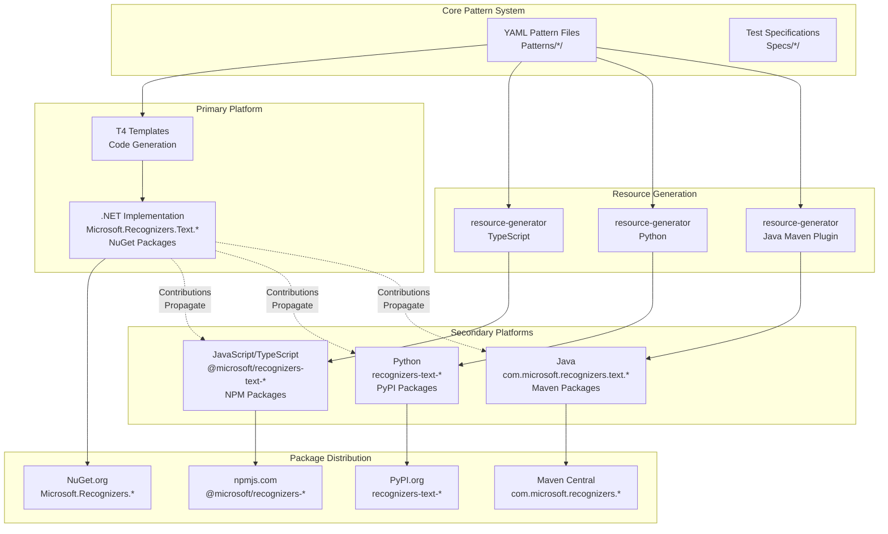
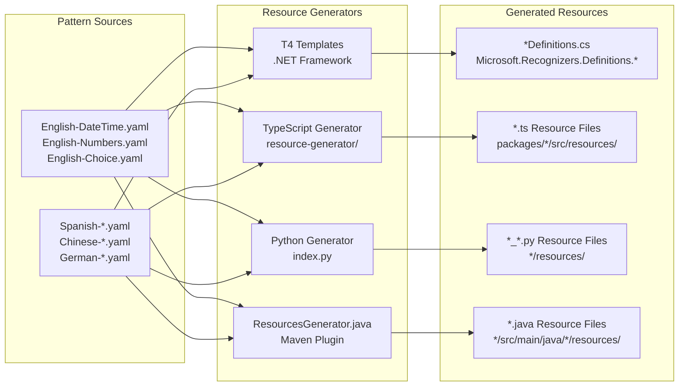
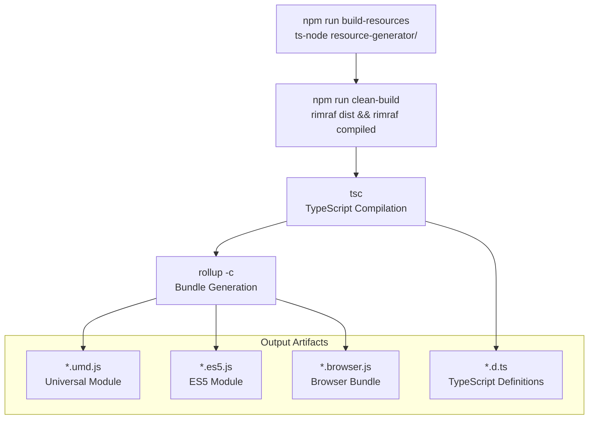
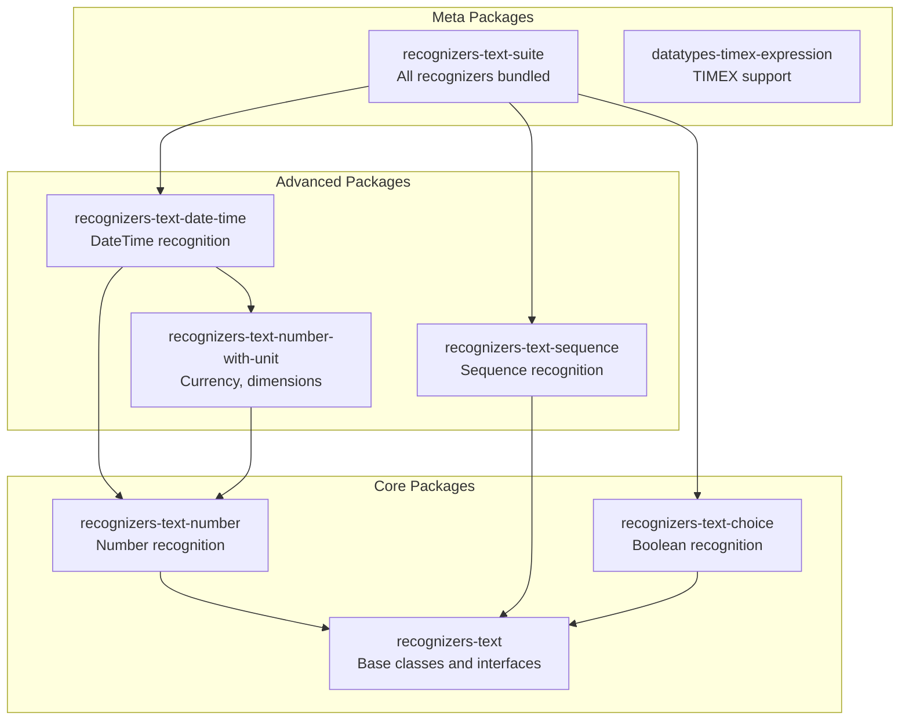
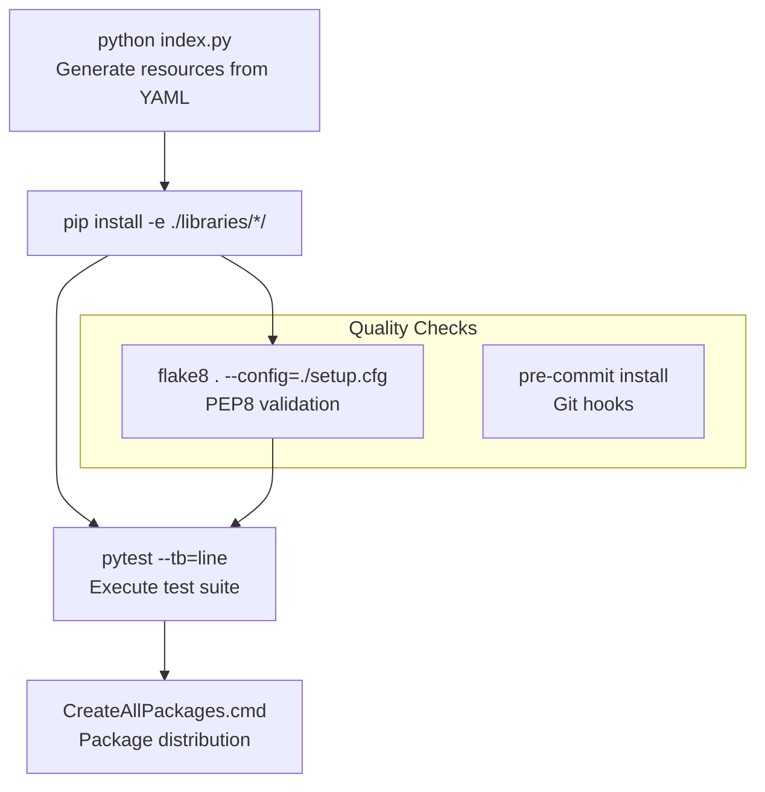
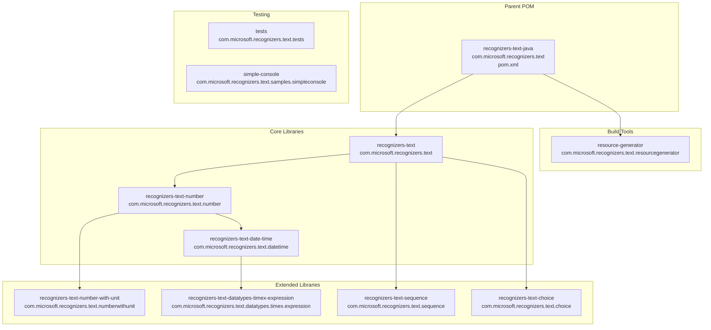
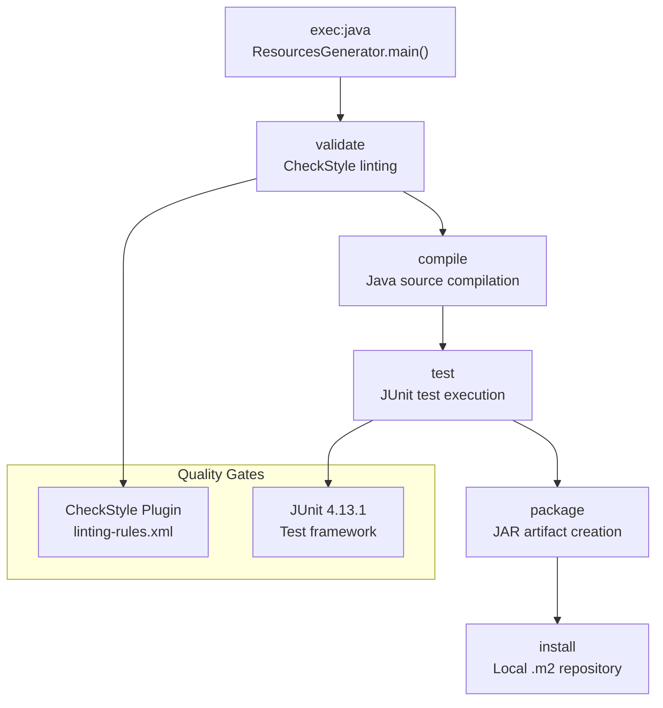
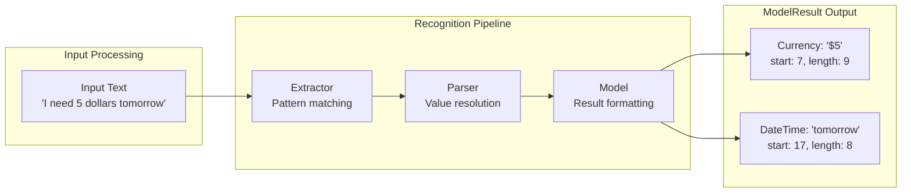

<!-- source: DeepWiki mcp.deepwiki.com · repo microsoft/Recognizers-Text · page 4 Platform Implementations · fetched 2026-10-26 -->

# Platform Implementations

Relevant source files

The following files were used as context for generating this wiki page:

- [.NET/Microsoft.Recognizers.Definitions.Common/Swedish/QuotedTextDefinitions.cs](.NET/Microsoft.Recognizers.Definitions.Common/Swedish/QuotedTextDefinitions.cs)
- [.NET/Microsoft.Recognizers.Definitions.Common/packages.config](.NET/Microsoft.Recognizers.Definitions.Common/packages.config)
- [.NET/Microsoft.Recognizers.Text.NumberWithUnit/Japanese/Extractors/TemperatureExtractorConfiguration.cs](.NET/Microsoft.Recognizers.Text.NumberWithUnit/Japanese/Extractors/TemperatureExtractorConfiguration.cs)
- [.NET/Microsoft.Recognizers.Text.NumberWithUnit/Japanese/Parsers/TemperatureParserConfiguration.cs](.NET/Microsoft.Recognizers.Text.NumberWithUnit/Japanese/Parsers/TemperatureParserConfiguration.cs)
- [Java/README.md](Java/README.md)
- [Java/libraries/recognizers-text-date-time/pom.xml](Java/libraries/recognizers-text-date-time/pom.xml)
- [Java/libraries/recognizers-text/src/main/java/com/microsoft/recognizers/text/utilities/StringUtility.java](Java/libraries/recognizers-text/src/main/java/com/microsoft/recognizers/text/utilities/StringUtility.java)
- [Java/libraries/resource-generator/pom.xml](Java/libraries/resource-generator/pom.xml)
- [Java/linting-excluded-files.xml](Java/linting-excluded-files.xml)
- [Java/linting-rules.xml](Java/linting-rules.xml)
- [Java/pom.xml](Java/pom.xml)
- [Java/samples/simple-console/pom.xml](Java/samples/simple-console/pom.xml)
- [Java/samples/simple-console/src/main/java/com/microsoft/recognizers/text/samples/simpleconsole/Sample.java](Java/samples/simple-console/src/main/java/com/microsoft/recognizers/text/samples/simpleconsole/Sample.java)
- [Java/tests/pom.xml](Java/tests/pom.xml)
- [JavaScript/lerna.json](JavaScript/lerna.json)
- [JavaScript/package-lock.json](JavaScript/package-lock.json)
- [JavaScript/package.json](JavaScript/package.json)
- [JavaScript/packages/datatypes-date-time/package-lock.json](JavaScript/packages/datatypes-date-time/package-lock.json)
- [JavaScript/packages/datatypes-date-time/package.json](JavaScript/packages/datatypes-date-time/package.json)
- [JavaScript/packages/recognizers-choice/package-lock.json](JavaScript/packages/recognizers-choice/package-lock.json)
- [JavaScript/packages/recognizers-choice/package.json](JavaScript/packages/recognizers-choice/package.json)
- [JavaScript/packages/recognizers-date-time/package-lock.json](JavaScript/packages/recognizers-date-time/package-lock.json)
- [JavaScript/packages/recognizers-date-time/package.json](JavaScript/packages/recognizers-date-time/package.json)
- [JavaScript/packages/recognizers-number-with-unit/package-lock.json](JavaScript/packages/recognizers-number-with-unit/package-lock.json)
- [JavaScript/packages/recognizers-number-with-unit/package.json](JavaScript/packages/recognizers-number-with-unit/package.json)
- [JavaScript/packages/recognizers-number/package-lock.json](JavaScript/packages/recognizers-number/package-lock.json)
- [JavaScript/packages/recognizers-number/package.json](JavaScript/packages/recognizers-number/package.json)
- [JavaScript/packages/recognizers-sequence/package.json](JavaScript/packages/recognizers-sequence/package.json)
- [JavaScript/packages/recognizers-text-suite/package.json](JavaScript/packages/recognizers-text-suite/package.json)
- [JavaScript/packages/recognizers-text/package.json](JavaScript/packages/recognizers-text/package.json)
- [Python/.pre-commit-config.yaml](Python/.pre-commit-config.yaml)
- [Python/build.ci.cmd](Python/build.ci.cmd)
- [Python/build.sh](Python/build.sh)
- [Python/libraries/recognizers-choice/recognizers_choice/choice/english/__init__.py](Python/libraries/recognizers-choice/recognizers_choice/choice/english/__init__.py)
- [Python/libraries/recognizers-choice/recognizers_choice/resources/__init__.py](Python/libraries/recognizers-choice/recognizers_choice/resources/__init__.py)
- [Python/libraries/recognizers-choice/resource-definitions.json](Python/libraries/recognizers-choice/resource-definitions.json)
- [Python/libraries/recognizers-choice/setup.py](Python/libraries/recognizers-choice/setup.py)
- [Python/libraries/recognizers-text/recognizers_text/parser.py](Python/libraries/recognizers-text/recognizers_text/parser.py)
- [Python/requirements.txt](Python/requirements.txt)
- [Python/setup.py](Python/setup.py)
- [Python/tests/requirements.txt](Python/tests/requirements.txt)
- [README.md](README.md)
- [Script/Utils/countNotSupportedCases.py](Script/Utils/countNotSupportedCases.py)
- [Script/Utils/deleteNotSupportedPlatform.py](Script/Utils/deleteNotSupportedPlatform.py)
- [Script/Utils/getNotSupportedInput.py](Script/Utils/getNotSupportedInput.py)

This document covers how Microsoft Recognizers Text is implemented across four different platforms (.NET, JavaScript, Python, and Java) while maintaining consistent APIs and shared recognition logic. It details the platform-specific packaging, build processes, and resource generation systems that enable cross-platform functionality.

For information about the core recognition algorithms and entity types, see [Entity Recognition Domains](#2). For language-specific pattern definitions, see [Language-Specific Implementations](#3).

## Platform Architecture Overview

Microsoft Recognizers Text implements a hub-and-spoke architecture where .NET serves as the primary platform, with contributions and improvements propagating to JavaScript, Python, and Java implementations.

Sources: [README.md:12-21](), [JavaScript/package.json:1-105](), [Java/pom.xml:1-60](), [Python/build.ci.cmd:1-73]()

## Cross-Platform Resource Generation

Each platform implements its own resource generation system to convert YAML pattern definitions into platform-specific code:

Sources: [JavaScript/packages/recognizers-number/package.json:29](), [Python/build.ci.cmd:18-25](), [Java/libraries/resource-generator/pom.xml:58-66]()

## JavaScript/TypeScript Implementation

The JavaScript implementation uses a monorepo structure managed by Lerna with individual NPM packages for each recognition domain.

### Package Structure

| Package | NPM Name | Purpose |
|---------|----------|---------|
| Base | `@microsoft/recognizers-text` | Core interfaces and utilities |
| Numbers | `@microsoft/recognizers-text-number` | Number recognition |
| DateTime | `@microsoft/recognizers-text-date-time` | Date/time recognition |
| NumberWithUnit | `@microsoft/recognizers-text-number-with-unit` | Currency, dimensions, etc. |
| Sequence | `@microsoft/recognizers-text-sequence` | Phone numbers, URLs, emails |
| Choice | `@microsoft/recognizers-text-choice` | Boolean choices |
| Suite | `@microsoft/recognizers-text-suite` | All recognizers bundled |
| Timex | `@microsoft/recognizers-text-data-types-timex-expression` | TIMEX data types |

### Build Process

The JavaScript build process follows this sequence for each package:

Sources: [JavaScript/packages/recognizers-number/package.json:28-32](), [JavaScript/packages/recognizers-text-suite/package.json:30-33](), [JavaScript/lerna.json:1-9]()

## Python Implementation

The Python implementation distributes packages via PyPI with a setup.py-based build system and pytest for testing.

### Package Structure and Dependencies

### Build and Test Process

The Python build process uses pip for dependency management and pytest for testing:

Sources: [Python/build.ci.cmd:1-73](), [Python/build.sh:1-43](), [Python/libraries/recognizers-choice/setup.py:1-38]()

## Java Implementation

The Java implementation uses Maven for build management and follows standard Java packaging conventions.

### Maven Module Structure

### Maven Build Process

The Java build integrates resource generation with standard Maven lifecycle phases:

Sources: [Java/pom.xml:16-27](), [Java/libraries/resource-generator/pom.xml:57-67](), [Java/samples/simple-console/pom.xml:1-110](), [Java/tests/pom.xml:1-114]()

## API Consistency Across Platforms

All platforms implement the same core recognition API pattern with platform-specific adaptations:

### Core Recognition Methods

| Recognition Type | .NET | JavaScript | Python | Java |
|------------------|------|------------|---------|------|
| Numbers | `NumberRecognizer.RecognizeNumber()` | `NumberRecognizer.recognizeNumber()` | `recognize_number()` | `NumberRecognizer.recognizeNumber()` |
| DateTime | `DateTimeRecognizer.RecognizeDateTime()` | `DateTimeRecognizer.recognizeDateTime()` | `recognize_datetime()` | `DateTimeRecognizer.recognizeDateTime()` |
| Currency | `NumberWithUnitRecognizer.RecognizeCurrency()` | `NumberWithUnitRecognizer.recognizeCurrency()` | `recognize_currency()` | `NumberWithUnitRecognizer.recognizeCurrency()` |

### Model Result Structure

Each platform returns results using a consistent `ModelResult` structure containing:

- `start`: Starting position in input text
- `length`: Length of recognized text
- `text`: Original recognized text
- `typeName`: Type of entity recognized
- `resolution`: Parsed and normalized values

Sources: [Java/samples/simple-console/src/main/java/com/microsoft/recognizers/text/samples/simpleconsole/Sample.java:66-132](), [Python/libraries/recognizers-text/recognizers_text/parser.py:9-26]()

---

