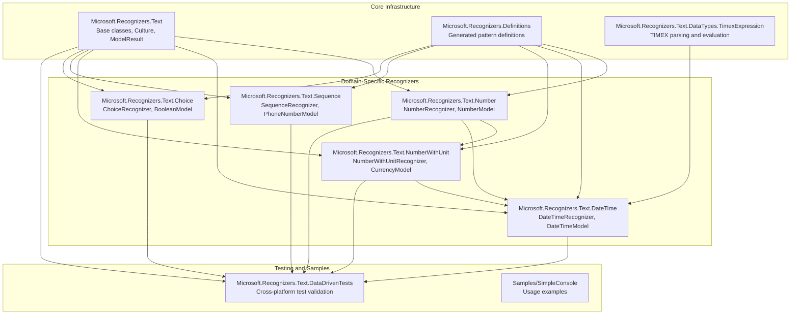
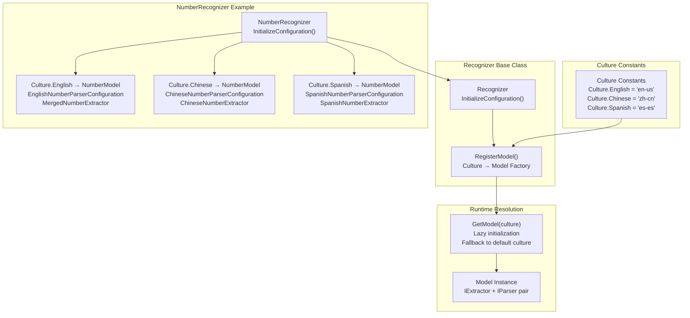
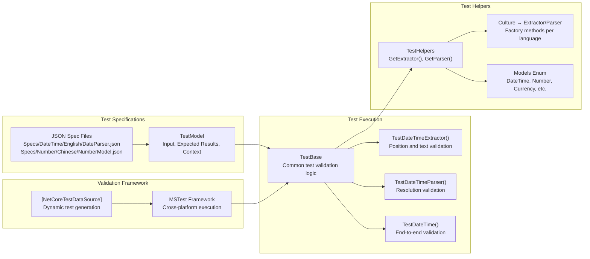
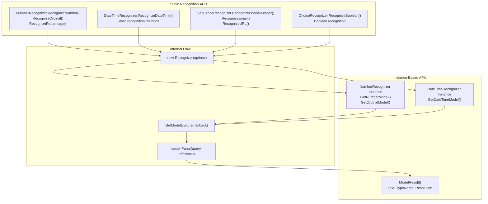

<!-- source: DeepWiki mcp.deepwiki.com · repo microsoft/Recognizers-Text · page 4.1 .NET Implementation · fetched 2026-10-26 -->

# .NET Implementation

<details>
<summary>Relevant source files</summary>

The following files were used as context for generating this wiki page:

- [.NET/Microsoft.Recognizers.Definitions.Common/Arabic/ChoiceDefinitions.cs](.NET/Microsoft.Recognizers.Definitions.Common/Arabic/ChoiceDefinitions.cs)
- [.NET/Microsoft.Recognizers.Definitions.Common/Arabic/ChoiceDefinitions.tt](.NET/Microsoft.Recognizers.Definitions.Common/Arabic/ChoiceDefinitions.tt)
- [.NET/Microsoft.Recognizers.Definitions.Common/Microsoft.Recognizers.Definitions.Common.csproj](.NET/Microsoft.Recognizers.Definitions.Common/Microsoft.Recognizers.Definitions.Common.csproj)
- [.NET/Microsoft.Recognizers.Definitions/Microsoft.Recognizers.Definitions.csproj](.NET/Microsoft.Recognizers.Definitions/Microsoft.Recognizers.Definitions.csproj)
- [.NET/Microsoft.Recognizers.Text.Choice/Arabic/Extractors/ArabicBooleanExtractorConfiguration.cs](.NET/Microsoft.Recognizers.Text.Choice/Arabic/Extractors/ArabicBooleanExtractorConfiguration.cs)
- [.NET/Microsoft.Recognizers.Text.Choice/ChoiceRecognizer.cs](.NET/Microsoft.Recognizers.Text.Choice/ChoiceRecognizer.cs)
- [.NET/Microsoft.Recognizers.Text.Choice/Microsoft.Recognizers.Text.Choice.csproj](.NET/Microsoft.Recognizers.Text.Choice/Microsoft.Recognizers.Text.Choice.csproj)
- [.NET/Microsoft.Recognizers.Text.DataDrivenTests/Choice/TestChoice_Arabic.cs](.NET/Microsoft.Recognizers.Text.DataDrivenTests/Choice/TestChoice_Arabic.cs)
- [.NET/Microsoft.Recognizers.Text.DataDrivenTests/DateTime/TestDateTime_English.cs](.NET/Microsoft.Recognizers.Text.DataDrivenTests/DateTime/TestDateTime_English.cs)
- [.NET/Microsoft.Recognizers.Text.DataDrivenTests/Microsoft.Recognizers.Text.DataDrivenTests.csproj](.NET/Microsoft.Recognizers.Text.DataDrivenTests/Microsoft.Recognizers.Text.DataDrivenTests.csproj)
- [.NET/Microsoft.Recognizers.Text.DataDrivenTests/Number/TestNumber_Chinese.cs](.NET/Microsoft.Recognizers.Text.DataDrivenTests/Number/TestNumber_Chinese.cs)
- [.NET/Microsoft.Recognizers.Text.DataDrivenTests/Number/TestNumber_Dutch.cs](.NET/Microsoft.Recognizers.Text.DataDrivenTests/Number/TestNumber_Dutch.cs)
- [.NET/Microsoft.Recognizers.Text.DataDrivenTests/Number/TestNumber_French.cs](.NET/Microsoft.Recognizers.Text.DataDrivenTests/Number/TestNumber_French.cs)
- [.NET/Microsoft.Recognizers.Text.DataDrivenTests/Number/TestNumber_German.cs](.NET/Microsoft.Recognizers.Text.DataDrivenTests/Number/TestNumber_German.cs)
- [.NET/Microsoft.Recognizers.Text.DataDrivenTests/Number/TestNumber_Italian.cs](.NET/Microsoft.Recognizers.Text.DataDrivenTests/Number/TestNumber_Italian.cs)
- [.NET/Microsoft.Recognizers.Text.DataDrivenTests/Number/TestNumber_Japanese.cs](.NET/Microsoft.Recognizers.Text.DataDrivenTests/Number/TestNumber_Japanese.cs)
- [.NET/Microsoft.Recognizers.Text.DataDrivenTests/Number/TestNumber_Korean.cs](.NET/Microsoft.Recognizers.Text.DataDrivenTests/Number/TestNumber_Korean.cs)
- [.NET/Microsoft.Recognizers.Text.DataDrivenTests/Number/TestNumber_Spanish.cs](.NET/Microsoft.Recognizers.Text.DataDrivenTests/Number/TestNumber_Spanish.cs)
- [.NET/Microsoft.Recognizers.Text.DataDrivenTests/TestBase.cs](.NET/Microsoft.Recognizers.Text.DataDrivenTests/TestBase.cs)
- [.NET/Microsoft.Recognizers.Text.DataDrivenTests/TestHelpers.cs](.NET/Microsoft.Recognizers.Text.DataDrivenTests/TestHelpers.cs)
- [.NET/Microsoft.Recognizers.Text.DataTypes.DataDrivenTests/Microsoft.Recognizers.Text.DataTypes.DataDrivenTests.csproj](.NET/Microsoft.Recognizers.Text.DataTypes.DataDrivenTests/Microsoft.Recognizers.Text.DataTypes.DataDrivenTests.csproj)
- [.NET/Microsoft.Recognizers.Text.DataTypes.TimexExpression/Microsoft.Recognizers.Text.DataTypes.TimexExpression.csproj](.NET/Microsoft.Recognizers.Text.DataTypes.TimexExpression/Microsoft.Recognizers.Text.DataTypes.TimexExpression.csproj)
- [.NET/Microsoft.Recognizers.Text.DateTime/DateTimeOptions.cs](.NET/Microsoft.Recognizers.Text.DateTime/DateTimeOptions.cs)
- [.NET/Microsoft.Recognizers.Text.DateTime/DateTimeRecognizer.cs](.NET/Microsoft.Recognizers.Text.DateTime/DateTimeRecognizer.cs)
- [.NET/Microsoft.Recognizers.Text.DateTime/Extractors/BaseDateExtractor.cs](.NET/Microsoft.Recognizers.Text.DateTime/Extractors/BaseDateExtractor.cs)
- [.NET/Microsoft.Recognizers.Text.DateTime/Microsoft.Recognizers.Text.DateTime.csproj](.NET/Microsoft.Recognizers.Text.DateTime/Microsoft.Recognizers.Text.DateTime.csproj)
- [.NET/Microsoft.Recognizers.Text.DateTime/Microsoft.Recognizers.Text.DateTime.xml](.NET/Microsoft.Recognizers.Text.DateTime/Microsoft.Recognizers.Text.DateTime.xml)
- [.NET/Microsoft.Recognizers.Text.DateTime/Parsers/BaseDateParser.cs](.NET/Microsoft.Recognizers.Text.DateTime/Parsers/BaseDateParser.cs)
- [.NET/Microsoft.Recognizers.Text.DateTime/Parsers/BaseDateTimeParser.cs](.NET/Microsoft.Recognizers.Text.DateTime/Parsers/BaseDateTimeParser.cs)
- [.NET/Microsoft.Recognizers.Text.Number/Italian/Extractors/NumberRangeExtractor.cs](.NET/Microsoft.Recognizers.Text.Number/Italian/Extractors/NumberRangeExtractor.cs)
- [.NET/Microsoft.Recognizers.Text.Number/Italian/Parsers/ItalianNumberRangeParserConfiguration.cs](.NET/Microsoft.Recognizers.Text.Number/Italian/Parsers/ItalianNumberRangeParserConfiguration.cs)
- [.NET/Microsoft.Recognizers.Text.Number/Microsoft.Recognizers.Text.Number.csproj](.NET/Microsoft.Recognizers.Text.Number/Microsoft.Recognizers.Text.Number.csproj)
- [.NET/Microsoft.Recognizers.Text.Number/NumberRecognizer.cs](.NET/Microsoft.Recognizers.Text.Number/NumberRecognizer.cs)
- [.NET/Microsoft.Recognizers.Text.NumberWithUnit/Microsoft.Recognizers.Text.NumberWithUnit.csproj](.NET/Microsoft.Recognizers.Text.NumberWithUnit/Microsoft.Recognizers.Text.NumberWithUnit.csproj)
- [.NET/Microsoft.Recognizers.Text.NumberWithUnit/NumberWithUnitRecognizer.cs](.NET/Microsoft.Recognizers.Text.NumberWithUnit/NumberWithUnitRecognizer.cs)
- [.NET/Microsoft.Recognizers.Text.Sequence/Microsoft.Recognizers.Text.Sequence.csproj](.NET/Microsoft.Recognizers.Text.Sequence/Microsoft.Recognizers.Text.Sequence.csproj)
- [.NET/Microsoft.Recognizers.Text.Sequence/SequenceRecognizer.cs](.NET/Microsoft.Recognizers.Text.Sequence/SequenceRecognizer.cs)
- [.NET/Microsoft.Recognizers.Text.sln](.NET/Microsoft.Recognizers.Text.sln)
- [.NET/Microsoft.Recognizers.Text/Constants.cs](.NET/Microsoft.Recognizers.Text/Constants.cs)
- [.NET/Microsoft.Recognizers.Text/Culture.cs](.NET/Microsoft.Recognizers.Text/Culture.cs)
- [.NET/Microsoft.Recognizers.Text/Microsoft.Recognizers.Text.csproj](.NET/Microsoft.Recognizers.Text/Microsoft.Recognizers.Text.csproj)
- [.NET/Microsoft.Recognizers.Text/Models/ExtendedModelResult.cs](.NET/Microsoft.Recognizers.Text/Models/ExtendedModelResult.cs)
- [.NET/Microsoft.Recognizers.Text/Models/ModelResult.cs](.NET/Microsoft.Recognizers.Text/Models/ModelResult.cs)
- [.NET/Microsoft.Recognizers.Text/Recognizer.cs](.NET/Microsoft.Recognizers.Text/Recognizer.cs)
- [.NET/Samples/SimpleConsole/SimpleConsole.csproj](.NET/Samples/SimpleConsole/SimpleConsole.csproj)
- [Java/tests/src/test/java/com/microsoft/recognizers/text/tests/numberwithunit/NumberWithUnitRecognizerInitializationTest.java](Java/tests/src/test/java/com/microsoft/recognizers/text/tests/numberwithunit/NumberWithUnitRecognizerInitializationTest.java)
- [Patterns/Arabic/Arabic-Choice.yaml](Patterns/Arabic/Arabic-Choice.yaml)
- [Specs/Choice/Arabic/BooleanModel.json](Specs/Choice/Arabic/BooleanModel.json)
- [Specs/DateTime/English/DateExtractor.json](Specs/DateTime/English/DateExtractor.json)
- [Specs/DateTime/English/DateParser.json](Specs/DateTime/English/DateParser.json)
- [Specs/Number/German/OrdinalModel.json](Specs/Number/German/OrdinalModel.json)
- [Specs/Number/German/OrdinalModelEnablePreview.json](Specs/Number/German/OrdinalModelEnablePreview.json)
- [Specs/Number/Italian/NumberRangeModel.json](Specs/Number/Italian/NumberRangeModel.json)

</details>


The .NET implementation serves as the primary platform for Microsoft Recognizers Text, providing comprehensive text recognition capabilities across multiple entity domains and languages. This implementation acts as the source of truth from which features and patterns propagate to other platform implementations (JavaScript, Python, and Java).

For information about the overall system architecture, see [Architecture Overview](#1.1). For details on specific recognition domains, see [Entity Recognition Domains](#2). For language-specific implementation details, see [Language-Specific Implementations](#3).

## Project Structure and Dependencies

The .NET implementation consists of multiple interconnected projects organized by functional domain, with shared infrastructure and comprehensive testing frameworks.



**Sources:** [.NET/Microsoft.Recognizers.Text.sln:1-638](), [.NET/Microsoft.Recognizers.Text.DataDrivenTests/Microsoft.Recognizers.Text.DataDrivenTests.csproj:54-61]()

## Recognition Pipeline Architecture

The .NET implementation follows a consistent three-layer architecture across all recognition domains: Extractors identify potential entities, Parsers resolve them to structured data, and Models provide the public API interface.

```mermaid
graph LR
    subgraph "Input Processing"
        Input["Natural Language Text<br/>'I'll meet you on January 15th'"]
        Preprocessing["Text Preprocessing<br/>Normalization, Tokenization"]
    end
    
    subgraph "Extractor Layer"
        Extractors["IExtractor Implementations<br/>BaseDateExtractor<br/>BaseNumberExtractor"]
        RegexPatterns["Regex Pattern Matching<br/>Generated from YAML definitions"]
        TokenResults["ExtractResult[]<br/>Position, Text, Type"]
    end
    
    subgraph "Parser Layer"
        Parsers["IParser Implementations<br/>BaseDateParser<br/>BaseNumberParser"]
        Configurations["Parser Configurations<br/>Language-specific logic"]
        ParseResults["DateTimeParseResult<br/>NumberParseResult"]
    end
    
    subgraph "Model Layer"
        Models["IModel Implementations<br/>DateTimeModel<br/>NumberModel"]
        ModelResults["ModelResult[]<br/>Text, TypeName, Resolution"]
    end
    
    subgraph "Culture Registration"
        Recognizers["Recognizer<TOptions><br/>NumberRecognizer<br/>DateTimeRecognizer"]
        CultureMap["Culture-specific<br/>Model Registration"]
    end
    
    Input --> Preprocessing
    Preprocessing --> Extractors
    Extractors --> RegexPatterns
    RegexPatterns --> TokenResults
    TokenResults --> Parsers
    Parsers --> Configurations
    Configurations --> ParseResults
    ParseResults --> Models
    Models --> ModelResults
    
    Recognizers --> CultureMap
    CultureMap --> Models
```



**Sources:** [.NET/Microsoft.Recognizers.Text/Recognizer.cs:10-108](), [.NET/Microsoft.Recognizers.Text.DateTime/Extractors/BaseDateExtractor.cs:16-152](), [.NET/Microsoft.Recognizers.Text.DateTime/Parsers/BaseDateParser.cs:15-114]()

## Target Framework Support

The .NET implementation targets multiple framework versions to ensure broad compatibility across different deployment scenarios.

| Project | Framework Targets | Purpose |
|---------|------------------|---------|
| Core Libraries | netstandard2.1, netstandard2.0, net462, net6.0 | Maximum compatibility |
| Test Projects | net6.0 | Modern testing capabilities |
| Sample Applications | net6.0 | Latest framework features |

**Framework-Specific Features:**
- **netstandard2.0/2.1**: Cross-platform compatibility for libraries
- **net462**: Legacy .NET Framework support
- **net6.0**: Modern .NET with performance optimizations

**Sources:** [.NET/Microsoft.Recognizers.Text/Microsoft.Recognizers.Text.csproj:4](), [.NET/Microsoft.Recognizers.Text.DataDrivenTests/Microsoft.Recognizers.Text.DataDrivenTests.csproj:4]()

## Model Registration and Culture Support

Each recognizer implements a culture-based model registration system that maps specific cultures to appropriate extractor and parser configurations.



**Sources:** [.NET/Microsoft.Recognizers.Text.Number/NumberRecognizer.cs:90-148](), [.NET/Microsoft.Recognizers.Text/Culture.cs:9-17](), [.NET/Microsoft.Recognizers.Text/Recognizer.cs:45-108]()

## Data-Driven Testing Framework

The .NET implementation includes a comprehensive testing framework that validates recognition accuracy across all supported languages and entity types using JSON specification files.



**Sources:** [.NET/Microsoft.Recognizers.Text.DataDrivenTests/TestBase.cs:18-141](), [.NET/Microsoft.Recognizers.Text.DataDrivenTests/TestHelpers.cs:104-145](), [Specs/DateTime/English/DateParser.json:1-24]()

## Package Configuration and Distribution

The .NET projects are configured for NuGet package distribution with consistent metadata, code analysis, and build targets.

| Package Name | Description | Key Dependencies |
|--------------|-------------|------------------|
| Microsoft.Recognizers.Text | Base classes and interfaces | System.Collections.Immutable |
| Microsoft.Recognizers.Text.Number | Number recognition | Microsoft.Recognizers.Text |
| Microsoft.Recognizers.Text.DateTime | Date/time recognition | TimexExpression, Number |
| Microsoft.Recognizers.Text.NumberWithUnit | Units and currency | Text, Number |
| Microsoft.Recognizers.Text.Sequence | Phone, email, URL recognition | Microsoft.Recognizers.Text |
| Microsoft.Recognizers.Text.Choice | Boolean/choice recognition | Microsoft.Recognizers.Text |

**Common Build Configuration:**
- Strong-name signing with delay signing
- StyleCop and FxCop analyzers for code quality
- XML documentation generation
- Multi-target framework support

**Sources:** [.NET/Microsoft.Recognizers.Text/Microsoft.Recognizers.Text.csproj:25-32](), [.NET/Microsoft.Recognizers.Text.Number/Microsoft.Recognizers.Text.Number.csproj:25-32](), [.NET/Microsoft.Recognizers.Text.DateTime/Microsoft.Recognizers.Text.DateTime.csproj:25-32]()

## Static Entry Points and Recognition APIs

Each domain recognizer provides static methods for convenient single-call recognition operations, implementing a consistent API pattern across all entity types.



**Example Usage Pattern:**
```csharp
// Static API
var results = NumberRecognizer.RecognizeNumber("twenty three", Culture.English);

// Instance API with options
var recognizer = new DateTimeRecognizer(Culture.English, DateTimeOptions.SplitDateAndTime);
var model = recognizer.GetDateTimeModel();
var results = model.Parse("next Monday", DateTime.Now);
```

**Sources:** [.NET/Microsoft.Recognizers.Text.Number/NumberRecognizer.cs:50-68](), [.NET/Microsoft.Recognizers.Text.DateTime/DateTimeRecognizer.cs:48-58](), [.NET/Microsoft.Recognizers.Text.Choice/ChoiceRecognizer.cs:51-56]()

---

