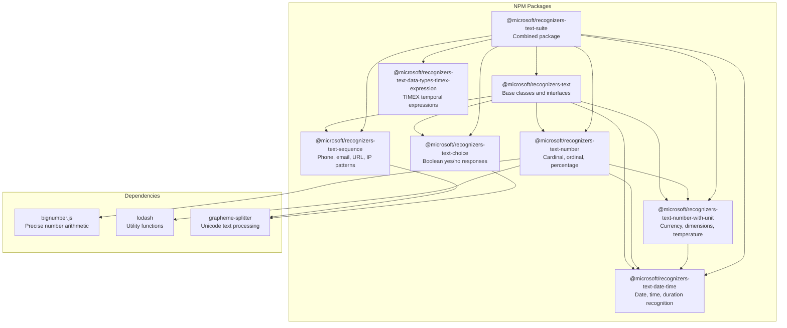
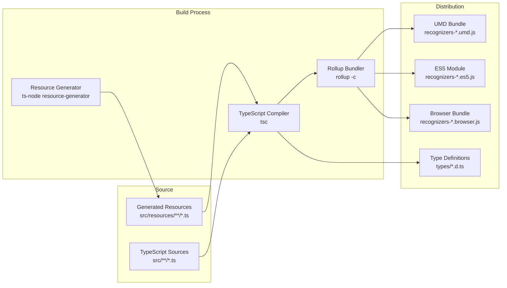
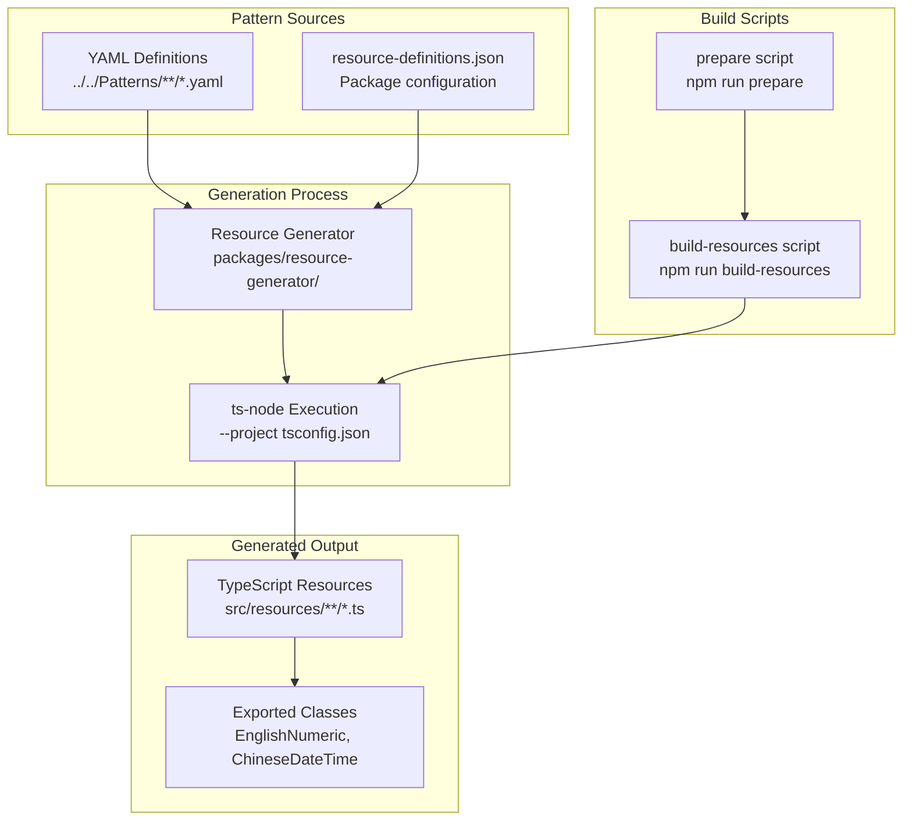
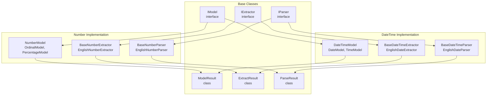
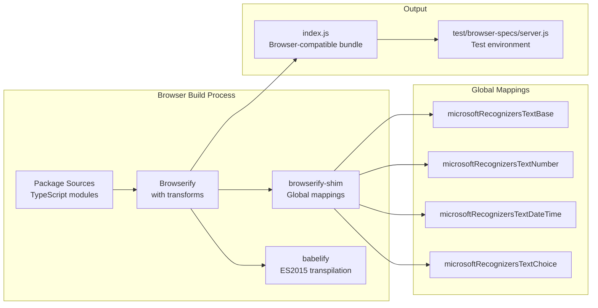
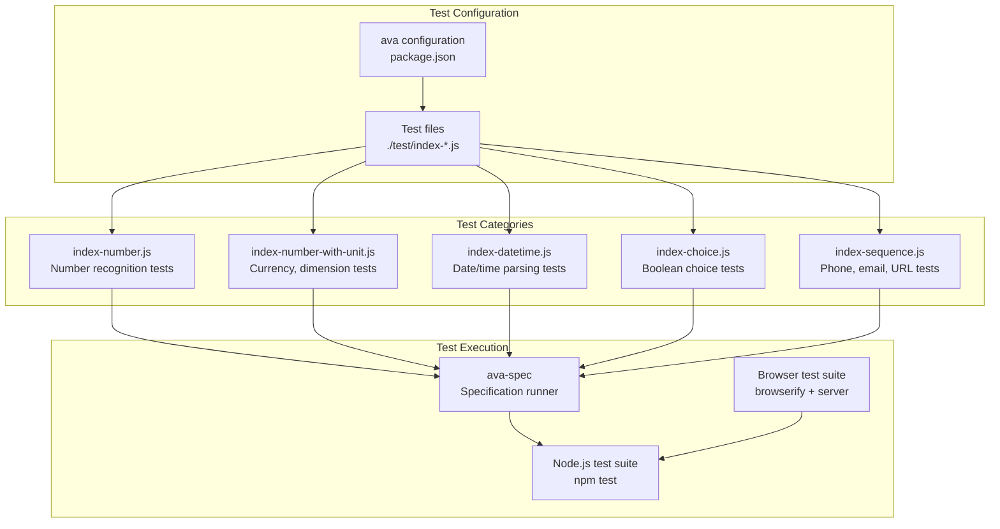
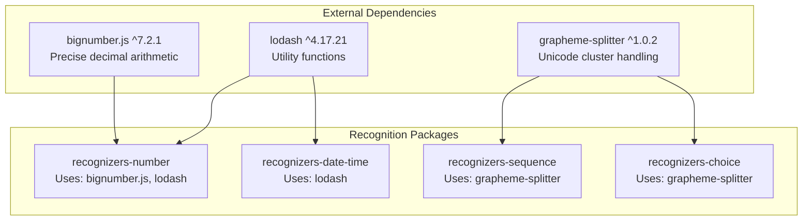

<!-- source: DeepWiki mcp.deepwiki.com · repo microsoft/Recognizers-Text · page 4.2 JavaScript Implementation · fetched 2026-10-26 -->

# JavaScript Implementation

Relevant source files

The following files were used as context for generating this wiki page:

- [JavaScript/lerna.json](JavaScript/lerna.json)
- [JavaScript/package-lock.json](JavaScript/package-lock.json)
- [JavaScript/package.json](JavaScript/package.json)
- [JavaScript/packages/datatypes-date-time/package-lock.json](JavaScript/packages/datatypes-date-time/package-lock.json)
- [JavaScript/packages/datatypes-date-time/package.json](JavaScript/packages/datatypes-date-time/package.json)
- [JavaScript/packages/recognizers-choice/package-lock.json](JavaScript/packages/recognizers-choice/package-lock.json)
- [JavaScript/packages/recognizers-choice/package.json](JavaScript/packages/recognizers-choice/package.json)
- [JavaScript/packages/recognizers-date-time/package-lock.json](JavaScript/packages/recognizers-date-time/package-lock.json)
- [JavaScript/packages/recognizers-date-time/package.json](JavaScript/packages/recognizers-date-time/package.json)
- [JavaScript/packages/recognizers-number-with-unit/package-lock.json](JavaScript/packages/recognizers-number-with-unit/package-lock.json)
- [JavaScript/packages/recognizers-number-with-unit/package.json](JavaScript/packages/recognizers-number-with-unit/package.json)
- [JavaScript/packages/recognizers-number/package-lock.json](JavaScript/packages/recognizers-number/package-lock.json)
- [JavaScript/packages/recognizers-number/package.json](JavaScript/packages/recognizers-number/package.json)
- [JavaScript/packages/recognizers-sequence/package.json](JavaScript/packages/recognizers-sequence/package.json)
- [JavaScript/packages/recognizers-text-suite/package.json](JavaScript/packages/recognizers-text-suite/package.json)
- [JavaScript/packages/recognizers-text/package.json](JavaScript/packages/recognizers-text/package.json)
- [Python/.pre-commit-config.yaml](Python/.pre-commit-config.yaml)
- [Python/build.ci.cmd](Python/build.ci.cmd)
- [Python/build.sh](Python/build.sh)
- [Python/libraries/recognizers-choice/recognizers_choice/choice/english/__init__.py](Python/libraries/recognizers-choice/recognizers_choice/choice/english/__init__.py)
- [Python/libraries/recognizers-choice/recognizers_choice/resources/__init__.py](Python/libraries/recognizers-choice/recognizers_choice/resources/__init__.py)
- [Python/libraries/recognizers-choice/resource-definitions.json](Python/libraries/recognizers-choice/resource-definitions.json)
- [Python/libraries/recognizers-choice/setup.py](Python/libraries/recognizers-choice/setup.py)
- [Python/libraries/recognizers-text/recognizers_text/parser.py](Python/libraries/recognizers-text/recognizers_text/parser.py)
- [Python/requirements.txt](Python/requirements.txt)
- [Python/setup.py](Python/setup.py)
- [Python/tests/requirements.txt](Python/tests/requirements.txt)
- [README.md](README.md)
- [Script/Utils/countNotSupportedCases.py](Script/Utils/countNotSupportedCases.py)
- [Script/Utils/deleteNotSupportedPlatform.py](Script/Utils/deleteNotSupportedPlatform.py)
- [Script/Utils/getNotSupportedInput.py](Script/Utils/getNotSupportedInput.py)

This document covers the JavaScript/TypeScript implementation of Microsoft Recognizers Text, including package architecture, build processes, distribution formats, and integration patterns. For information about the .NET implementation which serves as the primary platform, see [.NET Implementation](#4.1). For details about pattern definitions and resource generation, see [Pattern Definition System](#5.1).

## Package Architecture

The JavaScript implementation follows a modular monorepo structure managed by Lerna, with each recognition domain packaged as a separate NPM module. The packages are designed for both Node.js and browser environments.

Sources: [JavaScript/lerna.json:1-8](), [JavaScript/package.json:92-101](), [JavaScript/packages/recognizers-text-suite/package.json:34-42]()

## Distribution Formats and Entry Points

Each package provides multiple distribution formats to support different JavaScript environments and module systems.

| Format | Entry Point | Target Environment | Use Case |
|--------|-------------|-------------------|----------|
| UMD | `dist/*.umd.js` | Universal | Node.js CommonJS, AMD, global |
| ES5 Module | `dist/*.es5.js` | Modern bundlers | Tree-shaking, ES modules |
| Browser | `dist/*.browser.js` | Direct browser | Script tag inclusion |
| TypeScript | `dist/types/*.d.ts` | TypeScript projects | Type definitions |

Sources: [JavaScript/packages/recognizers-number/package.json:14-17](), [JavaScript/packages/recognizers-date-time/package.json:16-19](), [JavaScript/packages/recognizers-number-with-unit/package.json:14-17]()

## Resource Generation Pipeline

The JavaScript implementation uses a resource generation system to convert YAML pattern definitions into TypeScript modules. This ensures consistency across platforms while allowing JavaScript-specific optimizations.

Sources: [JavaScript/packages/recognizers-number/package.json:29](), [JavaScript/packages/recognizers-date-time/package.json:31](), [JavaScript/packages/recognizers-sequence/package.json:30]()

## Core Class Architecture

The JavaScript implementation mirrors the .NET architecture with `Extractor`, `Parser`, and `Model` classes for each recognition domain.

Sources: [JavaScript/packages/recognizers-text/package.json:1-31](), [Python/libraries/recognizers-text/recognizers_text/parser.py:22-25]()

## Browser Support and Browserify Configuration

The JavaScript implementation includes specific configurations for browser environments, using Browserify with transforms for compatibility.

Sources: [JavaScript/package.json:20-32](), [JavaScript/package.json:17-18]()

## Testing Framework

The JavaScript implementation uses AVA for testing with data-driven test cases that validate cross-platform consistency.

Sources: [JavaScript/package.json:34-42](), [JavaScript/package.json:16-18]()

## Dependency Management

The JavaScript implementation carefully manages dependencies to balance functionality with bundle size, using specific utility libraries for different domains.

| Package | Dependencies | Purpose |
|---------|-------------|---------|
| `recognizers-text` | None | Base abstractions |
| `recognizers-number` | `bignumber.js`, `lodash` | Precise arithmetic, utilities |
| `recognizers-date-time` | `lodash` | Date manipulation utilities |
| `recognizers-sequence` | `grapheme-splitter` | Unicode text processing |
| `recognizers-choice` | `grapheme-splitter` | Unicode text processing |

Sources: [JavaScript/packages/recognizers-number/package.json:33-37](), [JavaScript/packages/recognizers-date-time/package.json:35-40](), [JavaScript/packages/recognizers-sequence/package.json:34-37](), [JavaScript/packages/recognizers-choice/package.json:35-38]()

## Build Scripts and Automation

Each package includes standardized build scripts that handle resource generation, compilation, and bundling in a consistent manner.

| Script | Command | Purpose |
|--------|---------|---------|
| `build-resources` | `ts-node resource-generator` | Generate TypeScript from YAML |
| `clean-build` | `rimraf dist && rimraf compiled` | Clean build artifacts |
| `prepare` | `build-resources && clean-build && tsc && rollup` | Complete build pipeline |

The build process ensures that each package can be independently built and published while maintaining consistency across the monorepo structure.

Sources: [JavaScript/packages/recognizers-number/package.json:28-32](), [JavaScript/packages/recognizers-date-time/package.json:30-33](), [JavaScript/packages/recognizers-text-suite/package.json:30-32]()

---

