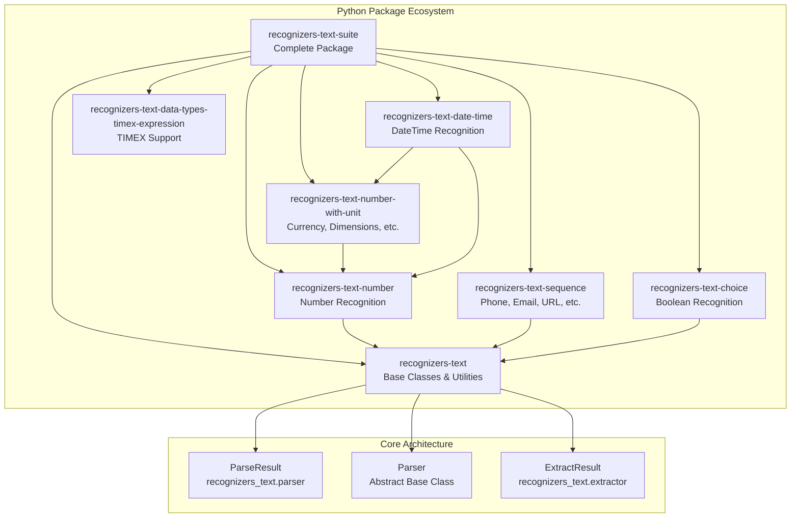
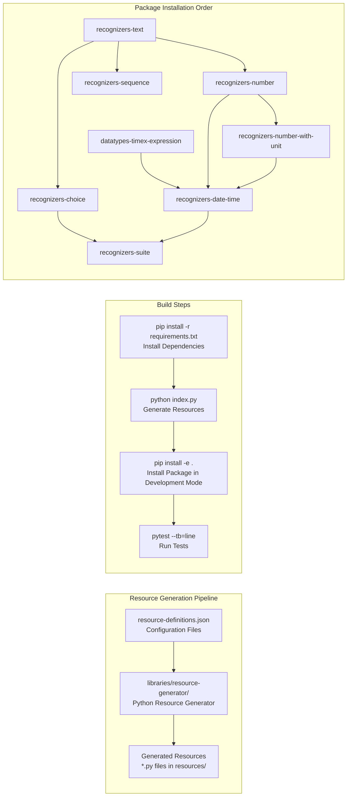
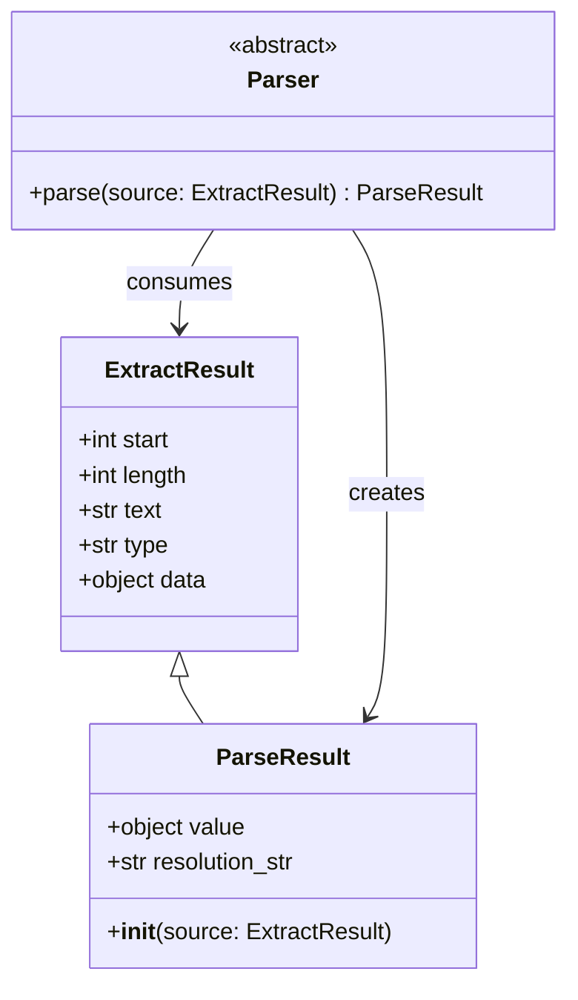

<!-- source: DeepWiki mcp.deepwiki.com · repo microsoft/Recognizers-Text · page 4.3 Python Implementation · fetched 2026-10-26 -->

# Python Implementation

<details>
<summary>Relevant source files</summary>

The following files were used as context for generating this wiki page:

- [JavaScript/lerna.json](JavaScript/lerna.json)
- [JavaScript/package-lock.json](JavaScript/package-lock.json)
- [JavaScript/package.json](JavaScript/package.json)
- [JavaScript/packages/datatypes-date-time/package-lock.json](JavaScript/packages/datatypes-date-time/package-lock.json)
- [JavaScript/packages/datatypes-date-time/package.json](JavaScript/packages/datatypes-date-time/package.json)
- [JavaScript/packages/recognizers-choice/package-lock.json](JavaScript/packages/recognizers-choice/package-lock.json)
- [JavaScript/packages/recognizers-choice/package.json](JavaScript/packages/recognizers-choice/package.json)
- [JavaScript/packages/recognizers-date-time/package-lock.json](JavaScript/packages/recognizers-date-time/package-lock.json)
- [JavaScript/packages/recognizers-date-time/package.json](JavaScript/packages/recognizers-date-time/package.json)
- [JavaScript/packages/recognizers-number-with-unit/package-lock.json](JavaScript/packages/recognizers-number-with-unit/package-lock.json)
- [JavaScript/packages/recognizers-number-with-unit/package.json](JavaScript/packages/recognizers-number-with-unit/package.json)
- [JavaScript/packages/recognizers-number/package-lock.json](JavaScript/packages/recognizers-number/package-lock.json)
- [JavaScript/packages/recognizers-number/package.json](JavaScript/packages/recognizers-number/package.json)
- [JavaScript/packages/recognizers-sequence/package.json](JavaScript/packages/recognizers-sequence/package.json)
- [JavaScript/packages/recognizers-text-suite/package.json](JavaScript/packages/recognizers-text-suite/package.json)
- [JavaScript/packages/recognizers-text/package.json](JavaScript/packages/recognizers-text/package.json)
- [Python/.pre-commit-config.yaml](Python/.pre-commit-config.yaml)
- [Python/build.ci.cmd](Python/build.ci.cmd)
- [Python/build.sh](Python/build.sh)
- [Python/libraries/recognizers-choice/recognizers_choice/choice/english/__init__.py](Python/libraries/recognizers-choice/recognizers_choice/choice/english/__init__.py)
- [Python/libraries/recognizers-choice/recognizers_choice/resources/__init__.py](Python/libraries/recognizers-choice/recognizers_choice/resources/__init__.py)
- [Python/libraries/recognizers-choice/resource-definitions.json](Python/libraries/recognizers-choice/resource-definitions.json)
- [Python/libraries/recognizers-choice/setup.py](Python/libraries/recognizers-choice/setup.py)
- [Python/libraries/recognizers-text/recognizers_text/parser.py](Python/libraries/recognizers-text/recognizers_text/parser.py)
- [Python/requirements.txt](Python/requirements.txt)
- [Python/setup.py](Python/setup.py)
- [Python/tests/requirements.txt](Python/tests/requirements.txt)
- [README.md](README.md)
- [Script/Utils/countNotSupportedCases.py](Script/Utils/countNotSupportedCases.py)
- [Script/Utils/deleteNotSupportedPlatform.py](Script/Utils/deleteNotSupportedPlatform.py)
- [Script/Utils/getNotSupportedInput.py](Script/Utils/getNotSupportedInput.py)

</details>


This document covers the Python implementation of Microsoft Recognizers-Text, including its package structure, build process, dependencies, and usage patterns. The Python implementation provides the same entity recognition capabilities as other platforms but is currently in alpha status. For overall architecture concepts, see [Architecture Overview](#1.1). For platform-agnostic entity recognition details, see [Entity Recognition Domains](#2).

## Overview

The Python implementation of Microsoft Recognizers-Text is distributed through PyPI packages and follows the same extractor-parser pipeline architecture as the primary .NET implementation. All recognition capabilities are available through separate packages that can be installed independently or as a complete suite.



Sources: [README.md:12-16](), [Python/libraries/recognizers-choice/setup.py:13-15](), [Python/libraries/recognizers-text/recognizers_text/parser.py:9-25]()

## Package Structure

The Python implementation is organized into separate packages that mirror the .NET structure, each focusing on specific entity recognition domains.

| Package | Purpose | Dependencies | Status |
|---------|---------|--------------|---------|
| `recognizers-text` | Base classes and utilities | None | Alpha |
| `recognizers-text-choice` | Boolean recognition | `recognizers-text`, `regex`, `grapheme` | Alpha |
| `recognizers-text-number` | Number recognition | `recognizers-text` | Alpha |
| `recognizers-text-number-with-unit` | Units and currencies | `recognizers-text`, `recognizers-text-number` | Alpha |
| `recognizers-text-date-time` | DateTime recognition | `recognizers-text`, `recognizers-text-number`, `recognizers-text-number-with-unit` | Alpha |
| `recognizers-text-sequence` | Structured sequences | `recognizers-text`, `grapheme` | Alpha |
| `recognizers-text-suite` | Complete suite | All above packages | Alpha |
| `recognizers-text-data-types-timex-expression` | TIMEX support | None | Alpha |

Sources: [Python/libraries/recognizers-choice/setup.py:13-15](), [Python/build.ci.cmd:29-43]()

## Build Process and Resource Generation

The Python implementation uses a resource generation system that converts YAML pattern definitions into Python code, similar to other platforms.



Sources: [Python/build.ci.cmd:19-26](), [Python/build.sh:6-11](), [Python/libraries/recognizers-choice/resource-definitions.json:1-16]()

## Development Environment Setup

The Python implementation requires specific dependencies and follows a structured build process for development.

### Dependencies

The core requirements include development and testing tools:

```python
# Core dependencies from requirements.txt
datedelta
pre-commit==1.16.1  
autopep8
flake8

# Test dependencies from tests/requirements.txt  
pytest-cov
pytest>=3.2.0
```

### Build Commands

The build process involves resource generation followed by package installation:

```bash
# Resource generation for each package
python index.py ../recognizers-choice/resource-definitions.json
python index.py ../recognizers-number/resource-definitions.json  
python index.py ../recognizers-number-with-unit/resource-definitions.json
python index.py ../recognizers-date-time/resource-definitions.json
python index.py ../recognizers-sequence/resource-definitions.json

# Development installation in dependency order
pip install -e ./libraries/recognizers-text/
pip install -e ./libraries/recognizers-choice/
pip install -e ./libraries/recognizers-number/
pip install -e ./libraries/recognizers-number-with-unit/
pip install -e ./libraries/datatypes-timex-expression/
pip install -e ./libraries/recognizers-date-time/
pip install -e ./libraries/recognizers-sequence/
pip install -e ./libraries/recognizers-suite/
```

Sources: [Python/requirements.txt:1-4](), [Python/tests/requirements.txt:1-2](), [Python/build.sh:7-36]()

## Core Architecture Classes

The Python implementation follows the same extractor-parser pattern as other platforms, with base classes providing the foundation for all recognizers.



The `ParseResult` class extends `ExtractResult` to include resolved values:

- **start, length, text, type, data**: Inherited from `ExtractResult`
- **value**: The parsed and resolved entity value  
- **resolution_str**: String representation of the resolution

The abstract `Parser` class defines the interface all parsers must implement with a single `parse` method that transforms `ExtractResult` objects into `ParseResult` objects.

Sources: [Python/libraries/recognizers-text/recognizers_text/parser.py:9-25]()

## Resource Generation System

Each Python package uses a resource generation configuration to convert shared YAML patterns into Python code.

The `resource-definitions.json` files specify how to generate Python resource classes:

```json
{
    "outputPath": "./recognizers_choice/resources/",
    "configFiles": [
        {
            "input": [ "English", "English-Choice" ],
            "output": "english_choice", 
            "header": [
                "# pylint: disable=line-too-long",
                "",
                "",
                "class EnglishChoice:"
            ],
            "footer": [ "# pylint: enable=line-too-long" ]
        }
    ]
}
```

This generates Python classes like `EnglishChoice` that contain the pattern definitions as class attributes, enabling the recognizers to access language-specific patterns at runtime.

Sources: [Python/libraries/recognizers-choice/resource-definitions.json:1-16]()

## Testing and Quality Assurance

The Python implementation uses pytest for testing and includes code quality tools:

### Testing Framework
- **pytest**: Primary testing framework with coverage reporting
- **pytest-cov**: Coverage analysis for test completeness
- Test execution: `pytest --tb=line` for concise error reporting

### Code Quality
- **flake8**: PEP8 style validation with configuration in `setup.cfg`
- **autopep8**: Automatic code formatting  
- **pre-commit**: Git hooks for quality checks before commits

### Pre-commit Configuration
The `.pre-commit-config.yaml` enforces quality standards:
- Runs flake8 style checks on push
- Applies autopep8 formatting automatically
- Uses global configuration from `Python/setup.cfg`

Sources: [Python/tests/requirements.txt:1-2](), [Python/.pre-commit-config.yaml:1-13](), [Python/build.ci.cmd:45-50]()

## Package Distribution

Python packages are created and distributed through PyPI with alpha versioning. The `CreateAllPackages.cmd` script handles package creation after successful builds and tests.

Current status: All Python packages are marked as version `1.0.0.a0` indicating alpha release status, with support for Python 3.6+ and dependencies managed through setuptools.

Sources: [Python/libraries/recognizers-choice/setup.py:14](), [Python/build.ci.cmd:63-68]()

---

