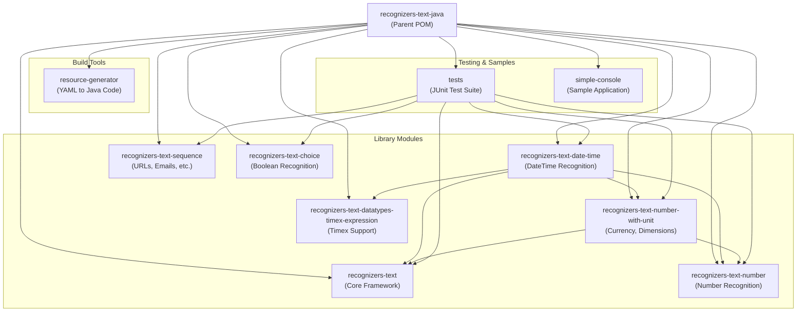
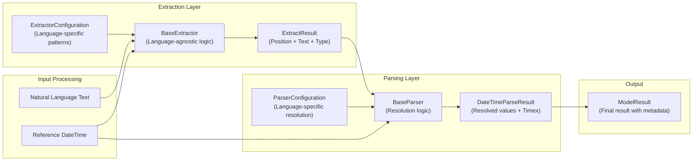
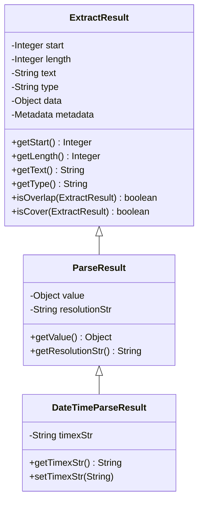
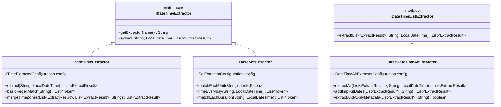
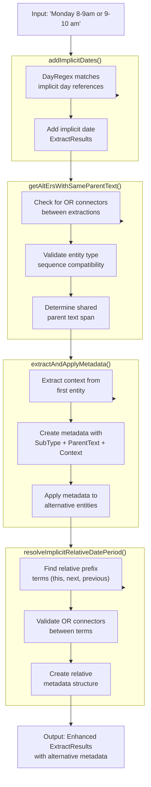
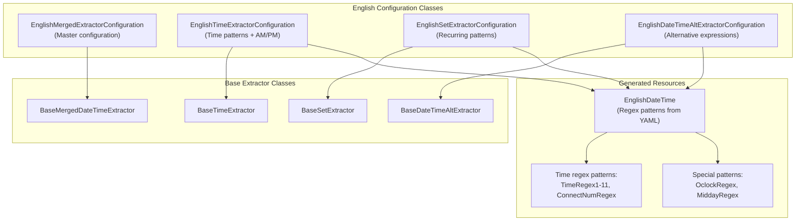
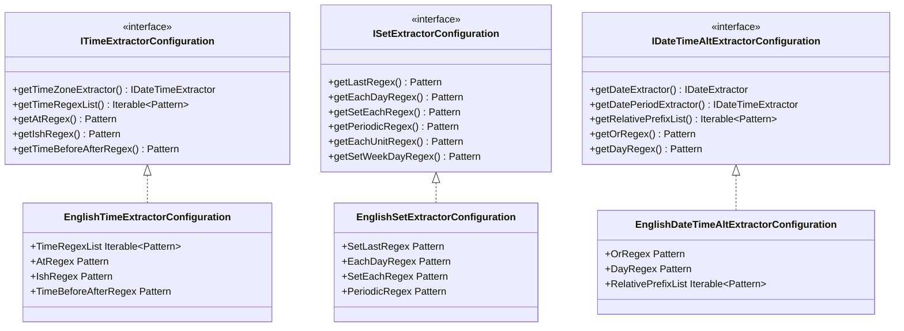
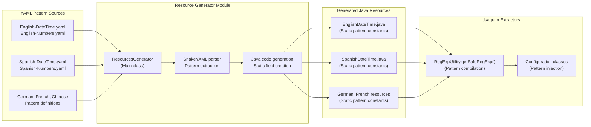
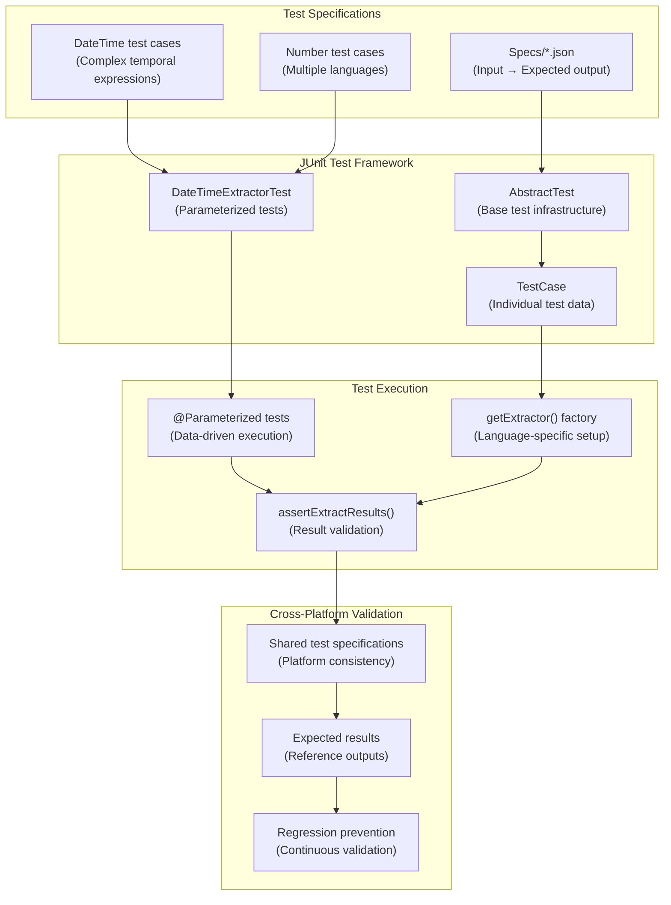

<!-- source: DeepWiki mcp.deepwiki.com · repo microsoft/Recognizers-Text · page 4.4 Java Implementation · fetched 2026-10-26 -->

# Java Implementation

<details>
<summary>Relevant source files</summary>

The following files were used as context for generating this wiki page:

- [.NET/Microsoft.Recognizers.Definitions.Common/Swedish/QuotedTextDefinitions.cs](.NET/Microsoft.Recognizers.Definitions.Common/Swedish/QuotedTextDefinitions.cs)
- [.NET/Microsoft.Recognizers.Definitions.Common/packages.config](.NET/Microsoft.Recognizers.Definitions.Common/packages.config)
- [.NET/Microsoft.Recognizers.Text.DateTime/Extractors/BaseDateTimeAltExtractor.cs](.NET/Microsoft.Recognizers.Text.DateTime/Extractors/BaseDateTimeAltExtractor.cs)
- [.NET/Microsoft.Recognizers.Text.NumberWithUnit/Japanese/Extractors/TemperatureExtractorConfiguration.cs](.NET/Microsoft.Recognizers.Text.NumberWithUnit/Japanese/Extractors/TemperatureExtractorConfiguration.cs)
- [.NET/Microsoft.Recognizers.Text.NumberWithUnit/Japanese/Parsers/TemperatureParserConfiguration.cs](.NET/Microsoft.Recognizers.Text.NumberWithUnit/Japanese/Parsers/TemperatureParserConfiguration.cs)
- [Java/README.md](Java/README.md)
- [Java/libraries/recognizers-text-date-time/pom.xml](Java/libraries/recognizers-text-date-time/pom.xml)
- [Java/libraries/recognizers-text-date-time/src/main/java/com/microsoft/recognizers/text/datetime/DateTimeOptions.java](Java/libraries/recognizers-text-date-time/src/main/java/com/microsoft/recognizers/text/datetime/DateTimeOptions.java)
- [Java/libraries/recognizers-text-date-time/src/main/java/com/microsoft/recognizers/text/datetime/english/extractors/EnglishDateTimeAltExtractorConfiguration.java](Java/libraries/recognizers-text-date-time/src/main/java/com/microsoft/recognizers/text/datetime/english/extractors/EnglishDateTimeAltExtractorConfiguration.java)
- [Java/libraries/recognizers-text-date-time/src/main/java/com/microsoft/recognizers/text/datetime/english/extractors/EnglishMergedExtractorConfiguration.java](Java/libraries/recognizers-text-date-time/src/main/java/com/microsoft/recognizers/text/datetime/english/extractors/EnglishMergedExtractorConfiguration.java)
- [Java/libraries/recognizers-text-date-time/src/main/java/com/microsoft/recognizers/text/datetime/english/extractors/EnglishSetExtractorConfiguration.java](Java/libraries/recognizers-text-date-time/src/main/java/com/microsoft/recognizers/text/datetime/english/extractors/EnglishSetExtractorConfiguration.java)
- [Java/libraries/recognizers-text-date-time/src/main/java/com/microsoft/recognizers/text/datetime/english/extractors/EnglishTimeExtractorConfiguration.java](Java/libraries/recognizers-text-date-time/src/main/java/com/microsoft/recognizers/text/datetime/english/extractors/EnglishTimeExtractorConfiguration.java)
- [Java/libraries/recognizers-text-date-time/src/main/java/com/microsoft/recognizers/text/datetime/extractors/BaseDateTimeAltExtractor.java](Java/libraries/recognizers-text-date-time/src/main/java/com/microsoft/recognizers/text/datetime/extractors/BaseDateTimeAltExtractor.java)
- [Java/libraries/recognizers-text-date-time/src/main/java/com/microsoft/recognizers/text/datetime/extractors/BaseSetExtractor.java](Java/libraries/recognizers-text-date-time/src/main/java/com/microsoft/recognizers/text/datetime/extractors/BaseSetExtractor.java)
- [Java/libraries/recognizers-text-date-time/src/main/java/com/microsoft/recognizers/text/datetime/extractors/BaseTimeExtractor.java](Java/libraries/recognizers-text-date-time/src/main/java/com/microsoft/recognizers/text/datetime/extractors/BaseTimeExtractor.java)
- [Java/libraries/recognizers-text-date-time/src/main/java/com/microsoft/recognizers/text/datetime/extractors/IDateTimeListExtractor.java](Java/libraries/recognizers-text-date-time/src/main/java/com/microsoft/recognizers/text/datetime/extractors/IDateTimeListExtractor.java)
- [Java/libraries/recognizers-text-date-time/src/main/java/com/microsoft/recognizers/text/datetime/extractors/config/IDateTimeAltExtractorConfiguration.java](Java/libraries/recognizers-text-date-time/src/main/java/com/microsoft/recognizers/text/datetime/extractors/config/IDateTimeAltExtractorConfiguration.java)
- [Java/libraries/recognizers-text-date-time/src/main/java/com/microsoft/recognizers/text/datetime/extractors/config/IMergedExtractorConfiguration.java](Java/libraries/recognizers-text-date-time/src/main/java/com/microsoft/recognizers/text/datetime/extractors/config/IMergedExtractorConfiguration.java)
- [Java/libraries/recognizers-text-date-time/src/main/java/com/microsoft/recognizers/text/datetime/extractors/config/ISetExtractorConfiguration.java](Java/libraries/recognizers-text-date-time/src/main/java/com/microsoft/recognizers/text/datetime/extractors/config/ISetExtractorConfiguration.java)
- [Java/libraries/recognizers-text-date-time/src/main/java/com/microsoft/recognizers/text/datetime/extractors/config/ITimeExtractorConfiguration.java](Java/libraries/recognizers-text-date-time/src/main/java/com/microsoft/recognizers/text/datetime/extractors/config/ITimeExtractorConfiguration.java)
- [Java/libraries/recognizers-text-date-time/src/main/java/com/microsoft/recognizers/text/datetime/extractors/config/ProcessedSuperfluousWords.java](Java/libraries/recognizers-text-date-time/src/main/java/com/microsoft/recognizers/text/datetime/extractors/config/ProcessedSuperfluousWords.java)
- [Java/libraries/recognizers-text-date-time/src/main/java/com/microsoft/recognizers/text/datetime/models/DateTimeModel.java](Java/libraries/recognizers-text-date-time/src/main/java/com/microsoft/recognizers/text/datetime/models/DateTimeModel.java)
- [Java/libraries/recognizers-text-date-time/src/main/java/com/microsoft/recognizers/text/datetime/parsers/DateTimeParseResult.java](Java/libraries/recognizers-text-date-time/src/main/java/com/microsoft/recognizers/text/datetime/parsers/DateTimeParseResult.java)
- [Java/libraries/recognizers-text-date-time/src/main/java/com/microsoft/recognizers/text/datetime/spanish/extractors/SpanishSetExtractorConfiguration.java](Java/libraries/recognizers-text-date-time/src/main/java/com/microsoft/recognizers/text/datetime/spanish/extractors/SpanishSetExtractorConfiguration.java)
- [Java/libraries/recognizers-text-date-time/src/main/java/com/microsoft/recognizers/text/datetime/utilities/MatchingUtil.java](Java/libraries/recognizers-text-date-time/src/main/java/com/microsoft/recognizers/text/datetime/utilities/MatchingUtil.java)
- [Java/libraries/recognizers-text-date-time/src/main/java/com/microsoft/recognizers/text/datetime/utilities/Token.java](Java/libraries/recognizers-text-date-time/src/main/java/com/microsoft/recognizers/text/datetime/utilities/Token.java)
- [Java/libraries/recognizers-text/src/main/java/com/microsoft/recognizers/text/ExtractResult.java](Java/libraries/recognizers-text/src/main/java/com/microsoft/recognizers/text/ExtractResult.java)
- [Java/libraries/recognizers-text/src/main/java/com/microsoft/recognizers/text/ParseResult.java](Java/libraries/recognizers-text/src/main/java/com/microsoft/recognizers/text/ParseResult.java)
- [Java/libraries/recognizers-text/src/main/java/com/microsoft/recognizers/text/utilities/StringUtility.java](Java/libraries/recognizers-text/src/main/java/com/microsoft/recognizers/text/utilities/StringUtility.java)
- [Java/libraries/resource-generator/pom.xml](Java/libraries/resource-generator/pom.xml)
- [Java/linting-excluded-files.xml](Java/linting-excluded-files.xml)
- [Java/linting-rules.xml](Java/linting-rules.xml)
- [Java/pom.xml](Java/pom.xml)
- [Java/samples/simple-console/pom.xml](Java/samples/simple-console/pom.xml)
- [Java/samples/simple-console/src/main/java/com/microsoft/recognizers/text/samples/simpleconsole/Sample.java](Java/samples/simple-console/src/main/java/com/microsoft/recognizers/text/samples/simpleconsole/Sample.java)
- [Java/tests/pom.xml](Java/tests/pom.xml)
- [Java/tests/src/test/java/com/microsoft/recognizers/text/tests/datetime/DateTimeExtractorTest.java](Java/tests/src/test/java/com/microsoft/recognizers/text/tests/datetime/DateTimeExtractorTest.java)
- [Specs/DateTime/English/DateTimeModelCalendarMode.json](Specs/DateTime/English/DateTimeModelCalendarMode.json)
- [Specs/DateTime/English/DateTimeModelExtendedTypes.json](Specs/DateTime/English/DateTimeModelExtendedTypes.json)

</details>


This document covers the Java implementation of Microsoft Recognizers Text, which provides comprehensive text recognition capabilities across multiple languages and entity types. The Java implementation follows the same architectural patterns as the .NET reference implementation while leveraging Java-specific technologies like Maven for build management and JUnit for testing.

For information about the overall system architecture, see [Architecture Overview](#1.1). For details about other platform implementations, see [.NET Implementation](#4.1), [JavaScript Implementation](#4.2), and [Python Implementation](#4.3).

## Project Structure and Maven Configuration

The Java implementation is organized as a multi-module Maven project with clear separation of concerns between different recognizer types and supporting components.

### Maven Module Architecture



**Sources:** [Java/pom.xml:16-27](), [Java/libraries/recognizers-text-date-time/pom.xml:43-69](), [Java/samples/simple-console/pom.xml:43-74](), [Java/tests/pom.xml:34-91]()

### Core Framework Dependencies

The Java implementation requires Java 8+ and uses several key dependencies:

| Dependency | Purpose | Usage |
|------------|---------|-------|
| Jackson Databind | JSON processing | Test data and result serialization |
| Guava | Utility collections | Enhanced collection operations |
| JUnit 4 | Testing framework | Data-driven test execution |
| Apache Commons | String utilities | Text processing helpers |

**Sources:** [Java/libraries/recognizers-text-date-time/pom.xml:64-68](), [Java/tests/pom.xml:46-66](), [Java/samples/simple-console/pom.xml:60-63]()

## Core Architecture Components

### Extractor-Parser Pipeline

The Java implementation follows the same extractor-parser pattern as other platforms, with language-agnostic base classes and language-specific configurations.



**Sources:** [Java/libraries/recognizers-text-date-time/src/main/java/com/microsoft/recognizers/text/datetime/models/DateTimeModel.java:42-69](), [Java/libraries/recognizers-text/src/main/java/com/microsoft/recognizers/text/ExtractResult.java:6-106]()

### Key Java Classes and Interfaces

#### Core Result Types

The `ExtractResult` class represents the fundamental unit of recognition output:



**Sources:** [Java/libraries/recognizers-text/src/main/java/com/microsoft/recognizers/text/ExtractResult.java:6-106](), [Java/libraries/recognizers-text/src/main/java/com/microsoft/recognizers/text/ParseResult.java:6-35](), [Java/libraries/recognizers-text-date-time/src/main/java/com/microsoft/recognizers/text/datetime/parsers/DateTimeParseResult.java:10-40]()

#### DateTime Extractor Hierarchy

The DateTime module implements a sophisticated hierarchy of extractors for different temporal concepts:



**Sources:** [Java/libraries/recognizers-text-date-time/src/main/java/com/microsoft/recognizers/text/datetime/extractors/BaseTimeExtractor.java:22-57](), [Java/libraries/recognizers-text-date-time/src/main/java/com/microsoft/recognizers-text-date-time/src/main/java/com/microsoft/recognizers/text/datetime/extractors/BaseSetExtractor.java:21-53](), [Java/libraries/recognizers-text-date-time/src/main/java/com/microsoft/recognizers/text/datetime/extractors/BaseDateTimeAltExtractor.java:32-52]()

## Alternative DateTime Extraction

One of the most sophisticated components is the `BaseDateTimeAltExtractor`, which handles complex expressions with multiple datetime alternatives like "Monday 8-9am or 9-10 am".

### Alternative DateTime Processing Pipeline



**Sources:** [Java/libraries/recognizers-text-date-time/src/main/java/com/microsoft/recognizers/text/datetime/extractors/BaseDateTimeAltExtractor.java:135-183](), [Java/libraries/recognizers-text-date-time/src/main/java/com/microsoft/recognizers/text/datetime/extractors/BaseDateTimeAltExtractor.java:92-133](), [Java/libraries/recognizers-text-date-time/src/main/java/com/microsoft/recognizers/text/datetime/extractors/BaseDateTimeAltExtractor.java:290-347]()

## Language-Specific Implementations

### English Implementation Architecture

The English implementation serves as the most comprehensive reference, with full support for all entity types and advanced features.



**Sources:** [Java/libraries/recognizers-text-date-time/src/main/java/com/microsoft/recognizers/text/datetime/english/extractors/EnglishMergedExtractorConfiguration.java:38-169](), [Java/libraries/recognizers-text-date-time/src/main/java/com/microsoft/recognizers/text/datetime/english/extractors/EnglishTimeExtractorConfiguration.java:18-143](), [Java/libraries/recognizers-text-date-time/src/main/java/com/microsoft/recognizers/text/datetime/english/extractors/EnglishSetExtractorConfiguration.java:23-123]()

### Configuration Interface Hierarchy

Language-specific configurations implement well-defined interfaces that separate language patterns from recognition logic:



**Sources:** [Java/libraries/recognizers-text-date-time/src/main/java/com/microsoft/recognizers/text/datetime/extractors/config/ITimeExtractorConfiguration.java:11-22](), [Java/libraries/recognizers-text-date-time/src/main/java/com/microsoft/recognizers/text/datetime/extractors/config/ISetExtractorConfiguration.java:11-41](), [Java/libraries/recognizers-text-date-time/src/main/java/com/microsoft/recognizers/text/datetime/extractors/config/IDateTimeAltExtractorConfiguration.java:11-27]()

## Resource Generation Process

The Java implementation uses a sophisticated resource generation system that converts YAML pattern definitions into Java source code.

### YAML to Java Code Generation Pipeline



**Sources:** [Java/libraries/resource-generator/pom.xml:58-66](), [Java/libraries/resource-generator/pom.xml:24-39](), [Java/libraries/recognizers-text-date-time/src/main/java/com/microsoft/recognizers/text/datetime/english/extractors/EnglishTimeExtractorConfiguration.java:22-101]()

## Testing Framework

The Java implementation includes a comprehensive data-driven testing framework that validates recognition accuracy across all supported languages and entity types.

### Test Execution Architecture



**Sources:** [Java/tests/src/test/java/com/microsoft/recognizers/text/tests/datetime/DateTimeExtractorTest.java:81-126](), [Java/tests/src/test/java/com/microsoft/recognizers/text/tests/datetime/DateTimeExtractorTest.java:128-151](), [Java/tests/pom.xml:52-56]()

### Language-Specific Test Execution

The test framework supports multiple languages through factory methods and configuration switching:

| Language | Extractor Support | Test Coverage |
|----------|------------------|---------------|
| English | Full (All extractors) | Comprehensive |
| Spanish | DateTime + Numbers | Substantial |
| French | DateTime + Numbers | Substantial |
| German | DateTime + Numbers | Substantial |
| Chinese | Numbers + CJK-specific | Targeted |

**Sources:** [Java/tests/src/test/java/com/microsoft/recognizers/text/tests/datetime/DateTimeExtractorTest.java:132-151](), [Java/tests/src/test/java/com/microsoft/recognizers/text/tests/datetime/DateTimeExtractorTest.java:153-187]()

## Usage Examples and Integration

### Maven Integration

To use the Java recognizers in your project, add the relevant dependencies to your `pom.xml`:

```xml
<dependency>
    <groupId>com.microsoft.recognizers.text.datetime</groupId>
    <artifactId>recognizers-text-date-time</artifactId>
    <version>1.0-SNAPSHOT</version>
</dependency>
```

### Basic Usage Pattern

The Java implementation follows a consistent API pattern across all recognizer types:

```java
// Direct recognition using static methods
List<ModelResult> results = DateTimeRecognizer.recognizeDateTime(
    "I have a meeting next Monday at 2pm", 
    Culture.English
);

// Model-based recognition for repeated use
DateTimeRecognizer recognizer = new DateTimeRecognizer(Culture.English);
IModel model = recognizer.getDateTimeModel();
List<ModelResult> results = model.parse("next Monday at 2pm");
```

**Sources:** [Java/samples/simple-console/src/main/java/com/microsoft/recognizers/text/samples/simpleconsole/Sample.java:66-104](), [Java/README.md:92-96]()

### Code Quality and Standards

The Java implementation enforces strict code quality standards through automated linting:

- **CheckStyle Integration**: Maven build lifecycle includes CheckStyle validation
- **Linting Rules**: Comprehensive rule set in `linting-rules.xml`
- **IDE Support**: Compatible with VS Code, IntelliJ IDEA, and Eclipse plugins
- **Build Integration**: Linting failures cause build failures to ensure quality

**Sources:** [Java/pom.xml:30-57](), [Java/linting-rules.xml:6-180](), [Java/README.md:196-207]()

---

