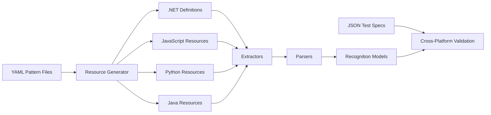
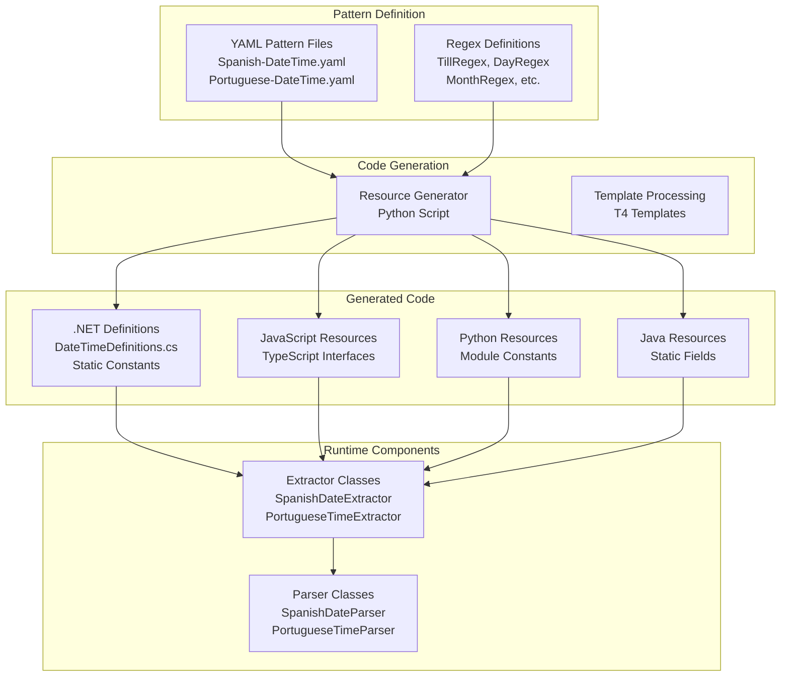
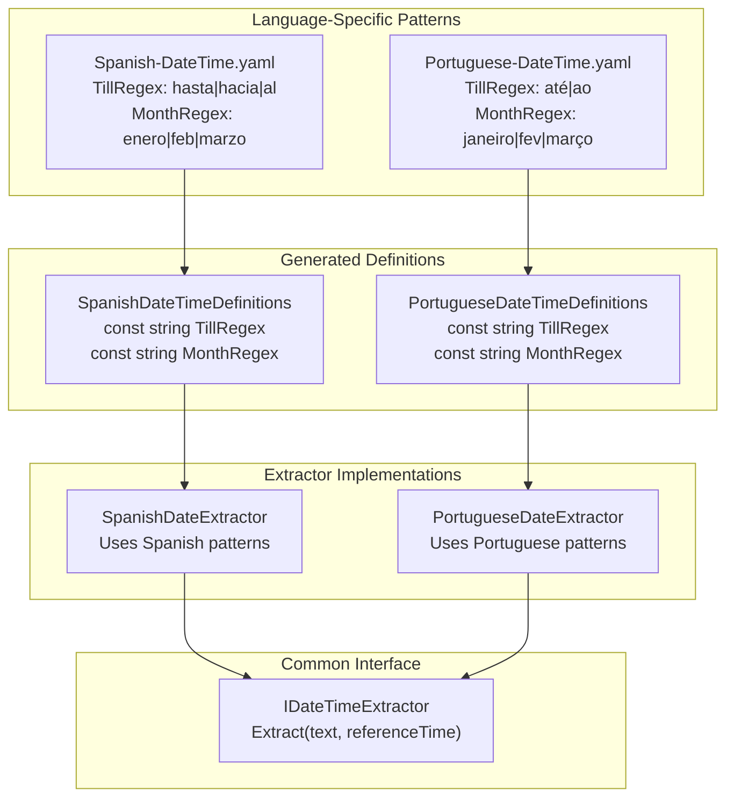
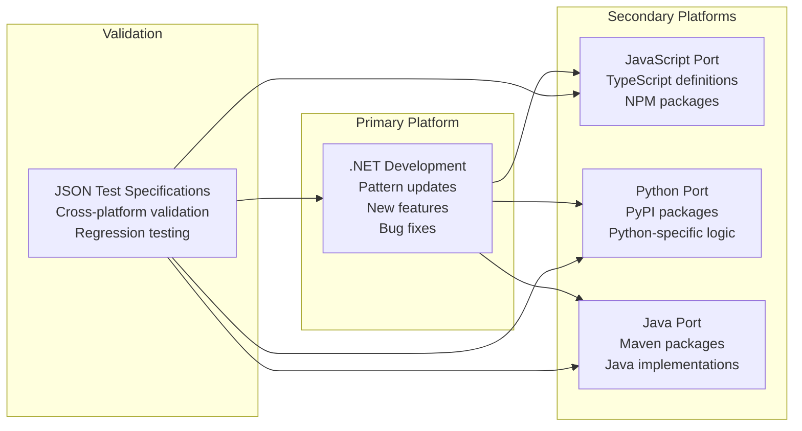
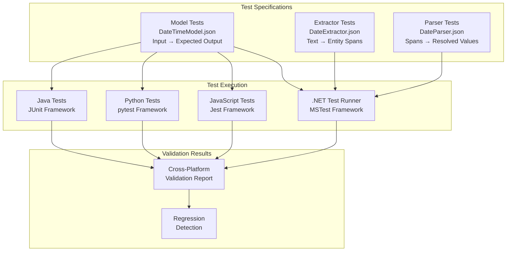

<!-- source: DeepWiki mcp.deepwiki.com · repo microsoft/Recognizers-Text · page 5 Development Guide · fetched 2026-10-26 -->

# Development Guide

<details>
<summary>Relevant source files</summary>

The following files were used as context for generating this wiki page:

- [.NET/Microsoft.Recognizers.Definitions.Common/Portuguese/DateTimeDefinitions.cs](.NET/Microsoft.Recognizers.Definitions.Common/Portuguese/DateTimeDefinitions.cs)
- [.NET/Microsoft.Recognizers.Definitions.Common/Spanish/DateTimeDefinitions.cs](.NET/Microsoft.Recognizers.Definitions.Common/Spanish/DateTimeDefinitions.cs)
- [Java/libraries/recognizers-text-date-time/src/main/java/com/microsoft/recognizers/text/datetime/spanish/extractors/SpanishDatePeriodExtractorConfiguration.java](Java/libraries/recognizers-text-date-time/src/main/java/com/microsoft/recognizers/text/datetime/spanish/extractors/SpanishDatePeriodExtractorConfiguration.java)
- [Java/libraries/recognizers-text-number/src/main/java/com/microsoft/recognizers/text/number/spanish/extractors/OrdinalExtractor.java](Java/libraries/recognizers-text-number/src/main/java/com/microsoft/recognizers/text/number/spanish/extractors/OrdinalExtractor.java)
- [Patterns/Portuguese/Portuguese-DateTime.yaml](Patterns/Portuguese/Portuguese-DateTime.yaml)
- [Patterns/Spanish/Spanish-DateTime.yaml](Patterns/Spanish/Spanish-DateTime.yaml)
- [Python/.pre-commit-config.yaml](Python/.pre-commit-config.yaml)
- [Python/build.ci.cmd](Python/build.ci.cmd)
- [Python/build.sh](Python/build.sh)
- [Python/libraries/recognizers-choice/recognizers_choice/choice/english/__init__.py](Python/libraries/recognizers-choice/recognizers_choice/choice/english/__init__.py)
- [Python/libraries/recognizers-choice/recognizers_choice/resources/__init__.py](Python/libraries/recognizers-choice/recognizers_choice/resources/__init__.py)
- [Python/libraries/recognizers-choice/resource-definitions.json](Python/libraries/recognizers-choice/resource-definitions.json)
- [Python/libraries/recognizers-choice/setup.py](Python/libraries/recognizers-choice/setup.py)
- [Python/libraries/recognizers-text/recognizers_text/parser.py](Python/libraries/recognizers-text/recognizers_text/parser.py)
- [Python/requirements.txt](Python/requirements.txt)
- [Python/setup.py](Python/setup.py)
- [Python/tests/requirements.txt](Python/tests/requirements.txt)
- [README.md](README.md)
- [Script/Utils/countNotSupportedCases.py](Script/Utils/countNotSupportedCases.py)
- [Script/Utils/deleteNotSupportedPlatform.py](Script/Utils/deleteNotSupportedPlatform.py)
- [Script/Utils/getNotSupportedInput.py](Script/Utils/getNotSupportedInput.py)
- [Specs/DateTime/Portuguese/DateTimeModel.json](Specs/DateTime/Portuguese/DateTimeModel.json)
- [Specs/DateTime/Spanish/DateExtractor.json](Specs/DateTime/Spanish/DateExtractor.json)
- [Specs/DateTime/Spanish/DatePeriodExtractor.json](Specs/DateTime/Spanish/DatePeriodExtractor.json)
- [Specs/DateTime/Spanish/DatePeriodParser.json](Specs/DateTime/Spanish/DatePeriodParser.json)
- [Specs/DateTime/Spanish/DateTimeModel.json](Specs/DateTime/Spanish/DateTimeModel.json)
- [Specs/DateTime/Spanish/DateTimePeriodExtractor.json](Specs/DateTime/Spanish/DateTimePeriodExtractor.json)
- [Specs/DateTime/Spanish/DateTimePeriodParser.json](Specs/DateTime/Spanish/DateTimePeriodParser.json)
- [Specs/DateTime/Spanish/DurationExtractor.json](Specs/DateTime/Spanish/DurationExtractor.json)
- [Specs/DateTime/Spanish/TimePeriodExtractor.json](Specs/DateTime/Spanish/TimePeriodExtractor.json)
- [Specs/DateTime/Spanish/TimePeriodParser.json](Specs/DateTime/Spanish/TimePeriodParser.json)

</details>


This guide provides essential information for developers contributing to Microsoft Recognizers Text. It covers the pattern-driven architecture, cross-platform development workflow, and key concepts needed to extend or modify the recognizers.

For information about specific entity recognition domains, see [Entity Recognition Domains](#2). For platform-specific implementation details, see [Platform Implementations](#4). For comprehensive testing procedures, see [Testing Framework](#5.3).

## Pattern-Driven Architecture

Microsoft Recognizers Text follows a pattern-driven development approach where natural language recognition rules are defined in YAML files and automatically generated into platform-specific code. This architecture enables consistent behavior across .NET, JavaScript, Python, and Java platforms while maintaining a single source of truth for recognition logic.

### Core Development Pipeline



Sources: [Patterns/Spanish/Spanish-DateTime.yaml:1-10](), [.NET/Microsoft.Recognizers.Definitions.Common/Spanish/DateTimeDefinitions.cs:1-25](), [Python/build.ci.cmd:20-25]()

### Pattern Definition to Code Generation Flow

The development process transforms human-readable pattern definitions into executable recognition logic:



Sources: [Patterns/Spanish/Spanish-DateTime.yaml:1-50](), [.NET/Microsoft.Recognizers.Definitions.Common/Spanish/DateTimeDefinitions.cs:17-50](), [Python/libraries/resource-generator]()

## Key Development Concepts

### Extractor-Parser Pipeline

All recognition follows a two-stage pipeline where `Extractors` identify potential matches and `Parsers` resolve them into structured results:

- **Extractors**: Use regex patterns to identify candidate text spans
- **Parsers**: Apply language-specific logic to resolve ambiguities and generate final values
- **Models**: Provide the public API interface combining extractor and parser functionality

### Pattern Inheritance and References

YAML patterns support inheritance and cross-references to maintain consistency:

```yaml
# Base pattern definition
DayRegex: !simpleRegex
  def: \b(?<day>01|02|03|...|31)(?:\.[º°])?(?=\b|t)

# Pattern that references another pattern  
OnRegex: !nestedRegex
  def: ((?<=\b(e[ln])\s+)|(\be[ln]\s+d[ií]a\s+))({DayRegex}s?)(?![.,]\d)\b
  references: [ DayRegex ]
```

Sources: [Patterns/Spanish/Spanish-DateTime.yaml:14-18](), [Patterns/Spanish/Spanish-DateTime.yaml:179-181]()

### Multi-Language Support Architecture

Each language implements the same interface contracts while providing language-specific pattern definitions:



Sources: [Patterns/Spanish/Spanish-DateTime.yaml:5-12](), [Patterns/Portuguese/Portuguese-DateTime.yaml:5-10](), [.NET/Microsoft.Recognizers.Definitions.Common/Spanish/DateTimeDefinitions.cs:22-30]()

## Cross-Platform Development Workflow

### Contribution Propagation Model

.NET serves as the primary development platform, with contributions propagating to other platforms over time:



Sources: [README.md:21](), [Python/build.ci.cmd:20-50](), [Specs/DateTime/Spanish/DateTimeModel.json:1-50]()

### Build and Resource Generation Process

The build process ensures consistent pattern deployment across all platforms:

| Step | Description | Key Files |
|------|-------------|-----------|
| Pattern Definition | Define recognition patterns in YAML | `Patterns/{Language}/{Language}-{Domain}.yaml` |
| Resource Generation | Transform YAML to platform code | `Python/libraries/resource-generator/index.py` |
| Code Generation | Generate platform-specific definitions | `.NET/.../DateTimeDefinitions.cs` |
| Testing | Validate against JSON test specifications | `Specs/{Domain}/{Language}/*.json` |
| Packaging | Create platform-specific packages | `CreateAllPackages.cmd` |

Sources: [Python/build.ci.cmd:20-70](), [Python/libraries/resource-generator](), [Specs/DateTime/Spanish/DateTimeModel.json:1-10]()

## Testing and Validation Framework

### Data-Driven Testing Architecture

The testing framework uses JSON specifications to ensure consistent behavior across platforms:



Sources: [Specs/DateTime/Spanish/DateTimeModel.json:1-20](), [Specs/DateTime/Spanish/DateExtractor.json:1-15](), [Python/build.ci.cmd:45-50]()

## Getting Started with Development

### Essential Development Environment Setup

1. **Prerequisites**: Python 3.x for resource generation, platform-specific SDKs
2. **Resource Generator**: Install dependencies via `pip install -r requirements.txt`
3. **Pattern Development**: Work with YAML files in `Patterns/{Language}/` directory
4. **Testing**: Use JSON specifications in `Specs/{Domain}/{Language}/` directory

### Common Development Tasks

| Task | Primary Files | Key Concepts |
|------|---------------|--------------|
| Add new language | `Patterns/{NewLanguage}/{NewLanguage}-{Domain}.yaml` | Pattern inheritance, regex groups |
| Extend existing patterns | `Patterns/{Language}/{Language}-{Domain}.yaml` | Nested regex references |
| Add test cases | `Specs/{Domain}/{Language}/*.json` | Input-output validation |
| Debug recognition | Generated definition files, extractor implementations | Pattern matching logic |

### Pattern Development Guidelines

- Use named capture groups in regex patterns: `(?<day>...)`
- Reference other patterns via `{PatternName}` syntax
- Define complex patterns using `!nestedRegex` with explicit references
- Maintain consistent naming conventions across languages
- Include comprehensive test cases for new patterns

Sources: [Patterns/Spanish/Spanish-DateTime.yaml:14-30](), [Patterns/Portuguese/Portuguese-DateTime.yaml:10-30](), [Specs/DateTime/Spanish/DateTimeModel.json:1-60](), [Python/requirements.txt:1-4]()

---

