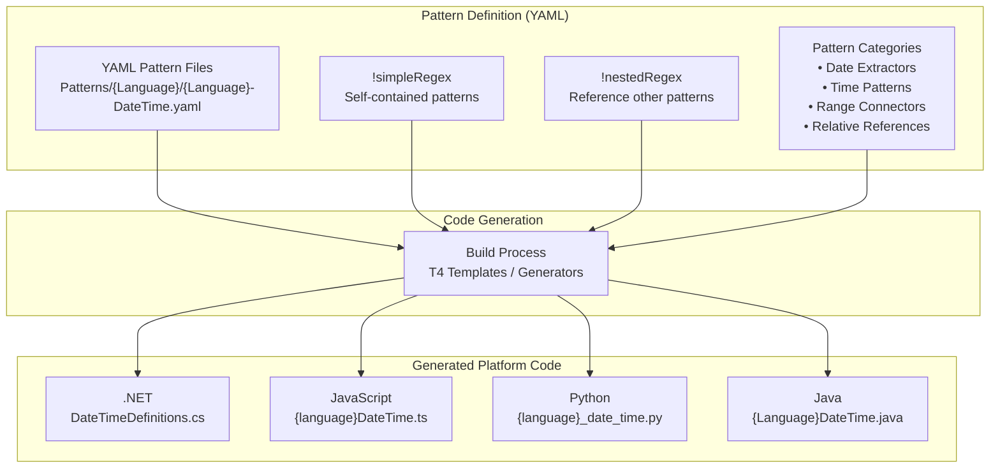
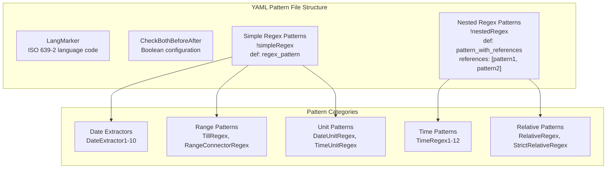
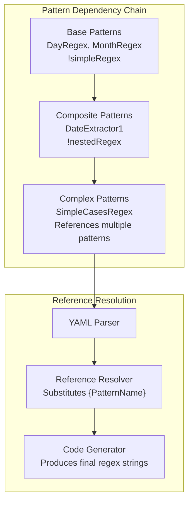
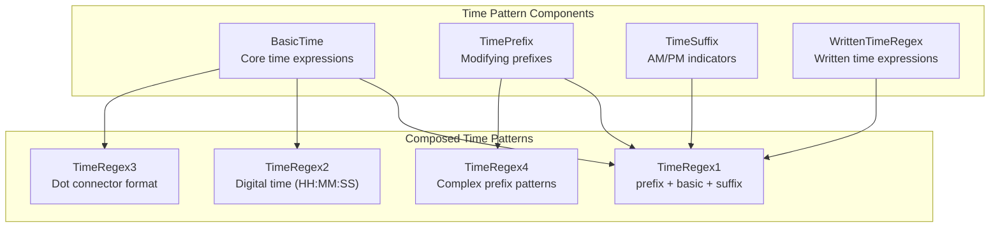
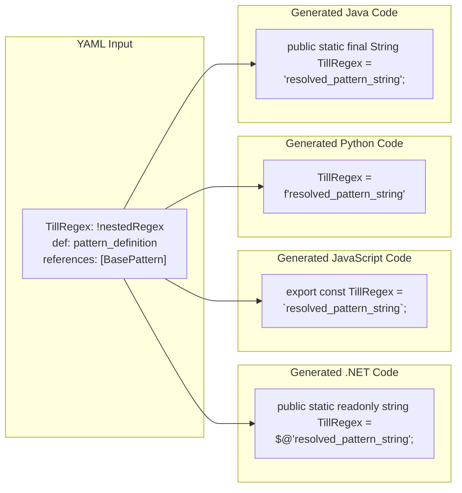
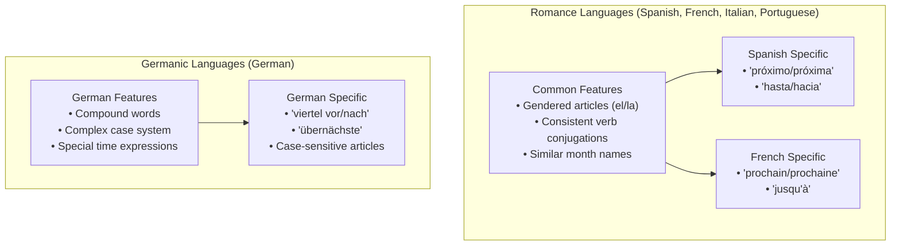
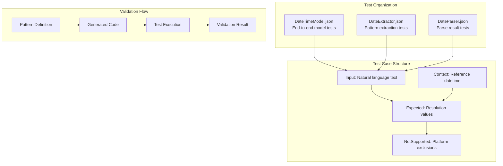

<!-- source: DeepWiki mcp.deepwiki.com · repo microsoft/Recognizers-Text · page 5.1 Pattern Definition System · fetched 2026-10-26 -->

# Pattern Definition System

<details>
<summary>Relevant source files</summary>

The following files were used as context for generating this wiki page:

- [.NET/Microsoft.Recognizers.Definitions.Common/French/DateTimeDefinitions.cs](.NET/Microsoft.Recognizers.Definitions.Common/French/DateTimeDefinitions.cs)
- [.NET/Microsoft.Recognizers.Definitions.Common/German/DateTimeDefinitions.cs](.NET/Microsoft.Recognizers.Definitions.Common/German/DateTimeDefinitions.cs)
- [.NET/Microsoft.Recognizers.Definitions.Common/Italian/DateTimeDefinitions.cs](.NET/Microsoft.Recognizers.Definitions.Common/Italian/DateTimeDefinitions.cs)
- [.NET/Microsoft.Recognizers.Definitions.Common/Portuguese/DateTimeDefinitions.cs](.NET/Microsoft.Recognizers.Definitions.Common/Portuguese/DateTimeDefinitions.cs)
- [.NET/Microsoft.Recognizers.Definitions.Common/Spanish/DateTimeDefinitions.cs](.NET/Microsoft.Recognizers.Definitions.Common/Spanish/DateTimeDefinitions.cs)
- [.NET/Microsoft.Recognizers.Text.DateTime/German/Parsers/GermanTimeParserConfiguration.cs](.NET/Microsoft.Recognizers.Text.DateTime/German/Parsers/GermanTimeParserConfiguration.cs)
- [Java/libraries/recognizers-text-date-time/src/main/java/com/microsoft/recognizers/text/datetime/german/parsers/GermanTimeParserConfiguration.java](Java/libraries/recognizers-text-date-time/src/main/java/com/microsoft/recognizers/text/datetime/german/parsers/GermanTimeParserConfiguration.java)
- [Java/libraries/recognizers-text-date-time/src/main/java/com/microsoft/recognizers/text/datetime/resources/FrenchDateTime.java](Java/libraries/recognizers-text-date-time/src/main/java/com/microsoft/recognizers/text/datetime/resources/FrenchDateTime.java)
- [Java/libraries/recognizers-text-date-time/src/main/java/com/microsoft/recognizers/text/datetime/resources/GermanDateTime.java](Java/libraries/recognizers-text-date-time/src/main/java/com/microsoft/recognizers/text/datetime/resources/GermanDateTime.java)
- [Java/libraries/recognizers-text-date-time/src/main/java/com/microsoft/recognizers/text/datetime/resources/PortugueseDateTime.java](Java/libraries/recognizers-text-date-time/src/main/java/com/microsoft/recognizers/text/datetime/resources/PortugueseDateTime.java)
- [Java/libraries/recognizers-text-date-time/src/main/java/com/microsoft/recognizers/text/datetime/resources/SpanishDateTime.java](Java/libraries/recognizers-text-date-time/src/main/java/com/microsoft/recognizers/text/datetime/resources/SpanishDateTime.java)
- [Java/libraries/recognizers-text-date-time/src/main/java/com/microsoft/recognizers/text/datetime/spanish/extractors/SpanishDatePeriodExtractorConfiguration.java](Java/libraries/recognizers-text-date-time/src/main/java/com/microsoft/recognizers/text/datetime/spanish/extractors/SpanishDatePeriodExtractorConfiguration.java)
- [Java/libraries/recognizers-text-number/src/main/java/com/microsoft/recognizers/text/number/spanish/extractors/OrdinalExtractor.java](Java/libraries/recognizers-text-number/src/main/java/com/microsoft/recognizers/text/number/spanish/extractors/OrdinalExtractor.java)
- [JavaScript/packages/recognizers-date-time/src/resources/frenchDateTime.ts](JavaScript/packages/recognizers-date-time/src/resources/frenchDateTime.ts)
- [JavaScript/packages/recognizers-date-time/src/resources/portugueseDateTime.ts](JavaScript/packages/recognizers-date-time/src/resources/portugueseDateTime.ts)
- [JavaScript/packages/recognizers-date-time/src/resources/spanishDateTime.ts](JavaScript/packages/recognizers-date-time/src/resources/spanishDateTime.ts)
- [Patterns/French/French-DateTime.yaml](Patterns/French/French-DateTime.yaml)
- [Patterns/German/German-DateTime.yaml](Patterns/German/German-DateTime.yaml)
- [Patterns/Italian/Italian-DateTime.yaml](Patterns/Italian/Italian-DateTime.yaml)
- [Patterns/Portuguese/Portuguese-DateTime.yaml](Patterns/Portuguese/Portuguese-DateTime.yaml)
- [Patterns/Spanish/Spanish-DateTime.yaml](Patterns/Spanish/Spanish-DateTime.yaml)
- [Python/libraries/recognizers-date-time/recognizers_date_time/date_time/german/time_parser_config.py](Python/libraries/recognizers-date-time/recognizers_date_time/date_time/german/time_parser_config.py)
- [Python/libraries/recognizers-date-time/recognizers_date_time/resources/french_date_time.py](Python/libraries/recognizers-date-time/recognizers_date_time/resources/french_date_time.py)
- [Python/libraries/recognizers-date-time/recognizers_date_time/resources/german_date_time.py](Python/libraries/recognizers-date-time/recognizers_date_time/resources/german_date_time.py)
- [Python/libraries/recognizers-date-time/recognizers_date_time/resources/portuguese_date_time.py](Python/libraries/recognizers-date-time/recognizers_date_time/resources/portuguese_date_time.py)
- [Python/libraries/recognizers-date-time/recognizers_date_time/resources/spanish_date_time.py](Python/libraries/recognizers-date-time/recognizers_date_time/resources/spanish_date_time.py)
- [Specs/DateTime/French/DateTimeModel.json](Specs/DateTime/French/DateTimeModel.json)
- [Specs/DateTime/German/DateTimeModel.json](Specs/DateTime/German/DateTimeModel.json)
- [Specs/DateTime/German/TimeExtractor.json](Specs/DateTime/German/TimeExtractor.json)
- [Specs/DateTime/German/TimeParser.json](Specs/DateTime/German/TimeParser.json)
- [Specs/DateTime/Italian/DateTimeModel.json](Specs/DateTime/Italian/DateTimeModel.json)
- [Specs/DateTime/Portuguese/DateTimeModel.json](Specs/DateTime/Portuguese/DateTimeModel.json)
- [Specs/DateTime/Spanish/DateExtractor.json](Specs/DateTime/Spanish/DateExtractor.json)
- [Specs/DateTime/Spanish/DatePeriodExtractor.json](Specs/DateTime/Spanish/DatePeriodExtractor.json)
- [Specs/DateTime/Spanish/DatePeriodParser.json](Specs/DateTime/Spanish/DatePeriodParser.json)
- [Specs/DateTime/Spanish/DateTimeModel.json](Specs/DateTime/Spanish/DateTimeModel.json)
- [Specs/DateTime/Spanish/DateTimePeriodExtractor.json](Specs/DateTime/Spanish/DateTimePeriodExtractor.json)
- [Specs/DateTime/Spanish/DateTimePeriodParser.json](Specs/DateTime/Spanish/DateTimePeriodParser.json)
- [Specs/DateTime/Spanish/DurationExtractor.json](Specs/DateTime/Spanish/DurationExtractor.json)
- [Specs/DateTime/Spanish/TimePeriodExtractor.json](Specs/DateTime/Spanish/TimePeriodExtractor.json)
- [Specs/DateTime/Spanish/TimePeriodParser.json](Specs/DateTime/Spanish/TimePeriodParser.json)

</details>


## Purpose and Scope

The Pattern Definition System is the core mechanism that drives entity recognition across all supported languages in Microsoft Recognizers Text. This system uses YAML-based pattern definitions to generate platform-specific code for recognizing dates, times, numbers, and other entities from natural language text.

This document covers the structure, organization, and code generation process of pattern definitions. For information about how these patterns are used during runtime recognition, see [Testing Framework](#5.3). For details about platform-specific implementations, see [Platform Implementations](#4).

## System Architecture Overview

The Pattern Definition System transforms human-readable YAML pattern files into platform-specific regular expression constants and recognition logic across .NET, JavaScript, Python, and Java platforms.



**Sources:** [Patterns/Spanish/Spanish-DateTime.yaml:1-10](), [.NET/Microsoft.Recognizers.Definitions.Common/Spanish/DateTimeDefinitions.cs:1-25](), [JavaScript/packages/recognizers-date-time/src/resources/spanishDateTime.ts:1-15]()

## YAML Pattern Structure

Pattern definitions are organized in YAML files with a consistent structure across all supported languages. Each language has its own pattern file following the naming convention `{Language}-DateTime.yaml`.

### Core Pattern Elements



**Sources:** [Patterns/Spanish/Spanish-DateTime.yaml:1-15](), [Patterns/German/German-DateTime.yaml:1-15](), [Patterns/French/French-DateTime.yaml:1-20]()

### Pattern Reference System

The system supports hierarchical pattern composition where complex patterns reference simpler ones, enabling maintainable and reusable pattern definitions.



**Example from Spanish patterns:**
- `DayRegex`: `\b(?<day>01|02|03|...|31)\b` (simple pattern)
- `SimpleCasesRegex`: Uses `{DayRegex}`, `{TillRegex}`, `{MonthSuffixRegex}` (nested pattern)

**Sources:** [Patterns/Spanish/Spanish-DateTime.yaml:16-17](), [Patterns/Spanish/Spanish-DateTime.yaml:81-83]()

## Pattern Types and Categories

### Date Extraction Patterns

Date extraction patterns are numbered sequentially (`DateExtractor1` through `DateExtractor10`) and handle different date formats and contexts.

| Pattern | Purpose | Example Match |
|---------|---------|---------------|
| `DateExtractor1` | Basic date with optional weekday | "domingo, 5 de Abril" |
| `DateExtractor2` | Date with year variations | "6 de Abril, 2016" |
| `DateExtractor3` | Month-first formats | "Abril 5, 2016" |
| `DateExtractor4` | Numeric formats (MM/DD/YYYY) | "3-23-2017" |
| `DateExtractor5` | European formats (DD/MM/YYYY) | "23-3-2015" |

**Sources:** [Patterns/Spanish/Spanish-DateTime.yaml:243-281](), [.NET/Microsoft.Recognizers.Definitions.Common/Spanish/DateTimeDefinitions.cs:119-128]()

### Time Pattern Hierarchy

Time patterns follow a structured hierarchy from basic time recognition to complex time expressions with prefixes and suffixes.



**Sources:** [Patterns/Spanish/Spanish-DateTime.yaml:322-390](), [Patterns/German/German-DateTime.yaml:322-351]()

### Range and Connector Patterns

Range patterns handle temporal ranges and connections between time expressions.

| Pattern | Purpose | Spanish Example | German Example |
|---------|---------|-----------------|----------------|
| `TillRegex` | "Until" expressions | "hasta", "hacia" | "bis", "zum" |
| `RangeConnectorRegex` | "And" connectors | "y", "el" | "und" |
| `BetweenRegex` | "Between" ranges | "entre" | "zwischen" |

**Sources:** [Patterns/Spanish/Spanish-DateTime.yaml:5-12](), [Patterns/German/German-DateTime.yaml:5-8]()

## Code Generation Process

The pattern definitions are transformed into platform-specific code through automated code generation during the build process.

### Generated Code Structure



**Sources:** [.NET/Microsoft.Recognizers.Definitions.Common/Spanish/DateTimeDefinitions.cs:26-28](), [JavaScript/packages/recognizers-date-time/src/resources/spanishDateTime.ts:14-16](), [Python/libraries/recognizers-date-time/recognizers_date_time/resources/spanish_date_time.py:16-20]()

### Reference Resolution Algorithm

The code generation process resolves pattern references through string interpolation and substitution.

1. **Parse YAML**: Load pattern definitions and metadata
2. **Resolve Dependencies**: Build dependency graph of pattern references  
3. **Substitute References**: Replace `{PatternName}` with actual pattern strings
4. **Generate Constants**: Create platform-specific constant declarations
5. **Optimize Patterns**: Apply platform-specific regex optimizations

**Example transformation:**
```yaml
TillRegex: !nestedRegex
  def: (?<till>\b(hasta|hacia|al?)\b(\s+(el|la(s)?)\b)?|{BaseDateTime.RangeConnectorSymbolRegex})
  references: [ BaseDateTime.RangeConnectorSymbolRegex ]
```

Becomes:
```csharp
public static readonly string TillRegex = 
    $@"(?<till>\b(hasta|hacia|al?)\b(\s+(el|la(s)?)\b)?|{BaseDateTime.RangeConnectorSymbolRegex})";
```

**Sources:** [Patterns/Spanish/Spanish-DateTime.yaml:5-7](), [.NET/Microsoft.Recognizers.Definitions.Common/Spanish/DateTimeDefinitions.cs:26]()

## Language-Specific Pattern Organization

### Supported Languages and Completeness

Each language implements patterns with varying levels of completeness based on linguistic complexity and usage requirements.

| Language | Pattern File | Generated Classes | Key Characteristics |
|----------|-------------|-------------------|-------------------|
| Spanish | `Spanish-DateTime.yaml` | `SpanishDateTime` | Most comprehensive Romance language support |
| German | `German-DateTime.yaml` | `GermanDateTime` | Complex compound words, special time expressions |
| French | `French-DateTime.yaml` | `FrenchDateTime` | Romance language patterns, liaison handling |
| Portuguese | `Portuguese-DateTime.yaml` | `PortugueseDateTime` | Brazilian/European variants |
| Italian | `Italian-DateTime.yaml` | `ItalianDateTime` | Romance language with regional variations |

**Sources:** [Patterns/Spanish/Spanish-DateTime.yaml:1-3](), [Patterns/German/German-DateTime.yaml:1-3](), [Patterns/French/French-DateTime.yaml:1-3]()

### Language-Specific Pattern Variations

Different languages require unique pattern approaches based on linguistic characteristics.



**Example: German time expressions**
- `QuarterToTokenRegex`: `^(viertel\s+vor|dreiviertel)\s*$` (quarter to)
- `QuarterPastTokenRegex`: `^(viertel\s+nach)\s*$` (quarter past)

**Sources:** [Patterns/German/German-DateTime.yaml:88-91](), [Patterns/Spanish/Spanish-DateTime.yaml:37-42](), [Patterns/French/French-DateTime.yaml:14-18]()

## Pattern Testing and Validation

Pattern definitions are validated through comprehensive test suites that verify extraction accuracy across different contexts and edge cases.

### Test Specification Structure

Test specifications are stored as JSON files with input text, expected extractions, and platform support indicators.



**Example test case:**
```json
{
  "Input": "Ich komme am 2. Oktober zurück.",
  "Context": { "ReferenceDateTime": "2016-11-07T00:00:00" },
  "Results": [{
    "Text": "2. oktober",
    "TypeName": "datetimeV2.date",
    "Resolution": {
      "values": [{ "timex": "XXXX-10-02", "type": "date", "value": "2016-10-02" }]
    }
  }]
}
```

**Sources:** [Specs/DateTime/German/DateTimeModel.json:1-30](), [Specs/DateTime/Spanish/DateTimeModel.json:1-60](), [Specs/DateTime/French/DateTimeModel.json:1-25]()

---

