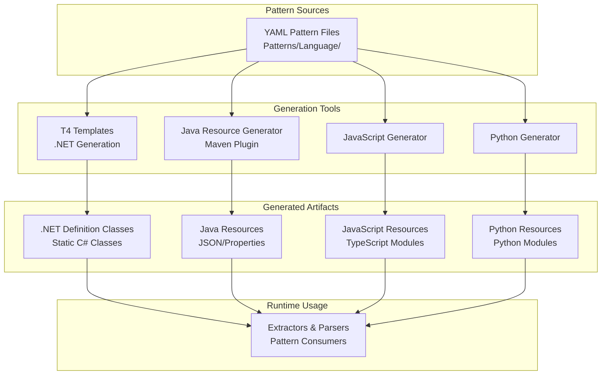
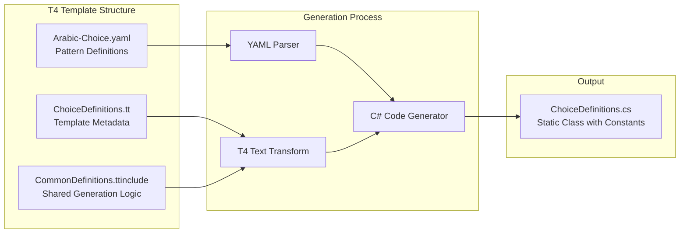
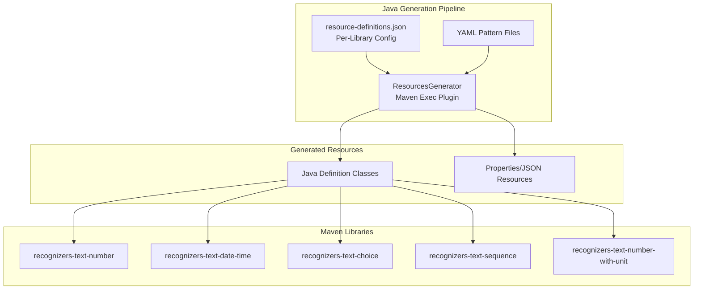
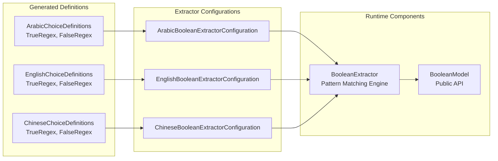
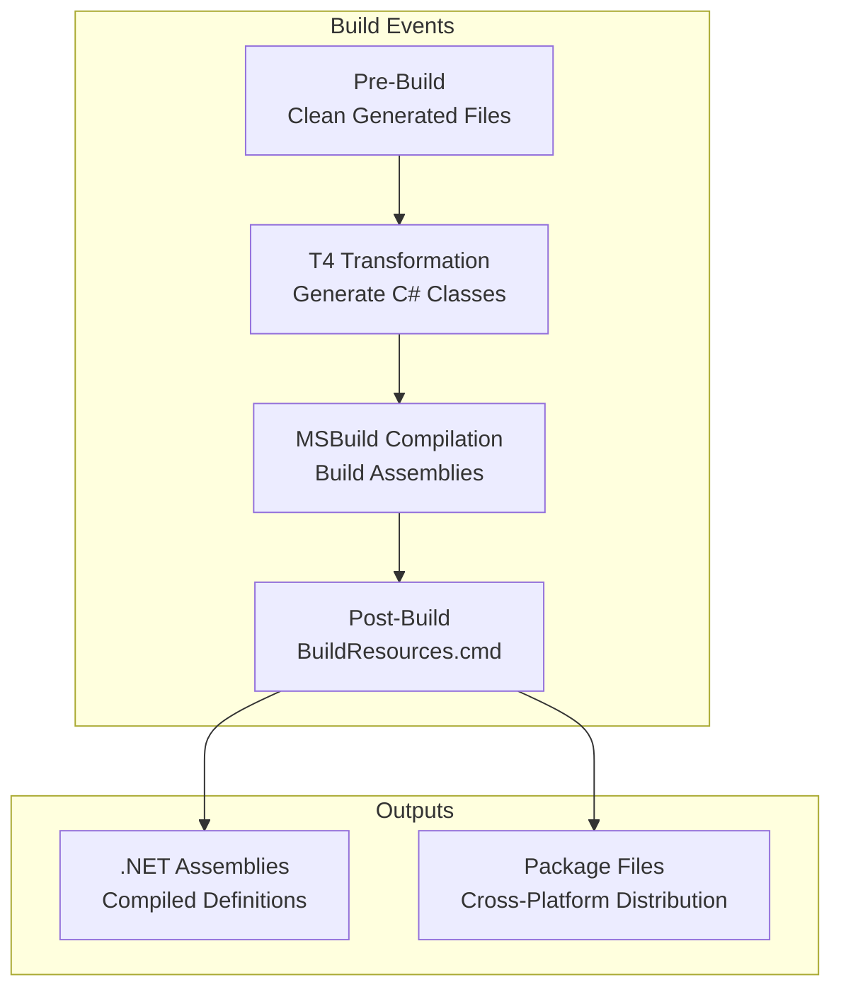

<!-- source: DeepWiki mcp.deepwiki.com · repo microsoft/Recognizers-Text · page 5.2 Code Generation Process · fetched 2026-10-26 -->

# Code Generation Process

<details>
<summary>Relevant source files</summary>

The following files were used as context for generating this wiki page:

- [.NET/Microsoft.Recognizers.Definitions.Common/Arabic/ChoiceDefinitions.cs](.NET/Microsoft.Recognizers.Definitions.Common/Arabic/ChoiceDefinitions.cs)
- [.NET/Microsoft.Recognizers.Definitions.Common/Arabic/ChoiceDefinitions.tt](.NET/Microsoft.Recognizers.Definitions.Common/Arabic/ChoiceDefinitions.tt)
- [.NET/Microsoft.Recognizers.Definitions.Common/Microsoft.Recognizers.Definitions.Common.csproj](.NET/Microsoft.Recognizers.Definitions.Common/Microsoft.Recognizers.Definitions.Common.csproj)
- [.NET/Microsoft.Recognizers.Definitions.Common/Swedish/QuotedTextDefinitions.cs](.NET/Microsoft.Recognizers.Definitions.Common/Swedish/QuotedTextDefinitions.cs)
- [.NET/Microsoft.Recognizers.Definitions.Common/packages.config](.NET/Microsoft.Recognizers.Definitions.Common/packages.config)
- [.NET/Microsoft.Recognizers.Definitions/Microsoft.Recognizers.Definitions.csproj](.NET/Microsoft.Recognizers.Definitions/Microsoft.Recognizers.Definitions.csproj)
- [.NET/Microsoft.Recognizers.Text.Choice/Arabic/Extractors/ArabicBooleanExtractorConfiguration.cs](.NET/Microsoft.Recognizers.Text.Choice/Arabic/Extractors/ArabicBooleanExtractorConfiguration.cs)
- [.NET/Microsoft.Recognizers.Text.Choice/ChoiceRecognizer.cs](.NET/Microsoft.Recognizers.Text.Choice/ChoiceRecognizer.cs)
- [.NET/Microsoft.Recognizers.Text.Choice/Microsoft.Recognizers.Text.Choice.csproj](.NET/Microsoft.Recognizers.Text.Choice/Microsoft.Recognizers.Text.Choice.csproj)
- [.NET/Microsoft.Recognizers.Text.DataDrivenTests/Choice/TestChoice_Arabic.cs](.NET/Microsoft.Recognizers.Text.DataDrivenTests/Choice/TestChoice_Arabic.cs)
- [.NET/Microsoft.Recognizers.Text.DataDrivenTests/Microsoft.Recognizers.Text.DataDrivenTests.csproj](.NET/Microsoft.Recognizers.Text.DataDrivenTests/Microsoft.Recognizers.Text.DataDrivenTests.csproj)
- [.NET/Microsoft.Recognizers.Text.DataTypes.DataDrivenTests/Microsoft.Recognizers.Text.DataTypes.DataDrivenTests.csproj](.NET/Microsoft.Recognizers.Text.DataTypes.DataDrivenTests/Microsoft.Recognizers.Text.DataTypes.DataDrivenTests.csproj)
- [.NET/Microsoft.Recognizers.Text.DataTypes.TimexExpression/Microsoft.Recognizers.Text.DataTypes.TimexExpression.csproj](.NET/Microsoft.Recognizers.Text.DataTypes.TimexExpression/Microsoft.Recognizers.Text.DataTypes.TimexExpression.csproj)
- [.NET/Microsoft.Recognizers.Text.DateTime/Microsoft.Recognizers.Text.DateTime.csproj](.NET/Microsoft.Recognizers.Text.DateTime/Microsoft.Recognizers.Text.DateTime.csproj)
- [.NET/Microsoft.Recognizers.Text.Number/Microsoft.Recognizers.Text.Number.csproj](.NET/Microsoft.Recognizers.Text.Number/Microsoft.Recognizers.Text.Number.csproj)
- [.NET/Microsoft.Recognizers.Text.NumberWithUnit/Japanese/Extractors/TemperatureExtractorConfiguration.cs](.NET/Microsoft.Recognizers.Text.NumberWithUnit/Japanese/Extractors/TemperatureExtractorConfiguration.cs)
- [.NET/Microsoft.Recognizers.Text.NumberWithUnit/Japanese/Parsers/TemperatureParserConfiguration.cs](.NET/Microsoft.Recognizers.Text.NumberWithUnit/Japanese/Parsers/TemperatureParserConfiguration.cs)
- [.NET/Microsoft.Recognizers.Text.NumberWithUnit/Microsoft.Recognizers.Text.NumberWithUnit.csproj](.NET/Microsoft.Recognizers.Text.NumberWithUnit/Microsoft.Recognizers.Text.NumberWithUnit.csproj)
- [.NET/Microsoft.Recognizers.Text.Sequence/Microsoft.Recognizers.Text.Sequence.csproj](.NET/Microsoft.Recognizers.Text.Sequence/Microsoft.Recognizers.Text.Sequence.csproj)
- [.NET/Microsoft.Recognizers.Text.sln](.NET/Microsoft.Recognizers.Text.sln)
- [.NET/Microsoft.Recognizers.Text/Culture.cs](.NET/Microsoft.Recognizers.Text/Culture.cs)
- [.NET/Microsoft.Recognizers.Text/Microsoft.Recognizers.Text.csproj](.NET/Microsoft.Recognizers.Text/Microsoft.Recognizers.Text.csproj)
- [.NET/Samples/SimpleConsole/SimpleConsole.csproj](.NET/Samples/SimpleConsole/SimpleConsole.csproj)
- [Java/README.md](Java/README.md)
- [Java/libraries/recognizers-text-date-time/pom.xml](Java/libraries/recognizers-text-date-time/pom.xml)
- [Java/libraries/recognizers-text/src/main/java/com/microsoft/recognizers/text/utilities/StringUtility.java](Java/libraries/recognizers-text/src/main/java/com/microsoft/recognizers/text/utilities/StringUtility.java)
- [Java/libraries/resource-generator/pom.xml](Java/libraries/resource-generator/pom.xml)
- [Java/linting-excluded-files.xml](Java/linting-excluded-files.xml)
- [Java/linting-rules.xml](Java/linting-rules.xml)
- [Java/pom.xml](Java/pom.xml)
- [Java/samples/simple-console/pom.xml](Java/samples/simple-console/pom.xml)
- [Java/samples/simple-console/src/main/java/com/microsoft/recognizers/text/samples/simpleconsole/Sample.java](Java/samples/simple-console/src/main/java/com/microsoft/recognizers/text/samples/simpleconsole/Sample.java)
- [Java/tests/pom.xml](Java/tests/pom.xml)
- [Patterns/Arabic/Arabic-Choice.yaml](Patterns/Arabic/Arabic-Choice.yaml)
- [Specs/Choice/Arabic/BooleanModel.json](Specs/Choice/Arabic/BooleanModel.json)

</details>


This document explains how YAML pattern definitions are transformed into platform-specific code resources across .NET, JavaScript, Python, and Java implementations. The code generation process ensures that pattern updates in YAML files are automatically propagated to all supported platforms with consistent functionality.

For information about how patterns are defined and structured, see [Pattern Definition System](#5.1). For details about testing the generated code, see [Testing Framework](#5.3).

## Overview

The code generation system converts human-readable YAML pattern files into strongly-typed platform-specific code. This multi-stage process enables a single source of truth for recognition patterns while maintaining optimal runtime performance across different platforms.



Sources: [.NET/Microsoft.Recognizers.Definitions.Common/Microsoft.Recognizers.Definitions.Common.csproj:1-570](), [Java/libraries/resource-generator/pom.xml:1-71](), [Patterns/Arabic/Arabic-Choice.yaml:1-12]()

## YAML to .NET Code Generation

### T4 Template System

The .NET platform uses T4 (Text Template Transformation Toolkit) templates to generate C# static classes from YAML pattern files. Each language-entity combination has a corresponding `.tt` template file that specifies generation parameters.



### Template Configuration

Each T4 template specifies three key parameters that drive code generation:

| Parameter | Purpose | Example |
|-----------|---------|---------|
| `DataFilename` | YAML source file path | `@"Patterns\Arabic\Arabic-Choice.yaml"` |
| `Language` | Target language identifier | `"Arabic"` |
| `ClassName` | Generated class name | `"ChoiceDefinitions"` |

Sources: [.NET/Microsoft.Recognizers.Definitions.Common/Arabic/ChoiceDefinitions.tt:1-7]()

### Generated Class Structure

The T4 transformation produces static C# classes containing `const string` definitions for each pattern. These classes follow a consistent structure across all languages and entity types.

**Generated Class Example:**
```csharp
namespace Microsoft.Recognizers.Definitions.Arabic
{
    public static class ChoiceDefinitions
    {
        public const string LangMarker = @"Ara";
        public const string TokenizerRegex = @"[^\u0621-\u064A0-9]";
        public const string TrueRegex = $@"\b(صحيح|نعم|حسنا|موافق...)\b|(\uD83D\uDC4D...){SkinToneRegex}?";
        public const string FalseRegex = $@"\b(لست متاحا|لا أستطيع...)\b|(\uD83D\uDC4E...){SkinToneRegex}?";
    }
}
```

Sources: [.NET/Microsoft.Recognizers.Definitions.Common/Arabic/ChoiceDefinitions.cs:17-30]()

### Build Integration

The T4 transformation is integrated into the MSBuild process through project configuration and post-build events.

**Project Configuration:**
- `YamlDotNet` package reference for YAML parsing
- `DotNetCliToolReference` to `T5.TextTransform.Tool` for T4 processing
- `PostBuild` target executing `BuildResources.cmd`

**Build Process Flow:**
1. MSBuild triggers T4 transformation for each `.tt` file
2. T4 engine reads YAML pattern files using YamlDotNet
3. Generated C# files are compiled into the definitions assembly
4. Post-build script propagates resources to other platforms

Sources: [.NET/Microsoft.Recognizers.Definitions.Common/Microsoft.Recognizers.Definitions.Common.csproj:37-38](), [.NET/Microsoft.Recognizers.Definitions.Common/Microsoft.Recognizers.Definitions.Common.csproj:563-568]()

## Cross-Platform Resource Generation

### Java Resource Generation

The Java platform uses a Maven plugin approach with a dedicated `ResourcesGenerator` class that processes JSON configuration files to generate Java-compatible resources.



**Maven Configuration:**
The resource generator is executed via the `exec-maven-plugin` with specific resource definition files for each recognizer library:

- `libraries/recognizers-text-number/resource-definitions.json`
- `libraries/recognizers-text-number-with-unit/resource-definitions.json`
- `libraries/recognizers-text-choice/resource-definitions.json`
- `libraries/recognizers-text-date-time/resource-definitions.json`
- `libraries/recognizers-text-sequence/resource-definitions.json`

Sources: [Java/libraries/resource-generator/pom.xml:55-66]()

### Dependencies and Tools

The Java resource generator relies on several key dependencies for YAML processing and code generation:

| Dependency | Purpose | Version |
|------------|---------|---------|
| `jackson-databind` | JSON processing | 2.13.4.2 |
| `snakeyaml` | YAML parsing | 1.32 |
| `guava` | Utility libraries | 29.0-jre |

Sources: [Java/libraries/resource-generator/pom.xml:24-40]()

## Generated Code Usage Patterns

### Extractor Configuration Integration

The generated definition classes are consumed by extractor configurations across all entity types. Each language-specific extractor configuration imports and uses the generated constants.



**Configuration Example:**
The `ArabicBooleanExtractorConfiguration` directly references generated constants from `ChoiceDefinitions`:

```csharp
public ArabicBooleanExtractorConfiguration(bool onlyTopMatch = true)
    : base(
          trueRegex: ChoiceDefinitions.TrueRegex,
          falseRegex: ChoiceDefinitions.FalseRegex,
          tokenRegex: ChoiceDefinitions.TokenizerRegex,
          options: RegexOptions.Singleline | RegexOptions.RightToLeft,
          allowPartialMatch: false,
          maxDistance: 2,
          onlyTopMatch)
{
}
```

Sources: [.NET/Microsoft.Recognizers.Text.Choice/Arabic/Extractors/ArabicBooleanExtractorConfiguration.cs:10-23]()

### Cross-Platform Consistency

The code generation process ensures that the same YAML patterns produce functionally equivalent resources across all platforms, maintaining consistent recognition behavior while optimizing for each platform's strengths.

**Platform-Specific Optimizations:**
- **.NET**: Static constants compiled into assemblies for optimal performance
- **Java**: Properties files and static classes following Java conventions
- **JavaScript**: ES6 modules with exported constants
- **Python**: Python modules with string constants

Sources: [.NET/Microsoft.Recognizers.Text.Choice/ChoiceRecognizer.cs:72-128](), [Java/samples/simple-console/src/main/java/com/microsoft/recognizers/text/samples/simpleconsole/Sample.java:66-132]()

## Build Process Integration

### .NET Build Pipeline

The .NET build process integrates code generation at multiple stages to ensure generated code is always up-to-date with pattern changes.



**Key Build Targets:**
- `RunPostBuildEvent`: Set to `OnOutputUpdated` for incremental builds
- Platform-specific post-build commands for Windows (`robocopy`) and Unix (`cp`)
- Resource propagation to shared package directories

Sources: [.NET/Microsoft.Recognizers.Definitions.Common/Microsoft.Recognizers.Definitions.Common.csproj:10-11](), [.NET/Microsoft.Recognizers.Text.Choice/Microsoft.Recognizers.Text.Choice.csproj:51-57]()

### Maven Build Integration

The Java build process uses Maven lifecycle phases to trigger resource generation before compilation.

**Maven Phase Integration:**
- Resource generation executes during the `validate` phase
- Generated resources are included in the compilation classpath
- CheckStyle validation runs on generated code (with exclusions for generated files)

Sources: [Java/pom.xml:41-56](), [Java/linting-excluded-files.xml:8-9]()

---

