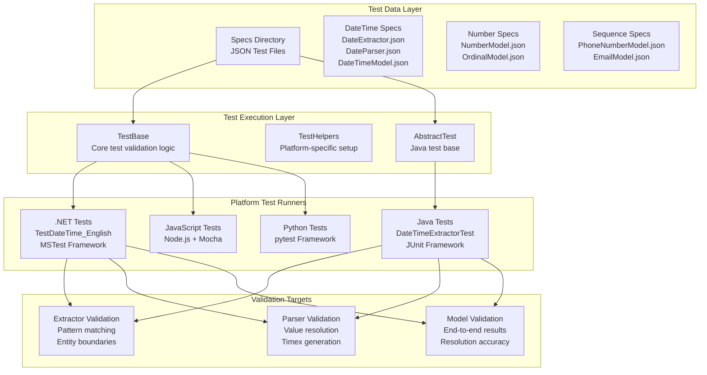
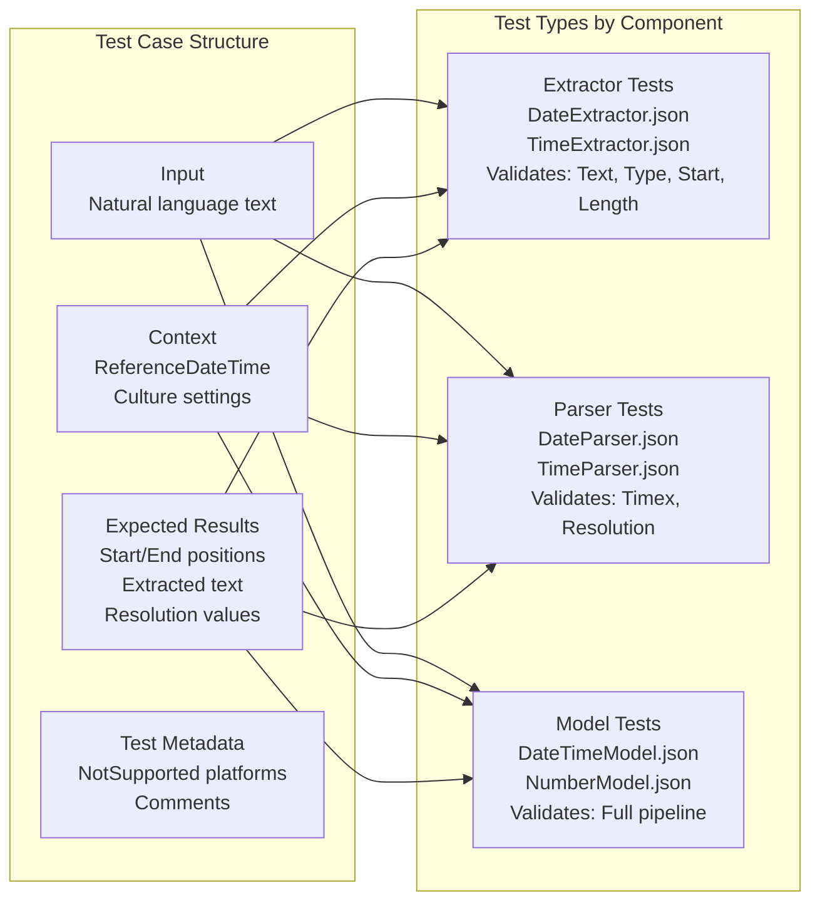
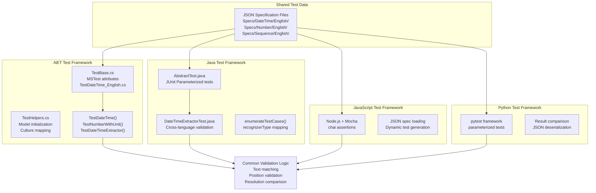
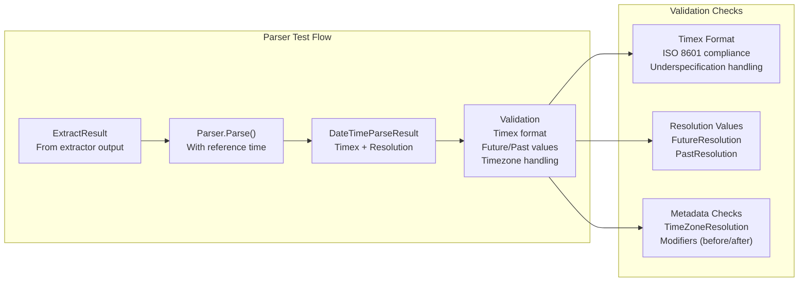
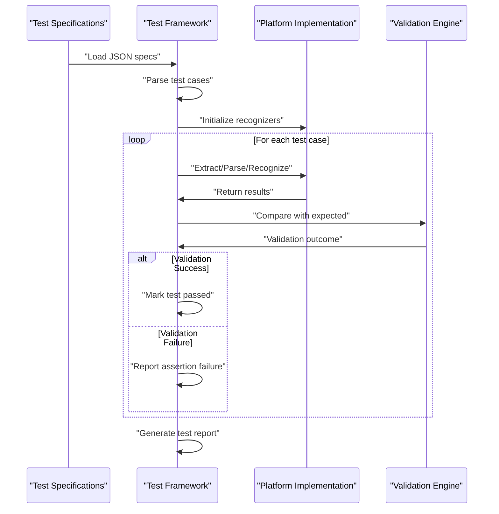

<!-- source: DeepWiki mcp.deepwiki.com · repo microsoft/Recognizers-Text · page 5.3 Testing Framework · fetched 2026-10-26 -->

# Testing Framework

<details>
<summary>Relevant source files</summary>

The following files were used as context for generating this wiki page:

- [.NET/Microsoft.Recognizers.Text.DataDrivenTests/DateTime/TestDateTime_English.cs](.NET/Microsoft.Recognizers.Text.DataDrivenTests/DateTime/TestDateTime_English.cs)
- [.NET/Microsoft.Recognizers.Text.DataDrivenTests/TestBase.cs](.NET/Microsoft.Recognizers.Text.DataDrivenTests/TestBase.cs)
- [.NET/Microsoft.Recognizers.Text.DataDrivenTests/TestHelpers.cs](.NET/Microsoft.Recognizers.Text.DataDrivenTests/TestHelpers.cs)
- [.NET/Microsoft.Recognizers.Text.DateTime/DateTimeOptions.cs](.NET/Microsoft.Recognizers.Text.DateTime/DateTimeOptions.cs)
- [.NET/Microsoft.Recognizers.Text.DateTime/Extractors/BaseDateExtractor.cs](.NET/Microsoft.Recognizers.Text.DateTime/Extractors/BaseDateExtractor.cs)
- [.NET/Microsoft.Recognizers.Text.DateTime/Extractors/BaseDateTimeAltExtractor.cs](.NET/Microsoft.Recognizers.Text.DateTime/Extractors/BaseDateTimeAltExtractor.cs)
- [.NET/Microsoft.Recognizers.Text.DateTime/Microsoft.Recognizers.Text.DateTime.xml](.NET/Microsoft.Recognizers.Text.DateTime/Microsoft.Recognizers.Text.DateTime.xml)
- [.NET/Microsoft.Recognizers.Text.DateTime/Parsers/BaseDateParser.cs](.NET/Microsoft.Recognizers.Text.DateTime/Parsers/BaseDateParser.cs)
- [.NET/Microsoft.Recognizers.Text.DateTime/Parsers/BaseDateTimeParser.cs](.NET/Microsoft.Recognizers.Text.DateTime/Parsers/BaseDateTimeParser.cs)
- [.NET/Microsoft.Recognizers.Text/Constants.cs](.NET/Microsoft.Recognizers.Text/Constants.cs)
- [.NET/Microsoft.Recognizers.Text/Models/ExtendedModelResult.cs](.NET/Microsoft.Recognizers.Text/Models/ExtendedModelResult.cs)
- [.NET/Microsoft.Recognizers.Text/Models/ModelResult.cs](.NET/Microsoft.Recognizers.Text/Models/ModelResult.cs)
- [Java/libraries/recognizers-text-date-time/src/main/java/com/microsoft/recognizers/text/datetime/DateTimeOptions.java](Java/libraries/recognizers-text-date-time/src/main/java/com/microsoft/recognizers/text/datetime/DateTimeOptions.java)
- [Java/libraries/recognizers-text-date-time/src/main/java/com/microsoft/recognizers/text/datetime/english/extractors/EnglishDateTimeAltExtractorConfiguration.java](Java/libraries/recognizers-text-date-time/src/main/java/com/microsoft/recognizers/text/datetime/english/extractors/EnglishDateTimeAltExtractorConfiguration.java)
- [Java/libraries/recognizers-text-date-time/src/main/java/com/microsoft/recognizers/text/datetime/english/extractors/EnglishMergedExtractorConfiguration.java](Java/libraries/recognizers-text-date-time/src/main/java/com/microsoft/recognizers/text/datetime/english/extractors/EnglishMergedExtractorConfiguration.java)
- [Java/libraries/recognizers-text-date-time/src/main/java/com/microsoft/recognizers/text/datetime/english/extractors/EnglishSetExtractorConfiguration.java](Java/libraries/recognizers-text-date-time/src/main/java/com/microsoft/recognizers/text/datetime/english/extractors/EnglishSetExtractorConfiguration.java)
- [Java/libraries/recognizers-text-date-time/src/main/java/com/microsoft/recognizers/text/datetime/english/extractors/EnglishTimeExtractorConfiguration.java](Java/libraries/recognizers-text-date-time/src/main/java/com/microsoft/recognizers/text/datetime/english/extractors/EnglishTimeExtractorConfiguration.java)
- [Java/libraries/recognizers-text-date-time/src/main/java/com/microsoft/recognizers/text/datetime/extractors/BaseDateTimeAltExtractor.java](Java/libraries/recognizers-text-date-time/src/main/java/com/microsoft/recognizers/text/datetime/extractors/BaseDateTimeAltExtractor.java)
- [Java/libraries/recognizers-text-date-time/src/main/java/com/microsoft/recognizers/text/datetime/extractors/BaseSetExtractor.java](Java/libraries/recognizers-text-date-time/src/main/java/com/microsoft/recognizers/text/datetime/extractors/BaseSetExtractor.java)
- [Java/libraries/recognizers-text-date-time/src/main/java/com/microsoft/recognizers/text/datetime/extractors/BaseTimeExtractor.java](Java/libraries/recognizers-text-date-time/src/main/java/com/microsoft/recognizers/text/datetime/extractors/BaseTimeExtractor.java)
- [Java/libraries/recognizers-text-date-time/src/main/java/com/microsoft/recognizers/text/datetime/extractors/IDateTimeListExtractor.java](Java/libraries/recognizers-text-date-time/src/main/java/com/microsoft/recognizers/text/datetime/extractors/IDateTimeListExtractor.java)
- [Java/libraries/recognizers-text-date-time/src/main/java/com/microsoft/recognizers/text/datetime/extractors/config/IDateTimeAltExtractorConfiguration.java](Java/libraries/recognizers-text-date-time/src/main/java/com/microsoft/recognizers/text/datetime/extractors/config/IDateTimeAltExtractorConfiguration.java)
- [Java/libraries/recognizers-text-date-time/src/main/java/com/microsoft/recognizers/text/datetime/extractors/config/IMergedExtractorConfiguration.java](Java/libraries/recognizers-text-date-time/src/main/java/com/microsoft/recognizers/text/datetime/extractors/config/IMergedExtractorConfiguration.java)
- [Java/libraries/recognizers-text-date-time/src/main/java/com/microsoft/recognizers/text/datetime/extractors/config/ISetExtractorConfiguration.java](Java/libraries/recognizers-text-date-time/src/main/java/com/microsoft/recognizers/text/datetime/extractors/config/ISetExtractorConfiguration.java)
- [Java/libraries/recognizers-text-date-time/src/main/java/com/microsoft/recognizers/text/datetime/extractors/config/ITimeExtractorConfiguration.java](Java/libraries/recognizers-text-date-time/src/main/java/com/microsoft/recognizers/text/datetime/extractors/config/ITimeExtractorConfiguration.java)
- [Java/libraries/recognizers-text-date-time/src/main/java/com/microsoft/recognizers/text/datetime/extractors/config/ProcessedSuperfluousWords.java](Java/libraries/recognizers-text-date-time/src/main/java/com/microsoft/recognizers/text/datetime/extractors/config/ProcessedSuperfluousWords.java)
- [Java/libraries/recognizers-text-date-time/src/main/java/com/microsoft/recognizers/text/datetime/models/DateTimeModel.java](Java/libraries/recognizers-text-date-time/src/main/java/com/microsoft/recognizers/text/datetime/models/DateTimeModel.java)
- [Java/libraries/recognizers-text-date-time/src/main/java/com/microsoft/recognizers/text/datetime/parsers/DateTimeParseResult.java](Java/libraries/recognizers-text-date-time/src/main/java/com/microsoft/recognizers/text/datetime/parsers/DateTimeParseResult.java)
- [Java/libraries/recognizers-text-date-time/src/main/java/com/microsoft/recognizers/text/datetime/spanish/extractors/SpanishSetExtractorConfiguration.java](Java/libraries/recognizers-text-date-time/src/main/java/com/microsoft/recognizers/text/datetime/spanish/extractors/SpanishSetExtractorConfiguration.java)
- [Java/libraries/recognizers-text-date-time/src/main/java/com/microsoft/recognizers/text/datetime/utilities/MatchingUtil.java](Java/libraries/recognizers-text-date-time/src/main/java/com/microsoft/recognizers/text/datetime/utilities/MatchingUtil.java)
- [Java/libraries/recognizers-text-date-time/src/main/java/com/microsoft/recognizers/text/datetime/utilities/Token.java](Java/libraries/recognizers-text-date-time/src/main/java/com/microsoft/recognizers/text/datetime/utilities/Token.java)
- [Java/libraries/recognizers-text/src/main/java/com/microsoft/recognizers/text/ExtractResult.java](Java/libraries/recognizers-text/src/main/java/com/microsoft/recognizers/text/ExtractResult.java)
- [Java/libraries/recognizers-text/src/main/java/com/microsoft/recognizers/text/ParseResult.java](Java/libraries/recognizers-text/src/main/java/com/microsoft/recognizers/text/ParseResult.java)
- [Java/tests/src/test/java/com/microsoft/recognizers/text/tests/datetime/DateTimeExtractorTest.java](Java/tests/src/test/java/com/microsoft/recognizers/text/tests/datetime/DateTimeExtractorTest.java)
- [Java/tests/src/test/java/com/microsoft/recognizers/text/tests/numberwithunit/NumberWithUnitRecognizerInitializationTest.java](Java/tests/src/test/java/com/microsoft/recognizers/text/tests/numberwithunit/NumberWithUnitRecognizerInitializationTest.java)
- [Specs/DateTime/English/DateExtractor.json](Specs/DateTime/English/DateExtractor.json)
- [Specs/DateTime/English/DateParser.json](Specs/DateTime/English/DateParser.json)
- [Specs/DateTime/English/DateTimeModelCalendarMode.json](Specs/DateTime/English/DateTimeModelCalendarMode.json)
- [Specs/DateTime/English/DateTimeModelExtendedTypes.json](Specs/DateTime/English/DateTimeModelExtendedTypes.json)

</details>


## Purpose and Scope

The Testing Framework provides comprehensive validation for the Microsoft Recognizers Text library across all supported platforms (.NET, Java, JavaScript, Python) and entity recognition domains. It implements a data-driven testing approach using JSON specification files to ensure consistent behavior and prevent regressions across language implementations and entity types.

For information about the actual recognition algorithms being tested, see [Entity Recognition Domains](#2). For details on platform-specific implementations, see [Platform Implementations](#4).

## Testing Architecture Overview

The testing framework uses a multi-layered architecture that separates test data definition from test execution, enabling consistent validation across all platforms and languages.



**Sources:** [.NET/Microsoft.Recognizers.Text.DataDrivenTests/TestBase.cs:1-463](), [Java/tests/src/test/java/com/microsoft/recognizers/text/tests/datetime/DateTimeExtractorTest.java:1-298](), [.NET/Microsoft.Recognizers.Text.DataDrivenTests/TestHelpers.cs:1-1000]()

## Test Specification Structure

Test specifications are defined in JSON files located in the `Specs` directory, organized by entity domain and language. Each test case contains input text, expected results, and contextual information.



**Example Test Case Structure:**
```json
{
  "Input": "I'll go back on 15",
  "Context": {
    "ReferenceDateTime": "2016-11-07T00:00:00"
  },
  "Results": [
    {
      "Text": "15",
      "Type": "date",
      "Start": 16,
      "Length": 2,
      "Resolution": {
        "values": [
          {
            "timex": "XXXX-XX-15",
            "type": "date",
            "value": "2016-11-15"
          }
        ]
      }
    }
  ]
}
```

**Sources:** [Specs/DateTime/English/DateParser.json:1-50](), [Specs/DateTime/English/DateExtractor.json:1-30](), [Specs/DateTime/English/DateTimeModelExtendedTypes.json:1-50]()

## Cross-Platform Test Execution

The framework ensures consistent behavior across all platforms by using shared test specifications and platform-specific test runners that validate the same expected outcomes.



**Sources:** [.NET/Microsoft.Recognizers.Text.DataDrivenTests/TestBase.cs:57-463](), [Java/tests/src/test/java/com/microsoft/recognizers/text/tests/datetime/DateTimeExtractorTest.java:81-297](), [.NET/Microsoft.Recognizers.Text.DataDrivenTests/TestHelpers.cs:104-230]()

## Test Validation Types

The framework implements three primary validation approaches, each targeting different aspects of the recognition pipeline with specific assertion strategies.

### Extractor Validation

Extractor tests validate pattern matching and entity boundary detection without parsing the extracted content.

| Validation Aspect | Implementation | Code Reference |
|-------------------|---------------|----------------|
| Text Extraction | `Assert.AreEqual(expected.getText(), actual.getText())` | [Java/tests/src/test/java/com/microsoft/recognizers/text/tests/datetime/DateTimeExtractorTest.java:122]() |
| Type Classification | `Assert.AreEqual(expected.getType(), actual.getType())` | [Java/tests/src/test/java/com/microsoft/recognizers/text/tests/datetime/DateTimeExtractorTest.java:121]() |
| Position Accuracy | `Assert.AreEqual(expected.getStart(), actual.getStart())` | [Java/tests/src/test/java/com/microsoft/recognizers/text/tests/datetime/DateTimeExtractorTest.java:123]() |
| Length Validation | `Assert.AreEqual(expected.getLength(), actual.getLength())` | [Java/tests/src/test/java/com/microsoft/recognizers/text/tests/datetime/DateTimeExtractorTest.java:124]() |

### Parser Validation

Parser tests validate value resolution, semantic interpretation, and TIMEX generation from extracted entities.



**Sources:** [.NET/Microsoft.Recognizers.Text.DataDrivenTests/TestBase.cs:217-271](), [Specs/DateTime/English/DateParser.json:7-23]()

### Model Validation

Model tests provide end-to-end validation by testing the complete recognition pipeline from input text to final resolution.

**Key Validation Areas:**

1. **Resolution Structure Validation**
   - ValueSet array structure: [.NET/Microsoft.Recognizers.Text.DataDrivenTests/TestBase.cs:106-131]()
   - Key-value pair consistency: [.NET/Microsoft.Recognizers.Text.DataDrivenTests/TestBase.cs:114-129]()

2. **Cross-Platform Consistency**
   - Model function mapping: [.NET/Microsoft.Recognizers.Text.DataDrivenTests/TestHelpers.cs:104-135]()
   - Culture-specific initialization: [.NET/Microsoft.Recognizers.Text.DataDrivenTests/TestHelpers.cs:137-187]()

3. **Feature Flag Support**
   - DateTimeOptions handling: [.NET/Microsoft.Recognizers.Text.DataDrivenTests/TestHelpers.cs:119-125]()
   - Platform-specific exclusions: [Specs/DateTime/English/DateTimeModelExtendedTypes.json:7]()

**Sources:** [.NET/Microsoft.Recognizers.Text.DataDrivenTests/TestBase.cs:75-140](), [.NET/Microsoft.Recognizers.Text.DataDrivenTests/TestHelpers.cs:104-145]()

## Data-Driven Testing Workflow

The framework orchestrates test execution through a systematic workflow that loads specifications, initializes platform-specific components, and validates results against expected outcomes.



**Workflow Implementation Details:**

1. **Test Discovery and Loading**
   - Spec enumeration: [Java/tests/src/test/java/com/microsoft/recognizers/text/tests/datetime/DateTimeExtractorTest.java:86-88]()
   - Dynamic test case generation: [.NET/Microsoft.Recognizers.Text.DataDrivenTests/TestHelpers.cs:137-145]()

2. **Component Initialization**
   - Extractor factory methods: [Java/tests/src/test/java/com/microsoft/recognizers/text/tests/datetime/DateTimeExtractorTest.java:128-151]()
   - Parser initialization: [.NET/Microsoft.Recognizers.Text.DataDrivenTests/TestHelpers.cs:189-229]()

3. **Result Validation**
   - Assertion frameworks: [.NET/Microsoft.Recognizers.Text.DataDrivenTests/TestBase.cs:384-463]()
   - Cross-platform result comparison: [Java/tests/src/test/java/com/microsoft/recognizers/text/tests/datetime/DateTimeExtractorTest.java:110-126]()

**Sources:** [.NET/Microsoft.Recognizers.Text.DataDrivenTests/TestBase.cs:384-463](), [Java/tests/src/test/java/com/microsoft/recognizers/text/tests/datetime/DateTimeExtractorTest.java:81-126](), [.NET/Microsoft.Recognizers.Text.DataDrivenTests/TestHelpers.cs:137-229]()