# Page: Overview

# Overview

<details>
<summary>Relevant source files</summary>

The following files were used as context for generating this wiki page:

- [.NET/Microsoft.Recognizers.Definitions.Common/Arabic/ChoiceDefinitions.cs](.NET/Microsoft.Recognizers.Definitions.Common/Arabic/ChoiceDefinitions.cs)
- [.NET/Microsoft.Recognizers.Definitions.Common/Arabic/ChoiceDefinitions.tt](.NET/Microsoft.Recognizers.Definitions.Common/Arabic/ChoiceDefinitions.tt)
- [.NET/Microsoft.Recognizers.Definitions.Common/Microsoft.Recognizers.Definitions.Common.csproj](.NET/Microsoft.Recognizers.Definitions.Common/Microsoft.Recognizers.Definitions.Common.csproj)
- [.NET/Microsoft.Recognizers.Definitions/Microsoft.Recognizers.Definitions.csproj](.NET/Microsoft.Recognizers.Definitions/Microsoft.Recognizers.Definitions.csproj)
- [.NET/Microsoft.Recognizers.Text.Choice/Arabic/Extractors/ArabicBooleanExtractorConfiguration.cs](.NET/Microsoft.Recognizers.Text.Choice/Arabic/Extractors/ArabicBooleanExtractorConfiguration.cs)
- [.NET/Microsoft.Recognizers.Text.Choice/ChoiceRecognizer.cs](.NET/Microsoft.Recognizers.Text.Choice/ChoiceRecognizer.cs)
- [.NET/Microsoft.Recognizers.Text.Choice/Microsoft.Recognizers.Text.Choice.csproj](.NET/Microsoft.Recognizers.Text.Choice/Microsoft.Recognizers.Text.Choice.csproj)
- [.NET/Microsoft.Recognizers.Text.DataDrivenTests/Choice/TestChoice_Arabic.cs](.NET/Microsoft.Recognizers.Text.DataDrivenTests/Choice/TestChoice_Arabic.cs)
- [.NET/Microsoft.Recognizers.Text.DataDrivenTests/Microsoft.Recognizers.Text.DataDrivenTests.csproj](.NET/Microsoft.Recognizers.Text.DataDrivenTests/Microsoft.Recognizers.Text.DataDrivenTests.csproj)
- [.NET/Microsoft.Recognizers.Text.DataTypes.DataDrivenTests/Microsoft.Recognizers.Text.DataTypes.DataDrivenTests.csproj](.NET/Microsoft.Recognizers.Text.DataTypes.DataDrivenTests/Microsoft.Recognizers.Text.DataTypes.DataDrivenTests.csproj)
- [.NET/Microsoft.Recognizers.Text.DataTypes.TimexExpression/Microsoft.Recognizers.Text.DataTypes.TimexExpression.csproj](.NET/Microsoft.Recognizers.Text.DataTypes.TimexExpression/Microsoft.Recognizers.Text.DataTypes.TimexExpression.csproj)
- [.NET/Microsoft.Recognizers.Text.DateTime/Microsoft.Recognizers.Text.DateTime.csproj](.NET/Microsoft.Recognizers.Text.DateTime/Microsoft.Recognizers.Text.DateTime.csproj)
- [.NET/Microsoft.Recognizers.Text.Number/Microsoft.Recognizers.Text.Number.csproj](.NET/Microsoft.Recognizers.Text.Number/Microsoft.Recognizers.Text.Number.csproj)
- [.NET/Microsoft.Recognizers.Text.NumberWithUnit/Microsoft.Recognizers.Text.NumberWithUnit.csproj](.NET/Microsoft.Recognizers.Text.NumberWithUnit/Microsoft.Recognizers.Text.NumberWithUnit.csproj)
- [.NET/Microsoft.Recognizers.Text.Sequence/Microsoft.Recognizers.Text.Sequence.csproj](.NET/Microsoft.Recognizers.Text.Sequence/Microsoft.Recognizers.Text.Sequence.csproj)
- [.NET/Microsoft.Recognizers.Text.sln](.NET/Microsoft.Recognizers.Text.sln)
- [.NET/Microsoft.Recognizers.Text/Culture.cs](.NET/Microsoft.Recognizers.Text/Culture.cs)
- [.NET/Microsoft.Recognizers.Text/Microsoft.Recognizers.Text.csproj](.NET/Microsoft.Recognizers.Text/Microsoft.Recognizers.Text.csproj)
- [.NET/Samples/SimpleConsole/SimpleConsole.csproj](.NET/Samples/SimpleConsole/SimpleConsole.csproj)
- [Patterns/Arabic/Arabic-Choice.yaml](Patterns/Arabic/Arabic-Choice.yaml)
- [Python/.pre-commit-config.yaml](Python/.pre-commit-config.yaml)
- [Python/build.ci.cmd](Python/build.ci.cmd)
- [Python/build.sh](Python/build.sh)
- [Python/libraries/recognizers-choice/recognizers_choice/choice/english/__init__.py](Python/libraries/recognizers-choice/recognizers_choice/choice/english/__init__.py)
- [Python/libraries/recognizers-choice/recognizers_choice/resources/__init__.py](Python/libraries/recognizers-choice/recognizers_choice/resources/__init__.py)
- [Python/libraries/recognizers-choice/resource-definitions.json](Python/libraries/recognizers-choice/resource-definitions.json)
- [Python/libraries/recognizers-choice/setup.py](Python/libraries/recognizers-choice/setup.py)
- [Python/libraries/recognizers-text/recognizers_text/parser.py](Python/libraries/recognizers-text/recognizers_text/parser.py)
- [Python/requirements.txt](Python/requirements.txt)
- [Python/setup.py](Python/setup.py)
- [Python/tests/requirements.txt](Python/tests/requirements.txt)
- [README.md](README.md)
- [Script/Utils/countNotSupportedCases.py](Script/Utils/countNotSupportedCases.py)
- [Script/Utils/deleteNotSupportedPlatform.py](Script/Utils/deleteNotSupportedPlatform.py)
- [Script/Utils/getNotSupportedInput.py](Script/Utils/getNotSupportedInput.py)
- [Specs/Choice/Arabic/BooleanModel.json](Specs/Choice/Arabic/BooleanModel.json)

</details>


Microsoft Recognizers Text is a comprehensive, multi-platform natural language processing library that provides robust recognition and resolution of structured entities from unstructured text. The system extracts and normalizes common data types including numbers, dates, times, units, currencies, sequences (URLs, emails, phone numbers), and boolean choices across multiple languages and cultural contexts.

This document covers the core architecture, entity recognition domains, and cross-platform design. For detailed implementation guides for specific languages, see pages [3.1](#3.1) through [3.6](#3.6). For platform-specific documentation, see pages [4.1](#4.1) through [4.4](#4.4).

## System Architecture

The Microsoft Recognizers Text system follows a pattern-driven, extractor-parser pipeline architecture that transforms natural language text into structured data through a multi-stage process.

```mermaid
graph TB
    subgraph "Input Layer"
        NL["Natural Language Text<br/>\"I'll pay $25.50 tomorrow at 3pm\""]
    end
    
    subgraph "Pattern Layer"
        YAML["YAML Pattern Files<br/>English-Numbers.yaml<br/>English-DateTime.yaml<br/>English-NumbersWithUnit.yaml"]
        CodeGen["Code Generation<br/>T4 Templates<br/>Resource Generators"]
        Definitions["Generated Definitions<br/>NumbersDefinitions.cs<br/>DateTimeDefinitions.cs"]
    end
    
    subgraph "Recognition Pipeline"
        Extractors["IExtractor Implementations<br/>CurrencyExtractor<br/>DateExtractor<br/>TimeExtractor"]
        Parsers["IParser Implementations<br/>CurrencyParser<br/>BaseDateParser<br/>BaseTimeParser"]
    end
    
    subgraph "Model Layer"
        Models["Recognition Models<br/>CurrencyModel<br/>DateTimeModel<br/>NumberModel"]
        Recognizers["Recognizer Classes<br/>NumberWithUnitRecognizer<br/>DateTimeRecognizer"]
    end
    
    subgraph "Output Layer"
        Results["ModelResult[]<br/>Text: \"$25.50\"<br/>TypeName: \"currency\"<br/>Resolution: {\"value\": 25.50, \"unit\": \"Dollar\"}"]
    end
    
    NL --> Extractors
    YAML --> CodeGen
    CodeGen --> Definitions
    Definitions --> Extractors
    Extractors --> Parsers
    Parsers --> Models
    Models --> Recognizers
    Recognizers --> Results
```

**Sources:** [README.md:1-109](), [.NET/Microsoft.Recognizers.Text.sln:15-135](), [.NET/Microsoft.Recognizers.Definitions.Common/Microsoft.Recognizers.Definitions.Common.csproj:1-571]()

The architecture consists of four primary layers:

### Pattern Definition Layer
YAML files in the `Patterns/` directory define language-specific recognition patterns. These are processed by T4 templates during build time to generate strongly-typed C# definition classes.

### Extraction Layer  
`IExtractor` implementations use regex patterns and linguistic rules to identify potential entities in text. Each extractor focuses on a specific entity type and language combination.

### Parsing Layer
`IParser` implementations take extracted text spans and resolve them into structured data with normalized values, handling cultural variations and ambiguity resolution.

### Model Layer
Recognition models combine extractors and parsers to provide the public API through `Recognizer` classes that return `ModelResult` objects containing resolved entity information.

## Entity Recognition Domains

The system recognizes five primary categories of entities, each implemented as separate packages with language-specific configurations.

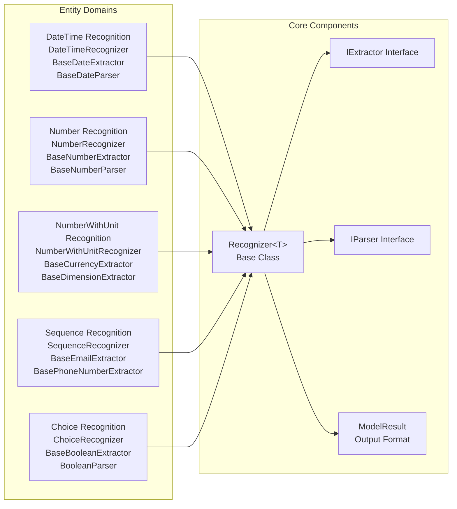

**Sources:** [.NET/Microsoft.Recognizers.Text.Choice/ChoiceRecognizer.cs:1-131](), [.NET/Microsoft.Recognizers.Text.DataDrivenTests/Microsoft.Recognizers.Text.DataDrivenTests.csproj:54-61]()

| Entity Domain | Primary Classes | Supported Entity Types |
|---------------|----------------|------------------------|
| **DateTime** | `DateTimeRecognizer`, `BaseDateExtractor` | Dates, times, durations, date ranges, recurring patterns |
| **Number** | `NumberRecognizer`, `BaseNumberExtractor` | Cardinals, ordinals, fractions, percentages, number ranges |
| **NumberWithUnit** | `NumberWithUnitRecognizer`, `BaseCurrencyExtractor` | Currency, dimensions, temperature, age |
| **Sequence** | `SequenceRecognizer`, `BaseEmailExtractor` | URLs, emails, phone numbers, IP addresses, GUIDs |
| **Choice** | `ChoiceRecognizer`, `BaseBooleanExtractor` | Boolean values, yes/no responses |

## Multi-Platform Support

The system maintains consistent APIs across four target platforms, with .NET serving as the primary platform where new features are developed before propagation to other platforms.

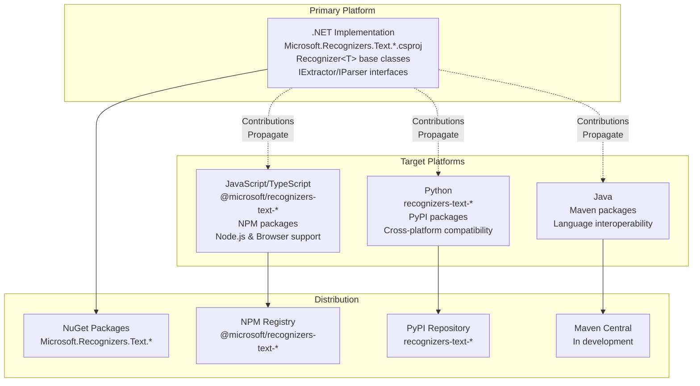

**Sources:** [README.md:12-21](), [.NET/Microsoft.Recognizers.Text/Microsoft.Recognizers.Text.csproj:1-52](), [Python/build.ci.cmd:1-73]()

The .NET implementation provides the reference architecture with base classes like `Recognizer<T>` and interfaces like `IExtractor` and `IParser` that define the contract for all platforms. Language-specific configurations such as `ArabicBooleanExtractorConfiguration` demonstrate the pattern used across all supported languages.

## Language Support Architecture

The system supports multiple languages through a culture-based configuration system that handles both full and partial implementations across different entity domains.

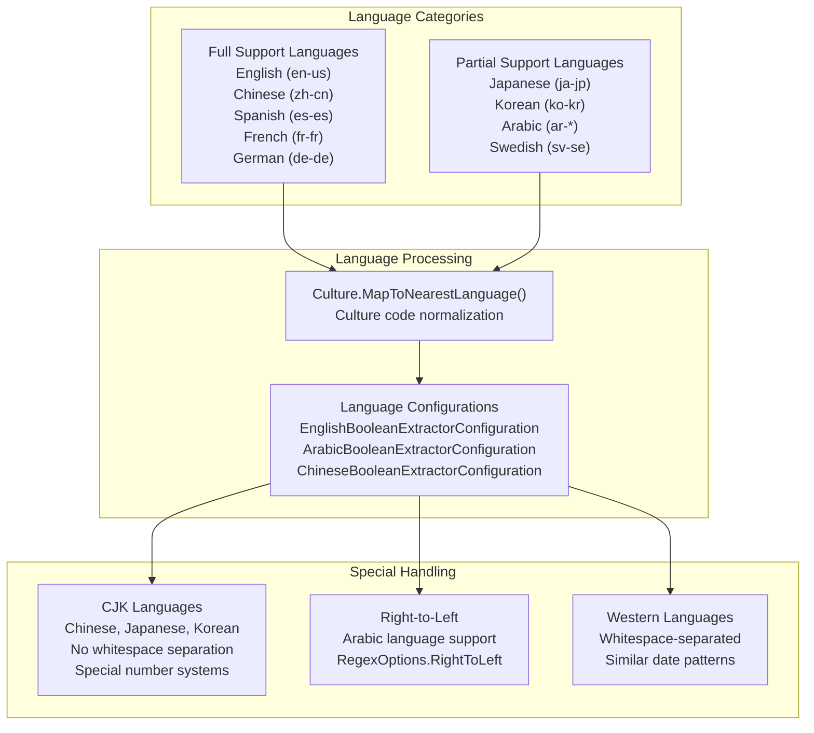

**Sources:** [.NET/Microsoft.Recognizers.Text/Culture.cs:1-102](), [.NET/Microsoft.Recognizers.Text.Choice/Arabic/Extractors/ArabicBooleanExtractorConfiguration.cs:1-24](), [README.md:65-108]()

The `Culture` class provides language code normalization through `MapToNearestLanguage()`, mapping variants like "en-029" to "en-*" for broader compatibility. Language-specific configurations like `ArabicBooleanExtractorConfiguration` demonstrate special handling requirements, such as `RegexOptions.RightToLeft` for Arabic text processing.

## Pattern-Driven Recognition System

Recognition logic is defined declaratively in YAML files that are compiled into executable code during the build process, enabling consistent pattern maintenance across platforms.

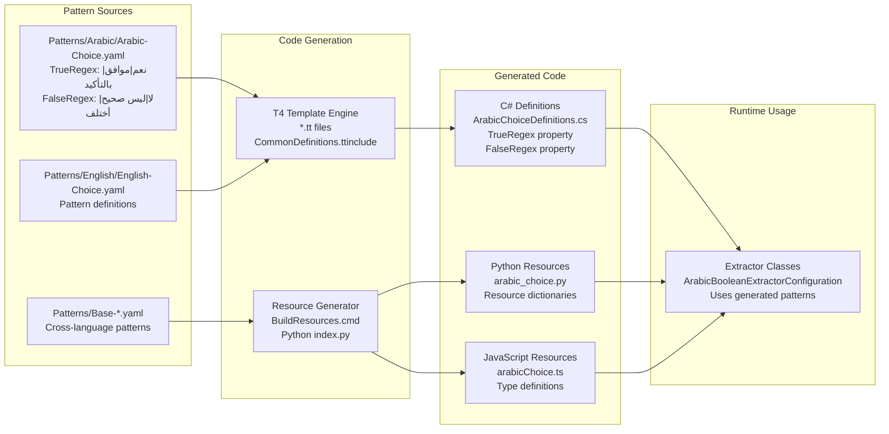

**Sources:** [Patterns/Arabic/Arabic-Choice.yaml:1-12](), [.NET/Microsoft.Recognizers.Definitions.Common/Arabic/ChoiceDefinitions.cs:1-30](), [.NET/Microsoft.Recognizers.Definitions.Common/Arabic/ChoiceDefinitions.tt:1-7](), [Python/build.ci.cmd:20-26]()

YAML pattern files like `Arabic-Choice.yaml` define language-specific recognition patterns using a structured format. These are processed by T4 templates (*.tt files) in .NET to generate strongly-typed definition classes like `ArabicChoiceDefinitions.cs`. For other platforms, resource generators create equivalent pattern files in the target language format.

## Core API and Integration

The system provides a consistent recognition API across all entity domains and platforms, centered around the `Recognizer` pattern and `ModelResult` output format.

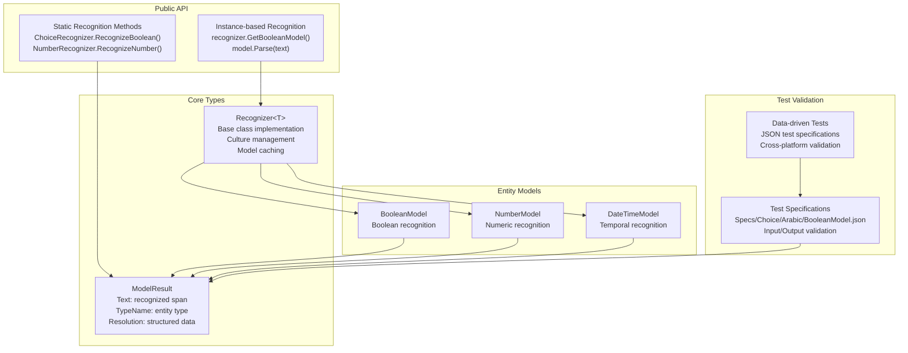

**Sources:** [.NET/Microsoft.Recognizers.Text.Choice/ChoiceRecognizer.cs:51-61](), [Specs/Choice/Arabic/BooleanModel.json:1-241](), [.NET/Microsoft.Recognizers.Text.DataDrivenTests/Choice/TestChoice_Arabic.cs:1-21]()

The API design emphasizes simplicity with static methods like `ChoiceRecognizer.RecognizeBoolean()` for common scenarios and instance-based methods for advanced configuration. All recognition results follow the `ModelResult` format with standardized `Text`, `TypeName`, and `Resolution` properties. The system includes comprehensive test coverage through JSON specification files that validate recognition accuracy across languages and platforms.

---

# Page: Architecture Overview

# Architecture Overview

<details>
<summary>Relevant source files</summary>

The following files were used as context for generating this wiki page:

- [.NET/Microsoft.Recognizers.Text.DataDrivenTests/DateTime/TestDateTime_English.cs](.NET/Microsoft.Recognizers.Text.DataDrivenTests/DateTime/TestDateTime_English.cs)
- [.NET/Microsoft.Recognizers.Text.DataDrivenTests/Number/TestNumber_Chinese.cs](.NET/Microsoft.Recognizers.Text.DataDrivenTests/Number/TestNumber_Chinese.cs)
- [.NET/Microsoft.Recognizers.Text.DataDrivenTests/Number/TestNumber_Dutch.cs](.NET/Microsoft.Recognizers.Text.DataDrivenTests/Number/TestNumber_Dutch.cs)
- [.NET/Microsoft.Recognizers.Text.DataDrivenTests/Number/TestNumber_French.cs](.NET/Microsoft.Recognizers.Text.DataDrivenTests/Number/TestNumber_French.cs)
- [.NET/Microsoft.Recognizers.Text.DataDrivenTests/Number/TestNumber_German.cs](.NET/Microsoft.Recognizers.Text.DataDrivenTests/Number/TestNumber_German.cs)
- [.NET/Microsoft.Recognizers.Text.DataDrivenTests/Number/TestNumber_Italian.cs](.NET/Microsoft.Recognizers.Text.DataDrivenTests/Number/TestNumber_Italian.cs)
- [.NET/Microsoft.Recognizers.Text.DataDrivenTests/Number/TestNumber_Japanese.cs](.NET/Microsoft.Recognizers.Text.DataDrivenTests/Number/TestNumber_Japanese.cs)
- [.NET/Microsoft.Recognizers.Text.DataDrivenTests/Number/TestNumber_Korean.cs](.NET/Microsoft.Recognizers.Text.DataDrivenTests/Number/TestNumber_Korean.cs)
- [.NET/Microsoft.Recognizers.Text.DataDrivenTests/Number/TestNumber_Spanish.cs](.NET/Microsoft.Recognizers.Text.DataDrivenTests/Number/TestNumber_Spanish.cs)
- [.NET/Microsoft.Recognizers.Text.DataDrivenTests/TestBase.cs](.NET/Microsoft.Recognizers.Text.DataDrivenTests/TestBase.cs)
- [.NET/Microsoft.Recognizers.Text.DataDrivenTests/TestHelpers.cs](.NET/Microsoft.Recognizers.Text.DataDrivenTests/TestHelpers.cs)
- [.NET/Microsoft.Recognizers.Text.DateTime/DateTimeOptions.cs](.NET/Microsoft.Recognizers.Text.DateTime/DateTimeOptions.cs)
- [.NET/Microsoft.Recognizers.Text.DateTime/DateTimeRecognizer.cs](.NET/Microsoft.Recognizers.Text.DateTime/DateTimeRecognizer.cs)
- [.NET/Microsoft.Recognizers.Text.DateTime/Extractors/BaseDateExtractor.cs](.NET/Microsoft.Recognizers.Text.DateTime/Extractors/BaseDateExtractor.cs)
- [.NET/Microsoft.Recognizers.Text.DateTime/Microsoft.Recognizers.Text.DateTime.xml](.NET/Microsoft.Recognizers.Text.DateTime/Microsoft.Recognizers.Text.DateTime.xml)
- [.NET/Microsoft.Recognizers.Text.DateTime/Parsers/BaseDateParser.cs](.NET/Microsoft.Recognizers.Text.DateTime/Parsers/BaseDateParser.cs)
- [.NET/Microsoft.Recognizers.Text.DateTime/Parsers/BaseDateTimeParser.cs](.NET/Microsoft.Recognizers.Text.DateTime/Parsers/BaseDateTimeParser.cs)
- [.NET/Microsoft.Recognizers.Text.Number/Italian/Extractors/NumberRangeExtractor.cs](.NET/Microsoft.Recognizers.Text.Number/Italian/Extractors/NumberRangeExtractor.cs)
- [.NET/Microsoft.Recognizers.Text.Number/Italian/Parsers/ItalianNumberRangeParserConfiguration.cs](.NET/Microsoft.Recognizers.Text.Number/Italian/Parsers/ItalianNumberRangeParserConfiguration.cs)
- [.NET/Microsoft.Recognizers.Text.Number/NumberRecognizer.cs](.NET/Microsoft.Recognizers.Text.Number/NumberRecognizer.cs)
- [.NET/Microsoft.Recognizers.Text.NumberWithUnit/NumberWithUnitRecognizer.cs](.NET/Microsoft.Recognizers.Text.NumberWithUnit/NumberWithUnitRecognizer.cs)
- [.NET/Microsoft.Recognizers.Text.Sequence/SequenceRecognizer.cs](.NET/Microsoft.Recognizers.Text.Sequence/SequenceRecognizer.cs)
- [.NET/Microsoft.Recognizers.Text/Constants.cs](.NET/Microsoft.Recognizers.Text/Constants.cs)
- [.NET/Microsoft.Recognizers.Text/Models/ExtendedModelResult.cs](.NET/Microsoft.Recognizers.Text/Models/ExtendedModelResult.cs)
- [.NET/Microsoft.Recognizers.Text/Models/ModelResult.cs](.NET/Microsoft.Recognizers.Text/Models/ModelResult.cs)
- [.NET/Microsoft.Recognizers.Text/Recognizer.cs](.NET/Microsoft.Recognizers.Text/Recognizer.cs)
- [Java/tests/src/test/java/com/microsoft/recognizers/text/tests/numberwithunit/NumberWithUnitRecognizerInitializationTest.java](Java/tests/src/test/java/com/microsoft/recognizers/text/tests/numberwithunit/NumberWithUnitRecognizerInitializationTest.java)
- [Python/.pre-commit-config.yaml](Python/.pre-commit-config.yaml)
- [Python/build.ci.cmd](Python/build.ci.cmd)
- [Python/build.sh](Python/build.sh)
- [Python/libraries/recognizers-choice/recognizers_choice/choice/english/__init__.py](Python/libraries/recognizers-choice/recognizers_choice/choice/english/__init__.py)
- [Python/libraries/recognizers-choice/recognizers_choice/resources/__init__.py](Python/libraries/recognizers-choice/recognizers_choice/resources/__init__.py)
- [Python/libraries/recognizers-choice/resource-definitions.json](Python/libraries/recognizers-choice/resource-definitions.json)
- [Python/libraries/recognizers-choice/setup.py](Python/libraries/recognizers-choice/setup.py)
- [Python/libraries/recognizers-text/recognizers_text/parser.py](Python/libraries/recognizers-text/recognizers_text/parser.py)
- [Python/requirements.txt](Python/requirements.txt)
- [Python/setup.py](Python/setup.py)
- [Python/tests/requirements.txt](Python/tests/requirements.txt)
- [README.md](README.md)
- [Script/Utils/countNotSupportedCases.py](Script/Utils/countNotSupportedCases.py)
- [Script/Utils/deleteNotSupportedPlatform.py](Script/Utils/deleteNotSupportedPlatform.py)
- [Script/Utils/getNotSupportedInput.py](Script/Utils/getNotSupportedInput.py)
- [Specs/DateTime/English/DateExtractor.json](Specs/DateTime/English/DateExtractor.json)
- [Specs/DateTime/English/DateParser.json](Specs/DateTime/English/DateParser.json)
- [Specs/Number/German/OrdinalModel.json](Specs/Number/German/OrdinalModel.json)
- [Specs/Number/German/OrdinalModelEnablePreview.json](Specs/Number/German/OrdinalModelEnablePreview.json)
- [Specs/Number/Italian/NumberRangeModel.json](Specs/Number/Italian/NumberRangeModel.json)

</details>


This document provides a comprehensive overview of the Microsoft Recognizers Text architecture, covering the core recognition pipeline, multi-platform design, language support framework, and pattern-driven code generation system. For detailed information about specific entity recognition domains, see [Entity Recognition Domains](#2). For platform-specific implementation details, see [Platform Implementations](#4).

## System Purpose and Core Design

Microsoft Recognizers Text is a multi-platform text recognition system designed to extract and resolve structured entities from natural language text. The system recognizes five primary entity types: DateTime, Numbers, NumberWithUnit, Sequences, and Choices across multiple languages and platforms.

The architecture follows a consistent **extractor-parser pipeline** pattern where extractors identify potential entity text spans and parsers resolve them into structured values. This two-stage approach enables flexible language-specific customization while maintaining consistent output formats across platforms.

**Sources:** [README.md:1-109]()

## High-Level System Architecture

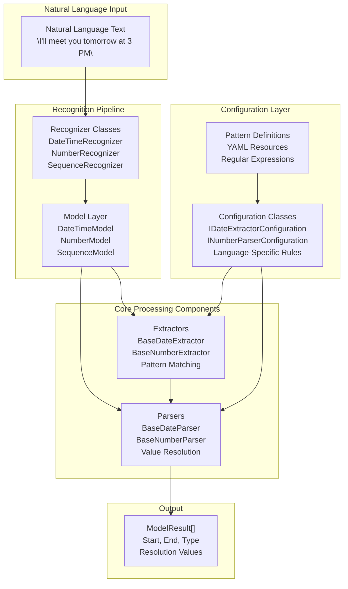

**Sources:** [.NET/Microsoft.Recognizers.Text.Number/NumberRecognizer.cs:21-534](), [.NET/Microsoft.Recognizers.Text.DateTime/DateTimeRecognizer.cs:21-183](), [.NET/Microsoft.Recognizers.Text/Recognizer.cs:10-89]()

## Extractor-Parser Pipeline Architecture

The core recognition process follows a two-stage pipeline that separates text identification from value resolution:

```mermaid
graph LR
    subgraph "Stage 1: Extraction"
        Input["Input Text<br/>\"next Friday\""]
        ExtractorConfig["IDateExtractorConfiguration<br/>Language-specific patterns<br/>Regular expressions"]
        Extractor["BaseDateExtractor<br/>Pattern matching<br/>Token identification"]
        ExtractResult["ExtractResult<br/>Text: \"next Friday\"<br/>Start: 0, Length: 11<br/>Type: \"date\""]
    end
    
    subgraph "Stage 2: Parsing"
        ParserConfig["IDateParserConfiguration<br/>Calendar logic<br/>Reference time handling"]
        Parser["BaseDateParser<br/>Value resolution<br/>Timex generation"]
        ParseResult["DateTimeParseResult<br/>FutureValue: 2024-01-19<br/>PastValue: 2024-01-12<br/>Timex: \"XXXX-WXX-5\""]
    end
    
    subgraph "Stage 3: Model Output"
        ModelResult["ModelResult<br/>Text, Start, End<br/>TypeName, Resolution"]
    end
    
    Input --> ExtractorConfig
    ExtractorConfig --> Extractor
    Extractor --> ExtractResult
    ExtractResult --> ParserConfig
    ParserConfig --> Parser
    Parser --> ParseResult
    ParseResult --> ModelResult
```

**Sources:** [.NET/Microsoft.Recognizers.Text.DateTime/Extractors/BaseDateExtractor.cs:16-631](), [.NET/Microsoft.Recognizers.Text.DateTime/Parsers/BaseDateParser.cs:15-629](), [.NET/Microsoft.Recognizers.Text/Models/ModelResult.cs:8-21]()

## Multi-Platform Design and Contribution Flow

The system implements a hub-and-spoke architecture with .NET as the primary platform and automatic propagation to other platforms:

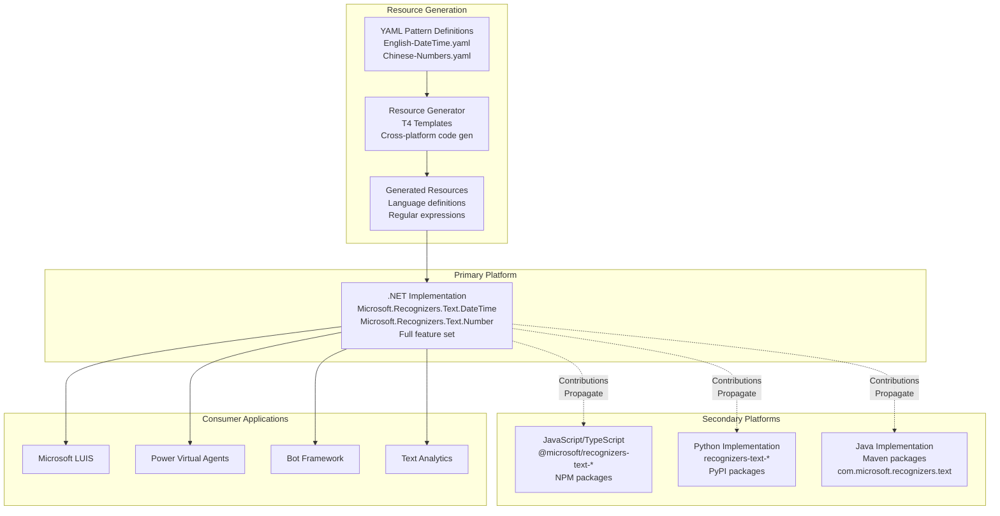

**Sources:** [README.md:12-22](), [.NET/Microsoft.Recognizers.Text.NumberWithUnit/NumberWithUnitRecognizer.cs:9-702](), [Python/build.ci.cmd:1-73]()

## Language Support and Configuration Architecture

The system supports multiple languages through a configuration-driven approach with language-specific implementations:

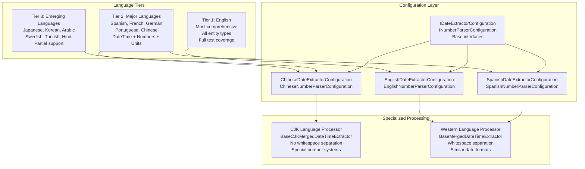

**Sources:** [.NET/Microsoft.Recognizers.Text.DataDrivenTests/TestHelpers.cs:147-298](), [README.md:63-108](), [.NET/Microsoft.Recognizers.Text.DateTime/DateTimeRecognizer.cs:60-183]()

## Pattern Definition and Code Generation Pipeline

The system uses a pattern-driven approach where YAML definitions generate platform-specific code:

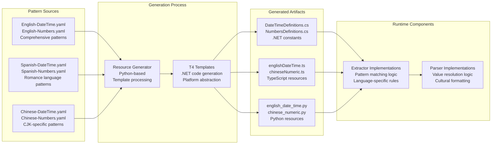

**Sources:** [Python/build.ci.cmd:19-26](), [Python/build.sh:6-11]()

## Testing and Validation Framework

The system employs a comprehensive data-driven testing approach with JSON specification files:

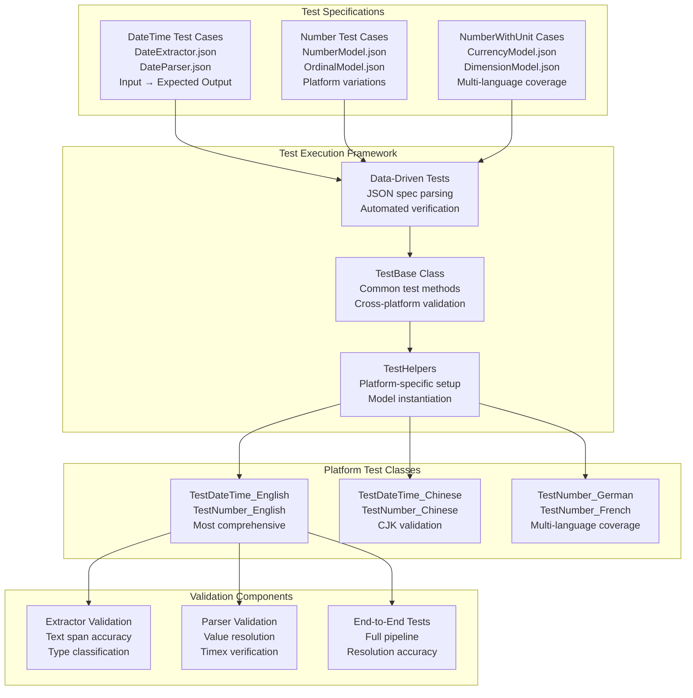

**Sources:** [.NET/Microsoft.Recognizers.Text.DataDrivenTests/TestBase.cs:18-464](), [.NET/Microsoft.Recognizers.Text.DataDrivenTests/TestHelpers.cs:102-229](), [.NET/Microsoft.Recognizers.Text.DataDrivenTests/DateTime/TestDateTime_English.cs:10-226](), [Specs/DateTime/English/DateParser.json:1-100](), [Specs/DateTime/English/DateExtractor.json:1-100]()

## Core Interfaces and Abstractions

The architecture defines clear interfaces that enable language-specific customization while maintaining consistent behavior:

| Interface | Purpose | Key Implementations |
|-----------|---------|-------------------|
| `IDateTimeExtractor` | Text span identification | `BaseDateExtractor`, `BaseTimeExtractor` |
| `IDateTimeParser` | Value resolution | `BaseDateParser`, `BaseTimeParser` |
| `IModel` | Public API abstraction | `DateTimeModel`, `NumberModel` |
| `IExtractorConfiguration` | Language-specific patterns | `EnglishDateExtractorConfiguration` |
| `IParserConfiguration` | Resolution logic | `EnglishDateParserConfiguration` |

The `Recognizer<TRecognizerOptions>` base class provides the primary entry point for all recognition operations, with specialized implementations for each entity domain like `DateTimeRecognizer`, `NumberRecognizer`, and `SequenceRecognizer`.

**Sources:** [.NET/Microsoft.Recognizers.Text/Recognizer.cs:10-89](), [.NET/Microsoft.Recognizers.Text.DateTime/DateTimeRecognizer.cs:21-183](), [.NET/Microsoft.Recognizers.Text.Number/NumberRecognizer.cs:23-535]()

---

# Page: Supported Languages

# Supported Languages

<details>
<summary>Relevant source files</summary>

The following files were used as context for generating this wiki page:

- [.NET/Microsoft.Recognizers.Definitions.Common/Arabic/ChoiceDefinitions.cs](.NET/Microsoft.Recognizers.Definitions.Common/Arabic/ChoiceDefinitions.cs)
- [.NET/Microsoft.Recognizers.Definitions.Common/Arabic/ChoiceDefinitions.tt](.NET/Microsoft.Recognizers.Definitions.Common/Arabic/ChoiceDefinitions.tt)
- [.NET/Microsoft.Recognizers.Definitions.Common/Chinese/DateTimeDefinitions.cs](.NET/Microsoft.Recognizers.Definitions.Common/Chinese/DateTimeDefinitions.cs)
- [.NET/Microsoft.Recognizers.Definitions.Common/Microsoft.Recognizers.Definitions.Common.csproj](.NET/Microsoft.Recognizers.Definitions.Common/Microsoft.Recognizers.Definitions.Common.csproj)
- [.NET/Microsoft.Recognizers.Definitions.Common/Portuguese/DateTimeDefinitions.cs](.NET/Microsoft.Recognizers.Definitions.Common/Portuguese/DateTimeDefinitions.cs)
- [.NET/Microsoft.Recognizers.Definitions.Common/Spanish/DateTimeDefinitions.cs](.NET/Microsoft.Recognizers.Definitions.Common/Spanish/DateTimeDefinitions.cs)
- [.NET/Microsoft.Recognizers.Definitions/Microsoft.Recognizers.Definitions.csproj](.NET/Microsoft.Recognizers.Definitions/Microsoft.Recognizers.Definitions.csproj)
- [.NET/Microsoft.Recognizers.Text.Choice/Arabic/Extractors/ArabicBooleanExtractorConfiguration.cs](.NET/Microsoft.Recognizers.Text.Choice/Arabic/Extractors/ArabicBooleanExtractorConfiguration.cs)
- [.NET/Microsoft.Recognizers.Text.Choice/ChoiceRecognizer.cs](.NET/Microsoft.Recognizers.Text.Choice/ChoiceRecognizer.cs)
- [.NET/Microsoft.Recognizers.Text.Choice/Microsoft.Recognizers.Text.Choice.csproj](.NET/Microsoft.Recognizers.Text.Choice/Microsoft.Recognizers.Text.Choice.csproj)
- [.NET/Microsoft.Recognizers.Text.DataDrivenTests/Choice/TestChoice_Arabic.cs](.NET/Microsoft.Recognizers.Text.DataDrivenTests/Choice/TestChoice_Arabic.cs)
- [.NET/Microsoft.Recognizers.Text.DataDrivenTests/Microsoft.Recognizers.Text.DataDrivenTests.csproj](.NET/Microsoft.Recognizers.Text.DataDrivenTests/Microsoft.Recognizers.Text.DataDrivenTests.csproj)
- [.NET/Microsoft.Recognizers.Text.DataTypes.DataDrivenTests/Microsoft.Recognizers.Text.DataTypes.DataDrivenTests.csproj](.NET/Microsoft.Recognizers.Text.DataTypes.DataDrivenTests/Microsoft.Recognizers.Text.DataTypes.DataDrivenTests.csproj)
- [.NET/Microsoft.Recognizers.Text.DataTypes.TimexExpression/Microsoft.Recognizers.Text.DataTypes.TimexExpression.csproj](.NET/Microsoft.Recognizers.Text.DataTypes.TimexExpression/Microsoft.Recognizers.Text.DataTypes.TimexExpression.csproj)
- [.NET/Microsoft.Recognizers.Text.DateTime/Chinese/Extractors/ChineseDateExtractorConfiguration.cs](.NET/Microsoft.Recognizers.Text.DateTime/Chinese/Extractors/ChineseDateExtractorConfiguration.cs)
- [.NET/Microsoft.Recognizers.Text.DateTime/Chinese/Extractors/ChineseDatePeriodExtractorConfiguration.cs](.NET/Microsoft.Recognizers.Text.DateTime/Chinese/Extractors/ChineseDatePeriodExtractorConfiguration.cs)
- [.NET/Microsoft.Recognizers.Text.DateTime/Chinese/Extractors/ChineseMergedExtractorConfiguration.cs](.NET/Microsoft.Recognizers.Text.DateTime/Chinese/Extractors/ChineseMergedExtractorConfiguration.cs)
- [.NET/Microsoft.Recognizers.Text.DateTime/Chinese/Parsers/ChineseDateParserConfiguration.cs](.NET/Microsoft.Recognizers.Text.DateTime/Chinese/Parsers/ChineseDateParserConfiguration.cs)
- [.NET/Microsoft.Recognizers.Text.DateTime/Chinese/Parsers/ChineseDatePeriodParserConfiguration.cs](.NET/Microsoft.Recognizers.Text.DateTime/Chinese/Parsers/ChineseDatePeriodParserConfiguration.cs)
- [.NET/Microsoft.Recognizers.Text.DateTime/Microsoft.Recognizers.Text.DateTime.csproj](.NET/Microsoft.Recognizers.Text.DateTime/Microsoft.Recognizers.Text.DateTime.csproj)
- [.NET/Microsoft.Recognizers.Text.DateTime/Parsers/CJK/BaseCJKDatePeriodParser.cs](.NET/Microsoft.Recognizers.Text.DateTime/Parsers/CJK/BaseCJKDatePeriodParser.cs)
- [.NET/Microsoft.Recognizers.Text.Number/Microsoft.Recognizers.Text.Number.csproj](.NET/Microsoft.Recognizers.Text.Number/Microsoft.Recognizers.Text.Number.csproj)
- [.NET/Microsoft.Recognizers.Text.NumberWithUnit/Microsoft.Recognizers.Text.NumberWithUnit.csproj](.NET/Microsoft.Recognizers.Text.NumberWithUnit/Microsoft.Recognizers.Text.NumberWithUnit.csproj)
- [.NET/Microsoft.Recognizers.Text.Sequence/Microsoft.Recognizers.Text.Sequence.csproj](.NET/Microsoft.Recognizers.Text.Sequence/Microsoft.Recognizers.Text.Sequence.csproj)
- [.NET/Microsoft.Recognizers.Text.sln](.NET/Microsoft.Recognizers.Text.sln)
- [.NET/Microsoft.Recognizers.Text/Culture.cs](.NET/Microsoft.Recognizers.Text/Culture.cs)
- [.NET/Microsoft.Recognizers.Text/Microsoft.Recognizers.Text.csproj](.NET/Microsoft.Recognizers.Text/Microsoft.Recognizers.Text.csproj)
- [.NET/Samples/SimpleConsole/SimpleConsole.csproj](.NET/Samples/SimpleConsole/SimpleConsole.csproj)
- [Java/libraries/recognizers-text-date-time/src/main/java/com/microsoft/recognizers/text/datetime/resources/ChineseDateTime.java](Java/libraries/recognizers-text-date-time/src/main/java/com/microsoft/recognizers/text/datetime/resources/ChineseDateTime.java)
- [Java/libraries/recognizers-text-date-time/src/main/java/com/microsoft/recognizers/text/datetime/spanish/extractors/SpanishDatePeriodExtractorConfiguration.java](Java/libraries/recognizers-text-date-time/src/main/java/com/microsoft/recognizers/text/datetime/spanish/extractors/SpanishDatePeriodExtractorConfiguration.java)
- [Java/libraries/recognizers-text-number/src/main/java/com/microsoft/recognizers/text/number/spanish/extractors/OrdinalExtractor.java](Java/libraries/recognizers-text-number/src/main/java/com/microsoft/recognizers/text/number/spanish/extractors/OrdinalExtractor.java)
- [JavaScript/packages/recognizers-date-time/src/resources/chineseDateTime.ts](JavaScript/packages/recognizers-date-time/src/resources/chineseDateTime.ts)
- [Patterns/Arabic/Arabic-Choice.yaml](Patterns/Arabic/Arabic-Choice.yaml)
- [Patterns/Chinese/Chinese-DateTime.yaml](Patterns/Chinese/Chinese-DateTime.yaml)
- [Patterns/Portuguese/Portuguese-DateTime.yaml](Patterns/Portuguese/Portuguese-DateTime.yaml)
- [Patterns/Spanish/Spanish-DateTime.yaml](Patterns/Spanish/Spanish-DateTime.yaml)
- [Python/libraries/recognizers-date-time/recognizers_date_time/date_time/chinese/duration_extractor_config.py](Python/libraries/recognizers-date-time/recognizers_date_time/date_time/chinese/duration_extractor_config.py)
- [Python/libraries/recognizers-date-time/recognizers_date_time/resources/chinese_date_time.py](Python/libraries/recognizers-date-time/recognizers_date_time/resources/chinese_date_time.py)
- [Specs/Choice/Arabic/BooleanModel.json](Specs/Choice/Arabic/BooleanModel.json)
- [Specs/DateTime/Chinese/DateExtractor.json](Specs/DateTime/Chinese/DateExtractor.json)
- [Specs/DateTime/Chinese/DateParser.json](Specs/DateTime/Chinese/DateParser.json)
- [Specs/DateTime/Chinese/DatePeriodExtractor.json](Specs/DateTime/Chinese/DatePeriodExtractor.json)
- [Specs/DateTime/Chinese/DatePeriodParser.json](Specs/DateTime/Chinese/DatePeriodParser.json)
- [Specs/DateTime/Chinese/DateTimeExtractor.json](Specs/DateTime/Chinese/DateTimeExtractor.json)
- [Specs/DateTime/Chinese/DateTimeModel.json](Specs/DateTime/Chinese/DateTimeModel.json)
- [Specs/DateTime/Chinese/DateTimePeriodParser.json](Specs/DateTime/Chinese/DateTimePeriodParser.json)
- [Specs/DateTime/Chinese/TimeParser.json](Specs/DateTime/Chinese/TimeParser.json)
- [Specs/DateTime/Portuguese/DateTimeModel.json](Specs/DateTime/Portuguese/DateTimeModel.json)
- [Specs/DateTime/Spanish/DateExtractor.json](Specs/DateTime/Spanish/DateExtractor.json)
- [Specs/DateTime/Spanish/DatePeriodExtractor.json](Specs/DateTime/Spanish/DatePeriodExtractor.json)
- [Specs/DateTime/Spanish/DatePeriodParser.json](Specs/DateTime/Spanish/DatePeriodParser.json)
- [Specs/DateTime/Spanish/DateTimeModel.json](Specs/DateTime/Spanish/DateTimeModel.json)
- [Specs/DateTime/Spanish/DateTimePeriodExtractor.json](Specs/DateTime/Spanish/DateTimePeriodExtractor.json)
- [Specs/DateTime/Spanish/DateTimePeriodParser.json](Specs/DateTime/Spanish/DateTimePeriodParser.json)
- [Specs/DateTime/Spanish/DurationExtractor.json](Specs/DateTime/Spanish/DurationExtractor.json)
- [Specs/DateTime/Spanish/TimePeriodExtractor.json](Specs/DateTime/Spanish/TimePeriodExtractor.json)
- [Specs/DateTime/Spanish/TimePeriodParser.json](Specs/DateTime/Spanish/TimePeriodParser.json)

</details>


This document provides a comprehensive overview of the languages supported by Microsoft Recognizers Text, including their capabilities, implementation details, and platform-specific availability. This covers the pattern definition system, code generation pipeline, and language-specific recognition features across different entity domains.

For information about the overall architecture and entity recognition domains, see [Architecture Overview](#1.1) and [Entity Recognition Domains](#2).

## Language Support Overview

Microsoft Recognizers Text supports **15+ languages** with varying levels of completeness across different entity recognition domains. The system uses a pattern-driven approach where language-specific YAML files define recognition patterns that are then generated into platform-specific code.

### Language Support Matrix

| Language | Code | DateTime | Numbers | NumberWithUnit | Sequences | Choice | Primary Platform Support |
|----------|------|----------|---------|----------------|-----------|---------|--------------------------|
| English | `eng` | ✅ Complete | ✅ Complete | ✅ Complete | ✅ Complete | ✅ Complete | .NET, JS, Python, Java |
| Spanish | `spa` | ✅ Complete | ✅ Complete | ✅ Complete | ❌ Limited | ✅ Complete | .NET, JS, Python, Java |
| Chinese | `chi` | ✅ Complete | ✅ Complete | ✅ Complete | ✅ Complete | ✅ Complete | .NET, JS, Python, Java |
| French | `fra` | ✅ Complete | ✅ Complete | ✅ Complete | ❌ Limited | ✅ Complete | .NET, JS, Python, Java |
| Portuguese | `por` | ✅ Complete | ✅ Complete | ✅ Complete | ❌ Limited | ✅ Complete | .NET, JS, Python, Java |
| German | `ger` | ✅ Complete | ✅ Complete | ✅ Complete | ❌ Limited | ✅ Complete | .NET, JS, Python, Java |
| Italian | `ita` | ✅ Complete | ✅ Complete | ✅ Complete | ❌ Limited | ✅ Complete | .NET, JS, Python, Java |
| Japanese | `jpn` | ✅ Complete | ✅ Complete | ✅ Complete | ✅ Complete | ✅ Complete | .NET, JS, Python, Java |
| Korean | `kor` | ✅ Complete | ✅ Complete | ✅ Complete | ❌ Limited | ❌ Limited | .NET, JS, Python, Java |
| Dutch | `dut` | ✅ Complete | ✅ Complete | ✅ Complete | ❌ Limited | ✅ Complete | .NET, JS, Python, Java |
| Arabic | `ara` | ✅ Limited | ✅ Complete | ❌ Limited | ❌ Limited | ✅ Complete | .NET, JS, Python, Java |
| Hindi | `hin` | ✅ Limited | ✅ Complete | ✅ Complete | ❌ Limited | ✅ Complete | .NET, JS, Python, Java |
| Bulgarian | `bul` | ❌ None | ✅ Complete | ❌ Limited | ❌ Limited | ✅ Complete | .NET, JS, Python, Java |
| Turkish | `tur` | ❌ None | ✅ Complete | ❌ Limited | ❌ Limited | ✅ Complete | .NET, JS, Python, Java |
| Swedish | `swe` | ❌ None | ✅ Complete | ❌ Limited | ❌ Limited | ✅ Complete | .NET, JS, Python, Java |

Sources: [Patterns/Spanish/Spanish-DateTime.yaml:1-5](), [Patterns/Chinese/Chinese-DateTime.yaml:1-5](), [Patterns/Portuguese/Portuguese-DateTime.yaml:1-5](), [.NET/Microsoft.Recognizers.Definitions/Microsoft.Recognizers.Definitions.csproj:44-135]()

## Language Categories

### Tier 1: Comprehensive Support
**English, Spanish, Chinese, French, Portuguese, German, Italian, Japanese, Dutch**

These languages have complete implementations across most entity recognition domains, including complex DateTime expressions, comprehensive number systems, and NumberWithUnit recognition.

```mermaid
graph TD
    subgraph "Tier1[Tier 1 - Comprehensive Support]"
        English["English (eng)<br/>Primary Reference"]
        Spanish["Spanish (spa)<br/>Romance Language"]
        Chinese["Chinese (chi)<br/>CJK + Lunar Calendar"]
        French["French (fra)<br/>Romance Language"]
        Portuguese["Portuguese (por)<br/>Romance Language"]
        German["German (ger)<br/>Germanic Language"]
        Italian["Italian (ita)<br/>Romance Language"]
        Japanese["Japanese (jpn)<br/>CJK Language"]
        Dutch["Dutch (dut)<br/>Germanic Language"]
    end
    
    subgraph "Domains[Supported Domains]"
        DateTime["DateTime Recognition<br/>Complete Coverage"]
        Numbers["Number Recognition<br/>Complete Coverage"]
        Units["NumberWithUnit<br/>Complete Coverage"]
        Sequences["Sequence Recognition<br/>Varies by Language"]
        Choice["Choice Recognition<br/>Complete Coverage"]
    end
    
    English --> DateTime
    Spanish --> DateTime
    Chinese --> DateTime
    French --> DateTime
    Portuguese --> DateTime
    German --> DateTime
    Italian --> DateTime
    Japanese --> DateTime
    Dutch --> DateTime
    
    English --> Numbers
    Spanish --> Numbers
    Chinese --> Numbers
    
    English --> Units
    Spanish --> Units
    Chinese --> Units
```

**English Implementation Details:**
- Serves as the primary reference implementation
- Most comprehensive pattern coverage
- All entity types fully supported
- Extensive test coverage across all platforms

**Spanish Implementation Details:**
- Romance language patterns with gender agreement
- Complex verb conjugations in temporal expressions
- Regional variations handled through flexible patterns

Sources: [Patterns/Spanish/Spanish-DateTime.yaml:1-600](), [.NET/Microsoft.Recognizers.Definitions.Common/Spanish/DateTimeDefinitions.cs:24-600]()

### Tier 2: CJK Language Support
**Chinese, Japanese, Korean**

These languages require special handling due to unique characteristics:
- No whitespace separation between words
- Complex number systems (Arabic + Traditional)
- Different calendar systems (Lunar calendar support in Chinese)
- Unique temporal expressions and cultural concepts

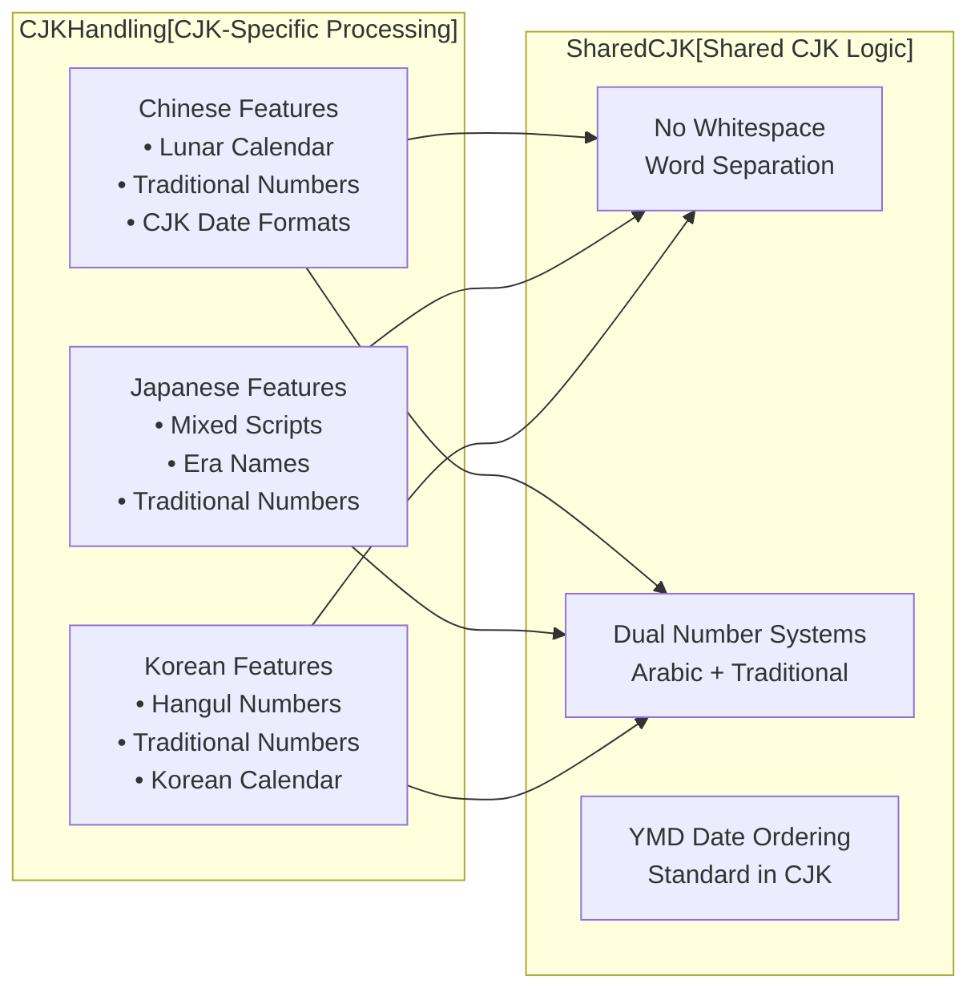

**Chinese Implementation Details:**
- `LangMarker: Chi` in pattern definitions
- Lunar calendar support with `LunarRegex` patterns
- Traditional Chinese number recognition alongside Arabic numerals
- Special handling for dynasties and traditional time periods

Sources: [Patterns/Chinese/Chinese-DateTime.yaml:1-50](), [.NET/Microsoft.Recognizers.Definitions.Common/Chinese/DateTimeDefinitions.cs:23-50]()

### Tier 3: Limited Support
**Korean, Arabic, Hindi, Bulgarian, Turkish, Swedish**

These languages have selective domain coverage, typically strong in Numbers and Choice recognition but limited DateTime or Sequence support.

Sources: [.NET/Microsoft.Recognizers.Definitions/Microsoft.Recognizers.Definitions.csproj:44-135]()

## Pattern Definition to Code Generation Pipeline

The language support system uses a multi-stage pipeline that transforms YAML pattern definitions into platform-specific code:

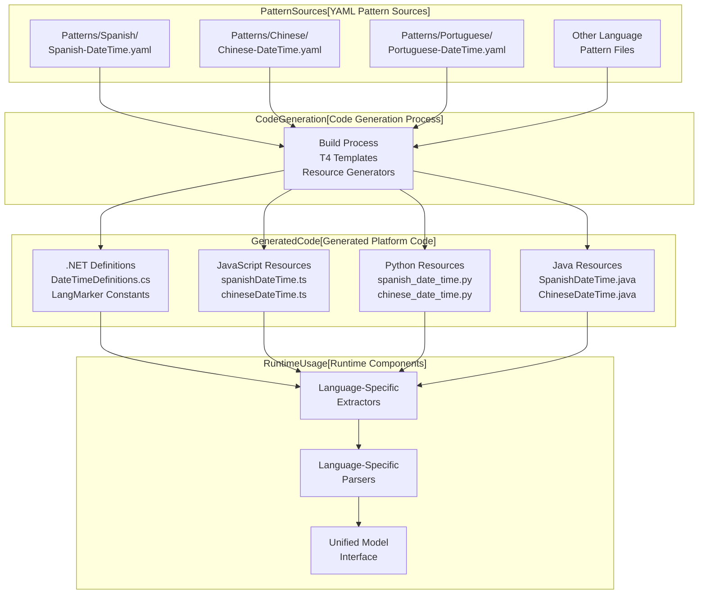

**YAML Pattern Structure:**
Each language defines patterns using a standardized YAML structure with language-specific markers:

```yaml
# Example from Spanish-DateTime.yaml
LangMarker: Spa
CheckBothBeforeAfter: !bool false
TillRegex: !nestedRegex
  def: (?<till>\b(hasta|hacia|al?)\b(\s+(el|la(s)?)\b)?|{BaseDateTime.RangeConnectorSymbolRegex})
  references: [ BaseDateTime.RangeConnectorSymbolRegex ]
```

**Generated Code Example:**
The YAML patterns are transformed into strongly-typed constants in each platform:

```csharp
// .NET Generated Code
public static class DateTimeDefinitions
{
    public const string LangMarker = @"Spa";
    public const bool CheckBothBeforeAfter = false;
    public static readonly string TillRegex = $@"(?<till>\b(hasta|hacia|al?)\b(\s+(el|la(s)?)\b)?|{BaseDateTime.RangeConnectorSymbolRegex})";
}
```

Sources: [Patterns/Spanish/Spanish-DateTime.yaml:1-10](), [.NET/Microsoft.Recognizers.Definitions.Common/Spanish/DateTimeDefinitions.cs:24-27](), [JavaScript/packages/recognizers-date-time/src/resources/chineseDateTime.ts:13-19]()

## Platform Availability and Cross-Platform Consistency

### Platform Support Matrix

All Tier 1 languages are supported across all platforms, but some features may have platform-specific limitations:

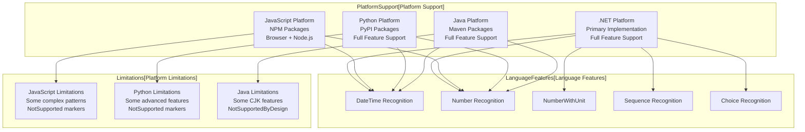

**Platform-Specific Limitations:**
Test specifications include markers indicating platform support:
- `"NotSupported": "javascript, python"` - Feature not available on specified platforms
- `"NotSupportedByDesign": "java"` - Intentionally not implemented on platform

Sources: [Specs/DateTime/Spanish/DateTimeModel.json:482-507](), [Specs/DateTime/Chinese/DateTimeModel.json:7-36]()

## Language-Specific Implementation Details

### Romance Languages (Spanish, Portuguese, French, Italian)
- Shared grammatical patterns for gender agreement
- Similar temporal expression structures
- Common verb conjugation patterns in date/time contexts
- Extensive month and day name variations

### Germanic Languages (German, Dutch, English)
- Compound word handling (especially German)
- Special time expressions like "halb" (half) and "viertel" (quarter) in German
- Modal verb constructions for future/past temporal references

### CJK Languages Special Handling
- **Chinese**: Lunar calendar integration, traditional vs simplified characters
- **Japanese**: Mixed script handling (Hiragana, Katakana, Kanji)
- **Korean**: Hangul number system integration

### Right-to-Left (RTL) Language Support
- **Arabic**: Special RTL text processing, Arabic-Indic numerals, Islamic calendar considerations

Sources: [Patterns/Spanish/Spanish-DateTime.yaml:14-100](), [Patterns/Chinese/Chinese-DateTime.yaml:40-50](), [Patterns/Portuguese/Portuguese-DateTime.yaml:13-30]()

## Testing and Validation Framework

The language support system includes comprehensive testing across all supported languages:

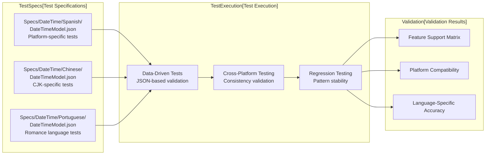

Sources: [Specs/DateTime/Spanish/DateTimeModel.json:1-50](), [Specs/DateTime/Chinese/DateTimeModel.json:1-50](), [.NET/Microsoft.Recognizers.Text.DataDrivenTests/Microsoft.Recognizers.Text.DataDrivenTests.csproj:1-60]()

---

# Page: Platform Support

# Platform Support

<details>
<summary>Relevant source files</summary>

The following files were used as context for generating this wiki page:

- [.NET/Microsoft.Recognizers.Definitions.Common/Swedish/QuotedTextDefinitions.cs](.NET/Microsoft.Recognizers.Definitions.Common/Swedish/QuotedTextDefinitions.cs)
- [.NET/Microsoft.Recognizers.Definitions.Common/packages.config](.NET/Microsoft.Recognizers.Definitions.Common/packages.config)
- [.NET/Microsoft.Recognizers.Text.NumberWithUnit/Japanese/Extractors/TemperatureExtractorConfiguration.cs](.NET/Microsoft.Recognizers.Text.NumberWithUnit/Japanese/Extractors/TemperatureExtractorConfiguration.cs)
- [.NET/Microsoft.Recognizers.Text.NumberWithUnit/Japanese/Parsers/TemperatureParserConfiguration.cs](.NET/Microsoft.Recognizers.Text.NumberWithUnit/Japanese/Parsers/TemperatureParserConfiguration.cs)
- [Java/README.md](Java/README.md)
- [Java/libraries/recognizers-text-date-time/pom.xml](Java/libraries/recognizers-text-date-time/pom.xml)
- [Java/libraries/recognizers-text/src/main/java/com/microsoft/recognizers/text/utilities/StringUtility.java](Java/libraries/recognizers-text/src/main/java/com/microsoft/recognizers/text/utilities/StringUtility.java)
- [Java/libraries/resource-generator/pom.xml](Java/libraries/resource-generator/pom.xml)
- [Java/linting-excluded-files.xml](Java/linting-excluded-files.xml)
- [Java/linting-rules.xml](Java/linting-rules.xml)
- [Java/pom.xml](Java/pom.xml)
- [Java/samples/simple-console/pom.xml](Java/samples/simple-console/pom.xml)
- [Java/samples/simple-console/src/main/java/com/microsoft/recognizers/text/samples/simpleconsole/Sample.java](Java/samples/simple-console/src/main/java/com/microsoft/recognizers/text/samples/simpleconsole/Sample.java)
- [Java/tests/pom.xml](Java/tests/pom.xml)
- [JavaScript/lerna.json](JavaScript/lerna.json)
- [JavaScript/package-lock.json](JavaScript/package-lock.json)
- [JavaScript/package.json](JavaScript/package.json)
- [JavaScript/packages/datatypes-date-time/package-lock.json](JavaScript/packages/datatypes-date-time/package-lock.json)
- [JavaScript/packages/datatypes-date-time/package.json](JavaScript/packages/datatypes-date-time/package.json)
- [JavaScript/packages/recognizers-choice/package-lock.json](JavaScript/packages/recognizers-choice/package-lock.json)
- [JavaScript/packages/recognizers-choice/package.json](JavaScript/packages/recognizers-choice/package.json)
- [JavaScript/packages/recognizers-date-time/package-lock.json](JavaScript/packages/recognizers-date-time/package-lock.json)
- [JavaScript/packages/recognizers-date-time/package.json](JavaScript/packages/recognizers-date-time/package.json)
- [JavaScript/packages/recognizers-number-with-unit/package-lock.json](JavaScript/packages/recognizers-number-with-unit/package-lock.json)
- [JavaScript/packages/recognizers-number-with-unit/package.json](JavaScript/packages/recognizers-number-with-unit/package.json)
- [JavaScript/packages/recognizers-number/package-lock.json](JavaScript/packages/recognizers-number/package-lock.json)
- [JavaScript/packages/recognizers-number/package.json](JavaScript/packages/recognizers-number/package.json)
- [JavaScript/packages/recognizers-sequence/package.json](JavaScript/packages/recognizers-sequence/package.json)
- [JavaScript/packages/recognizers-text-suite/package.json](JavaScript/packages/recognizers-text-suite/package.json)
- [JavaScript/packages/recognizers-text/package.json](JavaScript/packages/recognizers-text/package.json)
- [Python/.pre-commit-config.yaml](Python/.pre-commit-config.yaml)
- [Python/build.ci.cmd](Python/build.ci.cmd)
- [Python/build.sh](Python/build.sh)
- [Python/libraries/recognizers-choice/recognizers_choice/choice/english/__init__.py](Python/libraries/recognizers-choice/recognizers_choice/choice/english/__init__.py)
- [Python/libraries/recognizers-choice/recognizers_choice/resources/__init__.py](Python/libraries/recognizers-choice/recognizers_choice/resources/__init__.py)
- [Python/libraries/recognizers-choice/resource-definitions.json](Python/libraries/recognizers-choice/resource-definitions.json)
- [Python/libraries/recognizers-choice/setup.py](Python/libraries/recognizers-choice/setup.py)
- [Python/libraries/recognizers-text/recognizers_text/parser.py](Python/libraries/recognizers-text/recognizers_text/parser.py)
- [Python/requirements.txt](Python/requirements.txt)
- [Python/setup.py](Python/setup.py)
- [Python/tests/requirements.txt](Python/tests/requirements.txt)
- [README.md](README.md)
- [Script/Utils/countNotSupportedCases.py](Script/Utils/countNotSupportedCases.py)
- [Script/Utils/deleteNotSupportedPlatform.py](Script/Utils/deleteNotSupportedPlatform.py)
- [Script/Utils/getNotSupportedInput.py](Script/Utils/getNotSupportedInput.py)

</details>


This document covers the multi-platform architecture of Microsoft Recognizers Text, explaining how the recognition system is implemented across .NET, JavaScript, Python, and Java platforms. For information about the internal architecture and processing pipeline, see [Architecture Overview](#1.1). For details about specific platform implementations, see [Platform Implementations](#4).

## Supported Platforms

Microsoft Recognizers Text provides recognition capabilities across four major platforms, each with platform-specific packaging and distribution mechanisms:

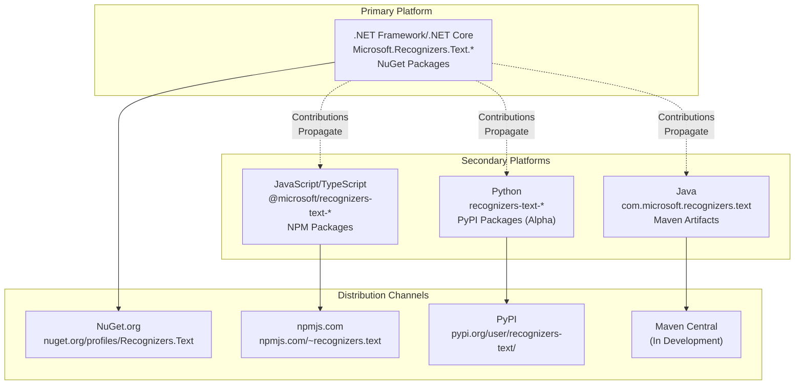

**Platform Status Overview**

| Platform | Status | Package Manager | Namespace/Package Prefix |
|----------|--------|-----------------|--------------------------|
| .NET | Primary | NuGet | `Microsoft.Recognizers.Text` |
| JavaScript/TypeScript | Stable | NPM | `@microsoft/recognizers-text` |
| Python | Alpha | PyPI | `recognizers-text` |
| Java | In Progress | Maven | `com.microsoft.recognizers.text` |

Sources: [README.md:12-21](), [JavaScript/package.json:1-104](), [Python/setup.py:1-5](), [Java/pom.xml:1-60]()

## Primary Platform Model

The project follows a ".NET-first" development model where .NET serves as the primary platform with the most comprehensive feature set. Contributions and improvements are initially implemented in .NET, then propagated to other platforms over time.

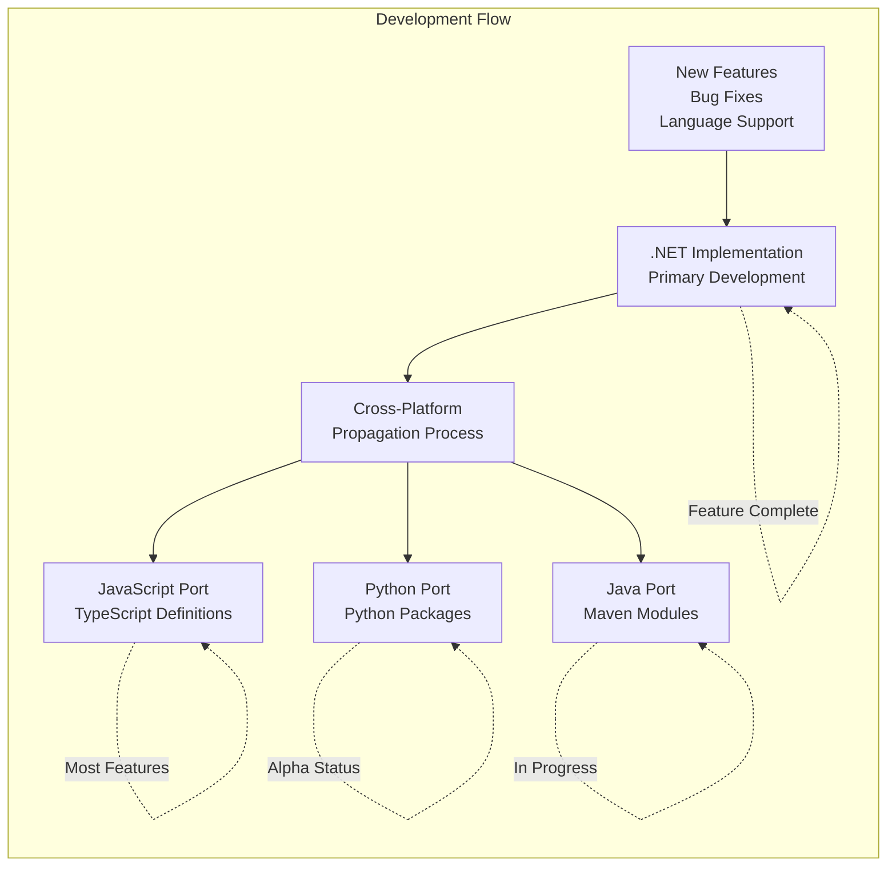

This model ensures consistency across platforms while allowing the .NET implementation to serve as the authoritative reference for new features and language support.

Sources: [README.md:21]()

## Platform-Specific Build Systems

Each platform implements its own build system and dependency management while sharing common pattern definitions and test specifications:

### .NET Build System
- **Project Structure**: Solution-based with multiple assemblies per recognizer type
- **Build Tool**: MSBuild with Visual Studio solution files
- **Package Generation**: NuGet packages with semantic versioning
- **Resource Generation**: T4 templates and YAML-to-C# code generation

### JavaScript Build System
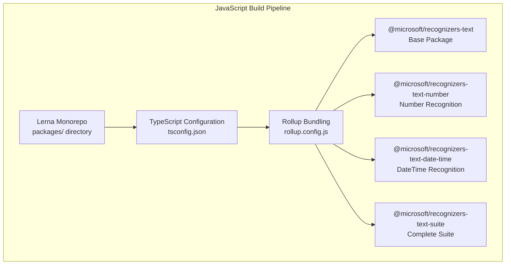

### Python Build System
- **Build Tool**: setuptools with `setup.py` files per package
- **Package Structure**: Separate pip-installable packages for each recognizer
- **Resource Generation**: Python scripts converting YAML to Python modules
- **Testing**: pytest with coverage reporting

### Java Build System
- **Build Tool**: Maven with multi-module project structure
- **Artifact Naming**: `com.microsoft.recognizers.text.*` group ID pattern
- **Resource Generation**: Java-based resource generator using YAML parsing
- **Code Style**: CheckStyle integration with custom linting rules

Sources: [JavaScript/lerna.json:1-8](), [JavaScript/package.json:12-19](), [Python/build.sh:1-43](), [Java/pom.xml:16-27](), [Python/libraries/recognizers-choice/setup.py:1-37](), [Java/linting-rules.xml:1-202]()

## Resource Generation and Sharing

All platforms share common pattern definitions stored in YAML files, with platform-specific resource generators converting these into native code:

```mermaid
graph TB
    subgraph "Shared Resources"
        YAML["YAML Pattern Files<br/>Patterns/ directory<br/>Language-specific definitions"]
        Specs["Test Specifications<br/>Specs/ directory<br/>JSON test cases"]
    end
    
    subgraph "Platform Generators"
        NET_Gen[".NET Generator<br/>T4 Templates<br/>C# Code Generation"]
        JS_Gen["JavaScript Generator<br/>TypeScript Resource Builder<br/>ts-node execution"]
        Python_Gen["Python Generator<br/>Python Index Scripts<br/>Dynamic imports"]
        Java_Gen["Java Generator<br/>ResourcesGenerator.java<br/>Maven execution"]
    end
    
    subgraph "Generated Code"
        NET_Resources[".NET Resources<br/>*Definitions.cs classes"]
        JS_Resources["JavaScript Resources<br/>*.ts modules"]
        Python_Resources["Python Resources<br/>*.py modules"]
        Java_Resources["Java Resources<br/>*.java classes"]
    end
    
    YAML --> NET_Gen
    YAML --> JS_Gen
    YAML --> Python_Gen
    YAML --> Java_Gen
    
    NET_Gen --> NET_Resources
    JS_Gen --> JS_Resources
    Python_Gen --> Python_Resources
    Java_Gen --> Java_Resources
    
    Specs -.->|"Cross-platform validation"| NET_Resources
    Specs -.->|"Cross-platform validation"| JS_Resources
    Specs -.->|"Cross-platform validation"| Python_Resources
    Specs -.->|"Cross-platform validation"| Java_Resources
```

**Resource Generation Commands by Platform:**

| Platform | Generator Location | Execution Command |
|----------|-------------------|------------------|
| .NET | Built into project | MSBuild automatic |
| JavaScript | `packages/resource-generator/` | `ts-node resource-generator/` |
| Python | `libraries/resource-generator/` | `python index.py` |
| Java | `libraries/resource-generator/` | `mvn exec:exec` |

Sources: [JavaScript/packages/recognizers-number/package.json:29](), [Python/build.ci.cmd:18-25](), [Java/libraries/resource-generator/pom.xml:58-66](), [Python/libraries/recognizers-choice/resource-definitions.json:1-16]()

## Package Distribution

Each platform follows platform-specific conventions for package distribution and dependency management:

### .NET Distribution
- **Repository**: NuGet.org under `Recognizers.Text` profile
- **Package Pattern**: `Microsoft.Recognizers.Text.*`
- **Target Frameworks**: .NET Framework 4.5.2+, .NET Standard 2.0+
- **Assembly Structure**: Separate assemblies per recognizer domain

### JavaScript Distribution  
- **Repository**: npmjs.com under `@microsoft` scope
- **Package Pattern**: `@microsoft/recognizers-text-*`
- **Module Formats**: UMD, ES5, and browser-compatible builds
- **Dependencies**: Managed through package.json with semver ranges

### Python Distribution
- **Repository**: PyPI under `recognizers-text` user
- **Package Pattern**: `recognizers-text-*` 
- **Status**: Alpha releases with active development
- **Dependencies**: Standard pip requirements with version pinning

### Java Distribution
- **Repository**: Maven Central (planned)
- **Group ID**: `com.microsoft.recognizers.text`
- **Artifact Pattern**: Domain-specific artifacts (number, datetime, etc.)
- **Dependencies**: Maven dependency management with version ranges

Sources: [README.md:13-16](), [JavaScript/packages/recognizers-text/package.json:1-31](), [Python/libraries/recognizers-choice/setup.py:13-29](), [Java/samples/simple-console/pom.xml:44-74]()

## Cross-Platform API Consistency

Despite platform differences, all implementations maintain consistent API patterns for recognizer usage:

### Common Recognition Pattern
```
// .NET
NumberRecognizer.RecognizeNumber("twenty five", Culture.English)

// JavaScript  
recognizeNumber("twenty five", Culture.English)

// Python
recognize_number("twenty five", Culture.ENGLISH)

// Java
NumberRecognizer.recognizeNumber("twenty five", Culture.English)
```

### Model-Based Usage Pattern
All platforms support both direct recognition methods and model-based approaches for better performance when processing multiple inputs with the same configuration.

Sources: [Java/samples/simple-console/src/main/java/com/microsoft/recognizers/text/samples/simpleconsole/Sample.java:66-132](), [Java/README.md:88-102]()

---

# Page: Entity Recognition Domains

# Entity Recognition Domains

<details>
<summary>Relevant source files</summary>

The following files were used as context for generating this wiki page:

- [.NET/Microsoft.Recognizers.Definitions.Common/English/DateTimeDefinitions.cs](.NET/Microsoft.Recognizers.Definitions.Common/English/DateTimeDefinitions.cs)
- [.NET/Microsoft.Recognizers.Text.DataDrivenTests/Number/TestNumber_Chinese.cs](.NET/Microsoft.Recognizers.Text.DataDrivenTests/Number/TestNumber_Chinese.cs)
- [.NET/Microsoft.Recognizers.Text.DataDrivenTests/Number/TestNumber_Dutch.cs](.NET/Microsoft.Recognizers.Text.DataDrivenTests/Number/TestNumber_Dutch.cs)
- [.NET/Microsoft.Recognizers.Text.DataDrivenTests/Number/TestNumber_French.cs](.NET/Microsoft.Recognizers.Text.DataDrivenTests/Number/TestNumber_French.cs)
- [.NET/Microsoft.Recognizers.Text.DataDrivenTests/Number/TestNumber_German.cs](.NET/Microsoft.Recognizers.Text.DataDrivenTests/Number/TestNumber_German.cs)
- [.NET/Microsoft.Recognizers.Text.DataDrivenTests/Number/TestNumber_Italian.cs](.NET/Microsoft.Recognizers.Text.DataDrivenTests/Number/TestNumber_Italian.cs)
- [.NET/Microsoft.Recognizers.Text.DataDrivenTests/Number/TestNumber_Japanese.cs](.NET/Microsoft.Recognizers.Text.DataDrivenTests/Number/TestNumber_Japanese.cs)
- [.NET/Microsoft.Recognizers.Text.DataDrivenTests/Number/TestNumber_Korean.cs](.NET/Microsoft.Recognizers.Text.DataDrivenTests/Number/TestNumber_Korean.cs)
- [.NET/Microsoft.Recognizers.Text.DataDrivenTests/Number/TestNumber_Spanish.cs](.NET/Microsoft.Recognizers.Text.DataDrivenTests/Number/TestNumber_Spanish.cs)
- [.NET/Microsoft.Recognizers.Text.DateTime/Constants.cs](.NET/Microsoft.Recognizers.Text.DateTime/Constants.cs)
- [.NET/Microsoft.Recognizers.Text.DateTime/DateTimeRecognizer.cs](.NET/Microsoft.Recognizers.Text.DateTime/DateTimeRecognizer.cs)
- [.NET/Microsoft.Recognizers.Text.DateTime/English/Extractors/EnglishDatePeriodExtractorConfiguration.cs](.NET/Microsoft.Recognizers.Text.DateTime/English/Extractors/EnglishDatePeriodExtractorConfiguration.cs)
- [.NET/Microsoft.Recognizers.Text.DateTime/English/Parsers/EnglishDatePeriodParserConfiguration.cs](.NET/Microsoft.Recognizers.Text.DateTime/English/Parsers/EnglishDatePeriodParserConfiguration.cs)
- [.NET/Microsoft.Recognizers.Text.DateTime/Extractors/BaseDatePeriodExtractor.cs](.NET/Microsoft.Recognizers.Text.DateTime/Extractors/BaseDatePeriodExtractor.cs)
- [.NET/Microsoft.Recognizers.Text.DateTime/Parsers/BaseDatePeriodParser.cs](.NET/Microsoft.Recognizers.Text.DateTime/Parsers/BaseDatePeriodParser.cs)
- [.NET/Microsoft.Recognizers.Text.DateTime/Parsers/BaseMergedDateTimeParser.cs](.NET/Microsoft.Recognizers.Text.DateTime/Parsers/BaseMergedDateTimeParser.cs)
- [.NET/Microsoft.Recognizers.Text.DateTime/Utilities/TimexUtility.cs](.NET/Microsoft.Recognizers.Text.DateTime/Utilities/TimexUtility.cs)
- [.NET/Microsoft.Recognizers.Text.Number/Italian/Extractors/NumberRangeExtractor.cs](.NET/Microsoft.Recognizers.Text.Number/Italian/Extractors/NumberRangeExtractor.cs)
- [.NET/Microsoft.Recognizers.Text.Number/Italian/Parsers/ItalianNumberRangeParserConfiguration.cs](.NET/Microsoft.Recognizers.Text.Number/Italian/Parsers/ItalianNumberRangeParserConfiguration.cs)
- [.NET/Microsoft.Recognizers.Text.Number/NumberRecognizer.cs](.NET/Microsoft.Recognizers.Text.Number/NumberRecognizer.cs)
- [.NET/Microsoft.Recognizers.Text.NumberWithUnit/NumberWithUnitRecognizer.cs](.NET/Microsoft.Recognizers.Text.NumberWithUnit/NumberWithUnitRecognizer.cs)
- [.NET/Microsoft.Recognizers.Text.Sequence/SequenceRecognizer.cs](.NET/Microsoft.Recognizers.Text.Sequence/SequenceRecognizer.cs)
- [.NET/Microsoft.Recognizers.Text/Recognizer.cs](.NET/Microsoft.Recognizers.Text/Recognizer.cs)
- [Java/libraries/recognizers-text-date-time/src/main/java/com/microsoft/recognizers/text/datetime/resources/EnglishDateTime.java](Java/libraries/recognizers-text-date-time/src/main/java/com/microsoft/recognizers/text/datetime/resources/EnglishDateTime.java)
- [JavaScript/packages/recognizers-date-time/src/resources/englishDateTime.ts](JavaScript/packages/recognizers-date-time/src/resources/englishDateTime.ts)
- [Patterns/English/English-DateTime.yaml](Patterns/English/English-DateTime.yaml)
- [Python/libraries/recognizers-date-time/recognizers_date_time/resources/english_date_time.py](Python/libraries/recognizers-date-time/recognizers_date_time/resources/english_date_time.py)
- [Specs/DateTime/English/DatePeriodExtractor.json](Specs/DateTime/English/DatePeriodExtractor.json)
- [Specs/DateTime/English/DatePeriodParser.json](Specs/DateTime/English/DatePeriodParser.json)
- [Specs/DateTime/English/DateTimeModel.json](Specs/DateTime/English/DateTimeModel.json)
- [Specs/DateTime/English/DateTimeModelComplexCalendar.json](Specs/DateTime/English/DateTimeModelComplexCalendar.json)
- [Specs/DateTime/English/DateTimeModelExperimentalMode.json](Specs/DateTime/English/DateTimeModelExperimentalMode.json)
- [Specs/DateTime/English/MergedExtractor.json](Specs/DateTime/English/MergedExtractor.json)
- [Specs/DateTime/English/MergedParser.json](Specs/DateTime/English/MergedParser.json)
- [Specs/Number/German/OrdinalModel.json](Specs/Number/German/OrdinalModel.json)
- [Specs/Number/German/OrdinalModelEnablePreview.json](Specs/Number/German/OrdinalModelEnablePreview.json)
- [Specs/Number/Italian/NumberRangeModel.json](Specs/Number/Italian/NumberRangeModel.json)

</details>


This document provides a comprehensive overview of the five main entity recognition domains supported by Microsoft Recognizers Text. Each domain specializes in extracting specific types of structured information from natural language text across multiple languages and platforms.

For information about language-specific implementations, see [Language-Specific Implementations](#3). For platform-specific details, see [Platform Implementations](#4).

## Overview of Recognition Domains

Microsoft Recognizers Text organizes entity recognition into five primary domains, each with specialized extractors, parsers, and models:

```mermaid
graph TD
    Input["Natural Language Text<br/>\"Meet me tomorrow at 3pm for 2 hours\""]
    
    subgraph "Recognition Domains"
        DateTime["DateTime Domain<br/>DateTimeRecognizer"]
        Numbers["Number Domain<br/>NumberRecognizer"] 
        NumberWithUnit["NumberWithUnit Domain<br/>NumberWithUnitRecognizer"]
        Sequence["Sequence Domain<br/>SequenceRecognizer"]
        Choice["Choice Domain<br/>ChoiceRecognizer"]
    end
    
    subgraph "Entity Types"
        DateTypes["SYS_DATETIME_DATE<br/>SYS_DATETIME_TIME<br/>SYS_DATETIME_DURATION"]
        NumberTypes["SYS_NUMBER_INTEGER<br/>SYS_NUMBER_ORDINAL<br/>SYS_NUMBER_PERCENTAGE"]
        UnitTypes["SYS_UNIT_CURRENCY<br/>SYS_UNIT_DIMENSION<br/>SYS_UNIT_TEMPERATURE"]
        SequenceTypes["SYS_SEQUENCE_PHONENUMBER<br/>SYS_SEQUENCE_URL<br/>SYS_SEQUENCE_EMAIL"]
        ChoiceTypes["SYS_CHOICE_BOOLEAN"]
    end
    
    Input --> DateTime
    Input --> Numbers
    Input --> NumberWithUnit
    
    DateTime --> DateTypes
    Numbers --> NumberTypes
    NumberWithUnit --> UnitTypes
    Sequence --> SequenceTypes
    Choice --> ChoiceTypes
```

Sources: [.NET/Microsoft.Recognizers.Text.DateTime/Constants.cs:14-23](), [.NET/Microsoft.Recognizers.Text.DateTime/DateTimeRecognizer.cs:1-50](), [.NET/Microsoft.Recognizers.Text.Number/NumberRecognizer.cs:23-48](), [.NET/Microsoft.Recognizers.Text.NumberWithUnit/NumberWithUnitRecognizer.cs:9-28](), [.NET/Microsoft.Recognizers.Text.Sequence/SequenceRecognizer.cs:1-20]()

## DateTime Recognition Domain

The DateTime domain is the most comprehensive, handling temporal expressions across multiple sub-types and complexity levels.

### DateTime Entity Types

```mermaid
graph LR
    subgraph "DateTime Constants"
        SYS_DATE["SYS_DATETIME_DATE<br/>\"date\""]
        SYS_TIME["SYS_DATETIME_TIME<br/>\"time\""]
        SYS_DATERANGE["SYS_DATETIME_DATEPERIOD<br/>\"daterange\""]
        SYS_DATETIME["SYS_DATETIME_DATETIME<br/>\"datetime\""]
        SYS_TIMERANGE["SYS_DATETIME_TIMEPERIOD<br/>\"timerange\""]
        SYS_DATETIMERANGE["SYS_DATETIME_DATETIMEPERIOD<br/>\"datetimerange\""]
        SYS_DURATION["SYS_DATETIME_DURATION<br/>\"duration\""]
        SYS_SET["SYS_DATETIME_SET<br/>\"set\""]
    end
    
    subgraph "Parser Classes"
        BaseDateParser["BaseDateParser"]
        BaseTimeParser["BaseTimeParser"]
        BaseDatePeriodParser["BaseDatePeriodParser"]
        BaseDateTimeParser["BaseDateTimeParser"]
        BaseTimePeriodParser["BaseTimePeriodParser"]
        BaseDateTimePeriodParser["BaseDateTimePeriodParser"]
        BaseDurationParser["BaseDurationParser"]
        BaseSetParser["BaseSetParser"]
    end
    
    SYS_DATE --> BaseDateParser
    SYS_TIME --> BaseTimeParser
    SYS_DATERANGE --> BaseDatePeriodParser
    SYS_DATETIME --> BaseDateTimeParser
    SYS_TIMERANGE --> BaseTimePeriodParser
    SYS_DATETIMERANGE --> BaseDateTimePeriodParser
    SYS_DURATION --> BaseDurationParser
    SYS_SET --> BaseSetParser
```

Sources: [.NET/Microsoft.Recognizers.Text.DateTime/Constants.cs:14-22](), [.NET/Microsoft.Recognizers.Text.DateTime/Parsers/BaseDatePeriodParser.cs:16-18]()

### DateTime Pattern-to-Code Flow

The DateTime domain uses an extensive YAML-to-code generation pipeline:

```mermaid
graph TD
    YAML["English-DateTime.yaml<br/>TillRegex, RelativeRegex<br/>MonthRegex, WeekDayRegex"]
    
    Generator["T4 Template Generator"]
    
    subgraph "Generated Definitions"
        NETDefs["DateTimeDefinitions.cs<br/>TillRegex = \"(?<till>\\b(to|...\"<br/>RelativeRegex = \"\\b(?<order>...\""]
        JSDefs["englishDateTime.ts<br/>export const TillRegex<br/>export const RelativeRegex"]
        PythonDefs["english_date_time.py<br/>TillRegex = f'(?<till>...'<br/>RelativeRegex = f'\\b(?<order>...'"]
        JavaDefs["EnglishDateTime.java<br/>public static final String TillRegex<br/>public static final String RelativeRegex"]
    end
    
    subgraph "Runtime Components"
        Extractors["BaseDatePeriodExtractor<br/>EnglishDatePeriodExtractorConfiguration"]
        Parsers["BaseDatePeriodParser<br/>EnglishDatePeriodParserConfiguration"]
    end
    
    YAML --> Generator
    Generator --> NETDefs
    Generator --> JSDefs
    Generator --> PythonDefs
    Generator --> JavaDefs
    
    NETDefs --> Extractors
    NETDefs --> Parsers
```

Sources: [Patterns/English/English-DateTime.yaml:5-10](), [.NET/Microsoft.Recognizers.Definitions.Common/English/DateTimeDefinitions.cs:24-29](), [JavaScript/packages/recognizers-date-time/src/resources/englishDateTime.ts:16-19](), [Python/libraries/recognizers-date-time/recognizers_date_time/resources/english_date_time.py:19-22](), [Java/libraries/recognizers-text-date-time/src/main/java/com/microsoft/recognizers/text/datetime/resources/EnglishDateTime.java:26-34]()

### DateTime Processing Pipeline

```mermaid
graph LR
    Input["\"tomorrow at 3pm\""]
    
    subgraph "Extraction Phase"
        MergedExtractor["BaseMergedDateTimeExtractor"]
        DateTimeExtractor["BaseDateTimeExtractor"]
        DateExtractor["BaseDateExtractor"]
        TimeExtractor["BaseTimeExtractor"]
    end
    
    subgraph "Parsing Phase"
        MergedParser["BaseMergedDateTimeParser"]
        DateTimeParser["BaseDateTimeParser"]
    end
    
    subgraph "Resolution"
        TimexUtility["TimexUtility"]
        Resolution["DateTimeResolution<br/>values: [<br/>  timex: \"2016-11-08T15\"<br/>  type: \"datetime\"<br/>  value: \"2016-11-08 15:00:00\"<br/>]"]
    end
    
    Input --> MergedExtractor
    MergedExtractor --> DateTimeExtractor
    DateTimeExtractor --> DateExtractor
    DateTimeExtractor --> TimeExtractor
    
    DateTimeExtractor --> MergedParser
    MergedParser --> DateTimeParser
    DateTimeParser --> TimexUtility
    TimexUtility --> Resolution
```

Sources: [.NET/Microsoft.Recognizers.Text.DateTime/Extractors/BaseDatePeriodExtractor.cs:15-28](), [.NET/Microsoft.Recognizers.Text.DateTime/Parsers/BaseDatePeriodParser.cs:107-125](), [.NET/Microsoft.Recognizers.Text.DateTime/Parsers/BaseMergedDateTimeParser.cs:13-50](), [.NET/Microsoft.Recognizers.Text.DateTime/Utilities/TimexUtility.cs:14-35]()

## Number Recognition Domain

The Number domain handles various numeric expressions and mathematical concepts.

### Number Entity Types and Models

```mermaid
graph TD
    NumberRecognizer["NumberRecognizer"]
    
    subgraph "Model Types"
        NumberModel["NumberModel<br/>RecognizeNumber()"]
        OrdinalModel["OrdinalModel<br/>RecognizeOrdinal()"]
        PercentModel["PercentModel<br/>RecognizePercentage()"]
        NumberRangeModel["NumberRangeModel<br/>RecognizeNumberRange()"]
    end
    
    subgraph "Entity Constants"
        SYS_NUMBER["SYS_NUMBER_INTEGER<br/>SYS_NUMBER_DECIMAL<br/>SYS_NUMBER_FRACTION"]
        SYS_ORDINAL["SYS_NUMBER_ORDINAL"]
        SYS_PERCENT["SYS_NUMBER_PERCENTAGE"]
        SYS_NUMRANGE["SYS_NUMBER_RANGE"]
    end
    
    NumberRecognizer --> NumberModel
    NumberRecognizer --> OrdinalModel  
    NumberRecognizer --> PercentModel
    NumberRecognizer --> NumberRangeModel
    
    NumberModel --> SYS_NUMBER
    OrdinalModel --> SYS_ORDINAL
    PercentModel --> SYS_PERCENT
    NumberRangeModel --> SYS_NUMRANGE
```

Sources: [.NET/Microsoft.Recognizers.Text.Number/NumberRecognizer.cs:50-68](), [.NET/Microsoft.Recognizers.Text.Number/NumberRecognizer.cs:70-83](), [.NET/Microsoft.Recognizers.Text.DateTime/Constants.cs:29]()

## NumberWithUnit Recognition Domain

The NumberWithUnit domain recognizes numbers combined with measurement units across various categories.

### NumberWithUnit Categories

```mermaid
graph TD
    NumberWithUnitRecognizer["NumberWithUnitRecognizer"]
    
    subgraph "Recognition Methods"
        RecognizeCurrency["RecognizeCurrency()<br/>\"$50\", \"20 dollars\""]
        RecognizeDimension["RecognizeDimension()<br/>\"5 feet\", \"10 kilometers\""]
        RecognizeTemperature["RecognizeTemperature()<br/>\"20°C\", \"68 fahrenheit\""]
        RecognizeAge["RecognizeAge()<br/>\"5 years old\", \"30-year-old\""]
    end
    
    subgraph "Model Classes"
        CurrencyModel["CurrencyModel"]
        DimensionModel["DimensionModel"]
        TemperatureModel["TemperatureModel"]
        AgeModel["AgeModel"]
    end
    
    NumberWithUnitRecognizer --> RecognizeCurrency
    NumberWithUnitRecognizer --> RecognizeDimension
    NumberWithUnitRecognizer --> RecognizeTemperature
    NumberWithUnitRecognizer --> RecognizeAge
    
    RecognizeCurrency --> CurrencyModel
    RecognizeDimension --> DimensionModel
    RecognizeTemperature --> TemperatureModel
    RecognizeAge --> AgeModel
```

Sources: [.NET/Microsoft.Recognizers.Text.NumberWithUnit/NumberWithUnitRecognizer.cs:50-85]()

## Sequence Recognition Domain

The Sequence domain handles structured patterns like contact information and identifiers.

### Sequence Entity Types

```mermaid
graph LR
    SequenceRecognizer["SequenceRecognizer"]
    
    subgraph "Recognition Methods"
        RecognizePhoneNumber["RecognizePhoneNumber()"]
        RecognizeURL["RecognizeURL()"]
        RecognizeEmail["RecognizeEmail()"]
        RecognizeIP["RecognizeIP()"]
        RecognizeGUID["RecognizeGUID()"]
        RecognizeSocialSecurity["RecognizeSocialSecurity()"]
    end
    
    subgraph "Pattern Examples"
        PhonePattern["\"(555) 123-4567\"<br/>\"+1-555-123-4567\""]
        URLPattern["\"https://example.com\"<br/>\"www.microsoft.com\""]
        EmailPattern["\"user@domain.com\""]
        IPPattern["\"192.168.1.1\"<br/>\"2001:db8::1\""]
        GUIDPattern["\"123e4567-e89b-12d3-a456-426614174000\""]
    end
    
    SequenceRecognizer --> RecognizePhoneNumber
    SequenceRecognizer --> RecognizeURL
    SequenceRecognizer --> RecognizeEmail
    SequenceRecognizer --> RecognizeIP
    SequenceRecognizer --> RecognizeGUID
    SequenceRecognizer --> RecognizeSocialSecurity
    
    RecognizePhoneNumber --> PhonePattern
    RecognizeURL --> URLPattern
    RecognizeEmail --> EmailPattern
    RecognizeIP --> IPPattern
    RecognizeGUID --> GUIDPattern
```

Sources: [.NET/Microsoft.Recognizers.Text.Sequence/SequenceRecognizer.cs:50-120]()

## Choice Recognition Domain

The Choice domain handles boolean and selection-based responses.

### Choice Recognition Types

```mermaid
graph TD
    Input["\"Yes, I agree\"<br/>\"No thanks\"<br/>\"Maybe tomorrow\""]
    
    ChoiceRecognizer["ChoiceRecognizer"]
    
    subgraph "Recognition Methods"
        RecognizeBoolean["RecognizeBoolean()"]
    end
    
    subgraph "Boolean Values"
        TrueValues["True Values:<br/>\"yes\", \"yeah\", \"yep\"<br/>\"true\", \"correct\", \"right\"<br/>\"ok\", \"okay\""]
        FalseValues["False Values:<br/>\"no\", \"nope\", \"nah\"<br/>\"false\", \"wrong\"<br/>\"cancel\", \"never\""]
    end
    
    Input --> ChoiceRecognizer
    ChoiceRecognizer --> RecognizeBoolean
    RecognizeBoolean --> TrueValues
    RecognizeBoolean --> FalseValues
```

Sources: [.NET/Microsoft.Recognizers.Text.Choice/ChoiceRecognizer.cs:1-50]()

## Cross-Domain Integration

All recognition domains follow a consistent architectural pattern and can be used together through the main entry points:

| Domain | Main Recognizer Class | Primary Entity Types | Key Features |
|--------|----------------------|---------------------|--------------|
| DateTime | `DateTimeRecognizer` | date, time, duration, daterange | Temporal expressions, recurring patterns |
| Number | `NumberRecognizer` | number, ordinal, percentage | Numeric values, mathematical expressions |
| NumberWithUnit | `NumberWithUnitRecognizer` | currency, dimension, temperature, age | Numbers with measurement units |
| Sequence | `SequenceRecognizer` | phonenumber, url, email, ip, guid | Structured identifiers and contact info |
| Choice | `ChoiceRecognizer` | boolean | Yes/no responses, selection choices |

Sources: [.NET/Microsoft.Recognizers.Text.DateTime/DateTimeRecognizer.cs:1-50](), [.NET/Microsoft.Recognizers.Text.Number/NumberRecognizer.cs:23-48](), [.NET/Microsoft.Recognizers.Text.NumberWithUnit/NumberWithUnitRecognizer.cs:9-28](), [.NET/Microsoft.Recognizers.Text.Sequence/SequenceRecognizer.cs:1-20]()

Each domain implements the same three-phase pipeline: extraction (pattern matching), parsing (structure analysis), and resolution (value normalization), ensuring consistent behavior across all entity types and platforms.

---

# Page: DateTime Recognition

# DateTime Recognition

<details>
<summary>Relevant source files</summary>

The following files were used as context for generating this wiki page:

- [.NET/Microsoft.Recognizers.Definitions.Common/English/DateTimeDefinitions.cs](.NET/Microsoft.Recognizers.Definitions.Common/English/DateTimeDefinitions.cs)
- [.NET/Microsoft.Recognizers.Text.DataDrivenTests/DateTime/TestDateTime_English.cs](.NET/Microsoft.Recognizers.Text.DataDrivenTests/DateTime/TestDateTime_English.cs)
- [.NET/Microsoft.Recognizers.Text.DataDrivenTests/TestBase.cs](.NET/Microsoft.Recognizers.Text.DataDrivenTests/TestBase.cs)
- [.NET/Microsoft.Recognizers.Text.DataDrivenTests/TestHelpers.cs](.NET/Microsoft.Recognizers.Text.DataDrivenTests/TestHelpers.cs)
- [.NET/Microsoft.Recognizers.Text.DateTime/Constants.cs](.NET/Microsoft.Recognizers.Text.DateTime/Constants.cs)
- [.NET/Microsoft.Recognizers.Text.DateTime/DateTimeOptions.cs](.NET/Microsoft.Recognizers.Text.DateTime/DateTimeOptions.cs)
- [.NET/Microsoft.Recognizers.Text.DateTime/English/Extractors/EnglishDatePeriodExtractorConfiguration.cs](.NET/Microsoft.Recognizers.Text.DateTime/English/Extractors/EnglishDatePeriodExtractorConfiguration.cs)
- [.NET/Microsoft.Recognizers.Text.DateTime/English/Extractors/EnglishDateTimePeriodExtractorConfiguration.cs](.NET/Microsoft.Recognizers.Text.DateTime/English/Extractors/EnglishDateTimePeriodExtractorConfiguration.cs)
- [.NET/Microsoft.Recognizers.Text.DateTime/English/Extractors/EnglishTimePeriodExtractorConfiguration.cs](.NET/Microsoft.Recognizers.Text.DateTime/English/Extractors/EnglishTimePeriodExtractorConfiguration.cs)
- [.NET/Microsoft.Recognizers.Text.DateTime/English/Parsers/EnglishDatePeriodParserConfiguration.cs](.NET/Microsoft.Recognizers.Text.DateTime/English/Parsers/EnglishDatePeriodParserConfiguration.cs)
- [.NET/Microsoft.Recognizers.Text.DateTime/English/Parsers/EnglishDateTimePeriodParserConfiguration.cs](.NET/Microsoft.Recognizers.Text.DateTime/English/Parsers/EnglishDateTimePeriodParserConfiguration.cs)
- [.NET/Microsoft.Recognizers.Text.DateTime/English/Parsers/EnglishTimePeriodParserConfiguration.cs](.NET/Microsoft.Recognizers.Text.DateTime/English/Parsers/EnglishTimePeriodParserConfiguration.cs)
- [.NET/Microsoft.Recognizers.Text.DateTime/Extractors/BaseDateExtractor.cs](.NET/Microsoft.Recognizers.Text.DateTime/Extractors/BaseDateExtractor.cs)
- [.NET/Microsoft.Recognizers.Text.DateTime/Extractors/BaseDatePeriodExtractor.cs](.NET/Microsoft.Recognizers.Text.DateTime/Extractors/BaseDatePeriodExtractor.cs)
- [.NET/Microsoft.Recognizers.Text.DateTime/Extractors/BaseDateTimePeriodExtractor.cs](.NET/Microsoft.Recognizers.Text.DateTime/Extractors/BaseDateTimePeriodExtractor.cs)
- [.NET/Microsoft.Recognizers.Text.DateTime/Extractors/BaseTimePeriodExtractor.cs](.NET/Microsoft.Recognizers.Text.DateTime/Extractors/BaseTimePeriodExtractor.cs)
- [.NET/Microsoft.Recognizers.Text.DateTime/Microsoft.Recognizers.Text.DateTime.xml](.NET/Microsoft.Recognizers.Text.DateTime/Microsoft.Recognizers.Text.DateTime.xml)
- [.NET/Microsoft.Recognizers.Text.DateTime/Parsers/BaseDateParser.cs](.NET/Microsoft.Recognizers.Text.DateTime/Parsers/BaseDateParser.cs)
- [.NET/Microsoft.Recognizers.Text.DateTime/Parsers/BaseDatePeriodParser.cs](.NET/Microsoft.Recognizers.Text.DateTime/Parsers/BaseDatePeriodParser.cs)
- [.NET/Microsoft.Recognizers.Text.DateTime/Parsers/BaseDateTimeParser.cs](.NET/Microsoft.Recognizers.Text.DateTime/Parsers/BaseDateTimeParser.cs)
- [.NET/Microsoft.Recognizers.Text.DateTime/Parsers/BaseDateTimePeriodParser.cs](.NET/Microsoft.Recognizers.Text.DateTime/Parsers/BaseDateTimePeriodParser.cs)
- [.NET/Microsoft.Recognizers.Text.DateTime/Parsers/BaseMergedDateTimeParser.cs](.NET/Microsoft.Recognizers.Text.DateTime/Parsers/BaseMergedDateTimeParser.cs)
- [.NET/Microsoft.Recognizers.Text.DateTime/Parsers/BaseTimePeriodParser.cs](.NET/Microsoft.Recognizers.Text.DateTime/Parsers/BaseTimePeriodParser.cs)
- [.NET/Microsoft.Recognizers.Text.DateTime/Utilities/TimexUtility.cs](.NET/Microsoft.Recognizers.Text.DateTime/Utilities/TimexUtility.cs)
- [.NET/Microsoft.Recognizers.Text/Constants.cs](.NET/Microsoft.Recognizers.Text/Constants.cs)
- [.NET/Microsoft.Recognizers.Text/Models/ExtendedModelResult.cs](.NET/Microsoft.Recognizers.Text/Models/ExtendedModelResult.cs)
- [.NET/Microsoft.Recognizers.Text/Models/ModelResult.cs](.NET/Microsoft.Recognizers.Text/Models/ModelResult.cs)
- [Java/libraries/recognizers-text-date-time/src/main/java/com/microsoft/recognizers/text/datetime/resources/EnglishDateTime.java](Java/libraries/recognizers-text-date-time/src/main/java/com/microsoft/recognizers/text/datetime/resources/EnglishDateTime.java)
- [Java/tests/src/test/java/com/microsoft/recognizers/text/tests/numberwithunit/NumberWithUnitRecognizerInitializationTest.java](Java/tests/src/test/java/com/microsoft/recognizers/text/tests/numberwithunit/NumberWithUnitRecognizerInitializationTest.java)
- [JavaScript/packages/recognizers-date-time/src/resources/englishDateTime.ts](JavaScript/packages/recognizers-date-time/src/resources/englishDateTime.ts)
- [Patterns/English/English-DateTime.yaml](Patterns/English/English-DateTime.yaml)
- [Python/libraries/recognizers-date-time/recognizers_date_time/resources/english_date_time.py](Python/libraries/recognizers-date-time/recognizers_date_time/resources/english_date_time.py)
- [Specs/DateTime/English/DateExtractor.json](Specs/DateTime/English/DateExtractor.json)
- [Specs/DateTime/English/DateParser.json](Specs/DateTime/English/DateParser.json)
- [Specs/DateTime/English/DatePeriodExtractor.json](Specs/DateTime/English/DatePeriodExtractor.json)
- [Specs/DateTime/English/DatePeriodParser.json](Specs/DateTime/English/DatePeriodParser.json)
- [Specs/DateTime/English/DateTimeModel.json](Specs/DateTime/English/DateTimeModel.json)
- [Specs/DateTime/English/DateTimeModelComplexCalendar.json](Specs/DateTime/English/DateTimeModelComplexCalendar.json)
- [Specs/DateTime/English/DateTimeModelExperimentalMode.json](Specs/DateTime/English/DateTimeModelExperimentalMode.json)
- [Specs/DateTime/English/DateTimePeriodExtractor.json](Specs/DateTime/English/DateTimePeriodExtractor.json)
- [Specs/DateTime/English/DateTimePeriodParser.json](Specs/DateTime/English/DateTimePeriodParser.json)
- [Specs/DateTime/English/MergedExtractor.json](Specs/DateTime/English/MergedExtractor.json)
- [Specs/DateTime/English/MergedParser.json](Specs/DateTime/English/MergedParser.json)
- [Specs/DateTime/English/TimePeriodExtractor.json](Specs/DateTime/English/TimePeriodExtractor.json)
- [Specs/DateTime/English/TimePeriodParser.json](Specs/DateTime/English/TimePeriodParser.json)

</details>


This document covers the DateTime Recognition system within Microsoft Recognizers Text, which identifies and parses temporal expressions in natural language text across multiple languages and platforms. For information about other entity types, see [Number Recognition](#2.2), [NumberWithUnit Recognition](#2.3), [Sequence Recognition](#2.4), and [Choice Recognition](#2.5).

## DateTime Entity Types

The DateTime Recognition system identifies eight distinct types of temporal entities, each with specific recognition patterns and resolution formats.

### Core Entity Types

| Entity Type | Constant | Description | Examples |
|-------------|----------|-------------|----------|
| Date | `SYS_DATETIME_DATE` | Specific dates and relative date references | "January 15th", "tomorrow", "next Friday" |
| Time | `SYS_DATETIME_TIME` | Time points and time expressions | "3:30 PM", "half past seven", "noon" |
| DateTime | `SYS_DATETIME_DATETIME` | Combined date and time expressions | "tomorrow 8:00am", "January 15th at 3 PM" |
| DateRange | `SYS_DATETIME_DATEPERIOD` | Date periods and ranges | "January 12-22", "this month", "next week" |
| TimeRange | `SYS_DATETIME_TIMEPERIOD` | Time periods and ranges | "9-5 PM", "morning to evening" |
| DateTimeRange | `SYS_DATETIME_DATETIMEPERIOD` | Combined datetime ranges | "Mon 9AM to Fri 5PM", "this evening" |
| Duration | `SYS_DATETIME_DURATION` | Time spans and durations | "3 hours", "half an hour", "all day" |
| Set | `SYS_DATETIME_SET` | Recurring temporal patterns | "every Monday", "daily", "weekly" |

**DateTime Entity Type Hierarchy**
```mermaid
graph TD
    DateTimeRecognition["DateTime Recognition"]
    
    DateTimeRecognition --> PointEntities["Point Entities"]
    DateTimeRecognition --> RangeEntities["Range Entities"] 
    DateTimeRecognition --> SpecialEntities["Special Entities"]
    
    PointEntities --> Date["Date<br/>SYS_DATETIME_DATE"]
    PointEntities --> Time["Time<br/>SYS_DATETIME_TIME"]
    PointEntities --> DateTime["DateTime<br/>SYS_DATETIME_DATETIME"]
    
    RangeEntities --> DateRange["DateRange<br/>SYS_DATETIME_DATEPERIOD"]
    RangeEntities --> TimeRange["TimeRange<br/>SYS_DATETIME_TIMEPERIOD"]
    RangeEntities --> DateTimeRange["DateTimeRange<br/>SYS_DATETIME_DATETIMEPERIOD"]
    
    SpecialEntities --> Duration["Duration<br/>SYS_DATETIME_DURATION"]
    SpecialEntities --> Set["Set<br/>SYS_DATETIME_SET"]
    
    Date --> DateExamples["Examples:<br/>'January 15th'<br/>'tomorrow'<br/>'next Friday'"]
    Time --> TimeExamples["Examples:<br/>'3:30 PM'<br/>'half past seven'<br/>'noon'"]
    DateTime --> DateTimeExamples["Examples:<br/>'tomorrow 8:00am'<br/>'Jan 15th at 3 PM'"]
    
    DateRange --> DateRangeExamples["Examples:<br/>'January 12-22'<br/>'this month'<br/>'next week'"]
    TimeRange --> TimeRangeExamples["Examples:<br/>'9-5 PM'<br/>'morning to evening'"]
    DateTimeRange --> DateTimeRangeExamples["Examples:<br/>'Mon 9AM to Fri 5PM'<br/>'this evening'"]
    
    Duration --> DurationExamples["Examples:<br/>'3 hours'<br/>'half an hour'<br/>'all day'"]
    Set --> SetExamples["Examples:<br/>'every Monday'<br/>'daily'<br/>'weekly'"]
```

Sources: [.NET/Microsoft.Recognizers.Text.DateTime/Constants.cs:14-22](), [Specs/DateTime/English/DateTimeModel.json:1-100]()

## Architecture Overview

The DateTime Recognition system follows a three-layer architecture: Extractors identify potential datetime entities, Parsers resolve them into structured values, and Models provide the public API.

### Processing Pipeline Architecture

```mermaid
graph LR
    Input["Natural Language Text<br/>'I'll meet you tomorrow at 3 PM'"]
    
    subgraph ExtractionLayer["Extraction Layer"]
        BaseDateExtractor["BaseDateExtractor"]
        BaseTimeExtractor["BaseTimeExtractor"] 
        BaseDateTimePeriodExtractor["BaseDateTimePeriodExtractor"]
        BaseDatePeriodExtractor["BaseDatePeriodExtractor"]
        BaseTimePeriodExtractor["BaseTimePeriodExtractor"]
    end
    
    subgraph ParsingLayer["Parsing Layer"]
        BaseDateParser["BaseDateParser"]
        BaseTimeParser["BaseTimeParser"]
        BaseDateTimePeriodParser["BaseDateTimePeriodParser"]
        BaseDatePeriodParser["BaseDatePeriodParser"]
        BaseTimePeriodParser["BaseTimePeriodParser"]
        BaseMergedDateTimeParser["BaseMergedDateTimeParser"]
    end
    
    subgraph ModelLayer["Model Layer"]
        DateTimeModel["DateTimeModel<br/>Public API"]
    end
    
    subgraph OutputLayer["Output Layer"]
        ExtractResult["ExtractResult<br/>Text: 'tomorrow at 3 PM'<br/>Start: 14, End: 29"]
        ParseResult["DateTimeParseResult<br/>Timex: '2016-11-08T15'<br/>Value: '2016-11-08 15:00:00'"]
    end
    
    Input --> ExtractionLayer
    ExtractionLayer --> ExtractResult
    ExtractResult --> ParsingLayer
    ParsingLayer --> ParseResult
    ParseResult --> ModelLayer
    ModelLayer --> OutputLayer
```

Sources: [.NET/Microsoft.Recognizers.Text.DateTime/Extractors/BaseDateExtractor.cs:16-18](), [.NET/Microsoft.Recognizers.Text.DateTime/Parsers/BaseDateParser.cs:1-15](), [.NET/Microsoft.Recognizers.Text.DateTime/Parsers/BaseMergedDateTimeParser.cs:13-21]()

### Core Component Classes

```mermaid
graph TD
    subgraph Extractors["Extractors (IDateTimeExtractor)"]
        BaseDateExtractor["BaseDateExtractor<br/>ExtractorName: SYS_DATETIME_DATE"]
        BaseTimeExtractor["BaseTimeExtractor<br/>ExtractorName: SYS_DATETIME_TIME"]
        BaseDatePeriodExtractor["BaseDatePeriodExtractor<br/>ExtractorName: SYS_DATETIME_DATEPERIOD"]
        BaseTimePeriodExtractor["BaseTimePeriodExtractor<br/>ExtractorName: SYS_DATETIME_TIMEPERIOD"]
        BaseDateTimePeriodExtractor["BaseDateTimePeriodExtractor<br/>ExtractorName: SYS_DATETIME_DATETIMEPERIOD"]
    end
    
    subgraph Parsers["Parsers (IDateTimeParser)"]
        BaseDateParser["BaseDateParser<br/>ParserName: SYS_DATETIME_DATE"]
        BaseTimeParser["BaseTimeParser<br/>ParserName: SYS_DATETIME_TIME"]
        BaseDatePeriodParser["BaseDatePeriodParser<br/>ParserName: SYS_DATETIME_DATEPERIOD"]
        BaseTimePeriodParser["BaseTimePeriodParser<br/>ParserName: SYS_DATETIME_TIMEPERIOD"] 
        BaseDateTimePeriodParser["BaseDateTimePeriodParser<br/>ParserName: SYS_DATETIME_DATETIMEPERIOD"]
        BaseMergedDateTimeParser["BaseMergedDateTimeParser<br/>Coordinates all parsers"]
    end
    
    subgraph Configurations["Configuration Interfaces"]
        IDateExtractorConfiguration["IDateExtractorConfiguration"]
        IDateParserConfiguration["IDateParserConfiguration"]
        IMergedParserConfiguration["IMergedParserConfiguration"]
    end
    
    BaseDateExtractor --> BaseDateParser
    BaseTimeExtractor --> BaseTimeParser
    BaseDatePeriodExtractor --> BaseDatePeriodParser
    BaseTimePeriodExtractor --> BaseTimePeriodParser
    BaseDateTimePeriodExtractor --> BaseDateTimePeriodParser
    
    Extractors --> Configurations
    Parsers --> Configurations
```

Sources: [.NET/Microsoft.Recognizers.Text.DateTime/Extractors/BaseDateExtractor.cs:18](), [.NET/Microsoft.Recognizers.Text.DateTime/Parsers/BaseDateParser.cs:1-20](), [.NET/Microsoft.Recognizers.Text.DateTime/Extractors/BaseDatePeriodExtractor.cs:15-17](), [.NET/Microsoft.Recognizers.Text.DateTime/Parsers/BaseDatePeriodParser.cs:16-18]()

## Pattern-Driven Recognition

The DateTime Recognition system uses a pattern-driven approach where YAML configuration files define language-specific regex patterns that are compiled into platform-specific code.

### Pattern Generation Workflow

```mermaid
graph LR
    subgraph PatternSources["Pattern Sources"]
        EnglishYAML["English-DateTime.yaml<br/>1000+ regex patterns<br/>TillRegex, RelativeRegex<br/>MonthRegex, WeekDayRegex"]
    end
    
    subgraph CodeGeneration["Code Generation"]
        T4Templates["T4 Templates /<br/>Build Process"]
    end
    
    subgraph GeneratedCode["Generated Platform Code"]
        NETDefs["DateTimeDefinitions.cs<br/>Static regex constants<br/>TillRegex, RelativeRegex"]
        JSDefs["englishDateTime.ts<br/>Exported regex constants"]
        PythonDefs["english_date_time.py<br/>Class-based regex patterns"]
        JavaDefs["EnglishDateTime.java<br/>Static final regex strings"]
    end
    
    subgraph RuntimeUsage["Runtime Usage"]
        EnglishConfig["EnglishDatePeriodExtractorConfiguration<br/>Uses generated patterns"]
        PatternMatching["Regex.Match() operations<br/>Extract datetime entities"]
    end
    
    EnglishYAML --> T4Templates
    T4Templates --> NETDefs
    T4Templates --> JSDefs
    T4Templates --> PythonDefs
    T4Templates --> JavaDefs
    
    NETDefs --> EnglishConfig
    EnglishConfig --> PatternMatching
```

### Key Pattern Categories

The YAML patterns are organized into hierarchical categories that build complex recognition capabilities:

| Pattern Category | Examples | Purpose |
|------------------|----------|---------|
| Basic Components | `DayRegex`, `MonthRegex`, `YearRegex` | Match fundamental date/time units |
| Relative Terms | `RelativeRegex`, `NextPrefixRegex`, `PastPrefixRegex` | Handle relative references like "next", "last" |
| Range Connectors | `TillRegex`, `RangeConnectorRegex`, `BetweenTokenRegex` | Identify range expressions |
| Complex Patterns | `SimpleCasesRegex`, `MonthFrontSimpleCasesRegex` | Complete entity extraction patterns |
| Time Expressions | `TimeRegex1` through `TimeRegex11` | Various time format patterns |

Sources: [Patterns/English/English-DateTime.yaml:1-50](), [.NET/Microsoft.Recognizers.Definitions.Common/English/DateTimeDefinitions.cs:22-30](), [.NET/Microsoft.Recognizers.Text.DateTime/English/Extractors/EnglishDatePeriodExtractorConfiguration.cs:1-20]()

## Processing Pipeline

The DateTime Recognition processing pipeline transforms natural language text through multiple stages to produce structured temporal information with TimeX representations.

### Extraction to Resolution Pipeline

```mermaid
graph TD
    subgraph InputStage["Input Stage"]
        NLText["Natural Language Text<br/>'I'll meet you next Friday at 3 PM'"]
    end
    
    subgraph ExtractionStage["Extraction Stage"]
        PatternMatching["Pattern Matching<br/>Apply regex patterns<br/>from YAML definitions"]
        EntityIdentification["Entity Identification<br/>BaseDateExtractor.Extract()<br/>BaseTimeExtractor.Extract()"]
        ExtractResults["ExtractResult[]<br/>Text: 'next Friday'<br/>Start: 14, End: 25<br/>Type: 'date'"]
    end
    
    subgraph ParsingStage["Parsing Stage"]
        TextAnalysis["Text Analysis<br/>BaseDateParser.Parse()<br/>BaseTimeParser.Parse()"]
        ContextResolution["Context Resolution<br/>Reference datetime<br/>Future/Past disambiguation"]
        TimexGeneration["TimeX Generation<br/>ISO 8601 format<br/>'XXXX-WXX-5T15'"]
    end
    
    subgraph ResolutionStage["Resolution Stage"]
        ValueResolution["Value Resolution<br/>Concrete datetime values<br/>FutureValue, PastValue"]
        ResultFormatting["Result Formatting<br/>DateTimeParseResult<br/>Multiple value alternatives"]
    end
    
    subgraph OutputStage["Output Stage"]
        FinalResult["Final Result<br/>timex: 'XXXX-WXX-5T15'<br/>type: 'datetime'<br/>value: '2016-11-11 15:00:00'"]
    end
    
    NLText --> PatternMatching
    PatternMatching --> EntityIdentification
    EntityIdentification --> ExtractResults
    
    ExtractResults --> TextAnalysis
    TextAnalysis --> ContextResolution
    ContextResolution --> TimexGeneration
    
    TimexGeneration --> ValueResolution
    ValueResolution --> ResultFormatting
    
    ResultFormatting --> FinalResult
```

### Resolution Strategy for Ambiguous Dates

The system handles temporal ambiguity by providing both future and past interpretations relative to a reference datetime:

```mermaid
graph LR
    subgraph AmbiguousInput["Ambiguous Input"]
        Example["'Friday'<br/>Reference: 2016-11-07 (Monday)"]
    end
    
    subgraph ResolutionLogic["Resolution Logic"]
        DateCalculation["Date Calculation<br/>Find previous Friday: 2016-11-04<br/>Find next Friday: 2016-11-11"]
    end
    
    subgraph DualResolution["Dual Resolution"]
        PastValue["PastValue<br/>'2016-11-04'<br/>Previous Friday"]
        FutureValue["FutureValue<br/>'2016-11-11'<br/>Next Friday"]
        
        TimexRepresentation["Timex: 'XXXX-WXX-5'<br/>Generic Friday pattern"]
    end
    
    Example --> DateCalculation
    DateCalculation --> PastValue
    DateCalculation --> FutureValue
    DateCalculation --> TimexRepresentation
```

Sources: [.NET/Microsoft.Recognizers.Text.DateTime/Extractors/BaseDateExtractor.cs:24-30](), [.NET/Microsoft.Recognizers.Text.DateTime/Parsers/BaseDateParser.cs:1-50](), [Specs/DateTime/English/DateTimeModel.json:300-330]()

## Cross-Platform Implementation

The DateTime Recognition system maintains consistent functionality across four platforms through code generation from shared pattern definitions.

### Platform-Specific Generated Code

```mermaid
graph TD
    subgraph SharedPatterns["Shared Pattern Source"]
        YAMLPatterns["English-DateTime.yaml<br/>Language-agnostic patterns<br/>TillRegex: '(?<till>\\b(to|(un)?till?...)'"
    end
    
    subgraph PlatformGeneration["Platform Code Generation"]
        Generator["Build Process<br/>T4 Templates / Generators"]
    end
    
    subgraph NETImplementation[".NET Implementation"]
        DateTimeDefinitions["DateTimeDefinitions.cs<br/>Static readonly string TillRegex<br/>= @'(?<till>\\b(to|(un)?till?...'"]
        EnglishDateExtractor["EnglishDateExtractorConfiguration<br/>Uses DateTimeDefinitions"]
    end
    
    subgraph JSImplementation["JavaScript Implementation"]
        EnglishDateTime["englishDateTime.ts<br/>export const TillRegex<br/>= '(?<till>\\\\b(to|(un)?till?...'"]
        JSDateExtractor["EnglishDateExtractorConfiguration<br/>Uses EnglishDateTime"]
    end
    
    subgraph PythonImplementation["Python Implementation"]
        EnglishDateTimePy["english_date_time.py<br/>class EnglishDateTime:<br/>    TillRegex = f'(?<till>...'"]
        PyDateExtractor["EnglishDateExtractorConfiguration<br/>Uses EnglishDateTime"]
    end
    
    subgraph JavaImplementation["Java Implementation"]
        EnglishDateTimeJava["EnglishDateTime.java<br/>public static final String TillRegex<br/>= '(?<till>\\\\b(to|(un)?till?...'"]
        JavaDateExtractor["EnglishDateExtractorConfiguration<br/>Uses EnglishDateTime"]
    end
    
    YAMLPatterns --> Generator
    
    Generator --> DateTimeDefinitions
    Generator --> EnglishDateTime
    Generator --> EnglishDateTimePy
    Generator --> EnglishDateTimeJava
    
    DateTimeDefinitions --> EnglishDateExtractor
    EnglishDateTime --> JSDateExtractor
    EnglishDateTimePy --> PyDateExtractor
    EnglishDateTimeJava --> JavaDateExtractor
```

### Platform-Specific Syntax Adaptations

| Platform | Pattern Storage | Regex Escaping | Reference Example |
|----------|----------------|-----------------|-------------------|
| .NET | Static readonly strings | Single backslash | `@"(?<till>\b(to\|(un)?till?...)` |
| JavaScript | Exported constants | Double backslash | `` `(?<till>\\b(to\|(un)?till?...` `` |
| Python | Class attributes with f-strings | Double backslash | `f'(?<till>\\b(to\|(un)?till?...'` |
| Java | Static final strings with replacement | Escaped replacement | `.replace("{pattern}", value)` |

Sources: [.NET/Microsoft.Recognizers.Definitions.Common/English/DateTimeDefinitions.cs:26](), [JavaScript/packages/recognizers-date-time/src/resources/englishDateTime.ts:16](), [Python/libraries/recognizers-date-time/recognizers_date_time/resources/english_date_time.py:19](), [Java/libraries/recognizers-text-date-time/src/main/java/com/microsoft/recognizers/text/datetime/resources/EnglishDateTime.java:26-27]()

## Testing Framework

The DateTime Recognition system employs a comprehensive data-driven testing framework that validates recognition accuracy across different entity types and languages using JSON test specifications.

### Test Specification Structure

```mermaid
graph LR
    subgraph TestSpecs["Test Specifications"]
        DateTimeModel["DateTimeModel.json<br/>End-to-end model tests<br/>Input → Expected Results"]
        DateExtractor["DateExtractor.json<br/>Extraction-only tests<br/>Text → ExtractResult"]
        DateParser["DateParser.json<br/>Parsing-only tests<br/>ExtractResult → ParseResult"]
        DatePeriodParser["DatePeriodParser.json<br/>Date range parsing tests"]
    end
    
    subgraph TestStructure["Test Case Structure"]
        TestCase["Test Case:<br/>{<br/>  'Input': 'I'll go back tomorrow',<br/>  'Context': {'ReferenceDateTime': '2016-11-07T00:00:00'},<br/>  'Results': [...]<br/>}"]
    end
    
    subgraph ValidationFramework["Validation Framework"]
        TestBase["TestBase.cs<br/>Data-driven test execution<br/>JSON deserialization"]
        TestHelpers["TestHelpers.cs<br/>Platform-specific model creation<br/>Result comparison logic"]
    end
    
    subgraph PlatformTesting["Platform Testing"]
        NETTests[".NET Tests<br/>TestDateTime_English<br/>MSTest framework"]
        CrossPlatform["Cross-platform validation<br/>Same specs, different runtimes"]
    end
    
    TestSpecs --> TestCase
    TestCase --> ValidationFramework
    ValidationFramework --> PlatformTesting
    TestBase --> CrossPlatform
```

### Test Coverage Categories

The testing framework covers multiple dimensions of DateTime Recognition functionality:

| Test Category | File Pattern | Purpose | Example Coverage |
|---------------|--------------|---------|------------------|
| Model Tests | `*Model.json` | End-to-end recognition | Full input-to-output validation |
| Extractor Tests | `*Extractor.json` | Pattern matching accuracy | Entity boundary detection |
| Parser Tests | `*Parser.json` | Resolution correctness | TimeX generation, value resolution |
| Complex Cases | `*ComplexCalendar.json` | Advanced scenarios | Holiday handling, ambiguous dates |
| Experimental | `*ExperimentalMode.json` | Preview features | New pattern validation |

Sources: [Specs/DateTime/English/DateTimeModel.json:1-50](), [.NET/Microsoft.Recognizers.Text.DataDrivenTests/TestBase.cs:18-30](), [.NET/Microsoft.Recognizers.Text.DataDrivenTests/TestHelpers.cs:1-20](), [Specs/DateTime/English/DatePeriodParser.json:1-30]()

---

# Page: Number Recognition

# Number Recognition

<details>
<summary>Relevant source files</summary>

The following files were used as context for generating this wiki page:

- [.NET/Microsoft.Recognizers.Definitions.Common/Chinese/NumbersDefinitions.cs](.NET/Microsoft.Recognizers.Definitions.Common/Chinese/NumbersDefinitions.cs)
- [.NET/Microsoft.Recognizers.Definitions.Common/Chinese/NumbersWithUnitDefinitions.cs](.NET/Microsoft.Recognizers.Definitions.Common/Chinese/NumbersWithUnitDefinitions.cs)
- [.NET/Microsoft.Recognizers.Definitions.Common/English/NumbersDefinitions.cs](.NET/Microsoft.Recognizers.Definitions.Common/English/NumbersDefinitions.cs)
- [.NET/Microsoft.Recognizers.Definitions.Common/Japanese/NumbersDefinitions.cs](.NET/Microsoft.Recognizers.Definitions.Common/Japanese/NumbersDefinitions.cs)
- [.NET/Microsoft.Recognizers.Definitions.Common/Japanese/NumbersWithUnitDefinitions.cs](.NET/Microsoft.Recognizers.Definitions.Common/Japanese/NumbersWithUnitDefinitions.cs)
- [.NET/Microsoft.Recognizers.Text.DataDrivenTests/Number/TestNumber_English.cs](.NET/Microsoft.Recognizers.Text.DataDrivenTests/Number/TestNumber_English.cs)
- [.NET/Microsoft.Recognizers.Text.Number/Constants.cs](.NET/Microsoft.Recognizers.Text.Number/Constants.cs)
- [.NET/Microsoft.Recognizers.Text.Number/English/Extractors/NumberExtractor.cs](.NET/Microsoft.Recognizers.Text.Number/English/Extractors/NumberExtractor.cs)
- [.NET/Microsoft.Recognizers.Text.Number/English/Extractors/OrdinalExtractor.cs](.NET/Microsoft.Recognizers.Text.Number/English/Extractors/OrdinalExtractor.cs)
- [.NET/Microsoft.Recognizers.Text.Number/Extractors/BaseNumberExtractor.cs](.NET/Microsoft.Recognizers.Text.Number/Extractors/BaseNumberExtractor.cs)
- [.NET/Microsoft.Recognizers.Text.Number/Japanese/Extractors/CardinalExtractor.cs](.NET/Microsoft.Recognizers.Text.Number/Japanese/Extractors/CardinalExtractor.cs)
- [.NET/Microsoft.Recognizers.Text.Number/Japanese/Extractors/DoubleExtractor.cs](.NET/Microsoft.Recognizers.Text.Number/Japanese/Extractors/DoubleExtractor.cs)
- [.NET/Microsoft.Recognizers.Text.Number/Japanese/Extractors/IntegerExtractor.cs](.NET/Microsoft.Recognizers.Text.Number/Japanese/Extractors/IntegerExtractor.cs)
- [.NET/Microsoft.Recognizers.Text.Number/Japanese/Parsers/JapaneseNumberRangeParserConfiguration.cs](.NET/Microsoft.Recognizers.Text.Number/Japanese/Parsers/JapaneseNumberRangeParserConfiguration.cs)
- [.NET/Microsoft.Recognizers.Text.Number/Microsoft.Recognizers.Text.Number.xml](.NET/Microsoft.Recognizers.Text.Number/Microsoft.Recognizers.Text.Number.xml)
- [.NET/Microsoft.Recognizers.Text.Number/Models/AbstractNumberModel.cs](.NET/Microsoft.Recognizers.Text.Number/Models/AbstractNumberModel.cs)
- [.NET/Microsoft.Recognizers.Text.Number/NumberOptions.cs](.NET/Microsoft.Recognizers.Text.Number/NumberOptions.cs)
- [.NET/Microsoft.Recognizers.Text.Number/Parsers/BaseCJKNumberParser.cs](.NET/Microsoft.Recognizers.Text.Number/Parsers/BaseCJKNumberParser.cs)
- [.NET/Microsoft.Recognizers.Text.Number/Parsers/BaseNumberParser.cs](.NET/Microsoft.Recognizers.Text.Number/Parsers/BaseNumberParser.cs)
- [.NET/Microsoft.Recognizers.Text.NumberWithUnit/Constants.cs](.NET/Microsoft.Recognizers.Text.NumberWithUnit/Constants.cs)
- [.NET/Microsoft.Recognizers.Text.NumberWithUnit/Japanese/Extractors/DimensionExtractorConfiguration.cs](.NET/Microsoft.Recognizers.Text.NumberWithUnit/Japanese/Extractors/DimensionExtractorConfiguration.cs)
- [.NET/Microsoft.Recognizers.Text.NumberWithUnit/Japanese/Parsers/DimensionParserConfiguration.cs](.NET/Microsoft.Recognizers.Text.NumberWithUnit/Japanese/Parsers/DimensionParserConfiguration.cs)
- [Java/libraries/recognizers-text-number-with-unit/src/main/java/com/microsoft/recognizers/text/numberwithunit/resources/ChineseNumericWithUnit.java](Java/libraries/recognizers-text-number-with-unit/src/main/java/com/microsoft/recognizers/text/numberwithunit/resources/ChineseNumericWithUnit.java)
- [Java/libraries/recognizers-text-number-with-unit/src/main/java/com/microsoft/recognizers/text/numberwithunit/resources/FrenchNumericWithUnit.java](Java/libraries/recognizers-text-number-with-unit/src/main/java/com/microsoft/recognizers/text/numberwithunit/resources/FrenchNumericWithUnit.java)
- [Java/libraries/recognizers-text-number/src/main/java/com/microsoft/recognizers/text/number/resources/ChineseNumeric.java](Java/libraries/recognizers-text-number/src/main/java/com/microsoft/recognizers/text/number/resources/ChineseNumeric.java)
- [Java/libraries/recognizers-text-number/src/main/java/com/microsoft/recognizers/text/number/resources/EnglishNumeric.java](Java/libraries/recognizers-text-number/src/main/java/com/microsoft/recognizers/text/number/resources/EnglishNumeric.java)
- [JavaScript/packages/recognizers-number-with-unit/src/resources/chineseNumericWithUnit.ts](JavaScript/packages/recognizers-number-with-unit/src/resources/chineseNumericWithUnit.ts)
- [JavaScript/packages/recognizers-number-with-unit/src/resources/frenchNumericWithUnit.ts](JavaScript/packages/recognizers-number-with-unit/src/resources/frenchNumericWithUnit.ts)
- [JavaScript/packages/recognizers-number/src/culture.ts](JavaScript/packages/recognizers-number/src/culture.ts)
- [JavaScript/packages/recognizers-number/src/number/cjkParsers.ts](JavaScript/packages/recognizers-number/src/number/cjkParsers.ts)
- [JavaScript/packages/recognizers-number/src/number/parsers.ts](JavaScript/packages/recognizers-number/src/number/parsers.ts)
- [JavaScript/packages/recognizers-number/src/resources/chineseNumeric.ts](JavaScript/packages/recognizers-number/src/resources/chineseNumeric.ts)
- [JavaScript/packages/recognizers-number/src/resources/englishNumeric.ts](JavaScript/packages/recognizers-number/src/resources/englishNumeric.ts)
- [Patterns/Chinese/Chinese-Numbers.yaml](Patterns/Chinese/Chinese-Numbers.yaml)
- [Patterns/Chinese/Chinese-NumbersWithUnit.yaml](Patterns/Chinese/Chinese-NumbersWithUnit.yaml)
- [Patterns/English/English-Numbers.yaml](Patterns/English/English-Numbers.yaml)
- [Patterns/Japanese/Japanese-Numbers.yaml](Patterns/Japanese/Japanese-Numbers.yaml)
- [Patterns/Japanese/Japanese-NumbersWithUnit.yaml](Patterns/Japanese/Japanese-NumbersWithUnit.yaml)
- [Python/libraries/recognizers-number-with-unit/recognizers_number_with_unit/resources/chinese_numeric_with_unit.py](Python/libraries/recognizers-number-with-unit/recognizers_number_with_unit/resources/chinese_numeric_with_unit.py)
- [Python/libraries/recognizers-number-with-unit/recognizers_number_with_unit/resources/french_numeric_with_unit.py](Python/libraries/recognizers-number-with-unit/recognizers_number_with_unit/resources/french_numeric_with_unit.py)
- [Python/libraries/recognizers-number/recognizers_number/number/cjk_parsers.py](Python/libraries/recognizers-number/recognizers_number/number/cjk_parsers.py)
- [Python/libraries/recognizers-number/recognizers_number/resources/chinese_numeric.py](Python/libraries/recognizers-number/recognizers_number/resources/chinese_numeric.py)
- [Python/libraries/recognizers-number/recognizers_number/resources/english_numeric.py](Python/libraries/recognizers-number/recognizers_number/resources/english_numeric.py)
- [Specs/Number/Chinese/NumberModel.json](Specs/Number/Chinese/NumberModel.json)
- [Specs/Number/Chinese/NumberRangeModel.json](Specs/Number/Chinese/NumberRangeModel.json)
- [Specs/Number/Chinese/OrdinalModel.json](Specs/Number/Chinese/OrdinalModel.json)
- [Specs/Number/Chinese/PercentModel.json](Specs/Number/Chinese/PercentModel.json)
- [Specs/Number/English/NumberModel.json](Specs/Number/English/NumberModel.json)
- [Specs/Number/English/NumberModelExperimentalMode.json](Specs/Number/English/NumberModelExperimentalMode.json)
- [Specs/Number/English/NumberRangeModel.json](Specs/Number/English/NumberRangeModel.json)
- [Specs/Number/English/OrdinalModel.json](Specs/Number/English/OrdinalModel.json)
- [Specs/Number/English/OrdinalModelSuppressExtendedTypes.json](Specs/Number/English/OrdinalModelSuppressExtendedTypes.json)
- [Specs/Number/French/OrdinalModel.json](Specs/Number/French/OrdinalModel.json)
- [Specs/Number/Japanese/NumberModel.json](Specs/Number/Japanese/NumberModel.json)
- [Specs/Number/Japanese/OrdinalModel.json](Specs/Number/Japanese/OrdinalModel.json)
- [Specs/Number/Japanese/PercentModel.json](Specs/Number/Japanese/PercentModel.json)
- [Specs/Number/Portuguese/OrdinalModel.json](Specs/Number/Portuguese/OrdinalModel.json)
- [Specs/NumberWithUnit/Chinese/CurrencyModel.json](Specs/NumberWithUnit/Chinese/CurrencyModel.json)
- [Specs/NumberWithUnit/Chinese/DimensionModel.json](Specs/NumberWithUnit/Chinese/DimensionModel.json)
- [Specs/NumberWithUnit/Japanese/CurrencyModel.json](Specs/NumberWithUnit/Japanese/CurrencyModel.json)

</details>


Number Recognition is a core component of Microsoft Recognizers Text that identifies and extracts numeric values from natural language text across multiple languages and formats. This system handles various number representations including written numbers ("twenty-three"), numeric digits ("23"), fractions ("two thirds"), percentages ("15%"), and scientific notation ("1e10").

For information about numbers with associated units (like currency, dimensions, temperature), see [NumberWithUnit Recognition](#2.3). For sequence recognition of structured numeric patterns like phone numbers, see [Sequence Recognition](#2.4).

## Supported Number Types

The Number Recognition system identifies several distinct categories of numeric expressions, each with specialized extraction and parsing logic.

### Number Type Taxonomy

```mermaid
graph TD
    NumberRecognition["NumberRecognition"]
    
    NumberRecognition --> Cardinals["Cardinals<br/>Basic Numbers"]
    NumberRecognition --> Ordinals["Ordinals<br/>Positional Numbers"]
    NumberRecognition --> Fractions["Fractions<br/>Partial Numbers"]
    NumberRecognition --> Percentages["Percentages<br/>Ratio Values"]
    NumberRecognition --> NumberRanges["Number Ranges<br/>Bounded Values"]
    
    Cardinals --> WrittenCardinals["Written: 'twenty-three'"]
    Cardinals --> DigitCardinals["Digits: '23'"]
    Cardinals --> MultiplyerCardinals["With Multipliers: '2k', '3 million'"]
    Cardinals --> ScientificCardinals["Scientific: '1e10', '2.5^3'"]
    
    Ordinals --> WrittenOrdinals["Written: 'twenty-third'"]
    Ordinals --> DigitOrdinals["Numeric: '23rd'"]
    Ordinals --> RelativeOrdinals["Relative: 'last', 'next'"]
    
    Fractions --> WrittenFractions["Written: 'two thirds'"]
    Fractions --> NotationFractions["Notation: '2/3'"]
    Fractions --> MixedFractions["Mixed: '2 1/4'"]
    
    Percentages --> SuffixPercent["Suffix: '25%'"]
    Percentages --> WrittenPercent["Written: 'twenty-five percent'"]
    Percentages --> PrepositionPercent["Preposition: '5 in 100'"]
    
    NumberRanges --> BetweenRanges["Between: '20 to 30'"]
    NumberRanges --> ComparisonRanges["Comparison: 'more than 15'"]
    NumberRanges --> BoundedRanges["Bounded: 'between 10 and 20'"]
```

**Sources:** [Patterns/English/English-Numbers.yaml:1-471](), [Specs/Number/English/NumberModel.json:1-4000]()

### Cardinal Numbers

Cardinal numbers represent basic counting values and support multiple representations:

| Type | Examples | Pattern Source |
|------|----------|----------------|
| Written Numbers | "three", "twenty-one", "one hundred" | `AllIntRegex` |
| Digit Numbers | "123", "4,567", "1.5" | `NumbersWithPlaceHolder` |
| With Multipliers | "2k", "3 million", "1.5B" | `NumbersWithSuffix` |
| Scientific Notation | "1e10", "2.5^-3", "1x10^6" | `DoubleExponentialNotationRegex` |

**Sources:** [Patterns/English/English-Numbers.yaml:16-82](), [.NET/Microsoft.Recognizers.Definitions.Common/English/NumbersDefinitions.cs:127-184]()

### Ordinal Numbers

Ordinal numbers indicate position or sequence:

- **Basic Ordinals**: "first", "second", "23rd", "hundredth"
- **Relative Ordinals**: "last", "next", "previous", "current"
- **Complex Ordinals**: "twenty-first", "one hundred and third"

**Sources:** [Patterns/English/English-Numbers.yaml:66-94](), [.NET/Microsoft.Recognizers.Text.Number/Parsers/BaseNumberParser.cs:156-178]()

## Architecture Overview

The Number Recognition system follows a consistent extractor-parser pipeline architecture across all supported languages and platforms.

### Extractor-Parser Pipeline

```mermaid
graph LR
    Input["Natural Language Text<br/>'twenty-three and a half'"]
    
    subgraph ExtractionPhase["Extraction Phase"]
        Extractors["Number Extractors"]
        CardinalExt["CardinalExtractor"]
        OrdinalExt["OrdinalExtractor"] 
        FractionExt["FractionExtractor"]
        PercentExt["PercentageExtractor"]
        
        Extractors --> CardinalExt
        Extractors --> OrdinalExt
        Extractors --> FractionExt
        Extractors --> PercentExt
    end
    
    subgraph ParsingPhase["Parsing Phase"]
        Parsers["Number Parsers"]
        BaseParser["BaseNumberParser"]
        CJKParser["BaseCJKNumberParser"]
        
        Parsers --> BaseParser
        Parsers --> CJKParser
    end
    
    subgraph OutputPhase["Output Phase"]
        ModelResult["ModelResult"]
        Resolution["Resolution<br/>value: 23.5<br/>subtype: fraction"]
    end
    
    Input --> ExtractionPhase
    ExtractionPhase --> ExtractResult["ExtractResult<br/>Text: 'twenty-three and a half'<br/>Start: 0, End: 23<br/>Type: 'number'"]
    ExtractResult --> ParsingPhase
    ParsingPhase --> ParseResult["ParseResult<br/>Value: 23.5<br/>ResolutionStr: '23.5'"]
    ParseResult --> OutputPhase
    ModelResult --> Resolution
```

**Sources:** [.NET/Microsoft.Recognizers.Text.Number/Extractors/BaseNumberExtractor.cs:17-200](), [.NET/Microsoft.Recognizers.Text.Number/Parsers/BaseNumberParser.cs:24-187]()

### Core Components

| Component | Purpose | Key Classes |
|-----------|---------|-------------|
| **Extractors** | Pattern matching and text identification | `BaseNumberExtractor`, `BaseCJKNumberExtractor` |
| **Parsers** | Value conversion and resolution | `BaseNumberParser`, `BaseCJKNumberParser` |
| **Models** | Public API and result integration | `AbstractNumberModel`, `NumberModel` |
| **Configurations** | Language-specific patterns and rules | `INumberExtractorConfiguration`, `INumberParserConfiguration` |

**Sources:** [.NET/Microsoft.Recognizers.Text.Number/Models/AbstractNumberModel.cs:12-100](), [.NET/Microsoft.Recognizers.Text.Number/Parsers/BaseCJKNumberParser.cs:12-50]()

## Language-Specific Implementations

The Number Recognition system supports multiple languages with specialized handling for different linguistic patterns and number systems.

### Language Categories

```mermaid
graph TD
    Languages["Supported Languages"]
    
    Languages --> Western["Western Languages<br/>Space-separated tokens"]
    Languages --> CJK["CJK Languages<br/>Compound character-based"]
    Languages --> RTL["Right-to-Left<br/>Arabic script"]
    
    Western --> English["English<br/>Most comprehensive<br/>All number types"]
    Western --> Spanish["Spanish<br/>Romance patterns"]
    Western --> French["French<br/>Romance patterns"]
    Western --> German["German<br/>Compound handling"]
    Western --> Portuguese["Portuguese<br/>Romance patterns"]
    
    CJK --> Chinese["Chinese<br/>Traditional/Simplified<br/>Special number system"]
    CJK --> Japanese["Japanese<br/>Kanji + Hiragana<br/>Multiple writing systems"]
    CJK --> Korean["Korean<br/>Hangul + Hanja"]
    
    RTL --> Arabic["Arabic<br/>RTL script<br/>Special handling"]
```

**Sources:** [Patterns/English/English-Numbers.yaml:1-10](), [Patterns/Chinese/Chinese-Numbers.yaml:1-15](), [Patterns/Japanese/Japanese-Numbers.yaml:1-15]()

### CJK vs Western Language Differences

| Aspect | Western Languages | CJK Languages |
|--------|------------------|---------------|
| **Character Separation** | Space-separated tokens | Compound character-based |
| **Number System** | Base-10 with place values | Traditional counting systems |
| **Parser Implementation** | `BaseNumberParser` | `BaseCJKNumberParser` |
| **Pattern Complexity** | Moderate regex patterns | Complex character mappings |

**Sources:** [.NET/Microsoft.Recognizers.Text.Number/Parsers/BaseCJKNumberParser.cs:14-50](), [Patterns/Chinese/Chinese-Numbers.yaml:5-10]()

### Chinese Number System Example

Chinese number recognition includes special handling for traditional number characters and compound expressions:

- **Character Mappings**: `ZeroToNineMap` maps characters like '一' → 1, '二' → 2
- **Round Numbers**: `RoundNumberMapChar` maps '十' → 10, '百' → 100, '万' → 10000
- **Full-to-Half Conversion**: `FullToHalfMap` converts full-width to half-width digits
- **Unit Simplification**: `UnitMap` handles compound units like "万万" → "億"

**Sources:** [.NET/Microsoft.Recognizers.Definitions.Common/Chinese/NumbersDefinitions.cs:55-105](), [Patterns/Chinese/Chinese-Numbers.yaml:37-148]()

## Pattern Definition and Code Generation

The Number Recognition system uses a YAML-to-code generation approach to maintain consistency across languages and platforms.

### Pattern Generation Flow

```mermaid
graph LR
    subgraph PatternSources["Pattern Sources"]
        EnglishYAML["English-Numbers.yaml<br/>Comprehensive patterns<br/>All number types"]
        ChineseYAML["Chinese-Numbers.yaml<br/>CJK-specific patterns<br/>Character mappings"]
        JapaneseYAML["Japanese-Numbers.yaml<br/>Kanji + Hiragana<br/>Multiple scripts"]
    end
    
    subgraph CodeGeneration["Code Generation"]
        Generator["Build Process<br/>T4 Templates<br/>Resource Generators"]
    end
    
    subgraph GeneratedDefinitions["Generated Definitions"]
        NETDefs["NumbersDefinitions.cs<br/>.NET Constants<br/>Regex Patterns"]
        JSDefs["englishNumeric.ts<br/>JavaScript Resources<br/>Pattern Exports"]
        PythonDefs["english_numeric.py<br/>Python Resources<br/>Class Constants"]
        JavaDefs["EnglishNumeric.java<br/>Java Resources<br/>Static Members"]
    end
    
    subgraph RuntimeComponents["Runtime Components"]
        Extractors["Language Extractors<br/>Pattern Matching"]
        Parsers["Language Parsers<br/>Value Conversion"]
    end
    
    PatternSources --> Generator
    Generator --> GeneratedDefinitions
    GeneratedDefinitions --> RuntimeComponents
```

**Sources:** [Patterns/English/English-Numbers.yaml:1-471](), [.NET/Microsoft.Recognizers.Definitions.Common/English/NumbersDefinitions.cs:1-340](), [JavaScript/packages/recognizers-number/src/resources/englishNumeric.ts:1-150]()

### Pattern Examples

#### English Integer Patterns
```yaml
# From English-Numbers.yaml
ZeroToNineIntegerRegex: !simpleRegex
  def: (?:three|seven|eight|four|five|zero|n[ao]ught|nine|one|two|six)

TenToNineteenIntegerRegex: !simpleRegex
  def: (?:seventeen|thirteen|fourteen|eighteen|nineteen|fifteen|sixteen|eleven|twelve|ten)

AllIntRegex: !nestedRegex
  def: (?:((({TenToNineteenIntegerRegex}|({TensNumberIntegerRegex}(\s+(and\s+)?|\s*-\s*){ZeroToNineIntegerRegex})|{TensNumberIntegerRegex}|{ZeroToNineIntegerRegex}|{AnIntRegex})(\s+{RoundNumberIntegerRegex})+)\s+(and\s+)?)*{SeparaIntRegex})
```

#### Generated C# Constants
```csharp
// From NumbersDefinitions.cs
public const string ZeroToNineIntegerRegex = @"(?:three|seven|eight|four|five|zero|n[ao]ught|nine|one|two|six)";
public const string TenToNineteenIntegerRegex = @"(?:seventeen|thirteen|fourteen|eighteen|nineteen|fifteen|sixteen|eleven|twelve|ten)";
public static readonly string AllIntRegex = $@"(?:((({TenToNineteenIntegerRegex}|({TensNumberIntegerRegex}(\s+(and\s+)?|\s*-\s*){ZeroToNineIntegerRegex})|{TensNumberIntegerRegex}|{ZeroToNineIntegerRegex}|{AnIntRegex})(\s+{RoundNumberIntegerRegex})+)\s+(and\s+)?)*{SeparaIntRegex})";
```

**Sources:** [Patterns/English/English-Numbers.yaml:18-42](), [.NET/Microsoft.Recognizers.Definitions.Common/English/NumbersDefinitions.cs:34-42]()

## Cross-Platform Implementation

The Number Recognition system provides consistent APIs across .NET, JavaScript, Python, and Java platforms through generated code.

### Platform-Specific Generated Resources

| Platform | Resource File | Purpose |
|----------|---------------|---------|
| **.NET** | `NumbersDefinitions.cs` | Static constants and dictionaries |
| **JavaScript** | `englishNumeric.ts` | Exported constants and functions |
| **Python** | `english_numeric.py` | Class-based constants |
| **Java** | `EnglishNumeric.java` | Static final members |

**Sources:** [JavaScript/packages/recognizers-number/src/resources/englishNumeric.ts:13-150](), [Python/libraries/recognizers-number/recognizers_number/resources/english_numeric.py:16-200](), [Java/libraries/recognizers-text-number/src/main/java/com/microsoft/recognizers/text/number/resources/EnglishNumeric.java:12-100]()

### Runtime Processing Example

For the input text "twenty-three and a half":

1. **Extraction**: `FractionExtractor` identifies the entire phrase using `FractionNounRegex`
2. **Parsing**: `BaseNumberParser.TextNumberParse()` converts text to numeric value
3. **Resolution**: Returns `value: 23.5, subtype: "fraction"`

**Sources:** [.NET/Microsoft.Recognizers.Text.Number/Parsers/BaseNumberParser.cs:287-349](), [Specs/Number/English/NumberModel.json:136-148]()

### Test Specification Format

The system uses comprehensive JSON test specifications to validate recognition across all platforms:

```json
{
  "Input": "twenty-three and a half",
  "Results": [{
    "Text": "twenty-three and a half", 
    "TypeName": "number",
    "Resolution": {
      "subtype": "fraction",
      "value": "23.5"
    },
    "Start": 0,
    "End": 22
  }]
}
```

**Sources:** [Specs/Number/English/NumberModel.json:1-4000](), [Specs/Number/Chinese/NumberModel.json:1-2000](), [Specs/Number/Japanese/NumberModel.json:1-3000]()

---

# Page: NumberWithUnit Recognition

# NumberWithUnit Recognition

<details>
<summary>Relevant source files</summary>

The following files were used as context for generating this wiki page:

- [.NET/Microsoft.Recognizers.Definitions.Common/Chinese/NumbersDefinitions.cs](.NET/Microsoft.Recognizers.Definitions.Common/Chinese/NumbersDefinitions.cs)
- [.NET/Microsoft.Recognizers.Definitions.Common/Chinese/NumbersWithUnitDefinitions.cs](.NET/Microsoft.Recognizers.Definitions.Common/Chinese/NumbersWithUnitDefinitions.cs)
- [.NET/Microsoft.Recognizers.Definitions.Common/English/NumbersWithUnitDefinitions.cs](.NET/Microsoft.Recognizers.Definitions.Common/English/NumbersWithUnitDefinitions.cs)
- [.NET/Microsoft.Recognizers.Text.NumberWithUnit/English/Extractors/DimensionExtractorConfiguration.cs](.NET/Microsoft.Recognizers.Text.NumberWithUnit/English/Extractors/DimensionExtractorConfiguration.cs)
- [.NET/Microsoft.Recognizers.Text.NumberWithUnit/English/Parsers/DimensionParserConfiguration.cs](.NET/Microsoft.Recognizers.Text.NumberWithUnit/English/Parsers/DimensionParserConfiguration.cs)
- [.NET/Microsoft.Recognizers.Text.NumberWithUnit/Extractors/NumberWithUnitExtractor.cs](.NET/Microsoft.Recognizers.Text.NumberWithUnit/Extractors/NumberWithUnitExtractor.cs)
- [.NET/Microsoft.Recognizers.Text.NumberWithUnit/Extractors/PrefixUnitResult.cs](.NET/Microsoft.Recognizers.Text.NumberWithUnit/Extractors/PrefixUnitResult.cs)
- [.NET/Microsoft.Recognizers.Text.NumberWithUnit/Microsoft.Recognizers.Text.NumberWithUnit.xml](.NET/Microsoft.Recognizers.Text.NumberWithUnit/Microsoft.Recognizers.Text.NumberWithUnit.xml)
- [.NET/Microsoft.Recognizers.Text.NumberWithUnit/Parsers/NumberWithUnitParser.cs](.NET/Microsoft.Recognizers.Text.NumberWithUnit/Parsers/NumberWithUnitParser.cs)
- [.NET/Microsoft.Recognizers.Text.NumberWithUnit/Utilities/StringComparer.cs](.NET/Microsoft.Recognizers.Text.NumberWithUnit/Utilities/StringComparer.cs)
- [.NET/Microsoft.Recognizers.Text.Sequence/Microsoft.Recognizers.Text.Sequence.xml](.NET/Microsoft.Recognizers.Text.Sequence/Microsoft.Recognizers.Text.Sequence.xml)
- [Java/libraries/recognizers-text-number-with-unit/src/main/java/com/microsoft/recognizers/text/numberwithunit/resources/ChineseNumericWithUnit.java](Java/libraries/recognizers-text-number-with-unit/src/main/java/com/microsoft/recognizers/text/numberwithunit/resources/ChineseNumericWithUnit.java)
- [Java/libraries/recognizers-text-number-with-unit/src/main/java/com/microsoft/recognizers/text/numberwithunit/resources/EnglishNumericWithUnit.java](Java/libraries/recognizers-text-number-with-unit/src/main/java/com/microsoft/recognizers/text/numberwithunit/resources/EnglishNumericWithUnit.java)
- [Java/libraries/recognizers-text-number-with-unit/src/main/java/com/microsoft/recognizers/text/numberwithunit/resources/FrenchNumericWithUnit.java](Java/libraries/recognizers-text-number-with-unit/src/main/java/com/microsoft/recognizers/text/numberwithunit/resources/FrenchNumericWithUnit.java)
- [Java/libraries/recognizers-text-number/src/main/java/com/microsoft/recognizers/text/number/resources/ChineseNumeric.java](Java/libraries/recognizers-text-number/src/main/java/com/microsoft/recognizers/text/number/resources/ChineseNumeric.java)
- [JavaScript/packages/recognizers-number-with-unit/src/resources/chineseNumericWithUnit.ts](JavaScript/packages/recognizers-number-with-unit/src/resources/chineseNumericWithUnit.ts)
- [JavaScript/packages/recognizers-number-with-unit/src/resources/englishNumericWithUnit.ts](JavaScript/packages/recognizers-number-with-unit/src/resources/englishNumericWithUnit.ts)
- [JavaScript/packages/recognizers-number-with-unit/src/resources/frenchNumericWithUnit.ts](JavaScript/packages/recognizers-number-with-unit/src/resources/frenchNumericWithUnit.ts)
- [JavaScript/packages/recognizers-number/src/resources/chineseNumeric.ts](JavaScript/packages/recognizers-number/src/resources/chineseNumeric.ts)
- [Patterns/Chinese/Chinese-Numbers.yaml](Patterns/Chinese/Chinese-Numbers.yaml)
- [Patterns/Chinese/Chinese-NumbersWithUnit.yaml](Patterns/Chinese/Chinese-NumbersWithUnit.yaml)
- [Patterns/English/English-NumbersWithUnit.yaml](Patterns/English/English-NumbersWithUnit.yaml)
- [Python/libraries/recognizers-number-with-unit/recognizers_number_with_unit/resources/chinese_numeric_with_unit.py](Python/libraries/recognizers-number-with-unit/recognizers_number_with_unit/resources/chinese_numeric_with_unit.py)
- [Python/libraries/recognizers-number-with-unit/recognizers_number_with_unit/resources/english_numeric_with_unit.py](Python/libraries/recognizers-number-with-unit/recognizers_number_with_unit/resources/english_numeric_with_unit.py)
- [Python/libraries/recognizers-number-with-unit/recognizers_number_with_unit/resources/french_numeric_with_unit.py](Python/libraries/recognizers-number-with-unit/recognizers_number_with_unit/resources/french_numeric_with_unit.py)
- [Python/libraries/recognizers-number/recognizers_number/resources/chinese_numeric.py](Python/libraries/recognizers-number/recognizers_number/resources/chinese_numeric.py)
- [Specs/Number/Chinese/NumberModel.json](Specs/Number/Chinese/NumberModel.json)
- [Specs/Number/Chinese/NumberRangeModel.json](Specs/Number/Chinese/NumberRangeModel.json)
- [Specs/Number/Chinese/PercentModel.json](Specs/Number/Chinese/PercentModel.json)
- [Specs/NumberWithUnit/Chinese/CurrencyModel.json](Specs/NumberWithUnit/Chinese/CurrencyModel.json)
- [Specs/NumberWithUnit/Chinese/DimensionModel.json](Specs/NumberWithUnit/Chinese/DimensionModel.json)
- [Specs/NumberWithUnit/English/CurrencyModel.json](Specs/NumberWithUnit/English/CurrencyModel.json)
- [Specs/NumberWithUnit/English/DimensionModel.json](Specs/NumberWithUnit/English/DimensionModel.json)
- [Specs/NumberWithUnit/English/TemperatureModel.json](Specs/NumberWithUnit/English/TemperatureModel.json)

</details>


NumberWithUnit Recognition identifies and extracts numerical values that are associated with specific units of measurement from natural language text. This system recognizes entities such as currency amounts ("$50 million"), physical dimensions ("200lbs", "3-inch"), temperatures ("40°C"), ages ("25 years old"), and areas ("5 square meters").

For basic number recognition without units, see [Number Recognition](#2.2). For sequence recognition of structured patterns, see [Sequence Recognition](#2.4).

## Supported Entity Types

NumberWithUnit Recognition supports five main categories of units across multiple languages:

| Entity Type | Examples | Unit Categories |
|-------------|----------|-----------------|
| **Currency** | "$75 million", "€100", "¥500" | Dollars, Euros, Yen, Pounds, and 100+ world currencies |
| **Dimensions** | "200lbs", "3-inch", "75ml", "2.5 miles" | Weight, Length, Volume, Area, Speed, Information |
| **Temperature** | "40°C", "98.6°F", "273K" | Celsius, Fahrenheit, Kelvin |
| **Age** | "25 years old", "3 months old", "5-year-old" | Years, months, weeks, days |
| **Area** | "5 sq meters", "2 acres", "100 km²" | Square units, hectares, acres |

Sources: [Patterns/English/English-NumbersWithUnit.yaml:1-1600](), [Specs/NumberWithUnit/English/DimensionModel.json:1-50](), [Specs/NumberWithUnit/English/CurrencyModel.json:1-50]()

## Architecture Overview

The NumberWithUnit recognition system follows the standard extractor-parser pipeline used throughout Microsoft Recognizers Text:

```mermaid
graph TD
    Input["Natural Language Text"]
    
    subgraph "NumberWithUnitExtractor"
        PrefixMatcher["StringMatcher (Prefix)"]
        SuffixMatcher["StringMatcher (Suffix)"]
        NumberExtractor["UnitNumExtractor"]
        UnitRegex["Unit Pattern Matching"]
    end
    
    subgraph "NumberWithUnitParser"
        NumberParser["InternalNumberParser"]
        UnitResolver["Unit Resolution"]
        ValueNormalizer["Value Normalization"]
    end
    
    subgraph "Configuration Sources"
        YAMLPatterns["YAML Pattern Files"]
        UnitLists["Unit Suffix/Prefix Lists"]
        ISOCodeMaps["Currency ISO Code Maps"]
    end
    
    subgraph "Output"
        ExtractResult["ExtractResult"]
        ParseResult["ParseResult with Resolution"]
    end
    
    Input --> NumberWithUnitExtractor
    YAMLPatterns --> UnitLists
    UnitLists --> PrefixMatcher
    UnitLists --> SuffixMatcher
    ISOCodeMaps --> UnitResolver
    
    NumberWithUnitExtractor --> ExtractResult
    ExtractResult --> NumberWithUnitParser
    NumberWithUnitParser --> ParseResult
    
    NumberExtractor --> NumberParser
```

**NumberWithUnit Extraction and Parsing Pipeline**

Sources: [.NET/Microsoft.Recognizers.Text.NumberWithUnit/Extractors/NumberWithUnitExtractor.cs:15-60](), [.NET/Microsoft.Recognizers.Text.NumberWithUnit/Parsers/NumberWithUnitParser.cs:14-50]()

## Pattern Definition and Code Generation

NumberWithUnit patterns are defined in YAML files and automatically generated into platform-specific code. Each unit type has dedicated suffix and prefix lists that define the textual patterns to recognize:

```mermaid
graph LR
    subgraph "YAML Pattern Sources"
        EnglishYAML["English-NumbersWithUnit.yaml"]
        ChineseYAML["Chinese-NumbersWithUnit.yaml"]
        FrenchYAML["French-NumbersWithUnit.yaml"]
    end
    
    subgraph "Generated Unit Lists"
        CurrencySuffixList["CurrencySuffixList"]
        AreaSuffixList["AreaSuffixList"]
        AgeSuffixList["AgeSuffixList"]
        DimensionSuffixList["DimensionSuffixList"]
        TemperatureSuffixList["TemperatureSuffixList"]
    end
    
    subgraph "Platform Code Generation"
        NETDefs[".NET NumbersWithUnitDefinitions"]
        JSDefs["TypeScript NumericWithUnit"]
        PythonDefs["Python numeric_with_unit"]
        JavaDefs["Java NumericWithUnit"]
    end
    
    subgraph "Runtime Components"
        StringMatcher["StringMatcher (TrieTree)"]
        ExtractorConfig["INumberWithUnitExtractorConfiguration"]
        ParserConfig["INumberWithUnitParserConfiguration"]
    end
    
    EnglishYAML --> CurrencySuffixList
    EnglishYAML --> AreaSuffixList
    EnglishYAML --> AgeSuffixList
    ChineseYAML --> CurrencySuffixList
    
    CurrencySuffixList --> NETDefs
    AreaSuffixList --> NETDefs
    AgeSuffixList --> NETDefs
    
    NETDefs --> JSDefs
    NETDefs --> PythonDefs
    NETDefs --> JavaDefs
    
    NETDefs --> StringMatcher
    StringMatcher --> ExtractorConfig
    ExtractorConfig --> ParserConfig
```

**Pattern Definition to Runtime Components**

### Currency Configuration Example

Currency recognition includes comprehensive support for world currencies with ISO code mapping:

| Currency | Pattern Examples | ISO Code |
|----------|------------------|----------|
| US Dollar | `dollars\|dollar\|$` | USD |
| Euro | `euros\|euro\|€\|eur` | EUR |
| British Pound | `pounds\|pound\|£` | GBP |
| Chinese Yuan | `yuan\|kuai\|chinese yuan\|rmb\|￥\|元` | CNY |
| Japanese Yen | `japanese yen\|jpy\|yen\|¥\|yens` | JPY |

Sources: [Patterns/English/English-NumbersWithUnit.yaml:40-580](), [.NET/Microsoft.Recognizers.Definitions.Common/English/NumbersWithUnitDefinitions.cs:59-600]()

## Extractor Implementation

The `NumberWithUnitExtractor` uses `StringMatcher` with `TrieTree` strategy for efficient pattern matching:

```mermaid
graph TD
    subgraph "NumberWithUnitExtractor Core"
        Constructor["NumberWithUnitExtractor(config)"]
        BuildMatchers["BuildMatcherFromSet()"]
        Extract["Extract(source)"]
        PreCheck["PreCheckStr()"]
    end
    
    subgraph "String Matching"
        SuffixMatcher["suffixMatcher: StringMatcher"]
        PrefixMatcher["prefixMatcher: StringMatcher"]
        TrieTree["MatchStrategy.TrieTree"]
        Tokenizer["NumberWithUnitTokenizer"]
    end
    
    subgraph "Pattern Processing"
        UnitNumExtractor["config.UnitNumExtractor"]
        SeparateRegex["separateRegex"]
        SingleCharUnit["singleCharUnitRegex"]
    end
    
    subgraph "Extraction Logic"
        PrefixMatches["Find prefix matches"]
        SuffixMatches["Find suffix matches"]
        NumberMatches["Extract numbers"]
        ValidateUnit["ValidateUnit()"]
        MergeResults["Merge and validate results"]
    end
    
    Constructor --> BuildMatchers
    BuildMatchers --> SuffixMatcher
    BuildMatchers --> PrefixMatcher
    SuffixMatcher --> TrieTree
    PrefixMatcher --> TrieTree
    TrieTree --> Tokenizer
    
    Extract --> PreCheck
    PreCheck --> PrefixMatches
    PreCheck --> SuffixMatches
    PrefixMatches --> NumberMatches
    SuffixMatches --> NumberMatches
    NumberMatches --> ValidateUnit
    ValidateUnit --> MergeResults
```

**NumberWithUnitExtractor Processing Flow**

Sources: [.NET/Microsoft.Recognizers.Text.NumberWithUnit/Extractors/NumberWithUnitExtractor.cs:31-120]()

## Parser Implementation and Value Resolution

The `NumberWithUnitParser` resolves extracted text into structured values with normalized units:

| Resolution Property | Description | Example |
|-------------------|-------------|---------|
| `value` | Normalized numeric value | "75000000" |
| `unit` | Canonical unit name | "Dollar" |
| `subtype` | Unit category (dimensions only) | "Weight", "Length", "Volume" |
| `isoCurrency` | ISO currency code | "USD", "EUR", "CNY" |

### Parser Processing Steps

1. **Number Extraction**: Parse the numeric component using `InternalNumberParser`
2. **Unit Key Building**: Extract unit text separate from numbers
3. **Unit Resolution**: Map unit text to canonical unit names
4. **Value Normalization**: Convert to standard numeric representation
5. **ISO Code Mapping**: Add currency codes for financial units

Sources: [.NET/Microsoft.Recognizers.Text.NumberWithUnit/Parsers/NumberWithUnitParser.cs:40-120]()

## Language-Specific Implementations

NumberWithUnit recognition supports multiple languages with culturally appropriate unit patterns:

### English
- Comprehensive coverage of all unit types
- Imperial and metric units
- Informal currency expressions ("bucks", "quid")

### Chinese  
- Traditional and simplified characters
- Chinese-specific units (斤, 两, 里)
- Currency in yuan/kuai/rmb variants
- CJK number integration

### Multi-Language Unit Examples

| Unit Type | English | Chinese | 
|-----------|---------|---------|
| Currency | "dollars", "$", "USD" | "元", "人民币", "rmb" |
| Weight | "pounds", "lbs", "kg" | "斤", "公斤", "克" |
| Length | "meters", "feet", "miles" | "米", "公里", "英尺" |

Sources: [Patterns/English/English-NumbersWithUnit.yaml:1-1600](), [Patterns/Chinese/Chinese-NumbersWithUnit.yaml:1-600](), [Python/libraries/recognizers-number-with-unit/recognizers_number_with_unit/resources/chinese_numeric_with_unit.py:16-100]()

## Advanced Features

### Compound Unit Support
Recognition of complex unit expressions:
- "5 feet 2 inches" → `5.166666666666667 Foot`
- "1 hour 30 minutes" → Time duration parsing
- "3 tablespoons butter" → Volume measurements

### Currency Conflict Resolution
Special handling for currencies that can appear as both prefix and suffix:
- Chinese: "$20，300美圆" splits into "$20" and "300美圆"
- Prevents incorrect parsing of comma-separated values

### Ambiguous Unit Handling
Built-in disambiguation for units with multiple meanings:
- "mo" can be months or other abbreviations
- "yo" can be years old or other contexts
- Context-aware filtering using `AmbiguousUnitList`

Sources: [.NET/Microsoft.Recognizers.Text.NumberWithUnit/Extractors/NumberWithUnitExtractor.cs:100-140](), [Patterns/English/English-NumbersWithUnit.yaml:14-18]()

---

# Page: Sequence Recognition

# Sequence Recognition

<details>
<summary>Relevant source files</summary>

The following files were used as context for generating this wiki page:

- [.NET/Microsoft.Recognizers.Definitions.Common/Swedish/QuotedTextDefinitions.cs](.NET/Microsoft.Recognizers.Definitions.Common/Swedish/QuotedTextDefinitions.cs)
- [.NET/Microsoft.Recognizers.Definitions.Common/packages.config](.NET/Microsoft.Recognizers.Definitions.Common/packages.config)
- [.NET/Microsoft.Recognizers.Text.DataDrivenTests/Number/TestNumber_Chinese.cs](.NET/Microsoft.Recognizers.Text.DataDrivenTests/Number/TestNumber_Chinese.cs)
- [.NET/Microsoft.Recognizers.Text.DataDrivenTests/Number/TestNumber_Dutch.cs](.NET/Microsoft.Recognizers.Text.DataDrivenTests/Number/TestNumber_Dutch.cs)
- [.NET/Microsoft.Recognizers.Text.DataDrivenTests/Number/TestNumber_French.cs](.NET/Microsoft.Recognizers.Text.DataDrivenTests/Number/TestNumber_French.cs)
- [.NET/Microsoft.Recognizers.Text.DataDrivenTests/Number/TestNumber_German.cs](.NET/Microsoft.Recognizers.Text.DataDrivenTests/Number/TestNumber_German.cs)
- [.NET/Microsoft.Recognizers.Text.DataDrivenTests/Number/TestNumber_Italian.cs](.NET/Microsoft.Recognizers.Text.DataDrivenTests/Number/TestNumber_Italian.cs)
- [.NET/Microsoft.Recognizers.Text.DataDrivenTests/Number/TestNumber_Japanese.cs](.NET/Microsoft.Recognizers.Text.DataDrivenTests/Number/TestNumber_Japanese.cs)
- [.NET/Microsoft.Recognizers.Text.DataDrivenTests/Number/TestNumber_Korean.cs](.NET/Microsoft.Recognizers.Text.DataDrivenTests/Number/TestNumber_Korean.cs)
- [.NET/Microsoft.Recognizers.Text.DataDrivenTests/Number/TestNumber_Spanish.cs](.NET/Microsoft.Recognizers.Text.DataDrivenTests/Number/TestNumber_Spanish.cs)
- [.NET/Microsoft.Recognizers.Text.DateTime/DateTimeRecognizer.cs](.NET/Microsoft.Recognizers.Text.DateTime/DateTimeRecognizer.cs)
- [.NET/Microsoft.Recognizers.Text.Number/Italian/Extractors/NumberRangeExtractor.cs](.NET/Microsoft.Recognizers.Text.Number/Italian/Extractors/NumberRangeExtractor.cs)
- [.NET/Microsoft.Recognizers.Text.Number/Italian/Parsers/ItalianNumberRangeParserConfiguration.cs](.NET/Microsoft.Recognizers.Text.Number/Italian/Parsers/ItalianNumberRangeParserConfiguration.cs)
- [.NET/Microsoft.Recognizers.Text.Number/NumberRecognizer.cs](.NET/Microsoft.Recognizers.Text.Number/NumberRecognizer.cs)
- [.NET/Microsoft.Recognizers.Text.NumberWithUnit/Japanese/Extractors/TemperatureExtractorConfiguration.cs](.NET/Microsoft.Recognizers.Text.NumberWithUnit/Japanese/Extractors/TemperatureExtractorConfiguration.cs)
- [.NET/Microsoft.Recognizers.Text.NumberWithUnit/Japanese/Parsers/TemperatureParserConfiguration.cs](.NET/Microsoft.Recognizers.Text.NumberWithUnit/Japanese/Parsers/TemperatureParserConfiguration.cs)
- [.NET/Microsoft.Recognizers.Text.NumberWithUnit/NumberWithUnitRecognizer.cs](.NET/Microsoft.Recognizers.Text.NumberWithUnit/NumberWithUnitRecognizer.cs)
- [.NET/Microsoft.Recognizers.Text.Sequence/SequenceRecognizer.cs](.NET/Microsoft.Recognizers.Text.Sequence/SequenceRecognizer.cs)
- [.NET/Microsoft.Recognizers.Text/Recognizer.cs](.NET/Microsoft.Recognizers.Text/Recognizer.cs)
- [Java/README.md](Java/README.md)
- [Java/libraries/recognizers-text-date-time/pom.xml](Java/libraries/recognizers-text-date-time/pom.xml)
- [Java/libraries/recognizers-text/src/main/java/com/microsoft/recognizers/text/utilities/StringUtility.java](Java/libraries/recognizers-text/src/main/java/com/microsoft/recognizers/text/utilities/StringUtility.java)
- [Java/libraries/resource-generator/pom.xml](Java/libraries/resource-generator/pom.xml)
- [Java/linting-excluded-files.xml](Java/linting-excluded-files.xml)
- [Java/linting-rules.xml](Java/linting-rules.xml)
- [Java/pom.xml](Java/pom.xml)
- [Java/samples/simple-console/pom.xml](Java/samples/simple-console/pom.xml)
- [Java/samples/simple-console/src/main/java/com/microsoft/recognizers/text/samples/simpleconsole/Sample.java](Java/samples/simple-console/src/main/java/com/microsoft/recognizers/text/samples/simpleconsole/Sample.java)
- [Java/tests/pom.xml](Java/tests/pom.xml)
- [Specs/Number/German/OrdinalModel.json](Specs/Number/German/OrdinalModel.json)
- [Specs/Number/German/OrdinalModelEnablePreview.json](Specs/Number/German/OrdinalModelEnablePreview.json)
- [Specs/Number/Italian/NumberRangeModel.json](Specs/Number/Italian/NumberRangeModel.json)

</details>


## Purpose and Scope

Sequence Recognition identifies structured text patterns that follow specific formats, such as phone numbers, email addresses, URLs, IP addresses, and social media elements like mentions and hashtags. This system handles sequences that have predictable structural patterns but may vary in their exact representation across different languages and regions.

For number-based entity recognition, see [Number Recognition](#2.2). For date and time sequences, see [DateTime Recognition](#2.1). For boolean and choice sequences, see [Choice Recognition](#2.5).

## Supported Sequence Types

The sequence recognition system identifies eight primary sequence types:

| Sequence Type | Examples | Primary Use Cases |
|---------------|----------|-------------------|
| Phone Numbers | `(555) 123-4567`, `+1-555-123-4567` | Contact information extraction |
| Email Addresses | `user@domain.com`, `test.email+tag@example.org` | Communication data processing |
| URLs | `https://example.com`, `www.microsoft.com` | Link detection and validation |
| IP Addresses | `192.168.1.1`, `2001:db8::1` | Network configuration parsing |
| Mentions | `@username`, `@user_name` | Social media content analysis |
| Hashtags | `#hashtag`, `#multi_word_tag` | Content categorization |
| Quoted Text | `"quoted content"`, `'single quotes'` | Text extraction from documents |
| GUIDs | `{12345678-1234-5678-9012-123456789012}` | Identifier recognition |

Sources: [.NET/Microsoft.Recognizers.Text.Sequence/SequenceRecognizer.cs:49-87](), [Java/samples/simple-console/src/main/java/com/microsoft/recognizers/text/samples/simpleconsole/Sample.java:104-130]()

## Architecture Overview

### Core Recognition Pipeline

```mermaid
graph TD
    Input["Natural Language Text"] --> SR["SequenceRecognizer"]
    SR --> Models["Sequence Models"]
    
    Models --> PhoneModel["PhoneNumberModel"]
    Models --> EmailModel["EmailModel"] 
    Models --> URLModel["URLModel"]
    Models --> IPModel["IpAddressModel"]
    Models --> MentionModel["MentionModel"]
    Models --> HashtagModel["HashtagModel"]
    Models --> QuotedModel["QuotedTextModel"]
    Models --> GUIDModel["GUIDModel"]
    
    PhoneModel --> PhoneExtractor["BasePhoneNumberExtractor"]
    EmailModel --> EmailExtractor["EmailExtractor"]
    URLModel --> URLExtractor["BaseURLExtractor"]
    IPModel --> IPExtractor["BaseIpExtractor"]
    MentionModel --> MentionExtractor["MentionExtractor"]
    HashtagModel --> HashtagExtractor["HashtagExtractor"]
    QuotedModel --> QuotedExtractor["BaseQuotedTextExtractor"]
    GUIDModel --> GUIDExtractor["GUIDExtractor"]
    
    PhoneExtractor --> PhoneParser["PhoneNumberParser"]
    EmailExtractor --> EmailParser["EmailParser"]
    URLExtractor --> URLParser["URLParser"]
    IPExtractor --> IPParser["IpParser"]
    MentionExtractor --> MentionParser["MentionParser"]
    HashtagExtractor --> HashtagParser["HashtagParser"]
    QuotedExtractor --> QuotedParser["QuotedTextParser"]
    GUIDExtractor --> GUIDParser["GUIDParser"]
    
    PhoneParser --> Results["ModelResult[]"]
    EmailParser --> Results
    URLParser --> Results
    IPParser --> Results
    MentionParser --> Results
    HashtagParser --> Results
    QuotedParser --> Results
    GUIDParser --> Results
```

Sources: [.NET/Microsoft.Recognizers.Text.Sequence/SequenceRecognizer.cs:155-341]()

### Recognition API Structure

```mermaid
graph LR
    StaticAPI["Static Recognition Methods"] --> RecognizePhoneNumber["RecognizePhoneNumber()"]
    StaticAPI --> RecognizeEmail["RecognizeEmail()"]
    StaticAPI --> RecognizeURL["RecognizeURL()"]
    StaticAPI --> RecognizeIpAddress["RecognizeIpAddress()"]
    StaticAPI --> RecognizeMention["RecognizeMention()"]
    StaticAPI --> RecognizeHashtag["RecognizeHashtag()"]
    StaticAPI --> RecognizeQuotedText["RecognizeQuotedText()"]
    StaticAPI --> RecognizeGUID["RecognizeGUID()"]
    
    InstanceAPI["Instance Model Methods"] --> GetPhoneNumberModel["GetPhoneNumberModel()"]
    InstanceAPI --> GetEmailModel["GetEmailModel()"]
    InstanceAPI --> GetURLModel["GetURLModel()"]
    InstanceAPI --> GetIpAddressModel["GetIpAddressModel()"]
    InstanceAPI --> GetMentionModel["GetMentionModel()"]
    InstanceAPI --> GetHashtagModel["GetHashtagModel()"]
    InstanceAPI --> GetQuotedTextModel["GetQuotedTextModel()"]
    InstanceAPI --> GetGUIDModel["GetGUIDModel()"]
```

Sources: [.NET/Microsoft.Recognizers.Text.Sequence/SequenceRecognizer.cs:49-153]()

## Language Support and Fallback Strategy

The sequence recognition system implements a sophisticated language fallback strategy where certain sequence types use English patterns as defaults while others have language-specific implementations:

### Language-Specific vs Universal Patterns

| Sequence Type | Language Support | Fallback Strategy |
|---------------|------------------|-------------------|
| Phone Numbers | English, Chinese, Portuguese, Spanish, Dutch, French, German, Hindi, Italian, Korean, Turkish | Language-specific patterns with regional formatting |
| IP Addresses | English, Chinese | English default with CJK support |
| Email Addresses | English only | Universal English patterns |
| URLs | English, Chinese | English default with CJK domain support |
| Mentions | English only | Universal @ symbol pattern |
| Hashtags | English only | Universal # symbol pattern |
| GUIDs | English only | Universal format pattern |
| Quoted Text | Multi-language | Language-specific quote characters |

### Cultural Context Handling

```mermaid
graph TD
    CultureInput["Input Culture"] --> CultureCheck{"Culture Detection"}
    
    CultureCheck -->|"zh-* or ja-*"| CJKPath["CJK Processing Path"]
    CultureCheck -->|"Other cultures"| DefaultPath["Default Processing Path"]
    
    CJKPath --> ChinesePhone["Chinese PhoneNumberModel"]
    CJKPath --> ChineseIP["Chinese IpAddressModel"] 
    CJKPath --> ChineseURL["Chinese URLModel"]
    CJKPath --> ChineseQuoted["Chinese QuotedTextModel"]
    
    DefaultPath --> EnglishPhone["English PhoneNumberModel"]
    DefaultPath --> EnglishIP["English IpAddressModel"]
    DefaultPath --> EnglishURL["English URLModel"]
    DefaultPath --> DefaultQuoted["Culture-Specific QuotedTextModel"]
    
    ChinesePhone --> CJKResults["CJK-Optimized Results"]
    ChineseIP --> CJKResults
    ChineseURL --> CJKResults
    ChineseQuoted --> CJKResults
    
    EnglishPhone --> StandardResults["Standard Results"]
    EnglishIP --> StandardResults
    EnglishURL --> StandardResults
    DefaultQuoted --> StandardResults
```

Sources: [.NET/Microsoft.Recognizers.Text.Sequence/SequenceRecognizer.cs:91-147]()

## Implementation Details

### Model Registration Pattern

The `SequenceRecognizer` follows the standard recognizer pattern by registering models for each supported culture in the `InitializeConfiguration()` method. Each model combines an extractor and parser specific to the sequence type:

```csharp
RegisterModel<PhoneNumberModel>(
    Culture.English,
    (options) => new PhoneNumberModel(
        new PhoneNumberParser(),
        new BasePhoneNumberExtractor(new EnglishPhoneNumberExtractorConfiguration(options))));
```

Sources: [.NET/Microsoft.Recognizers.Text.Sequence/SequenceRecognizer.cs:157-161]()

### Configuration-Based Extraction

Most sequence extractors use configuration classes that define language-specific patterns and validation rules. For example, phone number extraction uses configurations like:

- `EnglishPhoneNumberExtractorConfiguration`
- `ChinesePhoneNumberExtractorConfiguration`
- `PortuguesePhoneNumberExtractorConfiguration`

These configurations contain regular expressions and validation logic specific to each language's formatting conventions.

Sources: [.NET/Microsoft.Recognizers.Text.Sequence/SequenceRecognizer.cs:157-221]()

### Multi-Platform Consistency

The sequence recognition system maintains consistent APIs across all supported platforms:

```mermaid
graph TB
    subgraph ".NET Implementation"
        NetSequenceRecognizer["SequenceRecognizer"]
        NetModels["PhoneNumberModel, EmailModel, etc."]
        NetExtractors["BasePhoneNumberExtractor, etc."]
    end
    
    subgraph "Java Implementation"  
        JavaSequenceRecognizer["SequenceRecognizer"]
        JavaModels["PhoneNumberModel, EmailModel, etc."]
        JavaExtractors["BasePhoneNumberExtractor, etc."]
    end
    
    subgraph "JavaScript Implementation"
        JSSequenceRecognizer["SequenceRecognizer"]
        JSModels["PhoneNumberModel, EmailModel, etc."]
        JSExtractors["BasePhoneNumberExtractor, etc."]
    end
    
    subgraph "Python Implementation"
        PySequenceRecognizer["SequenceRecognizer"]
        PyModels["PhoneNumberModel, EmailModel, etc."]
        PyExtractors["BasePhoneNumberExtractor, etc."]
    end
    
    SharedPatterns["Shared YAML Pattern Definitions"] --> NetSequenceRecognizer
    SharedPatterns --> JavaSequenceRecognizer
    SharedPatterns --> JSSequenceRecognizer
    SharedPatterns --> PySequenceRecognizer
```

Sources: [Java/libraries/resource-generator/pom.xml:64](), [Java/samples/simple-console/pom.xml:70-72](), [Java/tests/pom.xml:86-90]()

### Usage Patterns

The sequence recognizer supports both static and instance-based usage patterns:

**Static Usage (Recommended for single calls):**
```java
List<ModelResult> phoneResults = SequenceRecognizer.recognizePhoneNumber(
    "Call me at (555) 123-4567", Culture.English);
```

**Instance Usage (Recommended for multiple calls with same culture):**
```java
SequenceRecognizer recognizer = new SequenceRecognizer(Culture.English);
IModel phoneModel = recognizer.getPhoneNumberModel();
List<ModelResult> results = phoneModel.parse("Call me at (555) 123-4567");
```

Sources: [Java/samples/simple-console/src/main/java/com/microsoft/recognizers/text/samples/simpleconsole/Sample.java:106-130]()

---

# Page: Choice Recognition

# Choice Recognition

<details>
<summary>Relevant source files</summary>

The following files were used as context for generating this wiki page:

- [.NET/Microsoft.Recognizers.Definitions.Common/Arabic/ChoiceDefinitions.cs](.NET/Microsoft.Recognizers.Definitions.Common/Arabic/ChoiceDefinitions.cs)
- [.NET/Microsoft.Recognizers.Definitions.Common/Arabic/ChoiceDefinitions.tt](.NET/Microsoft.Recognizers.Definitions.Common/Arabic/ChoiceDefinitions.tt)
- [.NET/Microsoft.Recognizers.Definitions.Common/Microsoft.Recognizers.Definitions.Common.csproj](.NET/Microsoft.Recognizers.Definitions.Common/Microsoft.Recognizers.Definitions.Common.csproj)
- [.NET/Microsoft.Recognizers.Definitions/Microsoft.Recognizers.Definitions.csproj](.NET/Microsoft.Recognizers.Definitions/Microsoft.Recognizers.Definitions.csproj)
- [.NET/Microsoft.Recognizers.Text.Choice/Arabic/Extractors/ArabicBooleanExtractorConfiguration.cs](.NET/Microsoft.Recognizers.Text.Choice/Arabic/Extractors/ArabicBooleanExtractorConfiguration.cs)
- [.NET/Microsoft.Recognizers.Text.Choice/ChoiceRecognizer.cs](.NET/Microsoft.Recognizers.Text.Choice/ChoiceRecognizer.cs)
- [.NET/Microsoft.Recognizers.Text.Choice/Microsoft.Recognizers.Text.Choice.csproj](.NET/Microsoft.Recognizers.Text.Choice/Microsoft.Recognizers.Text.Choice.csproj)
- [.NET/Microsoft.Recognizers.Text.DataDrivenTests/Choice/TestChoice_Arabic.cs](.NET/Microsoft.Recognizers.Text.DataDrivenTests/Choice/TestChoice_Arabic.cs)
- [.NET/Microsoft.Recognizers.Text.DataDrivenTests/Microsoft.Recognizers.Text.DataDrivenTests.csproj](.NET/Microsoft.Recognizers.Text.DataDrivenTests/Microsoft.Recognizers.Text.DataDrivenTests.csproj)
- [.NET/Microsoft.Recognizers.Text.DataDrivenTests/Number/TestNumber_Chinese.cs](.NET/Microsoft.Recognizers.Text.DataDrivenTests/Number/TestNumber_Chinese.cs)
- [.NET/Microsoft.Recognizers.Text.DataDrivenTests/Number/TestNumber_Dutch.cs](.NET/Microsoft.Recognizers.Text.DataDrivenTests/Number/TestNumber_Dutch.cs)
- [.NET/Microsoft.Recognizers.Text.DataDrivenTests/Number/TestNumber_French.cs](.NET/Microsoft.Recognizers.Text.DataDrivenTests/Number/TestNumber_French.cs)
- [.NET/Microsoft.Recognizers.Text.DataDrivenTests/Number/TestNumber_German.cs](.NET/Microsoft.Recognizers.Text.DataDrivenTests/Number/TestNumber_German.cs)
- [.NET/Microsoft.Recognizers.Text.DataDrivenTests/Number/TestNumber_Italian.cs](.NET/Microsoft.Recognizers.Text.DataDrivenTests/Number/TestNumber_Italian.cs)
- [.NET/Microsoft.Recognizers.Text.DataDrivenTests/Number/TestNumber_Japanese.cs](.NET/Microsoft.Recognizers.Text.DataDrivenTests/Number/TestNumber_Japanese.cs)
- [.NET/Microsoft.Recognizers.Text.DataDrivenTests/Number/TestNumber_Korean.cs](.NET/Microsoft.Recognizers.Text.DataDrivenTests/Number/TestNumber_Korean.cs)
- [.NET/Microsoft.Recognizers.Text.DataDrivenTests/Number/TestNumber_Spanish.cs](.NET/Microsoft.Recognizers.Text.DataDrivenTests/Number/TestNumber_Spanish.cs)
- [.NET/Microsoft.Recognizers.Text.DataTypes.DataDrivenTests/Microsoft.Recognizers.Text.DataTypes.DataDrivenTests.csproj](.NET/Microsoft.Recognizers.Text.DataTypes.DataDrivenTests/Microsoft.Recognizers.Text.DataTypes.DataDrivenTests.csproj)
- [.NET/Microsoft.Recognizers.Text.DataTypes.TimexExpression/Microsoft.Recognizers.Text.DataTypes.TimexExpression.csproj](.NET/Microsoft.Recognizers.Text.DataTypes.TimexExpression/Microsoft.Recognizers.Text.DataTypes.TimexExpression.csproj)
- [.NET/Microsoft.Recognizers.Text.DateTime/DateTimeRecognizer.cs](.NET/Microsoft.Recognizers.Text.DateTime/DateTimeRecognizer.cs)
- [.NET/Microsoft.Recognizers.Text.DateTime/Microsoft.Recognizers.Text.DateTime.csproj](.NET/Microsoft.Recognizers.Text.DateTime/Microsoft.Recognizers.Text.DateTime.csproj)
- [.NET/Microsoft.Recognizers.Text.Number/Italian/Extractors/NumberRangeExtractor.cs](.NET/Microsoft.Recognizers.Text.Number/Italian/Extractors/NumberRangeExtractor.cs)
- [.NET/Microsoft.Recognizers.Text.Number/Italian/Parsers/ItalianNumberRangeParserConfiguration.cs](.NET/Microsoft.Recognizers.Text.Number/Italian/Parsers/ItalianNumberRangeParserConfiguration.cs)
- [.NET/Microsoft.Recognizers.Text.Number/Microsoft.Recognizers.Text.Number.csproj](.NET/Microsoft.Recognizers.Text.Number/Microsoft.Recognizers.Text.Number.csproj)
- [.NET/Microsoft.Recognizers.Text.Number/NumberRecognizer.cs](.NET/Microsoft.Recognizers.Text.Number/NumberRecognizer.cs)
- [.NET/Microsoft.Recognizers.Text.NumberWithUnit/Microsoft.Recognizers.Text.NumberWithUnit.csproj](.NET/Microsoft.Recognizers.Text.NumberWithUnit/Microsoft.Recognizers.Text.NumberWithUnit.csproj)
- [.NET/Microsoft.Recognizers.Text.NumberWithUnit/NumberWithUnitRecognizer.cs](.NET/Microsoft.Recognizers.Text.NumberWithUnit/NumberWithUnitRecognizer.cs)
- [.NET/Microsoft.Recognizers.Text.Sequence/Microsoft.Recognizers.Text.Sequence.csproj](.NET/Microsoft.Recognizers.Text.Sequence/Microsoft.Recognizers.Text.Sequence.csproj)
- [.NET/Microsoft.Recognizers.Text.Sequence/SequenceRecognizer.cs](.NET/Microsoft.Recognizers.Text.Sequence/SequenceRecognizer.cs)
- [.NET/Microsoft.Recognizers.Text.sln](.NET/Microsoft.Recognizers.Text.sln)
- [.NET/Microsoft.Recognizers.Text/Culture.cs](.NET/Microsoft.Recognizers.Text/Culture.cs)
- [.NET/Microsoft.Recognizers.Text/Microsoft.Recognizers.Text.csproj](.NET/Microsoft.Recognizers.Text/Microsoft.Recognizers.Text.csproj)
- [.NET/Microsoft.Recognizers.Text/Recognizer.cs](.NET/Microsoft.Recognizers.Text/Recognizer.cs)
- [.NET/Samples/SimpleConsole/SimpleConsole.csproj](.NET/Samples/SimpleConsole/SimpleConsole.csproj)
- [Patterns/Arabic/Arabic-Choice.yaml](Patterns/Arabic/Arabic-Choice.yaml)
- [Specs/Choice/Arabic/BooleanModel.json](Specs/Choice/Arabic/BooleanModel.json)
- [Specs/Number/German/OrdinalModel.json](Specs/Number/German/OrdinalModel.json)
- [Specs/Number/German/OrdinalModelEnablePreview.json](Specs/Number/German/OrdinalModelEnablePreview.json)
- [Specs/Number/Italian/NumberRangeModel.json](Specs/Number/Italian/NumberRangeModel.json)

</details>


Choice Recognition provides robust identification and resolution of boolean values and yes/no responses expressed in natural language across multiple languages. This includes explicit boolean terms, agreement expressions, and emoji representations of affirmative or negative responses.

For information about other entity types, see [Number Recognition](#2.2), [DateTime Recognition](#2.1), [NumberWithUnit Recognition](#2.3), and [Sequence Recognition](#2.4).

## Architecture Overview

Choice Recognition follows the standard Microsoft Recognizers Text pattern with extractors identifying potential boolean expressions and parsers converting them to structured results. The system supports 15 languages with culture-specific boolean expressions and scoring mechanisms.

```mermaid
graph TB
    subgraph "Choice Recognition System"
        ChoiceRecognizer["ChoiceRecognizer"]
        BooleanModel["BooleanModel"]
        BooleanExtractor["BooleanExtractor"]
        BooleanParser["BooleanParser"]
    end
    
    subgraph "Language Configurations"
        EnglishConfig["EnglishBooleanExtractorConfiguration"]
        ArabicConfig["ArabicBooleanExtractorConfiguration"]
        ChineseConfig["ChineseBooleanExtractorConfiguration"]
        OtherConfigs["Other Language Configs..."]
    end
    
    subgraph "Pattern Sources"
        EnglishYAML["English-Choice.yaml"]
        ArabicYAML["Arabic-Choice.yaml"]
        ChineseYAML["Chinese-Choice.yaml"]
    end
    
    Input["Natural Language Text"] --> ChoiceRecognizer
    ChoiceRecognizer --> BooleanModel
    BooleanModel --> BooleanExtractor
    BooleanModel --> BooleanParser
    
    BooleanExtractor --> EnglishConfig
    BooleanExtractor --> ArabicConfig
    BooleanExtractor --> ChineseConfig
    BooleanExtractor --> OtherConfigs
    
    EnglishYAML --> EnglishConfig
    ArabicYAML --> ArabicConfig
    ChineseYAML --> ChineseConfig
    
    BooleanParser --> Output["ModelResult with boolean value and confidence score"]
```

**Sources:** [.NET/Microsoft.Recognizers.Text.Choice/ChoiceRecognizer.cs:1-131](), [.NET/Microsoft.Recognizers.Text.Choice/Microsoft.Recognizers.Text.Choice.csproj:1-60]()

## Core Components

### ChoiceRecognizer

The `ChoiceRecognizer` class serves as the main entry point for boolean recognition, inheriting from the base `Recognizer<ChoiceOptions>` class. It registers `BooleanModel` instances for each supported culture.

```mermaid
graph LR
    subgraph "Public API"
        RecognizeBoolean["RecognizeBoolean(query, culture)"]
        GetBooleanModel["GetBooleanModel(culture)"]
    end
    
    subgraph "Model Registration"
        RegisterArabic["Culture.Arabic → BooleanModel"]
        RegisterEnglish["Culture.English → BooleanModel"]
        RegisterChinese["Culture.Chinese → BooleanModel"]
        RegisterOthers["13 Other Cultures → BooleanModel"]
    end
    
    RecognizeBoolean --> GetBooleanModel
    GetBooleanModel --> RegisterArabic
    GetBooleanModel --> RegisterEnglish
    GetBooleanModel --> RegisterChinese
    GetBooleanModel --> RegisterOthers
```

**Sources:** [.NET/Microsoft.Recognizers.Text.Choice/ChoiceRecognizer.cs:51-56](), [.NET/Microsoft.Recognizers.Text.Choice/ChoiceRecognizer.cs:73-128]()

### BooleanModel and Processing Pipeline

Each `BooleanModel` contains a `BooleanParser` and `BooleanExtractor` with language-specific configuration. The extractor identifies potential boolean expressions using regex patterns, while the parser converts them to structured results with confidence scores.

```mermaid
graph TB
    TextInput["Text Input: 'definitely!'"]
    
    subgraph "BooleanExtractor"
        TrueRegex["TrueRegex Pattern Matching"]
        FalseRegex["FalseRegex Pattern Matching"]
        TokenRegex["TokenizerRegex"]
    end
    
    subgraph "BooleanParser"
        ScoreCalc["Confidence Score Calculation"]
        ValueRes["Boolean Value Resolution"]
    end
    
    ModelResult["ModelResult"]
    
    TextInput --> TrueRegex
    TextInput --> FalseRegex
    TrueRegex --> TokenRegex
    FalseRegex --> TokenRegex
    
    TokenRegex --> ScoreCalc
    ScoreCalc --> ValueRes
    ValueRes --> ModelResult
    
    ModelResult --> ResultDetails["Text: 'definitely'<br/>TypeName: 'boolean'<br/>Resolution: { value: true, score: 1.0 }"]
```

**Sources:** [.NET/Microsoft.Recognizers.Text.Choice/ChoiceRecognizer.cs:74-75](), [Specs/Choice/Arabic/BooleanModel.json:1-20]()

## Language Support

Choice Recognition supports 15 languages with culture-specific boolean expressions. Each language has its own extractor configuration defining true/false patterns and tokenization rules.

| Language | Culture Code | True Patterns Example | False Patterns Example |
|----------|-------------|----------------------|------------------------|
| English | en-us | yes, sure, definitely | no, nope, disagree |
| Arabic | ar-* | نعم, بالتأكيد, موافق | لا, ليس صحيح, غير موافق |
| Chinese | zh-cn | 是, 对, 好的 | 不, 错, 不对 |
| Spanish | es-es | sí, por supuesto | no, para nada |
| French | fr-fr | oui, certainement | non, pas du tout |

**Sources:** [.NET/Microsoft.Recognizers.Text.Choice/ChoiceRecognizer.cs:73-128](), [.NET/Microsoft.Recognizers.Definitions.Common/Arabic/ChoiceDefinitions.cs:27-28](), [Patterns/Arabic/Arabic-Choice.yaml:8-12]()

### Language Configuration Architecture

```mermaid
graph TB
    subgraph "Pattern Definition (YAML)"
        YAMLPatterns["TrueRegex: \\b(yes|sure|definitely)\\b<br/>FalseRegex: \\b(no|nope|disagree)\\b<br/>TokenizerRegex: [^\\w\\d]"]
    end
    
    subgraph "Generated Definitions"
        DefinitionsCS["ChoiceDefinitions.cs<br/>const string TrueRegex<br/>const string FalseRegex"]
    end
    
    subgraph "Language Configuration"
        ExtractorConfig["BooleanExtractorConfiguration<br/>- trueRegex<br/>- falseRegex<br/>- tokenRegex<br/>- allowPartialMatch<br/>- maxDistance"]
    end
    
    subgraph "Runtime Components"
        BooleanExtractor["BooleanExtractor"]
        BooleanModel["BooleanModel"]
    end
    
    YAMLPatterns --> DefinitionsCS
    DefinitionsCS --> ExtractorConfig
    ExtractorConfig --> BooleanExtractor
    BooleanExtractor --> BooleanModel
```

**Sources:** [Patterns/Arabic/Arabic-Choice.yaml:1-12](), [.NET/Microsoft.Recognizers.Definitions.Common/Arabic/ChoiceDefinitions.cs:24-29](), [.NET/Microsoft.Recognizers.Text.Choice/Arabic/Extractors/ArabicBooleanExtractorConfiguration.cs:10-23]()

## Recognition Patterns

Choice Recognition identifies several types of boolean expressions:

### Text-Based Patterns
- **Explicit Boolean Terms**: "yes", "no", "true", "false"
- **Agreement Expressions**: "sure", "definitely", "of course", "I agree"
- **Disagreement Expressions**: "nope", "not really", "I disagree"

### Emoji Support
- **Positive Emojis**: 👍 (thumbs up), 👌 (OK hand)
- **Negative Emojis**: 👎 (thumbs down), ✋ (raised hand), 🖐️ (raised hand with fingers splayed)
- **Skin Tone Variations**: Supports Unicode skin tone modifiers

### Confidence Scoring
The system provides confidence scores based on:
- Pattern specificity (exact matches score higher)
- Context length (shorter texts with clear boolean intent score higher)
- Ambiguity resolution (words that could be boolean or other types)

**Sources:** [.NET/Microsoft.Recognizers.Definitions.Common/Arabic/ChoiceDefinitions.cs:27-28](), [Specs/Choice/Arabic/BooleanModel.json:3-20]()

## Usage Examples

### Basic Recognition
```csharp
var results = ChoiceRecognizer.RecognizeBoolean("definitely!", "en-us");
// Returns: Text="definitely", TypeName="boolean", Resolution={ value=true, score=1.0 }
```

### Multi-Language Support
```csharp
var arabicResults = ChoiceRecognizer.RecognizeBoolean("بالتأكيد!", "ar-*");
// Returns: Text="بالتأكيد", TypeName="boolean", Resolution={ value=true, score=1.0 }
```

### Instance-Based Usage
```csharp
var recognizer = new ChoiceRecognizer("en-us", ChoiceOptions.None);
var model = recognizer.GetBooleanModel();
var results = model.Parse("I agree with that statement");
```

**Sources:** [.NET/Microsoft.Recognizers.Text.Choice/ChoiceRecognizer.cs:51-56](), [Specs/Choice/Arabic/BooleanModel.json:3-13]()

## Testing Framework

Choice Recognition uses comprehensive test specifications for validation across languages:

```mermaid
graph LR
    subgraph "Test Specifications"
        BooleanSpecs["BooleanModel.json"]
        TestCases["Input → Expected Results"]
    end
    
    subgraph "Test Execution"
        DataDriven["Data-Driven Tests"]
        TestChoice["TestChoice(testSpec)"]
    end
    
    subgraph "Language Coverage"
        TestArabic["TestChoice_Arabic"]
        TestEnglish["TestChoice_English"]
        TestOthers["13 Other Language Tests"]
    end
    
    BooleanSpecs --> TestCases
    TestCases --> DataDriven
    DataDriven --> TestChoice
    
    TestChoice --> TestArabic
    TestChoice --> TestEnglish
    TestChoice --> TestOthers
```

**Sources:** [.NET/Microsoft.Recognizers.Text.DataDrivenTests/Choice/TestChoice_Arabic.cs:8-20](), [Specs/Choice/Arabic/BooleanModel.json:1-200]()

---

# Page: Language-Specific Implementations

# Language-Specific Implementations

<details>
<summary>Relevant source files</summary>

The following files were used as context for generating this wiki page:

- [.NET/Microsoft.Recognizers.Definitions.Common/French/DateTimeDefinitions.cs](.NET/Microsoft.Recognizers.Definitions.Common/French/DateTimeDefinitions.cs)
- [.NET/Microsoft.Recognizers.Definitions.Common/German/DateTimeDefinitions.cs](.NET/Microsoft.Recognizers.Definitions.Common/German/DateTimeDefinitions.cs)
- [.NET/Microsoft.Recognizers.Definitions.Common/Italian/DateTimeDefinitions.cs](.NET/Microsoft.Recognizers.Definitions.Common/Italian/DateTimeDefinitions.cs)
- [.NET/Microsoft.Recognizers.Definitions.Common/Portuguese/DateTimeDefinitions.cs](.NET/Microsoft.Recognizers.Definitions.Common/Portuguese/DateTimeDefinitions.cs)
- [.NET/Microsoft.Recognizers.Definitions.Common/Spanish/DateTimeDefinitions.cs](.NET/Microsoft.Recognizers.Definitions.Common/Spanish/DateTimeDefinitions.cs)
- [.NET/Microsoft.Recognizers.Text.DateTime/German/Parsers/GermanTimeParserConfiguration.cs](.NET/Microsoft.Recognizers.Text.DateTime/German/Parsers/GermanTimeParserConfiguration.cs)
- [Java/libraries/recognizers-text-date-time/src/main/java/com/microsoft/recognizers/text/datetime/german/parsers/GermanTimeParserConfiguration.java](Java/libraries/recognizers-text-date-time/src/main/java/com/microsoft/recognizers/text/datetime/german/parsers/GermanTimeParserConfiguration.java)
- [Java/libraries/recognizers-text-date-time/src/main/java/com/microsoft/recognizers/text/datetime/resources/FrenchDateTime.java](Java/libraries/recognizers-text-date-time/src/main/java/com/microsoft/recognizers/text/datetime/resources/FrenchDateTime.java)
- [Java/libraries/recognizers-text-date-time/src/main/java/com/microsoft/recognizers/text/datetime/resources/GermanDateTime.java](Java/libraries/recognizers-text-date-time/src/main/java/com/microsoft/recognizers/text/datetime/resources/GermanDateTime.java)
- [Java/libraries/recognizers-text-date-time/src/main/java/com/microsoft/recognizers/text/datetime/resources/PortugueseDateTime.java](Java/libraries/recognizers-text-date-time/src/main/java/com/microsoft/recognizers/text/datetime/resources/PortugueseDateTime.java)
- [Java/libraries/recognizers-text-date-time/src/main/java/com/microsoft/recognizers/text/datetime/resources/SpanishDateTime.java](Java/libraries/recognizers-text-date-time/src/main/java/com/microsoft/recognizers/text/datetime/resources/SpanishDateTime.java)
- [Java/libraries/recognizers-text-date-time/src/main/java/com/microsoft/recognizers/text/datetime/spanish/extractors/SpanishDatePeriodExtractorConfiguration.java](Java/libraries/recognizers-text-date-time/src/main/java/com/microsoft/recognizers/text/datetime/spanish/extractors/SpanishDatePeriodExtractorConfiguration.java)
- [Java/libraries/recognizers-text-number/src/main/java/com/microsoft/recognizers/text/number/spanish/extractors/OrdinalExtractor.java](Java/libraries/recognizers-text-number/src/main/java/com/microsoft/recognizers/text/number/spanish/extractors/OrdinalExtractor.java)
- [JavaScript/packages/recognizers-date-time/src/resources/frenchDateTime.ts](JavaScript/packages/recognizers-date-time/src/resources/frenchDateTime.ts)
- [JavaScript/packages/recognizers-date-time/src/resources/portugueseDateTime.ts](JavaScript/packages/recognizers-date-time/src/resources/portugueseDateTime.ts)
- [JavaScript/packages/recognizers-date-time/src/resources/spanishDateTime.ts](JavaScript/packages/recognizers-date-time/src/resources/spanishDateTime.ts)
- [Patterns/French/French-DateTime.yaml](Patterns/French/French-DateTime.yaml)
- [Patterns/German/German-DateTime.yaml](Patterns/German/German-DateTime.yaml)
- [Patterns/Italian/Italian-DateTime.yaml](Patterns/Italian/Italian-DateTime.yaml)
- [Patterns/Portuguese/Portuguese-DateTime.yaml](Patterns/Portuguese/Portuguese-DateTime.yaml)
- [Patterns/Spanish/Spanish-DateTime.yaml](Patterns/Spanish/Spanish-DateTime.yaml)
- [Python/libraries/recognizers-date-time/recognizers_date_time/date_time/german/time_parser_config.py](Python/libraries/recognizers-date-time/recognizers_date_time/date_time/german/time_parser_config.py)
- [Python/libraries/recognizers-date-time/recognizers_date_time/resources/french_date_time.py](Python/libraries/recognizers-date-time/recognizers_date_time/resources/french_date_time.py)
- [Python/libraries/recognizers-date-time/recognizers_date_time/resources/german_date_time.py](Python/libraries/recognizers-date-time/recognizers_date_time/resources/german_date_time.py)
- [Python/libraries/recognizers-date-time/recognizers_date_time/resources/portuguese_date_time.py](Python/libraries/recognizers-date-time/recognizers_date_time/resources/portuguese_date_time.py)
- [Python/libraries/recognizers-date-time/recognizers_date_time/resources/spanish_date_time.py](Python/libraries/recognizers-date-time/recognizers_date_time/resources/spanish_date_time.py)
- [Specs/DateTime/French/DateTimeModel.json](Specs/DateTime/French/DateTimeModel.json)
- [Specs/DateTime/German/DateTimeModel.json](Specs/DateTime/German/DateTimeModel.json)
- [Specs/DateTime/German/TimeExtractor.json](Specs/DateTime/German/TimeExtractor.json)
- [Specs/DateTime/German/TimeParser.json](Specs/DateTime/German/TimeParser.json)
- [Specs/DateTime/Italian/DateTimeModel.json](Specs/DateTime/Italian/DateTimeModel.json)
- [Specs/DateTime/Portuguese/DateTimeModel.json](Specs/DateTime/Portuguese/DateTimeModel.json)
- [Specs/DateTime/Spanish/DateExtractor.json](Specs/DateTime/Spanish/DateExtractor.json)
- [Specs/DateTime/Spanish/DatePeriodExtractor.json](Specs/DateTime/Spanish/DatePeriodExtractor.json)
- [Specs/DateTime/Spanish/DatePeriodParser.json](Specs/DateTime/Spanish/DatePeriodParser.json)
- [Specs/DateTime/Spanish/DateTimeModel.json](Specs/DateTime/Spanish/DateTimeModel.json)
- [Specs/DateTime/Spanish/DateTimePeriodExtractor.json](Specs/DateTime/Spanish/DateTimePeriodExtractor.json)
- [Specs/DateTime/Spanish/DateTimePeriodParser.json](Specs/DateTime/Spanish/DateTimePeriodParser.json)
- [Specs/DateTime/Spanish/DurationExtractor.json](Specs/DateTime/Spanish/DurationExtractor.json)
- [Specs/DateTime/Spanish/TimePeriodExtractor.json](Specs/DateTime/Spanish/TimePeriodExtractor.json)
- [Specs/DateTime/Spanish/TimePeriodParser.json](Specs/DateTime/Spanish/TimePeriodParser.json)

</details>


This page documents how Microsoft Recognizers Text implements support for different languages, each with their unique linguistic patterns, cultural date/time formats, and grammatical rules. The system uses a pattern-driven approach where language-specific regular expressions and rules are defined in YAML files and then code-generated across multiple platforms.

For information about the overall architecture and cross-platform design, see [Platform Implementations](#4). For details about the pattern definition system, see [Pattern Definition System](#5.1).

## Language Support Overview

The recognizers support multiple languages with varying levels of feature completeness. Each language implementation includes culturally-appropriate patterns for recognizing dates, times, numbers, and other entities.

### Language Coverage Matrix

| Language | Code | DateTime | Numbers | NumberWithUnit | Sequences | Choice |
|----------|------|----------|---------|----------------|-----------|--------|
| English | en | ✓ Complete | ✓ Complete | ✓ Complete | ✓ Complete | ✓ Complete |
| Spanish | es | ✓ Complete | ✓ Complete | ✓ Complete | ✓ Limited | ✓ Complete |
| French | fr | ✓ Complete | ✓ Complete | ✓ Complete | ✓ Limited | ✓ Complete |
| German | de | ✓ Complete | ✓ Complete | ✓ Limited | ✓ Limited | ✓ Limited |
| Portuguese | pt | ✓ Complete | ✓ Complete | ✓ Limited | ✓ Limited | ✓ Complete |
| Italian | it | ✓ Complete | ✓ Complete | ✓ Limited | ✓ Limited | ✓ Limited |
| Chinese | zh | ✓ Complete | ✓ Complete | ✓ Limited | ✓ Limited | ✓ Complete |
| Japanese | ja | ✓ Limited | ✓ Complete | ✓ Limited | ✓ Limited | ✓ Limited |
| Korean | ko | ✓ Limited | ✓ Complete | ✓ Limited | ✓ Limited | ✓ Limited |

Sources: [Patterns/Spanish/Spanish-DateTime.yaml:1-10](), [Patterns/German/German-DateTime.yaml:1-10](), [Patterns/French/French-DateTime.yaml:1-10]()

## Pattern Definition Architecture

Each language follows a consistent pattern definition structure but with language-specific adaptations for grammar, syntax, and cultural conventions.

### YAML Pattern Structure

```mermaid
graph TD
    YAML["Language Pattern File<br/>(e.g., Spanish-DateTime.yaml)"] --> LangMarker["LangMarker: 'Spa'"]
    YAML --> BasicPatterns["Basic Patterns<br/>DayRegex, MonthRegex, YearRegex"]
    YAML --> RelativePatterns["Relative Patterns<br/>RelativeRegex, NextSuffixRegex"]
    YAML --> TimePatterns["Time Patterns<br/>HourRegex, MinuteRegex, AmPmRegex"]
    YAML --> ExtractorPatterns["Extractor Patterns<br/>DateExtractor1-10, TimeRegex1-12"]
    
    BasicPatterns --> Generator["Code Generator"]
    RelativePatterns --> Generator
    TimePatterns --> Generator
    ExtractorPatterns --> Generator
    
    Generator --> NetCode[".NET DateTimeDefinitions.cs"]
    Generator --> JSCode["JavaScript DateTime.ts"]
    Generator --> PythonCode["Python date_time.py"]
    Generator --> JavaCode["Java DateTime.java"]
```

Sources: [Patterns/Spanish/Spanish-DateTime.yaml:1-30](), [.NET/Microsoft.Recognizers.Definitions.Common/Spanish/DateTimeDefinitions.cs:1-30]()

### Language Groupings

Languages are implemented with consideration for their linguistic families and shared characteristics:

```mermaid
graph TB
    Languages["Language Implementations"] --> Romance["Romance Languages"]
    Languages --> Germanic["Germanic Languages"]
    Languages --> CJK["CJK Languages"]
    Languages --> Other["Other Languages"]
    
    Romance --> Spanish["Spanish (es)<br/>SpanishDateTime"]
    Romance --> French["French (fr)<br/>FrenchDateTime"]
    Romance --> Portuguese["Portuguese (pt)<br/>PortugueseDateTime"]
    Romance --> Italian["Italian (it)<br/>ItalianDateTime"]
    
    Germanic --> English["English (en)<br/>EnglishDateTime"]
    Germanic --> German["German (de)<br/>GermanDateTime"]
    
    CJK --> Chinese["Chinese (zh)<br/>ChineseDateTime"]
    CJK --> Japanese["Japanese (ja)<br/>JapaneseDateTime"]
    CJK --> Korean["Korean (ko)<br/>KoreanDateTime"]
    
    Other --> Arabic["Arabic (ar)<br/>ArabicDateTime"]
    Other --> Dutch["Dutch (nl)<br/>DutchDateTime"]
```

Sources: [Patterns/Spanish/Spanish-DateTime.yaml:3](), [Patterns/German/German-DateTime.yaml:3](), [Patterns/French/French-DateTime.yaml:3]()

## Romance Language Implementations

Romance languages (Spanish, French, Portuguese, Italian) share common patterns but have distinct regional and grammatical variations.

### Spanish Implementation Characteristics

Spanish uses gendered articles and complex verb conjugations that affect datetime recognition:

- **Gendered Time Expressions**: `"a las tres"` vs `"al mediodía"`
- **Regional Variations**: Different time formats across Spanish-speaking regions
- **Complex Relative Expressions**: `"el próximo martes"`, `"la semana pasada"`

Key Spanish patterns include:
- `TillRegex`: Handles `"hasta"`, `"hacia"`, `"al"` with optional articles
- `RelativeRegex`: Covers `"próximo"`, `"último"`, `"este"`, `"pasado"`
- `MonthRegex`: Abbreviated and full month names with optional periods

Sources: [Patterns/Spanish/Spanish-DateTime.yaml:5-15](), [Patterns/Spanish/Spanish-DateTime.yaml:44-52]()

### French Implementation Characteristics

French datetime patterns account for:

- **Liaison and Elision**: `"l'année"`, `"d'octobre"`
- **Complex Number System**: Unique patterns like `"quatre-vingt"` (80)
- **Formal vs Informal Time**: `"quinze heures"` vs `"trois heures de l'après-midi"`

Key French patterns:
- `TillRegex`: Handles `"au"`, `"jusqu'à"`, `"avant"`
- `WrittenTensRegex`: Includes `"quatre-vingt"`, `"soixante-dix"`, `"septante"`
- `RelativeMonthRegex`: Complex relative month expressions

Sources: [Patterns/French/French-DateTime.yaml:6-8](), [Patterns/French/French-DateTime.yaml:48-49]()

## Germanic Language Implementations

Germanic languages have distinct characteristics that require specialized pattern handling.

### German Implementation Characteristics

German has several unique features requiring special handling:

- **Compound Words**: `"Dienstagmorgen"`, `"Montagnachmittag"`
- **Quarter Hour Expressions**: `"viertel vor"`, `"dreiviertel"`, `"halb"`
- **Complex Declensions**: Case endings affect article and adjective forms

```mermaid
graph LR
    GermanTime["German Time Expressions"] --> QuarterPast["QuarterPastTokenRegex<br/>'viertel nach'"]
    GermanTime --> QuarterTo["QuarterToTokenRegex<br/>'viertel vor'"]
    GermanTime --> ThreeQuarter["ThreeQuarterToTokenRegex<br/>'dreiviertel vor'"]
    GermanTime --> Half["HalfTokenRegex<br/>'halb'"]
    
    QuarterPast --> TimeParser["German Time Parser"]
    QuarterTo --> TimeParser
    ThreeQuarter --> TimeParser
    Half --> TimeParser
```

German-specific patterns:
- `HalfTokenRegex`: `"halb"` for 30 minutes past
- `QuarterToTokenRegex`: `"viertel vor"`, `"dreiviertel"`
- `WrittenDayNumRegex`: Ordinal numbers with case endings

Sources: [Patterns/German/German-DateTime.yaml:87-95](), [Patterns/German/German-DateTime.yaml:37-39]()

### English Implementation (Base Case)

English serves as the primary implementation with the most comprehensive feature set. Other languages often reference English patterns as a fallback or extension point.

Sources: [.NET/Microsoft.Recognizers.Definitions.Common/Spanish/DateTimeDefinitions.cs:33-36]()

## CJK Language Implementations

Chinese, Japanese, and Korean languages require special handling due to their unique characteristics:

- **No Whitespace Separation**: Words are not separated by spaces
- **Different Number Systems**: Traditional counting systems alongside Arabic numerals
- **Complex Calendar Systems**: Lunar calendar support for Chinese

### Chinese Implementation Features

- **Traditional/Simplified Characters**: Support for both character sets
- **Lunar Calendar**: Special handling for traditional Chinese calendar
- **Number Systems**: Both Arabic numerals and Chinese characters

Sources: Analysis of system architecture and language groupings

## Code Generation Process

The pattern-to-code generation process ensures consistency across platforms while maintaining language-specific optimizations:

```mermaid
graph TD
    YAMLPattern["Spanish-DateTime.yaml<br/>Pattern Definitions"] --> Generator["T4 Template Engine<br/>Code Generator"]
    
    Generator --> NetOutput[".NET Output<br/>SpanishDateTimeDefinitions.cs"]
    Generator --> JSOutput["JavaScript Output<br/>spanishDateTime.ts"]
    Generator --> PythonOutput["Python Output<br/>spanish_date_time.py"]
    Generator --> JavaOutput["Java Output<br/>SpanishDateTime.java"]
    
    NetOutput --> NetRuntime[".NET Runtime<br/>DateTimeRecognizer"]
    JSOutput --> JSRuntime["JavaScript Runtime<br/>DateTimeRecognizer"]
    PythonOutput --> PythonRuntime["Python Runtime<br/>DateTimeRecognizer"]
    JavaOutput --> JavaRuntime["Java Runtime<br/>DateTimeRecognizer"]
```

Generated code structure example from Spanish implementation:
```csharp
public static class DateTimeDefinitions
{
    public const string LangMarker = @"Spa";
    public const string DayRegex = @"\b(?<day>01|02|03|...)\b";
    public const string MonthRegex = @"\b(?<month>abr(\.|(il)?\b)|ago...";
    // ... hundreds of other patterns
}
```

Sources: [.NET/Microsoft.Recognizers.Definitions.Common/Spanish/DateTimeDefinitions.cs:22-30](), [JavaScript/packages/recognizers-date-time/src/resources/spanishDateTime.ts:14-20]()

## Platform-Specific Adaptations

Each target platform receives generated code optimized for its ecosystem:

### .NET Implementation
- Strong typing with `const string` declarations
- Namespace organization by language
- Integration with `BaseDateTime` patterns

### JavaScript/TypeScript Implementation  
- ES6 module exports with namespace organization
- Template literal syntax for regex patterns
- TypeScript type definitions

### Python Implementation
- Class-based organization with static properties
- Pythonic naming conventions
- Integration with base classes

### Java Implementation
- Static final string constants
- Package organization by language
- Strong typing and null safety

Sources: [.NET/Microsoft.Recognizers.Definitions.Common/Spanish/DateTimeDefinitions.cs:17-22](), [JavaScript/packages/recognizers-date-time/src/resources/spanishDateTime.ts:12-14](), [Python/libraries/recognizers-date-time/recognizers_date_time/resources/spanish_date_time.py:16-17]()

## Testing and Validation

Each language implementation includes comprehensive test suites to validate recognition accuracy:

### Test Data Structure
- **Model Tests**: End-to-end recognition validation
- **Extractor Tests**: Pattern matching verification  
- **Parser Tests**: Value resolution confirmation

Example test from German implementation:
```json
{
  "Input": "Ich komme am 2. Oktober zurück.",
  "Context": { "ReferenceDateTime": "2016-11-07T00:00:00" },
  "Results": [{
    "Text": "2. oktober",
    "TypeName": "datetimeV2.date",
    "Resolution": {
      "values": [{"timex": "XXXX-10-02", "type": "date", "value": "2016-10-02"}]
    }
  }]
}
```

Sources: [Specs/DateTime/German/DateTimeModel.json:1-30](), [Specs/DateTime/Spanish/DateTimeModel.json:1-30](), [Specs/DateTime/French/DateTimeModel.json:1-30]()

## Language-Specific Cultural Considerations

Different languages require cultural adaptations beyond linguistic patterns:

- **Date Formats**: MM/DD vs DD/MM vs YYYY-MM-DD preferences
- **Time Systems**: 12-hour vs 24-hour clock usage
- **Calendar Systems**: Gregorian vs lunar calendar integration
- **Regional Variations**: Different patterns within the same language family

These cultural considerations are encoded in the pattern definitions and influence the resolution logic for ambiguous cases.

Sources: [Patterns/Spanish/Spanish-DateTime.yaml:105-118](), [Patterns/German/German-DateTime.yaml:108-120](), [Patterns/French/French-DateTime.yaml:94-100]()

---

# Page: English Implementation

# English Implementation

<details>
<summary>Relevant source files</summary>

The following files were used as context for generating this wiki page:

- [.NET/Microsoft.Recognizers.Definitions.Common/English/DateTimeDefinitions.cs](.NET/Microsoft.Recognizers.Definitions.Common/English/DateTimeDefinitions.cs)
- [.NET/Microsoft.Recognizers.Definitions.Common/English/NumbersDefinitions.cs](.NET/Microsoft.Recognizers.Definitions.Common/English/NumbersDefinitions.cs)
- [.NET/Microsoft.Recognizers.Definitions.Common/English/NumbersWithUnitDefinitions.cs](.NET/Microsoft.Recognizers.Definitions.Common/English/NumbersWithUnitDefinitions.cs)
- [.NET/Microsoft.Recognizers.Text.DataDrivenTests/Number/TestNumber_English.cs](.NET/Microsoft.Recognizers.Text.DataDrivenTests/Number/TestNumber_English.cs)
- [.NET/Microsoft.Recognizers.Text.DateTime/Constants.cs](.NET/Microsoft.Recognizers.Text.DateTime/Constants.cs)
- [.NET/Microsoft.Recognizers.Text.DateTime/English/Extractors/EnglishDatePeriodExtractorConfiguration.cs](.NET/Microsoft.Recognizers.Text.DateTime/English/Extractors/EnglishDatePeriodExtractorConfiguration.cs)
- [.NET/Microsoft.Recognizers.Text.DateTime/English/Parsers/EnglishDatePeriodParserConfiguration.cs](.NET/Microsoft.Recognizers.Text.DateTime/English/Parsers/EnglishDatePeriodParserConfiguration.cs)
- [.NET/Microsoft.Recognizers.Text.DateTime/Extractors/BaseDatePeriodExtractor.cs](.NET/Microsoft.Recognizers.Text.DateTime/Extractors/BaseDatePeriodExtractor.cs)
- [.NET/Microsoft.Recognizers.Text.DateTime/Parsers/BaseDatePeriodParser.cs](.NET/Microsoft.Recognizers.Text.DateTime/Parsers/BaseDatePeriodParser.cs)
- [.NET/Microsoft.Recognizers.Text.DateTime/Parsers/BaseMergedDateTimeParser.cs](.NET/Microsoft.Recognizers.Text.DateTime/Parsers/BaseMergedDateTimeParser.cs)
- [.NET/Microsoft.Recognizers.Text.DateTime/Utilities/TimexUtility.cs](.NET/Microsoft.Recognizers.Text.DateTime/Utilities/TimexUtility.cs)
- [.NET/Microsoft.Recognizers.Text.Number/Constants.cs](.NET/Microsoft.Recognizers.Text.Number/Constants.cs)
- [.NET/Microsoft.Recognizers.Text.Number/English/Extractors/NumberExtractor.cs](.NET/Microsoft.Recognizers.Text.Number/English/Extractors/NumberExtractor.cs)
- [.NET/Microsoft.Recognizers.Text.Number/English/Extractors/OrdinalExtractor.cs](.NET/Microsoft.Recognizers.Text.Number/English/Extractors/OrdinalExtractor.cs)
- [.NET/Microsoft.Recognizers.Text.Number/Extractors/BaseNumberExtractor.cs](.NET/Microsoft.Recognizers.Text.Number/Extractors/BaseNumberExtractor.cs)
- [.NET/Microsoft.Recognizers.Text.Number/Microsoft.Recognizers.Text.Number.xml](.NET/Microsoft.Recognizers.Text.Number/Microsoft.Recognizers.Text.Number.xml)
- [.NET/Microsoft.Recognizers.Text.Number/Models/AbstractNumberModel.cs](.NET/Microsoft.Recognizers.Text.Number/Models/AbstractNumberModel.cs)
- [.NET/Microsoft.Recognizers.Text.Number/NumberOptions.cs](.NET/Microsoft.Recognizers.Text.Number/NumberOptions.cs)
- [.NET/Microsoft.Recognizers.Text.Number/Parsers/BaseNumberParser.cs](.NET/Microsoft.Recognizers.Text.Number/Parsers/BaseNumberParser.cs)
- [.NET/Microsoft.Recognizers.Text.NumberWithUnit/English/Extractors/DimensionExtractorConfiguration.cs](.NET/Microsoft.Recognizers.Text.NumberWithUnit/English/Extractors/DimensionExtractorConfiguration.cs)
- [.NET/Microsoft.Recognizers.Text.NumberWithUnit/English/Parsers/DimensionParserConfiguration.cs](.NET/Microsoft.Recognizers.Text.NumberWithUnit/English/Parsers/DimensionParserConfiguration.cs)
- [.NET/Microsoft.Recognizers.Text.NumberWithUnit/Extractors/NumberWithUnitExtractor.cs](.NET/Microsoft.Recognizers.Text.NumberWithUnit/Extractors/NumberWithUnitExtractor.cs)
- [.NET/Microsoft.Recognizers.Text.NumberWithUnit/Extractors/PrefixUnitResult.cs](.NET/Microsoft.Recognizers.Text.NumberWithUnit/Extractors/PrefixUnitResult.cs)
- [.NET/Microsoft.Recognizers.Text.NumberWithUnit/Microsoft.Recognizers.Text.NumberWithUnit.xml](.NET/Microsoft.Recognizers.Text.NumberWithUnit/Microsoft.Recognizers.Text.NumberWithUnit.xml)
- [.NET/Microsoft.Recognizers.Text.NumberWithUnit/Parsers/NumberWithUnitParser.cs](.NET/Microsoft.Recognizers.Text.NumberWithUnit/Parsers/NumberWithUnitParser.cs)
- [.NET/Microsoft.Recognizers.Text.NumberWithUnit/Utilities/StringComparer.cs](.NET/Microsoft.Recognizers.Text.NumberWithUnit/Utilities/StringComparer.cs)
- [.NET/Microsoft.Recognizers.Text.Sequence/Microsoft.Recognizers.Text.Sequence.xml](.NET/Microsoft.Recognizers.Text.Sequence/Microsoft.Recognizers.Text.Sequence.xml)
- [Java/libraries/recognizers-text-date-time/src/main/java/com/microsoft/recognizers/text/datetime/resources/EnglishDateTime.java](Java/libraries/recognizers-text-date-time/src/main/java/com/microsoft/recognizers/text/datetime/resources/EnglishDateTime.java)
- [Java/libraries/recognizers-text-number-with-unit/src/main/java/com/microsoft/recognizers/text/numberwithunit/resources/EnglishNumericWithUnit.java](Java/libraries/recognizers-text-number-with-unit/src/main/java/com/microsoft/recognizers/text/numberwithunit/resources/EnglishNumericWithUnit.java)
- [Java/libraries/recognizers-text-number/src/main/java/com/microsoft/recognizers/text/number/resources/EnglishNumeric.java](Java/libraries/recognizers-text-number/src/main/java/com/microsoft/recognizers/text/number/resources/EnglishNumeric.java)
- [JavaScript/packages/recognizers-date-time/src/resources/englishDateTime.ts](JavaScript/packages/recognizers-date-time/src/resources/englishDateTime.ts)
- [JavaScript/packages/recognizers-number-with-unit/src/resources/englishNumericWithUnit.ts](JavaScript/packages/recognizers-number-with-unit/src/resources/englishNumericWithUnit.ts)
- [JavaScript/packages/recognizers-number/src/resources/englishNumeric.ts](JavaScript/packages/recognizers-number/src/resources/englishNumeric.ts)
- [Patterns/English/English-DateTime.yaml](Patterns/English/English-DateTime.yaml)
- [Patterns/English/English-Numbers.yaml](Patterns/English/English-Numbers.yaml)
- [Patterns/English/English-NumbersWithUnit.yaml](Patterns/English/English-NumbersWithUnit.yaml)
- [Python/libraries/recognizers-date-time/recognizers_date_time/resources/english_date_time.py](Python/libraries/recognizers-date-time/recognizers_date_time/resources/english_date_time.py)
- [Python/libraries/recognizers-number-with-unit/recognizers_number_with_unit/resources/english_numeric_with_unit.py](Python/libraries/recognizers-number-with-unit/recognizers_number_with_unit/resources/english_numeric_with_unit.py)
- [Python/libraries/recognizers-number/recognizers_number/resources/english_numeric.py](Python/libraries/recognizers-number/recognizers_number/resources/english_numeric.py)
- [Specs/DateTime/English/DatePeriodExtractor.json](Specs/DateTime/English/DatePeriodExtractor.json)
- [Specs/DateTime/English/DatePeriodParser.json](Specs/DateTime/English/DatePeriodParser.json)
- [Specs/DateTime/English/DateTimeModel.json](Specs/DateTime/English/DateTimeModel.json)
- [Specs/DateTime/English/DateTimeModelComplexCalendar.json](Specs/DateTime/English/DateTimeModelComplexCalendar.json)
- [Specs/DateTime/English/DateTimeModelExperimentalMode.json](Specs/DateTime/English/DateTimeModelExperimentalMode.json)
- [Specs/DateTime/English/MergedExtractor.json](Specs/DateTime/English/MergedExtractor.json)
- [Specs/DateTime/English/MergedParser.json](Specs/DateTime/English/MergedParser.json)
- [Specs/Number/English/NumberModel.json](Specs/Number/English/NumberModel.json)
- [Specs/Number/English/NumberModelExperimentalMode.json](Specs/Number/English/NumberModelExperimentalMode.json)
- [Specs/Number/English/NumberRangeModel.json](Specs/Number/English/NumberRangeModel.json)
- [Specs/Number/English/OrdinalModel.json](Specs/Number/English/OrdinalModel.json)
- [Specs/Number/English/OrdinalModelSuppressExtendedTypes.json](Specs/Number/English/OrdinalModelSuppressExtendedTypes.json)
- [Specs/NumberWithUnit/English/CurrencyModel.json](Specs/NumberWithUnit/English/CurrencyModel.json)
- [Specs/NumberWithUnit/English/DimensionModel.json](Specs/NumberWithUnit/English/DimensionModel.json)
- [Specs/NumberWithUnit/English/TemperatureModel.json](Specs/NumberWithUnit/English/TemperatureModel.json)

</details>


## Purpose and Scope

This document covers the English language implementation of Microsoft Recognizers Text, which serves as the primary and most comprehensive implementation across all supported entity types. The English implementation includes full support for DateTime, Numbers, NumberWithUnit, Sequence, and Choice recognition with extensive pattern coverage and cultural adaptations.

For information about other language implementations, see [Chinese Implementation](#3.2), [Spanish and Portuguese Implementation](#3.3), and other language-specific pages. For details about the overall architecture and cross-platform design, see [Architecture Overview](#1.1).

## Pattern Definition System

The English implementation is driven by comprehensive YAML pattern files that define the recognition logic for all entity types. These patterns serve as the source of truth and are automatically converted into platform-specific code.

### Core Pattern Files

| Entity Type | Pattern File | Generated Classes |
|-------------|-------------|-------------------|
| DateTime | `English-DateTime.yaml` | `DateTimeDefinitions` |
| Numbers | `English-Numbers.yaml` | `NumbersDefinitions` |
| NumberWithUnit | `English-NumbersWithUnit.yaml` | `NumbersWithUnitDefinitions` |

### Pattern Categories

The DateTime patterns in [Patterns/English/English-DateTime.yaml:1-2000]() include:

- **Temporal Expressions**: `today`, `tomorrow`, `yesterday`, `next week`
- **Date Formats**: `MM/dd/yyyy`, `Jan 15, 2023`, `15th of March`
- **Time Formats**: `3:30 PM`, `half past seven`, `noon`
- **Relative Expressions**: `last month`, `next Friday`, `in 2 hours`
- **Range Expressions**: `from Monday to Friday`, `between 9-5 PM`
- **Duration Expressions**: `3 hours`, `two weeks`, `half a day`
- **Set Expressions**: `every Monday`, `daily`, `weekly`

**Pattern Structure Example**
```mermaid
graph TD
    A["YAML Pattern Definition"] --> B["Regex Compilation"]
    B --> C["Cross-Platform Generation"]
    C --> D[".NET Definitions"]
    C --> E["TypeScript Resources"]
    C --> F["Python Resources"]
    C --> G["Java Resources"]
    
    D --> H["Runtime Extractors"]
    E --> I["JavaScript Recognizers"]
    F --> J["Python Recognizers"]
    G --> K["Java Recognizers"]
```

Sources: [Patterns/English/English-DateTime.yaml:1-500](), [.NET/Microsoft.Recognizers.Definitions.Common/English/DateTimeDefinitions.cs:1-50]()

## Code Generation Process

The English patterns undergo automatic transformation into platform-specific code during the build process. This ensures consistency across all platforms while allowing for language-specific optimizations.

### Generation Pipeline

```mermaid
graph LR
    A["English-DateTime.yaml"] --> B["T4 Template Engine"]
    A["English-Numbers.yaml"] --> B
    A["English-NumbersWithUnit.yaml"] --> B
    
    B --> C["DateTimeDefinitions.cs"]
    B --> D["englishDateTime.ts"]
    B --> E["english_date_time.py"]
    B --> F["EnglishDateTime.java"]
    
    C --> G["BaseExtractorConfiguration"]
    C --> H["BaseParserConfiguration"]
    
    D --> I["JavaScriptRecognizers"]
    E --> J["PythonRecognizers"]
    F --> K["JavaRecognizers"]
```

### Generated Code Structure

The generated [.NET/Microsoft.Recognizers.Definitions.Common/English/DateTimeDefinitions.cs:22-50]() contains:

- **Static Regex Patterns**: Pre-compiled expressions for extraction
- **Language Markers**: `LangMarker = "Eng"` for identification
- **Configuration Flags**: `CheckBothBeforeAfter = false` for parsing behavior
- **Reference Resolution**: Nested regex patterns with parameter substitution

Sources: [.NET/Microsoft.Recognizers.Definitions.Common/English/DateTimeDefinitions.cs:1-200](), [JavaScript/packages/recognizers-date-time/src/resources/englishDateTime.ts:1-100]()

## Entity Type Support

The English implementation provides comprehensive coverage across all recognizer entity types with sophisticated pattern matching and cultural awareness.

### DateTime Entity Hierarchy

```mermaid
graph TD
    A["DateTime Recognition"] --> B["Date"]
    A --> C["Time"]
    A --> D["DateTime"]
    A --> E["DateRange"]
    A --> F["TimeRange"]
    A --> G["DateTimeRange"]
    A --> H["Duration"]
    A --> I["Set"]
    
    B --> B1["Absolute: 'Jan 15, 2023'"]
    B --> B2["Relative: 'next Monday'"]
    B --> B3["Special: 'today', 'yesterday'"]
    
    C --> C1["12-hour: '3:30 PM'"]
    C --> C2["24-hour: '15:30'"]
    C --> C3["Written: 'half past three'"]
    
    H --> H1["Precise: '3 hours 15 minutes'"]
    H --> H2["Approximate: 'a few hours'"]
    H --> H3["Vague: 'all day'"]
    
    I --> I1["Periodic: 'every Monday'"]
    I --> I2["Frequency: 'daily', 'weekly'"]
```

### Number Recognition Capabilities

The English number system in [Patterns/English/English-Numbers.yaml:16-100]() supports:

- **Cardinal Numbers**: `one`, `twenty-three`, `1,234,567`
- **Ordinal Numbers**: `first`, `23rd`, `hundredth`
- **Fractions**: `two thirds`, `3 1/2`, `0.25`
- **Scientific Notation**: `1.5e10`, `3.2 × 10⁶`
- **Percentages**: `50%`, `three percent`
- **Negative Numbers**: `minus five`, `-123`

Sources: [Patterns/English/English-Numbers.yaml:16-150](), [Specs/Number/English/NumberModel.json:1-300]()

## Runtime Processing Architecture

The English implementation follows a consistent extractor-parser-model pipeline across all entity types, with specialized handling for English linguistic patterns.

### DateTime Processing Flow

```mermaid
graph TD
    A["Input Text"] --> B["BaseDateTimeExtractor"]
    B --> C["EnglishDateTimeExtractorConfiguration"]
    C --> D["Pattern Matching"]
    D --> E["ExtractResult[]"]
    
    E --> F["BaseDateTimeParser"]
    F --> G["EnglishDateTimeParserConfiguration"]
    G --> H["Value Resolution"]
    H --> I["DateTimeParseResult"]
    
    I --> J["DateTimeModel"]
    J --> K["ModelResult"]
    
    B --> B1["SimpleCasesRegex"]
    B --> B2["MonthWithYear"]
    B --> B3["SpecialDayRegex"]
    B --> B4["RelativeRegex"]
    
    F --> F1["ParseBaseDatePeriod"]
    F --> F2["ParseComplexDatePeriod"]
    F --> F3["TimexUtility"]
```

### Key Processing Classes

The English DateTime implementation uses these core classes from [.NET/Microsoft.Recognizers.Text.DateTime/]():

- **`BaseDatePeriodExtractor`**: Identifies date range patterns
- **`BaseDatePeriodParser`**: Resolves date ranges to start/end values  
- **`BaseMergedDateTimeParser`**: Handles combined DateTime entities
- **`TimexUtility`**: Generates TIMEX temporal expressions

Sources: [.NET/Microsoft.Recognizers.Text.DateTime/Extractors/BaseDatePeriodExtractor.cs:15-50](), [.NET/Microsoft.Recognizers.Text.DateTime/Parsers/BaseDatePeriodParser.cs:16-100]()

## Test Framework and Validation

The English implementation includes extensive test coverage through JSON specification files that define expected behavior for thousands of test cases.

### Test Organization

| Test Suite | File | Coverage |
|------------|------|----------|
| DateTime Model | `DateTimeModel.json` | End-to-end recognition |
| DateTime Complex | `DateTimeModelComplexCalendar.json` | Calendar complexities |
| Date Periods | `DatePeriodParser.json` | Range parsing |
| Numbers | `NumberModel.json` | Numeric recognition |
| Dimensions | `DimensionModel.json` | Unit conversions |

### Test Case Structure

Each test case in [Specs/DateTime/English/DateTimeModel.json:1-50]() follows this format:

```json
{
  "Input": "I'll go back tomorrow",
  "Context": {
    "ReferenceDateTime": "2016-11-07T00:00:00"
  },
  "Results": [
    {
      "Text": "tomorrow",
      "Start": 13,
      "End": 20,
      "TypeName": "datetimeV2.date",
      "Resolution": {
        "values": [
          {
            "timex": "2016-11-08",
            "type": "date", 
            "value": "2016-11-08"
          }
        ]
      }
    }
  ]
}
```

### Cross-Platform Validation

Tests include platform-specific annotations:
- **`NotSupported`**: Indicates platforms that don't support specific features
- **`Context`**: Provides reference time for relative expressions
- **`Resolution`**: Expected output format with TIMEX values

Sources: [Specs/DateTime/English/DateTimeModel.json:1-300](), [Specs/DateTime/English/DateTimeModelComplexCalendar.json:1-200]()

## Platform-Specific Implementations

While the core patterns are shared, each platform has optimized implementations that leverage platform-specific features and conventions.

### .NET Implementation

The .NET version serves as the reference implementation with classes like:

- **Configuration Classes**: `EnglishDateTimeExtractorConfiguration`, `EnglishDateTimeParserConfiguration`  
- **Constants**: Defined in [.NET/Microsoft.Recognizers.Text.DateTime/Constants.cs:12-100]()
- **Utilities**: `TimexUtility`, `DateTimeFormatUtil`

### JavaScript/TypeScript Implementation  

The JavaScript version in [JavaScript/packages/recognizers-date-time/src/resources/englishDateTime.ts:1-200]() provides:

- **ES6 Module Structure**: Exported constants and functions
- **TypeScript Definitions**: Strong typing for recognition results
- **Browser Compatibility**: Optimized for both Node.js and browser environments

### Python Implementation

The Python version in [Python/libraries/recognizers-date-time/recognizers_date_time/resources/english_date_time.py:1-150]() features:

- **Class-Based Organization**: `EnglishDateTime` class containing all patterns
- **f-string Interpolation**: Dynamic pattern generation
- **Pythonic Conventions**: Snake_case naming and list comprehensions

### Java Implementation

The Java version in [Java/libraries/recognizers-text-date-time/src/main/java/com/microsoft/recognizers/text/datetime/resources/EnglishDateTime.java:1-200]() includes:

- **Static Final Fields**: Immutable pattern definitions
- **String Replacement**: Manual pattern substitution using `.replace()`
- **Google Guava Integration**: ImmutableMap usage for collections

Sources: [.NET/Microsoft.Recognizers.Text.DateTime/Constants.cs:1-100](), [JavaScript/packages/recognizers-date-time/src/resources/englishDateTime.ts:1-300](), [Python/libraries/recognizers-date-time/recognizers_date_time/resources/english_date_time.py:1-200]()

## Cultural Adaptations and Special Cases

The English implementation includes sophisticated handling for cultural variations and edge cases specific to English-speaking regions.

### Regional Variations

- **Date Formats**: Support for both MM/dd/yyyy (US) and dd/MM/yyyy patterns
- **Time Conventions**: 12-hour with AM/PM and 24-hour formats  
- **Holiday Recognition**: English-speaking country holidays
- **Business Calendar**: Weekday/weekend distinctions, business hours

### Advanced Features

- **Ambiguity Resolution**: Past/future value resolution for incomplete dates
- **Context Awareness**: Reference time handling for relative expressions
- **Modifier Support**: "before", "after", "since", "until" temporal modifiers
- **Alternative Expressions**: Multiple patterns for the same semantic meaning

Sources: [Patterns/English/English-DateTime.yaml:400-600](), [.NET/Microsoft.Recognizers.Text.DateTime/Parsers/BaseMergedDateTimeParser.cs:45-100]()

---

# Page: Chinese Implementation

# Chinese Implementation

<details>
<summary>Relevant source files</summary>

The following files were used as context for generating this wiki page:

- [.NET/Microsoft.Recognizers.Definitions.Common/Chinese/DateTimeDefinitions.cs](.NET/Microsoft.Recognizers.Definitions.Common/Chinese/DateTimeDefinitions.cs)
- [.NET/Microsoft.Recognizers.Definitions.Common/Chinese/NumbersDefinitions.cs](.NET/Microsoft.Recognizers.Definitions.Common/Chinese/NumbersDefinitions.cs)
- [.NET/Microsoft.Recognizers.Definitions.Common/Chinese/NumbersWithUnitDefinitions.cs](.NET/Microsoft.Recognizers.Definitions.Common/Chinese/NumbersWithUnitDefinitions.cs)
- [.NET/Microsoft.Recognizers.Text.DateTime/Chinese/Extractors/ChineseDateExtractorConfiguration.cs](.NET/Microsoft.Recognizers.Text.DateTime/Chinese/Extractors/ChineseDateExtractorConfiguration.cs)
- [.NET/Microsoft.Recognizers.Text.DateTime/Chinese/Extractors/ChineseDatePeriodExtractorConfiguration.cs](.NET/Microsoft.Recognizers.Text.DateTime/Chinese/Extractors/ChineseDatePeriodExtractorConfiguration.cs)
- [.NET/Microsoft.Recognizers.Text.DateTime/Chinese/Extractors/ChineseMergedExtractorConfiguration.cs](.NET/Microsoft.Recognizers.Text.DateTime/Chinese/Extractors/ChineseMergedExtractorConfiguration.cs)
- [.NET/Microsoft.Recognizers.Text.DateTime/Chinese/Parsers/ChineseDateParserConfiguration.cs](.NET/Microsoft.Recognizers.Text.DateTime/Chinese/Parsers/ChineseDateParserConfiguration.cs)
- [.NET/Microsoft.Recognizers.Text.DateTime/Chinese/Parsers/ChineseDatePeriodParserConfiguration.cs](.NET/Microsoft.Recognizers.Text.DateTime/Chinese/Parsers/ChineseDatePeriodParserConfiguration.cs)
- [.NET/Microsoft.Recognizers.Text.DateTime/Parsers/CJK/BaseCJKDatePeriodParser.cs](.NET/Microsoft.Recognizers.Text.DateTime/Parsers/CJK/BaseCJKDatePeriodParser.cs)
- [Java/libraries/recognizers-text-date-time/src/main/java/com/microsoft/recognizers/text/datetime/resources/ChineseDateTime.java](Java/libraries/recognizers-text-date-time/src/main/java/com/microsoft/recognizers/text/datetime/resources/ChineseDateTime.java)
- [Java/libraries/recognizers-text-number-with-unit/src/main/java/com/microsoft/recognizers/text/numberwithunit/resources/ChineseNumericWithUnit.java](Java/libraries/recognizers-text-number-with-unit/src/main/java/com/microsoft/recognizers/text/numberwithunit/resources/ChineseNumericWithUnit.java)
- [Java/libraries/recognizers-text-number-with-unit/src/main/java/com/microsoft/recognizers/text/numberwithunit/resources/FrenchNumericWithUnit.java](Java/libraries/recognizers-text-number-with-unit/src/main/java/com/microsoft/recognizers/text/numberwithunit/resources/FrenchNumericWithUnit.java)
- [Java/libraries/recognizers-text-number/src/main/java/com/microsoft/recognizers/text/number/resources/ChineseNumeric.java](Java/libraries/recognizers-text-number/src/main/java/com/microsoft/recognizers/text/number/resources/ChineseNumeric.java)
- [JavaScript/packages/recognizers-date-time/src/resources/chineseDateTime.ts](JavaScript/packages/recognizers-date-time/src/resources/chineseDateTime.ts)
- [JavaScript/packages/recognizers-number-with-unit/src/resources/chineseNumericWithUnit.ts](JavaScript/packages/recognizers-number-with-unit/src/resources/chineseNumericWithUnit.ts)
- [JavaScript/packages/recognizers-number-with-unit/src/resources/frenchNumericWithUnit.ts](JavaScript/packages/recognizers-number-with-unit/src/resources/frenchNumericWithUnit.ts)
- [JavaScript/packages/recognizers-number/src/resources/chineseNumeric.ts](JavaScript/packages/recognizers-number/src/resources/chineseNumeric.ts)
- [Patterns/Chinese/Chinese-DateTime.yaml](Patterns/Chinese/Chinese-DateTime.yaml)
- [Patterns/Chinese/Chinese-Numbers.yaml](Patterns/Chinese/Chinese-Numbers.yaml)
- [Patterns/Chinese/Chinese-NumbersWithUnit.yaml](Patterns/Chinese/Chinese-NumbersWithUnit.yaml)
- [Python/libraries/recognizers-date-time/recognizers_date_time/date_time/chinese/duration_extractor_config.py](Python/libraries/recognizers-date-time/recognizers_date_time/date_time/chinese/duration_extractor_config.py)
- [Python/libraries/recognizers-date-time/recognizers_date_time/resources/chinese_date_time.py](Python/libraries/recognizers-date-time/recognizers_date_time/resources/chinese_date_time.py)
- [Python/libraries/recognizers-number-with-unit/recognizers_number_with_unit/resources/chinese_numeric_with_unit.py](Python/libraries/recognizers-number-with-unit/recognizers_number_with_unit/resources/chinese_numeric_with_unit.py)
- [Python/libraries/recognizers-number-with-unit/recognizers_number_with_unit/resources/french_numeric_with_unit.py](Python/libraries/recognizers-number-with-unit/recognizers_number_with_unit/resources/french_numeric_with_unit.py)
- [Python/libraries/recognizers-number/recognizers_number/resources/chinese_numeric.py](Python/libraries/recognizers-number/recognizers_number/resources/chinese_numeric.py)
- [Specs/DateTime/Chinese/DateExtractor.json](Specs/DateTime/Chinese/DateExtractor.json)
- [Specs/DateTime/Chinese/DateParser.json](Specs/DateTime/Chinese/DateParser.json)
- [Specs/DateTime/Chinese/DatePeriodExtractor.json](Specs/DateTime/Chinese/DatePeriodExtractor.json)
- [Specs/DateTime/Chinese/DatePeriodParser.json](Specs/DateTime/Chinese/DatePeriodParser.json)
- [Specs/DateTime/Chinese/DateTimeExtractor.json](Specs/DateTime/Chinese/DateTimeExtractor.json)
- [Specs/DateTime/Chinese/DateTimeModel.json](Specs/DateTime/Chinese/DateTimeModel.json)
- [Specs/DateTime/Chinese/DateTimePeriodParser.json](Specs/DateTime/Chinese/DateTimePeriodParser.json)
- [Specs/DateTime/Chinese/TimeParser.json](Specs/DateTime/Chinese/TimeParser.json)
- [Specs/Number/Chinese/NumberModel.json](Specs/Number/Chinese/NumberModel.json)
- [Specs/Number/Chinese/NumberRangeModel.json](Specs/Number/Chinese/NumberRangeModel.json)
- [Specs/Number/Chinese/PercentModel.json](Specs/Number/Chinese/PercentModel.json)
- [Specs/NumberWithUnit/Chinese/CurrencyModel.json](Specs/NumberWithUnit/Chinese/CurrencyModel.json)
- [Specs/NumberWithUnit/Chinese/DimensionModel.json](Specs/NumberWithUnit/Chinese/DimensionModel.json)

</details>


This document covers the Chinese language implementation within Microsoft Recognizers Text, detailing the CJK-specific logic, pattern definitions, and cross-platform code generation for Chinese text recognition. This implementation handles both DateTime and Number recognition with support for traditional Chinese numerals, lunar calendar dates, dynasty years, and compound number expressions.

For information about other CJK language implementations, see [Japanese and Korean Implementation](#3.6). For general language implementation patterns, see [Language-Specific Implementations](#3).

## Architecture Overview

The Chinese implementation follows the standard recognizer architecture but includes CJK-specific enhancements for handling Chinese linguistic characteristics.

### Chinese Implementation in Recognizer Pipeline

```mermaid
flowchart TD
    Input["Natural Language Input<br/>我们明年四月见面<br/>二零二一年十月初一"]
    
    subgraph ChineseExtractors ["Chinese Extractors"]
        DateExtract["ChineseDateExtractorConfiguration<br/>DateRegexList1-8<br/>LunarRegex"]
        NumberExtract["ChineseNumberExtractor<br/>AllIntRegex<br/>ZeroToNineIntegerRegex"]
        UnitExtract["ChineseNumberWithUnitExtractor<br/>CurrencyRegex<br/>DimensionRegex"]
    end
    
    subgraph ChineseParsers ["Chinese Parsers"]
        DateParse["ChineseDatePeriodParserConfiguration<br/>BaseCJKDatePeriodParser<br/>MonthRegex"]
        NumberParse["ChineseNumberParserConfiguration<br/>ZeroToNineMap<br/>RoundNumberMapChar"]
        UnitParse["ChineseNumberWithUnitParserConfiguration<br/>CurrencyUnitMap<br/>DimensionUnitMap"]
    end
    
    subgraph Models ["Recognition Models"]
        DateTimeModel["DateTimeModel<br/>datetimeV2.date<br/>datetimeV2.daterange"]
        NumberModel["NumberModel<br/>number<br/>ordinal"]
        UnitModel["NumberWithUnitModel<br/>currency<br/>dimension"]
    end
    
    Input --> ChineseExtractors
    ChineseExtractors --> ChineseParsers
    ChineseParsers --> Models
    
    Models --> Output["ModelResult[]<br/>Text, TypeName, Resolution<br/>Start, End positions"]
```

**Sources:** [.NET/Microsoft.Recognizers.Text.DateTime/Chinese/Extractors/ChineseDatePeriodExtractorConfiguration.cs:1-50](), [.NET/Microsoft.Recognizers.Text.DateTime/Chinese/Parsers/ChineseDatePeriodParserConfiguration.cs:1-50](), [Specs/DateTime/Chinese/DateTimeModel.json:1-50]()

## CJK-Specific Features

Chinese implementation includes specialized handling for Chinese, Japanese, and Korean (CJK) language characteristics that differ significantly from Western languages.

### Key CJK Characteristics

| Feature | Chinese Implementation | Code Reference |
|---------|----------------------|----------------|
| **Compound Numbers** | No spaces between number words | `CompoundNumberLanguage: true` |
| **Character Systems** | Traditional/Simplified Chinese | `ZeroToNineMap`, `TratoSimMap` |
| **Lunar Calendar** | Support for 农历, 初一, 正月 | `LunarRegex`, `LunarHolidayRegex` |
| **Dynasty Years** | Historical Chinese eras | `DynastyYearRegex`, `RegionTitleRegex` |
| **Number Systems** | Mix of Arabic and Chinese numerals | `ZeroToNineIntegerRegex`, `DigitNumRegex` |

**Sources:** [Patterns/Chinese/Chinese-Numbers.yaml:6-7](), [Patterns/Chinese/Chinese-DateTime.yaml:40-41](), [.NET/Microsoft.Recognizers.Definitions.Common/Chinese/NumbersDefinitions.cs:25-26]()

### Chinese Number System Architecture

```mermaid
flowchart TB
    subgraph NumberSystems ["Chinese Number Systems"]
        Arabic["Arabic Numerals<br/>0,1,2,3,4,5,6,7,8,9<br/>ZeroToNineFullHalfRegex"]
        TraditionalCJK["Traditional CJK Numerals<br/>零,一,二,三,四,五,六,七,八,九<br/>ZeroToNineIntegerRegex"]
        FormalCJK["Formal/Financial CJK<br/>壹,贰,叁,肆,伍,陆,柒,捌,玖<br/>ZeroToNineMap"]
        RoundNumbers["Round Number Units<br/>十,百,千,万,亿,兆<br/>RoundNumberMapChar"]
    end
    
    subgraph Processing ["Number Processing Pipeline"]
        Extraction["ChineseNumberExtractor<br/>AllIntRegex<br/>NotSingleRegex<br/>SingleRegex"]
        Parsing["ChineseNumberParserConfiguration<br/>ZeroToNineMap<br/>RoundNumberMapChar<br/>UnitMap"]
        Resolution["Number Resolution<br/>CompoundNumberLanguage=true<br/>Mixed numeral handling"]
    end
    
    NumberSystems --> Extraction
    Extraction --> Parsing
    Parsing --> Resolution
    
    Resolution --> Output["Resolved Numbers<br/>一千二百三十四万 → 12340000<br/>5万4千6百 → 54600"]
```

**Sources:** [Patterns/Chinese/Chinese-Numbers.yaml:16-31](), [.NET/Microsoft.Recognizers.Definitions.Common/Chinese/NumbersDefinitions.cs:41-54](), [Specs/Number/Chinese/NumberModel.json:350-361]()

## Pattern Definition System

Chinese patterns are defined in YAML files that serve as the source of truth for all platform implementations.

### DateTime Pattern Structure

The Chinese DateTime patterns include support for lunar calendar, dynasty years, and CJK-specific time expressions:

```mermaid
flowchart LR
    subgraph DatePatterns ["Chinese DateTime Patterns"]
        Basic["Basic Date Patterns<br/>DateRegexList1-8<br/>MonthRegex<br/>DayRegex"]
        Lunar["Lunar Calendar<br/>LunarRegex<br/>LunarHolidayRegex<br/>正月, 初一, 农历"]
        Dynasty["Dynasty Years<br/>DynastyYearRegex<br/>RegionTitleRegex<br/>贞观, 康熙, 民国"]
        Relative["Relative Expressions<br/>DateThisRegex<br/>DateLastRegex<br/>DateNextRegex"]
    end
    
    subgraph TimePatterns ["Chinese Time Patterns"]
        Hour["Hour Expressions<br/>TimeHourRegex<br/>TimeHourCJKRegex<br/>十二点, 下午五点"]
        Period["Time Periods<br/>TimePeriodRegexes1-2<br/>TimeDayDescRegex<br/>早上, 晚上, 午夜"]
        Duration["Duration<br/>DurationUnitRegex<br/>DurationSuffixList<br/>小时, 分钟, 天"]
    end
    
    DatePatterns --> Generation["Code Generation<br/>T4 Templates<br/>YAML → Platform Code"]
    TimePatterns --> Generation
    
    Generation --> Platforms["Platform Resources<br/>.NET: DateTimeDefinitions.cs<br/>JS: chineseDateTime.ts<br/>Python: chinese_date_time.py<br/>Java: ChineseDateTime.java"]
```

**Sources:** [Patterns/Chinese/Chinese-DateTime.yaml:106-136](), [Patterns/Chinese/Chinese-DateTime.yaml:411-495](), [Patterns/Chinese/Chinese-DateTime.yaml:325-396]()

### Number Pattern Categories

Chinese number patterns handle multiple numeral systems and compound expressions:

| Pattern Category | Purpose | Examples | Code Reference |
|-----------------|---------|----------|----------------|
| **AllIntRegex** | Complete integer matching | 一千二百三十四万 | `AllIntRegex` |
| **SingleRegex** | Single digit with context | 五个苹果, 三年 | `SingleRegex` |
| **DoubleSpecialsChars** | Decimal numbers | 3.14, 一点五 | `DoubleSpecialsChars` |
| **PercentageRegex** | Percentage expressions | 百分之三十, 30% | `PercentageRegex` |
| **FractionNotationRegex** | Fraction expressions | 三分之二, 1/3 | `FractionNotationRegex` |

**Sources:** [Patterns/Chinese/Chinese-Numbers.yaml:204-235](), [Patterns/Chinese/Chinese-Numbers.yaml:276-284](), [Patterns/Chinese/Chinese-Numbers.yaml:286-330]()

## Cross-Platform Code Generation

The YAML patterns are transformed into platform-specific resource files through an automated code generation process.

### Generation Pipeline Architecture

```mermaid
flowchart TD
    subgraph SourcePatterns ["Source Pattern Files"]
        DateTimeYAML["Chinese-DateTime.yaml<br/>LangMarker: Chi<br/>MonthRegex, DayRegex<br/>LunarRegex, DynastyYearRegex"]
        NumbersYAML["Chinese-Numbers.yaml<br/>ZeroToNineMap<br/>RoundNumberMapChar<br/>CompoundNumberLanguage: true"]
        UnitsYAML["Chinese-NumbersWithUnit.yaml<br/>CurrencyUnitMap<br/>DimensionUnitMap<br/>AgeExtractorConfiguration"]
    end
    
    subgraph CodeGeneration ["Code Generation Process"]
        T4Templates["T4 Templates<br/>Resource Generators<br/>Platform-specific transforms"]
    end
    
    subgraph PlatformResources ["Generated Platform Resources"]
        DotNet[".NET Resources<br/>DateTimeDefinitions.cs<br/>NumbersDefinitions.cs<br/>Static readonly strings"]
        JavaScript["JavaScript Resources<br/>chineseDateTime.ts<br/>chineseNumeric.ts<br/>Exported constants"]
        Python["Python Resources<br/>chinese_date_time.py<br/>chinese_numeric.py<br/>Class attributes"]
        Java["Java Resources<br/>ChineseDateTime.java<br/>ChineseNumeric.java<br/>Static final strings"]
    end
    
    SourcePatterns --> T4Templates
    T4Templates --> PlatformResources
    
    PlatformResources --> RuntimeImplementations["Runtime Implementations<br/>ChineseDateExtractor<br/>ChineseNumberParser<br/>ChineseDatePeriodParser"]
```

**Sources:** [.NET/Microsoft.Recognizers.Definitions.Common/Chinese/DateTimeDefinitions.cs:1-30](), [JavaScript/packages/recognizers-date-time/src/resources/chineseDateTime.ts:1-20](), [Python/libraries/recognizers-date-time/recognizers_date_time/resources/chinese_date_time.py:1-20]()

### Platform-Specific Implementations

Each platform maintains consistent APIs while adapting to platform conventions:

| Platform | Resource Pattern | Implementation Classes | Key Features |
|----------|------------------|----------------------|--------------|
| **.NET** | `public const string` | `ChineseDateExtractorConfiguration`<br/>`ChineseDatePeriodParserConfiguration` | Static readonly definitions<br/>Regex compilation |
| **JavaScript** | `export const` | `ChineseDateTimeExtractor`<br/>`ChineseDateTimeParser` | ES6 modules<br/>ReadonlyMap collections |
| **Python** | `class ChineseDateTime` | `BaseCJKDateExtractor`<br/>`BaseCJKDateParser` | Class attributes<br/>Dictionary mappings |
| **Java** | `public static final` | `ChineseDateExtractorConfiguration`<br/>`ChineseDateParserConfiguration` | ImmutableMap collections<br/>Static initialization |

**Sources:** [.NET/Microsoft.Recognizers.Text.DateTime/Chinese/Parsers/ChineseDatePeriodParserConfiguration.cs:13-50](), [JavaScript/packages/recognizers-date-time/src/resources/chineseDateTime.ts:13-50](), [Python/libraries/recognizers-date-time/recognizers_date_time/resources/chinese_date_time.py:16-50]()

## CJK Base Parser Integration

Chinese DateTime parsing leverages shared CJK infrastructure for common Asian language patterns.

### CJK Parser Hierarchy

```mermaid
classDiagram
    class BaseCJKDatePeriodParser {
        +ParseSimpleCases(text, reference)
        +ParseYearAndMonth(text, reference)
        +ParseOneWordPeriod(text, reference)
        +GetSwiftMonthOrYear(text)
        +ICJKDatePeriodParserConfiguration config
    }
    
    class ChineseDatePeriodParserConfiguration {
        +MonthRegex
        +YearRegex
        +SimpleCasesRegex
        +YearAndMonth
        +OneWordPeriodRegex
        +DatePeriodTillRegex
        +UnitMap
        +CardinalMap
        +DayOfMonth
    }
    
    class ICJKDatePeriodParserConfiguration {
        <<interface>>
        +MonthRegex
        +YearRegex
        +DateUnitRegex
        +UnitMap
        +CardinalMap
    }
    
    BaseCJKDatePeriodParser --> ICJKDatePeriodParserConfiguration
    ChineseDatePeriodParserConfiguration ..|> ICJKDatePeriodParserConfiguration
    BaseCJKDatePeriodParser ..> ChineseDatePeriodParserConfiguration
```

**Sources:** [.NET/Microsoft.Recognizers.Text.DateTime/Parsers/CJK/BaseCJKDatePeriodParser.cs:1-50](), [.NET/Microsoft.Recognizers.Text.DateTime/Chinese/Parsers/ChineseDatePeriodParserConfiguration.cs:13-30]()

## Testing Framework

The Chinese implementation includes comprehensive test specifications that validate recognition accuracy across different input patterns.

### Test Structure and Coverage

```mermaid
flowchart TB
    subgraph TestSpecs ["Test Specifications"]
        DateTimeTests["DateTimeModel.json<br/>农历2015年十月初一<br/>明年四月<br/>今晚6点"]
        NumberTests["NumberModel.json<br/>一千二百三十四万<br/>负三十二<br/>4.78万亿"]
        ExtractorTests["DateExtractor.json<br/>DatePeriodExtractor.json<br/>Pattern extraction validation"]
        ParserTests["DateParser.json<br/>DatePeriodParser.json<br/>Value resolution validation"]
    end
    
    subgraph TestExecution ["Test Execution"]
        DataDriven["Data-Driven Tests<br/>Input → Expected Output<br/>Context ReferenceDateTime"]
        CrossPlatform["Cross-Platform Validation<br/>.NET, JavaScript<br/>Python, Java"]
        Regression["Regression Prevention<br/>NotSupported flags<br/>NotSupportedByDesign"]
    end
    
    TestSpecs --> TestExecution
    
    TestExecution --> ValidationResults["Validation Results<br/>Text recognition accuracy<br/>Resolution correctness<br/>Platform consistency"]
```

**Sources:** [Specs/DateTime/Chinese/DateTimeModel.json:224-246](), [Specs/Number/Chinese/NumberModel.json:350-375](), [Specs/DateTime/Chinese/DateParser.json:1-30]()

### Example Test Cases

Key test patterns demonstrate Chinese-specific recognition capabilities:

| Input Pattern | Type | Expected Resolution | Special Features |
|---------------|------|-------------------|------------------|
| `农历2015年十月初一` | date | `2015-10-01` with `isLunar: "True"` | Lunar calendar |
| `一千二百三十四万` | number | `12340000` | Compound numbers |
| `二零零四年八月十五` | date | `2004-08-15` | CJK year notation |
| `负三十二` | number | `-32` | Negative numbers |
| `下下周末` | daterange | `2017-W14-WE` | Relative expressions |

**Sources:** [Specs/DateTime/Chinese/DateTimeModel.json:224-245](), [Specs/Number/Chinese/NumberModel.json:350-361](), [Specs/DateTime/Chinese/DateTimeModel.json:547-569]()

The Chinese implementation demonstrates the system's ability to handle complex linguistic features while maintaining consistency across multiple platforms through shared pattern definitions and systematic code generation.

---

# Page: Spanish and Portuguese Implementation

# Spanish and Portuguese Implementation

<details>
<summary>Relevant source files</summary>

The following files were used as context for generating this wiki page:

- [.NET/Microsoft.Recognizers.Definitions.Common/French/DateTimeDefinitions.cs](.NET/Microsoft.Recognizers.Definitions.Common/French/DateTimeDefinitions.cs)
- [.NET/Microsoft.Recognizers.Definitions.Common/Italian/DateTimeDefinitions.cs](.NET/Microsoft.Recognizers.Definitions.Common/Italian/DateTimeDefinitions.cs)
- [.NET/Microsoft.Recognizers.Definitions.Common/Portuguese/DateTimeDefinitions.cs](.NET/Microsoft.Recognizers.Definitions.Common/Portuguese/DateTimeDefinitions.cs)
- [.NET/Microsoft.Recognizers.Definitions.Common/Spanish/DateTimeDefinitions.cs](.NET/Microsoft.Recognizers.Definitions.Common/Spanish/DateTimeDefinitions.cs)
- [Java/libraries/recognizers-text-date-time/src/main/java/com/microsoft/recognizers/text/datetime/resources/FrenchDateTime.java](Java/libraries/recognizers-text-date-time/src/main/java/com/microsoft/recognizers/text/datetime/resources/FrenchDateTime.java)
- [Java/libraries/recognizers-text-date-time/src/main/java/com/microsoft/recognizers/text/datetime/resources/PortugueseDateTime.java](Java/libraries/recognizers-text-date-time/src/main/java/com/microsoft/recognizers/text/datetime/resources/PortugueseDateTime.java)
- [Java/libraries/recognizers-text-date-time/src/main/java/com/microsoft/recognizers/text/datetime/resources/SpanishDateTime.java](Java/libraries/recognizers-text-date-time/src/main/java/com/microsoft/recognizers/text/datetime/resources/SpanishDateTime.java)
- [Java/libraries/recognizers-text-date-time/src/main/java/com/microsoft/recognizers/text/datetime/spanish/extractors/SpanishDatePeriodExtractorConfiguration.java](Java/libraries/recognizers-text-date-time/src/main/java/com/microsoft/recognizers/text/datetime/spanish/extractors/SpanishDatePeriodExtractorConfiguration.java)
- [Java/libraries/recognizers-text-number/src/main/java/com/microsoft/recognizers/text/number/spanish/extractors/OrdinalExtractor.java](Java/libraries/recognizers-text-number/src/main/java/com/microsoft/recognizers/text/number/spanish/extractors/OrdinalExtractor.java)
- [JavaScript/packages/recognizers-date-time/src/resources/frenchDateTime.ts](JavaScript/packages/recognizers-date-time/src/resources/frenchDateTime.ts)
- [JavaScript/packages/recognizers-date-time/src/resources/portugueseDateTime.ts](JavaScript/packages/recognizers-date-time/src/resources/portugueseDateTime.ts)
- [JavaScript/packages/recognizers-date-time/src/resources/spanishDateTime.ts](JavaScript/packages/recognizers-date-time/src/resources/spanishDateTime.ts)
- [Patterns/French/French-DateTime.yaml](Patterns/French/French-DateTime.yaml)
- [Patterns/Italian/Italian-DateTime.yaml](Patterns/Italian/Italian-DateTime.yaml)
- [Patterns/Portuguese/Portuguese-DateTime.yaml](Patterns/Portuguese/Portuguese-DateTime.yaml)
- [Patterns/Spanish/Spanish-DateTime.yaml](Patterns/Spanish/Spanish-DateTime.yaml)
- [Python/libraries/recognizers-date-time/recognizers_date_time/resources/french_date_time.py](Python/libraries/recognizers-date-time/recognizers_date_time/resources/french_date_time.py)
- [Python/libraries/recognizers-date-time/recognizers_date_time/resources/portuguese_date_time.py](Python/libraries/recognizers-date-time/recognizers_date_time/resources/portuguese_date_time.py)
- [Python/libraries/recognizers-date-time/recognizers_date_time/resources/spanish_date_time.py](Python/libraries/recognizers-date-time/recognizers_date_time/resources/spanish_date_time.py)
- [Specs/DateTime/French/DateTimeModel.json](Specs/DateTime/French/DateTimeModel.json)
- [Specs/DateTime/Italian/DateTimeModel.json](Specs/DateTime/Italian/DateTimeModel.json)
- [Specs/DateTime/Portuguese/DateTimeModel.json](Specs/DateTime/Portuguese/DateTimeModel.json)
- [Specs/DateTime/Spanish/DateExtractor.json](Specs/DateTime/Spanish/DateExtractor.json)
- [Specs/DateTime/Spanish/DatePeriodExtractor.json](Specs/DateTime/Spanish/DatePeriodExtractor.json)
- [Specs/DateTime/Spanish/DatePeriodParser.json](Specs/DateTime/Spanish/DatePeriodParser.json)
- [Specs/DateTime/Spanish/DateTimeModel.json](Specs/DateTime/Spanish/DateTimeModel.json)
- [Specs/DateTime/Spanish/DateTimePeriodExtractor.json](Specs/DateTime/Spanish/DateTimePeriodExtractor.json)
- [Specs/DateTime/Spanish/DateTimePeriodParser.json](Specs/DateTime/Spanish/DateTimePeriodParser.json)
- [Specs/DateTime/Spanish/DurationExtractor.json](Specs/DateTime/Spanish/DurationExtractor.json)
- [Specs/DateTime/Spanish/TimePeriodExtractor.json](Specs/DateTime/Spanish/TimePeriodExtractor.json)
- [Specs/DateTime/Spanish/TimePeriodParser.json](Specs/DateTime/Spanish/TimePeriodParser.json)

</details>


This document covers the implementation details for Spanish and Portuguese language support in Microsoft Recognizers Text. It focuses on the pattern definition system, code generation process, and runtime architecture specific to these Romance languages. For information about other Romance language implementations (French and Italian), see [French and Italian Implementation](#3.4). For the overall pattern definition system that drives all language implementations, see [Pattern Definition System](#5.1).

## Overview

Spanish and Portuguese share similar linguistic structures as Romance languages, but each has distinct patterns for date/time expressions, number formats, and cultural conventions. Both languages support comprehensive DateTime recognition including dates, times, durations, periods, and holiday detection.

### Language Coverage

| Feature Domain | Spanish Support | Portuguese Support |
|---|---|---|
| DateTime Recognition | ✅ Full | ✅ Full |
| Number Recognition | ✅ Full | ✅ Full |
| NumberWithUnit Recognition | ✅ Full | ✅ Full |
| Sequence Recognition | ❌ Limited | ❌ Limited |
| Choice Recognition | ✅ Basic | ❌ Not implemented |

**Pattern Definition Architecture**

```mermaid
graph TD
    SpanishYAML["Patterns/Spanish/Spanish-DateTime.yaml<br/>LangMarker: Spa"]
    PortugueseYAML["Patterns/Portuguese/Portuguese-DateTime.yaml<br/>LangMarker: Por"]
    
    Generator["Code Generation Pipeline<br/>T4 Templates/.NET"]
    
    SpanishNET[".NET/Microsoft.Recognizers.Definitions.Common/<br/>Spanish/DateTimeDefinitions.cs"]
    PortugueseNET[".NET/Microsoft.Recognizers.Definitions.Common/<br/>Portuguese/DateTimeDefinitions.cs"]
    
    SpanishJS["JavaScript/packages/recognizers-date-time/<br/>src/resources/spanishDateTime.ts"]
    PortugueseJS["JavaScript/packages/recognizers-date-time/<br/>src/resources/portugueseDateTime.ts"]
    
    SpanishPython["Python/libraries/recognizers-date-time/<br/>recognizers_date_time/resources/spanish_date_time.py"]
    PortuguesePython["Python/libraries/recognizers-date-time/<br/>recognizers_date_time/resources/portuguese_date_time.py"]
    
    SpanishJava["Java/libraries/recognizers-text-date-time/<br/>src/main/java/.../resources/SpanishDateTime.java"]
    PortugueseJava["Java/libraries/recognizers-text-date-time/<br/>src/main/java/.../resources/PortugueseDateTime.java"]
    
    SpanishYAML --> Generator
    PortugueseYAML --> Generator
    
    Generator --> SpanishNET
    Generator --> PortugueseNET
    Generator --> SpanishJS
    Generator --> PortugueseJS
    Generator --> SpanishPython
    Generator --> PortuguesePython
    Generator --> SpanishJava
    Generator --> PortugueseJava
```

Sources: [Patterns/Spanish/Spanish-DateTime.yaml:1-10](), [Patterns/Portuguese/Portuguese-DateTime.yaml:1-10](), [.NET/Microsoft.Recognizers.Definitions.Common/Spanish/DateTimeDefinitions.cs:1-25](), [.NET/Microsoft.Recognizers.Definitions.Common/Portuguese/DateTimeDefinitions.cs:1-25]()

## Pattern Definition System

### YAML Structure

Both Spanish and Portuguese follow the same YAML pattern structure with language-specific regex definitions:

**Spanish Pattern Example:**
```yaml
LangMarker: Spa
TillRegex: !nestedRegex
  def: (?<till>\b(hasta|hacia|al?)\b(\s+(el|la(s)?)\b)?|{BaseDateTime.RangeConnectorSymbolRegex})
  references: [ BaseDateTime.RangeConnectorSymbolRegex ]
```

**Portuguese Pattern Example:**
```yaml
LangMarker: Por  
TillRegex: !simpleRegex
  def: (?<till>\b(at[eé]h?|[aà]s|ao?)\b|--|-|—|——)(\s+\b(o|[aà](s)?)\b)?
```

### Key Pattern Categories

| Pattern Type | Spanish Examples | Portuguese Examples |
|---|---|---|
| Time Connectors | `hasta`, `hacia`, `al` | `até`, `às`, `ao` |
| Range Connectors | `y el`, `y la` | `e`, `às` |
| Month Names | `enero`, `febrero`, `marzo` | `janeiro`, `fevereiro`, `março` |
| Relative Terms | `próximo`, `último`, `este` | `próximo`, `último`, `este` |
| Written Numbers | `veintiuno`, `veintidós` | `vinte e um`, `vinte e dois` |

Sources: [Patterns/Spanish/Spanish-DateTime.yaml:5-12](), [Patterns/Portuguese/Portuguese-DateTime.yaml:5-10]()

## Code Generation Process

**Code Generation Flow for Romance Languages**

```mermaid
graph LR
    YAMLPatterns["YAML Pattern Files<br/>Spanish-DateTime.yaml<br/>Portuguese-DateTime.yaml"]
    
    Generator["T4 Template Engine<br/>Pattern Processor"]
    
    subgraph "Generated Constants"
        NETConsts["C# Static Classes<br/>SpanishDateTime.DateTimeDefinitions<br/>PortugueseDateTime.DateTimeDefinitions"]
        JSConsts["TypeScript Namespaces<br/>SpanishDateTime<br/>PortugueseDateTime"]
        PythonConsts["Python Classes<br/>SpanishDateTime<br/>PortugueseDateTime"]
        JavaConsts["Java Classes<br/>SpanishDateTime<br/>PortugueseDateTime"]
    end
    
    subgraph "Runtime Components"
        Extractors["Language-Specific Extractors<br/>SpanishDateExtractor<br/>PortugueseDateExtractor"]
        Parsers["Language-Specific Parsers<br/>SpanishDateParser<br/>PortugueseDateParser"]
    end
    
    YAMLPatterns --> Generator
    Generator --> NETConsts
    Generator --> JSConsts  
    Generator --> PythonConsts
    Generator --> JavaConsts
    
    NETConsts --> Extractors
    JSConsts --> Extractors
    PythonConsts --> Extractors
    JavaConsts --> Extractors
    
    Extractors --> Parsers
```

### Generated Code Structure

The code generator creates platform-specific constant definitions from the YAML patterns:

**Generated .NET Constants:**
```csharp
public static class DateTimeDefinitions
{
    public const string LangMarker = @"Spa";
    public static readonly string TillRegex = $@"(?<till>\b(hasta|hacia|al?)\b(\s+(el|la(s)?)\b)?|{BaseDateTime.RangeConnectorSymbolRegex})";
    public const string MonthRegex = @"\b(?<month>abr(\.|(il)?\b)|ago(\.|(sto)?\b)|dic(\.|(iembre)?\b)...)";
}
```

Sources: [.NET/Microsoft.Recognizers.Definitions.Common/Spanish/DateTimeDefinitions.cs:22-30](), [.NET/Microsoft.Recognizers.Definitions.Common/Portuguese/DateTimeDefinitions.cs:22-30]()

## Romance Language Specific Features

### Shared Characteristics

Both Spanish and Portuguese implementations leverage common Romance language patterns:

- **Gendered Articles**: `el/la` (Spanish), `o/a` (Portuguese)
- **Complex Date Prepositions**: `de`, `del`, `en`, `por`
- **Written Number Systems**: Both support full text numbers alongside digits
- **Month Name Variations**: Abbreviated and full forms

### Spanish-Specific Patterns

**Time Expression Patterns:**
- `a las cinco` (at five o'clock)
- `por la mañana/tarde/noche` (in the morning/afternoon/night)
- `en punto` (o'clock)

**Date Range Patterns:**
- `desde el 4 hasta el 22` (from the 4th to the 22nd)
- `entre lunes y viernes` (between Monday and Friday)

### Portuguese-Specific Patterns

**Time Expression Patterns:**
- `às cinco` (at five o'clock)  
- `de manhã/tarde/noite` (in the morning/afternoon/night)
- `em ponto` (o'clock)

**Date Range Patterns:**
- `desde o 4 até o 22` (from the 4th to the 22nd)
- `entre segunda e sexta` (between Monday and Friday)

Sources: [Patterns/Spanish/Spanish-DateTime.yaml:283-390](), [Patterns/Portuguese/Portuguese-DateTime.yaml:174-280]()

## Runtime Architecture

**DateTime Recognition Pipeline for Spanish/Portuguese**

```mermaid
graph TD
    Input["Input Text<br/>'Nos vemos el próximo lunes a las 3pm'"]
    
    LanguageDetection["Language Detection<br/>LangMarker: 'Spa' or 'Por'"]
    
    subgraph "Extraction Phase"
        DateExtractor["SpanishDateExtractor<br/>PortugueseDateExtractor<br/>Uses DateExtractor1-10 patterns"]
        TimeExtractor["SpanishTimeExtractor<br/>PortugueseTimeExtractor<br/>Uses TimeRegex1-12 patterns"]
        DateTimeExtractor["SpanishDateTimeExtractor<br/>PortugueseDateTimeExtractor"]
    end
    
    subgraph "Parsing Phase"
        DateParser["SpanishDateParser<br/>PortugueseDateParser<br/>Converts to DateObject"]
        TimeParser["SpanishTimeParser<br/>PortugueseTimeParser<br/>Converts to TimeObject"]
        DateTimeParser["SpanishDateTimeParser<br/>PortugueseDateTimeParser"]
    end
    
    subgraph "Resolution Phase"
        DateTimeResolution["DateTimeResolution<br/>TIMEX: '2018-W43-1T15'<br/>Values: ['2018-10-22T15:00:00']"]
    end
    
    Input --> LanguageDetection
    LanguageDetection --> DateExtractor
    LanguageDetection --> TimeExtractor
    LanguageDetection --> DateTimeExtractor
    
    DateExtractor --> DateParser
    TimeExtractor --> TimeParser
    DateTimeExtractor --> DateTimeParser
    
    DateParser --> DateTimeResolution
    TimeParser --> DateTimeResolution
    DateTimeParser --> DateTimeResolution
```

### Extractor Pattern Usage

Spanish and Portuguese extractors use multiple regex patterns for robust recognition:

| Extractor Pattern | Purpose | Example Match |
|---|---|---|
| `DateExtractor1` | Basic date format | `5 de abril` |
| `DateExtractor2` | Date with year | `6 de abril, 2016` |
| `DateExtractor3` | Month-first format | `abril 5, 2016` |
| `TimeRegex1-12` | Various time formats | `3pm`, `tres de la tarde` |
| `SimpleCasesRegex` | Date ranges | `4 hasta 22 de este mes` |

Sources: [.NET/Microsoft.Recognizers.Definitions.Common/Spanish/DateTimeDefinitions.cs:119-128](), [Patterns/Spanish/Spanish-DateTime.yaml:242-282]()

## Testing Framework

Both Spanish and Portuguese implementations use comprehensive JSON test specifications:

**Test Structure:**
```json
{
  "Input": "Nos vemos el próximo lunes a las 3pm",
  "Context": {
    "ReferenceDateTime": "2018-09-28T01:00:00"
  },
  "Results": [
    {
      "Text": "el próximo lunes a las 3pm",
      "TypeName": "datetimeV2.datetime",
      "Resolution": {
        "values": [
          {
            "timex": "2018-10-01T15",
            "type": "datetime",
            "value": "2018-10-01 15:00:00"
          }
        ]
      }
    }
  ]
}
```

### Test Coverage Areas

- **Date Recognition**: Various date formats and relative dates
- **Time Recognition**: 12/24 hour formats, written times
- **DateTime Combinations**: Complex expressions with both date and time
- **Period Recognition**: Date ranges, time ranges, durations
- **Holiday Recognition**: Spanish/Portuguese holidays and cultural dates
- **Edge Cases**: Ambiguous expressions, boundary conditions

Sources: [Specs/DateTime/Spanish/DateTimeModel.json:1-50](), [Specs/DateTime/Portuguese/DateTimeModel.json:1-50]()

## Platform-Specific Implementations

### JavaScript/TypeScript Implementation

The JavaScript implementation exports namespace objects with pattern constants:

```typescript
export namespace SpanishDateTime {
    export const LangMarker = `Spa`;
    export const TillRegex = `(?<till>\\b(hasta|hacia|al?)\\b(\\s+(el|la(s)?)\\b)?|${BaseDateTime.RangeConnectorSymbolRegex})`;
    // ... other patterns
}
```

### Python Implementation

Python uses class-based pattern definitions:

```python
class SpanishDateTime:
    LangMarker = 'Spa'
    TillRegex = f'(?<till>\\b(hasta|hacia|al?)\\b(\\s+(el|la(s)?)\\b)?|{BaseDateTime.RangeConnectorSymbolRegex})'
    # ... other patterns
```

### Java Implementation

Java implements patterns as static final String constants:

```java
public final class SpanishDateTime {
    public static final String LangMarker = "Spa";
    public static final String TillRegex = "(?<till>\\b(hasta|hacia|al?)\\b(\\s+(el|la(s)?)\\b)?|" + BaseDateTime.RangeConnectorSymbolRegex + ")";
    // ... other patterns
}
```

Sources: [JavaScript/packages/recognizers-date-time/src/resources/spanishDateTime.ts:13-20](), [Python/libraries/recognizers-date-time/recognizers_date_time/resources/spanish_date_time.py:16-22](), [Java/libraries/recognizers-text-date-time/src/main/java/com/microsoft/recognizers/text/datetime/resources/SpanishDateTime.java:1-20]()

---

# Page: French and Italian Implementation

# French and Italian Implementation

<details>
<summary>Relevant source files</summary>

The following files were used as context for generating this wiki page:

- [.NET/Microsoft.Recognizers.Definitions.Common/French/DateTimeDefinitions.cs](.NET/Microsoft.Recognizers.Definitions.Common/French/DateTimeDefinitions.cs)
- [.NET/Microsoft.Recognizers.Definitions.Common/Italian/DateTimeDefinitions.cs](.NET/Microsoft.Recognizers.Definitions.Common/Italian/DateTimeDefinitions.cs)
- [.NET/Microsoft.Recognizers.Definitions.Common/Portuguese/DateTimeDefinitions.cs](.NET/Microsoft.Recognizers.Definitions.Common/Portuguese/DateTimeDefinitions.cs)
- [.NET/Microsoft.Recognizers.Definitions.Common/Spanish/DateTimeDefinitions.cs](.NET/Microsoft.Recognizers.Definitions.Common/Spanish/DateTimeDefinitions.cs)
- [Java/libraries/recognizers-text-date-time/src/main/java/com/microsoft/recognizers/text/datetime/resources/FrenchDateTime.java](Java/libraries/recognizers-text-date-time/src/main/java/com/microsoft/recognizers/text/datetime/resources/FrenchDateTime.java)
- [Java/libraries/recognizers-text-date-time/src/main/java/com/microsoft/recognizers/text/datetime/resources/PortugueseDateTime.java](Java/libraries/recognizers-text-date-time/src/main/java/com/microsoft/recognizers/text/datetime/resources/PortugueseDateTime.java)
- [Java/libraries/recognizers-text-date-time/src/main/java/com/microsoft/recognizers/text/datetime/resources/SpanishDateTime.java](Java/libraries/recognizers-text-date-time/src/main/java/com/microsoft/recognizers/text/datetime/resources/SpanishDateTime.java)
- [Java/libraries/recognizers-text-date-time/src/main/java/com/microsoft/recognizers/text/datetime/spanish/extractors/SpanishDatePeriodExtractorConfiguration.java](Java/libraries/recognizers-text-date-time/src/main/java/com/microsoft/recognizers/text/datetime/spanish/extractors/SpanishDatePeriodExtractorConfiguration.java)
- [Java/libraries/recognizers-text-number/src/main/java/com/microsoft/recognizers/text/number/spanish/extractors/OrdinalExtractor.java](Java/libraries/recognizers-text-number/src/main/java/com/microsoft/recognizers/text/number/spanish/extractors/OrdinalExtractor.java)
- [JavaScript/packages/recognizers-date-time/src/resources/frenchDateTime.ts](JavaScript/packages/recognizers-date-time/src/resources/frenchDateTime.ts)
- [JavaScript/packages/recognizers-date-time/src/resources/portugueseDateTime.ts](JavaScript/packages/recognizers-date-time/src/resources/portugueseDateTime.ts)
- [JavaScript/packages/recognizers-date-time/src/resources/spanishDateTime.ts](JavaScript/packages/recognizers-date-time/src/resources/spanishDateTime.ts)
- [Patterns/French/French-DateTime.yaml](Patterns/French/French-DateTime.yaml)
- [Patterns/Italian/Italian-DateTime.yaml](Patterns/Italian/Italian-DateTime.yaml)
- [Patterns/Portuguese/Portuguese-DateTime.yaml](Patterns/Portuguese/Portuguese-DateTime.yaml)
- [Patterns/Spanish/Spanish-DateTime.yaml](Patterns/Spanish/Spanish-DateTime.yaml)
- [Python/libraries/recognizers-date-time/recognizers_date_time/resources/french_date_time.py](Python/libraries/recognizers-date-time/recognizers_date_time/resources/french_date_time.py)
- [Python/libraries/recognizers-date-time/recognizers_date_time/resources/portuguese_date_time.py](Python/libraries/recognizers-date-time/recognizers_date_time/resources/portuguese_date_time.py)
- [Python/libraries/recognizers-date-time/recognizers_date_time/resources/spanish_date_time.py](Python/libraries/recognizers-date-time/recognizers_date_time/resources/spanish_date_time.py)
- [Specs/DateTime/French/DateTimeModel.json](Specs/DateTime/French/DateTimeModel.json)
- [Specs/DateTime/Italian/DateTimeModel.json](Specs/DateTime/Italian/DateTimeModel.json)
- [Specs/DateTime/Portuguese/DateTimeModel.json](Specs/DateTime/Portuguese/DateTimeModel.json)
- [Specs/DateTime/Spanish/DateExtractor.json](Specs/DateTime/Spanish/DateExtractor.json)
- [Specs/DateTime/Spanish/DatePeriodExtractor.json](Specs/DateTime/Spanish/DatePeriodExtractor.json)
- [Specs/DateTime/Spanish/DatePeriodParser.json](Specs/DateTime/Spanish/DatePeriodParser.json)
- [Specs/DateTime/Spanish/DateTimeModel.json](Specs/DateTime/Spanish/DateTimeModel.json)
- [Specs/DateTime/Spanish/DateTimePeriodExtractor.json](Specs/DateTime/Spanish/DateTimePeriodExtractor.json)
- [Specs/DateTime/Spanish/DateTimePeriodParser.json](Specs/DateTime/Spanish/DateTimePeriodParser.json)
- [Specs/DateTime/Spanish/DurationExtractor.json](Specs/DateTime/Spanish/DurationExtractor.json)
- [Specs/DateTime/Spanish/TimePeriodExtractor.json](Specs/DateTime/Spanish/TimePeriodExtractor.json)
- [Specs/DateTime/Spanish/TimePeriodParser.json](Specs/DateTime/Spanish/TimePeriodParser.json)

</details>


This document describes the implementation of French and Italian language support in Microsoft Recognizers Text, focusing on the DateTime recognition domain. Both languages follow the Romance language family patterns and share similar architectural approaches while maintaining their distinct linguistic characteristics.

For general language implementation patterns across the system, see [Language-Specific Implementations](#3). For broader Romance language patterns including Spanish and Portuguese, see [Spanish and Portuguese Implementation](#3.3).

## Architecture Overview

French and Italian implementations follow the established multi-layered architecture used across all supported languages in the recognizers system. Both languages implement comprehensive DateTime recognition capabilities including dates, times, date ranges, time ranges, durations, holidays, and recurring sets.

```mermaid
graph TB
    subgraph "Pattern Definition Layer"
        FrenchYAML["French-DateTime.yaml<br/>LangMarker: Fre"]
        ItalianYAML["Italian-DateTime.yaml<br/>LangMarker: Ita"]
    end
    
    subgraph "Code Generation"
        Generator["Build Process<br/>YAML → Platform Resources"]
    end
    
    subgraph "Generated Resources"
        FrenchCS["DateTimeDefinitions.cs<br/>(French namespace)"]
        FrenchJS["frenchDateTime.ts"]
        FrenchPY["french_date_time.py"]
        FrenchJava["FrenchDateTime.java"]
        
        ItalianCS["DateTimeDefinitions.cs<br/>(Italian namespace)"]
        ItalianJS["italianDateTime.ts"]
        ItalianPY["italian_date_time.py"]
        ItalianJava["ItalianDateTime.java"]
    end
    
    subgraph "Runtime Components"
        Extractors["Language-specific Extractors<br/>FrenchDateExtractor<br/>ItalianDateExtractor"]
        Parsers["Language-specific Parsers<br/>FrenchDateParser<br/>ItalianDateParser"]
        Models["Unified Models<br/>DateTimeModel<br/>Result Integration"]
    end
    
    FrenchYAML --> Generator
    ItalianYAML --> Generator
    
    Generator --> FrenchCS
    Generator --> FrenchJS
    Generator --> FrenchPY
    Generator --> FrenchJava
    Generator --> ItalianCS
    Generator --> ItalianJS
    Generator --> ItalianPY
    Generator --> ItalianJava
    
    FrenchCS --> Extractors
    ItalianCS --> Extractors
    
    Extractors --> Parsers
    Parsers --> Models
```

Sources: [Patterns/French/French-DateTime.yaml:1-10](), [Patterns/Italian/Italian-DateTime.yaml:1-10](), [.NET/Microsoft.Recognizers.Definitions.Common/French/DateTimeDefinitions.cs:1-25](), [.NET/Microsoft.Recognizers.Definitions.Common/Italian/DateTimeDefinitions.cs:1-25]()

## Pattern Definition System

### French Pattern Structure

French patterns are defined in the YAML configuration with language marker `Fre` and include comprehensive regex patterns for various temporal expressions. The implementation supports both formal and colloquial French date/time expressions.

Key French pattern categories include:

| Pattern Type | Examples | Regex Pattern |
|--------------|----------|---------------|
| Months | avril, février, janvier | `(?<month>avril\|avr(\.)?...)`  |
| Weekdays | dimanche, lundi, mardi | `(?<weekday>dimanche\|lundi...)`|
| Relative Terms | prochaine, dernière | `(?<order>prochaine?\|derni[eè]re...)`|
| Time Units | heures, minutes | `(?<unit>h\|(heure\|hr\|minute...)`|

```mermaid
graph LR
    subgraph "French Temporal Expressions"
        RelativeTerms["Relative Terms<br/>prochaine, dernière<br/>suivante, précédente"]
        MonthNames["Month Names<br/>janvier, février, mars<br/>avril, mai, juin"]
        TimeUnits["Time Units<br/>heures, minutes<br/>secondes, jours"]
        Connectors["Range Connectors<br/>au, et, jusqu'à<br/>de...à"]
    end
    
    subgraph "Pattern Processing"
        YAMLDef["French-DateTime.yaml<br/>StrictRelativeRegex<br/>WrittenMonthRegex<br/>TimeUnitRegex"]
        CodeGen["Code Generation<br/>T4 Templates<br/>Resource Generation"]
        RuntimeRes["Runtime Resources<br/>FrenchDateTime class<br/>Static regex patterns"]
    end
    
    RelativeTerms --> YAMLDef
    MonthNames --> YAMLDef
    TimeUnits --> YAMLDef
    Connectors --> YAMLDef
    
    YAMLDef --> CodeGen
    CodeGen --> RuntimeRes
```

Sources: [Patterns/French/French-DateTime.yaml:9-30](), [Patterns/French/French-DateTime.yaml:54-80](), [Patterns/French/French-DateTime.yaml:110-150]()

### Italian Pattern Structure

Italian patterns follow a similar structure with language marker `Ita`, incorporating Italian-specific grammatical constructions and temporal expressions. The implementation handles Italian articles, prepositions, and gender agreements.

Key Italian pattern features:

| Pattern Type | Examples | Regex Pattern |
|--------------|----------|---------------|
| Months | aprile, febbraio, gennaio | `(?<month>apr(ile)?\|feb(braio)?...)`|
| Weekdays | domenica, lunedì, martedì | `(?<weekday>domenica\|lunedì...)`|
| Relative Terms | prossimo, scorso, ultimo | `(?<order>prossim['oaie]\|scors[oaie]...)`|
| Articles/Prepositions | il, la, nel, della | Complex patterns for agreement |

Sources: [Patterns/Italian/Italian-DateTime.yaml:12-35](), [Patterns/Italian/Italian-DateTime.yaml:54-90](), [Patterns/Italian/Italian-DateTime.yaml:200-250]()

## Romance Language Commonalities

Both French and Italian share structural similarities as Romance languages, allowing for pattern reuse and similar processing approaches:

```mermaid
graph TB
    subgraph "Romance Language Features"
        GenderAgreement["Gender Agreement<br/>le/la (French)<br/>il/la (Italian)"]
        Articles["Definite Articles<br/>le, la, les (French)<br/>il, lo, la, gli (Italian)"]
        VerbConjugation["Temporal Verbs<br/>était, sera (French)<br/>era, sarà (Italian)"]
        MonthPatterns["Month Patterns<br/>Similar Latin roots<br/>-embre endings"]
    end
    
    subgraph "Shared Processing"
        DateExtraction["Date Extraction<br/>DD/MM/YYYY formats<br/>Day Month Year patterns"]
        TimeExtraction["Time Extraction<br/>24-hour formats<br/>AM/PM concepts"]
        RangeProcessing["Range Processing<br/>de...à (French)<br/>da...a (Italian)"]
    end
    
    GenderAgreement --> DateExtraction
    Articles --> DateExtraction
    VerbConjugation --> TimeExtraction
    MonthPatterns --> DateExtraction
    
    DateExtraction --> RangeProcessing
    TimeExtraction --> RangeProcessing
```

Sources: [Patterns/French/French-DateTime.yaml:70-100](), [Patterns/Italian/Italian-DateTime.yaml:55-85](), [Patterns/Spanish/Spanish-DateTime.yaml:70-100]()

## Code Generation and Platform Resources

### Generated Resource Files

The YAML patterns are transformed into platform-specific resource files through the build process:

**French Resources:**
- `.NET`: `Microsoft.Recognizers.Definitions.French.DateTimeDefinitions`
- `JavaScript`: `FrenchDateTime` namespace in `frenchDateTime.ts`
- `Python`: `FrenchDateTime` class in `french_date_time.py`
- `Java`: `FrenchDateTime` class in `com.microsoft.recognizers.text.datetime.resources`

**Italian Resources:**
- `.NET`: `Microsoft.Recognizers.Definitions.Italian.DateTimeDefinitions`
- `JavaScript`: `ItalianDateTime` namespace in `italianDateTime.ts`
- `Python`: `ItalianDateTime` class in `italian_date_time.py`
- `Java`: `ItalianDateTime` class in `com.microsoft.recognizers.text.datetime.resources`

```mermaid
graph TD
    subgraph "Pattern Flow Example"
        YAMLPattern["YAML Pattern<br/>WrittenMonthRegex: avril|mai|juin"]
        
        NETGenerated["C# Generated<br/>public const string WrittenMonthRegex =<br/>@\"(?<month>avril|mai|juin...)\""]
        
        JSGenerated["TypeScript Generated<br/>export const WrittenMonthRegex =<br/>`(?<month>avril|mai|juin...)`"]
        
        PyGenerated["Python Generated<br/>WrittenMonthRegex = f'(?<month>avril|mai|juin...)'"]
        
        JavaGenerated["Java Generated<br/>public static final String WrittenMonthRegex =<br/>\"(?<month>avril|mai|juin...)\""]
    end
    
    YAMLPattern --> NETGenerated
    YAMLPattern --> JSGenerated
    YAMLPattern --> PyGenerated
    YAMLPattern --> JavaGenerated
```

Sources: [.NET/Microsoft.Recognizers.Definitions.Common/French/DateTimeDefinitions.cs:54-80](), [JavaScript/packages/recognizers-date-time/src/resources/frenchDateTime.ts:40-60](), [Python/libraries/recognizers-date-time/recognizers_date_time/resources/french_date_time.py:30-50]()

## Language-Specific Implementation Details

### French-Specific Features

French implementation includes several language-specific characteristics:

1. **Elision Handling**: Patterns accommodate French elision rules (`l'année`, `d'avril`)
2. **Liaison Support**: Recognition of liaison in spoken/written forms
3. **Regional Variations**: Support for Belgian French number systems (`septante`, `octante`, `nonante`)
4. **Complex Time Expressions**: Handling of `quart`, `demie`, `trois quarts` for time fractions

Key French patterns:
- `TillRegex`: `(?<till>\b(au|et|(jusqu')?a|avant)\b|(jusqu')?à|--|-|—|——)`
- `WrittenTimeRegex`: Supports written time expressions like "trois heures et demie"
- `RelativeMonthRegex`: Handles "ce mois", "mois dernier", "mois prochain"

Sources: [Patterns/French/French-DateTime.yaml:5-8](), [Patterns/French/French-DateTime.yaml:240-280](), [.NET/Microsoft.Recognizers.Definitions.Common/French/DateTimeDefinitions.cs:26-28]()

### Italian-Specific Features

Italian implementation addresses Italian grammatical complexity:

1. **Article Agreement**: Complex patterns for `il/lo/la/gli/le` agreement with temporal nouns
2. **Preposition Contractions**: Handling of contracted prepositions (`del`, `dello`, `della`, `nell'`)
3. **Ordinal Numbers**: Support for Italian ordinal patterns (`primo`, `secondo`, `ultimo`)
4. **Regional Time Formats**: Recognition of both Northern and Southern Italian time expressions

Key Italian patterns:
- `TillRegex`: `(?<till>\b(fino\s+a(l(l[aoe'])?|gli|i|d)?|a(l(l[aoe'])?|gli|i|d)?|e\s+(il?|l[aoe']|gli))\b|--|-|—|——|~)`
- `RelativeRegex`: Comprehensive pattern for relative terms with article agreement
- `MonthSuffixRegex`: Handles preposition and article combinations with months

Sources: [Patterns/Italian/Italian-DateTime.yaml:5-11](), [Patterns/Italian/Italian-DateTime.yaml:64-66](), [.NET/Microsoft.Recognizers.Definitions.Common/Italian/DateTimeDefinitions.cs:26-30]()

## Testing and Validation

Both French and Italian implementations include comprehensive test suites to validate recognition accuracy:

### French Test Coverage

French test specifications cover various scenarios including:
- Basic date/time recognition
- Duration expressions (`3heures`, `vingt-quatre heures`)
- Time ranges (`5 a 6pm`, `entre 17 et 18`)
- Recurring patterns (`hebdomadaire`, `tous les jours`)
- Complex date ranges with prepositions

Sources: [Specs/DateTime/French/DateTimeModel.json:100-150](), [Specs/DateTime/French/DateTimeModel.json:350-400]()

### Italian Test Coverage

Italian test specifications validate:
- Date format recognition (`Ott/2`, month abbreviations)
- Time expression parsing
- Relative date expressions
- Duration and range recognition
- Holiday and special date handling

Sources: [Specs/DateTime/Italian/DateTimeModel.json:1-50]()

## Platform Implementation Architecture

The runtime architecture for both French and Italian follows the established extractor-parser pattern:

```mermaid
graph TB
    subgraph "French Implementation Stack"
        FrenchExtractors["French Extractors<br/>FrenchDateExtractor<br/>FrenchTimeExtractor<br/>FrenchDateTimeExtractor"]
        FrenchParsers["French Parsers<br/>FrenchDateParser<br/>FrenchTimeParser<br/>FrenchDateTimeParser"]
        FrenchResources["French Resources<br/>DateTimeDefinitions<br/>Static Regex Patterns"]
    end
    
    subgraph "Italian Implementation Stack"
        ItalianExtractors["Italian Extractors<br/>ItalianDateExtractor<br/>ItalianTimeExtractor<br/>ItalianDateTimeExtractor"]
        ItalianParsers["Italian Parsers<br/>ItalianDateParser<br/>ItalianTimeParser<br/>ItalianDateTimeParser"]
        ItalianResources["Italian Resources<br/>DateTimeDefinitions<br/>Static Regex Patterns"]
    end
    
    subgraph "Shared Components"
        BaseExtractors["Base Extractors<br/>Common Logic<br/>Pattern Matching"]
        BaseParsers["Base Parsers<br/>Value Resolution<br/>Timex Generation"]
        CommonUtilities["Common Utilities<br/>Date Calculation<br/>Format Conversion"]
    end
    
    FrenchResources --> FrenchExtractors
    FrenchExtractors --> FrenchParsers
    
    ItalianResources --> ItalianExtractors
    ItalianExtractors --> ItalianParsers
    
    BaseExtractors --> FrenchExtractors
    BaseExtractors --> ItalianExtractors
    BaseParsers --> FrenchParsers
    BaseParsers --> ItalianParsers
    
    CommonUtilities --> FrenchParsers
    CommonUtilities --> ItalianParsers
```

Both languages leverage shared base classes and utilities while implementing language-specific extraction and parsing logic. The resource files generated from YAML patterns provide the language-specific regex patterns and constants used by the extractors and parsers.

Sources: [.NET/Microsoft.Recognizers.Definitions.Common/French/DateTimeDefinitions.cs:20-25](), [.NET/Microsoft.Recognizers.Definitions.Common/Italian/DateTimeDefinitions.cs:20-25]()

---

# Page: German Implementation

# German Implementation

<details>
<summary>Relevant source files</summary>

The following files were used as context for generating this wiki page:

- [.NET/Microsoft.Recognizers.Definitions.Common/German/DateTimeDefinitions.cs](.NET/Microsoft.Recognizers.Definitions.Common/German/DateTimeDefinitions.cs)
- [.NET/Microsoft.Recognizers.Text.DateTime/German/Parsers/GermanTimeParserConfiguration.cs](.NET/Microsoft.Recognizers.Text.DateTime/German/Parsers/GermanTimeParserConfiguration.cs)
- [Java/libraries/recognizers-text-date-time/src/main/java/com/microsoft/recognizers/text/datetime/german/parsers/GermanTimeParserConfiguration.java](Java/libraries/recognizers-text-date-time/src/main/java/com/microsoft/recognizers/text/datetime/german/parsers/GermanTimeParserConfiguration.java)
- [Java/libraries/recognizers-text-date-time/src/main/java/com/microsoft/recognizers/text/datetime/resources/GermanDateTime.java](Java/libraries/recognizers-text-date-time/src/main/java/com/microsoft/recognizers/text/datetime/resources/GermanDateTime.java)
- [Patterns/German/German-DateTime.yaml](Patterns/German/German-DateTime.yaml)
- [Python/libraries/recognizers-date-time/recognizers_date_time/date_time/german/time_parser_config.py](Python/libraries/recognizers-date-time/recognizers_date_time/date_time/german/time_parser_config.py)
- [Python/libraries/recognizers-date-time/recognizers_date_time/resources/german_date_time.py](Python/libraries/recognizers-date-time/recognizers_date_time/resources/german_date_time.py)
- [Specs/DateTime/German/DateTimeModel.json](Specs/DateTime/German/DateTimeModel.json)
- [Specs/DateTime/German/TimeExtractor.json](Specs/DateTime/German/TimeExtractor.json)
- [Specs/DateTime/German/TimeParser.json](Specs/DateTime/German/TimeParser.json)

</details>


This document covers the German language implementation within Microsoft Recognizers Text, focusing on DateTime recognition capabilities. The German implementation provides comprehensive support for recognizing dates, times, durations, and recurring patterns in German text across multiple platforms.

For information about other language implementations, see [Chinese Implementation](#3.2), [Spanish and Portuguese Implementation](#3.3), and [French and Italian Implementation](#3.4). For general DateTime recognition concepts, see [DateTime Recognition](#2.1).

## Architecture Overview

The German implementation follows the standard recognizer architecture with language-specific customizations for German grammar and cultural conventions.

```mermaid
graph TD
    subgraph "German Language Input"
        GermanText["German Text Input<br/>\"am 5. Oktober um halb 8\""]
    end
    
    subgraph "Pattern Definitions"
        YamlPatterns["German-DateTime.yaml<br/>Pattern Definitions"]
    end
    
    subgraph "Generated Code"
        NETDefs["GermanDateTime<br/>DateTimeDefinitions.cs"]
        PythonDefs["GermanDateTime<br/>german_date_time.py"]
        JavaDefs["GermanDateTime<br/>GermanDateTime.java"]
    end
    
    subgraph "Extractor Components"
        DateExtractor["GermanDateExtractorConfiguration"]
        TimeExtractor["GermanTimeExtractorConfiguration"]
        DateTimeExtractor["GermanDateTimeExtractorConfiguration"]
    end
    
    subgraph "Parser Components"
        DateParser["GermanDateParserConfiguration"]
        TimeParser["GermanTimeParserConfiguration"]
        DateTimeParser["GermanDateTimeParserConfiguration"]
    end
    
    subgraph "Output"
        ModelResult["ModelResult<br/>Timex: 'XXXX-10-05T07:30'<br/>Value: '2024-10-05 07:30:00'"]
    end
    
    YamlPatterns --> NETDefs
    YamlPatterns --> PythonDefs
    YamlPatterns --> JavaDefs
    
    GermanText --> DateExtractor
    GermanText --> TimeExtractor
    GermanText --> DateTimeExtractor
    
    NETDefs --> DateExtractor
    PythonDefs --> DateExtractor
    JavaDefs --> DateExtractor
    
    DateExtractor --> DateParser
    TimeExtractor --> TimeParser
    DateTimeExtractor --> DateTimeParser
    
    DateParser --> ModelResult
    TimeParser --> ModelResult
    DateTimeParser --> ModelResult
```

Sources: [Patterns/German/German-DateTime.yaml:1-600](), [.NET/Microsoft.Recognizers.Definitions.Common/German/DateTimeDefinitions.cs:1-50]()

## Pattern Definition System

German DateTime patterns are defined in YAML format and automatically generated into platform-specific code. The system handles German-specific linguistic features including grammatical cases, compound words, and cultural date/time conventions.

```mermaid
graph LR
    subgraph "YAML Pattern Categories"
        RelativeRegex["RelativeRegex<br/>nächste, letzte, diese"]
        TimeRegex["Time Expressions<br/>halb, viertel, dreiviertel"]
        DateRegex["Date Expressions<br/>5. Oktober, neunter Mai"]
        MonthRegex["Month Names<br/>Januar, Februar, März"]
        WeekDayRegex["Weekdays<br/>Montag, Dienstag"]
    end
    
    subgraph "Generated Regex Constants"
        RelativeRegexCS["RelativeRegex<br/>C# constant"]
        HalfTokenRegex["HalfTokenRegex<br/>C# constant"]
        QuarterRegex["QuarterToTokenRegex<br/>C# constant"]
        MonthRegexCS["WrittenMonthRegex<br/>C# constant"]
    end
    
    subgraph "Parser Logic"
        AdjustByPrefix["AdjustByPrefix()<br/>Time adjustment logic"]
        AdjustBySuffix["AdjustBySuffix()<br/>AM/PM handling"]
    end
    
    RelativeRegex --> RelativeRegexCS
    TimeRegex --> HalfTokenRegex
    TimeRegex --> QuarterRegex
    MonthRegex --> MonthRegexCS
    
    HalfTokenRegex --> AdjustByPrefix
    QuarterRegex --> AdjustByPrefix
    MonthRegexCS --> AdjustBySuffix
```

Key pattern definitions include:

- **RelativeRegex**: `\b(?<order>(über)?nächste[rmns]?|kommende[rns]?|diese[rmns]?|letzte[rmns]?|vergangene[rns]?...)` for relative time expressions
- **HalfTokenRegex**: `^(halb)` for half-hour expressions
- **QuarterToTokenRegex**: `^(viertel\s+vor|dreiviertel)\s*$` for quarter-hour expressions
- **WrittenMonthRegex**: Captures German month names with proper grammatical cases

Sources: [Patterns/German/German-DateTime.yaml:9-12](), [Patterns/German/German-DateTime.yaml:86-95](), [.NET/Microsoft.Recognizers.Definitions.Common/German/DateTimeDefinitions.cs:28-29]()

## German-Specific Language Features

The German implementation handles several unique linguistic characteristics:

### Grammatical Cases and Gender Agreement
German nouns change form based on grammatical case. The patterns accommodate multiple forms:

- **Definite articles**: `de[rmsn]` captures der/die/das/des/dem/den variations
- **Month variations**: `j[äa]n(uar|ner|\.)` handles Januar/Jänner variations
- **Adjective endings**: `letzte[rmns]?` covers letzter/letzte/letztes/letzten forms

### Compound Time Expressions
German allows compound words for time expressions:

- `montagnachmittag` (Monday afternoon) as a single word
- `dienstagmorgen` (Tuesday morning) as a compound
- `wochenende` (weekend) as a compound noun

### German-Specific Time Conventions
- **"halb" logic**: "halb 8" means 7:30 (half to 8), not 8:30
- **"viertel" expressions**: "viertel 6" means 5:15, "dreiviertel 6" means 5:45
- **24-hour cultural preference**: Germans commonly use 24-hour time format

Sources: [Patterns/German/German-DateTime.yaml:38-40](), [Patterns/German/German-DateTime.yaml:86-95](), [Specs/DateTime/German/DateTimeModel.json:902-928]()

## Time Expression Handling

The German time parser implements sophisticated logic for handling German time expressions, particularly the "halb" and "viertel" patterns.

```mermaid
graph TD
    subgraph "German Time Input"
        HalbInput["\"halb 8\""]
        ViertelInput["\"viertel nach 8\""]
        DreiInput["\"dreiviertel 8\""]
    end
    
    subgraph "GermanTimeParserConfiguration"
        AdjustByPrefix["adjustByPrefix()<br/>Handles time prefixes"]
        HalfLogic["Half Token Logic<br/>deltaMin = -30"]
        QuarterLogic["Quarter Token Logic<br/>deltaMin = +/-15"]
        ThreeQuarterLogic["Three Quarter Logic<br/>deltaMin = +/-45"]
    end
    
    subgraph "Time Calculation"
        BaseHour["Base Hour: 8"]
        MinuteAdjustment["Minute Adjustment<br/>Based on prefix"]
        FinalTime["Final Time<br/>07:30, 08:15, 07:45"]
    end
    
    HalbInput --> AdjustByPrefix
    ViertelInput --> AdjustByPrefix
    DreiInput --> AdjustByPrefix
    
    AdjustByPrefix --> HalfLogic
    AdjustByPrefix --> QuarterLogic
    AdjustByPrefix --> ThreeQuarterLogic
    
    HalfLogic --> MinuteAdjustment
    QuarterLogic --> MinuteAdjustment
    ThreeQuarterLogic --> MinuteAdjustment
    
    BaseHour --> MinuteAdjustment
    MinuteAdjustment --> FinalTime
```

### Time Prefix Adjustment Logic

The `AdjustByPrefix` method in `GermanTimeParserConfiguration` handles German time prefixes:

```csharp
if (HalfTokenRegex.IsMatch(trimmedPrefix))
{
    deltaMin = -30;  // "halb 8" = 7:30
}
else if (QuarterToTokenRegex.IsMatch(trimmedPrefix))
{
    deltaMin = -15;  // "viertel vor 8" = 7:45
}
else if (QuarterPastTokenRegex.IsMatch(trimmedPrefix))
{
    deltaMin = 15;   // "viertel nach 8" = 8:15
}
```

### AM/PM and Time of Day Handling

German time expressions include specific patterns for time of day:

- **morgens/vormittags**: Morning (AM)
- **nachmittags**: Afternoon (PM) 
- **abends**: Evening (PM)
- **nachts**: Night (special handling for ambiguous hours)

Sources: [.NET/Microsoft.Recognizers.Text.DateTime/German/Parsers/GermanTimeParserConfiguration.cs:70-125](), [Python/libraries/recognizers-date-time/recognizers_date_time/date_time/german/time_parser_config.py:68-103]()

## Platform Implementations

The German implementation is available across all supported platforms with consistent behavior:

### .NET Implementation
- **Main class**: `GermanTimeParserConfiguration` in [.NET/Microsoft.Recognizers.Text.DateTime/German/Parsers/GermanTimeParserConfiguration.cs]()
- **Generated definitions**: `DateTimeDefinitions` in [.NET/Microsoft.Recognizers.Definitions.Common/German/DateTimeDefinitions.cs]()
- **Regex compilation**: Uses `RegexOptions.Singleline | RegexOptions.ExplicitCapture`

### Python Implementation  
- **Main class**: `GermanTimeParserConfiguration` in [Python/libraries/recognizers-date-time/recognizers_date_time/date_time/german/time_parser_config.py]()
- **Generated resources**: `GermanDateTime` in [Python/libraries/recognizers-date-time/recognizers_date_time/resources/german_date_time.py]()
- **Regex handling**: Uses `regex` library for advanced pattern matching

### Java Implementation
- **Main class**: `GermanTimeParserConfiguration` in [Java/libraries/recognizers-text-date-time/src/main/java/com/microsoft/recognizers/text/datetime/german/parsers/GermanTimeParserConfiguration.java]()
- **Generated resources**: `GermanDateTime` in [Java/libraries/recognizers-text-date-time/src/main/java/com/microsoft/recognizers/text/datetime/resources/GermanDateTime.java]()
- **Pattern compilation**: Uses `Pattern.compile()` with appropriate flags

```mermaid
graph TB
    subgraph "Cross-Platform Architecture"
        YAMLSource["German-DateTime.yaml<br/>Single source of truth"]
        
        subgraph ".NET Platform"
            NETDefs["DateTimeDefinitions.cs"]
            NETParser["GermanTimeParserConfiguration.cs"]
        end
        
        subgraph "Python Platform"
            PythonDefs["german_date_time.py"]
            PythonParser["time_parser_config.py"]
        end
        
        subgraph "Java Platform"
            JavaDefs["GermanDateTime.java"]
            JavaParser["GermanTimeParserConfiguration.java"]
        end
        
        subgraph "JavaScript Platform"
            JSSupport["Limited Support<br/>Basic patterns only"]
        end
    end
    
    YAMLSource --> NETDefs
    YAMLSource --> PythonDefs
    YAMLSource --> JavaDefs
    YAMLSource --> JSSupport
    
    NETDefs --> NETParser
    PythonDefs --> PythonParser
    JavaDefs --> JavaParser
```

Sources: [.NET/Microsoft.Recognizers.Text.DateTime/German/Parsers/GermanTimeParserConfiguration.cs:16-54](), [Python/libraries/recognizers-date-time/recognizers_date_time/date_time/german/time_parser_config.py:15-40](), [Java/libraries/recognizers-text-date-time/src/main/java/com/microsoft/recognizers/text/datetime/german/parsers/GermanTimeParserConfiguration.java:27-54]()

## Testing and Validation

The German implementation includes comprehensive test suites to validate recognition accuracy:

### Test Structure
- **Model Tests**: End-to-end validation in [Specs/DateTime/German/DateTimeModel.json]()
- **Parser Tests**: Component-level testing in [Specs/DateTime/German/TimeParser.json]()
- **Extractor Tests**: Pattern matching validation in [Specs/DateTime/German/TimeExtractor.json]()

### Key Test Cases

| Input | Expected Output | Type |
|-------|----------------|------|
| "am 2. Oktober" | `2016-10-02` or `2017-10-02` | Date |
| "halb 8" | `T07:30` and `T19:30` | Time |
| "viertel nach 8 Abends" | `T20:15` | Time |
| "nächsten Montag Nachmittag" | `2016-11-14TAF` | DateTimeRange |
| "alle zwei Tage" | `P2D` (Set) | Set |

### Platform Support Matrix

| Feature | .NET | Python | Java | JavaScript |
|---------|------|--------|------|------------|
| Basic Time Recognition | ✓ | ✓ | ✓ | Limited |
| "halb" expressions | ✓ | ✓ | ✓ | ✗ |
| "viertel" expressions | ✓ | Limited | Limited | ✗ |
| Compound time expressions | ✓ | Limited | ✗ | ✗ |

Sources: [Specs/DateTime/German/DateTimeModel.json:1-30](), [Specs/DateTime/German/TimeParser.json:1-50](), [Specs/DateTime/German/TimeExtractor.json:1-30]()

---

# Page: Japanese and Korean Implementation

# Japanese and Korean Implementation

<details>
<summary>Relevant source files</summary>

The following files were used as context for generating this wiki page:

- [.NET/Microsoft.Recognizers.Definitions.Common/Japanese/NumbersDefinitions.cs](.NET/Microsoft.Recognizers.Definitions.Common/Japanese/NumbersDefinitions.cs)
- [.NET/Microsoft.Recognizers.Definitions.Common/Japanese/NumbersWithUnitDefinitions.cs](.NET/Microsoft.Recognizers.Definitions.Common/Japanese/NumbersWithUnitDefinitions.cs)
- [.NET/Microsoft.Recognizers.Definitions.Common/Korean/NumbersDefinitions.cs](.NET/Microsoft.Recognizers.Definitions.Common/Korean/NumbersDefinitions.cs)
- [.NET/Microsoft.Recognizers.Text.DateTime/Korean/Parsers/KoreanCommonDateTimeParserConfiguration.cs](.NET/Microsoft.Recognizers.Text.DateTime/Korean/Parsers/KoreanCommonDateTimeParserConfiguration.cs)
- [.NET/Microsoft.Recognizers.Text.Number/Japanese/Extractors/CardinalExtractor.cs](.NET/Microsoft.Recognizers.Text.Number/Japanese/Extractors/CardinalExtractor.cs)
- [.NET/Microsoft.Recognizers.Text.Number/Japanese/Extractors/DoubleExtractor.cs](.NET/Microsoft.Recognizers.Text.Number/Japanese/Extractors/DoubleExtractor.cs)
- [.NET/Microsoft.Recognizers.Text.Number/Japanese/Extractors/IntegerExtractor.cs](.NET/Microsoft.Recognizers.Text.Number/Japanese/Extractors/IntegerExtractor.cs)
- [.NET/Microsoft.Recognizers.Text.Number/Japanese/Parsers/JapaneseNumberRangeParserConfiguration.cs](.NET/Microsoft.Recognizers.Text.Number/Japanese/Parsers/JapaneseNumberRangeParserConfiguration.cs)
- [.NET/Microsoft.Recognizers.Text.Number/Korean/Extractors/CardinalExtractor.cs](.NET/Microsoft.Recognizers.Text.Number/Korean/Extractors/CardinalExtractor.cs)
- [.NET/Microsoft.Recognizers.Text.Number/Korean/Extractors/DoubleExtractor.cs](.NET/Microsoft.Recognizers.Text.Number/Korean/Extractors/DoubleExtractor.cs)
- [.NET/Microsoft.Recognizers.Text.Number/Korean/Extractors/FractionExtractor.cs](.NET/Microsoft.Recognizers.Text.Number/Korean/Extractors/FractionExtractor.cs)
- [.NET/Microsoft.Recognizers.Text.Number/Korean/Extractors/IntegerExtractor.cs](.NET/Microsoft.Recognizers.Text.Number/Korean/Extractors/IntegerExtractor.cs)
- [.NET/Microsoft.Recognizers.Text.Number/Korean/Extractors/NumberExtractor.cs](.NET/Microsoft.Recognizers.Text.Number/Korean/Extractors/NumberExtractor.cs)
- [.NET/Microsoft.Recognizers.Text.Number/Korean/Extractors/NumberRangeExtractor.cs](.NET/Microsoft.Recognizers.Text.Number/Korean/Extractors/NumberRangeExtractor.cs)
- [.NET/Microsoft.Recognizers.Text.Number/Korean/Extractors/OrdinalExtractor.cs](.NET/Microsoft.Recognizers.Text.Number/Korean/Extractors/OrdinalExtractor.cs)
- [.NET/Microsoft.Recognizers.Text.Number/Korean/Extractors/PercentageExtractor.cs](.NET/Microsoft.Recognizers.Text.Number/Korean/Extractors/PercentageExtractor.cs)
- [.NET/Microsoft.Recognizers.Text.Number/Korean/Parsers/KoreanNumberRangeParserConfiguration.cs](.NET/Microsoft.Recognizers.Text.Number/Korean/Parsers/KoreanNumberRangeParserConfiguration.cs)
- [.NET/Microsoft.Recognizers.Text.Number/Parsers/BaseCJKNumberParser.cs](.NET/Microsoft.Recognizers.Text.Number/Parsers/BaseCJKNumberParser.cs)
- [.NET/Microsoft.Recognizers.Text.NumberWithUnit/Constants.cs](.NET/Microsoft.Recognizers.Text.NumberWithUnit/Constants.cs)
- [.NET/Microsoft.Recognizers.Text.NumberWithUnit/Japanese/Extractors/DimensionExtractorConfiguration.cs](.NET/Microsoft.Recognizers.Text.NumberWithUnit/Japanese/Extractors/DimensionExtractorConfiguration.cs)
- [.NET/Microsoft.Recognizers.Text.NumberWithUnit/Japanese/Parsers/DimensionParserConfiguration.cs](.NET/Microsoft.Recognizers.Text.NumberWithUnit/Japanese/Parsers/DimensionParserConfiguration.cs)
- [JavaScript/packages/recognizers-number/src/culture.ts](JavaScript/packages/recognizers-number/src/culture.ts)
- [JavaScript/packages/recognizers-number/src/number/cjkParsers.ts](JavaScript/packages/recognizers-number/src/number/cjkParsers.ts)
- [JavaScript/packages/recognizers-number/src/number/parsers.ts](JavaScript/packages/recognizers-number/src/number/parsers.ts)
- [Patterns/Japanese/Japanese-Numbers.yaml](Patterns/Japanese/Japanese-Numbers.yaml)
- [Patterns/Japanese/Japanese-NumbersWithUnit.yaml](Patterns/Japanese/Japanese-NumbersWithUnit.yaml)
- [Patterns/Korean/Korean-Numbers.yaml](Patterns/Korean/Korean-Numbers.yaml)
- [Python/libraries/recognizers-number/recognizers_number/number/cjk_parsers.py](Python/libraries/recognizers-number/recognizers_number/number/cjk_parsers.py)
- [Specs/Number/Chinese/OrdinalModel.json](Specs/Number/Chinese/OrdinalModel.json)
- [Specs/Number/French/OrdinalModel.json](Specs/Number/French/OrdinalModel.json)
- [Specs/Number/Japanese/NumberModel.json](Specs/Number/Japanese/NumberModel.json)
- [Specs/Number/Japanese/OrdinalModel.json](Specs/Number/Japanese/OrdinalModel.json)
- [Specs/Number/Japanese/PercentModel.json](Specs/Number/Japanese/PercentModel.json)
- [Specs/Number/Korean/NumberModel.json](Specs/Number/Korean/NumberModel.json)
- [Specs/Number/Korean/NumberModelPercentMode.json](Specs/Number/Korean/NumberModelPercentMode.json)
- [Specs/Number/Korean/NumberRangeModel.json](Specs/Number/Korean/NumberRangeModel.json)
- [Specs/Number/Korean/OrdinalModel.json](Specs/Number/Korean/OrdinalModel.json)
- [Specs/Number/Korean/PercentModel.json](Specs/Number/Korean/PercentModel.json)
- [Specs/Number/Korean/PercentModelPercentMode.json](Specs/Number/Korean/PercentModelPercentMode.json)
- [Specs/Number/Portuguese/OrdinalModel.json](Specs/Number/Portuguese/OrdinalModel.json)
- [Specs/NumberWithUnit/Japanese/CurrencyModel.json](Specs/NumberWithUnit/Japanese/CurrencyModel.json)

</details>


This document covers the implementation of Japanese and Korean language support in Microsoft Recognizers Text. Both languages are part of the CJK (Chinese, Japanese, Korean) family and share common number system characteristics while maintaining language-specific patterns and vocabulary.

For information about Chinese implementation, see [Chinese Implementation](#3.2). For general CJK parsing concepts that apply across all three languages, refer to the shared `BaseCJKNumberParser` implementation detailed in this document.

## CJK Language Characteristics

Japanese and Korean implementations share several key characteristics that distinguish them from Western languages:

- **Compound Number Language**: Numbers are written without whitespace separation between components
- **Complex Number Systems**: Use traditional CJK numerals alongside Arabic digits
- **Character-Based Multipliers**: Employ characters like 十 (10), 百 (100), 千 (1000), 万 (10,000)
- **Multiple Writing Systems**: Support both traditional characters and full-width/half-width digits

## Pattern Definition Architecture

Both Japanese and Korean implementations follow the same pattern-driven architecture, with YAML files defining language-specific patterns that generate corresponding C# definition classes.

```mermaid
graph TD
    subgraph "Pattern Sources"
        JapaneseYAML["Patterns/Japanese/Japanese-Numbers.yaml"]
        KoreanYAML["Patterns/Korean/Korean-Numbers.yaml"]
    end
    
    subgraph "Code Generation"
        Generator["Build Process<br/>YAML → C# Generation"]
    end
    
    subgraph "Generated Definitions"
        JapaneseDefs[".NET/Microsoft.Recognizers.Definitions.Common/<br/>Japanese/NumbersDefinitions.cs"]
        KoreanDefs[".NET/Microsoft.Recognizers.Definitions.Common/<br/>Korean/NumbersDefinitions.cs"]
    end
    
    subgraph "Runtime Components"
        BaseCJKParser["BaseCJKNumberParser<br/>Shared CJK Logic"]
        JapaneseExtractors["Japanese Extractors<br/>IntegerExtractor<br/>DoubleExtractor<br/>etc."]
        KoreanExtractors["Korean Extractors<br/>IntegerExtractor<br/>DoubleExtractor<br/>etc."]
    end
    
    JapaneseYAML --> Generator
    KoreanYAML --> Generator
    Generator --> JapaneseDefs
    Generator --> KoreanDefs
    
    JapaneseDefs --> JapaneseExtractors
    KoreanDefs --> KoreanExtractors
    JapaneseExtractors --> BaseCJKParser
    KoreanExtractors --> BaseCJKParser
```

Sources: [Patterns/Japanese/Japanese-Numbers.yaml:1-469](), [Patterns/Korean/Korean-Numbers.yaml:1-470](), [.NET/Microsoft.Recognizers.Definitions.Common/Japanese/NumbersDefinitions.cs:1-299](), [.NET/Microsoft.Recognizers.Definitions.Common/Korean/NumbersDefinitions.cs:1-300]()

## Shared CJK Parsing Infrastructure

Both Japanese and Korean implementations utilize the `BaseCJKNumberParser` class, which provides specialized parsing logic for CJK number systems.

```mermaid
graph LR
    subgraph "Input Processing"
        Input["Natural Language Input<br/>e.g., '二十三' or '스물셋'"]
        ExtractResult["ExtractResult<br/>From Language-Specific Extractor"]
    end
    
    subgraph "BaseCJKNumberParser Pipeline"
        TypeDetection["Parse Type Detection<br/>Integer, Double, Fraction, etc."]
        CharNormalization["Character Normalization<br/>Full-width → Half-width<br/>Traditional → Simplified"]
        DigitParsing["DigitNumberParse<br/>Handle Arabic digits"]
        IntegerParsing["ParseInteger<br/>Handle CJK numerals"]
        DoubleParsing["ParseDouble<br/>Handle decimal points"]
        FractionParsing["ParseFraction<br/>Handle fractional expressions"]
        PowerParsing["PowerNumberParse<br/>Handle exponential notation"]
    end
    
    subgraph "Output"
        ParseResult["ParseResult<br/>Numeric value + metadata"]
    end
    
    Input --> ExtractResult
    ExtractResult --> TypeDetection
    TypeDetection --> CharNormalization
    CharNormalization --> DigitParsing
    CharNormalization --> IntegerParsing
    CharNormalization --> DoubleParsing
    CharNormalization --> FractionParsing
    CharNormalization --> PowerParsing
    DigitParsing --> ParseResult
    IntegerParsing --> ParseResult
    DoubleParsing --> ParseResult
    FractionParsing --> ParseResult
    PowerParsing --> ParseResult
```

The `BaseCJKNumberParser` handles culture-specific processing and delegates to appropriate parsing methods based on the `ExtractResult.Data` field:

| Data Value | Parsing Method | Purpose |
|------------|---------------|---------|
| "Integer" | `ParseInteger` | CJK numeral parsing |
| "Dou" | `ParseDouble` | Decimal number parsing |
| "Frac" | `ParseFraction` | Fractional expression parsing |
| "Num" | `DigitNumberParse` | Arabic digit parsing |
| "Pow" | `PowerNumberParse` | Exponential notation |
| "Per" | `ParsePercentage` | Percentage expressions |
| "Ordinal" | `ParseOrdinal` | Ordinal number parsing |

Sources: [.NET/Microsoft.Recognizers.Text.Number/Parsers/BaseCJKNumberParser.cs:22-130](), [.NET/Microsoft.Recognizers.Text.Number/Parsers/BaseCJKNumberParser.cs:54-90]()

## Japanese Implementation

### Character Mappings and Patterns

Japanese number recognition supports multiple character systems with comprehensive mappings defined in the YAML configuration:

| Character Type | Examples | Purpose |
|---------------|----------|---------|
| CJK Numerals | 零〇一二三四五六七八九 | Traditional Japanese numerals |
| Arabic Digits | 0123456789 | Standard digits |
| Full-width Digits | ０１２３４５６７８９ | Japanese typography |
| Multipliers | 十百千万億兆 | Powers of 10 |
| Special Values | 半 (0.5) | Fractional expressions |

The Japanese implementation includes unique vocabulary mappings through the `UnitMap`:

```yaml
UnitMap: !dictionary
  types: [string, string]
  entries:
    いち: 一    # "ichi" → kanji "1"
    に: 二      # "ni" → kanji "2"
    さん: 三    # "san" → kanji "3"
    じゅう: 十  # "juu" → kanji "10"
    ひゃく: 百  # "hyaku" → kanji "100"
```

### Japanese-Specific Extractors

Japanese extractors are implemented in dedicated classes that handle language-specific patterns:

- `IntegerExtractor`: Handles Japanese integer patterns including kanji numerals
- `DoubleExtractor`: Processes decimal numbers with Japanese decimal points (・．.)
- `PercentageExtractor`: Recognizes パーセント (percent) and percentage symbols
- `FractionExtractor`: Handles Japanese fractional expressions with 分の

Sources: [Patterns/Japanese/Japanese-Numbers.yaml:99-135](), [.NET/Microsoft.Recognizers.Definitions.Common/Japanese/NumbersDefinitions.cs:99-135](), [.NET/Microsoft.Recognizers.Text.Number/Japanese/Extractors/IntegerExtractor.cs:1-136]()

### Japanese Number Examples

The Japanese implementation recognizes various number formats as demonstrated in test specifications:

| Input | Recognized Value | Type |
|-------|------------------|------|
| 二十億 | 2,000,000,000 | Integer |
| ５万４千６百 | 54,600 | Integer |
| マイナス10000 | -10,000 | Negative Integer |
| 一ダース | 12 | Dozen conversion |
| 半ダース | 6 | Half dozen |

Sources: [Specs/Number/Japanese/NumberModel.json:108-262]()

## Korean Implementation

### Character Mappings and Patterns

Korean number recognition supports both Sino-Korean and native Korean number systems:

| Number System | Examples | Usage |
|--------------|----------|-------|
| Sino-Korean | 일이삼사오육칠팔구 | Formal counting, dates |
| Native Korean | 하나둘셋넷다섯여섯일곱여덟아홉 | Informal counting |
| Mixed Forms | 스물 (20), 서른 (30), 마흔 (40) | Native tens |

The Korean `UnitMap` includes extensive native-to-Sino-Korean conversions:

```yaml
UnitMap: !dictionary
  entries:
    하나: 일     # "hana" → "il" (1)
    둘: 이       # "dul" → "i" (2)
    셋: 삼       # "set" → "sam" (3)
    스물: 이십   # "seumul" → "isip" (20)
    서른: 삼십   # "seoreun" → "samsip" (30)
```

### Korean-Specific Features

Korean includes unique linguistic patterns:

- **Negative expressions**: 마이너스 (minus) and 음수 (negative number)
- **Percentage terms**: 백분의 (percent of), 퍼센트 (percent)
- **Ordinal expressions**: 번째 (ordinal suffix), 등 (rank)
- **Fraction expressions**: 분의 (fraction of), 중 (among)

### Korean Number Range Support

Korean implements comprehensive number range recognition with specific patterns:

```mermaid
graph TD
    subgraph "Korean Range Patterns"
        TwoNumBetween["...과...사이<br/>'between...and...'<br/>TwoNumberRangeRegex1"]
        TwoNum["이상...이하...<br/>'more than...less than...'<br/>TwoNumberRangeRegex2"]
        TwoNumTill["...에서..., 20~30<br/>'from...to...'<br/>TwoNumberRangeRegex4"]
        OneNumMore["...보다 크다<br/>'greater than...'<br/>OneNumberRangeMoreRegex"]
        OneNumLess["...보다 작다<br/>'less than...'<br/>OneNumberRangeLessRegex"]
    end
    
    subgraph "NumberRangeExtractor"
        RegexMapping["Regex → Type Mapping<br/>TWONUMBETWEEN<br/>TWONUM<br/>TWONUMTILL<br/>MORE<br/>LESS"]
    end
    
    TwoNumBetween --> RegexMapping
    TwoNum --> RegexMapping
    TwoNumTill --> RegexMapping
    OneNumMore --> RegexMapping
    OneNumLess --> RegexMapping
```

Sources: [.NET/Microsoft.Recognizers.Text.Number/Korean/Extractors/NumberRangeExtractor.cs:23-75](), [Patterns/Korean/Korean-Numbers.yaml:411-470]()

### Korean Number Examples

Korean number recognition handles both number systems effectively:

| Input | Recognized Value | Number System |
|-------|------------------|---------------|
| 십육 | 16 | Sino-Korean |
| 일백십육 | 116 | Sino-Korean |
| 스물한 번째 | 21st | Mixed (native + ordinal) |
| 삼분의 이 | 2/3 | Fraction |
| 백분의 오십 | 50% | Percentage |

Sources: [Specs/Number/Korean/NumberModel.json:186-226](), [Specs/Number/Korean/OrdinalModel.json:63-76]()

## Testing and Validation

Both Japanese and Korean implementations include comprehensive test suites that validate number recognition across different formats and contexts:

### Test Coverage Areas

- **Basic Number Recognition**: Single digits to large numbers
- **Negative Numbers**: Various negative expression formats
- **Fractions**: Fractional expressions in native language patterns
- **Percentages**: Percentage symbols and written forms
- **Ordinals**: Ordinal number expressions with appropriate suffixes
- **Number Ranges**: Range expressions with comparative language
- **Edge Cases**: Ambiguous contexts and special formatting

The test specifications demonstrate expected behavior and serve as regression tests for both languages.

Sources: [Specs/Number/Japanese/NumberModel.json:1-400](), [Specs/Number/Korean/NumberModel.json:1-400](), [Specs/Number/Korean/NumberRangeModel.json:1-200](), [Specs/Number/Japanese/OrdinalModel.json:1-200]()

---

# Page: Platform Implementations

# Platform Implementations

<details>
<summary>Relevant source files</summary>

The following files were used as context for generating this wiki page:

- [.NET/Microsoft.Recognizers.Definitions.Common/Swedish/QuotedTextDefinitions.cs](.NET/Microsoft.Recognizers.Definitions.Common/Swedish/QuotedTextDefinitions.cs)
- [.NET/Microsoft.Recognizers.Definitions.Common/packages.config](.NET/Microsoft.Recognizers.Definitions.Common/packages.config)
- [.NET/Microsoft.Recognizers.Text.NumberWithUnit/Japanese/Extractors/TemperatureExtractorConfiguration.cs](.NET/Microsoft.Recognizers.Text.NumberWithUnit/Japanese/Extractors/TemperatureExtractorConfiguration.cs)
- [.NET/Microsoft.Recognizers.Text.NumberWithUnit/Japanese/Parsers/TemperatureParserConfiguration.cs](.NET/Microsoft.Recognizers.Text.NumberWithUnit/Japanese/Parsers/TemperatureParserConfiguration.cs)
- [Java/README.md](Java/README.md)
- [Java/libraries/recognizers-text-date-time/pom.xml](Java/libraries/recognizers-text-date-time/pom.xml)
- [Java/libraries/recognizers-text/src/main/java/com/microsoft/recognizers/text/utilities/StringUtility.java](Java/libraries/recognizers-text/src/main/java/com/microsoft/recognizers/text/utilities/StringUtility.java)
- [Java/libraries/resource-generator/pom.xml](Java/libraries/resource-generator/pom.xml)
- [Java/linting-excluded-files.xml](Java/linting-excluded-files.xml)
- [Java/linting-rules.xml](Java/linting-rules.xml)
- [Java/pom.xml](Java/pom.xml)
- [Java/samples/simple-console/pom.xml](Java/samples/simple-console/pom.xml)
- [Java/samples/simple-console/src/main/java/com/microsoft/recognizers/text/samples/simpleconsole/Sample.java](Java/samples/simple-console/src/main/java/com/microsoft/recognizers/text/samples/simpleconsole/Sample.java)
- [Java/tests/pom.xml](Java/tests/pom.xml)
- [JavaScript/lerna.json](JavaScript/lerna.json)
- [JavaScript/package-lock.json](JavaScript/package-lock.json)
- [JavaScript/package.json](JavaScript/package.json)
- [JavaScript/packages/datatypes-date-time/package-lock.json](JavaScript/packages/datatypes-date-time/package-lock.json)
- [JavaScript/packages/datatypes-date-time/package.json](JavaScript/packages/datatypes-date-time/package.json)
- [JavaScript/packages/recognizers-choice/package-lock.json](JavaScript/packages/recognizers-choice/package-lock.json)
- [JavaScript/packages/recognizers-choice/package.json](JavaScript/packages/recognizers-choice/package.json)
- [JavaScript/packages/recognizers-date-time/package-lock.json](JavaScript/packages/recognizers-date-time/package-lock.json)
- [JavaScript/packages/recognizers-date-time/package.json](JavaScript/packages/recognizers-date-time/package.json)
- [JavaScript/packages/recognizers-number-with-unit/package-lock.json](JavaScript/packages/recognizers-number-with-unit/package-lock.json)
- [JavaScript/packages/recognizers-number-with-unit/package.json](JavaScript/packages/recognizers-number-with-unit/package.json)
- [JavaScript/packages/recognizers-number/package-lock.json](JavaScript/packages/recognizers-number/package-lock.json)
- [JavaScript/packages/recognizers-number/package.json](JavaScript/packages/recognizers-number/package.json)
- [JavaScript/packages/recognizers-sequence/package.json](JavaScript/packages/recognizers-sequence/package.json)
- [JavaScript/packages/recognizers-text-suite/package.json](JavaScript/packages/recognizers-text-suite/package.json)
- [JavaScript/packages/recognizers-text/package.json](JavaScript/packages/recognizers-text/package.json)
- [Python/.pre-commit-config.yaml](Python/.pre-commit-config.yaml)
- [Python/build.ci.cmd](Python/build.ci.cmd)
- [Python/build.sh](Python/build.sh)
- [Python/libraries/recognizers-choice/recognizers_choice/choice/english/__init__.py](Python/libraries/recognizers-choice/recognizers_choice/choice/english/__init__.py)
- [Python/libraries/recognizers-choice/recognizers_choice/resources/__init__.py](Python/libraries/recognizers-choice/recognizers_choice/resources/__init__.py)
- [Python/libraries/recognizers-choice/resource-definitions.json](Python/libraries/recognizers-choice/resource-definitions.json)
- [Python/libraries/recognizers-choice/setup.py](Python/libraries/recognizers-choice/setup.py)
- [Python/libraries/recognizers-text/recognizers_text/parser.py](Python/libraries/recognizers-text/recognizers_text/parser.py)
- [Python/requirements.txt](Python/requirements.txt)
- [Python/setup.py](Python/setup.py)
- [Python/tests/requirements.txt](Python/tests/requirements.txt)
- [README.md](README.md)
- [Script/Utils/countNotSupportedCases.py](Script/Utils/countNotSupportedCases.py)
- [Script/Utils/deleteNotSupportedPlatform.py](Script/Utils/deleteNotSupportedPlatform.py)
- [Script/Utils/getNotSupportedInput.py](Script/Utils/getNotSupportedInput.py)

</details>


This document covers how Microsoft Recognizers Text is implemented across four different platforms (.NET, JavaScript, Python, and Java) while maintaining consistent APIs and shared recognition logic. It details the platform-specific packaging, build processes, and resource generation systems that enable cross-platform functionality.

For information about the core recognition algorithms and entity types, see [Entity Recognition Domains](#2). For language-specific pattern definitions, see [Language-Specific Implementations](#3).

## Platform Architecture Overview

Microsoft Recognizers Text implements a hub-and-spoke architecture where .NET serves as the primary platform, with contributions and improvements propagating to JavaScript, Python, and Java implementations.

```mermaid
graph TB
    subgraph "Core Pattern System"
        YAMLPatterns["YAML Pattern Files<br/>Patterns/*/"]
        Specs["Test Specifications<br/>Specs/*/"]
    end
    
    subgraph "Primary Platform"
        DotNet[".NET Implementation<br/>Microsoft.Recognizers.Text.*<br/>NuGet Packages"]
        T4Templates["T4 Templates<br/>Code Generation"]
    end
    
    subgraph "Secondary Platforms"
        JavaScript["JavaScript/TypeScript<br/>@microsoft/recognizers-text-*<br/>NPM Packages"]
        Python["Python<br/>recognizers-text-*<br/>PyPI Packages"]
        Java["Java<br/>com.microsoft.recognizers.text.*<br/>Maven Packages"]
    end
    
    subgraph "Resource Generation"
        JSResourceGen["resource-generator<br/>TypeScript"]
        PyResourceGen["resource-generator<br/>Python"]
        JavaResourceGen["resource-generator<br/>Java Maven Plugin"]
    end
    
    subgraph "Package Distribution"
        NuGet["NuGet.org<br/>Microsoft.Recognizers.*"]
        NPM["npmjs.com<br/>@microsoft/recognizers-*"]
        PyPI["PyPI.org<br/>recognizers-text-*"]
        Maven["Maven Central<br/>com.microsoft.recognizers.*"]
    end
    
    YAMLPatterns --> T4Templates
    YAMLPatterns --> JSResourceGen
    YAMLPatterns --> PyResourceGen
    YAMLPatterns --> JavaResourceGen
    
    T4Templates --> DotNet
    JSResourceGen --> JavaScript
    PyResourceGen --> Python
    JavaResourceGen --> Java
    
    DotNet --> NuGet
    JavaScript --> NPM
    Python --> PyPI
    Java --> Maven
    
    DotNet -.->|"Contributions<br/>Propagate"| JavaScript
    DotNet -.->|"Contributions<br/>Propagate"| Python
    DotNet -.->|"Contributions<br/>Propagate"| Java
```

Sources: [README.md:12-21](), [JavaScript/package.json:1-105](), [Java/pom.xml:1-60](), [Python/build.ci.cmd:1-73]()

## Cross-Platform Resource Generation

Each platform implements its own resource generation system to convert YAML pattern definitions into platform-specific code:

```mermaid
graph LR
    subgraph "Pattern Sources"
        EnglishYAML["English-DateTime.yaml<br/>English-Numbers.yaml<br/>English-Choice.yaml"]
        OtherYAML["Spanish-*.yaml<br/>Chinese-*.yaml<br/>German-*.yaml"]
    end
    
    subgraph "Resource Generators"
        DotNetGen["T4 Templates<br/>.NET Framework"]
        JSGen["TypeScript Generator<br/>resource-generator/"]
        PyGen["Python Generator<br/>index.py"]
        JavaGen["ResourcesGenerator.java<br/>Maven Plugin"]
    end
    
    subgraph "Generated Resources"
        DotNetRes["*Definitions.cs<br/>Microsoft.Recognizers.Definitions.*"]
        JSRes["*.ts Resource Files<br/>packages/*/src/resources/"]
        PyRes["*_*.py Resource Files<br/>*/resources/"]
        JavaRes["*.java Resource Files<br/>*/src/main/java/*/resources/"]
    end
    
    EnglishYAML --> DotNetGen
    EnglishYAML --> JSGen
    EnglishYAML --> PyGen
    EnglishYAML --> JavaGen
    
    OtherYAML --> DotNetGen
    OtherYAML --> JSGen
    OtherYAML --> PyGen
    OtherYAML --> JavaGen
    
    DotNetGen --> DotNetRes
    JSGen --> JSRes
    PyGen --> PyRes
    JavaGen --> JavaRes
```

Sources: [JavaScript/packages/recognizers-number/package.json:29](), [Python/build.ci.cmd:18-25](), [Java/libraries/resource-generator/pom.xml:58-66]()

## JavaScript/TypeScript Implementation

The JavaScript implementation uses a monorepo structure managed by Lerna with individual NPM packages for each recognition domain.

### Package Structure

| Package | NPM Name | Purpose |
|---------|----------|---------|
| Base | `@microsoft/recognizers-text` | Core interfaces and utilities |
| Numbers | `@microsoft/recognizers-text-number` | Number recognition |
| DateTime | `@microsoft/recognizers-text-date-time` | Date/time recognition |
| NumberWithUnit | `@microsoft/recognizers-text-number-with-unit` | Currency, dimensions, etc. |
| Sequence | `@microsoft/recognizers-text-sequence` | Phone numbers, URLs, emails |
| Choice | `@microsoft/recognizers-text-choice` | Boolean choices |
| Suite | `@microsoft/recognizers-text-suite` | All recognizers bundled |
| Timex | `@microsoft/recognizers-text-data-types-timex-expression` | TIMEX data types |

### Build Process

The JavaScript build process follows this sequence for each package:

```mermaid
graph TB
    ResourceGen["npm run build-resources<br/>ts-node resource-generator/"]
    CleanBuild["npm run clean-build<br/>rimraf dist && rimraf compiled"]
    TypeScript["tsc<br/>TypeScript Compilation"]
    Rollup["rollup -c<br/>Bundle Generation"]
    
    ResourceGen --> CleanBuild
    CleanBuild --> TypeScript
    TypeScript --> Rollup
    
    subgraph "Output Artifacts"
        UMD["*.umd.js<br/>Universal Module"]
        ES5["*.es5.js<br/>ES5 Module"]
        Browser["*.browser.js<br/>Browser Bundle"]
        Types["*.d.ts<br/>TypeScript Definitions"]
    end
    
    Rollup --> UMD
    Rollup --> ES5
    Rollup --> Browser
    TypeScript --> Types
```

Sources: [JavaScript/packages/recognizers-number/package.json:28-32](), [JavaScript/packages/recognizers-text-suite/package.json:30-33](), [JavaScript/lerna.json:1-9]()

## Python Implementation

The Python implementation distributes packages via PyPI with a setup.py-based build system and pytest for testing.

### Package Structure and Dependencies

```mermaid
graph TB
    subgraph "Core Packages"
        RecognizersText["recognizers-text<br/>Base classes and interfaces"]
        RecognizersNumber["recognizers-text-number<br/>Number recognition"]
        RecognizersChoice["recognizers-text-choice<br/>Boolean recognition"]
    end
    
    subgraph "Advanced Packages"
        RecognizersNumberWithUnit["recognizers-text-number-with-unit<br/>Currency, dimensions"]
        RecognizersDateTime["recognizers-text-date-time<br/>DateTime recognition"]
        RecognizersSequence["recognizers-text-sequence<br/>Sequence recognition"]
    end
    
    subgraph "Meta Packages"
        RecognizersSuite["recognizers-text-suite<br/>All recognizers bundled"]
        TimexExpression["datatypes-timex-expression<br/>TIMEX support"]
    end
    
    RecognizersNumber --> RecognizersText
    RecognizersChoice --> RecognizersText
    RecognizersNumberWithUnit --> RecognizersNumber
    RecognizersDateTime --> RecognizersNumber
    RecognizersDateTime --> RecognizersNumberWithUnit
    RecognizersSequence --> RecognizersText
    RecognizersSuite --> RecognizersDateTime
    RecognizersSuite --> RecognizersSequence
    RecognizersSuite --> RecognizersChoice
```

### Build and Test Process

The Python build process uses pip for dependency management and pytest for testing:

```mermaid
graph TB
    ResourceGenPy["python index.py<br/>Generate resources from YAML"]
    InstallDeps["pip install -e ./libraries/*/"]
    RunTests["pytest --tb=line<br/>Execute test suite"]
    CreatePackages["CreateAllPackages.cmd<br/>Package distribution"]
    
    ResourceGenPy --> InstallDeps
    InstallDeps --> RunTests
    RunTests --> CreatePackages
    
    subgraph "Quality Checks"
        Flake8["flake8 . --config=./setup.cfg<br/>PEP8 validation"]
        PreCommit["pre-commit install<br/>Git hooks"]
    end
    
    InstallDeps --> Flake8
    Flake8 --> RunTests
```

Sources: [Python/build.ci.cmd:1-73](), [Python/build.sh:1-43](), [Python/libraries/recognizers-choice/setup.py:1-38]()

## Java Implementation

The Java implementation uses Maven for build management and follows standard Java packaging conventions.

### Maven Module Structure

```mermaid
graph TB
    subgraph "Parent POM"
        ParentPOM["recognizers-text-java<br/>com.microsoft.recognizers.text<br/>pom.xml"]
    end
    
    subgraph "Core Libraries"
        RecognizersTextJava["recognizers-text<br/>com.microsoft.recognizers.text"]
        RecognizersNumber["recognizers-text-number<br/>com.microsoft.recognizers.text.number"]
        RecognizersDateTime["recognizers-text-date-time<br/>com.microsoft.recognizers.text.datetime"]
    end
    
    subgraph "Extended Libraries"
        RecognizersNumberWithUnit["recognizers-text-number-with-unit<br/>com.microsoft.recognizers.text.numberwithunit"]
        RecognizersSequence["recognizers-text-sequence<br/>com.microsoft.recognizers.text.sequence"]
        RecognizersChoice["recognizers-text-choice<br/>com.microsoft.recognizers.text.choice"]
        TimexExpression["recognizers-text-datatypes-timex-expression<br/>com.microsoft.recognizers.text.datatypes.timex.expression"]
    end
    
    subgraph "Build Tools"
        ResourceGenerator["resource-generator<br/>com.microsoft.recognizers.text.resourcegenerator"]
    end
    
    subgraph "Testing"
        Tests["tests<br/>com.microsoft.recognizers.text.tests"]
        Samples["simple-console<br/>com.microsoft.recognizers.text.samples.simpleconsole"]
    end
    
    ParentPOM --> RecognizersTextJava
    ParentPOM --> ResourceGenerator
    RecognizersTextJava --> RecognizersNumber
    RecognizersNumber --> RecognizersNumberWithUnit
    RecognizersNumber --> RecognizersDateTime
    RecognizersTextJava --> RecognizersSequence
    RecognizersTextJava --> RecognizersChoice
    RecognizersDateTime --> TimexExpression
```

### Maven Build Process

The Java build integrates resource generation with standard Maven lifecycle phases:

```mermaid
graph TB
    ResourceGenJava["exec:java<br/>ResourcesGenerator.main()"]
    Validate["validate<br/>CheckStyle linting"]
    Compile["compile<br/>Java source compilation"]
    Test["test<br/>JUnit test execution"]
    Package["package<br/>JAR artifact creation"]
    Install["install<br/>Local .m2 repository"]
    
    ResourceGenJava --> Validate
    Validate --> Compile
    Compile --> Test
    Test --> Package
    Package --> Install
    
    subgraph "Quality Gates"
        CheckStyle["CheckStyle Plugin<br/>linting-rules.xml"]
        JUnit["JUnit 4.13.1<br/>Test framework"]
    end
    
    Validate --> CheckStyle
    Test --> JUnit
```

Sources: [Java/pom.xml:16-27](), [Java/libraries/resource-generator/pom.xml:57-67](), [Java/samples/simple-console/pom.xml:1-110](), [Java/tests/pom.xml:1-114]()

## API Consistency Across Platforms

All platforms implement the same core recognition API pattern with platform-specific adaptations:

### Core Recognition Methods

| Recognition Type | .NET | JavaScript | Python | Java |
|------------------|------|------------|---------|------|
| Numbers | `NumberRecognizer.RecognizeNumber()` | `NumberRecognizer.recognizeNumber()` | `recognize_number()` | `NumberRecognizer.recognizeNumber()` |
| DateTime | `DateTimeRecognizer.RecognizeDateTime()` | `DateTimeRecognizer.recognizeDateTime()` | `recognize_datetime()` | `DateTimeRecognizer.recognizeDateTime()` |
| Currency | `NumberWithUnitRecognizer.RecognizeCurrency()` | `NumberWithUnitRecognizer.recognizeCurrency()` | `recognize_currency()` | `NumberWithUnitRecognizer.recognizeCurrency()` |

### Model Result Structure

Each platform returns results using a consistent `ModelResult` structure containing:

- `start`: Starting position in input text
- `length`: Length of recognized text
- `text`: Original recognized text
- `typeName`: Type of entity recognized
- `resolution`: Parsed and normalized values

```mermaid
graph LR
    subgraph "Input Processing"
        InputText["Input Text<br/>'I need 5 dollars tomorrow'"]
    end
    
    subgraph "Recognition Pipeline"
        Extractor["Extractor<br/>Pattern matching"]
        Parser["Parser<br/>Value resolution"]
        Model["Model<br/>Result formatting"]
    end
    
    subgraph "ModelResult Output"
        Result1["Currency: '$5'<br/>start: 7, length: 9"]
        Result2["DateTime: 'tomorrow'<br/>start: 17, length: 8"]
    end
    
    InputText --> Extractor
    Extractor --> Parser
    Parser --> Model
    Model --> Result1
    Model --> Result2
```

Sources: [Java/samples/simple-console/src/main/java/com/microsoft/recognizers/text/samples/simpleconsole/Sample.java:66-132](), [Python/libraries/recognizers-text/recognizers_text/parser.py:9-26]()

---

# Page: .NET Implementation

# .NET Implementation

<details>
<summary>Relevant source files</summary>

The following files were used as context for generating this wiki page:

- [.NET/Microsoft.Recognizers.Definitions.Common/Arabic/ChoiceDefinitions.cs](.NET/Microsoft.Recognizers.Definitions.Common/Arabic/ChoiceDefinitions.cs)
- [.NET/Microsoft.Recognizers.Definitions.Common/Arabic/ChoiceDefinitions.tt](.NET/Microsoft.Recognizers.Definitions.Common/Arabic/ChoiceDefinitions.tt)
- [.NET/Microsoft.Recognizers.Definitions.Common/Microsoft.Recognizers.Definitions.Common.csproj](.NET/Microsoft.Recognizers.Definitions.Common/Microsoft.Recognizers.Definitions.Common.csproj)
- [.NET/Microsoft.Recognizers.Definitions/Microsoft.Recognizers.Definitions.csproj](.NET/Microsoft.Recognizers.Definitions/Microsoft.Recognizers.Definitions.csproj)
- [.NET/Microsoft.Recognizers.Text.Choice/Arabic/Extractors/ArabicBooleanExtractorConfiguration.cs](.NET/Microsoft.Recognizers.Text.Choice/Arabic/Extractors/ArabicBooleanExtractorConfiguration.cs)
- [.NET/Microsoft.Recognizers.Text.Choice/ChoiceRecognizer.cs](.NET/Microsoft.Recognizers.Text.Choice/ChoiceRecognizer.cs)
- [.NET/Microsoft.Recognizers.Text.Choice/Microsoft.Recognizers.Text.Choice.csproj](.NET/Microsoft.Recognizers.Text.Choice/Microsoft.Recognizers.Text.Choice.csproj)
- [.NET/Microsoft.Recognizers.Text.DataDrivenTests/Choice/TestChoice_Arabic.cs](.NET/Microsoft.Recognizers.Text.DataDrivenTests/Choice/TestChoice_Arabic.cs)
- [.NET/Microsoft.Recognizers.Text.DataDrivenTests/DateTime/TestDateTime_English.cs](.NET/Microsoft.Recognizers.Text.DataDrivenTests/DateTime/TestDateTime_English.cs)
- [.NET/Microsoft.Recognizers.Text.DataDrivenTests/Microsoft.Recognizers.Text.DataDrivenTests.csproj](.NET/Microsoft.Recognizers.Text.DataDrivenTests/Microsoft.Recognizers.Text.DataDrivenTests.csproj)
- [.NET/Microsoft.Recognizers.Text.DataDrivenTests/Number/TestNumber_Chinese.cs](.NET/Microsoft.Recognizers.Text.DataDrivenTests/Number/TestNumber_Chinese.cs)
- [.NET/Microsoft.Recognizers.Text.DataDrivenTests/Number/TestNumber_Dutch.cs](.NET/Microsoft.Recognizers.Text.DataDrivenTests/Number/TestNumber_Dutch.cs)
- [.NET/Microsoft.Recognizers.Text.DataDrivenTests/Number/TestNumber_French.cs](.NET/Microsoft.Recognizers.Text.DataDrivenTests/Number/TestNumber_French.cs)
- [.NET/Microsoft.Recognizers.Text.DataDrivenTests/Number/TestNumber_German.cs](.NET/Microsoft.Recognizers.Text.DataDrivenTests/Number/TestNumber_German.cs)
- [.NET/Microsoft.Recognizers.Text.DataDrivenTests/Number/TestNumber_Italian.cs](.NET/Microsoft.Recognizers.Text.DataDrivenTests/Number/TestNumber_Italian.cs)
- [.NET/Microsoft.Recognizers.Text.DataDrivenTests/Number/TestNumber_Japanese.cs](.NET/Microsoft.Recognizers.Text.DataDrivenTests/Number/TestNumber_Japanese.cs)
- [.NET/Microsoft.Recognizers.Text.DataDrivenTests/Number/TestNumber_Korean.cs](.NET/Microsoft.Recognizers.Text.DataDrivenTests/Number/TestNumber_Korean.cs)
- [.NET/Microsoft.Recognizers.Text.DataDrivenTests/Number/TestNumber_Spanish.cs](.NET/Microsoft.Recognizers.Text.DataDrivenTests/Number/TestNumber_Spanish.cs)
- [.NET/Microsoft.Recognizers.Text.DataDrivenTests/TestBase.cs](.NET/Microsoft.Recognizers.Text.DataDrivenTests/TestBase.cs)
- [.NET/Microsoft.Recognizers.Text.DataDrivenTests/TestHelpers.cs](.NET/Microsoft.Recognizers.Text.DataDrivenTests/TestHelpers.cs)
- [.NET/Microsoft.Recognizers.Text.DataTypes.DataDrivenTests/Microsoft.Recognizers.Text.DataTypes.DataDrivenTests.csproj](.NET/Microsoft.Recognizers.Text.DataTypes.DataDrivenTests/Microsoft.Recognizers.Text.DataTypes.DataDrivenTests.csproj)
- [.NET/Microsoft.Recognizers.Text.DataTypes.TimexExpression/Microsoft.Recognizers.Text.DataTypes.TimexExpression.csproj](.NET/Microsoft.Recognizers.Text.DataTypes.TimexExpression/Microsoft.Recognizers.Text.DataTypes.TimexExpression.csproj)
- [.NET/Microsoft.Recognizers.Text.DateTime/DateTimeOptions.cs](.NET/Microsoft.Recognizers.Text.DateTime/DateTimeOptions.cs)
- [.NET/Microsoft.Recognizers.Text.DateTime/DateTimeRecognizer.cs](.NET/Microsoft.Recognizers.Text.DateTime/DateTimeRecognizer.cs)
- [.NET/Microsoft.Recognizers.Text.DateTime/Extractors/BaseDateExtractor.cs](.NET/Microsoft.Recognizers.Text.DateTime/Extractors/BaseDateExtractor.cs)
- [.NET/Microsoft.Recognizers.Text.DateTime/Microsoft.Recognizers.Text.DateTime.csproj](.NET/Microsoft.Recognizers.Text.DateTime/Microsoft.Recognizers.Text.DateTime.csproj)
- [.NET/Microsoft.Recognizers.Text.DateTime/Microsoft.Recognizers.Text.DateTime.xml](.NET/Microsoft.Recognizers.Text.DateTime/Microsoft.Recognizers.Text.DateTime.xml)
- [.NET/Microsoft.Recognizers.Text.DateTime/Parsers/BaseDateParser.cs](.NET/Microsoft.Recognizers.Text.DateTime/Parsers/BaseDateParser.cs)
- [.NET/Microsoft.Recognizers.Text.DateTime/Parsers/BaseDateTimeParser.cs](.NET/Microsoft.Recognizers.Text.DateTime/Parsers/BaseDateTimeParser.cs)
- [.NET/Microsoft.Recognizers.Text.Number/Italian/Extractors/NumberRangeExtractor.cs](.NET/Microsoft.Recognizers.Text.Number/Italian/Extractors/NumberRangeExtractor.cs)
- [.NET/Microsoft.Recognizers.Text.Number/Italian/Parsers/ItalianNumberRangeParserConfiguration.cs](.NET/Microsoft.Recognizers.Text.Number/Italian/Parsers/ItalianNumberRangeParserConfiguration.cs)
- [.NET/Microsoft.Recognizers.Text.Number/Microsoft.Recognizers.Text.Number.csproj](.NET/Microsoft.Recognizers.Text.Number/Microsoft.Recognizers.Text.Number.csproj)
- [.NET/Microsoft.Recognizers.Text.Number/NumberRecognizer.cs](.NET/Microsoft.Recognizers.Text.Number/NumberRecognizer.cs)
- [.NET/Microsoft.Recognizers.Text.NumberWithUnit/Microsoft.Recognizers.Text.NumberWithUnit.csproj](.NET/Microsoft.Recognizers.Text.NumberWithUnit/Microsoft.Recognizers.Text.NumberWithUnit.csproj)
- [.NET/Microsoft.Recognizers.Text.NumberWithUnit/NumberWithUnitRecognizer.cs](.NET/Microsoft.Recognizers.Text.NumberWithUnit/NumberWithUnitRecognizer.cs)
- [.NET/Microsoft.Recognizers.Text.Sequence/Microsoft.Recognizers.Text.Sequence.csproj](.NET/Microsoft.Recognizers.Text.Sequence/Microsoft.Recognizers.Text.Sequence.csproj)
- [.NET/Microsoft.Recognizers.Text.Sequence/SequenceRecognizer.cs](.NET/Microsoft.Recognizers.Text.Sequence/SequenceRecognizer.cs)
- [.NET/Microsoft.Recognizers.Text.sln](.NET/Microsoft.Recognizers.Text.sln)
- [.NET/Microsoft.Recognizers.Text/Constants.cs](.NET/Microsoft.Recognizers.Text/Constants.cs)
- [.NET/Microsoft.Recognizers.Text/Culture.cs](.NET/Microsoft.Recognizers.Text/Culture.cs)
- [.NET/Microsoft.Recognizers.Text/Microsoft.Recognizers.Text.csproj](.NET/Microsoft.Recognizers.Text/Microsoft.Recognizers.Text.csproj)
- [.NET/Microsoft.Recognizers.Text/Models/ExtendedModelResult.cs](.NET/Microsoft.Recognizers.Text/Models/ExtendedModelResult.cs)
- [.NET/Microsoft.Recognizers.Text/Models/ModelResult.cs](.NET/Microsoft.Recognizers.Text/Models/ModelResult.cs)
- [.NET/Microsoft.Recognizers.Text/Recognizer.cs](.NET/Microsoft.Recognizers.Text/Recognizer.cs)
- [.NET/Samples/SimpleConsole/SimpleConsole.csproj](.NET/Samples/SimpleConsole/SimpleConsole.csproj)
- [Java/tests/src/test/java/com/microsoft/recognizers/text/tests/numberwithunit/NumberWithUnitRecognizerInitializationTest.java](Java/tests/src/test/java/com/microsoft/recognizers/text/tests/numberwithunit/NumberWithUnitRecognizerInitializationTest.java)
- [Patterns/Arabic/Arabic-Choice.yaml](Patterns/Arabic/Arabic-Choice.yaml)
- [Specs/Choice/Arabic/BooleanModel.json](Specs/Choice/Arabic/BooleanModel.json)
- [Specs/DateTime/English/DateExtractor.json](Specs/DateTime/English/DateExtractor.json)
- [Specs/DateTime/English/DateParser.json](Specs/DateTime/English/DateParser.json)
- [Specs/Number/German/OrdinalModel.json](Specs/Number/German/OrdinalModel.json)
- [Specs/Number/German/OrdinalModelEnablePreview.json](Specs/Number/German/OrdinalModelEnablePreview.json)
- [Specs/Number/Italian/NumberRangeModel.json](Specs/Number/Italian/NumberRangeModel.json)

</details>


The .NET implementation serves as the primary platform for Microsoft Recognizers Text, providing comprehensive text recognition capabilities across multiple entity domains and languages. This implementation acts as the source of truth from which features and patterns propagate to other platform implementations (JavaScript, Python, and Java).

For information about the overall system architecture, see [Architecture Overview](#1.1). For details on specific recognition domains, see [Entity Recognition Domains](#2). For language-specific implementation details, see [Language-Specific Implementations](#3).

## Project Structure and Dependencies

The .NET implementation consists of multiple interconnected projects organized by functional domain, with shared infrastructure and comprehensive testing frameworks.

```mermaid
graph TB
    subgraph "Core Infrastructure"
        TextCore["Microsoft.Recognizers.Text<br/>Base classes, Culture, ModelResult"]
        Definitions["Microsoft.Recognizers.Definitions<br/>Generated pattern definitions"]
        TimexExpr["Microsoft.Recognizers.Text.DataTypes.TimexExpression<br/>TIMEX parsing and evaluation"]
    end
    
    subgraph "Domain-Specific Recognizers"
        Number["Microsoft.Recognizers.Text.Number<br/>NumberRecognizer, NumberModel"]
        DateTime["Microsoft.Recognizers.Text.DateTime<br/>DateTimeRecognizer, DateTimeModel"]
        NumberWithUnit["Microsoft.Recognizers.Text.NumberWithUnit<br/>NumberWithUnitRecognizer, CurrencyModel"]
        Sequence["Microsoft.Recognizers.Text.Sequence<br/>SequenceRecognizer, PhoneNumberModel"]
        Choice["Microsoft.Recognizers.Text.Choice<br/>ChoiceRecognizer, BooleanModel"]
    end
    
    subgraph "Testing and Samples"
        DataDrivenTests["Microsoft.Recognizers.Text.DataDrivenTests<br/>Cross-platform test validation"]
        SimpleConsole["Samples/SimpleConsole<br/>Usage examples"]
    end
    
    TextCore --> Number
    TextCore --> DateTime
    TextCore --> NumberWithUnit
    TextCore --> Sequence
    TextCore --> Choice
    
    Definitions --> Number
    Definitions --> DateTime
    Definitions --> NumberWithUnit
    Definitions --> Sequence
    Definitions --> Choice
    
    Number --> NumberWithUnit
    Number --> DateTime
    NumberWithUnit --> DateTime
    TimexExpr --> DateTime
    
    Number --> DataDrivenTests
    DateTime --> DataDrivenTests
    NumberWithUnit --> DataDrivenTests
    Sequence --> DataDrivenTests
    Choice --> DataDrivenTests
    TextCore --> DataDrivenTests
```

**Sources:** [.NET/Microsoft.Recognizers.Text.sln:1-638](), [.NET/Microsoft.Recognizers.Text.DataDrivenTests/Microsoft.Recognizers.Text.DataDrivenTests.csproj:54-61]()

## Recognition Pipeline Architecture

The .NET implementation follows a consistent three-layer architecture across all recognition domains: Extractors identify potential entities, Parsers resolve them to structured data, and Models provide the public API interface.

```mermaid
graph LR
    subgraph "Input Processing"
        Input["Natural Language Text<br/>'I'll meet you on January 15th'"]
        Preprocessing["Text Preprocessing<br/>Normalization, Tokenization"]
    end
    
    subgraph "Extractor Layer"
        Extractors["IExtractor Implementations<br/>BaseDateExtractor<br/>BaseNumberExtractor"]
        RegexPatterns["Regex Pattern Matching<br/>Generated from YAML definitions"]
        TokenResults["ExtractResult[]<br/>Position, Text, Type"]
    end
    
    subgraph "Parser Layer"
        Parsers["IParser Implementations<br/>BaseDateParser<br/>BaseNumberParser"]
        Configurations["Parser Configurations<br/>Language-specific logic"]
        ParseResults["DateTimeParseResult<br/>NumberParseResult"]
    end
    
    subgraph "Model Layer"
        Models["IModel Implementations<br/>DateTimeModel<br/>NumberModel"]
        ModelResults["ModelResult[]<br/>Text, TypeName, Resolution"]
    end
    
    subgraph "Culture Registration"
        Recognizers["Recognizer<TOptions><br/>NumberRecognizer<br/>DateTimeRecognizer"]
        CultureMap["Culture-specific<br/>Model Registration"]
    end
    
    Input --> Preprocessing
    Preprocessing --> Extractors
    Extractors --> RegexPatterns
    RegexPatterns --> TokenResults
    TokenResults --> Parsers
    Parsers --> Configurations
    Configurations --> ParseResults
    ParseResults --> Models
    Models --> ModelResults
    
    Recognizers --> CultureMap
    CultureMap --> Models
```

**Sources:** [.NET/Microsoft.Recognizers.Text/Recognizer.cs:10-108](), [.NET/Microsoft.Recognizers.Text.DateTime/Extractors/BaseDateExtractor.cs:16-152](), [.NET/Microsoft.Recognizers.Text.DateTime/Parsers/BaseDateParser.cs:15-114]()

## Target Framework Support

The .NET implementation targets multiple framework versions to ensure broad compatibility across different deployment scenarios.

| Project | Framework Targets | Purpose |
|---------|------------------|---------|
| Core Libraries | netstandard2.1, netstandard2.0, net462, net6.0 | Maximum compatibility |
| Test Projects | net6.0 | Modern testing capabilities |
| Sample Applications | net6.0 | Latest framework features |

**Framework-Specific Features:**
- **netstandard2.0/2.1**: Cross-platform compatibility for libraries
- **net462**: Legacy .NET Framework support
- **net6.0**: Modern .NET with performance optimizations

**Sources:** [.NET/Microsoft.Recognizers.Text/Microsoft.Recognizers.Text.csproj:4](), [.NET/Microsoft.Recognizers.Text.DataDrivenTests/Microsoft.Recognizers.Text.DataDrivenTests.csproj:4]()

## Model Registration and Culture Support

Each recognizer implements a culture-based model registration system that maps specific cultures to appropriate extractor and parser configurations.

```mermaid
graph TB
    subgraph "Recognizer Base Class"
        RecognizerBase["Recognizer<TRecognizerOptions><br/>InitializeConfiguration()"]
        RegisterModel["RegisterModel<TModel>()<br/>Culture → Model Factory"]
    end
    
    subgraph "Culture Constants"
        CultureClass["Culture Constants<br/>Culture.English = 'en-us'<br/>Culture.Chinese = 'zh-cn'<br/>Culture.Spanish = 'es-es'"]
    end
    
    subgraph "NumberRecognizer Example"
        NumberReg["NumberRecognizer<br/>InitializeConfiguration()"]
        EnglishNumber["Culture.English → NumberModel<br/>EnglishNumberParserConfiguration<br/>MergedNumberExtractor"]
        ChineseNumber["Culture.Chinese → NumberModel<br/>ChineseNumberParserConfiguration<br/>ChineseNumberExtractor"]
        SpanishNumber["Culture.Spanish → NumberModel<br/>SpanishNumberParserConfiguration<br/>SpanishNumberExtractor"]
    end
    
    subgraph "Runtime Resolution"
        GetModel["GetModel<TModel>(culture)<br/>Lazy initialization<br/>Fallback to default culture"]
        ModelInstance["Model Instance<br/>IExtractor + IParser pair"]
    end
    
    RecognizerBase --> RegisterModel
    CultureClass --> RegisterModel
    
    NumberReg --> RecognizerBase
    NumberReg --> EnglishNumber
    NumberReg --> ChineseNumber
    NumberReg --> SpanishNumber
    
    RegisterModel --> GetModel
    GetModel --> ModelInstance
```

**Sources:** [.NET/Microsoft.Recognizers.Text.Number/NumberRecognizer.cs:90-148](), [.NET/Microsoft.Recognizers.Text/Culture.cs:9-17](), [.NET/Microsoft.Recognizers.Text/Recognizer.cs:45-108]()

## Data-Driven Testing Framework

The .NET implementation includes a comprehensive testing framework that validates recognition accuracy across all supported languages and entity types using JSON specification files.

```mermaid
graph LR
    subgraph "Test Specifications"
        SpecFiles["JSON Spec Files<br/>Specs/DateTime/English/DateParser.json<br/>Specs/Number/Chinese/NumberModel.json"]
        TestModel["TestModel<br/>Input, Expected Results, Context"]
    end
    
    subgraph "Test Execution"
        TestBase["TestBase<br/>Common test validation logic"]
        ExtractorTests["TestDateTimeExtractor()<br/>Position and text validation"]
        ParserTests["TestDateTimeParser()<br/>Resolution validation"]
        ModelTests["TestDateTime()<br/>End-to-end validation"]
    end
    
    subgraph "Test Helpers"
        TestHelpers["TestHelpers<br/>GetExtractor(), GetParser()"]
        CultureMapping["Culture → Extractor/Parser<br/>Factory methods per language"]
        Models["Models Enum<br/>DateTime, Number, Currency, etc."]
    end
    
    subgraph "Validation Framework"
        DataDrivenAttr["[NetCoreTestDataSource]<br/>Dynamic test generation"]
        TestRunner["MSTest Framework<br/>Cross-platform execution"]
    end
    
    SpecFiles --> TestModel
    TestModel --> TestBase
    TestBase --> ExtractorTests
    TestBase --> ParserTests
    TestBase --> ModelTests
    
    TestBase --> TestHelpers
    TestHelpers --> CultureMapping
    TestHelpers --> Models
    
    DataDrivenAttr --> TestRunner
    TestRunner --> TestBase
```

**Sources:** [.NET/Microsoft.Recognizers.Text.DataDrivenTests/TestBase.cs:18-141](), [.NET/Microsoft.Recognizers.Text.DataDrivenTests/TestHelpers.cs:104-145](), [Specs/DateTime/English/DateParser.json:1-24]()

## Package Configuration and Distribution

The .NET projects are configured for NuGet package distribution with consistent metadata, code analysis, and build targets.

| Package Name | Description | Key Dependencies |
|--------------|-------------|------------------|
| Microsoft.Recognizers.Text | Base classes and interfaces | System.Collections.Immutable |
| Microsoft.Recognizers.Text.Number | Number recognition | Microsoft.Recognizers.Text |
| Microsoft.Recognizers.Text.DateTime | Date/time recognition | TimexExpression, Number |
| Microsoft.Recognizers.Text.NumberWithUnit | Units and currency | Text, Number |
| Microsoft.Recognizers.Text.Sequence | Phone, email, URL recognition | Microsoft.Recognizers.Text |
| Microsoft.Recognizers.Text.Choice | Boolean/choice recognition | Microsoft.Recognizers.Text |

**Common Build Configuration:**
- Strong-name signing with delay signing
- StyleCop and FxCop analyzers for code quality
- XML documentation generation
- Multi-target framework support

**Sources:** [.NET/Microsoft.Recognizers.Text/Microsoft.Recognizers.Text.csproj:25-32](), [.NET/Microsoft.Recognizers.Text.Number/Microsoft.Recognizers.Text.Number.csproj:25-32](), [.NET/Microsoft.Recognizers.Text.DateTime/Microsoft.Recognizers.Text.DateTime.csproj:25-32]()

## Static Entry Points and Recognition APIs

Each domain recognizer provides static methods for convenient single-call recognition operations, implementing a consistent API pattern across all entity types.

```mermaid
graph TB
    subgraph "Static Recognition APIs"
        NumberAPI["NumberRecognizer.RecognizeNumber()<br/>RecognizeOrdinal()<br/>RecognizePercentage()"]
        DateTimeAPI["DateTimeRecognizer.RecognizeDateTime()<br/>Static recognition methods"]
        SequenceAPI["SequenceRecognizer.RecognizePhoneNumber()<br/>RecognizeEmail()<br/>RecognizeURL()"]
        ChoiceAPI["ChoiceRecognizer.RecognizeBoolean()<br/>Boolean recognition"]
    end
    
    subgraph "Instance-Based APIs"
        NumberInstance["NumberRecognizer Instance<br/>GetNumberModel()<br/>GetOrdinalModel()"]
        DateTimeInstance["DateTimeRecognizer Instance<br/>GetDateTimeModel()"]
        ModelResults["ModelResult[]<br/>Text, TypeName, Resolution"]
    end
    
    subgraph "Internal Flow"
        RecognizerFactory["new Recognizer(options)"]
        ModelRetrieval["GetModel(culture, fallback)"]
        ModelParse["model.Parse(query, reference)"]
    end
    
    NumberAPI --> RecognizerFactory
    DateTimeAPI --> RecognizerFactory
    SequenceAPI --> RecognizerFactory
    ChoiceAPI --> RecognizerFactory
    
    RecognizerFactory --> NumberInstance
    RecognizerFactory --> DateTimeInstance
    
    NumberInstance --> ModelRetrieval
    DateTimeInstance --> ModelRetrieval
    ModelRetrieval --> ModelParse
    ModelParse --> ModelResults
```

**Example Usage Pattern:**
```csharp
// Static API
var results = NumberRecognizer.RecognizeNumber("twenty three", Culture.English);

// Instance API with options
var recognizer = new DateTimeRecognizer(Culture.English, DateTimeOptions.SplitDateAndTime);
var model = recognizer.GetDateTimeModel();
var results = model.Parse("next Monday", DateTime.Now);
```

**Sources:** [.NET/Microsoft.Recognizers.Text.Number/NumberRecognizer.cs:50-68](), [.NET/Microsoft.Recognizers.Text.DateTime/DateTimeRecognizer.cs:48-58](), [.NET/Microsoft.Recognizers.Text.Choice/ChoiceRecognizer.cs:51-56]()

---

# Page: JavaScript Implementation

# JavaScript Implementation

<details>
<summary>Relevant source files</summary>

The following files were used as context for generating this wiki page:

- [JavaScript/lerna.json](JavaScript/lerna.json)
- [JavaScript/package-lock.json](JavaScript/package-lock.json)
- [JavaScript/package.json](JavaScript/package.json)
- [JavaScript/packages/datatypes-date-time/package-lock.json](JavaScript/packages/datatypes-date-time/package-lock.json)
- [JavaScript/packages/datatypes-date-time/package.json](JavaScript/packages/datatypes-date-time/package.json)
- [JavaScript/packages/recognizers-choice/package-lock.json](JavaScript/packages/recognizers-choice/package-lock.json)
- [JavaScript/packages/recognizers-choice/package.json](JavaScript/packages/recognizers-choice/package.json)
- [JavaScript/packages/recognizers-date-time/package-lock.json](JavaScript/packages/recognizers-date-time/package-lock.json)
- [JavaScript/packages/recognizers-date-time/package.json](JavaScript/packages/recognizers-date-time/package.json)
- [JavaScript/packages/recognizers-number-with-unit/package-lock.json](JavaScript/packages/recognizers-number-with-unit/package-lock.json)
- [JavaScript/packages/recognizers-number-with-unit/package.json](JavaScript/packages/recognizers-number-with-unit/package.json)
- [JavaScript/packages/recognizers-number/package-lock.json](JavaScript/packages/recognizers-number/package-lock.json)
- [JavaScript/packages/recognizers-number/package.json](JavaScript/packages/recognizers-number/package.json)
- [JavaScript/packages/recognizers-sequence/package.json](JavaScript/packages/recognizers-sequence/package.json)
- [JavaScript/packages/recognizers-text-suite/package.json](JavaScript/packages/recognizers-text-suite/package.json)
- [JavaScript/packages/recognizers-text/package.json](JavaScript/packages/recognizers-text/package.json)
- [Python/.pre-commit-config.yaml](Python/.pre-commit-config.yaml)
- [Python/build.ci.cmd](Python/build.ci.cmd)
- [Python/build.sh](Python/build.sh)
- [Python/libraries/recognizers-choice/recognizers_choice/choice/english/__init__.py](Python/libraries/recognizers-choice/recognizers_choice/choice/english/__init__.py)
- [Python/libraries/recognizers-choice/recognizers_choice/resources/__init__.py](Python/libraries/recognizers-choice/recognizers_choice/resources/__init__.py)
- [Python/libraries/recognizers-choice/resource-definitions.json](Python/libraries/recognizers-choice/resource-definitions.json)
- [Python/libraries/recognizers-choice/setup.py](Python/libraries/recognizers-choice/setup.py)
- [Python/libraries/recognizers-text/recognizers_text/parser.py](Python/libraries/recognizers-text/recognizers_text/parser.py)
- [Python/requirements.txt](Python/requirements.txt)
- [Python/setup.py](Python/setup.py)
- [Python/tests/requirements.txt](Python/tests/requirements.txt)
- [README.md](README.md)
- [Script/Utils/countNotSupportedCases.py](Script/Utils/countNotSupportedCases.py)
- [Script/Utils/deleteNotSupportedPlatform.py](Script/Utils/deleteNotSupportedPlatform.py)
- [Script/Utils/getNotSupportedInput.py](Script/Utils/getNotSupportedInput.py)

</details>


This document covers the JavaScript/TypeScript implementation of Microsoft Recognizers Text, including package architecture, build processes, distribution formats, and integration patterns. For information about the .NET implementation which serves as the primary platform, see [.NET Implementation](#4.1). For details about pattern definitions and resource generation, see [Pattern Definition System](#5.1).

## Package Architecture

The JavaScript implementation follows a modular monorepo structure managed by Lerna, with each recognition domain packaged as a separate NPM module. The packages are designed for both Node.js and browser environments.

```mermaid
graph TB
    subgraph "NPM Packages"
        Base["@microsoft/recognizers-text<br/>Base classes and interfaces"]
        Number["@microsoft/recognizers-text-number<br/>Cardinal, ordinal, percentage"]
        NumberUnit["@microsoft/recognizers-text-number-with-unit<br/>Currency, dimensions, temperature"]
        DateTime["@microsoft/recognizers-text-date-time<br/>Date, time, duration recognition"]
        Sequence["@microsoft/recognizers-text-sequence<br/>Phone, email, URL, IP patterns"]
        Choice["@microsoft/recognizers-text-choice<br/>Boolean yes/no responses"]
        Timex["@microsoft/recognizers-text-data-types-timex-expression<br/>TIMEX temporal expressions"]
        Suite["@microsoft/recognizers-text-suite<br/>Combined package"]
    end

    subgraph "Dependencies"
        BigNumber["bignumber.js<br/>Precise number arithmetic"]
        Lodash["lodash<br/>Utility functions"]
        GraphemeSplitter["grapheme-splitter<br/>Unicode text processing"]
    end

    Base --> Number
    Base --> NumberUnit
    Base --> DateTime
    Base --> Sequence
    Base --> Choice
    
    Number --> NumberUnit
    Number --> DateTime
    NumberUnit --> DateTime
    
    Suite --> Base
    Suite --> Number
    Suite --> NumberUnit
    Suite --> DateTime
    Suite --> Sequence
    Suite --> Choice
    Suite --> Timex
    
    Number --> BigNumber
    Number --> Lodash
    Sequence --> GraphemeSplitter
    Choice --> GraphemeSplitter
```

Sources: [JavaScript/lerna.json:1-8](), [JavaScript/package.json:92-101](), [JavaScript/packages/recognizers-text-suite/package.json:34-42]()

## Distribution Formats and Entry Points

Each package provides multiple distribution formats to support different JavaScript environments and module systems.

| Format | Entry Point | Target Environment | Use Case |
|--------|-------------|-------------------|----------|
| UMD | `dist/*.umd.js` | Universal | Node.js CommonJS, AMD, global |
| ES5 Module | `dist/*.es5.js` | Modern bundlers | Tree-shaking, ES modules |
| Browser | `dist/*.browser.js` | Direct browser | Script tag inclusion |
| TypeScript | `dist/types/*.d.ts` | TypeScript projects | Type definitions |

```mermaid
graph LR
    subgraph "Source"
        TS["TypeScript Sources<br/>src/**/*.ts"]
        Resources["Generated Resources<br/>src/resources/**/*.ts"]
    end
    
    subgraph "Build Process"
        TSC["TypeScript Compiler<br/>tsc"]
        Rollup["Rollup Bundler<br/>rollup -c"]
        ResourceGen["Resource Generator<br/>ts-node resource-generator"]
    end
    
    subgraph "Distribution"
        UMD["UMD Bundle<br/>recognizers-*.umd.js"]
        ES5["ES5 Module<br/>recognizers-*.es5.js"]
        Browser["Browser Bundle<br/>recognizers-*.browser.js"]
        Types["Type Definitions<br/>types/*.d.ts"]
    end
    
    Resources --> TSC
    TS --> TSC
    TSC --> Rollup
    ResourceGen --> Resources
    
    Rollup --> UMD
    Rollup --> ES5
    Rollup --> Browser
    TSC --> Types
```

Sources: [JavaScript/packages/recognizers-number/package.json:14-17](), [JavaScript/packages/recognizers-date-time/package.json:16-19](), [JavaScript/packages/recognizers-number-with-unit/package.json:14-17]()

## Resource Generation Pipeline

The JavaScript implementation uses a resource generation system to convert YAML pattern definitions into TypeScript modules. This ensures consistency across platforms while allowing JavaScript-specific optimizations.

```mermaid
graph TD
    subgraph "Pattern Sources"
        YAMLDefs["YAML Definitions<br/>../../Patterns/**/*.yaml"]
        ResourceDefs["resource-definitions.json<br/>Package configuration"]
    end
    
    subgraph "Generation Process"
        ResourceGenerator["Resource Generator<br/>packages/resource-generator/"]
        TSNode["ts-node Execution<br/>--project tsconfig.json"]
    end
    
    subgraph "Generated Output"
        TSResources["TypeScript Resources<br/>src/resources/**/*.ts"]
        ExportedClasses["Exported Classes<br/>EnglishNumeric, ChineseDateTime"]
    end
    
    subgraph "Build Scripts"
        BuildRes["build-resources script<br/>npm run build-resources"]
        Prepare["prepare script<br/>npm run prepare"]
    end
    
    YAMLDefs --> ResourceGenerator
    ResourceDefs --> ResourceGenerator
    ResourceGenerator --> TSNode
    TSNode --> TSResources
    TSResources --> ExportedClasses
    
    BuildRes --> TSNode
    Prepare --> BuildRes
```

Sources: [JavaScript/packages/recognizers-number/package.json:29](), [JavaScript/packages/recognizers-date-time/package.json:31](), [JavaScript/packages/recognizers-sequence/package.json:30]()

## Core Class Architecture

The JavaScript implementation mirrors the .NET architecture with `Extractor`, `Parser`, and `Model` classes for each recognition domain.

```mermaid
graph TB
    subgraph "Base Classes"
        IExtractor["IExtractor<br/>interface"]
        IParser["IParser<br/>interface"]
        IModel["IModel<br/>interface"]
        ModelResult["ModelResult<br/>class"]
        ExtractResult["ExtractResult<br/>class"]
        ParseResult["ParseResult<br/>class"]
    end
    
    subgraph "Number Implementation"
        NumberExtractor["BaseNumberExtractor<br/>EnglishNumberExtractor"]
        NumberParser["BaseNumberParser<br/>EnglishNumberParser"]
        NumberModel["NumberModel<br/>OrdinalModel, PercentageModel"]
    end
    
    subgraph "DateTime Implementation"
        DateTimeExtractor["BaseDateTimeExtractor<br/>EnglishDateExtractor"]
        DateTimeParser["BaseDateTimeParser<br/>EnglishDateParser"]
        DateTimeModel["DateTimeModel<br/>DateModel, TimeModel"]
    end
    
    IExtractor --> NumberExtractor
    IParser --> NumberParser
    IModel --> NumberModel
    
    IExtractor --> DateTimeExtractor
    IParser --> DateTimeParser
    IModel --> DateTimeModel
    
    NumberExtractor --> ExtractResult
    NumberParser --> ParseResult
    NumberModel --> ModelResult
    
    DateTimeExtractor --> ExtractResult
    DateTimeParser --> ParseResult
    DateTimeModel --> ModelResult
```

Sources: [JavaScript/packages/recognizers-text/package.json:1-31](), [Python/libraries/recognizers-text/recognizers_text/parser.py:22-25]()

## Browser Support and Browserify Configuration

The JavaScript implementation includes specific configurations for browser environments, using Browserify with transforms for compatibility.

```mermaid
graph LR
    subgraph "Browser Build Process"
        Sources["Package Sources<br/>TypeScript modules"]
        Browserify["Browserify<br/>with transforms"]
        BrowserifyShim["browserify-shim<br/>Global mappings"]
        Babelify["babelify<br/>ES2015 transpilation"]
    end
    
    subgraph "Global Mappings"
        TextBase["microsoftRecognizersTextBase"]
        TextNumber["microsoftRecognizersTextNumber"]
        TextDateTime["microsoftRecognizersTextDateTime"]
        TextChoice["microsoftRecognizersTextChoice"]
    end
    
    subgraph "Output"
        BrowserBundle["index.js<br/>Browser-compatible bundle"]
        TestServer["test/browser-specs/server.js<br/>Test environment"]
    end
    
    Sources --> Browserify
    Browserify --> BrowserifyShim
    Browserify --> Babelify
    BrowserifyShim --> TextBase
    BrowserifyShim --> TextNumber
    BrowserifyShim --> TextDateTime
    BrowserifyShim --> TextChoice
    
    Browserify --> BrowserBundle
    BrowserBundle --> TestServer
```

Sources: [JavaScript/package.json:20-32](), [JavaScript/package.json:17-18]()

## Testing Framework

The JavaScript implementation uses AVA for testing with data-driven test cases that validate cross-platform consistency.

```mermaid
graph TD
    subgraph "Test Configuration"
        AvaConfig["ava configuration<br/>package.json"]
        TestFiles["Test files<br/>./test/index-*.js"]
    end
    
    subgraph "Test Categories"
        NumberTests["index-number.js<br/>Number recognition tests"]
        NumberUnitTests["index-number-with-unit.js<br/>Currency, dimension tests"]
        DateTimeTests["index-datetime.js<br/>Date/time parsing tests"]
        ChoiceTests["index-choice.js<br/>Boolean choice tests"]
        SequenceTests["index-sequence.js<br/>Phone, email, URL tests"]
    end
    
    subgraph "Test Execution"
        SpecRunner["ava-spec<br/>Specification runner"]
        BrowserTests["Browser test suite<br/>browserify + server"]
        NodeTests["Node.js test suite<br/>npm test"]
    end
    
    AvaConfig --> TestFiles
    TestFiles --> NumberTests
    TestFiles --> NumberUnitTests
    TestFiles --> DateTimeTests
    TestFiles --> ChoiceTests
    TestFiles --> SequenceTests
    
    NumberTests --> SpecRunner
    NumberUnitTests --> SpecRunner
    DateTimeTests --> SpecRunner
    ChoiceTests --> SpecRunner
    SequenceTests --> SpecRunner
    
    SpecRunner --> NodeTests
    BrowserTests --> NodeTests
```

Sources: [JavaScript/package.json:34-42](), [JavaScript/package.json:16-18]()

## Dependency Management

The JavaScript implementation carefully manages dependencies to balance functionality with bundle size, using specific utility libraries for different domains.

| Package | Dependencies | Purpose |
|---------|-------------|---------|
| `recognizers-text` | None | Base abstractions |
| `recognizers-number` | `bignumber.js`, `lodash` | Precise arithmetic, utilities |
| `recognizers-date-time` | `lodash` | Date manipulation utilities |
| `recognizers-sequence` | `grapheme-splitter` | Unicode text processing |
| `recognizers-choice` | `grapheme-splitter` | Unicode text processing |

```mermaid
graph TB
    subgraph "External Dependencies"
        BigNumberJS["bignumber.js ^7.2.1<br/>Precise decimal arithmetic"]
        LodashFull["lodash ^4.17.21<br/>Utility functions"]
        GraphemeSplit["grapheme-splitter ^1.0.2<br/>Unicode cluster handling"]
    end
    
    subgraph "Recognition Packages"
        Number["recognizers-number<br/>Uses: bignumber.js, lodash"]
        DateTime["recognizers-date-time<br/>Uses: lodash"]
        Sequence["recognizers-sequence<br/>Uses: grapheme-splitter"]
        Choice["recognizers-choice<br/>Uses: grapheme-splitter"]
    end
    
    BigNumberJS --> Number
    LodashFull --> Number
    LodashFull --> DateTime
    GraphemeSplit --> Sequence
    GraphemeSplit --> Choice
```

Sources: [JavaScript/packages/recognizers-number/package.json:33-37](), [JavaScript/packages/recognizers-date-time/package.json:35-40](), [JavaScript/packages/recognizers-sequence/package.json:34-37](), [JavaScript/packages/recognizers-choice/package.json:35-38]()

## Build Scripts and Automation

Each package includes standardized build scripts that handle resource generation, compilation, and bundling in a consistent manner.

| Script | Command | Purpose |
|--------|---------|---------|
| `build-resources` | `ts-node resource-generator` | Generate TypeScript from YAML |
| `clean-build` | `rimraf dist && rimraf compiled` | Clean build artifacts |
| `prepare` | `build-resources && clean-build && tsc && rollup` | Complete build pipeline |

The build process ensures that each package can be independently built and published while maintaining consistency across the monorepo structure.

Sources: [JavaScript/packages/recognizers-number/package.json:28-32](), [JavaScript/packages/recognizers-date-time/package.json:30-33](), [JavaScript/packages/recognizers-text-suite/package.json:30-32]()

---

# Page: Python Implementation

# Python Implementation

<details>
<summary>Relevant source files</summary>

The following files were used as context for generating this wiki page:

- [JavaScript/lerna.json](JavaScript/lerna.json)
- [JavaScript/package-lock.json](JavaScript/package-lock.json)
- [JavaScript/package.json](JavaScript/package.json)
- [JavaScript/packages/datatypes-date-time/package-lock.json](JavaScript/packages/datatypes-date-time/package-lock.json)
- [JavaScript/packages/datatypes-date-time/package.json](JavaScript/packages/datatypes-date-time/package.json)
- [JavaScript/packages/recognizers-choice/package-lock.json](JavaScript/packages/recognizers-choice/package-lock.json)
- [JavaScript/packages/recognizers-choice/package.json](JavaScript/packages/recognizers-choice/package.json)
- [JavaScript/packages/recognizers-date-time/package-lock.json](JavaScript/packages/recognizers-date-time/package-lock.json)
- [JavaScript/packages/recognizers-date-time/package.json](JavaScript/packages/recognizers-date-time/package.json)
- [JavaScript/packages/recognizers-number-with-unit/package-lock.json](JavaScript/packages/recognizers-number-with-unit/package-lock.json)
- [JavaScript/packages/recognizers-number-with-unit/package.json](JavaScript/packages/recognizers-number-with-unit/package.json)
- [JavaScript/packages/recognizers-number/package-lock.json](JavaScript/packages/recognizers-number/package-lock.json)
- [JavaScript/packages/recognizers-number/package.json](JavaScript/packages/recognizers-number/package.json)
- [JavaScript/packages/recognizers-sequence/package.json](JavaScript/packages/recognizers-sequence/package.json)
- [JavaScript/packages/recognizers-text-suite/package.json](JavaScript/packages/recognizers-text-suite/package.json)
- [JavaScript/packages/recognizers-text/package.json](JavaScript/packages/recognizers-text/package.json)
- [Python/.pre-commit-config.yaml](Python/.pre-commit-config.yaml)
- [Python/build.ci.cmd](Python/build.ci.cmd)
- [Python/build.sh](Python/build.sh)
- [Python/libraries/recognizers-choice/recognizers_choice/choice/english/__init__.py](Python/libraries/recognizers-choice/recognizers_choice/choice/english/__init__.py)
- [Python/libraries/recognizers-choice/recognizers_choice/resources/__init__.py](Python/libraries/recognizers-choice/recognizers_choice/resources/__init__.py)
- [Python/libraries/recognizers-choice/resource-definitions.json](Python/libraries/recognizers-choice/resource-definitions.json)
- [Python/libraries/recognizers-choice/setup.py](Python/libraries/recognizers-choice/setup.py)
- [Python/libraries/recognizers-text/recognizers_text/parser.py](Python/libraries/recognizers-text/recognizers_text/parser.py)
- [Python/requirements.txt](Python/requirements.txt)
- [Python/setup.py](Python/setup.py)
- [Python/tests/requirements.txt](Python/tests/requirements.txt)
- [README.md](README.md)
- [Script/Utils/countNotSupportedCases.py](Script/Utils/countNotSupportedCases.py)
- [Script/Utils/deleteNotSupportedPlatform.py](Script/Utils/deleteNotSupportedPlatform.py)
- [Script/Utils/getNotSupportedInput.py](Script/Utils/getNotSupportedInput.py)

</details>


This document covers the Python implementation of Microsoft Recognizers-Text, including its package structure, build process, dependencies, and usage patterns. The Python implementation provides the same entity recognition capabilities as other platforms but is currently in alpha status. For overall architecture concepts, see [Architecture Overview](#1.1). For platform-agnostic entity recognition details, see [Entity Recognition Domains](#2).

## Overview

The Python implementation of Microsoft Recognizers-Text is distributed through PyPI packages and follows the same extractor-parser pipeline architecture as the primary .NET implementation. All recognition capabilities are available through separate packages that can be installed independently or as a complete suite.

```mermaid
graph TD
    subgraph "Python Package Ecosystem"
        Suite["recognizers-text-suite<br/>Complete Package"]
        Base["recognizers-text<br/>Base Classes & Utilities"]
        Number["recognizers-text-number<br/>Number Recognition"]
        NumberUnit["recognizers-text-number-with-unit<br/>Currency, Dimensions, etc."]
        DateTime["recognizers-text-date-time<br/>DateTime Recognition"]
        Sequence["recognizers-text-sequence<br/>Phone, Email, URL, etc."]
        Choice["recognizers-text-choice<br/>Boolean Recognition"]
        Timex["recognizers-text-data-types-timex-expression<br/>TIMEX Support"]
    end
    
    subgraph "Core Architecture"
        ParseResult["ParseResult<br/>recognizers_text.parser"]
        Parser["Parser<br/>Abstract Base Class"]
        ExtractResult["ExtractResult<br/>recognizers_text.extractor"]
    end
    
    Suite --> Base
    Suite --> Number
    Suite --> NumberUnit
    Suite --> DateTime
    Suite --> Sequence
    Suite --> Choice
    Suite --> Timex
    
    Number --> Base
    NumberUnit --> Number
    DateTime --> Number
    DateTime --> NumberUnit
    Sequence --> Base
    Choice --> Base
    
    Base --> ParseResult
    Base --> Parser
    Base --> ExtractResult
```

Sources: [README.md:12-16](), [Python/libraries/recognizers-choice/setup.py:13-15](), [Python/libraries/recognizers-text/recognizers_text/parser.py:9-25]()

## Package Structure

The Python implementation is organized into separate packages that mirror the .NET structure, each focusing on specific entity recognition domains.

| Package | Purpose | Dependencies | Status |
|---------|---------|--------------|---------|
| `recognizers-text` | Base classes and utilities | None | Alpha |
| `recognizers-text-choice` | Boolean recognition | `recognizers-text`, `regex`, `grapheme` | Alpha |
| `recognizers-text-number` | Number recognition | `recognizers-text` | Alpha |
| `recognizers-text-number-with-unit` | Units and currencies | `recognizers-text`, `recognizers-text-number` | Alpha |
| `recognizers-text-date-time` | DateTime recognition | `recognizers-text`, `recognizers-text-number`, `recognizers-text-number-with-unit` | Alpha |
| `recognizers-text-sequence` | Structured sequences | `recognizers-text`, `grapheme` | Alpha |
| `recognizers-text-suite` | Complete suite | All above packages | Alpha |
| `recognizers-text-data-types-timex-expression` | TIMEX support | None | Alpha |

Sources: [Python/libraries/recognizers-choice/setup.py:13-15](), [Python/build.ci.cmd:29-43]()

## Build Process and Resource Generation

The Python implementation uses a resource generation system that converts YAML pattern definitions into Python code, similar to other platforms.

```mermaid
graph LR
    subgraph "Resource Generation Pipeline"
        JSON["resource-definitions.json<br/>Configuration Files"]
        Generator["libraries/resource-generator/<br/>Python Resource Generator"]
        Resources["Generated Resources<br/>*.py files in resources/"]
    end
    
    subgraph "Build Steps"
        Install["pip install -r requirements.txt<br/>Install Dependencies"]
        Generate["python index.py<br/>Generate Resources"]
        InstallPkg["pip install -e .<br/>Install Package in Development Mode"]
        Test["pytest --tb=line<br/>Run Tests"]
    end
    
    subgraph "Package Installation Order"
        TextPkg["recognizers-text"]
        ChoicePkg["recognizers-choice"]
        NumberPkg["recognizers-number"]
        NumberUnitPkg["recognizers-number-with-unit"]
        TimexPkg["datatypes-timex-expression"]
        DateTimePkg["recognizers-date-time"]
        SequencePkg["recognizers-sequence"]
        SuitePkg["recognizers-suite"]
    end
    
    JSON --> Generator
    Generator --> Resources
    
    Install --> Generate
    Generate --> InstallPkg
    InstallPkg --> Test
    
    TextPkg --> ChoicePkg
    TextPkg --> NumberPkg
    NumberPkg --> NumberUnitPkg
    TimexPkg --> DateTimePkg
    NumberPkg --> DateTimePkg
    NumberUnitPkg --> DateTimePkg
    TextPkg --> SequencePkg
    ChoicePkg --> SuitePkg
    DateTimePkg --> SuitePkg
```

Sources: [Python/build.ci.cmd:19-26](), [Python/build.sh:6-11](), [Python/libraries/recognizers-choice/resource-definitions.json:1-16]()

## Development Environment Setup

The Python implementation requires specific dependencies and follows a structured build process for development.

### Dependencies

The core requirements include development and testing tools:

```python
# Core dependencies from requirements.txt
datedelta
pre-commit==1.16.1  
autopep8
flake8

# Test dependencies from tests/requirements.txt  
pytest-cov
pytest>=3.2.0
```

### Build Commands

The build process involves resource generation followed by package installation:

```bash
# Resource generation for each package
python index.py ../recognizers-choice/resource-definitions.json
python index.py ../recognizers-number/resource-definitions.json  
python index.py ../recognizers-number-with-unit/resource-definitions.json
python index.py ../recognizers-date-time/resource-definitions.json
python index.py ../recognizers-sequence/resource-definitions.json

# Development installation in dependency order
pip install -e ./libraries/recognizers-text/
pip install -e ./libraries/recognizers-choice/
pip install -e ./libraries/recognizers-number/
pip install -e ./libraries/recognizers-number-with-unit/
pip install -e ./libraries/datatypes-timex-expression/
pip install -e ./libraries/recognizers-date-time/
pip install -e ./libraries/recognizers-sequence/
pip install -e ./libraries/recognizers-suite/
```

Sources: [Python/requirements.txt:1-4](), [Python/tests/requirements.txt:1-2](), [Python/build.sh:7-36]()

## Core Architecture Classes

The Python implementation follows the same extractor-parser pattern as other platforms, with base classes providing the foundation for all recognizers.

```mermaid
classDiagram
    class ExtractResult {
        +int start
        +int length  
        +str text
        +str type
        +object data
    }
    
    class ParseResult {
        +object value
        +str resolution_str
        +__init__(source: ExtractResult)
    }
    
    class Parser {
        <<abstract>>
        +parse(source: ExtractResult) ParseResult
    }
    
    ExtractResult <|-- ParseResult
    Parser --> ParseResult : creates
    Parser --> ExtractResult : consumes
```

The `ParseResult` class extends `ExtractResult` to include resolved values:

- **start, length, text, type, data**: Inherited from `ExtractResult`
- **value**: The parsed and resolved entity value  
- **resolution_str**: String representation of the resolution

The abstract `Parser` class defines the interface all parsers must implement with a single `parse` method that transforms `ExtractResult` objects into `ParseResult` objects.

Sources: [Python/libraries/recognizers-text/recognizers_text/parser.py:9-25]()

## Resource Generation System

Each Python package uses a resource generation configuration to convert shared YAML patterns into Python code.

The `resource-definitions.json` files specify how to generate Python resource classes:

```json
{
    "outputPath": "./recognizers_choice/resources/",
    "configFiles": [
        {
            "input": [ "English", "English-Choice" ],
            "output": "english_choice", 
            "header": [
                "# pylint: disable=line-too-long",
                "",
                "",
                "class EnglishChoice:"
            ],
            "footer": [ "# pylint: enable=line-too-long" ]
        }
    ]
}
```

This generates Python classes like `EnglishChoice` that contain the pattern definitions as class attributes, enabling the recognizers to access language-specific patterns at runtime.

Sources: [Python/libraries/recognizers-choice/resource-definitions.json:1-16]()

## Testing and Quality Assurance

The Python implementation uses pytest for testing and includes code quality tools:

### Testing Framework
- **pytest**: Primary testing framework with coverage reporting
- **pytest-cov**: Coverage analysis for test completeness
- Test execution: `pytest --tb=line` for concise error reporting

### Code Quality
- **flake8**: PEP8 style validation with configuration in `setup.cfg`
- **autopep8**: Automatic code formatting  
- **pre-commit**: Git hooks for quality checks before commits

### Pre-commit Configuration
The `.pre-commit-config.yaml` enforces quality standards:
- Runs flake8 style checks on push
- Applies autopep8 formatting automatically
- Uses global configuration from `Python/setup.cfg`

Sources: [Python/tests/requirements.txt:1-2](), [Python/.pre-commit-config.yaml:1-13](), [Python/build.ci.cmd:45-50]()

## Package Distribution

Python packages are created and distributed through PyPI with alpha versioning. The `CreateAllPackages.cmd` script handles package creation after successful builds and tests.

Current status: All Python packages are marked as version `1.0.0.a0` indicating alpha release status, with support for Python 3.6+ and dependencies managed through setuptools.

Sources: [Python/libraries/recognizers-choice/setup.py:14](), [Python/build.ci.cmd:63-68]()

---

# Page: Java Implementation

# Java Implementation

<details>
<summary>Relevant source files</summary>

The following files were used as context for generating this wiki page:

- [.NET/Microsoft.Recognizers.Definitions.Common/Swedish/QuotedTextDefinitions.cs](.NET/Microsoft.Recognizers.Definitions.Common/Swedish/QuotedTextDefinitions.cs)
- [.NET/Microsoft.Recognizers.Definitions.Common/packages.config](.NET/Microsoft.Recognizers.Definitions.Common/packages.config)
- [.NET/Microsoft.Recognizers.Text.DateTime/Extractors/BaseDateTimeAltExtractor.cs](.NET/Microsoft.Recognizers.Text.DateTime/Extractors/BaseDateTimeAltExtractor.cs)
- [.NET/Microsoft.Recognizers.Text.NumberWithUnit/Japanese/Extractors/TemperatureExtractorConfiguration.cs](.NET/Microsoft.Recognizers.Text.NumberWithUnit/Japanese/Extractors/TemperatureExtractorConfiguration.cs)
- [.NET/Microsoft.Recognizers.Text.NumberWithUnit/Japanese/Parsers/TemperatureParserConfiguration.cs](.NET/Microsoft.Recognizers.Text.NumberWithUnit/Japanese/Parsers/TemperatureParserConfiguration.cs)
- [Java/README.md](Java/README.md)
- [Java/libraries/recognizers-text-date-time/pom.xml](Java/libraries/recognizers-text-date-time/pom.xml)
- [Java/libraries/recognizers-text-date-time/src/main/java/com/microsoft/recognizers/text/datetime/DateTimeOptions.java](Java/libraries/recognizers-text-date-time/src/main/java/com/microsoft/recognizers/text/datetime/DateTimeOptions.java)
- [Java/libraries/recognizers-text-date-time/src/main/java/com/microsoft/recognizers/text/datetime/english/extractors/EnglishDateTimeAltExtractorConfiguration.java](Java/libraries/recognizers-text-date-time/src/main/java/com/microsoft/recognizers/text/datetime/english/extractors/EnglishDateTimeAltExtractorConfiguration.java)
- [Java/libraries/recognizers-text-date-time/src/main/java/com/microsoft/recognizers/text/datetime/english/extractors/EnglishMergedExtractorConfiguration.java](Java/libraries/recognizers-text-date-time/src/main/java/com/microsoft/recognizers/text/datetime/english/extractors/EnglishMergedExtractorConfiguration.java)
- [Java/libraries/recognizers-text-date-time/src/main/java/com/microsoft/recognizers/text/datetime/english/extractors/EnglishSetExtractorConfiguration.java](Java/libraries/recognizers-text-date-time/src/main/java/com/microsoft/recognizers/text/datetime/english/extractors/EnglishSetExtractorConfiguration.java)
- [Java/libraries/recognizers-text-date-time/src/main/java/com/microsoft/recognizers/text/datetime/english/extractors/EnglishTimeExtractorConfiguration.java](Java/libraries/recognizers-text-date-time/src/main/java/com/microsoft/recognizers/text/datetime/english/extractors/EnglishTimeExtractorConfiguration.java)
- [Java/libraries/recognizers-text-date-time/src/main/java/com/microsoft/recognizers/text/datetime/extractors/BaseDateTimeAltExtractor.java](Java/libraries/recognizers-text-date-time/src/main/java/com/microsoft/recognizers/text/datetime/extractors/BaseDateTimeAltExtractor.java)
- [Java/libraries/recognizers-text-date-time/src/main/java/com/microsoft/recognizers/text/datetime/extractors/BaseSetExtractor.java](Java/libraries/recognizers-text-date-time/src/main/java/com/microsoft/recognizers/text/datetime/extractors/BaseSetExtractor.java)
- [Java/libraries/recognizers-text-date-time/src/main/java/com/microsoft/recognizers/text/datetime/extractors/BaseTimeExtractor.java](Java/libraries/recognizers-text-date-time/src/main/java/com/microsoft/recognizers/text/datetime/extractors/BaseTimeExtractor.java)
- [Java/libraries/recognizers-text-date-time/src/main/java/com/microsoft/recognizers/text/datetime/extractors/IDateTimeListExtractor.java](Java/libraries/recognizers-text-date-time/src/main/java/com/microsoft/recognizers/text/datetime/extractors/IDateTimeListExtractor.java)
- [Java/libraries/recognizers-text-date-time/src/main/java/com/microsoft/recognizers/text/datetime/extractors/config/IDateTimeAltExtractorConfiguration.java](Java/libraries/recognizers-text-date-time/src/main/java/com/microsoft/recognizers/text/datetime/extractors/config/IDateTimeAltExtractorConfiguration.java)
- [Java/libraries/recognizers-text-date-time/src/main/java/com/microsoft/recognizers/text/datetime/extractors/config/IMergedExtractorConfiguration.java](Java/libraries/recognizers-text-date-time/src/main/java/com/microsoft/recognizers/text/datetime/extractors/config/IMergedExtractorConfiguration.java)
- [Java/libraries/recognizers-text-date-time/src/main/java/com/microsoft/recognizers/text/datetime/extractors/config/ISetExtractorConfiguration.java](Java/libraries/recognizers-text-date-time/src/main/java/com/microsoft/recognizers/text/datetime/extractors/config/ISetExtractorConfiguration.java)
- [Java/libraries/recognizers-text-date-time/src/main/java/com/microsoft/recognizers/text/datetime/extractors/config/ITimeExtractorConfiguration.java](Java/libraries/recognizers-text-date-time/src/main/java/com/microsoft/recognizers/text/datetime/extractors/config/ITimeExtractorConfiguration.java)
- [Java/libraries/recognizers-text-date-time/src/main/java/com/microsoft/recognizers/text/datetime/extractors/config/ProcessedSuperfluousWords.java](Java/libraries/recognizers-text-date-time/src/main/java/com/microsoft/recognizers/text/datetime/extractors/config/ProcessedSuperfluousWords.java)
- [Java/libraries/recognizers-text-date-time/src/main/java/com/microsoft/recognizers/text/datetime/models/DateTimeModel.java](Java/libraries/recognizers-text-date-time/src/main/java/com/microsoft/recognizers/text/datetime/models/DateTimeModel.java)
- [Java/libraries/recognizers-text-date-time/src/main/java/com/microsoft/recognizers/text/datetime/parsers/DateTimeParseResult.java](Java/libraries/recognizers-text-date-time/src/main/java/com/microsoft/recognizers/text/datetime/parsers/DateTimeParseResult.java)
- [Java/libraries/recognizers-text-date-time/src/main/java/com/microsoft/recognizers/text/datetime/spanish/extractors/SpanishSetExtractorConfiguration.java](Java/libraries/recognizers-text-date-time/src/main/java/com/microsoft/recognizers/text/datetime/spanish/extractors/SpanishSetExtractorConfiguration.java)
- [Java/libraries/recognizers-text-date-time/src/main/java/com/microsoft/recognizers/text/datetime/utilities/MatchingUtil.java](Java/libraries/recognizers-text-date-time/src/main/java/com/microsoft/recognizers/text/datetime/utilities/MatchingUtil.java)
- [Java/libraries/recognizers-text-date-time/src/main/java/com/microsoft/recognizers/text/datetime/utilities/Token.java](Java/libraries/recognizers-text-date-time/src/main/java/com/microsoft/recognizers/text/datetime/utilities/Token.java)
- [Java/libraries/recognizers-text/src/main/java/com/microsoft/recognizers/text/ExtractResult.java](Java/libraries/recognizers-text/src/main/java/com/microsoft/recognizers/text/ExtractResult.java)
- [Java/libraries/recognizers-text/src/main/java/com/microsoft/recognizers/text/ParseResult.java](Java/libraries/recognizers-text/src/main/java/com/microsoft/recognizers/text/ParseResult.java)
- [Java/libraries/recognizers-text/src/main/java/com/microsoft/recognizers/text/utilities/StringUtility.java](Java/libraries/recognizers-text/src/main/java/com/microsoft/recognizers/text/utilities/StringUtility.java)
- [Java/libraries/resource-generator/pom.xml](Java/libraries/resource-generator/pom.xml)
- [Java/linting-excluded-files.xml](Java/linting-excluded-files.xml)
- [Java/linting-rules.xml](Java/linting-rules.xml)
- [Java/pom.xml](Java/pom.xml)
- [Java/samples/simple-console/pom.xml](Java/samples/simple-console/pom.xml)
- [Java/samples/simple-console/src/main/java/com/microsoft/recognizers/text/samples/simpleconsole/Sample.java](Java/samples/simple-console/src/main/java/com/microsoft/recognizers/text/samples/simpleconsole/Sample.java)
- [Java/tests/pom.xml](Java/tests/pom.xml)
- [Java/tests/src/test/java/com/microsoft/recognizers/text/tests/datetime/DateTimeExtractorTest.java](Java/tests/src/test/java/com/microsoft/recognizers/text/tests/datetime/DateTimeExtractorTest.java)
- [Specs/DateTime/English/DateTimeModelCalendarMode.json](Specs/DateTime/English/DateTimeModelCalendarMode.json)
- [Specs/DateTime/English/DateTimeModelExtendedTypes.json](Specs/DateTime/English/DateTimeModelExtendedTypes.json)

</details>


This document covers the Java implementation of Microsoft Recognizers Text, which provides comprehensive text recognition capabilities across multiple languages and entity types. The Java implementation follows the same architectural patterns as the .NET reference implementation while leveraging Java-specific technologies like Maven for build management and JUnit for testing.

For information about the overall system architecture, see [Architecture Overview](#1.1). For details about other platform implementations, see [.NET Implementation](#4.1), [JavaScript Implementation](#4.2), and [Python Implementation](#4.3).

## Project Structure and Maven Configuration

The Java implementation is organized as a multi-module Maven project with clear separation of concerns between different recognizer types and supporting components.

### Maven Module Architecture

```mermaid
graph TD
    Root["recognizers-text-java<br/>(Parent POM)"]
    
    subgraph Libraries["Library Modules"]
        Core["recognizers-text<br/>(Core Framework)"]
        Number["recognizers-text-number<br/>(Number Recognition)"]
        NumberUnit["recognizers-text-number-with-unit<br/>(Currency, Dimensions)"]
        DateTime["recognizers-text-date-time<br/>(DateTime Recognition)"]
        Sequence["recognizers-text-sequence<br/>(URLs, Emails, etc.)"]
        Choice["recognizers-text-choice<br/>(Boolean Recognition)"]
        Timex["recognizers-text-datatypes-timex-expression<br/>(Timex Support)"]
    end
    
    subgraph Tools["Build Tools"]
        ResourceGen["resource-generator<br/>(YAML to Java Code)"]
    end
    
    subgraph Testing["Testing & Samples"]
        Tests["tests<br/>(JUnit Test Suite)"]
        Sample["simple-console<br/>(Sample Application)"]
    end
    
    Root --> Core
    Root --> Number
    Root --> NumberUnit
    Root --> DateTime
    Root --> Sequence
    Root --> Choice
    Root --> Timex
    Root --> ResourceGen
    Root --> Tests
    Root --> Sample
    
    DateTime --> Core
    DateTime --> Number
    DateTime --> NumberUnit
    DateTime --> Timex
    
    NumberUnit --> Core
    NumberUnit --> Number
    
    Tests --> Core
    Tests --> Number
    Tests --> NumberUnit
    Tests --> DateTime
    Tests --> Sequence
    Tests --> Choice
```

**Sources:** [Java/pom.xml:16-27](), [Java/libraries/recognizers-text-date-time/pom.xml:43-69](), [Java/samples/simple-console/pom.xml:43-74](), [Java/tests/pom.xml:34-91]()

### Core Framework Dependencies

The Java implementation requires Java 8+ and uses several key dependencies:

| Dependency | Purpose | Usage |
|------------|---------|-------|
| Jackson Databind | JSON processing | Test data and result serialization |
| Guava | Utility collections | Enhanced collection operations |
| JUnit 4 | Testing framework | Data-driven test execution |
| Apache Commons | String utilities | Text processing helpers |

**Sources:** [Java/libraries/recognizers-text-date-time/pom.xml:64-68](), [Java/tests/pom.xml:46-66](), [Java/samples/simple-console/pom.xml:60-63]()

## Core Architecture Components

### Extractor-Parser Pipeline

The Java implementation follows the same extractor-parser pattern as other platforms, with language-agnostic base classes and language-specific configurations.

```mermaid
graph LR
    subgraph Input["Input Processing"]
        Text["Natural Language Text"]
        Reference["Reference DateTime"]
    end
    
    subgraph Extraction["Extraction Layer"]
        BaseExtractor["BaseExtractor<br/>(Language-agnostic logic)"]
        Config["ExtractorConfiguration<br/>(Language-specific patterns)"]
        ExtractResult["ExtractResult<br/>(Position + Text + Type)"]
    end
    
    subgraph Parsing["Parsing Layer"]
        BaseParser["BaseParser<br/>(Resolution logic)"]
        ParseConfig["ParserConfiguration<br/>(Language-specific resolution)"]
        ParseResult["DateTimeParseResult<br/>(Resolved values + Timex)"]
    end
    
    subgraph Output["Output"]
        ModelResult["ModelResult<br/>(Final result with metadata)"]
    end
    
    Text --> BaseExtractor
    Reference --> BaseExtractor
    Config --> BaseExtractor
    BaseExtractor --> ExtractResult
    
    ExtractResult --> BaseParser
    Reference --> BaseParser
    ParseConfig --> BaseParser
    BaseParser --> ParseResult
    
    ParseResult --> ModelResult
```

**Sources:** [Java/libraries/recognizers-text-date-time/src/main/java/com/microsoft/recognizers/text/datetime/models/DateTimeModel.java:42-69](), [Java/libraries/recognizers-text/src/main/java/com/microsoft/recognizers/text/ExtractResult.java:6-106]()

### Key Java Classes and Interfaces

#### Core Result Types

The `ExtractResult` class represents the fundamental unit of recognition output:

```mermaid
classDiagram
    class ExtractResult {
        -Integer start
        -Integer length
        -String text
        -String type
        -Object data
        -Metadata metadata
        +getStart() Integer
        +getLength() Integer
        +getText() String
        +getType() String
        +isOverlap(ExtractResult) boolean
        +isCover(ExtractResult) boolean
    }
    
    class ParseResult {
        -Object value
        -String resolutionStr
        +getValue() Object
        +getResolutionStr() String
    }
    
    class DateTimeParseResult {
        -String timexStr
        +getTimexStr() String
        +setTimexStr(String)
    }
    
    ExtractResult <|-- ParseResult
    ParseResult <|-- DateTimeParseResult
```

**Sources:** [Java/libraries/recognizers-text/src/main/java/com/microsoft/recognizers/text/ExtractResult.java:6-106](), [Java/libraries/recognizers-text/src/main/java/com/microsoft/recognizers/text/ParseResult.java:6-35](), [Java/libraries/recognizers-text-date-time/src/main/java/com/microsoft/recognizers/text/datetime/parsers/DateTimeParseResult.java:10-40]()

#### DateTime Extractor Hierarchy

The DateTime module implements a sophisticated hierarchy of extractors for different temporal concepts:

```mermaid
classDiagram
    class IDateTimeExtractor {
        <<interface>>
        +getExtractorName() String
        +extract(String, LocalDateTime) List~ExtractResult~
    }
    
    class IDateTimeListExtractor {
        <<interface>>
        +extract(List~ExtractResult~, String, LocalDateTime) List~ExtractResult~
    }
    
    class BaseTimeExtractor {
        -ITimeExtractorConfiguration config
        +extract(String, LocalDateTime) List~ExtractResult~
        +basicRegexMatch(String) List~Token~
        +mergeTimeZones(List~ExtractResult~, List~ExtractResult~, String) List~ExtractResult~
    }
    
    class BaseSetExtractor {
        -ISetExtractorConfiguration config
        +matchEachUnit(String) List~Token~
        +timeEveryday(String, LocalDateTime) List~Token~
        +matchEachDuration(String, LocalDateTime) List~Token~
    }
    
    class BaseDateTimeAltExtractor {
        -IDateTimeAltExtractorConfiguration config
        +extractAlt(List~ExtractResult~, String, LocalDateTime) List~ExtractResult~
        +addImplicitDates(List~ExtractResult~, String) List~ExtractResult~
        +extractAndApplyMetadata(List~ExtractResult~, String) boolean
    }
    
    IDateTimeExtractor <|.. BaseTimeExtractor
    IDateTimeExtractor <|.. BaseSetExtractor
    IDateTimeListExtractor <|.. BaseDateTimeAltExtractor
```

**Sources:** [Java/libraries/recognizers-text-date-time/src/main/java/com/microsoft/recognizers/text/datetime/extractors/BaseTimeExtractor.java:22-57](), [Java/libraries/recognizers-text-date-time/src/main/java/com/microsoft/recognizers-text-date-time/src/main/java/com/microsoft/recognizers/text/datetime/extractors/BaseSetExtractor.java:21-53](), [Java/libraries/recognizers-text-date-time/src/main/java/com/microsoft/recognizers/text/datetime/extractors/BaseDateTimeAltExtractor.java:32-52]()

## Alternative DateTime Extraction

One of the most sophisticated components is the `BaseDateTimeAltExtractor`, which handles complex expressions with multiple datetime alternatives like "Monday 8-9am or 9-10 am".

### Alternative DateTime Processing Pipeline

```mermaid
graph TD
    Input["Input: 'Monday 8-9am or 9-10 am'"]
    
    subgraph ImplicitDates["addImplicitDates()"]
        DayRegex["DayRegex matches<br/>implicit day references"]
        ImplicitErs["Add implicit date<br/>ExtractResults"]
    end
    
    subgraph GroupExtraction["getAltErsWithSameParentText()"]
        ConnectorCheck["Check for OR connectors<br/>between extractions"]
        TypeValidation["Validate entity type<br/>sequence compatibility"]
        ParentText["Determine shared<br/>parent text span"]
    end
    
    subgraph MetadataExtraction["extractAndApplyMetadata()"]
        ContextExtraction["Extract context from<br/>first entity"]
        MetadataCreation["Create metadata with<br/>SubType + ParentText + Context"]
        MetadataApplication["Apply metadata to<br/>alternative entities"]
    end
    
    subgraph RelativeResolution["resolveImplicitRelativeDatePeriod()"]
        RelativeTerms["Find relative prefix<br/>terms (this, next, previous)"]
        ConnectorValidation["Validate OR connectors<br/>between terms"]
        RelativeMetadata["Create relative<br/>metadata structure"]
    end
    
    Output["Output: Enhanced ExtractResults<br/>with alternative metadata"]
    
    Input --> ImplicitDates
    ImplicitDates --> DayRegex
    DayRegex --> ImplicitErs
    
    ImplicitErs --> GroupExtraction
    GroupExtraction --> ConnectorCheck
    ConnectorCheck --> TypeValidation
    TypeValidation --> ParentText
    
    ParentText --> MetadataExtraction
    MetadataExtraction --> ContextExtraction
    ContextExtraction --> MetadataCreation
    MetadataCreation --> MetadataApplication
    
    MetadataApplication --> RelativeResolution
    RelativeResolution --> RelativeTerms
    RelativeTerms --> ConnectorValidation
    ConnectorValidation --> RelativeMetadata
    
    RelativeMetadata --> Output
```

**Sources:** [Java/libraries/recognizers-text-date-time/src/main/java/com/microsoft/recognizers/text/datetime/extractors/BaseDateTimeAltExtractor.java:135-183](), [Java/libraries/recognizers-text-date-time/src/main/java/com/microsoft/recognizers/text/datetime/extractors/BaseDateTimeAltExtractor.java:92-133](), [Java/libraries/recognizers-text-date-time/src/main/java/com/microsoft/recognizers/text/datetime/extractors/BaseDateTimeAltExtractor.java:290-347]()

## Language-Specific Implementations

### English Implementation Architecture

The English implementation serves as the most comprehensive reference, with full support for all entity types and advanced features.

```mermaid
graph TB
    subgraph EnglishConfigs["English Configuration Classes"]
        EnglishMerged["EnglishMergedExtractorConfiguration<br/>(Master configuration)"]
        EnglishTime["EnglishTimeExtractorConfiguration<br/>(Time patterns + AM/PM)"]
        EnglishSet["EnglishSetExtractorConfiguration<br/>(Recurring patterns)"]
        EnglishAlt["EnglishDateTimeAltExtractorConfiguration<br/>(Alternative expressions)"]
    end
    
    subgraph BaseExtractors["Base Extractor Classes"]
        BaseMerged["BaseMergedDateTimeExtractor"]
        BaseTime["BaseTimeExtractor"]
        BaseSet["BaseSetExtractor"]
        BaseAlt["BaseDateTimeAltExtractor"]
    end
    
    subgraph ResourceDefinitions["Generated Resources"]
        EnglishDateTime["EnglishDateTime<br/>(Regex patterns from YAML)"]
        Patterns["Time regex patterns:<br/>TimeRegex1-11, ConnectNumRegex"]
        SpecialCases["Special patterns:<br/>OclockRegex, MiddayRegex"]
    end
    
    EnglishMerged --> BaseMerged
    EnglishTime --> BaseTime
    EnglishSet --> BaseSet
    EnglishAlt --> BaseAlt
    
    EnglishTime --> EnglishDateTime
    EnglishSet --> EnglishDateTime
    EnglishAlt --> EnglishDateTime
    
    EnglishDateTime --> Patterns
    EnglishDateTime --> SpecialCases
```

**Sources:** [Java/libraries/recognizers-text-date-time/src/main/java/com/microsoft/recognizers/text/datetime/english/extractors/EnglishMergedExtractorConfiguration.java:38-169](), [Java/libraries/recognizers-text-date-time/src/main/java/com/microsoft/recognizers/text/datetime/english/extractors/EnglishTimeExtractorConfiguration.java:18-143](), [Java/libraries/recognizers-text-date-time/src/main/java/com/microsoft/recognizers/text/datetime/english/extractors/EnglishSetExtractorConfiguration.java:23-123]()

### Configuration Interface Hierarchy

Language-specific configurations implement well-defined interfaces that separate language patterns from recognition logic:

```mermaid
classDiagram
    class ITimeExtractorConfiguration {
        <<interface>>
        +getTimeZoneExtractor() IDateTimeExtractor
        +getTimeRegexList() Iterable~Pattern~
        +getAtRegex() Pattern
        +getIshRegex() Pattern
        +getTimeBeforeAfterRegex() Pattern
    }
    
    class ISetExtractorConfiguration {
        <<interface>>
        +getLastRegex() Pattern
        +getEachDayRegex() Pattern
        +getSetEachRegex() Pattern
        +getPeriodicRegex() Pattern
        +getEachUnitRegex() Pattern
        +getSetWeekDayRegex() Pattern
    }
    
    class IDateTimeAltExtractorConfiguration {
        <<interface>>
        +getDateExtractor() IDateExtractor
        +getDatePeriodExtractor() IDateTimeExtractor
        +getRelativePrefixList() Iterable~Pattern~
        +getOrRegex() Pattern
        +getDayRegex() Pattern
    }
    
    class EnglishTimeExtractorConfiguration {
        +TimeRegexList Iterable~Pattern~
        +AtRegex Pattern
        +IshRegex Pattern
        +TimeBeforeAfterRegex Pattern
    }
    
    class EnglishSetExtractorConfiguration {
        +SetLastRegex Pattern
        +EachDayRegex Pattern
        +SetEachRegex Pattern
        +PeriodicRegex Pattern
    }
    
    class EnglishDateTimeAltExtractorConfiguration {
        +OrRegex Pattern
        +DayRegex Pattern
        +RelativePrefixList Iterable~Pattern~
    }
    
    ITimeExtractorConfiguration <|.. EnglishTimeExtractorConfiguration
    ISetExtractorConfiguration <|.. EnglishSetExtractorConfiguration
    IDateTimeAltExtractorConfiguration <|.. EnglishDateTimeAltExtractorConfiguration
```

**Sources:** [Java/libraries/recognizers-text-date-time/src/main/java/com/microsoft/recognizers/text/datetime/extractors/config/ITimeExtractorConfiguration.java:11-22](), [Java/libraries/recognizers-text-date-time/src/main/java/com/microsoft/recognizers/text/datetime/extractors/config/ISetExtractorConfiguration.java:11-41](), [Java/libraries/recognizers-text-date-time/src/main/java/com/microsoft/recognizers/text/datetime/extractors/config/IDateTimeAltExtractorConfiguration.java:11-27]()

## Resource Generation Process

The Java implementation uses a sophisticated resource generation system that converts YAML pattern definitions into Java source code.

### YAML to Java Code Generation Pipeline

```mermaid
graph LR
    subgraph YAMLSources["YAML Pattern Sources"]
        EnglishYAML["English-DateTime.yaml<br/>English-Numbers.yaml"]
        SpanishYAML["Spanish-DateTime.yaml<br/>Spanish-Numbers.yaml"]
        OtherYAML["German, French, Chinese<br/>Pattern definitions"]
    end
    
    subgraph ResourceGenerator["Resource Generator Module"]
        ResourcesGenerator["ResourcesGenerator<br/>(Main class)"]
        YAMLParser["SnakeYAML parser<br/>Pattern extraction"]
        CodeGen["Java code generation<br/>Static field creation"]
    end
    
    subgraph JavaResources["Generated Java Resources"]
        EnglishDateTime["EnglishDateTime.java<br/>(Static pattern constants)"]
        SpanishDateTime["SpanishDateTime.java<br/>(Static pattern constants)"]
        OtherResources["German, French resources<br/>(Static pattern constants)"]
    end
    
    subgraph Usage["Usage in Extractors"]
        PatternUsage["RegExpUtility.getSafeRegExp()<br/>(Pattern compilation)"]
        ExtractorConfig["Configuration classes<br/>(Pattern injection)"]
    end
    
    EnglishYAML --> ResourcesGenerator
    SpanishYAML --> ResourcesGenerator
    OtherYAML --> ResourcesGenerator
    
    ResourcesGenerator --> YAMLParser
    YAMLParser --> CodeGen
    
    CodeGen --> EnglishDateTime
    CodeGen --> SpanishDateTime
    CodeGen --> OtherResources
    
    EnglishDateTime --> PatternUsage
    SpanishDateTime --> PatternUsage
    OtherResources --> PatternUsage
    
    PatternUsage --> ExtractorConfig
```

**Sources:** [Java/libraries/resource-generator/pom.xml:58-66](), [Java/libraries/resource-generator/pom.xml:24-39](), [Java/libraries/recognizers-text-date-time/src/main/java/com/microsoft/recognizers/text/datetime/english/extractors/EnglishTimeExtractorConfiguration.java:22-101]()

## Testing Framework

The Java implementation includes a comprehensive data-driven testing framework that validates recognition accuracy across all supported languages and entity types.

### Test Execution Architecture

```mermaid
graph TD
    subgraph TestSpecs["Test Specifications"]
        JSONSpecs["Specs/*.json<br/>(Input → Expected output)"]
        DateTimeSpecs["DateTime test cases<br/>(Complex temporal expressions)"]
        NumberSpecs["Number test cases<br/>(Multiple languages)"]
    end
    
    subgraph TestFramework["JUnit Test Framework"]
        AbstractTest["AbstractTest<br/>(Base test infrastructure)"]
        DateTimeExtractorTest["DateTimeExtractorTest<br/>(Parameterized tests)"]
        TestCase["TestCase<br/>(Individual test data)"]
    end
    
    subgraph TestExecution["Test Execution"]
        ParamTests["@Parameterized tests<br/>(Data-driven execution)"]
        ExtractorTests["getExtractor() factory<br/>(Language-specific setup)"]
        AssertMethods["assertExtractResults()<br/>(Result validation)"]
    end
    
    subgraph CrossPlatform["Cross-Platform Validation"]
        SharedSpecs["Shared test specifications<br/>(Platform consistency)"]
        ExpectedResults["Expected results<br/>(Reference outputs)"]
        RegressionPrevention["Regression prevention<br/>(Continuous validation)"]
    end
    
    JSONSpecs --> AbstractTest
    DateTimeSpecs --> DateTimeExtractorTest
    NumberSpecs --> DateTimeExtractorTest
    
    AbstractTest --> TestCase
    DateTimeExtractorTest --> ParamTests
    TestCase --> ExtractorTests
    
    ParamTests --> AssertMethods
    ExtractorTests --> AssertMethods
    
    AssertMethods --> SharedSpecs
    SharedSpecs --> ExpectedResults
    ExpectedResults --> RegressionPrevention
```

**Sources:** [Java/tests/src/test/java/com/microsoft/recognizers/text/tests/datetime/DateTimeExtractorTest.java:81-126](), [Java/tests/src/test/java/com/microsoft/recognizers/text/tests/datetime/DateTimeExtractorTest.java:128-151](), [Java/tests/pom.xml:52-56]()

### Language-Specific Test Execution

The test framework supports multiple languages through factory methods and configuration switching:

| Language | Extractor Support | Test Coverage |
|----------|------------------|---------------|
| English | Full (All extractors) | Comprehensive |
| Spanish | DateTime + Numbers | Substantial |
| French | DateTime + Numbers | Substantial |
| German | DateTime + Numbers | Substantial |
| Chinese | Numbers + CJK-specific | Targeted |

**Sources:** [Java/tests/src/test/java/com/microsoft/recognizers/text/tests/datetime/DateTimeExtractorTest.java:132-151](), [Java/tests/src/test/java/com/microsoft/recognizers/text/tests/datetime/DateTimeExtractorTest.java:153-187]()

## Usage Examples and Integration

### Maven Integration

To use the Java recognizers in your project, add the relevant dependencies to your `pom.xml`:

```xml
<dependency>
    <groupId>com.microsoft.recognizers.text.datetime</groupId>
    <artifactId>recognizers-text-date-time</artifactId>
    <version>1.0-SNAPSHOT</version>
</dependency>
```

### Basic Usage Pattern

The Java implementation follows a consistent API pattern across all recognizer types:

```java
// Direct recognition using static methods
List<ModelResult> results = DateTimeRecognizer.recognizeDateTime(
    "I have a meeting next Monday at 2pm", 
    Culture.English
);

// Model-based recognition for repeated use
DateTimeRecognizer recognizer = new DateTimeRecognizer(Culture.English);
IModel model = recognizer.getDateTimeModel();
List<ModelResult> results = model.parse("next Monday at 2pm");
```

**Sources:** [Java/samples/simple-console/src/main/java/com/microsoft/recognizers/text/samples/simpleconsole/Sample.java:66-104](), [Java/README.md:92-96]()

### Code Quality and Standards

The Java implementation enforces strict code quality standards through automated linting:

- **CheckStyle Integration**: Maven build lifecycle includes CheckStyle validation
- **Linting Rules**: Comprehensive rule set in `linting-rules.xml`
- **IDE Support**: Compatible with VS Code, IntelliJ IDEA, and Eclipse plugins
- **Build Integration**: Linting failures cause build failures to ensure quality

**Sources:** [Java/pom.xml:30-57](), [Java/linting-rules.xml:6-180](), [Java/README.md:196-207]()

---

# Page: Development Guide

# Development Guide

<details>
<summary>Relevant source files</summary>

The following files were used as context for generating this wiki page:

- [.NET/Microsoft.Recognizers.Definitions.Common/Portuguese/DateTimeDefinitions.cs](.NET/Microsoft.Recognizers.Definitions.Common/Portuguese/DateTimeDefinitions.cs)
- [.NET/Microsoft.Recognizers.Definitions.Common/Spanish/DateTimeDefinitions.cs](.NET/Microsoft.Recognizers.Definitions.Common/Spanish/DateTimeDefinitions.cs)
- [Java/libraries/recognizers-text-date-time/src/main/java/com/microsoft/recognizers/text/datetime/spanish/extractors/SpanishDatePeriodExtractorConfiguration.java](Java/libraries/recognizers-text-date-time/src/main/java/com/microsoft/recognizers/text/datetime/spanish/extractors/SpanishDatePeriodExtractorConfiguration.java)
- [Java/libraries/recognizers-text-number/src/main/java/com/microsoft/recognizers/text/number/spanish/extractors/OrdinalExtractor.java](Java/libraries/recognizers-text-number/src/main/java/com/microsoft/recognizers/text/number/spanish/extractors/OrdinalExtractor.java)
- [Patterns/Portuguese/Portuguese-DateTime.yaml](Patterns/Portuguese/Portuguese-DateTime.yaml)
- [Patterns/Spanish/Spanish-DateTime.yaml](Patterns/Spanish/Spanish-DateTime.yaml)
- [Python/.pre-commit-config.yaml](Python/.pre-commit-config.yaml)
- [Python/build.ci.cmd](Python/build.ci.cmd)
- [Python/build.sh](Python/build.sh)
- [Python/libraries/recognizers-choice/recognizers_choice/choice/english/__init__.py](Python/libraries/recognizers-choice/recognizers_choice/choice/english/__init__.py)
- [Python/libraries/recognizers-choice/recognizers_choice/resources/__init__.py](Python/libraries/recognizers-choice/recognizers_choice/resources/__init__.py)
- [Python/libraries/recognizers-choice/resource-definitions.json](Python/libraries/recognizers-choice/resource-definitions.json)
- [Python/libraries/recognizers-choice/setup.py](Python/libraries/recognizers-choice/setup.py)
- [Python/libraries/recognizers-text/recognizers_text/parser.py](Python/libraries/recognizers-text/recognizers_text/parser.py)
- [Python/requirements.txt](Python/requirements.txt)
- [Python/setup.py](Python/setup.py)
- [Python/tests/requirements.txt](Python/tests/requirements.txt)
- [README.md](README.md)
- [Script/Utils/countNotSupportedCases.py](Script/Utils/countNotSupportedCases.py)
- [Script/Utils/deleteNotSupportedPlatform.py](Script/Utils/deleteNotSupportedPlatform.py)
- [Script/Utils/getNotSupportedInput.py](Script/Utils/getNotSupportedInput.py)
- [Specs/DateTime/Portuguese/DateTimeModel.json](Specs/DateTime/Portuguese/DateTimeModel.json)
- [Specs/DateTime/Spanish/DateExtractor.json](Specs/DateTime/Spanish/DateExtractor.json)
- [Specs/DateTime/Spanish/DatePeriodExtractor.json](Specs/DateTime/Spanish/DatePeriodExtractor.json)
- [Specs/DateTime/Spanish/DatePeriodParser.json](Specs/DateTime/Spanish/DatePeriodParser.json)
- [Specs/DateTime/Spanish/DateTimeModel.json](Specs/DateTime/Spanish/DateTimeModel.json)
- [Specs/DateTime/Spanish/DateTimePeriodExtractor.json](Specs/DateTime/Spanish/DateTimePeriodExtractor.json)
- [Specs/DateTime/Spanish/DateTimePeriodParser.json](Specs/DateTime/Spanish/DateTimePeriodParser.json)
- [Specs/DateTime/Spanish/DurationExtractor.json](Specs/DateTime/Spanish/DurationExtractor.json)
- [Specs/DateTime/Spanish/TimePeriodExtractor.json](Specs/DateTime/Spanish/TimePeriodExtractor.json)
- [Specs/DateTime/Spanish/TimePeriodParser.json](Specs/DateTime/Spanish/TimePeriodParser.json)

</details>


This guide provides essential information for developers contributing to Microsoft Recognizers Text. It covers the pattern-driven architecture, cross-platform development workflow, and key concepts needed to extend or modify the recognizers.

For information about specific entity recognition domains, see [Entity Recognition Domains](#2). For platform-specific implementation details, see [Platform Implementations](#4). For comprehensive testing procedures, see [Testing Framework](#5.3).

## Pattern-Driven Architecture

Microsoft Recognizers Text follows a pattern-driven development approach where natural language recognition rules are defined in YAML files and automatically generated into platform-specific code. This architecture enables consistent behavior across .NET, JavaScript, Python, and Java platforms while maintaining a single source of truth for recognition logic.

### Core Development Pipeline

```mermaid
graph LR
    YAML["YAML Pattern Files"] --> Generator["Resource Generator"]
    Generator --> NET[".NET Definitions"]
    Generator --> JS["JavaScript Resources"]
    Generator --> Python["Python Resources"] 
    Generator --> Java["Java Resources"]
    NET --> Extractors["Extractors"]
    JS --> Extractors
    Python --> Extractors
    Java --> Extractors
    Extractors --> Parsers["Parsers"]
    Parsers --> Models["Recognition Models"]
    Tests["JSON Test Specs"] --> Validation["Cross-Platform Validation"]
    Models --> Validation
```

Sources: [Patterns/Spanish/Spanish-DateTime.yaml:1-10](), [.NET/Microsoft.Recognizers.Definitions.Common/Spanish/DateTimeDefinitions.cs:1-25](), [Python/build.ci.cmd:20-25]()

### Pattern Definition to Code Generation Flow

The development process transforms human-readable pattern definitions into executable recognition logic:

```mermaid
graph TB
    subgraph "Pattern Definition"
        YAML_Patterns["YAML Pattern Files<br/>Spanish-DateTime.yaml<br/>Portuguese-DateTime.yaml"]
        Regex_Defs["Regex Definitions<br/>TillRegex, DayRegex<br/>MonthRegex, etc."]
    end
    
    subgraph "Code Generation"
        Resource_Gen["Resource Generator<br/>Python Script"]
        Template_Proc["Template Processing<br/>T4 Templates"]
    end
    
    subgraph "Generated Code"
        NET_Defs[".NET Definitions<br/>DateTimeDefinitions.cs<br/>Static Constants"]
        JS_Resources["JavaScript Resources<br/>TypeScript Interfaces"]
        Python_Resources["Python Resources<br/>Module Constants"] 
        Java_Resources["Java Resources<br/>Static Fields"]
    end
    
    subgraph "Runtime Components"
        Extractor_Classes["Extractor Classes<br/>SpanishDateExtractor<br/>PortugueseTimeExtractor"]
        Parser_Classes["Parser Classes<br/>SpanishDateParser<br/>PortugueseTimeParser"]
    end
    
    YAML_Patterns --> Resource_Gen
    Regex_Defs --> Resource_Gen
    Resource_Gen --> NET_Defs
    Resource_Gen --> JS_Resources
    Resource_Gen --> Python_Resources
    Resource_Gen --> Java_Resources
    
    NET_Defs --> Extractor_Classes
    JS_Resources --> Extractor_Classes
    Python_Resources --> Extractor_Classes
    Java_Resources --> Extractor_Classes
    
    Extractor_Classes --> Parser_Classes
```

Sources: [Patterns/Spanish/Spanish-DateTime.yaml:1-50](), [.NET/Microsoft.Recognizers.Definitions.Common/Spanish/DateTimeDefinitions.cs:17-50](), [Python/libraries/resource-generator]()

## Key Development Concepts

### Extractor-Parser Pipeline

All recognition follows a two-stage pipeline where `Extractors` identify potential matches and `Parsers` resolve them into structured results:

- **Extractors**: Use regex patterns to identify candidate text spans
- **Parsers**: Apply language-specific logic to resolve ambiguities and generate final values
- **Models**: Provide the public API interface combining extractor and parser functionality

### Pattern Inheritance and References

YAML patterns support inheritance and cross-references to maintain consistency:

```yaml
# Base pattern definition
DayRegex: !simpleRegex
  def: \b(?<day>01|02|03|...|31)(?:\.[º°])?(?=\b|t)

# Pattern that references another pattern  
OnRegex: !nestedRegex
  def: ((?<=\b(e[ln])\s+)|(\be[ln]\s+d[ií]a\s+))({DayRegex}s?)(?![.,]\d)\b
  references: [ DayRegex ]
```

Sources: [Patterns/Spanish/Spanish-DateTime.yaml:14-18](), [Patterns/Spanish/Spanish-DateTime.yaml:179-181]()

### Multi-Language Support Architecture

Each language implements the same interface contracts while providing language-specific pattern definitions:

```mermaid
graph TB
    subgraph "Language-Specific Patterns"
        Spanish_YAML["Spanish-DateTime.yaml<br/>TillRegex: hasta|hacia|al<br/>MonthRegex: enero|feb|marzo"]
        Portuguese_YAML["Portuguese-DateTime.yaml<br/>TillRegex: até|ao<br/>MonthRegex: janeiro|fev|março"]
    end
    
    subgraph "Generated Definitions"
        Spanish_Defs["SpanishDateTimeDefinitions<br/>const string TillRegex<br/>const string MonthRegex"]
        Portuguese_Defs["PortugueseDateTimeDefinitions<br/>const string TillRegex<br/>const string MonthRegex"]
    end
    
    subgraph "Extractor Implementations"  
        Spanish_Extractor["SpanishDateExtractor<br/>Uses Spanish patterns"]
        Portuguese_Extractor["PortugueseDateExtractor<br/>Uses Portuguese patterns"]
    end
    
    subgraph "Common Interface"
        IDateExtractor["IDateTimeExtractor<br/>Extract(text, referenceTime)"]
    end
    
    Spanish_YAML --> Spanish_Defs
    Portuguese_YAML --> Portuguese_Defs
    Spanish_Defs --> Spanish_Extractor
    Portuguese_Defs --> Portuguese_Extractor
    Spanish_Extractor --> IDateExtractor
    Portuguese_Extractor --> IDateExtractor
```

Sources: [Patterns/Spanish/Spanish-DateTime.yaml:5-12](), [Patterns/Portuguese/Portuguese-DateTime.yaml:5-10](), [.NET/Microsoft.Recognizers.Definitions.Common/Spanish/DateTimeDefinitions.cs:22-30]()

## Cross-Platform Development Workflow

### Contribution Propagation Model

.NET serves as the primary development platform, with contributions propagating to other platforms over time:

```mermaid
graph LR
    subgraph "Primary Platform"
        NET_Dev[".NET Development<br/>Pattern updates<br/>New features<br/>Bug fixes"]
    end
    
    subgraph "Secondary Platforms"
        JS_Port["JavaScript Port<br/>TypeScript definitions<br/>NPM packages"]
        Python_Port["Python Port<br/>PyPI packages<br/>Python-specific logic"]
        Java_Port["Java Port<br/>Maven packages<br/>Java implementations"]
    end
    
    subgraph "Validation"
        Test_Specs["JSON Test Specifications<br/>Cross-platform validation<br/>Regression testing"]
    end
    
    NET_Dev --> JS_Port
    NET_Dev --> Python_Port  
    NET_Dev --> Java_Port
    Test_Specs --> NET_Dev
    Test_Specs --> JS_Port
    Test_Specs --> Python_Port
    Test_Specs --> Java_Port
```

Sources: [README.md:21](), [Python/build.ci.cmd:20-50](), [Specs/DateTime/Spanish/DateTimeModel.json:1-50]()

### Build and Resource Generation Process

The build process ensures consistent pattern deployment across all platforms:

| Step | Description | Key Files |
|------|-------------|-----------|
| Pattern Definition | Define recognition patterns in YAML | `Patterns/{Language}/{Language}-{Domain}.yaml` |
| Resource Generation | Transform YAML to platform code | `Python/libraries/resource-generator/index.py` |
| Code Generation | Generate platform-specific definitions | `.NET/.../DateTimeDefinitions.cs` |
| Testing | Validate against JSON test specifications | `Specs/{Domain}/{Language}/*.json` |
| Packaging | Create platform-specific packages | `CreateAllPackages.cmd` |

Sources: [Python/build.ci.cmd:20-70](), [Python/libraries/resource-generator](), [Specs/DateTime/Spanish/DateTimeModel.json:1-10]()

## Testing and Validation Framework

### Data-Driven Testing Architecture

The testing framework uses JSON specifications to ensure consistent behavior across platforms:

```mermaid
graph TB
    subgraph "Test Specifications"
        Model_Tests["Model Tests<br/>DateTimeModel.json<br/>Input → Expected Output"]
        Extractor_Tests["Extractor Tests<br/>DateExtractor.json<br/>Text → Entity Spans"]
        Parser_Tests["Parser Tests<br/>DateParser.json<br/>Spans → Resolved Values"]
    end
    
    subgraph "Test Execution"
        NET_Tests[".NET Test Runner<br/>MSTest Framework"]
        JS_Tests["JavaScript Tests<br/>Jest Framework"]
        Python_Tests["Python Tests<br/>pytest Framework"]
        Java_Tests["Java Tests<br/>JUnit Framework"]
    end
    
    subgraph "Validation Results"
        Cross_Platform["Cross-Platform<br/>Validation Report"]
        Regression["Regression<br/>Detection"]
    end
    
    Model_Tests --> NET_Tests
    Extractor_Tests --> NET_Tests
    Parser_Tests --> NET_Tests
    
    Model_Tests --> JS_Tests
    Model_Tests --> Python_Tests
    Model_Tests --> Java_Tests
    
    NET_Tests --> Cross_Platform
    JS_Tests --> Cross_Platform
    Python_Tests --> Cross_Platform
    Java_Tests --> Cross_Platform
    
    Cross_Platform --> Regression
```

Sources: [Specs/DateTime/Spanish/DateTimeModel.json:1-20](), [Specs/DateTime/Spanish/DateExtractor.json:1-15](), [Python/build.ci.cmd:45-50]()

## Getting Started with Development

### Essential Development Environment Setup

1. **Prerequisites**: Python 3.x for resource generation, platform-specific SDKs
2. **Resource Generator**: Install dependencies via `pip install -r requirements.txt`
3. **Pattern Development**: Work with YAML files in `Patterns/{Language}/` directory
4. **Testing**: Use JSON specifications in `Specs/{Domain}/{Language}/` directory

### Common Development Tasks

| Task | Primary Files | Key Concepts |
|------|---------------|--------------|
| Add new language | `Patterns/{NewLanguage}/{NewLanguage}-{Domain}.yaml` | Pattern inheritance, regex groups |
| Extend existing patterns | `Patterns/{Language}/{Language}-{Domain}.yaml` | Nested regex references |
| Add test cases | `Specs/{Domain}/{Language}/*.json` | Input-output validation |
| Debug recognition | Generated definition files, extractor implementations | Pattern matching logic |

### Pattern Development Guidelines

- Use named capture groups in regex patterns: `(?<day>...)`
- Reference other patterns via `{PatternName}` syntax
- Define complex patterns using `!nestedRegex` with explicit references
- Maintain consistent naming conventions across languages
- Include comprehensive test cases for new patterns

Sources: [Patterns/Spanish/Spanish-DateTime.yaml:14-30](), [Patterns/Portuguese/Portuguese-DateTime.yaml:10-30](), [Specs/DateTime/Spanish/DateTimeModel.json:1-60](), [Python/requirements.txt:1-4]()

---

# Page: Pattern Definition System

# Pattern Definition System

<details>
<summary>Relevant source files</summary>

The following files were used as context for generating this wiki page:

- [.NET/Microsoft.Recognizers.Definitions.Common/French/DateTimeDefinitions.cs](.NET/Microsoft.Recognizers.Definitions.Common/French/DateTimeDefinitions.cs)
- [.NET/Microsoft.Recognizers.Definitions.Common/German/DateTimeDefinitions.cs](.NET/Microsoft.Recognizers.Definitions.Common/German/DateTimeDefinitions.cs)
- [.NET/Microsoft.Recognizers.Definitions.Common/Italian/DateTimeDefinitions.cs](.NET/Microsoft.Recognizers.Definitions.Common/Italian/DateTimeDefinitions.cs)
- [.NET/Microsoft.Recognizers.Definitions.Common/Portuguese/DateTimeDefinitions.cs](.NET/Microsoft.Recognizers.Definitions.Common/Portuguese/DateTimeDefinitions.cs)
- [.NET/Microsoft.Recognizers.Definitions.Common/Spanish/DateTimeDefinitions.cs](.NET/Microsoft.Recognizers.Definitions.Common/Spanish/DateTimeDefinitions.cs)
- [.NET/Microsoft.Recognizers.Text.DateTime/German/Parsers/GermanTimeParserConfiguration.cs](.NET/Microsoft.Recognizers.Text.DateTime/German/Parsers/GermanTimeParserConfiguration.cs)
- [Java/libraries/recognizers-text-date-time/src/main/java/com/microsoft/recognizers/text/datetime/german/parsers/GermanTimeParserConfiguration.java](Java/libraries/recognizers-text-date-time/src/main/java/com/microsoft/recognizers/text/datetime/german/parsers/GermanTimeParserConfiguration.java)
- [Java/libraries/recognizers-text-date-time/src/main/java/com/microsoft/recognizers/text/datetime/resources/FrenchDateTime.java](Java/libraries/recognizers-text-date-time/src/main/java/com/microsoft/recognizers/text/datetime/resources/FrenchDateTime.java)
- [Java/libraries/recognizers-text-date-time/src/main/java/com/microsoft/recognizers/text/datetime/resources/GermanDateTime.java](Java/libraries/recognizers-text-date-time/src/main/java/com/microsoft/recognizers/text/datetime/resources/GermanDateTime.java)
- [Java/libraries/recognizers-text-date-time/src/main/java/com/microsoft/recognizers/text/datetime/resources/PortugueseDateTime.java](Java/libraries/recognizers-text-date-time/src/main/java/com/microsoft/recognizers/text/datetime/resources/PortugueseDateTime.java)
- [Java/libraries/recognizers-text-date-time/src/main/java/com/microsoft/recognizers/text/datetime/resources/SpanishDateTime.java](Java/libraries/recognizers-text-date-time/src/main/java/com/microsoft/recognizers/text/datetime/resources/SpanishDateTime.java)
- [Java/libraries/recognizers-text-date-time/src/main/java/com/microsoft/recognizers/text/datetime/spanish/extractors/SpanishDatePeriodExtractorConfiguration.java](Java/libraries/recognizers-text-date-time/src/main/java/com/microsoft/recognizers/text/datetime/spanish/extractors/SpanishDatePeriodExtractorConfiguration.java)
- [Java/libraries/recognizers-text-number/src/main/java/com/microsoft/recognizers/text/number/spanish/extractors/OrdinalExtractor.java](Java/libraries/recognizers-text-number/src/main/java/com/microsoft/recognizers/text/number/spanish/extractors/OrdinalExtractor.java)
- [JavaScript/packages/recognizers-date-time/src/resources/frenchDateTime.ts](JavaScript/packages/recognizers-date-time/src/resources/frenchDateTime.ts)
- [JavaScript/packages/recognizers-date-time/src/resources/portugueseDateTime.ts](JavaScript/packages/recognizers-date-time/src/resources/portugueseDateTime.ts)
- [JavaScript/packages/recognizers-date-time/src/resources/spanishDateTime.ts](JavaScript/packages/recognizers-date-time/src/resources/spanishDateTime.ts)
- [Patterns/French/French-DateTime.yaml](Patterns/French/French-DateTime.yaml)
- [Patterns/German/German-DateTime.yaml](Patterns/German/German-DateTime.yaml)
- [Patterns/Italian/Italian-DateTime.yaml](Patterns/Italian/Italian-DateTime.yaml)
- [Patterns/Portuguese/Portuguese-DateTime.yaml](Patterns/Portuguese/Portuguese-DateTime.yaml)
- [Patterns/Spanish/Spanish-DateTime.yaml](Patterns/Spanish/Spanish-DateTime.yaml)
- [Python/libraries/recognizers-date-time/recognizers_date_time/date_time/german/time_parser_config.py](Python/libraries/recognizers-date-time/recognizers_date_time/date_time/german/time_parser_config.py)
- [Python/libraries/recognizers-date-time/recognizers_date_time/resources/french_date_time.py](Python/libraries/recognizers-date-time/recognizers_date_time/resources/french_date_time.py)
- [Python/libraries/recognizers-date-time/recognizers_date_time/resources/german_date_time.py](Python/libraries/recognizers-date-time/recognizers_date_time/resources/german_date_time.py)
- [Python/libraries/recognizers-date-time/recognizers_date_time/resources/portuguese_date_time.py](Python/libraries/recognizers-date-time/recognizers_date_time/resources/portuguese_date_time.py)
- [Python/libraries/recognizers-date-time/recognizers_date_time/resources/spanish_date_time.py](Python/libraries/recognizers-date-time/recognizers_date_time/resources/spanish_date_time.py)
- [Specs/DateTime/French/DateTimeModel.json](Specs/DateTime/French/DateTimeModel.json)
- [Specs/DateTime/German/DateTimeModel.json](Specs/DateTime/German/DateTimeModel.json)
- [Specs/DateTime/German/TimeExtractor.json](Specs/DateTime/German/TimeExtractor.json)
- [Specs/DateTime/German/TimeParser.json](Specs/DateTime/German/TimeParser.json)
- [Specs/DateTime/Italian/DateTimeModel.json](Specs/DateTime/Italian/DateTimeModel.json)
- [Specs/DateTime/Portuguese/DateTimeModel.json](Specs/DateTime/Portuguese/DateTimeModel.json)
- [Specs/DateTime/Spanish/DateExtractor.json](Specs/DateTime/Spanish/DateExtractor.json)
- [Specs/DateTime/Spanish/DatePeriodExtractor.json](Specs/DateTime/Spanish/DatePeriodExtractor.json)
- [Specs/DateTime/Spanish/DatePeriodParser.json](Specs/DateTime/Spanish/DatePeriodParser.json)
- [Specs/DateTime/Spanish/DateTimeModel.json](Specs/DateTime/Spanish/DateTimeModel.json)
- [Specs/DateTime/Spanish/DateTimePeriodExtractor.json](Specs/DateTime/Spanish/DateTimePeriodExtractor.json)
- [Specs/DateTime/Spanish/DateTimePeriodParser.json](Specs/DateTime/Spanish/DateTimePeriodParser.json)
- [Specs/DateTime/Spanish/DurationExtractor.json](Specs/DateTime/Spanish/DurationExtractor.json)
- [Specs/DateTime/Spanish/TimePeriodExtractor.json](Specs/DateTime/Spanish/TimePeriodExtractor.json)
- [Specs/DateTime/Spanish/TimePeriodParser.json](Specs/DateTime/Spanish/TimePeriodParser.json)

</details>


## Purpose and Scope

The Pattern Definition System is the core mechanism that drives entity recognition across all supported languages in Microsoft Recognizers Text. This system uses YAML-based pattern definitions to generate platform-specific code for recognizing dates, times, numbers, and other entities from natural language text.

This document covers the structure, organization, and code generation process of pattern definitions. For information about how these patterns are used during runtime recognition, see [Testing Framework](#5.3). For details about platform-specific implementations, see [Platform Implementations](#4).

## System Architecture Overview

The Pattern Definition System transforms human-readable YAML pattern files into platform-specific regular expression constants and recognition logic across .NET, JavaScript, Python, and Java platforms.

```mermaid
graph TB
    subgraph "Pattern Definition (YAML)"
        YamlFiles["YAML Pattern Files<br/>Patterns/{Language}/{Language}-DateTime.yaml"]
        SimpleRegex["!simpleRegex<br/>Self-contained patterns"]
        NestedRegex["!nestedRegex<br/>Reference other patterns"]
        PatternCategories["Pattern Categories<br/>• Date Extractors<br/>• Time Patterns<br/>• Range Connectors<br/>• Relative References"]
    end
    
    subgraph "Code Generation"
        Generator["Build Process<br/>T4 Templates / Generators"]
    end
    
    subgraph "Generated Platform Code"
        DotNet[".NET<br/>DateTimeDefinitions.cs"]
        JavaScript["JavaScript<br/>{language}DateTime.ts"]
        Python["Python<br/>{language}_date_time.py"]
        Java["Java<br/>{Language}DateTime.java"]
    end
    
    YamlFiles --> Generator
    SimpleRegex --> Generator
    NestedRegex --> Generator
    PatternCategories --> Generator
    
    Generator --> DotNet
    Generator --> JavaScript
    Generator --> Python
    Generator --> Java
```

**Sources:** [Patterns/Spanish/Spanish-DateTime.yaml:1-10](), [.NET/Microsoft.Recognizers.Definitions.Common/Spanish/DateTimeDefinitions.cs:1-25](), [JavaScript/packages/recognizers-date-time/src/resources/spanishDateTime.ts:1-15]()

## YAML Pattern Structure

Pattern definitions are organized in YAML files with a consistent structure across all supported languages. Each language has its own pattern file following the naming convention `{Language}-DateTime.yaml`.

### Core Pattern Elements

```mermaid
graph TD
    subgraph "YAML Pattern File Structure"
        LangMarker["LangMarker<br/>ISO 639-2 language code"]
        CheckBothBeforeAfter["CheckBothBeforeAfter<br/>Boolean configuration"]
        SimplePatterns["Simple Regex Patterns<br/>!simpleRegex<br/>def: regex_pattern"]
        NestedPatterns["Nested Regex Patterns<br/>!nestedRegex<br/>def: pattern_with_references<br/>references: [pattern1, pattern2]"]
    end
    
    subgraph "Pattern Categories"
        DateExtractors["Date Extractors<br/>DateExtractor1-10"]
        TimePatterns["Time Patterns<br/>TimeRegex1-12"]
        RangePatterns["Range Patterns<br/>TillRegex, RangeConnectorRegex"]
        RelativePatterns["Relative Patterns<br/>RelativeRegex, StrictRelativeRegex"]
        UnitPatterns["Unit Patterns<br/>DateUnitRegex, TimeUnitRegex"]
    end
    
    SimplePatterns --> DateExtractors
    NestedPatterns --> TimePatterns
    SimplePatterns --> RangePatterns
    NestedPatterns --> RelativePatterns
    SimplePatterns --> UnitPatterns
```

**Sources:** [Patterns/Spanish/Spanish-DateTime.yaml:1-15](), [Patterns/German/German-DateTime.yaml:1-15](), [Patterns/French/French-DateTime.yaml:1-20]()

### Pattern Reference System

The system supports hierarchical pattern composition where complex patterns reference simpler ones, enabling maintainable and reusable pattern definitions.

```mermaid
graph TD
    subgraph "Pattern Dependency Chain"
        BasePatterns["Base Patterns<br/>DayRegex, MonthRegex<br/>!simpleRegex"]
        CompositePatterns["Composite Patterns<br/>DateExtractor1<br/>!nestedRegex"]
        ComplexPatterns["Complex Patterns<br/>SimpleCasesRegex<br/>References multiple patterns"]
    end
    
    subgraph "Reference Resolution"
        YamlParser["YAML Parser"]
        ReferenceResolver["Reference Resolver<br/>Substitutes {PatternName}"]
        CodeGenerator["Code Generator<br/>Produces final regex strings"]
    end
    
    BasePatterns --> CompositePatterns
    CompositePatterns --> ComplexPatterns
    
    ComplexPatterns --> YamlParser
    YamlParser --> ReferenceResolver
    ReferenceResolver --> CodeGenerator
```

**Example from Spanish patterns:**
- `DayRegex`: `\b(?<day>01|02|03|...|31)\b` (simple pattern)
- `SimpleCasesRegex`: Uses `{DayRegex}`, `{TillRegex}`, `{MonthSuffixRegex}` (nested pattern)

**Sources:** [Patterns/Spanish/Spanish-DateTime.yaml:16-17](), [Patterns/Spanish/Spanish-DateTime.yaml:81-83]()

## Pattern Types and Categories

### Date Extraction Patterns

Date extraction patterns are numbered sequentially (`DateExtractor1` through `DateExtractor10`) and handle different date formats and contexts.

| Pattern | Purpose | Example Match |
|---------|---------|---------------|
| `DateExtractor1` | Basic date with optional weekday | "domingo, 5 de Abril" |
| `DateExtractor2` | Date with year variations | "6 de Abril, 2016" |
| `DateExtractor3` | Month-first formats | "Abril 5, 2016" |
| `DateExtractor4` | Numeric formats (MM/DD/YYYY) | "3-23-2017" |
| `DateExtractor5` | European formats (DD/MM/YYYY) | "23-3-2015" |

**Sources:** [Patterns/Spanish/Spanish-DateTime.yaml:243-281](), [.NET/Microsoft.Recognizers.Definitions.Common/Spanish/DateTimeDefinitions.cs:119-128]()

### Time Pattern Hierarchy

Time patterns follow a structured hierarchy from basic time recognition to complex time expressions with prefixes and suffixes.

```mermaid
graph TB
    subgraph "Time Pattern Components"
        BasicTime["BasicTime<br/>Core time expressions"]
        TimePrefix["TimePrefix<br/>Modifying prefixes"]
        TimeSuffix["TimeSuffix<br/>AM/PM indicators"]
        WrittenTime["WrittenTimeRegex<br/>Written time expressions"]
    end
    
    subgraph "Composed Time Patterns"
        TimeRegex1["TimeRegex1<br/>prefix + basic + suffix"]
        TimeRegex2["TimeRegex2<br/>Digital time (HH:MM:SS)"]
        TimeRegex3["TimeRegex3<br/>Dot connector format"]
        TimeRegex4["TimeRegex4<br/>Complex prefix patterns"]
    end
    
    BasicTime --> TimeRegex1
    TimePrefix --> TimeRegex1
    TimeSuffix --> TimeRegex1
    WrittenTime --> TimeRegex1
    
    BasicTime --> TimeRegex2
    BasicTime --> TimeRegex3
    TimePrefix --> TimeRegex4
```

**Sources:** [Patterns/Spanish/Spanish-DateTime.yaml:322-390](), [Patterns/German/German-DateTime.yaml:322-351]()

### Range and Connector Patterns

Range patterns handle temporal ranges and connections between time expressions.

| Pattern | Purpose | Spanish Example | German Example |
|---------|---------|-----------------|----------------|
| `TillRegex` | "Until" expressions | "hasta", "hacia" | "bis", "zum" |
| `RangeConnectorRegex` | "And" connectors | "y", "el" | "und" |
| `BetweenRegex` | "Between" ranges | "entre" | "zwischen" |

**Sources:** [Patterns/Spanish/Spanish-DateTime.yaml:5-12](), [Patterns/German/German-DateTime.yaml:5-8]()

## Code Generation Process

The pattern definitions are transformed into platform-specific code through automated code generation during the build process.

### Generated Code Structure

```mermaid
graph LR
    subgraph "YAML Input"
        YamlPattern["TillRegex: !nestedRegex<br/>def: pattern_definition<br/>references: [BasePattern]"]
    end
    
    subgraph "Generated .NET Code"
        DotNetConst["public static readonly string TillRegex =<br/>$@'resolved_pattern_string';"]
    end
    
    subgraph "Generated JavaScript Code"
        JSConst["export const TillRegex =<br/>`resolved_pattern_string`;"]
    end
    
    subgraph "Generated Python Code"
        PythonConst["TillRegex =<br/>f'resolved_pattern_string'"]
    end
    
    subgraph "Generated Java Code"
        JavaConst["public static final String TillRegex =<br/>'resolved_pattern_string';"]
    end
    
    YamlPattern --> DotNetConst
    YamlPattern --> JSConst
    YamlPattern --> PythonConst
    YamlPattern --> JavaConst
```

**Sources:** [.NET/Microsoft.Recognizers.Definitions.Common/Spanish/DateTimeDefinitions.cs:26-28](), [JavaScript/packages/recognizers-date-time/src/resources/spanishDateTime.ts:14-16](), [Python/libraries/recognizers-date-time/recognizers_date_time/resources/spanish_date_time.py:16-20]()

### Reference Resolution Algorithm

The code generation process resolves pattern references through string interpolation and substitution.

1. **Parse YAML**: Load pattern definitions and metadata
2. **Resolve Dependencies**: Build dependency graph of pattern references  
3. **Substitute References**: Replace `{PatternName}` with actual pattern strings
4. **Generate Constants**: Create platform-specific constant declarations
5. **Optimize Patterns**: Apply platform-specific regex optimizations

**Example transformation:**
```yaml
TillRegex: !nestedRegex
  def: (?<till>\b(hasta|hacia|al?)\b(\s+(el|la(s)?)\b)?|{BaseDateTime.RangeConnectorSymbolRegex})
  references: [ BaseDateTime.RangeConnectorSymbolRegex ]
```

Becomes:
```csharp
public static readonly string TillRegex = 
    $@"(?<till>\b(hasta|hacia|al?)\b(\s+(el|la(s)?)\b)?|{BaseDateTime.RangeConnectorSymbolRegex})";
```

**Sources:** [Patterns/Spanish/Spanish-DateTime.yaml:5-7](), [.NET/Microsoft.Recognizers.Definitions.Common/Spanish/DateTimeDefinitions.cs:26]()

## Language-Specific Pattern Organization

### Supported Languages and Completeness

Each language implements patterns with varying levels of completeness based on linguistic complexity and usage requirements.

| Language | Pattern File | Generated Classes | Key Characteristics |
|----------|-------------|-------------------|-------------------|
| Spanish | `Spanish-DateTime.yaml` | `SpanishDateTime` | Most comprehensive Romance language support |
| German | `German-DateTime.yaml` | `GermanDateTime` | Complex compound words, special time expressions |
| French | `French-DateTime.yaml` | `FrenchDateTime` | Romance language patterns, liaison handling |
| Portuguese | `Portuguese-DateTime.yaml` | `PortugueseDateTime` | Brazilian/European variants |
| Italian | `Italian-DateTime.yaml` | `ItalianDateTime` | Romance language with regional variations |

**Sources:** [Patterns/Spanish/Spanish-DateTime.yaml:1-3](), [Patterns/German/German-DateTime.yaml:1-3](), [Patterns/French/French-DateTime.yaml:1-3]()

### Language-Specific Pattern Variations

Different languages require unique pattern approaches based on linguistic characteristics.

```mermaid
graph TD
    subgraph "Romance Languages (Spanish, French, Italian, Portuguese)"
        RomanceFeatures["Common Features<br/>• Gendered articles (el/la)<br/>• Consistent verb conjugations<br/>• Similar month names"]
        SpanishPatterns["Spanish Specific<br/>• 'próximo/próxima'<br/>• 'hasta/hacia'"]
        FrenchPatterns["French Specific<br/>• 'prochain/prochaine'<br/>• 'jusqu'à'"]
    end
    
    subgraph "Germanic Languages (German)"
        GermanFeatures["German Features<br/>• Compound words<br/>• Complex case system<br/>• Special time expressions"]
        GermanSpecific["German Specific<br/>• 'viertel vor/nach'<br/>• 'übernächste'<br/>• Case-sensitive articles"]
    end
    
    RomanceFeatures --> SpanishPatterns
    RomanceFeatures --> FrenchPatterns
    GermanFeatures --> GermanSpecific
```

**Example: German time expressions**
- `QuarterToTokenRegex`: `^(viertel\s+vor|dreiviertel)\s*$` (quarter to)
- `QuarterPastTokenRegex`: `^(viertel\s+nach)\s*$` (quarter past)

**Sources:** [Patterns/German/German-DateTime.yaml:88-91](), [Patterns/Spanish/Spanish-DateTime.yaml:37-42](), [Patterns/French/French-DateTime.yaml:14-18]()

## Pattern Testing and Validation

Pattern definitions are validated through comprehensive test suites that verify extraction accuracy across different contexts and edge cases.

### Test Specification Structure

Test specifications are stored as JSON files with input text, expected extractions, and platform support indicators.

```mermaid
graph TB
    subgraph "Test Organization"
        ModelTests["DateTimeModel.json<br/>End-to-end model tests"]
        ExtractorTests["DateExtractor.json<br/>Pattern extraction tests"]
        ParserTests["DateParser.json<br/>Parse result tests"]
    end
    
    subgraph "Test Case Structure"
        Input["Input: Natural language text"]
        Context["Context: Reference datetime"]
        Expected["Expected: Resolution values"]
        NotSupported["NotSupported: Platform exclusions"]
    end
    
    subgraph "Validation Flow"
        PatternDef["Pattern Definition"]
        GeneratedCode["Generated Code"]
        TestExecution["Test Execution"]
        ValidationResult["Validation Result"]
    end
    
    ModelTests --> Input
    ExtractorTests --> Input
    ParserTests --> Input
    
    Input --> Expected
    Context --> Expected
    Expected --> NotSupported
    
    PatternDef --> GeneratedCode
    GeneratedCode --> TestExecution
    TestExecution --> ValidationResult
```

**Example test case:**
```json
{
  "Input": "Ich komme am 2. Oktober zurück.",
  "Context": { "ReferenceDateTime": "2016-11-07T00:00:00" },
  "Results": [{
    "Text": "2. oktober",
    "TypeName": "datetimeV2.date",
    "Resolution": {
      "values": [{ "timex": "XXXX-10-02", "type": "date", "value": "2016-10-02" }]
    }
  }]
}
```

**Sources:** [Specs/DateTime/German/DateTimeModel.json:1-30](), [Specs/DateTime/Spanish/DateTimeModel.json:1-60](), [Specs/DateTime/French/DateTimeModel.json:1-25]()

---

# Page: Code Generation Process

# Code Generation Process

<details>
<summary>Relevant source files</summary>

The following files were used as context for generating this wiki page:

- [.NET/Microsoft.Recognizers.Definitions.Common/Arabic/ChoiceDefinitions.cs](.NET/Microsoft.Recognizers.Definitions.Common/Arabic/ChoiceDefinitions.cs)
- [.NET/Microsoft.Recognizers.Definitions.Common/Arabic/ChoiceDefinitions.tt](.NET/Microsoft.Recognizers.Definitions.Common/Arabic/ChoiceDefinitions.tt)
- [.NET/Microsoft.Recognizers.Definitions.Common/Microsoft.Recognizers.Definitions.Common.csproj](.NET/Microsoft.Recognizers.Definitions.Common/Microsoft.Recognizers.Definitions.Common.csproj)
- [.NET/Microsoft.Recognizers.Definitions.Common/Swedish/QuotedTextDefinitions.cs](.NET/Microsoft.Recognizers.Definitions.Common/Swedish/QuotedTextDefinitions.cs)
- [.NET/Microsoft.Recognizers.Definitions.Common/packages.config](.NET/Microsoft.Recognizers.Definitions.Common/packages.config)
- [.NET/Microsoft.Recognizers.Definitions/Microsoft.Recognizers.Definitions.csproj](.NET/Microsoft.Recognizers.Definitions/Microsoft.Recognizers.Definitions.csproj)
- [.NET/Microsoft.Recognizers.Text.Choice/Arabic/Extractors/ArabicBooleanExtractorConfiguration.cs](.NET/Microsoft.Recognizers.Text.Choice/Arabic/Extractors/ArabicBooleanExtractorConfiguration.cs)
- [.NET/Microsoft.Recognizers.Text.Choice/ChoiceRecognizer.cs](.NET/Microsoft.Recognizers.Text.Choice/ChoiceRecognizer.cs)
- [.NET/Microsoft.Recognizers.Text.Choice/Microsoft.Recognizers.Text.Choice.csproj](.NET/Microsoft.Recognizers.Text.Choice/Microsoft.Recognizers.Text.Choice.csproj)
- [.NET/Microsoft.Recognizers.Text.DataDrivenTests/Choice/TestChoice_Arabic.cs](.NET/Microsoft.Recognizers.Text.DataDrivenTests/Choice/TestChoice_Arabic.cs)
- [.NET/Microsoft.Recognizers.Text.DataDrivenTests/Microsoft.Recognizers.Text.DataDrivenTests.csproj](.NET/Microsoft.Recognizers.Text.DataDrivenTests/Microsoft.Recognizers.Text.DataDrivenTests.csproj)
- [.NET/Microsoft.Recognizers.Text.DataTypes.DataDrivenTests/Microsoft.Recognizers.Text.DataTypes.DataDrivenTests.csproj](.NET/Microsoft.Recognizers.Text.DataTypes.DataDrivenTests/Microsoft.Recognizers.Text.DataTypes.DataDrivenTests.csproj)
- [.NET/Microsoft.Recognizers.Text.DataTypes.TimexExpression/Microsoft.Recognizers.Text.DataTypes.TimexExpression.csproj](.NET/Microsoft.Recognizers.Text.DataTypes.TimexExpression/Microsoft.Recognizers.Text.DataTypes.TimexExpression.csproj)
- [.NET/Microsoft.Recognizers.Text.DateTime/Microsoft.Recognizers.Text.DateTime.csproj](.NET/Microsoft.Recognizers.Text.DateTime/Microsoft.Recognizers.Text.DateTime.csproj)
- [.NET/Microsoft.Recognizers.Text.Number/Microsoft.Recognizers.Text.Number.csproj](.NET/Microsoft.Recognizers.Text.Number/Microsoft.Recognizers.Text.Number.csproj)
- [.NET/Microsoft.Recognizers.Text.NumberWithUnit/Japanese/Extractors/TemperatureExtractorConfiguration.cs](.NET/Microsoft.Recognizers.Text.NumberWithUnit/Japanese/Extractors/TemperatureExtractorConfiguration.cs)
- [.NET/Microsoft.Recognizers.Text.NumberWithUnit/Japanese/Parsers/TemperatureParserConfiguration.cs](.NET/Microsoft.Recognizers.Text.NumberWithUnit/Japanese/Parsers/TemperatureParserConfiguration.cs)
- [.NET/Microsoft.Recognizers.Text.NumberWithUnit/Microsoft.Recognizers.Text.NumberWithUnit.csproj](.NET/Microsoft.Recognizers.Text.NumberWithUnit/Microsoft.Recognizers.Text.NumberWithUnit.csproj)
- [.NET/Microsoft.Recognizers.Text.Sequence/Microsoft.Recognizers.Text.Sequence.csproj](.NET/Microsoft.Recognizers.Text.Sequence/Microsoft.Recognizers.Text.Sequence.csproj)
- [.NET/Microsoft.Recognizers.Text.sln](.NET/Microsoft.Recognizers.Text.sln)
- [.NET/Microsoft.Recognizers.Text/Culture.cs](.NET/Microsoft.Recognizers.Text/Culture.cs)
- [.NET/Microsoft.Recognizers.Text/Microsoft.Recognizers.Text.csproj](.NET/Microsoft.Recognizers.Text/Microsoft.Recognizers.Text.csproj)
- [.NET/Samples/SimpleConsole/SimpleConsole.csproj](.NET/Samples/SimpleConsole/SimpleConsole.csproj)
- [Java/README.md](Java/README.md)
- [Java/libraries/recognizers-text-date-time/pom.xml](Java/libraries/recognizers-text-date-time/pom.xml)
- [Java/libraries/recognizers-text/src/main/java/com/microsoft/recognizers/text/utilities/StringUtility.java](Java/libraries/recognizers-text/src/main/java/com/microsoft/recognizers/text/utilities/StringUtility.java)
- [Java/libraries/resource-generator/pom.xml](Java/libraries/resource-generator/pom.xml)
- [Java/linting-excluded-files.xml](Java/linting-excluded-files.xml)
- [Java/linting-rules.xml](Java/linting-rules.xml)
- [Java/pom.xml](Java/pom.xml)
- [Java/samples/simple-console/pom.xml](Java/samples/simple-console/pom.xml)
- [Java/samples/simple-console/src/main/java/com/microsoft/recognizers/text/samples/simpleconsole/Sample.java](Java/samples/simple-console/src/main/java/com/microsoft/recognizers/text/samples/simpleconsole/Sample.java)
- [Java/tests/pom.xml](Java/tests/pom.xml)
- [Patterns/Arabic/Arabic-Choice.yaml](Patterns/Arabic/Arabic-Choice.yaml)
- [Specs/Choice/Arabic/BooleanModel.json](Specs/Choice/Arabic/BooleanModel.json)

</details>


This document explains how YAML pattern definitions are transformed into platform-specific code resources across .NET, JavaScript, Python, and Java implementations. The code generation process ensures that pattern updates in YAML files are automatically propagated to all supported platforms with consistent functionality.

For information about how patterns are defined and structured, see [Pattern Definition System](#5.1). For details about testing the generated code, see [Testing Framework](#5.3).

## Overview

The code generation system converts human-readable YAML pattern files into strongly-typed platform-specific code. This multi-stage process enables a single source of truth for recognition patterns while maintaining optimal runtime performance across different platforms.

```mermaid
graph TD
    subgraph "Pattern Sources"
        YAML["YAML Pattern Files<br/>Patterns/Language/"]
    end
    
    subgraph "Generation Tools"
        T4["T4 Templates<br/>.NET Generation"]
        JavaGen["Java Resource Generator<br/>Maven Plugin"]
        JSGen["JavaScript Generator"]
        PythonGen["Python Generator"]
    end
    
    subgraph "Generated Artifacts"
        DotNetDefs[".NET Definition Classes<br/>Static C# Classes"]
        JavaRes["Java Resources<br/>JSON/Properties"]
        JSRes["JavaScript Resources<br/>TypeScript Modules"]
        PythonRes["Python Resources<br/>Python Modules"]
    end
    
    subgraph "Runtime Usage"
        ExtractorsParsers["Extractors & Parsers<br/>Pattern Consumers"]
    end
    
    YAML --> T4
    YAML --> JavaGen
    YAML --> JSGen
    YAML --> PythonGen
    
    T4 --> DotNetDefs
    JavaGen --> JavaRes
    JSGen --> JSRes
    PythonGen --> PythonRes
    
    DotNetDefs --> ExtractorsParsers
    JavaRes --> ExtractorsParsers
    JSRes --> ExtractorsParsers
    PythonRes --> ExtractorsParsers
```

Sources: [.NET/Microsoft.Recognizers.Definitions.Common/Microsoft.Recognizers.Definitions.Common.csproj:1-570](), [Java/libraries/resource-generator/pom.xml:1-71](), [Patterns/Arabic/Arabic-Choice.yaml:1-12]()

## YAML to .NET Code Generation

### T4 Template System

The .NET platform uses T4 (Text Template Transformation Toolkit) templates to generate C# static classes from YAML pattern files. Each language-entity combination has a corresponding `.tt` template file that specifies generation parameters.

```mermaid
graph LR
    subgraph "T4 Template Structure"
        TTFile["ChoiceDefinitions.tt<br/>Template Metadata"]
        CommonTT["CommonDefinitions.ttinclude<br/>Shared Generation Logic"]
        YAMLInput["Arabic-Choice.yaml<br/>Pattern Definitions"]
    end
    
    subgraph "Generation Process"
        T4Engine["T4 Text Transform"]
        YAMLParser["YAML Parser"]
        CodeGen["C# Code Generator"]
    end
    
    subgraph "Output"
        CSFile["ChoiceDefinitions.cs<br/>Static Class with Constants"]
    end
    
    TTFile --> T4Engine
    CommonTT --> T4Engine
    YAMLInput --> YAMLParser
    YAMLParser --> CodeGen
    T4Engine --> CodeGen
    CodeGen --> CSFile
```

### Template Configuration

Each T4 template specifies three key parameters that drive code generation:

| Parameter | Purpose | Example |
|-----------|---------|---------|
| `DataFilename` | YAML source file path | `@"Patterns\Arabic\Arabic-Choice.yaml"` |
| `Language` | Target language identifier | `"Arabic"` |
| `ClassName` | Generated class name | `"ChoiceDefinitions"` |

Sources: [.NET/Microsoft.Recognizers.Definitions.Common/Arabic/ChoiceDefinitions.tt:1-7]()

### Generated Class Structure

The T4 transformation produces static C# classes containing `const string` definitions for each pattern. These classes follow a consistent structure across all languages and entity types.

**Generated Class Example:**
```csharp
namespace Microsoft.Recognizers.Definitions.Arabic
{
    public static class ChoiceDefinitions
    {
        public const string LangMarker = @"Ara";
        public const string TokenizerRegex = @"[^\u0621-\u064A0-9]";
        public const string TrueRegex = $@"\b(صحيح|نعم|حسنا|موافق...)\b|(\uD83D\uDC4D...){SkinToneRegex}?";
        public const string FalseRegex = $@"\b(لست متاحا|لا أستطيع...)\b|(\uD83D\uDC4E...){SkinToneRegex}?";
    }
}
```

Sources: [.NET/Microsoft.Recognizers.Definitions.Common/Arabic/ChoiceDefinitions.cs:17-30]()

### Build Integration

The T4 transformation is integrated into the MSBuild process through project configuration and post-build events.

**Project Configuration:**
- `YamlDotNet` package reference for YAML parsing
- `DotNetCliToolReference` to `T5.TextTransform.Tool` for T4 processing
- `PostBuild` target executing `BuildResources.cmd`

**Build Process Flow:**
1. MSBuild triggers T4 transformation for each `.tt` file
2. T4 engine reads YAML pattern files using YamlDotNet
3. Generated C# files are compiled into the definitions assembly
4. Post-build script propagates resources to other platforms

Sources: [.NET/Microsoft.Recognizers.Definitions.Common/Microsoft.Recognizers.Definitions.Common.csproj:37-38](), [.NET/Microsoft.Recognizers.Definitions.Common/Microsoft.Recognizers.Definitions.Common.csproj:563-568]()

## Cross-Platform Resource Generation

### Java Resource Generation

The Java platform uses a Maven plugin approach with a dedicated `ResourcesGenerator` class that processes JSON configuration files to generate Java-compatible resources.

```mermaid
graph TD
    subgraph "Java Generation Pipeline"
        ConfigJSON["resource-definitions.json<br/>Per-Library Config"]
        JavaGenTool["ResourcesGenerator<br/>Maven Exec Plugin"]
        YAMLSource["YAML Pattern Files"]
    end
    
    subgraph "Generated Resources"
        JavaClasses["Java Definition Classes"]
        ResourceFiles["Properties/JSON Resources"]
    end
    
    subgraph "Maven Libraries"
        NumberLib["recognizers-text-number"]
        DateTimeLib["recognizers-text-date-time"]
        ChoiceLib["recognizers-text-choice"]
        SequenceLib["recognizers-text-sequence"]
        UnitLib["recognizers-text-number-with-unit"]
    end
    
    ConfigJSON --> JavaGenTool
    YAMLSource --> JavaGenTool
    JavaGenTool --> JavaClasses
    JavaGenTool --> ResourceFiles
    
    JavaClasses --> NumberLib
    JavaClasses --> DateTimeLib
    JavaClasses --> ChoiceLib
    JavaClasses --> SequenceLib
    JavaClasses --> UnitLib
```

**Maven Configuration:**
The resource generator is executed via the `exec-maven-plugin` with specific resource definition files for each recognizer library:

- `libraries/recognizers-text-number/resource-definitions.json`
- `libraries/recognizers-text-number-with-unit/resource-definitions.json`
- `libraries/recognizers-text-choice/resource-definitions.json`
- `libraries/recognizers-text-date-time/resource-definitions.json`
- `libraries/recognizers-text-sequence/resource-definitions.json`

Sources: [Java/libraries/resource-generator/pom.xml:55-66]()

### Dependencies and Tools

The Java resource generator relies on several key dependencies for YAML processing and code generation:

| Dependency | Purpose | Version |
|------------|---------|---------|
| `jackson-databind` | JSON processing | 2.13.4.2 |
| `snakeyaml` | YAML parsing | 1.32 |
| `guava` | Utility libraries | 29.0-jre |

Sources: [Java/libraries/resource-generator/pom.xml:24-40]()

## Generated Code Usage Patterns

### Extractor Configuration Integration

The generated definition classes are consumed by extractor configurations across all entity types. Each language-specific extractor configuration imports and uses the generated constants.

```mermaid
graph LR
    subgraph "Generated Definitions"
        ArabicChoice["ArabicChoiceDefinitions<br/>TrueRegex, FalseRegex"]
        EnglishChoice["EnglishChoiceDefinitions<br/>TrueRegex, FalseRegex"]
        ChineseChoice["ChineseChoiceDefinitions<br/>TrueRegex, FalseRegex"]
    end
    
    subgraph "Extractor Configurations"
        ArabicConfig["ArabicBooleanExtractorConfiguration"]
        EnglishConfig["EnglishBooleanExtractorConfiguration"]
        ChineseConfig["ChineseBooleanExtractorConfiguration"]
    end
    
    subgraph "Runtime Components"
        BooleanExtractor["BooleanExtractor<br/>Pattern Matching Engine"]
        BooleanModel["BooleanModel<br/>Public API"]
    end
    
    ArabicChoice --> ArabicConfig
    EnglishChoice --> EnglishConfig
    ChineseChoice --> ChineseConfig
    
    ArabicConfig --> BooleanExtractor
    EnglishConfig --> BooleanExtractor
    ChineseConfig --> BooleanExtractor
    
    BooleanExtractor --> BooleanModel
```

**Configuration Example:**
The `ArabicBooleanExtractorConfiguration` directly references generated constants from `ChoiceDefinitions`:

```csharp
public ArabicBooleanExtractorConfiguration(bool onlyTopMatch = true)
    : base(
          trueRegex: ChoiceDefinitions.TrueRegex,
          falseRegex: ChoiceDefinitions.FalseRegex,
          tokenRegex: ChoiceDefinitions.TokenizerRegex,
          options: RegexOptions.Singleline | RegexOptions.RightToLeft,
          allowPartialMatch: false,
          maxDistance: 2,
          onlyTopMatch)
{
}
```

Sources: [.NET/Microsoft.Recognizers.Text.Choice/Arabic/Extractors/ArabicBooleanExtractorConfiguration.cs:10-23]()

### Cross-Platform Consistency

The code generation process ensures that the same YAML patterns produce functionally equivalent resources across all platforms, maintaining consistent recognition behavior while optimizing for each platform's strengths.

**Platform-Specific Optimizations:**
- **.NET**: Static constants compiled into assemblies for optimal performance
- **Java**: Properties files and static classes following Java conventions
- **JavaScript**: ES6 modules with exported constants
- **Python**: Python modules with string constants

Sources: [.NET/Microsoft.Recognizers.Text.Choice/ChoiceRecognizer.cs:72-128](), [Java/samples/simple-console/src/main/java/com/microsoft/recognizers/text/samples/simpleconsole/Sample.java:66-132]()

## Build Process Integration

### .NET Build Pipeline

The .NET build process integrates code generation at multiple stages to ensure generated code is always up-to-date with pattern changes.

```mermaid
graph TD
    subgraph "Build Events"
        PreBuild["Pre-Build<br/>Clean Generated Files"]
        T4Transform["T4 Transformation<br/>Generate C# Classes"]
        Compile["MSBuild Compilation<br/>Build Assemblies"]
        PostBuild["Post-Build<br/>BuildResources.cmd"]
    end
    
    subgraph "Outputs"
        Assemblies[".NET Assemblies<br/>Compiled Definitions"]
        PackageFiles["Package Files<br/>Cross-Platform Distribution"]
    end
    
    PreBuild --> T4Transform
    T4Transform --> Compile
    Compile --> PostBuild
    PostBuild --> Assemblies
    PostBuild --> PackageFiles
```

**Key Build Targets:**
- `RunPostBuildEvent`: Set to `OnOutputUpdated` for incremental builds
- Platform-specific post-build commands for Windows (`robocopy`) and Unix (`cp`)
- Resource propagation to shared package directories

Sources: [.NET/Microsoft.Recognizers.Definitions.Common/Microsoft.Recognizers.Definitions.Common.csproj:10-11](), [.NET/Microsoft.Recognizers.Text.Choice/Microsoft.Recognizers.Text.Choice.csproj:51-57]()

### Maven Build Integration

The Java build process uses Maven lifecycle phases to trigger resource generation before compilation.

**Maven Phase Integration:**
- Resource generation executes during the `validate` phase
- Generated resources are included in the compilation classpath
- CheckStyle validation runs on generated code (with exclusions for generated files)

Sources: [Java/pom.xml:41-56](), [Java/linting-excluded-files.xml:8-9]()

---

# Page: Testing Framework

# Testing Framework

<details>
<summary>Relevant source files</summary>

The following files were used as context for generating this wiki page:

- [.NET/Microsoft.Recognizers.Text.DataDrivenTests/DateTime/TestDateTime_English.cs](.NET/Microsoft.Recognizers.Text.DataDrivenTests/DateTime/TestDateTime_English.cs)
- [.NET/Microsoft.Recognizers.Text.DataDrivenTests/TestBase.cs](.NET/Microsoft.Recognizers.Text.DataDrivenTests/TestBase.cs)
- [.NET/Microsoft.Recognizers.Text.DataDrivenTests/TestHelpers.cs](.NET/Microsoft.Recognizers.Text.DataDrivenTests/TestHelpers.cs)
- [.NET/Microsoft.Recognizers.Text.DateTime/DateTimeOptions.cs](.NET/Microsoft.Recognizers.Text.DateTime/DateTimeOptions.cs)
- [.NET/Microsoft.Recognizers.Text.DateTime/Extractors/BaseDateExtractor.cs](.NET/Microsoft.Recognizers.Text.DateTime/Extractors/BaseDateExtractor.cs)
- [.NET/Microsoft.Recognizers.Text.DateTime/Extractors/BaseDateTimeAltExtractor.cs](.NET/Microsoft.Recognizers.Text.DateTime/Extractors/BaseDateTimeAltExtractor.cs)
- [.NET/Microsoft.Recognizers.Text.DateTime/Microsoft.Recognizers.Text.DateTime.xml](.NET/Microsoft.Recognizers.Text.DateTime/Microsoft.Recognizers.Text.DateTime.xml)
- [.NET/Microsoft.Recognizers.Text.DateTime/Parsers/BaseDateParser.cs](.NET/Microsoft.Recognizers.Text.DateTime/Parsers/BaseDateParser.cs)
- [.NET/Microsoft.Recognizers.Text.DateTime/Parsers/BaseDateTimeParser.cs](.NET/Microsoft.Recognizers.Text.DateTime/Parsers/BaseDateTimeParser.cs)
- [.NET/Microsoft.Recognizers.Text/Constants.cs](.NET/Microsoft.Recognizers.Text/Constants.cs)
- [.NET/Microsoft.Recognizers.Text/Models/ExtendedModelResult.cs](.NET/Microsoft.Recognizers.Text/Models/ExtendedModelResult.cs)
- [.NET/Microsoft.Recognizers.Text/Models/ModelResult.cs](.NET/Microsoft.Recognizers.Text/Models/ModelResult.cs)
- [Java/libraries/recognizers-text-date-time/src/main/java/com/microsoft/recognizers/text/datetime/DateTimeOptions.java](Java/libraries/recognizers-text-date-time/src/main/java/com/microsoft/recognizers/text/datetime/DateTimeOptions.java)
- [Java/libraries/recognizers-text-date-time/src/main/java/com/microsoft/recognizers/text/datetime/english/extractors/EnglishDateTimeAltExtractorConfiguration.java](Java/libraries/recognizers-text-date-time/src/main/java/com/microsoft/recognizers/text/datetime/english/extractors/EnglishDateTimeAltExtractorConfiguration.java)
- [Java/libraries/recognizers-text-date-time/src/main/java/com/microsoft/recognizers/text/datetime/english/extractors/EnglishMergedExtractorConfiguration.java](Java/libraries/recognizers-text-date-time/src/main/java/com/microsoft/recognizers/text/datetime/english/extractors/EnglishMergedExtractorConfiguration.java)
- [Java/libraries/recognizers-text-date-time/src/main/java/com/microsoft/recognizers/text/datetime/english/extractors/EnglishSetExtractorConfiguration.java](Java/libraries/recognizers-text-date-time/src/main/java/com/microsoft/recognizers/text/datetime/english/extractors/EnglishSetExtractorConfiguration.java)
- [Java/libraries/recognizers-text-date-time/src/main/java/com/microsoft/recognizers/text/datetime/english/extractors/EnglishTimeExtractorConfiguration.java](Java/libraries/recognizers-text-date-time/src/main/java/com/microsoft/recognizers/text/datetime/english/extractors/EnglishTimeExtractorConfiguration.java)
- [Java/libraries/recognizers-text-date-time/src/main/java/com/microsoft/recognizers/text/datetime/extractors/BaseDateTimeAltExtractor.java](Java/libraries/recognizers-text-date-time/src/main/java/com/microsoft/recognizers/text/datetime/extractors/BaseDateTimeAltExtractor.java)
- [Java/libraries/recognizers-text-date-time/src/main/java/com/microsoft/recognizers/text/datetime/extractors/BaseSetExtractor.java](Java/libraries/recognizers-text-date-time/src/main/java/com/microsoft/recognizers/text/datetime/extractors/BaseSetExtractor.java)
- [Java/libraries/recognizers-text-date-time/src/main/java/com/microsoft/recognizers/text/datetime/extractors/BaseTimeExtractor.java](Java/libraries/recognizers-text-date-time/src/main/java/com/microsoft/recognizers/text/datetime/extractors/BaseTimeExtractor.java)
- [Java/libraries/recognizers-text-date-time/src/main/java/com/microsoft/recognizers/text/datetime/extractors/IDateTimeListExtractor.java](Java/libraries/recognizers-text-date-time/src/main/java/com/microsoft/recognizers/text/datetime/extractors/IDateTimeListExtractor.java)
- [Java/libraries/recognizers-text-date-time/src/main/java/com/microsoft/recognizers/text/datetime/extractors/config/IDateTimeAltExtractorConfiguration.java](Java/libraries/recognizers-text-date-time/src/main/java/com/microsoft/recognizers/text/datetime/extractors/config/IDateTimeAltExtractorConfiguration.java)
- [Java/libraries/recognizers-text-date-time/src/main/java/com/microsoft/recognizers/text/datetime/extractors/config/IMergedExtractorConfiguration.java](Java/libraries/recognizers-text-date-time/src/main/java/com/microsoft/recognizers/text/datetime/extractors/config/IMergedExtractorConfiguration.java)
- [Java/libraries/recognizers-text-date-time/src/main/java/com/microsoft/recognizers/text/datetime/extractors/config/ISetExtractorConfiguration.java](Java/libraries/recognizers-text-date-time/src/main/java/com/microsoft/recognizers/text/datetime/extractors/config/ISetExtractorConfiguration.java)
- [Java/libraries/recognizers-text-date-time/src/main/java/com/microsoft/recognizers/text/datetime/extractors/config/ITimeExtractorConfiguration.java](Java/libraries/recognizers-text-date-time/src/main/java/com/microsoft/recognizers/text/datetime/extractors/config/ITimeExtractorConfiguration.java)
- [Java/libraries/recognizers-text-date-time/src/main/java/com/microsoft/recognizers/text/datetime/extractors/config/ProcessedSuperfluousWords.java](Java/libraries/recognizers-text-date-time/src/main/java/com/microsoft/recognizers/text/datetime/extractors/config/ProcessedSuperfluousWords.java)
- [Java/libraries/recognizers-text-date-time/src/main/java/com/microsoft/recognizers/text/datetime/models/DateTimeModel.java](Java/libraries/recognizers-text-date-time/src/main/java/com/microsoft/recognizers/text/datetime/models/DateTimeModel.java)
- [Java/libraries/recognizers-text-date-time/src/main/java/com/microsoft/recognizers/text/datetime/parsers/DateTimeParseResult.java](Java/libraries/recognizers-text-date-time/src/main/java/com/microsoft/recognizers/text/datetime/parsers/DateTimeParseResult.java)
- [Java/libraries/recognizers-text-date-time/src/main/java/com/microsoft/recognizers/text/datetime/spanish/extractors/SpanishSetExtractorConfiguration.java](Java/libraries/recognizers-text-date-time/src/main/java/com/microsoft/recognizers/text/datetime/spanish/extractors/SpanishSetExtractorConfiguration.java)
- [Java/libraries/recognizers-text-date-time/src/main/java/com/microsoft/recognizers/text/datetime/utilities/MatchingUtil.java](Java/libraries/recognizers-text-date-time/src/main/java/com/microsoft/recognizers/text/datetime/utilities/MatchingUtil.java)
- [Java/libraries/recognizers-text-date-time/src/main/java/com/microsoft/recognizers/text/datetime/utilities/Token.java](Java/libraries/recognizers-text-date-time/src/main/java/com/microsoft/recognizers/text/datetime/utilities/Token.java)
- [Java/libraries/recognizers-text/src/main/java/com/microsoft/recognizers/text/ExtractResult.java](Java/libraries/recognizers-text/src/main/java/com/microsoft/recognizers/text/ExtractResult.java)
- [Java/libraries/recognizers-text/src/main/java/com/microsoft/recognizers/text/ParseResult.java](Java/libraries/recognizers-text/src/main/java/com/microsoft/recognizers/text/ParseResult.java)
- [Java/tests/src/test/java/com/microsoft/recognizers/text/tests/datetime/DateTimeExtractorTest.java](Java/tests/src/test/java/com/microsoft/recognizers/text/tests/datetime/DateTimeExtractorTest.java)
- [Java/tests/src/test/java/com/microsoft/recognizers/text/tests/numberwithunit/NumberWithUnitRecognizerInitializationTest.java](Java/tests/src/test/java/com/microsoft/recognizers/text/tests/numberwithunit/NumberWithUnitRecognizerInitializationTest.java)
- [Specs/DateTime/English/DateExtractor.json](Specs/DateTime/English/DateExtractor.json)
- [Specs/DateTime/English/DateParser.json](Specs/DateTime/English/DateParser.json)
- [Specs/DateTime/English/DateTimeModelCalendarMode.json](Specs/DateTime/English/DateTimeModelCalendarMode.json)
- [Specs/DateTime/English/DateTimeModelExtendedTypes.json](Specs/DateTime/English/DateTimeModelExtendedTypes.json)

</details>


## Purpose and Scope

The Testing Framework provides comprehensive validation for the Microsoft Recognizers Text library across all supported platforms (.NET, Java, JavaScript, Python) and entity recognition domains. It implements a data-driven testing approach using JSON specification files to ensure consistent behavior and prevent regressions across language implementations and entity types.

For information about the actual recognition algorithms being tested, see [Entity Recognition Domains](#2). For details on platform-specific implementations, see [Platform Implementations](#4).

## Testing Architecture Overview

The testing framework uses a multi-layered architecture that separates test data definition from test execution, enabling consistent validation across all platforms and languages.

```mermaid
graph TB
    subgraph "Test Data Layer"
        Specs["Specs Directory<br/>JSON Test Files"]
        DateTimeSpecs["DateTime Specs<br/>DateExtractor.json<br/>DateParser.json<br/>DateTimeModel.json"]
        NumberSpecs["Number Specs<br/>NumberModel.json<br/>OrdinalModel.json"]
        SequenceSpecs["Sequence Specs<br/>PhoneNumberModel.json<br/>EmailModel.json"]
    end
    
    subgraph "Test Execution Layer"
        TestBase["TestBase<br/>Core test validation logic"]
        TestHelpers["TestHelpers<br/>Platform-specific setup"]
        AbstractTest["AbstractTest<br/>Java test base"]
    end
    
    subgraph "Platform Test Runners"
        DotNetTests[".NET Tests<br/>TestDateTime_English<br/>MSTest Framework"]
        JavaTests["Java Tests<br/>DateTimeExtractorTest<br/>JUnit Framework"]
        JSTests["JavaScript Tests<br/>Node.js + Mocha"]
        PythonTests["Python Tests<br/>pytest Framework"]
    end
    
    subgraph "Validation Targets"
        Extractors["Extractor Validation<br/>Pattern matching<br/>Entity boundaries"]
        Parsers["Parser Validation<br/>Value resolution<br/>Timex generation"]
        Models["Model Validation<br/>End-to-end results<br/>Resolution accuracy"]
    end
    
    Specs --> TestBase
    Specs --> AbstractTest
    
    TestBase --> DotNetTests
    AbstractTest --> JavaTests
    TestBase --> JSTests
    TestBase --> PythonTests
    
    DotNetTests --> Extractors
    DotNetTests --> Parsers
    DotNetTests --> Models
    
    JavaTests --> Extractors
    JavaTests --> Parsers
    JavaTests --> Models
```

**Sources:** [.NET/Microsoft.Recognizers.Text.DataDrivenTests/TestBase.cs:1-463](), [Java/tests/src/test/java/com/microsoft/recognizers/text/tests/datetime/DateTimeExtractorTest.java:1-298](), [.NET/Microsoft.Recognizers.Text.DataDrivenTests/TestHelpers.cs:1-1000]()

## Test Specification Structure

Test specifications are defined in JSON files located in the `Specs` directory, organized by entity domain and language. Each test case contains input text, expected results, and contextual information.

```mermaid
graph LR
    subgraph "Test Case Structure"
        Input["Input<br/>Natural language text"]
        Context["Context<br/>ReferenceDateTime<br/>Culture settings"]
        Results["Expected Results<br/>Start/End positions<br/>Extracted text<br/>Resolution values"]
        Metadata["Test Metadata<br/>NotSupported platforms<br/>Comments"]
    end
    
    subgraph "Test Types by Component"
        ExtractorTests["Extractor Tests<br/>DateExtractor.json<br/>TimeExtractor.json<br/>Validates: Text, Type, Start, Length"]
        ParserTests["Parser Tests<br/>DateParser.json<br/>TimeParser.json<br/>Validates: Timex, Resolution"]
        ModelTests["Model Tests<br/>DateTimeModel.json<br/>NumberModel.json<br/>Validates: Full pipeline"]
    end
    
    Input --> ExtractorTests
    Input --> ParserTests
    Input --> ModelTests
    
    Context --> ExtractorTests
    Context --> ParserTests
    Context --> ModelTests
    
    Results --> ExtractorTests
    Results --> ParserTests
    Results --> ModelTests
```

**Example Test Case Structure:**
```json
{
  "Input": "I'll go back on 15",
  "Context": {
    "ReferenceDateTime": "2016-11-07T00:00:00"
  },
  "Results": [
    {
      "Text": "15",
      "Type": "date",
      "Start": 16,
      "Length": 2,
      "Resolution": {
        "values": [
          {
            "timex": "XXXX-XX-15",
            "type": "date",
            "value": "2016-11-15"
          }
        ]
      }
    }
  ]
}
```

**Sources:** [Specs/DateTime/English/DateParser.json:1-50](), [Specs/DateTime/English/DateExtractor.json:1-30](), [Specs/DateTime/English/DateTimeModelExtendedTypes.json:1-50]()

## Cross-Platform Test Execution

The framework ensures consistent behavior across all platforms by using shared test specifications and platform-specific test runners that validate the same expected outcomes.

```mermaid
graph TD
    subgraph "Shared Test Data"
        SpecFiles["JSON Specification Files<br/>Specs/DateTime/English/<br/>Specs/Number/English/<br/>Specs/Sequence/English/"]
    end
    
    subgraph ".NET Test Framework"
        DotNetTestBase["TestBase.cs<br/>MSTest attributes<br/>TestDateTime_English.cs"]
        DotNetHelpers["TestHelpers.cs<br/>Model initialization<br/>Culture mapping"]
        DotNetValidation["TestDateTime()<br/>TestNumberWithUnit()<br/>TestDateTimeExtractor()"]
    end
    
    subgraph "Java Test Framework"
        JavaAbstractTest["AbstractTest.java<br/>JUnit Parameterized tests"]
        JavaExtractorTest["DateTimeExtractorTest.java<br/>Cross-language validation"]
        JavaTestCases["enumerateTestCases()<br/>recognizerType mapping"]
    end
    
    subgraph "JavaScript Test Framework"
        JSTestRunner["Node.js + Mocha<br/>chai assertions"]
        JSSpecLoader["JSON spec loading<br/>Dynamic test generation"]
    end
    
    subgraph "Python Test Framework"
        PythonTestRunner["pytest framework<br/>parameterized tests"]
        PythonValidation["Result comparison<br/>JSON deserialization"]
    end
    
    SpecFiles --> DotNetTestBase
    SpecFiles --> JavaAbstractTest
    SpecFiles --> JSTestRunner
    SpecFiles --> PythonTestRunner
    
    DotNetTestBase --> DotNetValidation
    JavaAbstractTest --> JavaExtractorTest
    
    DotNetValidation --> CommonValidation["Common Validation Logic<br/>Text matching<br/>Position validation<br/>Resolution comparison"]
    JavaExtractorTest --> CommonValidation
    JSTestRunner --> CommonValidation
    PythonTestRunner --> CommonValidation
```

**Sources:** [.NET/Microsoft.Recognizers.Text.DataDrivenTests/TestBase.cs:57-463](), [Java/tests/src/test/java/com/microsoft/recognizers/text/tests/datetime/DateTimeExtractorTest.java:81-297](), [.NET/Microsoft.Recognizers.Text.DataDrivenTests/TestHelpers.cs:104-230]()

## Test Validation Types

The framework implements three primary validation approaches, each targeting different aspects of the recognition pipeline with specific assertion strategies.

### Extractor Validation

Extractor tests validate pattern matching and entity boundary detection without parsing the extracted content.

| Validation Aspect | Implementation | Code Reference |
|-------------------|---------------|----------------|
| Text Extraction | `Assert.AreEqual(expected.getText(), actual.getText())` | [Java/tests/src/test/java/com/microsoft/recognizers/text/tests/datetime/DateTimeExtractorTest.java:122]() |
| Type Classification | `Assert.AreEqual(expected.getType(), actual.getType())` | [Java/tests/src/test/java/com/microsoft/recognizers/text/tests/datetime/DateTimeExtractorTest.java:121]() |
| Position Accuracy | `Assert.AreEqual(expected.getStart(), actual.getStart())` | [Java/tests/src/test/java/com/microsoft/recognizers/text/tests/datetime/DateTimeExtractorTest.java:123]() |
| Length Validation | `Assert.AreEqual(expected.getLength(), actual.getLength())` | [Java/tests/src/test/java/com/microsoft/recognizers/text/tests/datetime/DateTimeExtractorTest.java:124]() |

### Parser Validation

Parser tests validate value resolution, semantic interpretation, and TIMEX generation from extracted entities.

```mermaid
graph LR
    subgraph "Parser Test Flow"
        ExtractResult["ExtractResult<br/>From extractor output"]
        ParseInput["Parser.Parse()<br/>With reference time"]
        ParseResult["DateTimeParseResult<br/>Timex + Resolution"]
        Validation["Validation<br/>Timex format<br/>Future/Past values<br/>Timezone handling"]
    end
    
    ExtractResult --> ParseInput
    ParseInput --> ParseResult
    ParseResult --> Validation
    
    subgraph "Validation Checks"
        TimexValidation["Timex Format<br/>ISO 8601 compliance<br/>Underspecification handling"]
        ResolutionValidation["Resolution Values<br/>FutureResolution<br/>PastResolution"]
        MetadataValidation["Metadata Checks<br/>TimeZoneResolution<br/>Modifiers (before/after)"]
    end
    
    Validation --> TimexValidation
    Validation --> ResolutionValidation
    Validation --> MetadataValidation
```

**Sources:** [.NET/Microsoft.Recognizers.Text.DataDrivenTests/TestBase.cs:217-271](), [Specs/DateTime/English/DateParser.json:7-23]()

### Model Validation

Model tests provide end-to-end validation by testing the complete recognition pipeline from input text to final resolution.

**Key Validation Areas:**

1. **Resolution Structure Validation**
   - ValueSet array structure: [.NET/Microsoft.Recognizers.Text.DataDrivenTests/TestBase.cs:106-131]()
   - Key-value pair consistency: [.NET/Microsoft.Recognizers.Text.DataDrivenTests/TestBase.cs:114-129]()

2. **Cross-Platform Consistency**
   - Model function mapping: [.NET/Microsoft.Recognizers.Text.DataDrivenTests/TestHelpers.cs:104-135]()
   - Culture-specific initialization: [.NET/Microsoft.Recognizers.Text.DataDrivenTests/TestHelpers.cs:137-187]()

3. **Feature Flag Support**
   - DateTimeOptions handling: [.NET/Microsoft.Recognizers.Text.DataDrivenTests/TestHelpers.cs:119-125]()
   - Platform-specific exclusions: [Specs/DateTime/English/DateTimeModelExtendedTypes.json:7]()

**Sources:** [.NET/Microsoft.Recognizers.Text.DataDrivenTests/TestBase.cs:75-140](), [.NET/Microsoft.Recognizers.Text.DataDrivenTests/TestHelpers.cs:104-145]()

## Data-Driven Testing Workflow

The framework orchestrates test execution through a systematic workflow that loads specifications, initializes platform-specific components, and validates results against expected outcomes.

```mermaid
sequenceDiagram
    participant TS as "Test Specifications"
    participant TF as "Test Framework"
    participant PI as "Platform Implementation"
    participant V as "Validation Engine"
    
    TS->>TF: "Load JSON specs"
    TF->>TF: "Parse test cases"
    TF->>PI: "Initialize recognizers"
    
    loop For each test case
        TF->>PI: "Extract/Parse/Recognize"
        PI->>TF: "Return results"
        TF->>V: "Compare with expected"
        V->>TF: "Validation outcome"
        
        alt Validation Success
            TF->>TF: "Mark test passed"
        else Validation Failure
            TF->>TF: "Report assertion failure"
        end
    end
    
    TF->>TF: "Generate test report"
```

**Workflow Implementation Details:**

1. **Test Discovery and Loading**
   - Spec enumeration: [Java/tests/src/test/java/com/microsoft/recognizers/text/tests/datetime/DateTimeExtractorTest.java:86-88]()
   - Dynamic test case generation: [.NET/Microsoft.Recognizers.Text.DataDrivenTests/TestHelpers.cs:137-145]()

2. **Component Initialization**
   - Extractor factory methods: [Java/tests/src/test/java/com/microsoft/recognizers/text/tests/datetime/DateTimeExtractorTest.java:128-151]()
   - Parser initialization: [.NET/Microsoft.Recognizers.Text.DataDrivenTests/TestHelpers.cs:189-229]()

3. **Result Validation**
   - Assertion frameworks: [.NET/Microsoft.Recognizers.Text.DataDrivenTests/TestBase.cs:384-463]()
   - Cross-platform result comparison: [Java/tests/src/test/java/com/microsoft/recognizers/text/tests/datetime/DateTimeExtractorTest.java:110-126]()

**Sources:** [.NET/Microsoft.Recognizers.Text.DataDrivenTests/TestBase.cs:384-463](), [Java/tests/src/test/java/com/microsoft/recognizers/text/tests/datetime/DateTimeExtractorTest.java:81-126](), [.NET/Microsoft.Recognizers.Text.DataDrivenTests/TestHelpers.cs:137-229]()