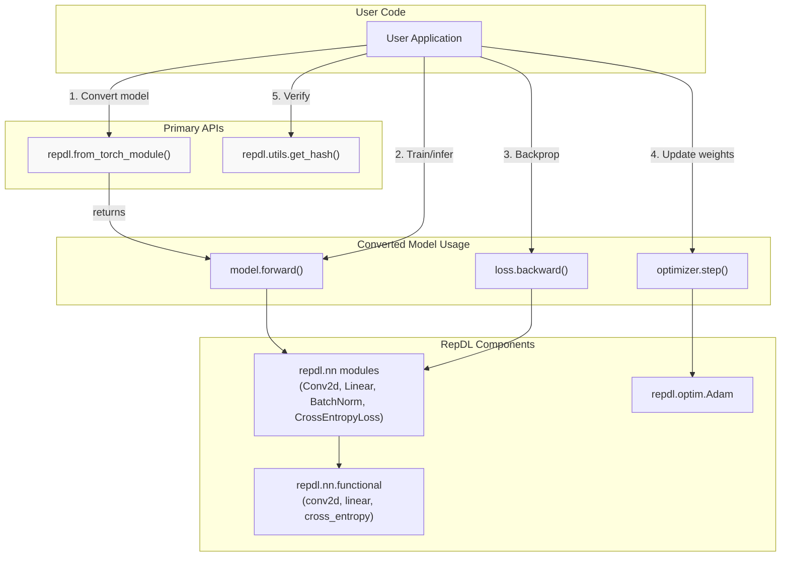
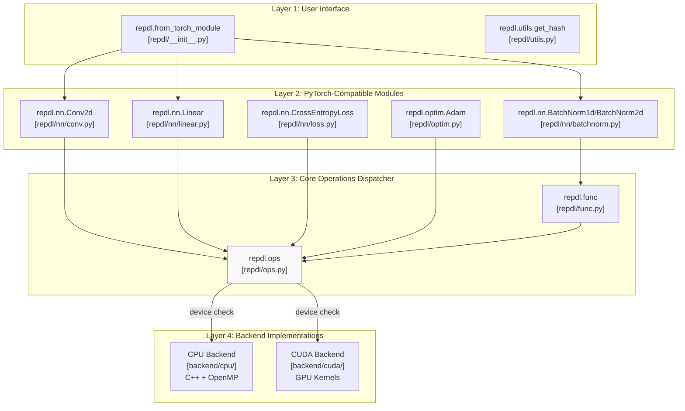
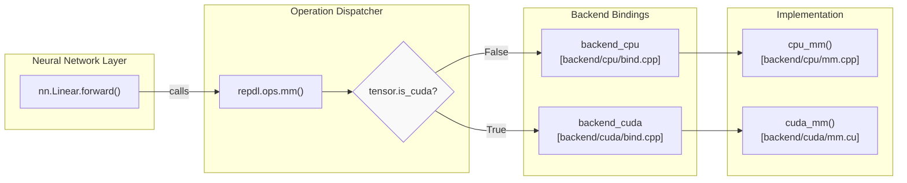

<!-- source: DeepWiki mcp.deepwiki.com · repo microsoft/RepDL · page 1 Overview · fetched 2026-10-26 -->

# Overview

<details>
<summary>Relevant source files</summary>

The following files were used as context for generating this wiki page:

- [README.md](README.md)
- [examples/mnist_trainig.py](examples/mnist_trainig.py)

</details>


## Purpose and Scope

RepDL (Reproducible Deep Learning) is a specialized library that guarantees **bitwise identical results across different hardware platforms** for identical training or inference tasks. This document provides a high-level overview of RepDL's architecture, key components, and design principles.

This page covers the fundamental concepts and system structure. For detailed reproducibility principles, see [Reproducibility Principles](#6.4). For API usage details, see [API Reference](#4). For extending the system, see [Development Guide](#6).

**Sources:** [README.md:1-5]()

## What RepDL Provides

RepDL addresses the non-determinism inherent in PyTorch operations, where even with `torch.use_deterministic_algorithms(True)`, operations like matrix multiplication, division, and square root can produce different results across devices. RepDL solves this by:

| Feature | Description | Key Components |
|---------|-------------|----------------|
| **Reproducible Operations** | Low-level operations that produce identical results regardless of hardware | `repdl.ops` module with CPU and CUDA backends |
| **PyTorch Compatibility** | Drop-in replacements for PyTorch modules | `repdl.nn`, `repdl.optim` |
| **Model Conversion** | Convert existing PyTorch models to reproducible versions | `repdl.from_torch_module()` function |
| **Verification Tools** | Cryptographic hashing to verify reproducibility | `repdl.utils.get_hash()` |

The library achieves reproducibility through three fundamental principles:
1. **Fixed floating-point operation order** - prevents reordering optimizations
2. **IEEE-754 compliance** - ensures standard floating-point behavior  
3. **Correctly rounded math functions** - guarantees precise results

**Sources:** [README.md:5-6, 29-32, 41-53]()

## Primary Entry Points

RepDL provides two main entry points for users:



**Diagram: User-Facing Entry Points and Workflow**

### Model Conversion API

The `repdl.from_torch_module()` function [repdl/__init__.py]() serves as the primary entry point for enabling reproducibility. It recursively converts a PyTorch model's layers to their RepDL equivalents:

```python
import repdl
model = repdl.from_torch_module(model)
```

This single function call transforms supported PyTorch modules (Conv2d, Linear, BatchNorm1d, BatchNorm2d, ReLU, MaxPool2d, Flatten, Sequential) into their reproducible counterparts.

### Verification API

The `repdl.utils.get_hash()` function provides cryptographic verification of model states and outputs, enabling users to confirm bitwise identical results across hardware platforms.

**Sources:** [README.md:29-40](), [examples/mnist_trainig.py:38, 67, 83, 103]()

## Layered Architecture

RepDL implements a four-layer architecture where each layer has distinct responsibilities:



**Diagram: Four-Layer Architecture with Code Paths**

### Layer 1: User Interface Layer

Provides high-level APIs for model conversion and verification. The conversion function walks the module tree and replaces supported layers.

**Key files:** [repdl/__init__.py](), [repdl/utils.py]()

### Layer 2: PyTorch-Compatible Modules  

Implements familiar neural network building blocks that inherit from PyTorch base classes (`torch.nn.Module`, `torch.optim.Optimizer`) but override computation methods to use reproducible operations.

**Key files:** [repdl/nn/conv.py](), [repdl/nn/linear.py](), [repdl/nn/batchnorm.py](), [repdl/nn/loss.py](), [repdl/optim.py]()

### Layer 3: Core Operations Dispatcher

The `repdl.ops` module serves as the **critical chokepoint** for reproducibility. It examines tensor device placement (`tensor.is_cuda`) and routes all operations to the appropriate backend. Custom autograd functions in `repdl.func` provide differentiable operations with controlled gradients.

**Key files:** [repdl/ops.py](), [repdl/func.py]()

### Layer 4: Backend Implementations

C++ and CUDA implementations provide the actual reproducible computations. These backends are registered with Python via pybind11 bindings.

**Key files:** [backend/cpu/bind.cpp](), [backend/cuda/bind.cpp](), [backend/cpu/*.cpp](), [backend/cuda/*.cu]()

**Sources:** [README.md:45-52]()

## Operation Dispatch Mechanism

The `repdl.ops` module implements device-aware routing, the core mechanism that ensures reproducibility:



**Diagram: Operation Dispatch Flow from Layer to Backend**

Every neural network operation flows through this dispatch mechanism:

1. High-level modules call operations via `repdl.ops`
2. The dispatcher checks tensor device placement
3. The appropriate backend function is invoked
4. Results are returned with reproducibility guarantees

This architecture ensures that **all computations** - forward pass, backward pass, optimizer updates - follow reproducible code paths regardless of the hardware platform.

**Sources:** [README.md:43-44, 49]()

## Currently Supported Components

RepDL provides a subset of PyTorch functionality focused on common deep learning workflows:

| Category | Components | Module Path |
|----------|------------|-------------|
| **Layers** | Conv2d, Linear, BatchNorm1d, BatchNorm2d | `repdl.nn` |
| **Activations** | ReLU | `repdl.nn` |
| **Pooling** | MaxPool2d | `repdl.nn` |
| **Utilities** | Flatten, Sequential | `repdl.nn` |
| **Loss Functions** | CrossEntropyLoss | `repdl.nn` |
| **Optimizers** | Adam | `repdl.optim` |
| **Operations** | mm, conv2d, div, sqrt, sum*, cross_entropy, softmax | `repdl.ops` |

For the complete API reference, see [API Reference](#4).

**Sources:** [README.md:45-46]()

## Example Usage

The MNIST training example demonstrates the complete workflow:

```python
# 1. Set up reproducibility
os.environ["CUBLAS_WORKSPACE_CONFIG"] = ":4096:8"
torch.use_deterministic_algorithms(True)

# 2. Convert model
model = torch.nn.Sequential(...)
model = repdl.from_torch_module(model)

# 3. Verify initial state
print(f"Hash of the initial model: {repdl.utils.get_hash(model)}")

# 4. Train with RepDL components
optimizer = repdl.optim.Adam(model.parameters(), lr=0.01)
for images, labels in data_loader:
    output = model(images)
    loss = repdl.nn.functional.cross_entropy(output, labels)
    loss.backward()
    optimizer.step()

# 5. Verify trained state
print(f"Hash of the trained model: {repdl.utils.get_hash(model)}")
```

This code produces **identical hash values** across different GPUs (V100, A100), CPU, and different CUDA versions, demonstrating bitwise reproducibility.

Expected output (consistent across all platforms):
```
Hash of the initial model: 2a2d133895b1684e55d0f152ead2914b55adc551d9790a4b4585309b79c60362
Hash of the trained model: 31ee86a7f75dbd76bac22f209617eb7349f93b0ede116dba924f328cac3013f1
Test accuracy: 0.9804
Hash of the logits: 0ca34dcd37105b4af690c46a62407b4b9b097d1063864c6d99f4309aeb4bca3e
```

**Sources:** [examples/mnist_trainig.py:42-43, 64, 67, 73, 83](), [README.md:34-39]()

## Extending RepDL

RepDL is designed to be extensible while maintaining reproducibility guarantees. The development workflow follows a four-step process:

1. **Define operation interface** in [repdl/ops.py]()
2. **Implement backends** in [backend/cpu/]() and [backend/cuda/]()  
3. **Register bindings** in [backend/cpu/bind.cpp]() and [backend/cuda/bind.cpp]()
4. **Build higher APIs** in [repdl/func.py]() and [repdl/nn/]()

All extensions must maintain the three core principles: fixed floating-point operation order, IEEE-754 compliance, and correctly rounded math functions.

For detailed guidance, see [Development Guide](#6).

**Sources:** [README.md:47-53]()

## Key Architectural Insights

| Insight | Implication |
|---------|-------------|
| **Single dispatch point** | All operations flow through `repdl.ops`, creating a reproducibility chokepoint |
| **Dual backend requirement** | Every operation must have both CPU and CUDA implementations for cross-platform reproducibility |
| **PyTorch extension strategy** | RepDL inherits from PyTorch classes, enabling seamless integration with existing codebases |
| **Verification by design** | Cryptographic hashing (`utils.get_hash()`) enables objective verification of reproducibility claims |
| **Layered abstraction** | Clear separation between user API, modules, operations, and backends simplifies maintenance and extension |

The architecture achieves its primary goal of **bitwise identical results** by controlling the entire computation path from high-level API calls through to low-level kernel execution, ensuring that every floating-point operation follows a deterministic, reproducible code path.

**Sources:** [README.md:1-53](), [examples/mnist_trainig.py:1-115]()

---

