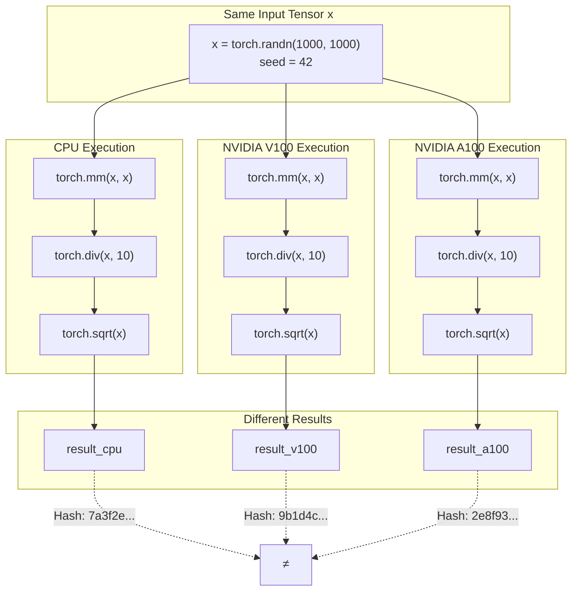
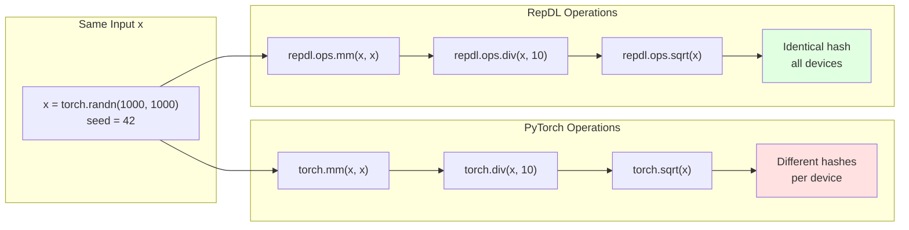
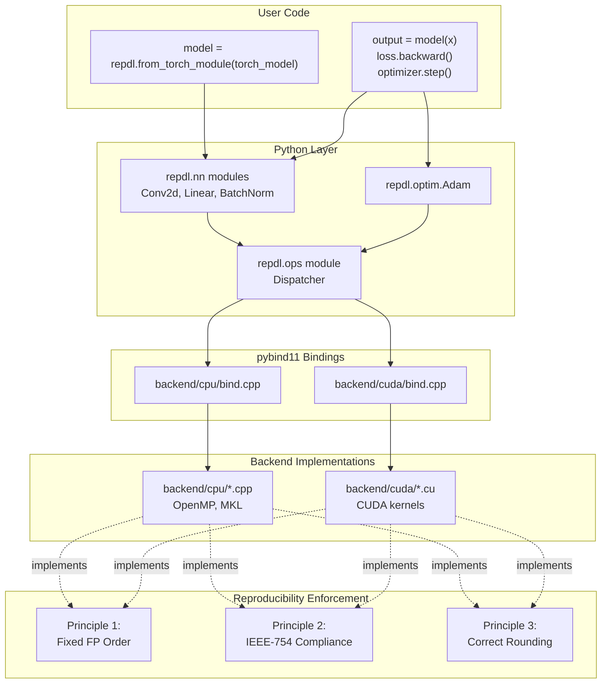

<!-- source: DeepWiki mcp.deepwiki.com · repo microsoft/RepDL · page 1.1 What is Reproducible Deep Learning? · fetched 2026-10-26 -->

# What is Reproducible Deep Learning?

<details>
<summary>Relevant source files</summary>

The following files were used as context for generating this wiki page:

- [README.md](README.md)
- [examples/mnist_trainig.py](examples/mnist_trainig.py)

</details>


## Purpose and Scope

This document explains the reproducibility problem in deep learning and how RepDL addresses it. We define what constitutes "reproducible" in the context of deep learning training and inference, describe the technical challenges that cause non-reproducibility, and provide an overview of RepDL's solution based on three core principles: fixed floating-point operation order, IEEE-754 compliance, and correctly rounded mathematical functions.

For details on RepDL's architecture and how these principles are implemented across the system, see [Architecture Overview](#1.2). For a deep technical dive into maintaining reproducibility when extending RepDL, see [Reproducibility Principles](#6.4). For practical guidance on verifying reproducibility in your models, see [Reproducibility Verification](#3.3).

---

## The Reproducibility Problem

Deep learning researchers and practitioners expect that running the same training or inference code with the same data and random seed should produce identical results. However, in practice, deep learning frameworks like PyTorch produce **different numerical results** when executed on different hardware platforms, even with identical inputs and model parameters.

### Common Sources of Non-Reproducibility

| Source | Description | Impact |
|--------|-------------|--------|
| **Hardware-dependent optimizations** | Different GPUs (e.g., V100 vs A100) use different instruction sets and optimization paths | Different floating-point results |
| **Parallel reduction order** | Operations like matrix multiplication and summation may accumulate values in different orders | Non-associativity of floating-point arithmetic causes divergence |
| **Math library implementations** | CUDA libraries (cuBLAS, cuDNN) use fast-math approximations that sacrifice precision | Results vary across CUDA versions and GPU architectures |
| **Compiler optimizations** | CPU and GPU compilers may reorder floating-point operations for performance | Changes to operation order alter final results |

Even when PyTorch's deterministic mode is enabled via `torch.use_deterministic_algorithms(True)`, many operations remain non-reproducible across devices.

**Sources:** [README.md:43-44]()

---

## PyTorch Non-Reproducibility Example

The following diagram illustrates how identical PyTorch operations produce different results on different devices:



**PyTorch Non-Reproducibility: Identical operations on identical inputs produce different results across CPU, V100, and A100**

Even with `torch.manual_seed(42)` and `torch.use_deterministic_algorithms(True)`, the final hash values differ because:

1. `torch.mm` uses different BLAS libraries (MKL on CPU, cuBLAS on GPU) with different accumulation orders
2. `torch.div` may use fast-math approximations on GPU
3. `torch.sqrt` implementations vary across platforms

**Sources:** [README.md:43-44]()

---

## RepDL's Solution: Bitwise Identical Results

RepDL guarantees **bitwise identical results** across all hardware platforms for the same input. This means that not only are results numerically similar—they are *exactly the same at the bit level*, producing identical cryptographic hashes.

### RepDL Operations vs PyTorch Operations



**Comparison: PyTorch operations are non-reproducible; RepDL operations guarantee bitwise identical results**

**Sources:** [README.md:43-44]()

---

## The Three Reproducibility Principles

RepDL achieves bitwise reproducibility by enforcing three fundamental principles in all operation implementations:

### 1. Fixed Floating-Point Operation Order

**Principle:** All floating-point operations must occur in a deterministic, fixed order.

**Why it matters:** Floating-point arithmetic is not associative. The expression `(a + b) + c` may produce a different result than `a + (b + c)` due to rounding errors at each step.

**Implementation:**
- Parallel reductions (e.g., in matrix multiplication) use fixed accumulation patterns
- CPU implementations use deterministic OpenMP scheduling
- CUDA kernels use fixed thread block sizes and reduction trees

**Example:**
```
Non-reproducible: sum([1e10, 1e-10, 1e10, -1e10, -1e10])
  - Parallel threads may accumulate in any order
  - Result depends on thread scheduling
  
Reproducible: sum([1e10, 1e-10, 1e10, -1e10, -1e10])
  - Elements always accumulated left-to-right
  - Result is identical every time
```

### 2. IEEE-754 Compliance

**Principle:** All operations must strictly follow the IEEE-754 standard for floating-point arithmetic.

**Why it matters:** Many hardware-specific optimizations (fast-math, fused multiply-add variations) violate IEEE-754 to improve performance but produce inconsistent results across platforms.

**Implementation:**
- No use of `-ffast-math` or CUDA's `--use_fast_math` flags
- Explicit control over fused multiply-add (FMA) instructions
- Disabled vendor-specific floating-point optimizations

### 3. Correctly Rounded Mathematical Functions

**Principle:** Mathematical functions (sqrt, div, exp, log, etc.) must be correctly rounded to the nearest representable value.

**Why it matters:** Many math libraries use approximations (polynomial expansions, lookup tables) that introduce platform-specific errors.

**Implementation:**
- CPU backend uses high-precision math functions
- CUDA backend uses correctly rounded intrinsics (e.g., `__dsqrt_rn` instead of `sqrtf`)
- Division operations use explicit rounding control

**Sources:** [README.md:52]()

---

## Reproducibility Guarantee Scope

RepDL provides reproducibility guarantees for the following:

| Category | Reproducible Across | Code Reference |
|----------|-------------------|----------------|
| **Operations** | CPU, all CUDA-capable GPUs | `repdl.ops.*` |
| **Neural network layers** | All devices | `repdl.nn.Conv2d`, `repdl.nn.Linear`, `repdl.nn.BatchNorm*` |
| **Loss functions** | All devices | `repdl.nn.CrossEntropyLoss` |
| **Optimizers** | All devices | `repdl.optim.Adam` |
| **Training loops** | All devices | See [examples/mnist_trainig.py]() |
| **Inference** | All devices | Model converted via `repdl.from_torch_module` |

### What RepDL Does NOT Guarantee

- **Data loading order:** Use fixed seeds and `shuffle=False` in dataloaders for reproducibility
- **PyTorch native operations:** Operations outside RepDL's control remain non-reproducible
- **Mixed precision training:** Currently not supported
- **Operations not yet implemented:** See [API Reference](#4) for supported operations

---

## Concrete Example: MNIST Training

The following table shows hash values from training a simple CNN on MNIST across different hardware platforms. With RepDL, all hash values are identical:

| Checkpoint | CPU | NVIDIA V100 | NVIDIA A100 | RTX 3090 |
|-----------|-----|-------------|-------------|----------|
| **Initial model** | `2a2d133895b16...` | `2a2d133895b16...` | `2a2d133895b16...` | `2a2d133895b16...` |
| **After 2 epochs** | `31ee86a7f75db...` | `31ee86a7f75db...` | `31ee86a7f75db...` | `31ee86a7f75db...` |
| **Test logits** | `0ca34dcd37105...` | `0ca34dcd37105...` | `0ca34dcd37105...` | `0ca34dcd37105...` |
| **Test accuracy** | 0.9804 | 0.9804 | 0.9804 | 0.9804 |

**All hash values are bitwise identical across devices**

This reproducibility is achieved through the code in [examples/mnist_trainig.py:62-84](), which uses:

1. `repdl.from_torch_module()` to convert the PyTorch model [examples/mnist_trainig.py:109]()
2. `repdl.optim.Adam` for optimization [examples/mnist_trainig.py:64]()
3. `repdl.nn.functional.cross_entropy` for loss computation [examples/mnist_trainig.py:73]()
4. `repdl.utils.get_hash()` for verification [examples/mnist_trainig.py:67,83,103]()

**Sources:** [README.md:34-39](), [examples/mnist_trainig.py:62-104]()

---

## How RepDL Achieves Reproducibility

The following diagram shows how RepDL's architecture enforces the three reproducibility principles:



**RepDL Architecture: All operations flow through `repdl.ops` to reproducible backends that enforce the three principles**

**Key Components:**

1. **`repdl.ops` module** [repdl/ops.py](): Central dispatcher that routes operations to device-specific backends
2. **CPU backend** [backend/cpu/](): C++ implementations with OpenMP for parallel operations
3. **CUDA backend** [backend/cuda/](): CUDA kernel implementations with explicit reproducibility controls
4. **pybind11 bindings** [backend/cpu/bind.cpp](), [backend/cuda/bind.cpp](): Register C++/CUDA functions with Python

Every operation in RepDL follows this path, ensuring that all three reproducibility principles are enforced at the lowest level of computation.

**Sources:** [README.md:45-52]()

---

## Why Reproducibility Matters

### Research
- **Exact result verification:** Collaborators can verify published results bit-for-bit
- **Debugging:** Reproduce bugs and numerical issues exactly
- **Ablation studies:** Isolate the impact of specific changes without noise from hardware differences

### Production
- **Model versioning:** Guarantee that re-training produces identical models
- **Regulatory compliance:** Meet requirements for auditable, deterministic AI systems
- **A/B testing:** Ensure differences are due to model changes, not hardware variance

### Education
- **Consistent experiments:** Students get identical results regardless of hardware
- **Fair grading:** Assignments produce comparable outputs across different machines

---

## Environment Setup Requirements

To use RepDL's reproducibility guarantees, you must configure your environment:

```python
import os
import torch

# Required for CUDA deterministic operations
os.environ["CUBLAS_WORKSPACE_CONFIG"] = ":4096:8"

# Enable PyTorch deterministic algorithms
torch.use_deterministic_algorithms(True)

# Set random seeds
torch.manual_seed(42)
```

These settings are demonstrated in [examples/mnist_trainig.py:42-43]().

**Sources:** [examples/mnist_trainig.py:41-43]()

---

## Summary

RepDL solves the reproducibility problem in deep learning by:

1. **Identifying the root causes:** Non-deterministic operation order, non-compliant floating-point operations, and approximate math functions
2. **Enforcing three principles:** Fixed FP operation order, IEEE-754 compliance, and correctly rounded math
3. **Implementing reproducible backends:** Custom C++ and CUDA implementations that guarantee bitwise identical results
4. **Providing a familiar API:** PyTorch-compatible interface via `repdl.from_torch_module`, `repdl.nn`, and `repdl.optim`

The result is **bitwise identical** training and inference across all hardware platforms, verified through cryptographic hashing.

For implementation details, see [Architecture Overview](#1.2). For practical usage, see [Quick Start](#2.2) and [MNIST Training Example](#2.3).

**Sources:** [README.md:1-52](), [examples/mnist_trainig.py:1-115]()

---

