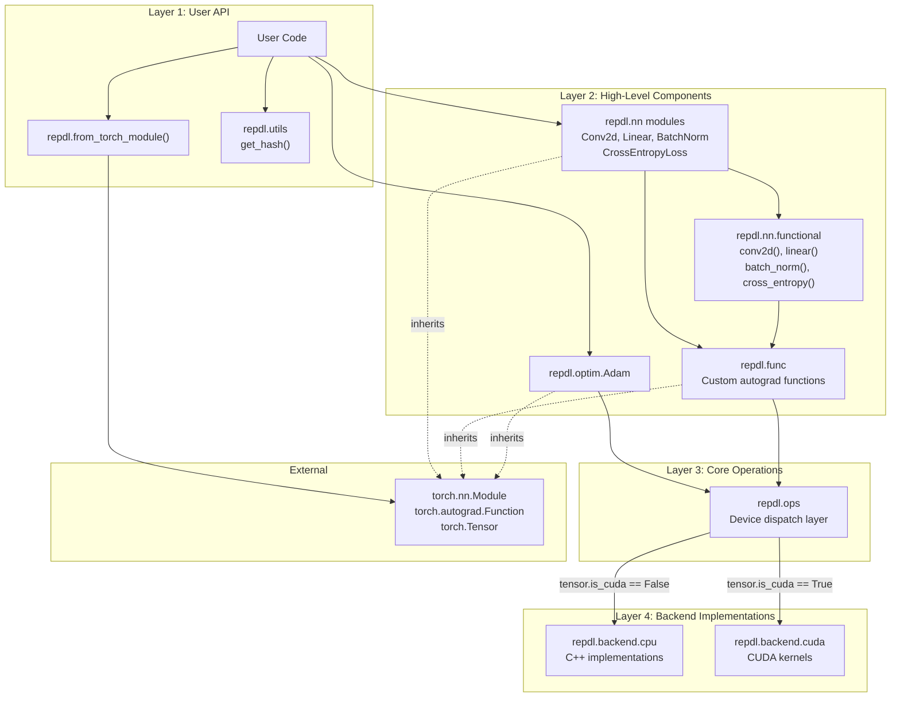
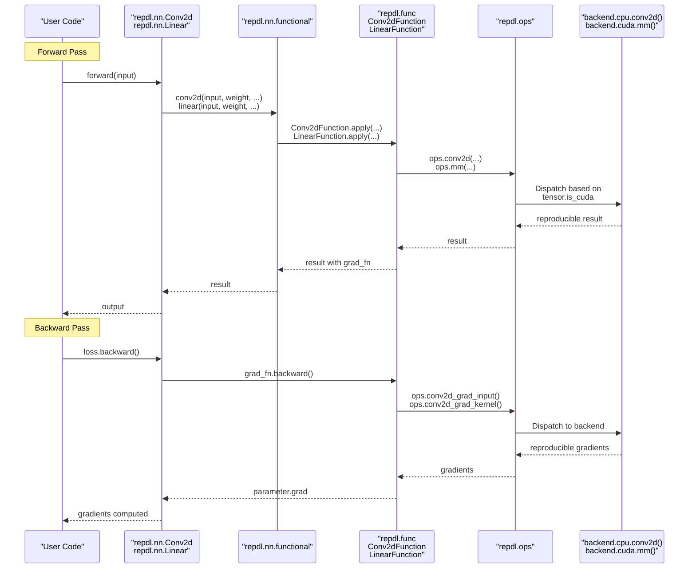
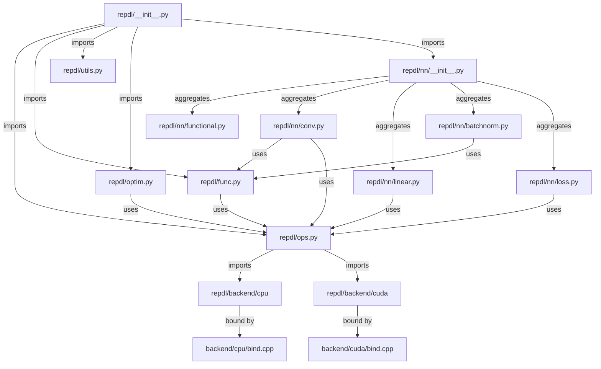

<!-- source: DeepWiki mcp.deepwiki.com · repo microsoft/RepDL · page 1.2 Architecture Overview · fetched 2026-10-26 -->

# Architecture Overview

<details>
<summary>Relevant source files</summary>

The following files were used as context for generating this wiki page:

- [README.md](README.md)
- [examples/mnist_trainig.py](examples/mnist_trainig.py)
- [repdl/ops.py](repdl/ops.py)

</details>


## Purpose and Scope

This document describes the high-level architecture of RepDL, explaining how the system's components are organized into layers and how they interact to achieve bitwise reproducibility. It covers the overall structure from user-facing APIs down to backend implementations, the role of each major component, and the key architectural patterns that enable reproducible computation.

For details on specific architectural aspects, see:
- [Operation Dispatch Mechanism](#3.1) for the dispatch logic details
- [Backend Architecture](#5.1) for C++/CUDA implementation details
- [Reproducibility Principles](#6.4) for the mathematical foundations

---

## System Layers

RepDL implements a four-layer architecture where each layer has clearly defined responsibilities. The design follows a strict dependency hierarchy to maintain separation of concerns and enable controlled execution paths.



**Sources:** [README.md:1-53](), [repdl/ops.py:1-158]()

### Layer Descriptions

| Layer | Components | Responsibility | Key Files |
|-------|-----------|----------------|-----------|
| **User API** | Conversion utilities, hashing | Entry points for model conversion and reproducibility verification | `repdl/__init__.py`, `repdl/utils.py` |
| **High-Level Components** | Neural network modules, optimizers, functional APIs | PyTorch-compatible interfaces with state management | `repdl/nn/*.py`, `repdl/optim.py`, `repdl/func.py` |
| **Core Operations** | Operation dispatcher | Device-aware routing to reproducible backends | `repdl/ops.py` |
| **Backend Implementations** | C++ and CUDA kernels | Reproducible arithmetic implementations | `backend/cpu/*.cpp`, `backend/cuda/*.cu` |

**Sources:** [README.md:45-52]()

---

## Core Components and Their Roles

### Operation Dispatcher: `repdl.ops`

The `repdl.ops` module serves as the central chokepoint for all reproducible operations. Every computational operation flows through this dispatcher, which examines the tensor's device placement and routes to the appropriate backend.

**Key Operations:**
- `conv2d()`, `conv2d_grad_input()`, `conv2d_grad_kernel()` - Convolution operations [repdl/ops.py:12-88]()
- `mm()` - Matrix multiplication [repdl/ops.py:106-112]()
- `div()`, `sqrt()` - Element-wise operations [repdl/ops.py:98-123]()
- `sum1d()`, `sum2d_dim0()`, `sum2d_dim1()`, `sum4d_dim023()` - Reduction operations [repdl/ops.py:126-157]()
- `cross_entropy()`, `softmax()` - Loss and activation functions [repdl/ops.py:91-119]()

**Dispatch Pattern:**
```python
# Example from ops.py
def mm(input: torch.Tensor, mat2: torch.Tensor, 
       transA: bool = False, transB: bool = False) -> torch.Tensor:
    if input.is_cuda:
        return cuda.mm(input, mat2, transA, transB)
    else:
        return cpu.mm(input, mat2, transA, transB)
```

This pattern is repeated for all operations, ensuring consistent device-aware routing.

**Sources:** [repdl/ops.py:1-158]()

### Neural Network Modules: `repdl.nn`

The `repdl.nn` package provides PyTorch-compatible neural network modules that inherit from `torch.nn.Module` but override forward passes to use reproducible operations.

**Module Organization:**
- `repdl.nn.conv.Conv2d` - 2D convolution layer
- `repdl.nn.linear.Linear` - Fully connected layer
- `repdl.nn.batchnorm.BatchNorm1d`, `BatchNorm2d` - Normalization layers
- `repdl.nn.loss.CrossEntropyLoss` - Classification loss function
- `repdl.nn.functional` - Stateless function aggregator

Each module delegates to custom autograd functions in `repdl.func`, which in turn use `repdl.ops` for actual computation.

**Sources:** [README.md:45-46]()

### Custom Autograd Functions: `repdl.func`

The `repdl.func` module implements `torch.autograd.Function` subclasses that control both forward and backward passes. This enables reproducible gradient computation.

**Example Functions:**
- `expand_as()` - Tensor broadcasting with reproducible gradients
- `mean1d()` - 1D mean with reproducible gradient computation
- `mean2d_dim0()` - 2D mean along dimension 0
- `mean4d_dim023()` - 4D mean along dimensions 0, 2, 3

These functions are used internally by higher-level modules to ensure all gradient operations are reproducible.

**Sources:** [README.md:50]()

### Optimizer: `repdl.optim.Adam`

The `repdl.optim.Adam` optimizer inherits from PyTorch's optimizer base class but uses `repdl.ops` for parameter updates, ensuring reproducible weight modifications across training steps.

**Sources:** [README.md:51](), [examples/mnist_trainig.py:64]()

### Model Conversion: `repdl.from_torch_module()`

This function converts existing PyTorch models to use RepDL's reproducible operations by recursively replacing standard layers with RepDL equivalents.

**Conversion Process:**
1. Recursively traverse model's module tree
2. Replace `torch.nn` layers with corresponding `repdl.nn` layers
3. Transfer trained parameters and buffers
4. Preserve model structure and interface

**Sources:** [README.md:29-32](), [examples/mnist_trainig.py:38]()

---

## Data Flow Architecture

The following diagram shows how data flows through RepDL during training, illustrating the path from user code to backend implementations.



**Sources:** [examples/mnist_trainig.py:69-77](), [repdl/ops.py:12-88]()

---

## Module Dependency Graph

This diagram maps the actual Python modules and their import relationships, showing how the codebase is organized.



**Import Hierarchy:**
1. Top-level `repdl` package exports primary APIs
2. `repdl.ops` imports backend modules (`backend.cpu`, `backend.cuda`)
3. High-level components (`nn`, `func`, `optim`) depend on `ops`
4. Backend modules are bound to Python via pybind11

**Sources:** [repdl/ops.py:8-9](), [README.md:49]()

---

## Key Architectural Patterns

### 1. Central Dispatcher Pattern

All operations funnel through `repdl.ops`, which acts as a single point of control. This ensures:
- Consistent device-aware routing
- Single source of truth for operation dispatch
- Easy auditability of execution paths

**Implementation:**
```python
# Pattern from ops.py
def operation_name(input: torch.Tensor, ...) -> torch.Tensor:
    if input.is_cuda:
        return cuda.operation_name(input, ...)
    else:
        return cpu.operation_name(input, ...)
```

**Sources:** [repdl/ops.py:19-26]()

### 2. Layer Inheritance with Override

RepDL modules inherit from PyTorch classes but override critical methods to redirect computation through reproducible paths.

**Example Pattern:**
- Inherit from `torch.nn.Module` or `torch.autograd.Function`
- Override `forward()` or `apply()` methods
- Delegate to `repdl.ops` for actual computation
- Maintain PyTorch API compatibility

**Sources:** [README.md:45]()

### 3. Dual Backend Implementation

Every operation has two implementations:
- **CPU backend:** C++ with OpenMP parallelization
- **CUDA backend:** CUDA kernels for GPU execution

Both implement identical interfaces and guarantee bitwise identical results.

**Backend Registration:**
- C++ implementations registered in [backend/cpu/bind.cpp]()
- CUDA implementations registered in [backend/cuda/bind.cpp]()
- Exposed to Python via pybind11

**Sources:** [README.md:49]()

### 4. Functional Decomposition

Complex operations are decomposed into simpler, reproducible primitives:
- High-level modules → functional APIs → autograd functions → ops → backends
- Each layer adds a specific abstraction (state management, gradients, dispatch, execution)

**Sources:** [README.md:45-52]()

---

## Extension Points

The architecture supports extension at multiple levels:

| Extension Level | How to Extend | Files to Modify |
|----------------|---------------|-----------------|
| **Operations** | Add dispatcher function, implement CPU/CUDA backends, register bindings | `repdl/ops.py`, `backend/cpu/*.cpp`, `backend/cuda/*.cu`, `backend/*/bind.cpp` |
| **Autograd Functions** | Implement `torch.autograd.Function` subclass using `repdl.ops` | `repdl/func.py` |
| **Modules** | Implement `torch.nn.Module` subclass using `repdl.func` or `repdl.ops` | `repdl/nn/*.py` |
| **Optimizers** | Implement optimizer using `repdl.ops` for parameter updates | `repdl/optim.py` |

**Requirements for Extensions:**
1. Maintain fixed floating-point operation order
2. Use IEEE-754 compliant operations
3. Implement correctly rounded math functions
4. Provide both CPU and CUDA implementations

**Sources:** [README.md:47-52]()

---

## Reproducibility Verification Workflow

The architecture supports verification at multiple stages:

```mermaid
graph LR
    SETUP["Environment Setup<br/>CUBLAS_WORKSPACE_CONFIG<br/>torch.use_deterministic_algorithms"]
    CONVERT["Model Conversion<br/>repdl.from_torch_module()"]
    INIT_HASH["Initial Hash<br/>repdl.utils.get_hash(model)"]
    TRAIN["Training Loop<br/>All ops through repdl.ops"]
    FINAL_HASH["Final Hash<br/>repdl.utils.get_hash(model)"]
    INFER["Inference<br/>Model evaluation"]
    OUTPUT_HASH["Output Hash<br/>repdl.utils.get_hash(output)"]
    
    SETUP --> CONVERT
    CONVERT --> INIT_HASH
    INIT_HASH --> TRAIN
    TRAIN --> FINAL_HASH
    FINAL_HASH --> INFER
    INFER --> OUTPUT_HASH
```



**Hash Values from MNIST Example:**
- Initial model: `2a2d133895b1684e55d0f152ead2914b55adc551d9790a4b4585309b79c60362`
- Trained model: `31ee86a7f75dbd76bac22f209617eb7349f93b0ede116dba924f328cac3013f1`
- Logits output: `0ca34dcd37105b4af690c46a62407b4b9b097d1063864c6d99f4309aeb4bca3e`

These hash values are identical across all hardware platforms (CPU, different GPUs) when using the same input data and random seed.

**Sources:** [README.md:34-39](), [examples/mnist_trainig.py:67-83]()

---

## Summary

The RepDL architecture achieves reproducibility through:

1. **Layered Design:** Clear separation between user APIs, high-level components, core operations, and backend implementations
2. **Central Dispatch:** Single routing point (`repdl.ops`) for all computational operations
3. **Dual Backends:** Identical CPU and CUDA implementations for every operation
4. **Controlled Execution:** Custom autograd functions that route all forward and backward passes through reproducible paths
5. **Verification Tools:** Cryptographic hashing for bitwise identical result validation

The architecture is extensible while maintaining reproducibility guarantees through strict adherence to reproducibility principles at all levels.

**Sources:** [README.md:1-53](), [repdl/ops.py:1-158]()

---

