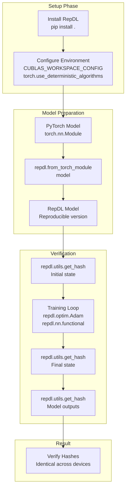
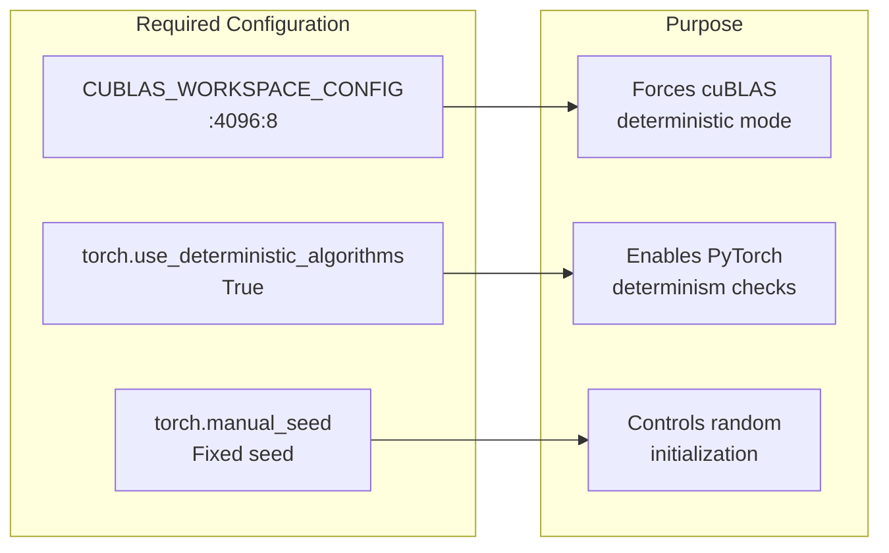
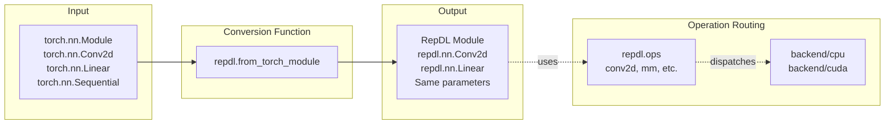
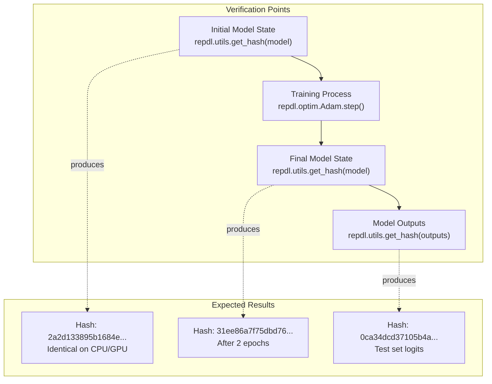
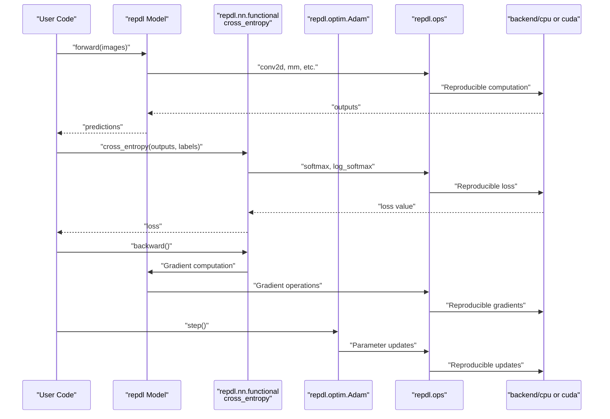
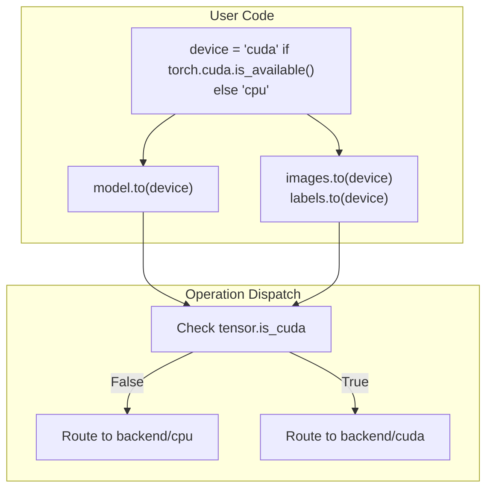

<!-- source: DeepWiki mcp.deepwiki.com · repo microsoft/RepDL · page 2 Getting Started · fetched 2026-10-26 -->

# Getting Started

<details>
<summary>Relevant source files</summary>

The following files were used as context for generating this wiki page:

- [README.md](README.md)
- [examples/mnist_trainig.py](examples/mnist_trainig.py)

</details>


This section provides a practical guide for installing RepDL, converting PyTorch models to reproducible versions, and verifying bitwise identical results across hardware platforms. It covers the essential steps from installation through basic model conversion and training workflows.

For detailed architectural concepts, see [Core Concepts](#3). For comprehensive API documentation, see [API Reference](#4).

---

## Purpose and Scope

This page introduces the fundamental workflow for using RepDL in your projects. It covers:

- Prerequisites and installation process
- Environment configuration for reproducibility
- Basic model conversion using `repdl.from_torch_module`
- Reproducibility verification using `repdl.utils.get_hash`
- Overview of the training workflow

**Child pages provide detailed information:**
- [Installation](#2.1) - Complete installation instructions and troubleshooting
- [Quick Start](#2.2) - Minimal working example with inference
- [MNIST Training Example](#2.3) - Full training example with expected outputs

---

## RepDL Workflow Overview

The following diagram shows the end-to-end workflow for using RepDL, mapping natural language concepts to actual code symbols:



**Sources:** [README.md:19-39](), [examples/mnist_trainig.py:41-114]()

---

## Prerequisites

RepDL requires PyTorch and compatible CUDA libraries to be installed before setup. The system supports both CPU and CUDA execution.

| Requirement | Purpose |
|------------|---------|
| **PyTorch** | Base framework for tensor operations and autograd |
| **CUDA Toolkit** | GPU support (optional but recommended) |
| **C++ Compiler** | Required for building backend extensions |
| **Python 3.6+** | Language runtime |

**Sources:** [README.md:21-22]()

---

## Installation Overview

The installation process involves cloning the repository and building the C++ and CUDA backend extensions. This process compiles the reproducible operation implementations in [backend/cpu/]() and [backend/cuda/]().

```bash
git clone https://github.com/microsoft/RepDL.git
cd RepDL
pip install .
```

The `pip install .` command triggers the build process defined in `setup.py`, which compiles the pybind11 bindings registered in [backend/cpu/bind.cpp]() and [backend/cuda/bind.cpp]().

For detailed installation instructions, troubleshooting, and build configuration options, see [Installation](#2.1).

**Sources:** [README.md:23-27]()

---

## Environment Configuration

RepDL requires specific environment settings to ensure deterministic behavior across all operations:



### Configuration Code

```python
import os
import torch

# Enable cuBLAS deterministic mode
os.environ["CUBLAS_WORKSPACE_CONFIG"] = ":4096:8"

# Enable PyTorch deterministic algorithms
torch.use_deterministic_algorithms(True)

# Set random seed for reproducible initialization
torch.manual_seed(0)
```

**Critical:** These settings must be applied before any model operations. The `CUBLAS_WORKSPACE_CONFIG` environment variable forces CUDA BLAS operations to use deterministic algorithms rather than faster non-deterministic ones.

**Sources:** [examples/mnist_trainig.py:42-43](), [examples/mnist_trainig.py:107]()

---

## Model Conversion Process

The `repdl.from_torch_module` function converts a standard `torch.nn.Module` to use reproducible operations. This process preserves model parameters and structure while replacing operation implementations.



### Basic Conversion Example

```python
import torch
import repdl

# Define a standard PyTorch model
model = torch.nn.Sequential(
    torch.nn.Conv2d(3, 64, kernel_size=3),
    torch.nn.ReLU(),
    torch.nn.Linear(64, 10)
)

# Convert to reproducible version
model = repdl.from_torch_module(model)
```

The conversion function:
1. Recursively traverses the module tree
2. Replaces supported layer types (Conv2d, Linear, BatchNorm, etc.) with RepDL equivalents
3. Preserves parameter values and states
4. Maintains the same forward pass interface

For a minimal working example, see [Quick Start](#2.2).

**Sources:** [README.md:29-32](), [examples/mnist_trainig.py:38]()

---

## Reproducibility Verification

RepDL provides `repdl.utils.get_hash` to verify bitwise identical results across different hardware platforms. This function computes a SHA-256 hash of model state or tensor data.



### Hash Computation at Key Points

```python
import repdl

# Verify initial model state
initial_hash = repdl.utils.get_hash(model)
print(f"Hash of the initial model: {initial_hash}")

# Train model...
train(model, optimizer)

# Verify trained model state
trained_hash = repdl.utils.get_hash(model)
print(f"Hash of the trained model: {trained_hash}")

# Verify model outputs
outputs = model(test_inputs)
output_hash = repdl.utils.get_hash(outputs)
print(f"Hash of the logits: {output_hash}")
```

**Expected Behavior:** When running the same training process on different devices (e.g., CPU, NVIDIA V100, NVIDIA A100), all three hash values will be identical, demonstrating bitwise reproducibility.

For detailed verification workflow and interpreting hash values, see [Reproducibility Verification](#3.3).

**Sources:** [examples/mnist_trainig.py:67](), [examples/mnist_trainig.py:83](), [examples/mnist_trainig.py:103](), [README.md:34-39]()

---

## Training Workflow Overview

RepDL training follows the standard PyTorch training loop pattern while using reproducible operations throughout. The key difference is the use of `repdl.optim` optimizers and `repdl.nn.functional` loss functions.



### Training Loop Structure

The training loop uses RepDL components at critical points:

| Component | RepDL Symbol | Purpose |
|-----------|--------------|---------|
| **Optimizer** | `repdl.optim.Adam` | Reproducible parameter updates |
| **Loss Function** | `repdl.nn.functional.cross_entropy` | Reproducible loss computation |
| **Model** | Converted via `repdl.from_torch_module` | Reproducible forward/backward passes |
| **Verification** | `repdl.utils.get_hash` | Hash computation at checkpoints |

### Minimal Training Example

```python
import repdl

# Setup
model = repdl.from_torch_module(model)
optimizer = repdl.optim.Adam(model.parameters(), lr=0.01)

# Training loop
for epoch in range(num_epochs):
    for images, labels in data_loader:
        # Forward pass
        outputs = model(images)
        
        # Compute loss using reproducible function
        loss = repdl.nn.functional.cross_entropy(outputs, labels)
        
        # Backward pass and optimization
        optimizer.zero_grad()
        loss.backward()
        optimizer.step()
```

For a complete training example with data loading, evaluation, and hash verification, see [MNIST Training Example](#2.3).

**Sources:** [examples/mnist_trainig.py:62-84]()

---

## Device Placement

RepDL supports both CPU and CUDA devices. The operation dispatch mechanism automatically routes operations to the appropriate backend based on tensor device placement.



### Device Usage Example

```python
import torch
import repdl

# Select device
device = "cuda" if torch.cuda.is_available() else "cpu"

# Move model to device
model = repdl.from_torch_module(model)
model.to(device)

# Move data to device during training
for images, labels in data_loader:
    images = images.to(device)
    labels = labels.to(device)
    outputs = model(images)
```

The `repdl.ops` dispatcher examines `tensor.is_cuda` and routes operations accordingly. For details on the dispatch mechanism, see [Operation Dispatch Mechanism](#3.1).

**Sources:** [examples/mnist_trainig.py:110](), [examples/mnist_trainig.py:63](), [examples/mnist_trainig.py:70-71]()

---

## Supported Operations and Modules

RepDL currently supports a subset of PyTorch operations and modules. The following table shows the mapping between PyTorch and RepDL components:

| Category | PyTorch | RepDL Equivalent | Source |
|----------|---------|------------------|--------|
| **Operations** | `torch.mm` | `repdl.ops.mm` | [repdl/ops.py]() |
| | `torch.div` | `repdl.ops.div` | [repdl/ops.py]() |
| | `torch.sqrt` | `repdl.ops.sqrt` | [repdl/ops.py]() |
| **Layers** | `torch.nn.Conv2d` | `repdl.nn.Conv2d` | [repdl/nn/conv.py]() |
| | `torch.nn.Linear` | `repdl.nn.Linear` | [repdl/nn/linear.py]() |
| | `torch.nn.BatchNorm1d` | `repdl.nn.BatchNorm1d` | [repdl/nn/batchnorm.py]() |
| | `torch.nn.BatchNorm2d` | `repdl.nn.BatchNorm2d` | [repdl/nn/batchnorm.py]() |
| **Loss Functions** | `torch.nn.CrossEntropyLoss` | `repdl.nn.CrossEntropyLoss` | [repdl/nn/loss.py]() |
| **Optimizers** | `torch.optim.Adam` | `repdl.optim.Adam` | [repdl/optim.py]() |
| **Functional** | `F.cross_entropy` | `repdl.nn.functional.cross_entropy` | [repdl/nn/functional.py]() |

**Note:** Operations not implemented in RepDL will fall back to standard PyTorch implementations, which may not provide reproducibility guarantees. For extending RepDL with custom operations, see [Development Guide](#6).

**Sources:** [README.md:42-45]()

---

## Next Steps

After completing the basic setup:

1. **Try the Quick Start** - See [Quick Start](#2.2) for a minimal inference example
2. **Run MNIST Training** - See [MNIST Training Example](#2.3) for a complete training workflow
3. **Understand Core Concepts** - See [Core Concepts](#3) for architectural details
4. **Explore the API** - See [API Reference](#4) for comprehensive documentation
5. **Extend RepDL** - See [Development Guide](#6) for adding custom operations

**Sources:** [README.md:19-52]()

---

