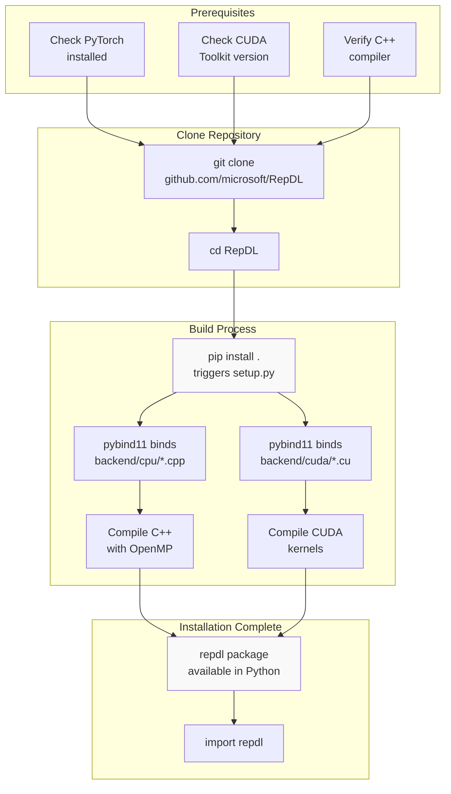
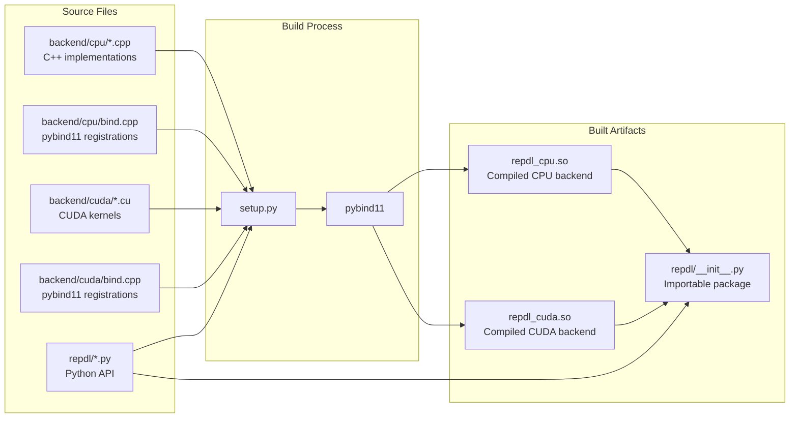
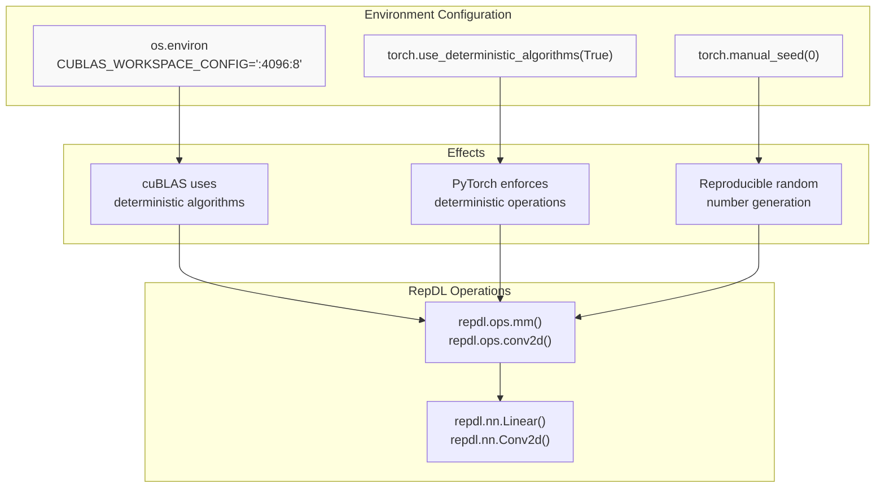

<!-- source: DeepWiki mcp.deepwiki.com · repo microsoft/RepDL · page 2.1 Installation · fetched 2026-10-26 -->

# Installation

<details>
<summary>Relevant source files</summary>

The following files were used as context for generating this wiki page:

- [README.md](README.md)
- [examples/mnist_trainig.py](examples/mnist_trainig.py)

</details>


This page provides step-by-step instructions for installing RepDL on your system, including prerequisite software, build configuration, and environment setup required for reproducibility. For information on using RepDL after installation, see [Quick Start](#2.2) and [MNIST Training Example](#2.3).

## Prerequisites

RepDL requires the following software to be installed before building from source:

| Component | Purpose | Notes |
|-----------|---------|-------|
| **PyTorch** | Base tensor operations and autograd | Must be installed first |
| **CUDA Toolkit** | GPU computation support | Version must match PyTorch's CUDA version |
| **C++ Compiler** | Building CPU backend | GCC 7+ or MSVC 2019+ |
| **Python 3.7+** | Runtime environment | With pip package manager |
| **Git** | Source code retrieval | For cloning repository |

### PyTorch and CUDA Version Compatibility

RepDL extends PyTorch by providing reproducible backends for operations. The CUDA version used to build RepDL must match the CUDA version that PyTorch was built against. Verify your PyTorch installation:

```python
import torch
print(torch.__version__)  # e.g., '2.0.0+cu118'
print(torch.version.cuda)  # e.g., '11.8'
```

**Sources:** [README.md:19-21]()

## Installation Steps

### Diagram: Installation Workflow



**Sources:** [README.md:23-27]()

### Step-by-Step Installation

Execute the following commands in your terminal to build and install RepDL from source:

```bash
git clone https://github.com/microsoft/RepDL.git
cd RepDL
pip install .
```

The `pip install .` command triggers the following build process:

1. **C++ Backend Compilation**: Compiles files in `backend/cpu/` directory with OpenMP support for parallel operations
2. **CUDA Backend Compilation**: Compiles `.cu` files in `backend/cuda/` directory into GPU kernels
3. **Python Binding**: Uses pybind11 to create Python-callable interfaces defined in `backend/cpu/bind.cpp` and `backend/cuda/bind.cpp`
4. **Package Installation**: Installs the `repdl` Python package into your environment

**Sources:** [README.md:23-27]()

### Build System Architecture



**Sources:** [README.md:23-27](), [backend/cpu/bind.cpp](), [backend/cuda/bind.cpp]()

## Environment Configuration

RepDL achieves bitwise reproducibility by controlling floating-point operation ordering and enforcing deterministic algorithms. Proper environment configuration is **required** for reproducibility guarantees.

### Required Environment Variables

The following environment variables must be set before executing reproducible code:

| Variable | Value | Purpose |
|----------|-------|---------|
| `CUBLAS_WORKSPACE_CONFIG` | `:4096:8` or `:16:8` | Allocates workspace memory for deterministic cuBLAS operations |

### Required PyTorch Settings

Configure PyTorch's deterministic mode in your Python code:

```python
import os
import torch

# Set environment variable (must be set before any CUDA operations)
os.environ["CUBLAS_WORKSPACE_CONFIG"] = ":4096:8"

# Enable deterministic algorithms in PyTorch
torch.use_deterministic_algorithms(True)

# Set manual seed for reproducible random number generation
torch.manual_seed(0)
```

**Sources:** [examples/mnist_trainig.py:41-43](), [examples/mnist_trainig.py:107]()

### Environment Setup Diagram



**Sources:** [examples/mnist_trainig.py:41-43]()

### CUBLAS_WORKSPACE_CONFIG Values

The `CUBLAS_WORKSPACE_CONFIG` variable accepts two formats:

| Format | Memory Usage | Description |
|--------|--------------|-------------|
| `:4096:8` | ~24MB | 4096 workspaces of 8 bytes each |
| `:16:8` | ~128 bytes | 16 workspaces of 8 bytes each (minimal memory) |

Use `:4096:8` for most workloads. Use `:16:8` if GPU memory is constrained, though this may limit the size of operations that can be executed deterministically.

**Sources:** [examples/mnist_trainig.py:42]()

## Verification

After installation, verify that RepDL is correctly installed and configured:

### Import Test

```python
import repdl

# Verify core modules are accessible
print(repdl.__version__)  # Package version
print(dir(repdl))  # Available functions and modules
```

### Operation Test

Test basic reproducible operations:

```python
import torch
import repdl

# Create test tensor
x = torch.randn(10, 10)

# Test CPU operation
result_cpu = repdl.ops.mm(x, x)
hash_cpu = repdl.utils.get_hash(result_cpu)
print(f"CPU result hash: {hash_cpu}")

# Test CUDA operation (if available)
if torch.cuda.is_available():
    x_cuda = x.cuda()
    result_cuda = repdl.ops.mm(x_cuda, x_cuda)
    hash_cuda = repdl.utils.get_hash(result_cuda.cpu())
    print(f"CUDA result hash: {hash_cuda}")
    
    # Hashes should match for reproducibility
    assert hash_cpu == hash_cuda, "Results differ between CPU and CUDA!"
```

**Sources:** [README.md:43]()

### Conversion Test

Verify model conversion functionality:

```python
import torch
import repdl

# Create a simple PyTorch model
torch_model = torch.nn.Sequential(
    torch.nn.Linear(10, 20),
    torch.nn.ReLU(),
    torch.nn.Linear(20, 10)
)

# Convert to RepDL model
repdl_model = repdl.from_torch_module(torch_model)

# Verify conversion succeeded
print(type(repdl_model))  # Should show RepDL module types
```

**Sources:** [README.md:29-32](), [examples/mnist_trainig.py:35-38]()

## Troubleshooting

### Common Installation Issues

| Issue | Cause | Solution |
|-------|-------|----------|
| **Import error: `No module named repdl`** | Installation failed or wrong Python environment | Re-run `pip install .` and verify Python environment |
| **CUDA compilation error** | CUDA version mismatch | Ensure CUDA Toolkit version matches PyTorch's CUDA version |
| **Runtime error: `CUBLAS_WORKSPACE_CONFIG not set`** | Missing environment variable | Set `os.environ["CUBLAS_WORKSPACE_CONFIG"] = ":4096:8"` before CUDA operations |
| **Different results on CPU vs GPU** | Deterministic mode not enabled | Call `torch.use_deterministic_algorithms(True)` |
| **C++ compiler not found** | Missing or incompatible compiler | Install GCC 7+ (Linux) or MSVC 2019+ (Windows) |

### Verifying CUDA Backend

Check if the CUDA backend was successfully compiled:

```python
import torch
import repdl

if torch.cuda.is_available():
    # Test CUDA operation
    x = torch.randn(5, 5).cuda()
    result = repdl.ops.mm(x, x)
    print("CUDA backend is working")
else:
    print("CUDA not available; only CPU backend compiled")
```

### Build Logs

During installation, monitor build output for warnings or errors. Key indicators of successful build:

- `Building extension for cpu backend`
- `Building extension for cuda backend` (if CUDA available)
- `Successfully installed repdl-X.X.X`

**Sources:** [README.md:19-27]()

## Next Steps

After successful installation and verification:

1. **Quick Start**: See [Quick Start](#2.2) for a minimal example of converting a PyTorch model
2. **Complete Example**: Follow the [MNIST Training Example](#2.3) for a full training workflow
3. **API Reference**: Explore available operations in [Operations Module](#4.2) and neural network modules in [Neural Network Modules](#4.3)

For troubleshooting reproducibility issues, see [Reproducibility Verification](#3.3).

**Sources:** [README.md:29-39]()

---

