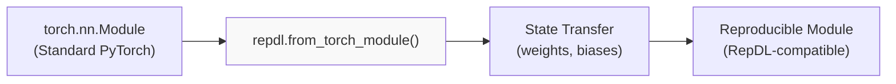
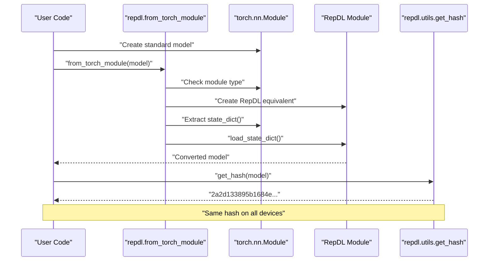
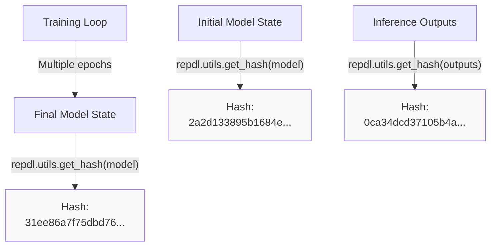
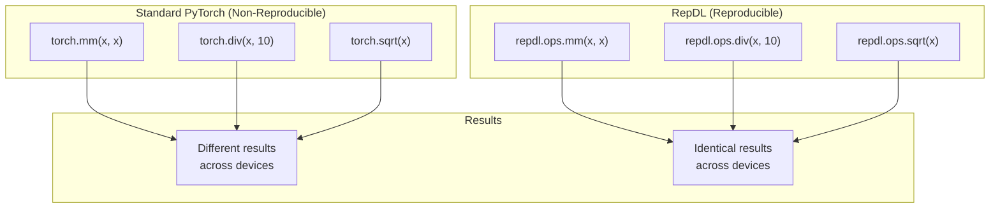
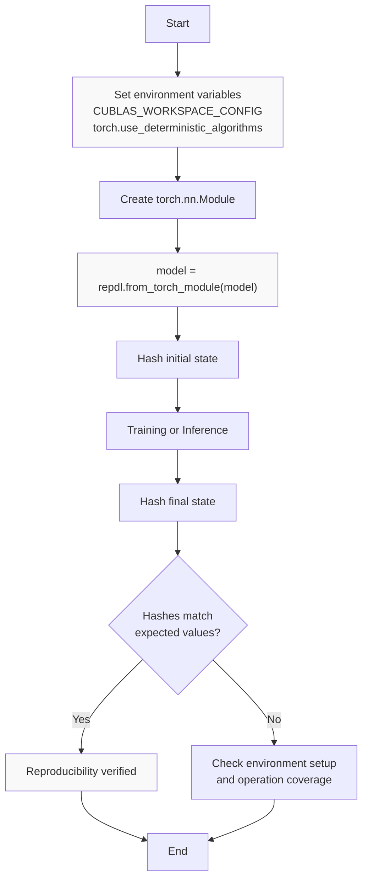

<!-- source: DeepWiki mcp.deepwiki.com · repo microsoft/RepDL · page 2.2 Quick Start · fetched 2026-10-26 -->

# Quick Start

<details>
<summary>Relevant source files</summary>

The following files were used as context for generating this wiki page:

- [README.md](README.md)
- [examples/mnist_trainig.py](examples/mnist_trainig.py)
- [repdl/__init__.py](repdl/__init__.py)

</details>


This page provides a minimal example to get started with RepDL. It demonstrates the core workflow: converting a PyTorch model to use RepDL's reproducible operations and verifying bitwise identical results. For detailed installation instructions, see [Installation](#2.1). For a complete training example with the MNIST dataset, see [MNIST Training Example](#2.3).

## Prerequisites

Before using RepDL, you must configure your environment for deterministic execution:

```python
import os
import torch

os.environ["CUBLAS_WORKSPACE_CONFIG"] = ":4096:8"
torch.use_deterministic_algorithms(True)
torch.manual_seed(0)  # Set seed for reproducibility
```

These settings are **mandatory** for achieving bitwise identical results:

| Setting | Purpose |
|---------|---------|
| `CUBLAS_WORKSPACE_CONFIG` | Forces cuBLAS to use deterministic algorithms |
| `torch.use_deterministic_algorithms(True)` | Disables non-deterministic PyTorch operations |
| `torch.manual_seed(0)` | Ensures identical initialization across runs |

**Sources:** [examples/mnist_trainig.py:42-43](), [README.md:34]()

---

## Basic Model Conversion

The primary entry point for RepDL is `repdl.from_torch_module()`, which converts a standard PyTorch model to use reproducible operations.

### Conversion Workflow



### Supported Module Types

The `from_torch_module()` function in [repdl/\_\_init\_\_.py:15-65]() recursively converts PyTorch modules to their RepDL equivalents:

| PyTorch Module | RepDL Equivalent | State Transferred |
|----------------|------------------|-------------------|
| `torch.nn.Conv2d` | `repdl.nn.Conv2d` | Yes (weight, bias) |
| `torch.nn.Linear` | `repdl.nn.Linear` | Yes (weight, bias) |
| `torch.nn.BatchNorm1d` | `repdl.nn.BatchNorm1d` | Yes (weight, bias, running stats) |
| `torch.nn.BatchNorm2d` | `repdl.nn.BatchNorm2d` | Yes (weight, bias, running stats) |
| `torch.nn.CrossEntropyLoss` | `repdl.nn.CrossEntropyLoss` | No (stateless) |
| `torch.nn.Sequential` | `torch.nn.Sequential` | Recursive conversion |
| Other modules | Shallow copy | Recursive child conversion |

The conversion process preserves all module parameters by calling `load_state_dict()` [repdl/\_\_init\_\_.py:26,35,48,55]().

**Sources:** [repdl/\_\_init\_\_.py:15-65](), [README.md:29-32]()

---

## Simple Conversion Example

Here is the minimal workflow for converting a model and verifying reproducibility:



### Example Usage Pattern

Following the pattern in [examples/mnist_trainig.py:35-38]():

1. **Define a standard PyTorch model** with `torch.nn` modules
2. **Convert the entire model** using `repdl.from_torch_module()`
3. **Move to device** (CPU or CUDA) as needed
4. **Verify state** using `repdl.utils.get_hash()`

The converted model maintains the same interface as the original PyTorch model, so forward passes, backward passes, and optimizer steps work identically.

**Sources:** [examples/mnist_trainig.py:35-38,109](), [README.md:29-32]()

---

## Reproducibility Verification

RepDL provides `repdl.utils.get_hash()` to cryptographically verify bitwise identical results across different hardware platforms.

### Hash Calculation Points



### Expected Hash Values

When running the same operations on different devices (CPU, V100 GPU, A100 GPU, etc.), the hash values should be **bitwise identical**. From [README.md:36-39]():

| Checkpoint | Expected Hash (MNIST Example) |
|------------|-------------------------------|
| Initial model | `2a2d133895b1684e55d0f152ead2914b55adc551d9790a4b4585309b79c60362` |
| After 2 epochs | `31ee86a7f75dbd76bac22f209617eb7349f93b0ede116dba924f328cac3013f1` |
| Test logits | `0ca34dcd37105b4af690c46a62407b4b9b097d1063864c6d99f4309aeb4bca3e` |

The `get_hash()` function computes a SHA-256 hash over all model parameters (weights, biases) or tensor data, ensuring that even a single bit difference will produce a completely different hash value.

**Sources:** [examples/mnist_trainig.py:67,83,103](), [README.md:36-39]()

---

## Reproducible Operations

RepDL provides low-level reproducible operations through `repdl.ops` that replace non-deterministic PyTorch operations.

### Operation Comparison



### Available Operations

The `repdl.ops` module [repdl/ops.py]() provides device-aware dispatching to reproducible backends. Key operations include:

| Operation | Function Signature | Purpose |
|-----------|-------------------|---------|
| Matrix multiplication | `repdl.ops.mm(input, mat2)` | Reproducible matmul for Linear layers |
| Convolution | `repdl.ops.conv2d(input, weight, bias, ...)` | Reproducible 2D convolution |
| Division | `repdl.ops.div(input, other)` | Element-wise division with fixed rounding |
| Square root | `repdl.ops.sqrt(input)` | Element-wise sqrt with correct rounding |
| Sum operations | `repdl.ops.sum*` variants | Fixed-order summation |
| Softmax/Cross-entropy | `repdl.ops.softmax`, `repdl.ops.cross_entropy` | Reproducible classification |

These operations are automatically used when you convert a model with `from_torch_module()`. For manual usage patterns, see [Reproducible Operations Example](examples/reproducible_ops.py).

**Sources:** [README.md:43](), [repdl/ops.py]()

---

## Putting It Together

The complete quick start workflow combines conversion, training/inference, and verification:



### Key Points

1. **Environment setup is mandatory** - Without proper configuration, RepDL cannot guarantee reproducibility
2. **Conversion is recursive** - `from_torch_module()` handles nested `Sequential` and custom modules
3. **State is preserved** - All weights, biases, and running statistics transfer to the converted model
4. **Verification is cryptographic** - Use `get_hash()` to verify bitwise identical results
5. **Operations are transparent** - Converted models use the same PyTorch API for forward/backward/optimize

For complete training workflows with data loaders, optimizers, and loss functions, proceed to [MNIST Training Example](#2.3).

**Sources:** [README.md:19-40](), [examples/mnist_trainig.py:41-114]()

---

