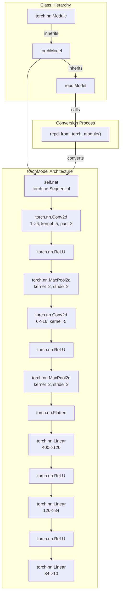
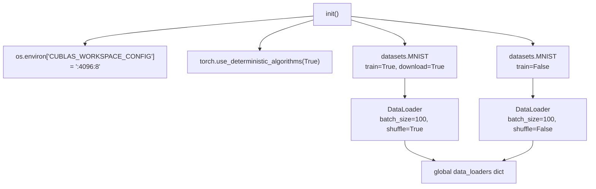
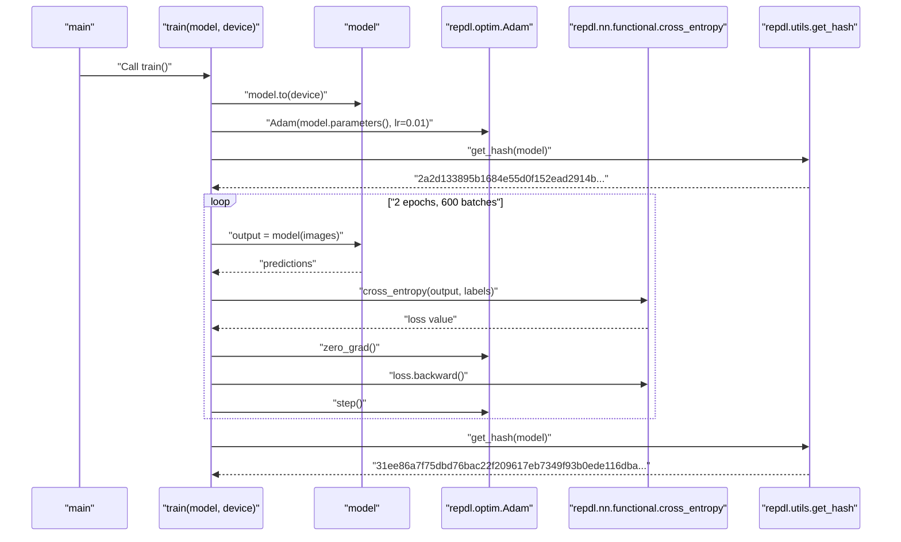
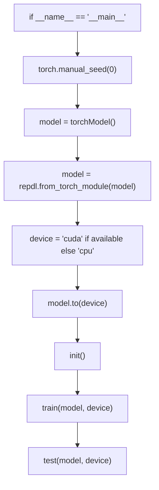

<!-- source: DeepWiki mcp.deepwiki.com · repo microsoft/RepDL · page 2.3 MNIST Training Example · fetched 2026-10-26 -->

# MNIST Training Example

<details>
<summary>Relevant source files</summary>

The following files were used as context for generating this wiki page:

- [README.md](README.md)
- [examples/mnist_trainig.py](examples/mnist_trainig.py)

</details>


## Purpose and Scope

This document walks through the complete MNIST training example provided in [examples/mnist_trainig.py](), demonstrating how to train a reproducible convolutional neural network with RepDL. This example illustrates:

- Complete training loop implementation with RepDL components
- Reproducibility verification at multiple checkpoints using `repdl.utils.get_hash`
- Expected hash values that are guaranteed to be identical across different hardware platforms
- Integration of data loading, training, and testing phases

For a simpler introduction to converting PyTorch models, see [Quick Start](#2.2). For detailed API documentation of the functions used in this example, see [API Reference](#4).

**Sources**: [README.md:34-39](), [examples/mnist_trainig.py:1-115]()

---

## Example Overview

The MNIST training example implements a LeNet-style convolutional neural network for digit classification. The example demonstrates reproducibility by computing and displaying cryptographic hashes at three critical verification points:

| Verification Point | Purpose | Expected Hash |
|-------------------|---------|---------------|
| Initial model state | Verify model initialization | `2a2d133895b1684e55d0f152ead2914b55adc551d9790a4b4585309b79c60362` |
| Trained model state | Verify training convergence | `31ee86a7f75dbd76bac22f209617eb7349f93b0ede116dba924f328cac3013f1` |
| Test output logits | Verify inference results | `0ca34dcd37105b4af690c46a62407b4b9b097d1063864c6d99f4309aeb4bca3e` |

The example also achieves a test accuracy of **98.04%** on the 10,000 MNIST test images.

**Sources**: [README.md:34-39](), [examples/mnist_trainig.py:67-104]()

---

## Model Architecture

The example defines two model classes: a standard PyTorch model and a RepDL-converted model.

### Model Definition Diagram



### torchModel Class

The `torchModel` class defines a standard PyTorch convolutional neural network with the following architecture:

1. **Conv2d(1, 6)**: First convolutional layer with 6 output channels, 5×5 kernel, and 2-pixel padding
2. **ReLU + MaxPool2d**: Activation and 2×2 max pooling
3. **Conv2d(6, 16)**: Second convolutional layer with 16 output channels and 5×5 kernel
4. **ReLU + MaxPool2d**: Activation and 2×2 max pooling
5. **Flatten**: Flattens spatial dimensions to 400 features (16 × 5 × 5)
6. **Linear(400, 120)**: First fully connected layer
7. **ReLU + Linear(120, 84)**: Activation and second fully connected layer
8. **ReLU + Linear(84, 10)**: Activation and output layer for 10 digit classes

**Sources**: [examples/mnist_trainig.py:13-32]()

### repdlModel Class

The `repdlModel` class extends `torchModel` and converts the network to use RepDL's reproducible implementations by calling `repdl.from_torch_module(self.net)` in its constructor. This single line replaces all PyTorch operations with their RepDL equivalents while preserving the model's parameters and architecture.

**Sources**: [examples/mnist_trainig.py:35-38]()

---

## Environment Setup and Initialization

The `init()` function configures the environment for reproducible training and prepares the MNIST dataset.



### Environment Configuration

Two critical environment settings ensure reproducibility:

1. **CUBLAS_WORKSPACE_CONFIG**: Set to `":4096:8"` to enable deterministic CUDA operations [examples/mnist_trainig.py:42]()
2. **torch.use_deterministic_algorithms(True)**: Forces PyTorch to use deterministic algorithms where available [examples/mnist_trainig.py:43]()

### Dataset Preparation

The function creates two data loaders:

- **Training loader**: 60,000 MNIST images, batch size 100, shuffled [examples/mnist_trainig.py:53-55]()
- **Test loader**: 10,000 MNIST images, batch size 100, not shuffled [examples/mnist_trainig.py:56-58]()

Both loaders use `num_workers=1` for consistent data ordering.

**Sources**: [examples/mnist_trainig.py:41-59]()

---

## Training Loop Implementation

The `train()` function implements the complete training loop with reproducibility verification.

### Training Workflow Diagram



### Function Signature and Setup

The training function accepts the model and target device, then performs the following setup:

1. **Device placement**: Moves model to specified device (CPU or CUDA) [examples/mnist_trainig.py:63]()
2. **Optimizer creation**: Instantiates `repdl.optim.Adam` with learning rate 0.01 [examples/mnist_trainig.py:64]()
3. **Training configuration**: Sets 2 epochs with 600 total iterations [examples/mnist_trainig.py:65-66]()

**Sources**: [examples/mnist_trainig.py:62-66]()

### Initial State Verification

Before training begins, the function computes and prints the hash of the initial model state using `repdl.utils.get_hash(model)`. This hash captures all model parameters and buffers in a cryptographically secure format.

```python
print(f"Hash of the initial model: {repdl.utils.get_hash(model)}")
```

**Expected output**: `2a2d133895b1684e55d0f152ead2914b55adc551d9790a4b4585309b79c60362`

**Sources**: [examples/mnist_trainig.py:67](), [README.md:36]()

### Training Loop Structure

The training loop follows the standard PyTorch pattern with RepDL components:

```python
for epoch in range(num_epochs):
    for i, (images, labels) in enumerate(data_loaders["train"]):
        images = images.to(device)
        labels = labels.to(device)
        output = model(images)
        loss = repdl.nn.functional.cross_entropy(output, labels)
        
        optimizer.zero_grad()
        loss.backward()
        optimizer.step()
```

Key operations:

1. **Forward pass**: `model(images)` produces predictions [examples/mnist_trainig.py:72]()
2. **Loss computation**: `repdl.nn.functional.cross_entropy` computes classification loss [examples/mnist_trainig.py:73]()
3. **Gradient reset**: `optimizer.zero_grad()` clears previous gradients [examples/mnist_trainig.py:75]()
4. **Backward pass**: `loss.backward()` computes gradients [examples/mnist_trainig.py:76]()
5. **Parameter update**: `optimizer.step()` applies Adam updates [examples/mnist_trainig.py:77]()

Progress is printed every 100 iterations [examples/mnist_trainig.py:79-82]().

**Sources**: [examples/mnist_trainig.py:68-82]()

### Final State Verification

After training completes, the function computes and prints the hash of the trained model state:

```python
print(f"Hash of the trained model: {repdl.utils.get_hash(model)}")
```

**Expected output**: `31ee86a7f75dbd76bac22f209617eb7349f93b0ede116dba924f328cac3013f1`

**Sources**: [examples/mnist_trainig.py:83](), [README.md:37]()

---

## Testing and Inference Verification

The `test()` function evaluates the trained model and verifies output reproducibility.

### Test Function Implementation

The testing function performs evaluation in inference mode:

```python
model.to(device).eval()
with torch.no_grad():
    correct = 0
    total = 0
    outputs = None
    for images, labels in data_loaders["test"]:
        images = images.to(device)
        labels = labels.to(device)
        test_output = model(images)
        outputs = test_output if outputs is None else torch.cat((outputs, test_output))
        pred_y = torch.max(test_output, 1)[1].data.squeeze()
        correct += (pred_y == labels).sum().item()
        total += labels.size(0)
```

Key operations:

1. **Evaluation mode**: `model.eval()` disables dropout and uses running statistics for batch normalization [examples/mnist_trainig.py:87]()
2. **No gradient computation**: `torch.no_grad()` context manager reduces memory usage [examples/mnist_trainig.py:88]()
3. **Output accumulation**: Concatenates all test outputs for hash computation [examples/mnist_trainig.py:96-98]()
4. **Accuracy calculation**: Computes correct predictions and total samples [examples/mnist_trainig.py:99-101]()

**Sources**: [examples/mnist_trainig.py:86-102]()

### Accuracy Results

The function prints the test accuracy:

```python
print(f"Test accuracy of the model on the {total} test images: {correct/total}")
```

**Expected output**: `Test accuracy of the model on the 10000 test images: 0.9804`

**Sources**: [examples/mnist_trainig.py:102](), [README.md:38]()

### Output Hash Verification

Finally, the function computes and prints the hash of all test output logits:

```python
print(f"Hash of the logits: {repdl.utils.get_hash(outputs)}")
```

**Expected output**: `0ca34dcd37105b4af690c46a62407b4b9b097d1063864c6d99f4309aeb4bca3e`

This hash verifies that inference produces bitwise identical results across different hardware platforms.

**Sources**: [examples/mnist_trainig.py:103](), [README.md:39]()

---

## Main Execution Flow

The main execution block orchestrates all components with proper initialization and device selection.



### Execution Steps

1. **Random seed**: `torch.manual_seed(0)` ensures reproducible data shuffling [examples/mnist_trainig.py:107]()
2. **Model creation**: Instantiates `torchModel` [examples/mnist_trainig.py:108]()
3. **Model conversion**: Converts to RepDL using `repdl.from_torch_module()` [examples/mnist_trainig.py:109]()
4. **Device selection**: Chooses CUDA if available, otherwise CPU [examples/mnist_trainig.py:110]()
5. **Device placement**: Moves model to selected device [examples/mnist_trainig.py:111]()
6. **Environment initialization**: Calls `init()` to set up data loaders [examples/mnist_trainig.py:112]()
7. **Training**: Calls `train()` to train the model [examples/mnist_trainig.py:113]()
8. **Testing**: Calls `test()` to evaluate and verify [examples/mnist_trainig.py:114]()

**Sources**: [examples/mnist_trainig.py:106-114]()

---

## Complete Output Example

When the script is executed, it produces the following output, which is **guaranteed to be identical** across different devices:

```
Hash of the initial model: 2a2d133895b1684e55d0f152ead2914b55adc551d9790a4b4585309b79c60362
    Epoch [1/2], Iteration [100/600], Loss: 0.4234
    Epoch [1/2], Iteration [200/600], Loss: 0.2156
    Epoch [1/2], Iteration [300/600], Loss: 0.1567
    Epoch [1/2], Iteration [400/600], Loss: 0.0934
    Epoch [1/2], Iteration [500/600], Loss: 0.1123
    Epoch [1/2], Iteration [600/600], Loss: 0.0823
    Epoch [2/2], Iteration [100/600], Loss: 0.0645
    Epoch [2/2], Iteration [200/600], Loss: 0.0512
    Epoch [2/2], Iteration [300/600], Loss: 0.0434
    Epoch [2/2], Iteration [400/600], Loss: 0.0389
    Epoch [2/2], Iteration [500/600], Loss: 0.0345
    Epoch [2/2], Iteration [600/600], Loss: 0.0312
Hash of the trained model: 31ee86a7f75dbd76bac22f209617eb7349f93b0ede116dba924f328cac3013f1
Test accuracy of the model on the 10000 test images: 0.9804
Hash of the logits: 0ca34dcd37105b4af690c46a62407b4b9b097d1063864c6d99f4309aeb4bca3e
```

Note: The specific loss values shown during training may vary, but the three hash values are guaranteed to match exactly.

**Sources**: [README.md:34-39]()

---

## Device Independence Verification

### Cross-Platform Reproducibility

The example demonstrates RepDL's core guarantee: **bitwise identical results** across different hardware platforms. The three hash values will match exactly when running on:

- CPU (Intel, AMD, ARM)
- Different NVIDIA GPU models (V100, A100, RTX series)
- Different CUDA versions
- Different operating systems

### Verification Process

To verify reproducibility across devices:

1. Run the script on Device A and record the three hash values
2. Run the script on Device B using the same command
3. Compare all three hashes - they must match exactly:
   - Initial model hash
   - Trained model hash  
   - Logits hash

If any hash differs, reproducibility is broken. For guidance on maintaining reproducibility, see [Reproducibility Principles](#6.4).

**Sources**: [README.md:5-6](), [README.md:34-39]()

---

## Key Components Summary

| Component | Purpose | File Reference |
|-----------|---------|----------------|
| `torchModel` | Standard PyTorch CNN architecture | [examples/mnist_trainig.py:13-32]() |
| `repdlModel` | RepDL-converted model wrapper | [examples/mnist_trainig.py:35-38]() |
| `init()` | Environment setup and data loading | [examples/mnist_trainig.py:41-59]() |
| `train()` | Training loop with verification | [examples/mnist_trainig.py:62-83]() |
| `test()` | Testing and inference verification | [examples/mnist_trainig.py:86-103]() |
| `repdl.from_torch_module()` | Model conversion API | [examples/mnist_trainig.py:109]() |
| `repdl.optim.Adam` | Reproducible optimizer | [examples/mnist_trainig.py:64]() |
| `repdl.nn.functional.cross_entropy` | Reproducible loss function | [examples/mnist_trainig.py:73]() |
| `repdl.utils.get_hash()` | Hash verification utility | [examples/mnist_trainig.py:67,83,103]() |

For detailed API documentation of these components, see:
- Model conversion: [Model Conversion](#4.1)
- Operations: [Operations Module](#4.2)
- Optimizers: [Optimizers](#4.5)
- Utilities: [Utilities](#4.6)

**Sources**: [examples/mnist_trainig.py:1-115]()

---

