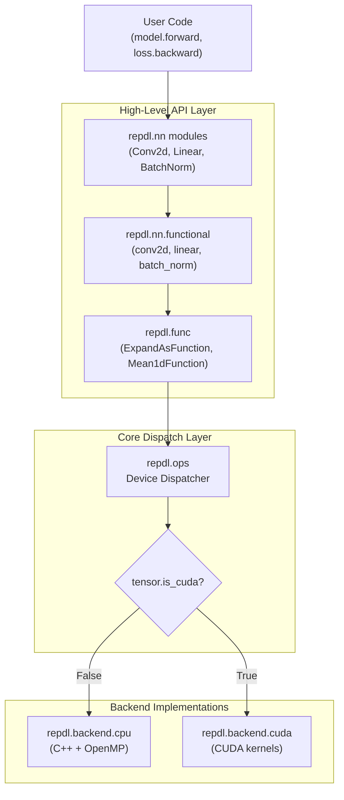
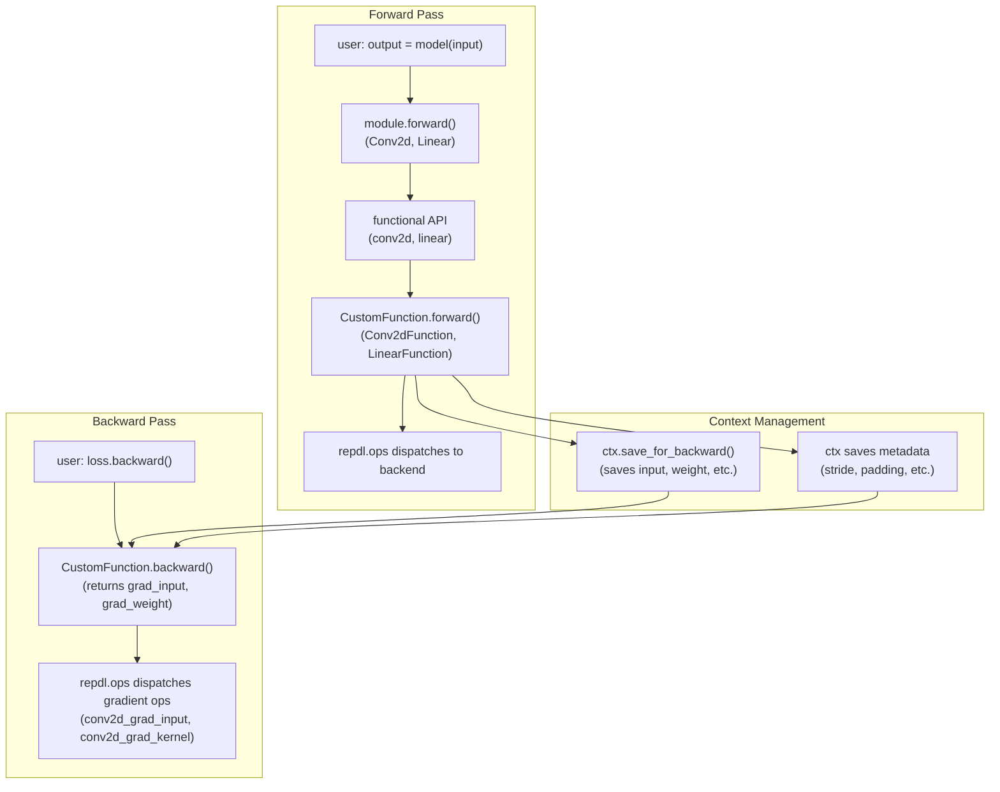
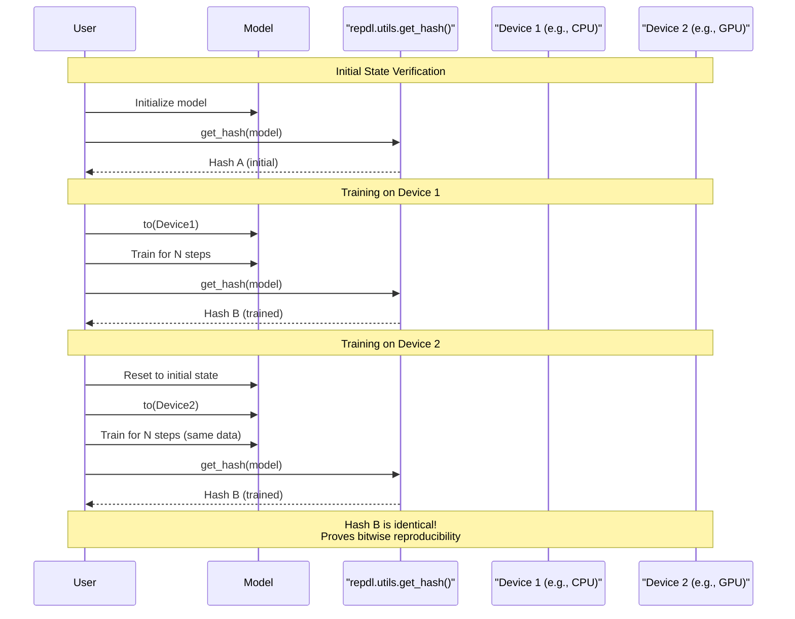
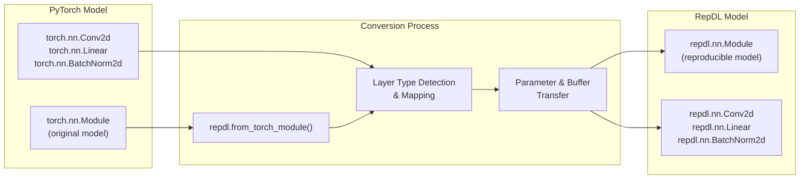
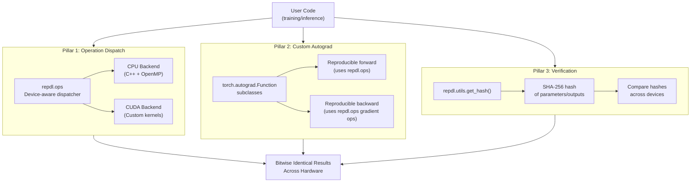

<!-- source: DeepWiki mcp.deepwiki.com · repo microsoft/RepDL · page 3 Core Concepts · fetched 2026-10-26 -->

# Core Concepts

<details>
<summary>Relevant source files</summary>

The following files were used as context for generating this wiki page:

- [README.md](README.md)
- [examples/mnist_trainig.py](examples/mnist_trainig.py)
- [repdl/ops.py](repdl/ops.py)

</details>


This document explains the fundamental concepts that enable RepDL to achieve bitwise identical results across different hardware platforms. Understanding these concepts is essential for effectively using RepDL and extending it with custom operations.

The three core mechanisms are:
1. **Operation Dispatch** - routing all computations through reproducible backends ([3.1](#3.1))
2. **Custom Autograd Functions** - controlling gradient computation for reproducibility ([3.2](#3.2))
3. **Reproducibility Verification** - cryptographic validation of identical results ([3.3](#3.3))

For architectural details about how these components fit together, see [Architecture Overview](#1.2). For implementation details of the backends, see [Backend Implementation](#5).

---

## The Reproducibility Guarantee

RepDL guarantees **bitwise identical results** for the same computation across different hardware platforms (CPU, GPU) and GPU models (V100, A100, etc.). This guarantee applies to:

| Computation Type | Reproducibility Scope |
|-----------------|----------------------|
| Forward pass | Identical output tensors |
| Backward pass | Identical gradients |
| Optimizer updates | Identical parameter values |
| Full training loop | Identical final model state |

The guarantee is achieved by controlling three sources of non-determinism in deep learning:

1. **Floating-point operation order**: Operations are executed in a fixed sequence
2. **Hardware-specific implementations**: Custom kernels replace vendor libraries
3. **Rounding modes**: IEEE-754 compliant correctly-rounded operations

**Sources:** [README.md:5-5](), [README.md:34-39]()

---

## The Central Dispatch Pattern

All reproducible operations in RepDL flow through a single entry point: the `repdl.ops` module. This module implements a **device-aware dispatcher** that examines the device of input tensors and routes operations to the appropriate backend implementation.

### Dispatch Architecture



**Dispatch Decision Logic**

The dispatch mechanism is implemented consistently across all operations in `repdl.ops`. Each operation follows this pattern:

```python
# Pattern used in repdl/ops.py
def operation(input: torch.Tensor, ...) -> torch.Tensor:
    if input.is_cuda:
        return cuda.operation(input, ...)
    else:
        return cpu.operation(input, ...)
```

For example, the `conv2d` operation ([repdl/ops.py:12-26]()):

```python
def conv2d(input, weight, stride, padding, groups):
    if input.is_cuda:
        return cuda.conv2d(input, weight, stride[0], stride[1], 
                          padding[0], padding[1], groups)
    else:
        return cpu.conv2d(input, weight, stride[0], stride[1], 
                         padding[0], padding[1], groups)
```

This pattern ensures that:
- Every computation goes through a **single decision point**
- The device check is **consistent** across operations
- Backend implementations are **isolated** from high-level code
- Device switching is **transparent** to users

**Sources:** [repdl/ops.py:1-158]()

---

## Operation Categories

RepDL implements reproducible versions of operations across several categories:

### Matrix Operations

| Operation | Function Signature | Device Dispatch |
|-----------|-------------------|-----------------|
| Matrix multiplication | `mm(input, mat2, transA, transB)` | [repdl/ops.py:106-112]() |
| Convolution forward | `conv2d(input, weight, stride, padding, groups)` | [repdl/ops.py:12-26]() |
| Convolution gradient (input) | `conv2d_grad_input(input_shape, weight, grad_output, stride, padding)` | [repdl/ops.py:29-57]() |
| Convolution gradient (kernel) | `conv2d_grad_kernel(input, weight_shape, grad_output, stride, padding)` | [repdl/ops.py:60-88]() |

### Reduction Operations

| Operation | Function Signature | Device Dispatch |
|-----------|-------------------|-----------------|
| 1D sum/mean | `sum1d(input, average)` | [repdl/ops.py:126-130]() |
| 2D sum/mean (dim 0) | `sum2d_dim0(input, keepdim, average)` | [repdl/ops.py:133-139]() |
| 2D sum/mean (dim 1) | `sum2d_dim1(input, keepdim, average)` | [repdl/ops.py:142-148]() |
| 4D sum/mean (dims 0,2,3) | `sum4d_dim023(input, keepdim, average)` | [repdl/ops.py:151-157]() |

### Element-wise Operations

| Operation | Function Signature | Special Handling |
|-----------|-------------------|------------------|
| Division | `div(input, other)` | Device-specific tensor conversion ([repdl/ops.py:98-103]()) |
| Square root | `sqrt(input)` | Float64 upcast for precision ([repdl/ops.py:122-123]()) |

### Specialized Operations

| Operation | Function Signature | Purpose |
|-----------|-------------------|---------|
| Softmax | `softmax(input)` | Numerically stable softmax ([repdl/ops.py:115-119]()) |
| Cross-entropy | `cross_entropy(input, target)` | Combined softmax + NLL loss ([repdl/ops.py:91-95]()) |

**Sources:** [repdl/ops.py:12-158]()

---

## The Autograd Integration

RepDL integrates with PyTorch's automatic differentiation system by implementing custom `torch.autograd.Function` subclasses. This allows RepDL to control both forward and backward passes while remaining compatible with PyTorch's `.backward()` API.

### Autograd Flow Diagram



### Key Autograd Principles

**Gradient Reproducibility**: Custom autograd functions ensure that gradient computation is reproducible by:
1. Using `repdl.ops` operations exclusively in `backward()` methods
2. Maintaining fixed operation order for gradient calculations
3. Avoiding PyTorch's non-deterministic gradient functions

**Context Preservation**: The `ctx` object passed to `forward()` and `backward()` stores:
- Input tensors needed for gradient computation
- Operation metadata (stride, padding, shapes)
- Flags indicating which gradients are needed

For detailed implementation patterns, see [Custom Autograd Functions](#3.2).

**Sources:** [README.md:50-50](), [repdl/ops.py:29-88]()

---

## Hash-Based Verification

RepDL provides cryptographic verification of reproducibility through the `repdl.utils.get_hash()` function. This function computes a SHA-256 hash of model parameters or tensor values, enabling bitwise comparison across runs and devices.

### Verification Workflow



### Verification Points

RepDL supports verification at three critical stages:

| Stage | What to Hash | Example from MNIST |
|-------|-------------|-------------------|
| Initial state | Model parameters before training | `2a2d133895b1684e55d0f152ead2914b55adc551d9790a4b4585309b79c60362` |
| Trained state | Model parameters after training | `31ee86a7f75dbd76bac22f209617eb7349f93b0ede116dba924f328cac3013f1` |
| Inference output | Model predictions (logits) | `0ca34dcd37105b4af690c46a62407b4b9b097d1063864c6d99f4309aeb4bca3e` |

These hash values from [examples/mnist_trainig.py:36-39]() are guaranteed to be identical across:
- Different hardware platforms (CPU vs GPU)
- Different GPU models (V100, A100, RTX 3090, etc.)
- Different execution environments (local, cloud, cluster)

**Usage Pattern:**

```python
import repdl
model = repdl.from_torch_module(model)

# Check initial state
initial_hash = repdl.utils.get_hash(model)
print(f"Initial: {initial_hash}")

# Train model
train(model)

# Verify trained state
trained_hash = repdl.utils.get_hash(model)
print(f"Trained: {trained_hash}")

# Verify inference
with torch.no_grad():
    outputs = model(test_data)
output_hash = repdl.utils.get_hash(outputs)
print(f"Output: {output_hash}")
```

For detailed verification strategies, see [Reproducibility Verification](#3.3).

**Sources:** [examples/mnist_trainig.py:67-83](), [examples/mnist_trainig.py:103-103](), [README.md:36-39]()

---

## Environment Setup for Reproducibility

RepDL requires specific environment configuration to achieve full reproducibility:

### Required Configuration

| Setting | Value | Purpose |
|---------|-------|---------|
| `CUBLAS_WORKSPACE_CONFIG` | `:4096:8` | Allocates workspace for deterministic cuBLAS operations |
| `torch.use_deterministic_algorithms()` | `True` | Forces PyTorch to use deterministic implementations |
| `torch.manual_seed()` | Fixed value | Ensures consistent data shuffling and initialization |

**Setup Example:**

```python
import os
import torch

# Configure environment
os.environ["CUBLAS_WORKSPACE_CONFIG"] = ":4096:8"
torch.use_deterministic_algorithms(True)
torch.manual_seed(0)  # Use consistent seed
```

This configuration is shown in [examples/mnist_trainig.py:41-43]() and [examples/mnist_trainig.py:107-107]().

### Why These Settings Matter

**cuBLAS Workspace**: Without `CUBLAS_WORKSPACE_CONFIG`, NVIDIA's cuBLAS library may use non-deterministic algorithms for better performance. RepDL's custom kernels don't need this, but PyTorch operations might.

**Deterministic Algorithms**: Setting `torch.use_deterministic_algorithms(True)` prevents PyTorch from using optimized but non-deterministic implementations (like atomic operations in reductions).

**Manual Seed**: While RepDL ensures operation-level reproducibility, the random seed controls:
- Data loader shuffling order
- Parameter initialization (if using random init)
- Dropout behavior (if present)

**Sources:** [examples/mnist_trainig.py:41-43](), [examples/mnist_trainig.py:107-107]()

---

## Integration with PyTorch

RepDL extends PyTorch rather than replacing it, inheriting from PyTorch base classes while overriding computation methods. This design allows:

1. **Seamless conversion**: `repdl.from_torch_module()` converts existing models
2. **API compatibility**: RepDL modules match PyTorch signatures
3. **Ecosystem integration**: Works with PyTorch data loaders, optimizers (when wrapped), and utilities

### Conversion Process



**Example:**

```python
# Define PyTorch model
class PyTorchModel(torch.nn.Module):
    def __init__(self):
        super().__init__()
        self.conv = torch.nn.Conv2d(1, 6, kernel_size=5, padding=2)
        self.linear = torch.nn.Linear(16 * 5 * 5, 120)
    
    def forward(self, x):
        x = self.conv(x)
        x = self.linear(x)
        return x

# Convert to RepDL
model = PyTorchModel()
model = repdl.from_torch_module(model)  # Now uses reproducible operations
```

The converted model maintains the same structure and parameters but routes all operations through `repdl.ops`.

**Sources:** [README.md:29-32](), [examples/mnist_trainig.py:35-38](), [examples/mnist_trainig.py:109-109]()

---

## Summary: The Three Pillars Working Together

RepDL's reproducibility guarantee is achieved through the coordinated operation of three core mechanisms:



**How They Work Together:**

1. **User writes code** using familiar PyTorch API patterns
2. **Operations dispatch** through `repdl.ops` to reproducible backends
3. **Autograd functions** ensure gradients are computed reproducibly
4. **Hash verification** provides cryptographic proof of reproducibility

Each pillar is essential:
- Without **dispatch**, operations would use non-deterministic PyTorch/cuBLAS implementations
- Without **custom autograd**, gradients would be non-reproducible even if forward passes match
- Without **verification**, reproducibility claims couldn't be validated

For implementation details:
- Operation dispatch mechanics: [Operation Dispatch Mechanism](#3.1)
- Autograd function patterns: [Custom Autograd Functions](#3.2)
- Verification strategies: [Reproducibility Verification](#3.3)

**Sources:** [README.md:5-5](), [README.md:43-52](), [repdl/ops.py:1-158](), [examples/mnist_trainig.py:67-83]()

---

