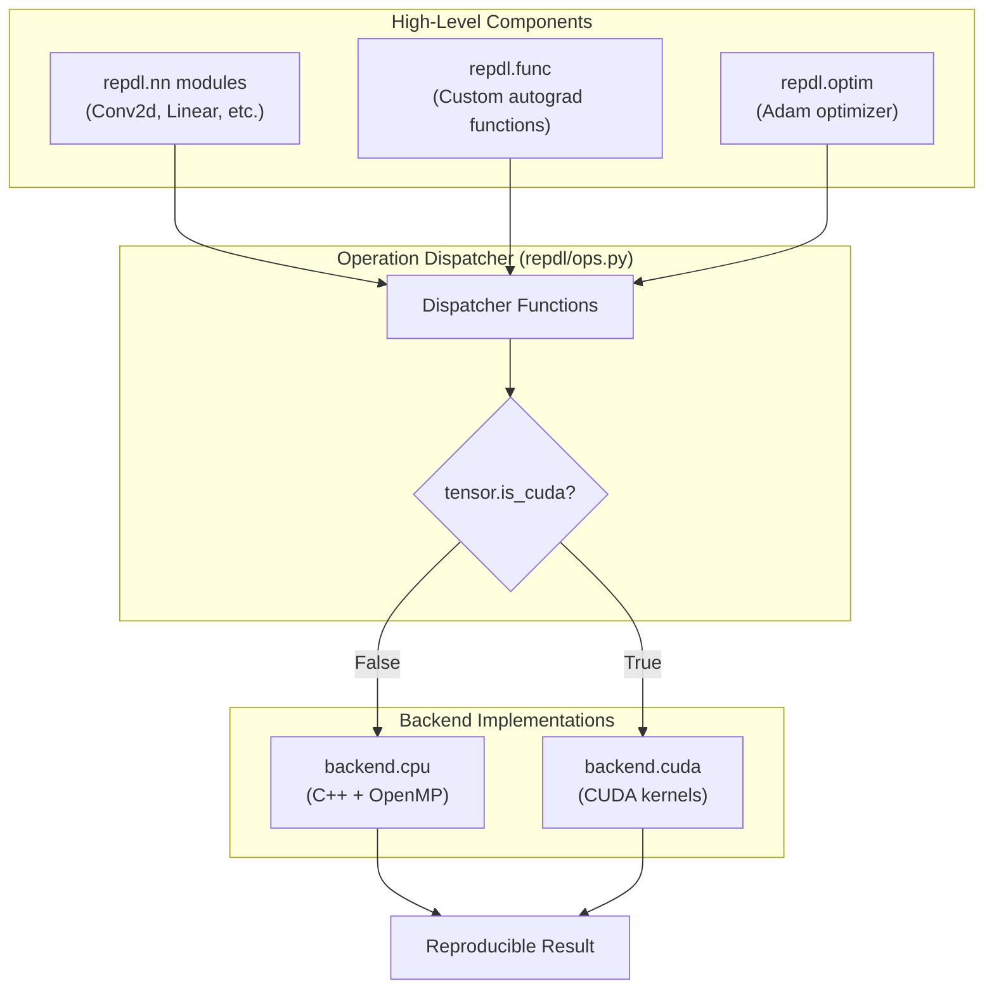
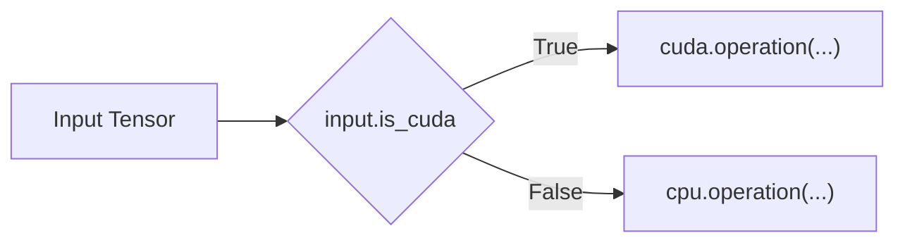
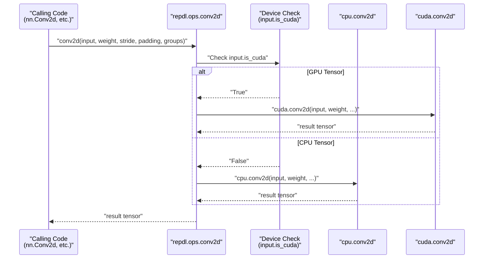
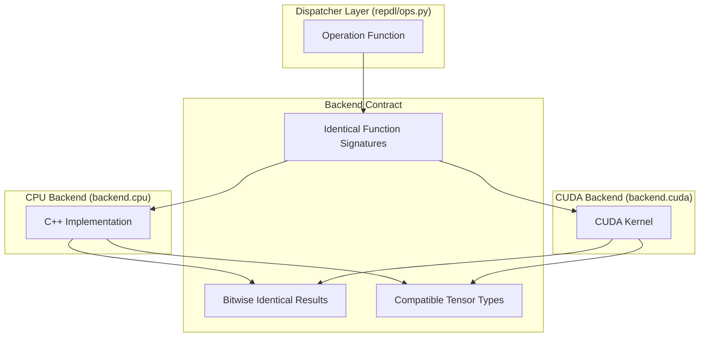
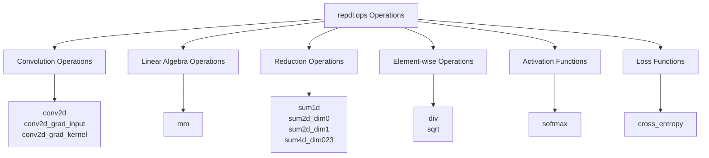
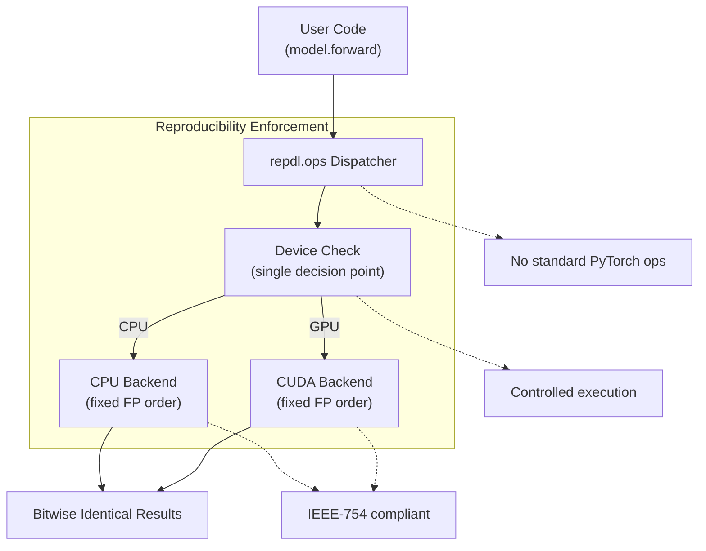

<!-- source: DeepWiki mcp.deepwiki.com · repo microsoft/RepDL · page 3.1 Operation Dispatch Mechanism · fetched 2026-10-26 -->

# Operation Dispatch Mechanism

<details>
<summary>Relevant source files</summary>

The following files were used as context for generating this wiki page:

- [repdl/ops.py](repdl/ops.py)

</details>


## Purpose and Scope

This document explains the operation dispatch mechanism implemented in `repdl.ops`, which serves as the central routing layer for all reproducible operations in RepDL. The dispatcher examines tensor device placement and routes operations to either CPU or CUDA backend implementations, ensuring consistent execution paths across hardware platforms.

For information about the backend implementations themselves, see [CPU Backend](#5.2) and [CUDA Backend](#5.3). For information about how custom autograd functions use these operations, see [Custom Autograd Functions](#3.2).

---

## Overview of the Dispatch Mechanism

The `repdl.ops` module acts as the single chokepoint through which all reproducible operations flow. This centralized design ensures that:

1. Every tensor operation is routed to a reproducible backend implementation
2. Device placement determines the execution backend transparently
3. The same high-level API works identically on CPU and GPU
4. No operation bypasses the reproducibility guarantee



**Diagram: Central Dispatch Architecture**

Sources: [repdl/ops.py:1-158]()

---

## Device Detection Logic

The dispatcher determines backend routing by examining the `is_cuda` property of input tensors. This property returns `True` for tensors residing in GPU memory and `False` for CPU tensors.

### Detection Strategy

| Tensor Property | Backend Selection | Rationale |
|----------------|-------------------|-----------|
| `tensor.is_cuda == True` | CUDA backend | Tensor resides in GPU memory |
| `tensor.is_cuda == False` | CPU backend | Tensor resides in CPU memory |

The dispatcher typically checks the first input tensor's device, as all operands in a valid operation must reside on the same device (PyTorch enforces this constraint).



**Diagram: Device Detection Flow**

Sources: [repdl/ops.py:19-26](), [repdl/ops.py:92-95](), [repdl/ops.py:109-112]()

---

## Operation Dispatch Flow

Each operation in `repdl.ops` follows a consistent dispatch pattern that transforms high-level operation requests into backend-specific function calls.

### Complete Dispatch Sequence



**Diagram: Operation Dispatch Sequence**

Sources: [repdl/ops.py:12-26]()

---

## Standard Dispatch Pattern

Most operations in `repdl.ops` follow a standard pattern with minimal transformation between the high-level API and backend calls.

### Pattern Structure

```python
def operation_name(input: torch.Tensor, ...) -> torch.Tensor:
    if input.is_cuda:
        return cuda.operation_name(input, ...)
    else:
        return cpu.operation_name(input, ...)
```

### Examples of Standard Dispatch

#### Matrix Multiplication

The `mm` function demonstrates the standard pattern with optional transpose flags:

[repdl/ops.py:106-112]()

```python
def mm(
    input: torch.Tensor, mat2: torch.Tensor, transA: bool = False, transB: bool = False
) -> torch.Tensor:
    if input.is_cuda:
        return cuda.mm(input, mat2, transA, transB)
    else:
        return cpu.mm(input, mat2, transA, transB)
```

#### Cross-Entropy Loss

The `cross_entropy` function follows the same pattern:

[repdl/ops.py:91-95]()

```python
def cross_entropy(input: torch.Tensor, target: torch.Tensor) -> torch.Tensor:
    if input.is_cuda:
        return cuda.cross_entropy(input, target)
    else:
        return cpu.cross_entropy(input, target)
```

#### Softmax

The `softmax` function dispatches identically:

[repdl/ops.py:115-119]()

```python
def softmax(input: torch.Tensor) -> torch.Tensor:
    if input.is_cuda:
        return cuda.softmax(input)
    else:
        return cpu.softmax(input)
```

### Dispatch with Parameter Unpacking

Some operations receive tuple parameters that must be unpacked before passing to backend functions:

#### Conv2D Forward Pass

[repdl/ops.py:12-26]()

The `conv2d` function unpacks `stride` and `padding` tuples:

```python
def conv2d(
    input: torch.Tensor,
    weight: torch.Tensor,
    stride: tuple[int, int],
    padding: tuple[int, int],
    groups: int,
) -> torch.Tensor:
    if input.is_cuda:
        return cuda.conv2d(
            input, weight, stride[0], stride[1], padding[0], padding[1], groups
        )
    else:
        return cpu.conv2d(
            input, weight, stride[0], stride[1], padding[0], padding[1], groups
        )
```

The backend functions expect individual stride/padding components rather than tuples.

#### Conv2D Gradient Operations

Similar unpacking occurs for gradient computation:

[repdl/ops.py:29-57]() - `conv2d_grad_input` unpacks shape dimensions and stride/padding parameters

[repdl/ops.py:60-88]() - `conv2d_grad_kernel` follows the same pattern

Sources: [repdl/ops.py:12-88](), [repdl/ops.py:91-119]()

---

## Special Case Operations

Two operations deviate from the standard dispatch pattern due to reproducibility requirements or PyTorch compatibility.

### Square Root with Precision Upgrade

The `sqrt` operation upgrades precision to `float64` before computation, then downgrades back to `float32`:

[repdl/ops.py:122-123]()

```python
def sqrt(input: torch.Tensor) -> torch.Tensor:
    return input.to(dtype=torch.float64).sqrt().to(dtype=torch.float32)
```

This approach:
- Uses PyTorch's native `sqrt` implementation (no custom backend)
- Achieves reproducibility through higher precision arithmetic
- Eliminates rounding differences across hardware

### Division with Tensor Conversion

The `div` operation has conditional device handling:

[repdl/ops.py:98-103]()

```python
def div(input: torch.Tensor, other: Union[torch.Tensor, float]) -> torch.Tensor:
    # See pytorch/aten/src/ATen/native/cuda/BinaryMulDivKernel.cu
    if isinstance(other, torch.Tensor) or input.device == "cpu":
        return input.div(other)
    else:
        return input.div(torch.tensor(other, device=input.device))
```

**Behavior:**

| Condition | Action | Rationale |
|-----------|--------|-----------|
| `other` is `torch.Tensor` | Direct division | Tensor-tensor operations are consistent |
| `input.device == "cpu"` | Direct division with scalar | CPU scalar division is reproducible |
| GPU tensor with scalar | Convert scalar to tensor | Ensures consistent CUDA kernel path |

The scalar-to-tensor conversion on CUDA ensures that PyTorch's CUDA division kernel follows a consistent code path, as referenced by the comment pointing to PyTorch's implementation at `pytorch/aten/src/ATen/native/cuda/BinaryMulDivKernel.cu`.

Sources: [repdl/ops.py:98-123]()

---

## Sum Operations Taxonomy

The dispatcher provides multiple sum reduction operations specialized by tensor dimensionality and reduction axes:

### Sum Operation Variants

| Operation | Input Shape | Reduction Axes | Output Shape | Use Case |
|-----------|-------------|----------------|--------------|----------|
| `sum1d` | `(N,)` | All | `()` scalar | 1D tensor reduction |
| `sum2d_dim0` | `(N, M)` | Axis 0 | `(M,)` or `(1, M)` | Column-wise sum |
| `sum2d_dim1` | `(N, M)` | Axis 1 | `(N,)` or `(N, 1)` | Row-wise sum |
| `sum4d_dim023` | `(N, C, H, W)` | Axes 0, 2, 3 | `(C,)` or `(1, C, 1, 1)` | Batch norm statistics |

Each variant includes `keepdim` and `average` parameters for controlling output dimensions and computing means instead of sums.

### Sum Operation Dispatch

#### 1D Sum

[repdl/ops.py:126-130]()

```python
def sum1d(input: torch.Tensor, average: bool = False) -> torch.Tensor:
    if input.is_cuda:
        return cuda.sum1d(input, average)
    else:
        return cpu.sum1d(input, average)
```

#### 2D Sum Along Dimension 0

[repdl/ops.py:133-139]()

```python
def sum2d_dim0(
    input: torch.Tensor, keepdim: bool = False, average: bool = False
) -> torch.Tensor:
    if input.is_cuda:
        return cuda.sum2d_dim0(input, keepdim, average)
    else:
        return cpu.sum2d_dim0(input, keepdim, average)
```

#### 2D Sum Along Dimension 1

[repdl/ops.py:142-148]()

```python
def sum2d_dim1(
    input: torch.Tensor, keepdim: bool = False, average: bool = False
) -> torch.Tensor:
    if input.is_cuda:
        return cuda.sum2d_dim1(input, keepdim, average)
    else:
        return cpu.sum2d_dim1(input, keepdim, average)
```

#### 4D Sum Along Dimensions 0, 2, 3

[repdl/ops.py:151-157]()

```python
def sum4d_dim023(
    input: torch.Tensor, keepdim: bool = False, average: bool = False
) -> torch.Tensor:
    if input.is_cuda:
        return cuda.sum4d_dim023(input, keepdim, average)
    else:
        return cpu.sum4d_dim023(input, keepdim, average)
```

These specialized functions enable reproducible reduction operations critical for batch normalization and other statistical computations.

Sources: [repdl/ops.py:126-157]()

---

## Backend Interface Contract

The dispatch mechanism assumes that CPU and CUDA backends implement identical function signatures for each operation. This interface contract enables transparent device switching.

### Interface Requirements



**Diagram: Backend Interface Contract**

### Contract Guarantees

1. **Signature Compatibility**: Backend functions accept the same parameters in the same order
2. **Bitwise Identical Results**: Both backends produce identical floating-point bit patterns
3. **Tensor Type Support**: Both backends handle the same PyTorch tensor types (`float32`, gradients)
4. **Error Behavior**: Both backends raise equivalent exceptions for invalid inputs

### Example: Matrix Multiplication Interface

The `mm` operation requires both backends to implement:

```python
# Backend signature (both cpu and cuda modules)
def mm(
    input: torch.Tensor,      # First matrix
    mat2: torch.Tensor,       # Second matrix
    transA: bool,             # Transpose first matrix?
    transB: bool              # Transpose second matrix?
) -> torch.Tensor:            # Result matrix
```

The dispatcher calls `cpu.mm(...)` or `cuda.mm(...)` with identical argument lists, relying on the backend contract.

Sources: [repdl/ops.py:1-158]()

---

## Complete Operations Reference

The following table catalogs all operations available through the dispatcher:

| Operation | Purpose | Device Detection Tensor | Gradient Support |
|-----------|---------|------------------------|------------------|
| `conv2d` | 2D convolution forward | `input` | Via separate grad ops |
| `conv2d_grad_input` | Convolution gradient w.r.t. input | `grad_output` | N/A (is gradient) |
| `conv2d_grad_kernel` | Convolution gradient w.r.t. kernel | `input` | N/A (is gradient) |
| `cross_entropy` | Cross-entropy loss | `input` | Via autograd |
| `div` | Element-wise division | `input` | Via PyTorch |
| `mm` | Matrix multiplication | `input` | Via autograd |
| `softmax` | Softmax normalization | `input` | Via autograd |
| `sqrt` | Square root | N/A (no dispatch) | Via PyTorch |
| `sum1d` | 1D reduction | `input` | Via autograd |
| `sum2d_dim0` | 2D reduction (axis 0) | `input` | Via autograd |
| `sum2d_dim1` | 2D reduction (axis 1) | `input` | Via autograd |
| `sum4d_dim023` | 4D reduction (axes 0,2,3) | `input` | Via autograd |

### Operation Categories



**Diagram: Operation Taxonomy**

Sources: [repdl/ops.py:1-158]()

---

## Role in Reproducibility

The operation dispatch mechanism is essential to RepDL's reproducibility guarantee. By centralizing all operations through a single dispatcher:

### Reproducibility Guarantees

1. **No Operation Bypass**: Every computation flows through reproducible backends; standard PyTorch operations are never called directly for critical operations

2. **Consistent Execution Paths**: The same operation always executes the same backend code on the same device type, eliminating non-deterministic optimizations

3. **Device-Agnostic API**: High-level code is identical regardless of device, preventing device-specific code paths that could introduce discrepancies

4. **Verifiable Dispatch**: The simple `if input.is_cuda` pattern is auditable and testable, with no complex routing logic that could hide non-determinism

### Reproducibility Flow



**Diagram: Reproducibility Through Centralized Dispatch**

### Anti-Pattern Prevention

The dispatcher prevents common reproducibility anti-patterns:

| Anti-Pattern | How Dispatcher Prevents It |
|--------------|---------------------------|
| Direct PyTorch operator use | All high-level APIs route through `ops` module |
| Device-specific code branches | Device detection happens once per operation in dispatcher |
| Non-deterministic algorithm selection | Backends implement single reproducible algorithm |
| Floating-point reordering | Backends enforce fixed operation order |

Sources: [repdl/ops.py:1-158]()

---

## Implementation Notes

### Import Structure

The dispatcher imports backend modules at the module level:

[repdl/ops.py:8-9]()

```python
from .backend import cpu
from .backend import cuda
```

This enables direct function calls like `cpu.conv2d(...)` and `cuda.conv2d(...)` without additional indirection.

### Type Annotations

All dispatcher functions use type hints for clarity and static analysis:

[repdl/ops.py:12-18]()

```python
def conv2d(
    input: torch.Tensor,
    weight: torch.Tensor,
    stride: tuple[int, int],
    padding: tuple[int, int],
    groups: int,
) -> torch.Tensor:
```

The `Union` type enables mixed tensor/scalar parameters:

[repdl/ops.py:98]()

```python
def div(input: torch.Tensor, other: Union[torch.Tensor, float]) -> torch.Tensor:
```

### Performance Considerations

The dispatcher adds minimal overhead:
- Single `is_cuda` property check (fast attribute access)
- Direct function call to backend (no dynamic dispatch)
- No intermediate tensor allocations
- No data copying between layers

The performance impact is negligible compared to the backend computation cost.

Sources: [repdl/ops.py:1-158]()

---

