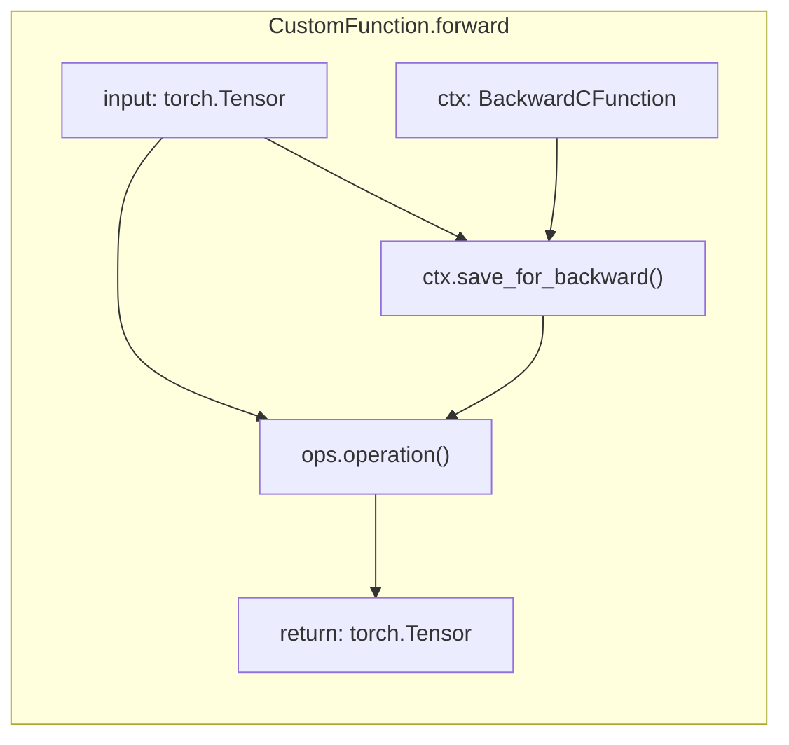
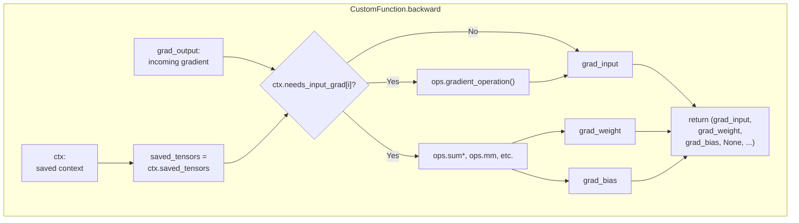
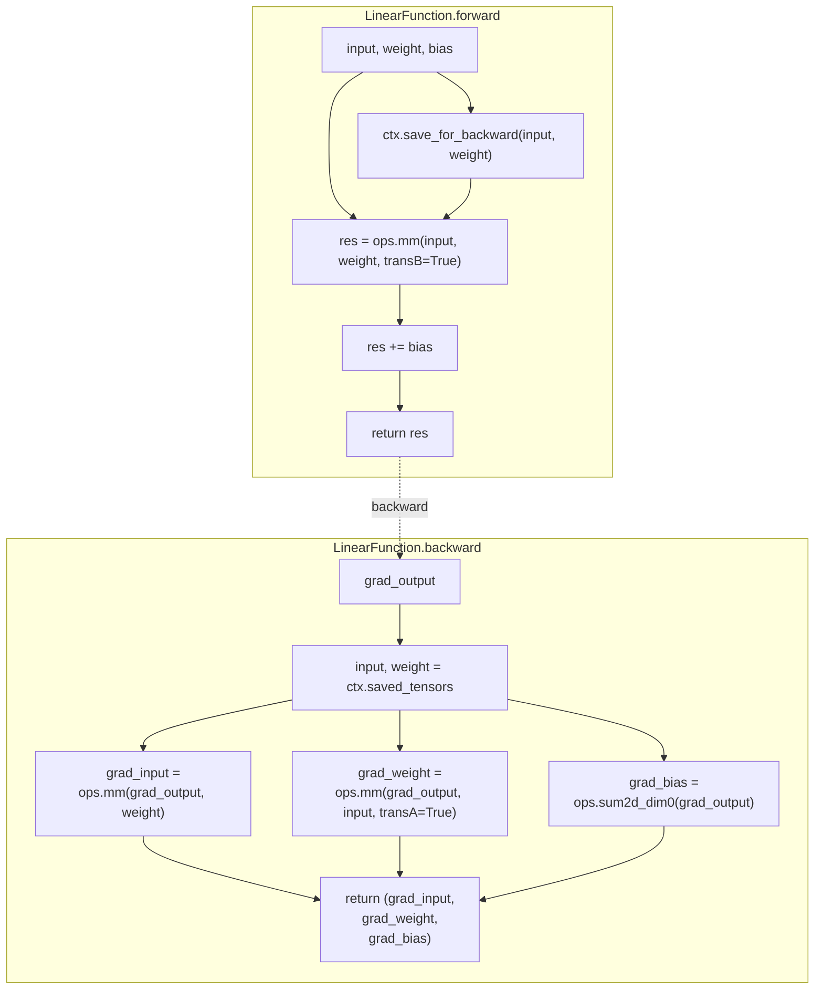
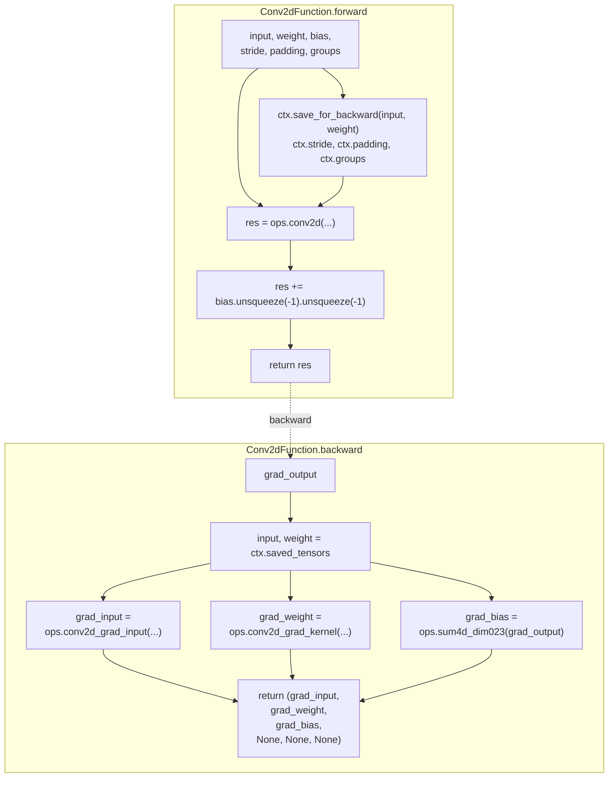
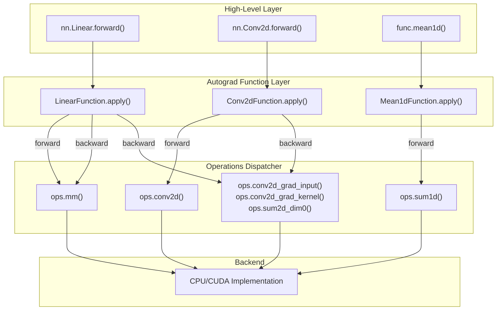

<!-- source: DeepWiki mcp.deepwiki.com · repo microsoft/RepDL · page 3.2 Custom Autograd Functions · fetched 2026-10-26 -->

# Custom Autograd Functions

<details>
<summary>Relevant source files</summary>

The following files were used as context for generating this wiki page:

- [repdl/func.py](repdl/func.py)
- [repdl/nn/conv.py](repdl/nn/conv.py)
- [repdl/nn/linear.py](repdl/nn/linear.py)

</details>


## Purpose and Scope

This document explains how RepDL uses `torch.autograd.Function` subclasses to control both forward and backward passes for reproducible gradient computation. Custom autograd functions serve as the interface layer between high-level neural network operations and the reproducible `repdl.ops` backend, ensuring that all gradient calculations flow through deterministic computation paths.

For information about the operation dispatch mechanism that these functions call, see [Operation Dispatch Mechanism](#3.1). For information about specific neural network layers that use these functions, see [Neural Network Modules](#4.3).

---

## The torch.autograd.Function Pattern

RepDL implements custom autograd functions by subclassing `torch.autograd.Function` and implementing two static methods:

- **`forward(ctx, ...)`**: Performs the forward computation and optionally saves tensors/metadata in `ctx` for use during backward pass
- **`backward(ctx, grad_output)`**: Computes gradients with respect to inputs using saved context and the incoming gradient

This pattern provides complete control over gradient computation, allowing RepDL to route all operations through `repdl.ops` for reproducibility.

### General Structure

```
class CustomFunction(torch.autograd.Function):
    @staticmethod
    def forward(ctx, input, ...):
        ctx.save_for_backward(input, ...)  # Save tensors
        ctx.attribute = value              # Save metadata
        return ops.operation(input, ...)   # Use reproducible ops
    
    @staticmethod
    def backward(ctx, grad_output):
        saved_tensors = ctx.saved_tensors
        grad_input = ops.gradient_operation(...)  # Reproducible gradients
        return grad_input, None, ...
```

**Sources:** [repdl/func.py:11-30](), [repdl/nn/linear.py:11-38]()

---

## Custom Autograd Functions in RepDL

RepDL implements several categories of custom autograd functions to handle different types of operations:

| Function Class | Purpose | Location | Operations Used |
|---------------|---------|----------|-----------------|
| `ExpandFunction` | Broadcast tensors with controlled gradient aggregation | [repdl/func.py:11-30]() | `ops.sum4d_dim023`, `ops.sum2d_dim0` |
| `Mean1dFunction` | 1D mean with reproducible gradient distribution | [repdl/func.py:47-64]() | `ops.sum1d` |
| `Mean2dDim0Function` | 2D mean over dimension 0 | [repdl/func.py:72-90]() | `ops.sum2d_dim0` |
| `Mean4dDim023Function` | 4D mean over dimensions 0,2,3 | [repdl/func.py:98-116]() | `ops.sum4d_dim023` |
| `LinearFunction` | Fully connected layer forward/backward | [repdl/nn/linear.py:11-38]() | `ops.mm`, `ops.sum2d_dim0` |
| `Conv2dFunction` | 2D convolution forward/backward | [repdl/nn/conv.py:11-50]() | `ops.conv2d`, `ops.conv2d_grad_input`, `ops.conv2d_grad_kernel`, `ops.sum4d_dim023` |
| `CrossEntropyFunction` | Cross-entropy loss with softmax gradient | [repdl/nn/conv.py:79-102]() | `ops.cross_entropy`, `ops.softmax` |

**Sources:** [repdl/func.py:1-122](), [repdl/nn/linear.py:1-55](), [repdl/nn/conv.py:1-116]()

---

## Forward Pass Implementation

### Basic Pattern

The forward pass must route operations through `repdl.ops` to ensure reproducibility:



### Context Saving Strategy

Custom functions save different types of information for the backward pass:

**Tensor Saving:**
- [repdl/nn/linear.py:19](): `ctx.save_for_backward(input, weight)` - Saves tensors needed for gradient computation
- [repdl/nn/conv.py:22](): `ctx.save_for_backward(input, weight)` - Similar pattern for convolution

**Metadata Saving:**
- [repdl/nn/conv.py:23-25](): Saves `stride`, `padding`, `groups` as attributes
- [repdl/func.py:52](): Saves `input_shape` for gradient reshaping

**Sources:** [repdl/nn/linear.py:13-23](), [repdl/nn/conv.py:13-29](), [repdl/func.py:47-53]()

---

## Backward Pass Implementation

### Gradient Computation Pattern

The backward pass retrieves saved context and computes gradients using `repdl.ops`:



### Conditional Gradient Computation

All custom functions check `ctx.needs_input_grad` to avoid unnecessary computation:

```
grad_input = None
if ctx.needs_input_grad[0]:
    grad_input = ops.gradient_operation(...)
```

This pattern appears in:
- [repdl/func.py:25-30]() - ExpandFunction
- [repdl/nn/linear.py:31-37]() - LinearFunction  
- [repdl/nn/conv.py:39-49]() - Conv2dFunction

**Sources:** [repdl/func.py:21-30](), [repdl/nn/linear.py:26-38](), [repdl/nn/conv.py:32-50]()

---

## LinearFunction Example

The `LinearFunction` demonstrates the complete pattern for a neural network layer:



**Forward Pass:** [repdl/nn/linear.py:13-23]()
- Saves `input` and `weight` for backward pass
- Computes matrix multiplication using `ops.mm` with `transB=True` (transpose weight)
- Adds bias if present

**Backward Pass:** [repdl/nn/linear.py:26-38]()
- Computes `grad_input` by multiplying `grad_output` with `weight`
- Computes `grad_weight` by multiplying transposed `grad_output` with `input`
- Computes `grad_bias` by summing `grad_output` over batch dimension using `ops.sum2d_dim0`

**Sources:** [repdl/nn/linear.py:11-49]()

---

## Conv2dFunction Example

The `Conv2dFunction` handles 2D convolution with separate gradient operations for input and kernel:



**Forward Pass:** [repdl/nn/conv.py:13-29]()
- Saves `input`, `weight`, and convolution parameters
- Calls `ops.conv2d` for reproducible convolution
- Broadcasts bias to output dimensions if present

**Backward Pass:** [repdl/nn/conv.py:32-50]()
- `grad_input`: Uses `ops.conv2d_grad_input` with input shape, weight, and grad_output
- `grad_weight`: Uses `ops.conv2d_grad_kernel` with input, weight shape, and grad_output  
- `grad_bias`: Sums over batch, height, and width using `ops.sum4d_dim023`
- Returns `None` for gradient of non-tensor parameters (stride, padding, groups)

**Sources:** [repdl/nn/conv.py:11-50]()

---

## Mean Functions and Dimension Handling

RepDL provides specialized mean functions for different tensor dimensions, each with carefully designed gradient distribution:

### Mean1dFunction

[repdl/func.py:47-69]()

**Forward:** Calls `ops.sum1d(input, average=True)` to compute mean over 1D tensor

**Backward:** Distributes gradient equally to all elements:
- Computes `grad_input = grad_output * (1 / input_shape.numel())`
- Expands scalar gradient to input shape

### Mean2dDim0Function

[repdl/func.py:72-95]()

**Forward:** Calls `ops.sum2d_dim0(input, average=True)` to compute mean over dimension 0

**Backward:** Distributes gradient along dimension 0:
- Computes reduction factor: `factor = 1 / (input_shape.numel() // grad_output.numel())`
- Unsqueezes and expands to input shape

### Mean4dDim023Function  

[repdl/func.py:98-121]()

**Forward:** Calls `ops.sum4d_dim023(input, average=True)` to compute mean over dimensions 0, 2, 3

**Backward:** Distributes gradient along reduced dimensions:
- Computes reduction factor
- Unsqueezes twice (for dimensions 2 and 3) and expands to input shape

### Gradient Distribution Pattern

| Function | Input Shape | Output Shape | Gradient Expansion |
|----------|-------------|--------------|-------------------|
| `mean1d` | `(n,)` | `()` | Scalar → expand to `(n,)` |
| `mean2d_dim0` | `(n, m)` | `(m,)` | `(m,)` → unsqueeze(-1) → expand to `(n, m)` |
| `mean4d_dim023` | `(n, c, h, w)` | `(c,)` | `(c,)` → unsqueeze(-1).unsqueeze(-1) → expand to `(n, c, h, w)` |

**Sources:** [repdl/func.py:47-121]()

---

## ExpandFunction and Broadcast Handling

The `ExpandFunction` handles tensor broadcasting with reproducible gradient aggregation:

**Forward:** [repdl/func.py:13-18]()
- Uses PyTorch's native `expand` operation (view operation, no data copy)
- Supports two patterns:
  - 1D → 2D: `(n,)` → `(?, n)` [repdl/func.py:36]()
  - 3D → 4D: `(n, 1, 1)` → `(?, n, ?, ?)` [repdl/func.py:37-42]()

**Backward:** [repdl/func.py:21-30]()
- Aggregates gradients over expanded dimensions using `ops.sum*`
- For 4D tensors: `ops.sum4d_dim023(grad_output, keepdim=True).squeeze(0)`
- For 2D tensors: `ops.sum2d_dim0(grad_output)`

**Usage:** [repdl/func.py:33-44]()
```
expand_as(input, other) -> Tensor
```
The function validates dimension compatibility before applying the autograd function.

**Sources:** [repdl/func.py:11-44]()

---

## CrossEntropyFunction

The `CrossEntropyFunction` combines cross-entropy loss computation with softmax gradient:

**Forward:** [repdl/nn/conv.py:81-87]()
- Saves `input` and `target` tensors
- Calls `ops.cross_entropy(input, target)` for reproducible loss computation

**Backward:** [repdl/nn/conv.py:90-102]()
- Computes softmax using `ops.softmax(input)`
- Subtracts one-hot encoded target using `torch.nn.functional.one_hot`
- Scales by `1.0 / input.shape[0]` (batch size)
- Multiplies by incoming `grad_output`

This implements the standard softmax-cross-entropy gradient: `softmax(x) - y`, scaled by batch size.

**Sources:** [repdl/nn/conv.py:79-102]()

---

## Integration with repdl.ops

All custom autograd functions route operations through `repdl.ops` to ensure reproducibility:



### Operation Usage by Function

| Autograd Function | Forward Operations | Backward Operations |
|-------------------|-------------------|---------------------|
| `LinearFunction` | `ops.mm` | `ops.mm`, `ops.sum2d_dim0` |
| `Conv2dFunction` | `ops.conv2d` | `ops.conv2d_grad_input`, `ops.conv2d_grad_kernel`, `ops.sum4d_dim023` |
| `CrossEntropyFunction` | `ops.cross_entropy` | `ops.softmax` |
| `Mean1dFunction` | `ops.sum1d` | (native PyTorch expand) |
| `Mean2dDim0Function` | `ops.sum2d_dim0` | (native PyTorch unsqueeze/expand) |
| `Mean4dDim023Function` | `ops.sum4d_dim023` | (native PyTorch unsqueeze/expand) |
| `ExpandFunction` | (native PyTorch expand) | `ops.sum2d_dim0`, `ops.sum4d_dim023` |

**Key Insight:** Custom autograd functions serve as the **exclusive interface** between high-level neural network operations and the reproducible `repdl.ops` backend. This ensures that all gradient computations flow through deterministic paths, enabling bitwise identical results across hardware platforms.

**Sources:** [repdl/func.py:8](), [repdl/nn/linear.py:8](), [repdl/nn/conv.py:8]()

---

## Return Value Pattern

All backward methods must return a tuple with gradients matching the forward signature:

**Convention:**
- One gradient per forward input argument
- `None` for non-tensor arguments (stride, padding, etc.)
- `None` for tensor arguments where `ctx.needs_input_grad[i]` is `False`

**Examples:**

[repdl/nn/linear.py:38](): `return grad_input, grad_weight, grad_bias`
- Matches forward signature: `(input, weight, bias)`

[repdl/nn/conv.py:50](): `return grad_input, grad_weight, grad_bias, None, None, None`
- Matches forward signature: `(input, weight, bias, stride, padding, groups)`
- Last three are `None` because they are non-tensor parameters

[repdl/func.py:30](): `return grad_input, None`
- Matches forward signature: `(input, shape)`
- Second element is `None` because `shape` is not a tensor

**Sources:** [repdl/nn/linear.py:25-38](), [repdl/nn/conv.py:32-50](), [repdl/func.py:21-30]()

---

