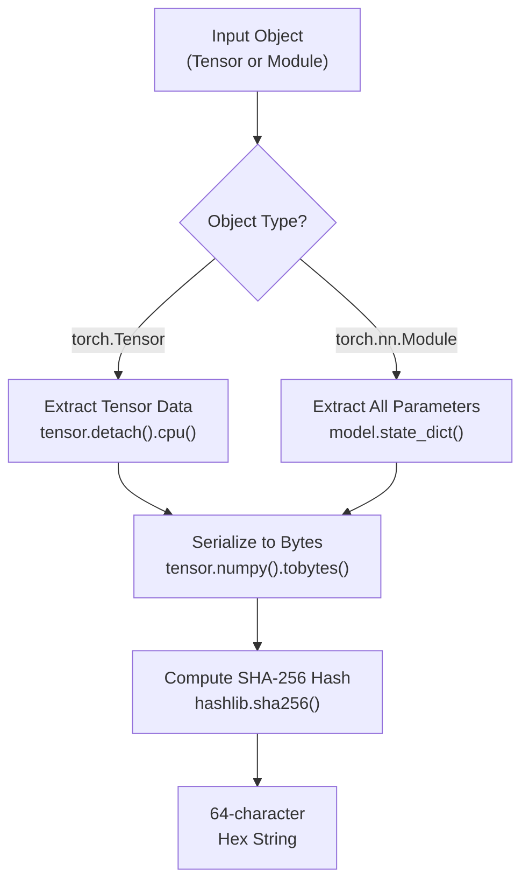
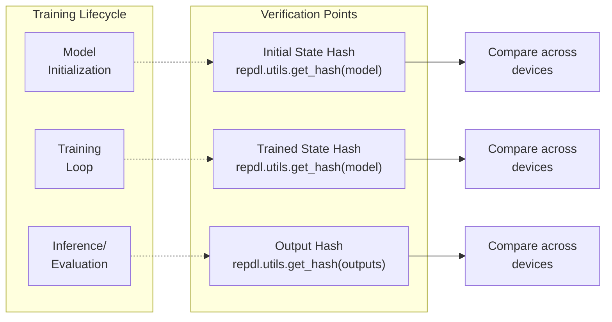
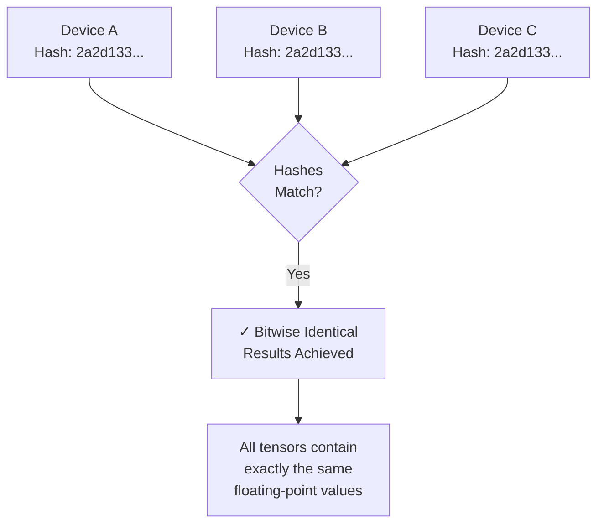
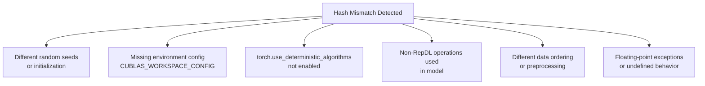
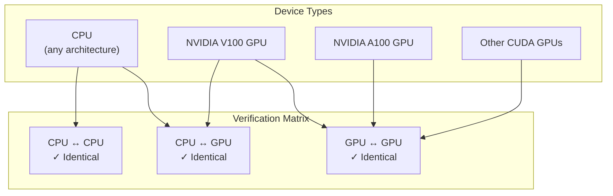
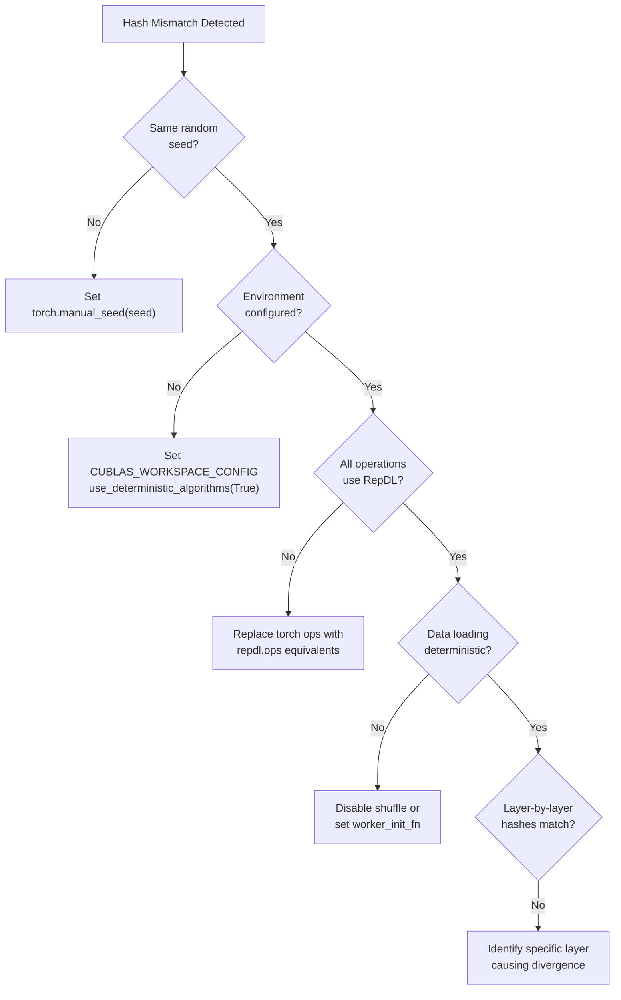

<!-- source: DeepWiki mcp.deepwiki.com · repo microsoft/RepDL · page 3.3 Reproducibility Verification · fetched 2026-10-26 -->

# Reproducibility Verification

<details>
<summary>Relevant source files</summary>

The following files were used as context for generating this wiki page:

- [README.md](README.md)
- [examples/mnist_trainig.py](examples/mnist_trainig.py)

</details>


## Purpose and Scope

This document explains how to verify bitwise identical results in RepDL using the `repdl.utils.get_hash` function. Reproducibility verification is the process of cryptographically confirming that two model executions produce exactly the same numerical results, regardless of hardware platform or execution environment.

For information about the underlying reproducible operations that make verification possible, see [Operation Dispatch Mechanism](#3.1). For details on environment setup required for reproducibility, see [Quick Start](#2.2).

---

## The `get_hash` Function

The `repdl.utils.get_hash` function computes a SHA-256 cryptographic hash of tensor or model state data, enabling bitwise comparison of results across different execution environments.

### Function Signature

```python
repdl.utils.get_hash(obj)
```

**Parameters:**
- `obj`: A PyTorch tensor or `torch.nn.Module` instance

**Returns:**
- A 64-character hexadecimal string representing the SHA-256 hash

### Supported Input Types

| Input Type | What is Hashed | Use Case |
|------------|----------------|----------|
| `torch.Tensor` | Raw tensor data (values) | Verify model outputs, intermediate activations, or gradients |
| `torch.nn.Module` | All model parameters and buffers | Verify complete model state before/after training |

### Hash Computation Process



**Sources:** [examples/mnist_trainig.py:67](), [examples/mnist_trainig.py:83](), [examples/mnist_trainig.py:103]()

The function:
1. **Extracts data**: Moves tensors to CPU and detaches from computation graph
2. **Serializes**: Converts numerical values to a byte stream
3. **Hashes**: Applies SHA-256 cryptographic hash function
4. **Returns**: Hexadecimal string representation of the hash

---

## Verification Points in Training

RepDL enables verification at three critical stages of the machine learning lifecycle. These verification points ensure reproducibility throughout the entire workflow.



**Sources:** [examples/mnist_trainig.py:67-83-103](), [README.md:34-39]()

### 1. Initial Model State Verification

Compute the hash immediately after model creation and device placement:

```python
model = repdl.from_torch_module(model)
model.to(device)
initial_hash = repdl.utils.get_hash(model)
print(f"Hash of the initial model: {initial_hash}")
```

**Purpose:** Ensures that model initialization is deterministic across devices. The same random seed and initialization method should produce identical initial parameters.

**Expected Result (MNIST example):**
```
Hash of the initial model: 2a2d133895b1684e55d0f152ead2914b55adc551d9790a4b4585309b79c60362
```

**Sources:** [examples/mnist_trainig.py:67](), [README.md:36]()

### 2. Post-Training Model State Verification

Compute the hash after training is complete:

```python
# After training loop
trained_hash = repdl.utils.get_hash(model)
print(f"Hash of the trained model: {trained_hash}")
```

**Purpose:** Verifies that the entire training process—including forward passes, loss computation, backward passes, and optimizer updates—is reproducible. This is the most comprehensive verification point.

**Expected Result (MNIST example):**
```
Hash of the trained model: 31ee86a7f75dbd76bac22f209617eb7349f93b0ede116dba924f328cac3013f1
```

**Sources:** [examples/mnist_trainig.py:83](), [README.md:37]()

### 3. Inference Output Verification

Compute the hash of model predictions:

```python
model.eval()
with torch.no_grad():
    outputs = model(test_data)
output_hash = repdl.utils.get_hash(outputs)
print(f"Hash of the logits: {output_hash}")
```

**Purpose:** Verifies that inference produces identical predictions across devices. Critical for deployment scenarios where models must produce consistent results in production.

**Expected Result (MNIST example):**
```
Hash of the logits: 0ca34dcd37105b4af690c46a62407b4b9b097d1063864c6d99f4309aeb4bca3e
```

**Sources:** [examples/mnist_trainig.py:91-103](), [README.md:39]()

---

## Complete Verification Workflow

The following diagram shows how verification integrates into a typical training workflow, mapping natural language concepts to actual code constructs.

```mermaid
sequenceDiagram
    participant User
    participant Model["repdl Model<br/>(torch.nn.Module)"]
    participant Utils["repdl.utils.get_hash"]
    participant Training["Training Loop"]
    participant Inference["Inference Pass"]
    
    Note over User: Setup Phase
    User->>User: "Set CUBLAS_WORKSPACE_CONFIG<br/>torch.use_deterministic_algorithms(True)"
    User->>Model: "repdl.from_torch_module(model)"
    User->>Model: "model.to(device)"
    
    Note over User,Utils: Checkpoint 1: Initial State
    User->>Utils: "get_hash(model)"
    Utils-->>User: "2a2d133895b1684e..."
    User->>User: "Record hash for comparison"
    
    Note over User,Training: Training Phase
    User->>Training: "for epoch in range(num_epochs)"
    loop "Each batch"
        Training->>Model: "output = model(images)"
        Training->>Training: "loss = cross_entropy(...)"
        Training->>Model: "loss.backward()"
        Training->>Training: "optimizer.step()"
    end
    
    Note over User,Utils: Checkpoint 2: Trained State
    User->>Utils: "get_hash(model)"
    Utils-->>User: "31ee86a7f75dbd76..."
    User->>User: "Compare with reference hash"
    
    Note over User,Inference: Inference Phase
    User->>Model: "model.eval()"
    User->>Inference: "with torch.no_grad():"
    Inference->>Model: "outputs = model(test_data)"
    
    Note over User,Utils: Checkpoint 3: Output State
    User->>Utils: "get_hash(outputs)"
    Utils-->>User: "0ca34dcd37105b4a..."
    User->>User: "Verify against expected hash"
```

**Sources:** [examples/mnist_trainig.py:41-114](), [README.md:29-39]()

### Step-by-Step Verification Process

**1. Environment Setup**

Before any verification, ensure deterministic behavior:

```python
import os
os.environ["CUBLAS_WORKSPACE_CONFIG"] = ":4096:8"
torch.use_deterministic_algorithms(True)
torch.manual_seed(0)
```

**Sources:** [examples/mnist_trainig.py:42-43]()

**2. Model Conversion and Initial Hash**

```python
model = torchModel()
model = repdl.from_torch_module(model)
device = "cuda" if torch.cuda.is_available() else "cpu"
model.to(device)

initial_hash = repdl.utils.get_hash(model)
```

**Sources:** [examples/mnist_trainig.py:108-111]()

**3. Training with Intermediate Verification**

```python
optimizer = repdl.optim.Adam(model.parameters(), lr=0.01)

for epoch in range(num_epochs):
    for images, labels in data_loader:
        images, labels = images.to(device), labels.to(device)
        output = model(images)
        loss = repdl.nn.functional.cross_entropy(output, labels)
        
        optimizer.zero_grad()
        loss.backward()
        optimizer.step()

trained_hash = repdl.utils.get_hash(model)
```

**Sources:** [examples/mnist_trainig.py:64-83]()

**4. Inference Verification**

```python
model.eval()
with torch.no_grad():
    outputs = None
    for images, labels in test_loader:
        images = images.to(device)
        test_output = model(images)
        outputs = test_output if outputs is None else torch.cat((outputs, test_output))

output_hash = repdl.utils.get_hash(outputs)
```

**Sources:** [examples/mnist_trainig.py:87-103]()

---

## Interpreting Hash Values

### What Identical Hashes Mean



**Identical hashes guarantee:**
- All floating-point values are bitwise identical
- Every parameter, buffer, and output matches exactly
- No rounding differences or accumulation errors
- Cross-device reproducibility is achieved

**Example - MNIST Expected Hashes:**

| Checkpoint | Hash Value | Hardware Verified |
|------------|-----------|-------------------|
| Initial Model | `2a2d133895b1684e55d0f152ead2914b55adc551d9790a4b4585309b79c60362` | CPU, V100, A100 |
| Trained Model | `31ee86a7f75dbd76bac22f209617eb7349f93b0ede116dba924f328cac3013f1` | CPU, V100, A100 |
| Test Logits | `0ca34dcd37105b4af690c46a62407b4b9b097d1063864c6d99f4309aeb4bca3e` | CPU, V100, A100 |

**Sources:** [README.md:36-39]()

### What Different Hashes Indicate

If hashes differ between two executions, reproducibility has been violated. Common causes:



| Issue | Symptom | Solution |
|-------|---------|----------|
| **Different random seeds** | Initial model hash differs | Set `torch.manual_seed(0)` before model creation |
| **CUBLAS not configured** | Trained model hash differs on CUDA | Set `os.environ["CUBLAS_WORKSPACE_CONFIG"] = ":4096:8"` |
| **Non-deterministic algorithms** | Hash differences appear randomly | Call `torch.use_deterministic_algorithms(True)` |
| **Standard PyTorch ops mixed in** | Hash differs after certain layers | Ensure all operations use RepDL equivalents |
| **Data loader shuffling** | Training hashes differ unpredictably | Use deterministic data loading |

**Sources:** [examples/mnist_trainig.py:42-43](), [README.md:43]()

---

## Verification Across Devices

RepDL guarantees identical hashes across different hardware configurations when properly configured.

### Supported Device Combinations



**Sources:** [README.md:5]()

### Cross-Device Verification Example

To verify reproducibility across devices:

1. **Run on Device A (e.g., CPU):**
```python
device_a = "cpu"
model_a = repdl.from_torch_module(model).to(device_a)
hash_a = repdl.utils.get_hash(model_a)
# Result: 2a2d133895b1684e55d0f152ead2914b55adc551d9790a4b4585309b79c60362
```

2. **Run on Device B (e.g., CUDA):**
```python
device_b = "cuda"
model_b = repdl.from_torch_module(model).to(device_b)
hash_b = repdl.utils.get_hash(model_b)
# Result: 2a2d133895b1684e55d0f152ead2914b55adc551d9790a4b4585309b79c60362
```

3. **Compare:**
```python
assert hash_a == hash_b, "Reproducibility violated!"
```

**Sources:** [examples/mnist_trainig.py:110-111](), [README.md:34-39]()

---

## Best Practices

### When to Compute Hashes

| Timing | Purpose | Frequency |
|--------|---------|-----------|
| **Before training** | Verify initialization | Once per experiment |
| **After training** | Verify complete training reproducibility | Once per training run |
| **During inference** | Verify deployment consistency | Per batch or per dataset |
| **After checkpoint loading** | Verify state restoration | After each `model.load_state_dict()` |
| **During debugging** | Identify where reproducibility breaks | At suspicious operations |

### Hash Storage and Documentation

For reproducible research, document and store verification hashes:

```python
verification_record = {
    "experiment_id": "mnist_baseline_v1",
    "timestamp": "2025-01-15T10:30:00",
    "device": "NVIDIA V100",
    "pytorch_version": "2.0.0",
    "hashes": {
        "initial_model": repdl.utils.get_hash(model),
        "trained_model": repdl.utils.get_hash(trained_model),
        "test_outputs": repdl.utils.get_hash(outputs)
    }
}
```

### Debugging Hash Mismatches

If hashes don't match, use a systematic approach:



**Layer-by-layer debugging example:**

```python
# Insert hash checks after each layer
for name, module in model.named_modules():
    if hasattr(module, 'forward'):
        # Store original forward
        original_forward = module.forward
        
        def forward_with_hash(self, x, name=name):
            output = original_forward(x)
            print(f"{name}: {repdl.utils.get_hash(output)[:16]}...")
            return output
        
        # Replace forward method
        module.forward = lambda x, s=module: forward_with_hash(s, x)
```

This technique isolates the exact operation where reproducibility breaks.

---

## Summary

The `repdl.utils.get_hash` function provides cryptographic verification of RepDL's reproducibility guarantees:

- **Compute hashes** at initialization, post-training, and during inference
- **Compare hashes** across different devices to verify bitwise identical results
- **Identical hashes** guarantee exact numerical equivalence
- **Different hashes** indicate configuration issues or non-RepDL operations
- **Document hashes** for reproducible research and deployment verification

For details on the underlying reproducible operations that enable this verification, see [Operation Dispatch Mechanism](#3.1). For practical examples, see [MNIST Training Example](#2.3).

**Sources:** [README.md:1-65](), [examples/mnist_trainig.py:1-115]()

---

