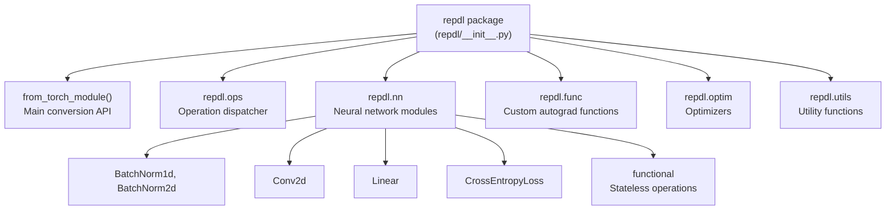
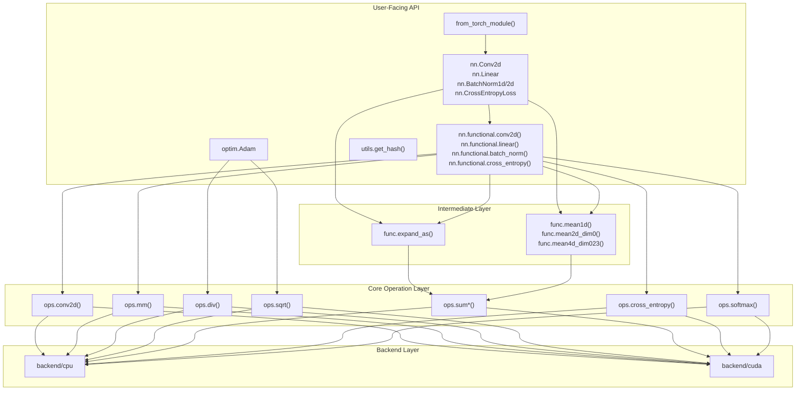
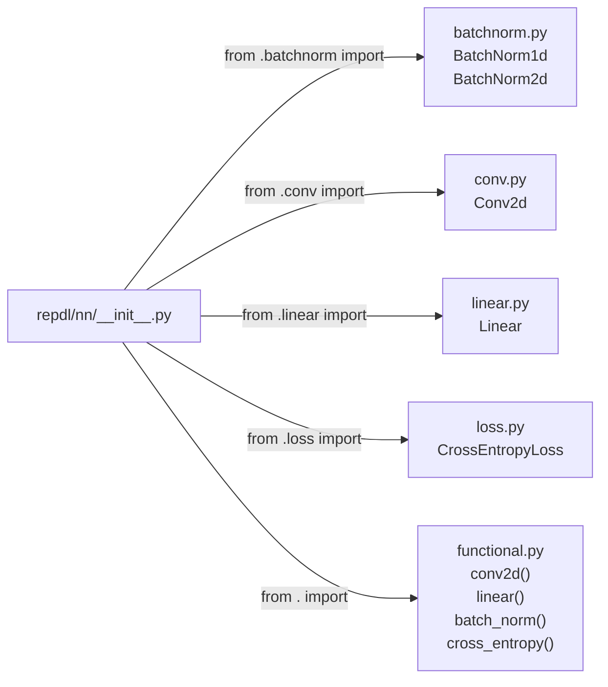
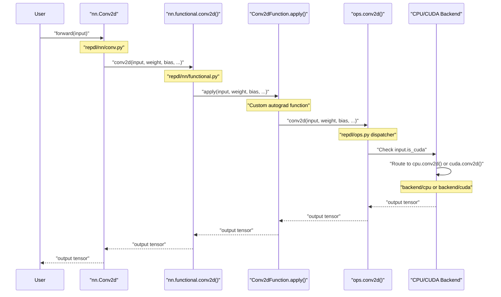

<!-- source: DeepWiki mcp.deepwiki.com · repo microsoft/RepDL · page 4 API Reference · fetched 2026-10-26 -->

# API Reference

<details>
<summary>Relevant source files</summary>

The following files were used as context for generating this wiki page:

- [repdl/__init__.py](repdl/__init__.py)
- [repdl/nn/__init__.py](repdl/nn/__init__.py)

</details>


This page provides a comprehensive reference for the RepDL API. It documents the structure of the package, the main entry points, and the relationships between modules. For detailed documentation of specific components, see the child pages listed in each section below.

For conceptual explanations of how these components work together, see [Core Concepts](#3). For implementation details of the backend systems, see [Backend Implementation](#5).

## Package Structure

RepDL is organized as a Python package with the following top-level structure:



**Sources:** [repdl/__init__.py:1-66](), [repdl/nn/__init__.py:1-9]()

## Module Overview

The following table summarizes the purpose and location of each major module in RepDL:

| Module | Location | Purpose | Child Pages |
|--------|----------|---------|-------------|
| `from_torch_module` | `repdl/__init__.py` | Convert PyTorch modules to reproducible equivalents | [4.1](#4.1) |
| `repdl.ops` | `repdl/ops.py` | Low-level operation dispatcher routing to CPU/CUDA backends | [4.2](#4.2) |
| `repdl.nn` | `repdl/nn/` | Neural network layers and loss functions | [4.3](#4.3) |
| `repdl.func` | `repdl/func.py` | Custom autograd functions for gradient computation | [4.4](#4.4) |
| `repdl.optim` | `repdl/optim.py` | Reproducible optimizers (Adam) | [4.5](#4.5) |
| `repdl.utils` | `repdl/utils.py` | Utility functions for reproducibility verification | [4.6](#4.6) |

**Sources:** [repdl/__init__.py:8-12]()

## Primary Entry Points

### Model Conversion

The main entry point for using RepDL is the `from_torch_module()` function:

```python
repdl.from_torch_module(m: torch.nn.Module) -> torch.nn.Module
```

This function converts a PyTorch module to use reproducible operations. The conversion process is recursive for `torch.nn.Sequential` and custom modules with child modules.

**Supported Layer Types:**
- `torch.nn.BatchNorm1d` → `repdl.nn.BatchNorm1d` [repdl/__init__.py:18-26]()
- `torch.nn.BatchNorm2d` → `repdl.nn.BatchNorm2d` [repdl/__init__.py:27-35]()
- `torch.nn.Conv2d` → `repdl.nn.Conv2d` [repdl/__init__.py:36-48]()
- `torch.nn.CrossEntropyLoss` → `repdl.nn.CrossEntropyLoss` [repdl/__init__.py:49-52]()
- `torch.nn.Linear` → `repdl.nn.Linear` [repdl/__init__.py:53-55]()
- `torch.nn.Sequential` → recursive conversion [repdl/__init__.py:56-60]()

For detailed documentation, see [Model Conversion](#4.1).

**Sources:** [repdl/__init__.py:15-65]()

### Direct Module Usage

Users can also directly instantiate RepDL modules without conversion:

```python
import repdl

# Direct instantiation
model = repdl.nn.Sequential(
    repdl.nn.Conv2d(1, 32, 3),
    repdl.nn.BatchNorm2d(32),
    repdl.nn.Linear(32 * 26 * 26, 10)
)
```

**Sources:** [repdl/nn/__init__.py:1-9]()

## API Layering and Dependencies

The RepDL API is organized in layers, with clear dependency relationships:



**Sources:** [repdl/__init__.py:8-12](), [repdl/nn/__init__.py:4-8]()

## Module Import Patterns

RepDL follows standard Python import conventions. The `repdl.nn` subpackage aggregates all neural network components:



This allows users to import modules as:
```python
from repdl.nn import Conv2d, Linear, BatchNorm2d
from repdl.nn import functional as F
```

**Sources:** [repdl/nn/__init__.py:4-8]()

## Type Hierarchies

RepDL modules inherit from PyTorch base classes to maintain API compatibility:

```mermaid
graph TB
    torch_module["torch.nn.Module"]
    torch_function["torch.autograd.Function"]
    torch_optimizer["torch.optim.Optimizer"]
    
    repdl_conv["repdl.nn.Conv2d"]
    repdl_linear["repdl.nn.Linear"]
    repdl_bn1d["repdl.nn.BatchNorm1d"]
    repdl_bn2d["repdl.nn.BatchNorm2d"]
    repdl_loss["repdl.nn.CrossEntropyLoss"]
    
    repdl_expandas["repdl.func.expand_as"]
    repdl_mean1d["repdl.func.mean1d"]
    repdl_mean2d["repdl.func.mean2d_dim0"]
    repdl_mean4d["repdl.func.mean4d_dim023"]
    
    repdl_adam["repdl.optim.Adam"]
    
    torch_module -.inherits.-> repdl_conv
    torch_module -.inherits.-> repdl_linear
    torch_module -.inherits.-> repdl_bn1d
    torch_module -.inherits.-> repdl_bn2d
    torch_module -.inherits.-> repdl_loss
    
    torch_function -.inherits.-> repdl_expandas
    torch_function -.inherits.-> repdl_mean1d
    torch_function -.inherits.-> repdl_mean2d
    torch_function -.inherits.-> repdl_mean4d
    
    torch_optimizer -.inherits.-> repdl_adam
```



This inheritance ensures that RepDL components work with existing PyTorch code and tools.

**Sources:** [repdl/__init__.py:6](), [repdl/__init__.py:15-65]()

## Operation Flow Through Layers

The following diagram shows how a typical forward pass flows through the API layers:



**Sources:** [repdl/__init__.py:1-66](), [repdl/nn/__init__.py:1-9]()

## Child Pages

Detailed documentation for each component:

- **[4.1 Model Conversion](#4.1)** - `from_torch_module()` function, supported layers, conversion process
- **[4.2 Operations Module](#4.2)** - `repdl.ops` dispatcher and all low-level operations
- **[4.3 Neural Network Modules](#4.3)** - Overview of `repdl.nn` package structure
  - **[4.3.1 Convolutional Layers](#4.3.1)** - `Conv2d` documentation
  - **[4.3.2 Linear Layers](#4.3.2)** - `Linear` documentation
  - **[4.3.3 Normalization Layers](#4.3.3)** - `BatchNorm1d` and `BatchNorm2d` documentation
  - **[4.3.4 Loss Functions](#4.3.4)** - `CrossEntropyLoss` documentation
  - **[4.3.5 Functional API](#4.3.5)** - `repdl.nn.functional` stateless operations
- **[4.4 Custom Functions](#4.4)** - `repdl.func` autograd functions
- **[4.5 Optimizers](#4.5)** - `repdl.optim.Adam` documentation
- **[4.6 Utilities](#4.6)** - `repdl.utils.get_hash()` and other utilities

## Naming Conventions

RepDL follows PyTorch naming conventions for consistency:

| Convention | Example | Purpose |
|------------|---------|---------|
| PascalCase | `Conv2d`, `BatchNorm1d` | Module classes |
| snake_case | `conv2d()`, `batch_norm()` | Functions and methods |
| lowercase | `repdl.nn`, `repdl.optim` | Package names |
| ALL_CAPS | (Not used) | - |

**Sources:** [repdl/__init__.py:1-66](), [repdl/nn/__init__.py:1-9]()

## Common Usage Patterns

### Pattern 1: Full Model Conversion

```python
import torch
import repdl

# Create standard PyTorch model
torch_model = torch.nn.Sequential(
    torch.nn.Conv2d(1, 32, 3),
    torch.nn.BatchNorm2d(32),
    torch.nn.Linear(32 * 26 * 26, 10)
)

# Convert to reproducible version
repdl_model = repdl.from_torch_module(torch_model)
```

### Pattern 2: Direct Module Construction

```python
import repdl.nn as nn

# Build directly with RepDL modules
model = nn.Sequential(
    nn.Conv2d(1, 32, 3),
    nn.BatchNorm2d(32),
    nn.Linear(32 * 26 * 26, 10)
)
```

### Pattern 3: Mixed API Usage

```python
import repdl
from repdl.nn import functional as F

# Use functional API in custom forward pass
class CustomModel(torch.nn.Module):
    def forward(self, x):
        x = F.conv2d(x, self.weight, self.bias)
        x = F.batch_norm(x, ...)
        return x
```

**Sources:** [repdl/__init__.py:15-65]()

---

