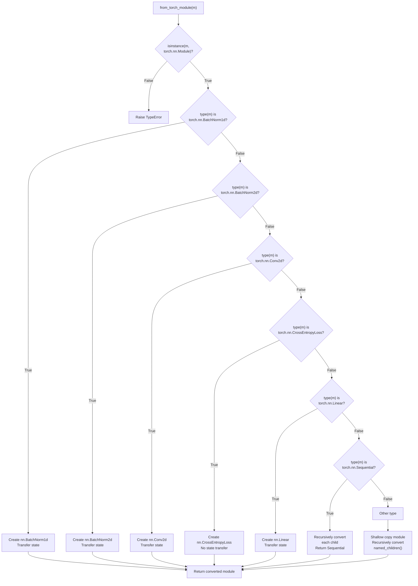
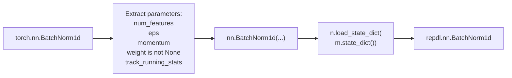
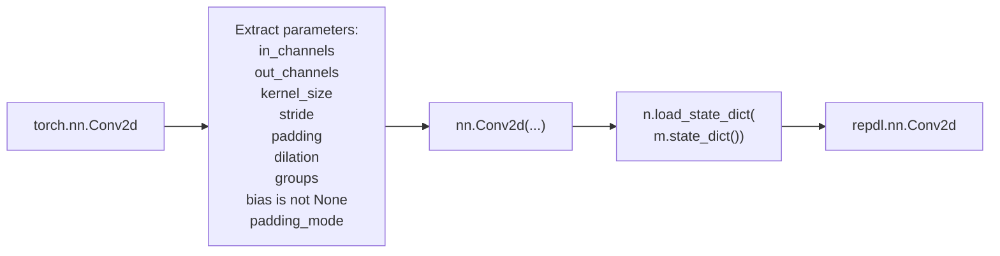
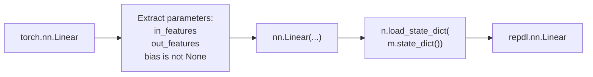
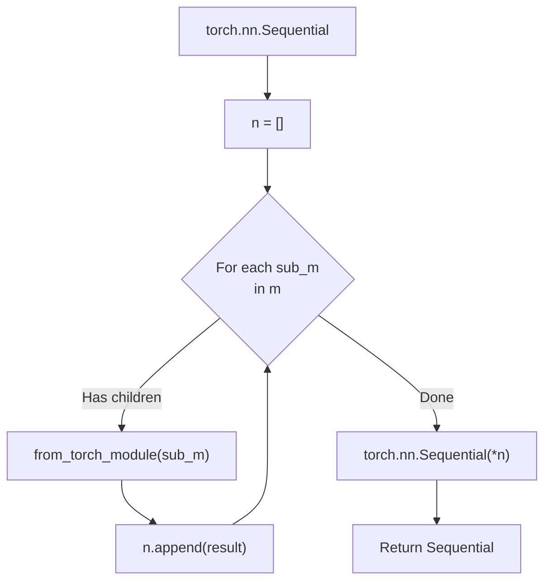
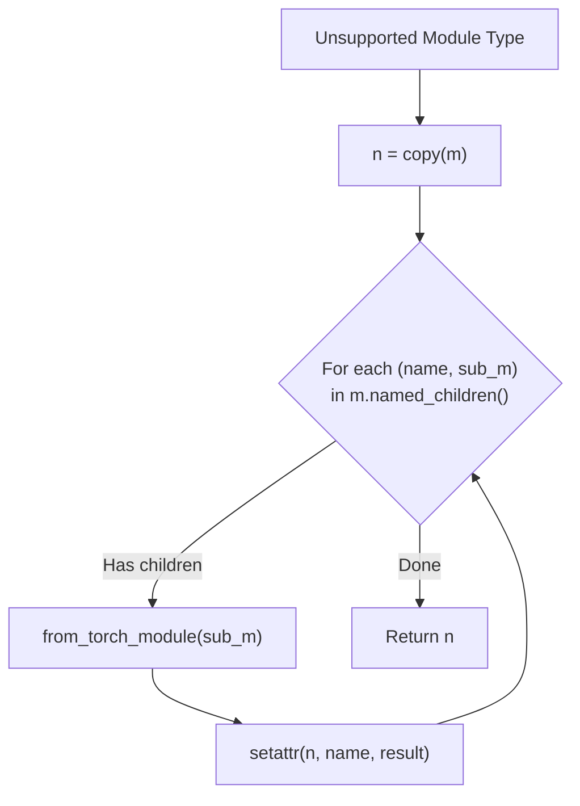
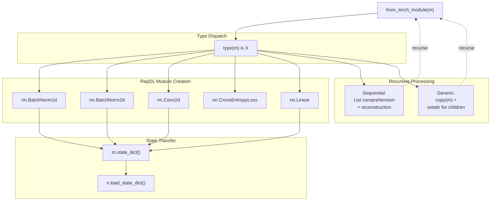

<!-- source: DeepWiki mcp.deepwiki.com · repo microsoft/RepDL · page 4.1 Model Conversion (repdl.from_torch_module) · fetched 2026-10-26 -->

# Model Conversion (repdl.from_torch_module)

<details>
<summary>Relevant source files</summary>

The following files were used as context for generating this wiki page:

- [repdl/__init__.py](repdl/__init__.py)

</details>


## Purpose and Scope

This page documents the `repdl.from_torch_module` function, which serves as the primary entry point for converting existing PyTorch models into their RepDL reproducible equivalents. The function performs type-based conversion of supported layers and recursive traversal of module hierarchies to produce a model that guarantees bitwise identical results across hardware platforms.

For information about the broader conversion API design, see the Overview [1](#1). For details about individual RepDL layer implementations, see Neural Network Modules [4.3](#4.3).

**Sources:** [repdl/__init__.py:15-65]()

---

## Function Signature

```python
def from_torch_module(m: torch.nn.Module) -> torch.nn.Module
```

| Parameter | Type | Description |
|-----------|------|-------------|
| `m` | `torch.nn.Module` | The PyTorch module to convert. Can be a single layer, loss function, or entire model. |
| **Returns** | `torch.nn.Module` | A module with supported layers replaced by RepDL equivalents. Maintains the same architecture structure. |
| **Raises** | `TypeError` | If the input is not a `torch.nn.Module` instance. |

**Sources:** [repdl/__init__.py:15-17]()

---

## Conversion Flow

The conversion process follows a type-dispatch pattern with recursive traversal for nested modules:



**Sources:** [repdl/__init__.py:15-65]()

---

## Supported Layer Types

The following table maps PyTorch layer types to their RepDL equivalents:

| PyTorch Type | RepDL Type | State Transfer | Line Reference |
|--------------|------------|----------------|----------------|
| `torch.nn.BatchNorm1d` | `repdl.nn.BatchNorm1d` | Yes | [18-26]() |
| `torch.nn.BatchNorm2d` | `repdl.nn.BatchNorm2d` | Yes | [27-35]() |
| `torch.nn.Conv2d` | `repdl.nn.Conv2d` | Yes | [36-48]() |
| `torch.nn.CrossEntropyLoss` | `repdl.nn.CrossEntropyLoss` | No | [49-52]() |
| `torch.nn.Linear` | `repdl.nn.Linear` | Yes | [53-55]() |
| `torch.nn.Sequential` | `torch.nn.Sequential` | Recursive | [56-60]() |

**Note:** The function uses exact type matching (`type(m) is`), not `isinstance()` checks. Subclasses of these types will not be converted and will fall through to the generic handler.

**Sources:** [repdl/__init__.py:18-60]()

---

## Layer Conversion Details

### BatchNorm1d Conversion



The conversion extracts configuration parameters from the PyTorch module and creates a RepDL equivalent with identical settings. State transfer includes:
- `weight` parameter (if present)
- `bias` parameter (if present)
- `running_mean` buffer
- `running_var` buffer
- `num_batches_tracked` buffer

**Sources:** [repdl/__init__.py:18-26]()

### BatchNorm2d Conversion

Identical process to BatchNorm1d, but for 2D spatial inputs. The conversion logic [27-35]() mirrors the 1D version exactly.

**Sources:** [repdl/__init__.py:27-35]()

### Conv2d Conversion



State transfer includes:
- `weight` parameter (always present)
- `bias` parameter (if configured)

**Sources:** [repdl/__init__.py:36-48]()

### CrossEntropyLoss Conversion

Unlike layer modules, `CrossEntropyLoss` is stateless and does not require state transfer. The conversion [49-52]() only copies configuration parameters:
- `weight` (class weights)
- `ignore_index`
- `reduction` mode
- `label_smoothing`

**Sources:** [repdl/__init__.py:49-52]()

### Linear Conversion



State transfer includes:
- `weight` parameter (always present)
- `bias` parameter (if configured)

**Sources:** [repdl/__init__.py:53-55]()

---

## Recursive Conversion

### Sequential Container Handling

For `torch.nn.Sequential` modules, the function performs recursive conversion of each child module and reconstructs the Sequential container:



This approach maintains the sequential execution order while replacing individual layers with RepDL equivalents.

**Sources:** [repdl/__init__.py:56-60]()

### Generic Module Handling

For unsupported module types, the function performs a shallow copy and recursively converts all named children:



This strategy allows conversion of custom model architectures (e.g., ResNet, VGG) without explicit support, as long as the leaf layers are supported types.

**Sources:** [repdl/__init__.py:61-64]()

---

## State Transfer Mechanism

State transfer uses PyTorch's standard `state_dict()` and `load_state_dict()` mechanisms:

| Component | Transfer Method | Notes |
|-----------|----------------|-------|
| Parameters | `load_state_dict(m.state_dict())` | Includes `weight` and `bias` tensors |
| Buffers | `load_state_dict(m.state_dict())` | Includes running statistics for BatchNorm |
| Configuration | Constructor arguments | Passed during RepDL module creation |
| Training state | Implicit | `requires_grad` flags preserved in parameters |

The state transfer occurs immediately after module creation [26, 35, 48, 55](), ensuring the RepDL module has identical parameter values to the original PyTorch module.

**Sources:** [repdl/__init__.py:26](), [repdl/__init__.py:35](), [repdl/__init__.py:48](), [repdl/__init__.py:55]()

---

## Type Checking and Error Handling

The function performs strict type checking at entry:

```python
if not isinstance(m, torch.nn.Module):
    raise TypeError
```

This ensures only valid PyTorch modules are processed. The function uses exact type matching (`type(m) is`) rather than `isinstance()` checks, meaning:

- ✅ Exact type matches are converted to RepDL equivalents
- ❌ Subclasses of supported types fall through to generic handling
- ⚠️ Custom modules extending supported types will be shallow-copied, not converted

**Sources:** [repdl/__init__.py:16-17]()

---

## Conversion Patterns

### Complete Model Conversion

For a typical CNN model:
1. Top-level model (unsupported type) → shallow copy
2. Sequential containers → recursive conversion with reconstruction
3. Conv2d, BatchNorm2d, Linear layers → RepDL equivalents with state transfer
4. CrossEntropyLoss criterion → RepDL equivalent without state transfer

### Partial Conversion

The function handles models containing both supported and unsupported layers:
- Supported layers are replaced with RepDL equivalents
- Unsupported layers remain as PyTorch modules
- Reproducibility is guaranteed only for operations passing through RepDL layers

**Sources:** [repdl/__init__.py:56-65]()

---

## Implementation Architecture



The implementation uses a single-pass, type-based dispatch pattern with minimal branching. Each supported type has a dedicated conversion path that:
1. Extracts configuration from the PyTorch module
2. Constructs the RepDL equivalent with identical configuration
3. Transfers state using `load_state_dict()` (for stateful modules)
4. Returns the converted module

**Sources:** [repdl/__init__.py:15-65]()

---

## Limitations and Considerations

### Exact Type Matching

The function uses `type(m) is` rather than `isinstance()`, which means:
- Custom subclasses are not automatically converted
- Monkey-patched modules may not be recognized
- Dynamic type checking is not supported

### Stateless Modules

`CrossEntropyLoss` does not use `load_state_dict()` because loss functions are stateless. This is intentional and does not affect reproducibility.

### Shallow Copy Behavior

For unsupported module types, `copy(m)` creates a shallow copy [62](). This means:
- The module object is copied
- Parameters and buffers reference the same tensors
- Child modules are replaced via `setattr` during recursive conversion

### Sequential Container Reconstruction

`torch.nn.Sequential` is reconstructed using `torch.nn.Sequential(*n)` [60](), not converted to a RepDL-specific Sequential. This maintains compatibility with PyTorch's container APIs.

**Sources:** [repdl/__init__.py:49-52](), [repdl/__init__.py:56-60](), [repdl/__init__.py:61-64]()

---

## Integration with RepDL Ecosystem

The converted modules integrate seamlessly with other RepDL components:

| Component | Integration Point | Description |
|-----------|------------------|-------------|
| `repdl.ops` | Automatic | RepDL layers route operations through the reproducible dispatcher |
| `repdl.optim` | Compatible | Converted models work with `repdl.optim.Adam` optimizer |
| `repdl.utils.get_hash` | Verification | Hash computation works on converted model states |
| PyTorch training loop | Drop-in | Converted models maintain `torch.nn.Module` interface |

The conversion function is imported at the package level [8-12](), making it available as `repdl.from_torch_module`.

**Sources:** [repdl/__init__.py:1-12]()

---

