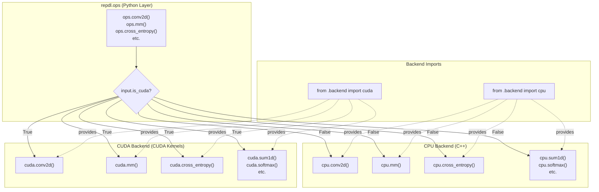
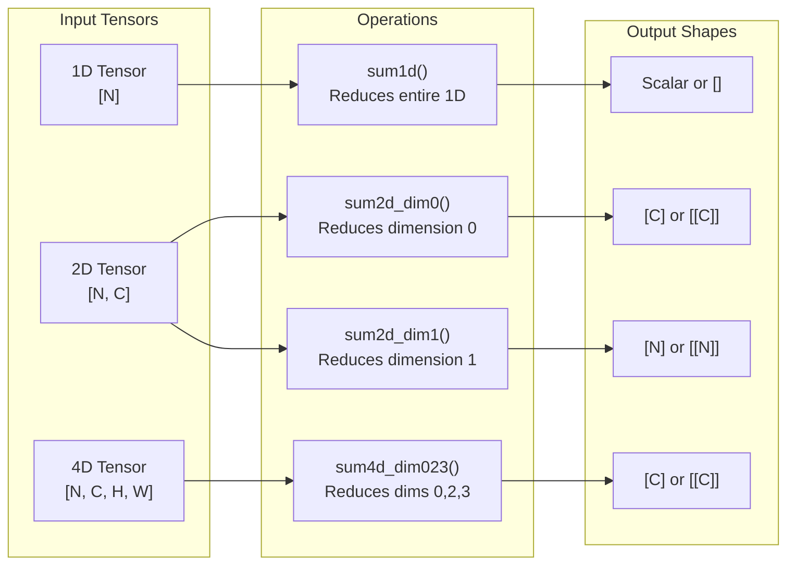
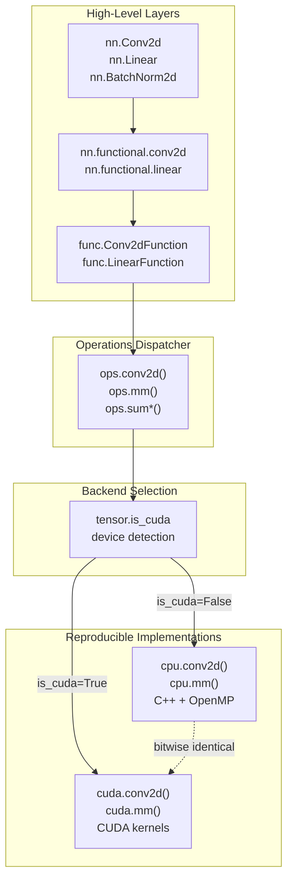

<!-- source: DeepWiki mcp.deepwiki.com · repo microsoft/RepDL · page 4.2 Operations Module (repdl.ops) · fetched 2026-10-26 -->

# Operations Module (repdl.ops)

<details>
<summary>Relevant source files</summary>

The following files were used as context for generating this wiki page:

- [repdl/ops.py](repdl/ops.py)

</details>


The `repdl.ops` module serves as the **central dispatch layer** for all reproducible operations in RepDL. It acts as a device-aware router that examines tensor device placement and forwards operations to the appropriate backend implementation (CPU or CUDA). This module is the critical chokepoint that ensures all computations flow through reproducible backends, enabling bitwise identical results across hardware platforms.

**Scope:** This page documents the dispatch mechanism, operation signatures, and routing behavior. For backend implementations, see [Backend Architecture](#5.1), [CPU Backend](#5.2), and [CUDA Backend](#5.3). For higher-level usage in neural network layers, see [Neural Network Modules](#4.3).

## Dispatch Mechanism

The operations module implements a simple but effective dispatch pattern: each function checks the input tensor's device using `tensor.is_cuda` and routes to either the `cpu` or `cuda` backend module. This ensures that operations execute on the correct hardware with reproducible implementations.

### Dispatch Flow



**Sources:** [repdl/ops.py:1-158]()

### Device Detection Pattern

All dispatching functions follow a consistent pattern:

```python
def operation(input: torch.Tensor, ...) -> torch.Tensor:
    if input.is_cuda:
        return cuda.operation(...)
    else:
        return cpu.operation(...)
```

This pattern ensures:
1. **Single decision point**: Device routing happens once per operation call
2. **Consistent execution path**: Same operation always routes to the same backend for a given device
3. **No fallback logic**: Either CPU or CUDA, determined by input tensor device

**Sources:** [repdl/ops.py:12-26](), [repdl/ops.py:91-95](), [repdl/ops.py:106-112]()

## Operation Categories

The operations module provides three main categories of functions:

| Category | Operations | Purpose |
|----------|-----------|---------|
| **Convolution** | `conv2d`, `conv2d_grad_input`, `conv2d_grad_kernel` | Forward and backward convolution operations for 2D inputs |
| **Linear Algebra** | `mm`, `div`, `sqrt` | Matrix multiplication and element-wise operations |
| **Reduction** | `sum1d`, `sum2d_dim0`, `sum2d_dim1`, `sum4d_dim023` | Summation across specific dimensions with optional averaging |
| **Loss & Activation** | `cross_entropy`, `softmax` | Loss computation and probability distributions |

**Sources:** [repdl/ops.py:1-158]()

## Convolution Operations

### conv2d

Performs 2D convolution on input tensors using filters (weight).

**Signature:**
```python
def conv2d(
    input: torch.Tensor,      # Shape: (N, C_in, H_in, W_in)
    weight: torch.Tensor,     # Shape: (C_out, C_in/groups, K_h, K_w)
    stride: tuple[int, int],  # (stride_h, stride_w)
    padding: tuple[int, int], # (pad_h, pad_w)
    groups: int,              # Number of blocked connections
) -> torch.Tensor:            # Shape: (N, C_out, H_out, W_out)
```

**Dispatch Logic:**
- **CUDA path**: Calls `cuda.conv2d(input, weight, stride[0], stride[1], padding[0], padding[1], groups)`
- **CPU path**: Calls `cpu.conv2d(input, weight, stride[0], stride[1], padding[1], padding[1], groups)`

**Note:** Tuple parameters are unpacked into separate integer arguments for the backend functions.

**Sources:** [repdl/ops.py:12-26]()

### conv2d_grad_input

Computes gradient with respect to input during convolution backward pass.

**Signature:**
```python
def conv2d_grad_input(
    input_shape: tuple[int, ...],  # Original input shape (N, C_in, H_in, W_in)
    weight: torch.Tensor,          # Convolution kernel
    grad_output: torch.Tensor,     # Gradient from next layer
    stride: tuple[int, int],
    padding: tuple[int, int],
) -> torch.Tensor:                 # Gradient w.r.t. input
```

**Dispatch Logic:**
- Device determined by `grad_output.is_cuda`
- Extracts `input_shape[2]` (height) and `input_shape[3]` (width) for backend

**Sources:** [repdl/ops.py:29-57]()

### conv2d_grad_kernel

Computes gradient with respect to convolution kernel (weight) during backward pass.

**Signature:**
```python
def conv2d_grad_kernel(
    input: torch.Tensor,
    weight_shape: tuple[int, ...],  # Original kernel shape
    grad_output: torch.Tensor,
    stride: tuple[int, int],
    padding: tuple[int, int],
) -> torch.Tensor:                  # Gradient w.r.t. kernel
```

**Dispatch Logic:**
- Device determined by `input.is_cuda`
- Extracts `weight_shape[2]` and `weight_shape[3]` (kernel height/width) for backend

**Sources:** [repdl/ops.py:60-88]()

## Linear Algebra Operations

### mm

Performs matrix multiplication with optional transposition.

**Signature:**
```python
def mm(
    input: torch.Tensor,     # First matrix
    mat2: torch.Tensor,      # Second matrix
    transA: bool = False,    # Transpose first matrix?
    transB: bool = False,    # Transpose second matrix?
) -> torch.Tensor:           # Result matrix
```

**Behavior:**
- Computes: `(input^T if transA else input) @ (mat2^T if transB else mat2)`
- Dispatch based on `input.is_cuda`

**Sources:** [repdl/ops.py:106-112]()

### div

Performs element-wise division with special handling for scalar divisors on CUDA.

**Signature:**
```python
def div(
    input: torch.Tensor,
    other: Union[torch.Tensor, float]
) -> torch.Tensor:
```

**Special Behavior:**
- If `other` is a `torch.Tensor` **OR** `input.device == "cpu"`: Directly calls `input.div(other)`
- If `other` is a scalar **AND** `input.is_cuda`: Converts scalar to tensor on same device before division
- This prevents CUDA-specific numerical inconsistencies with scalar division

**Rationale:** PyTorch's CUDA scalar division can produce non-reproducible results. Explicitly converting scalars to device tensors ensures consistent behavior.

**Sources:** [repdl/ops.py:98-103]()

### sqrt

Computes element-wise square root with extended precision.

**Signature:**
```python
def sqrt(input: torch.Tensor) -> torch.Tensor:
```

**Implementation:**
```python
return input.to(dtype=torch.float64).sqrt().to(dtype=torch.float32)
```

**Rationale:** Computing square root in float64 precision then converting back to float32 ensures correctly rounded results, a key reproducibility principle.

**Sources:** [repdl/ops.py:122-123]()

## Reduction Operations

RepDL provides specialized summation functions for different tensor dimensions. Each supports optional `keepdim` (preserve dimensions) and `average` (divide by count) parameters.

### Operation-to-Dimension Mapping



**Sources:** [repdl/ops.py:126-157]()

### sum1d

Sums all elements in a 1D tensor.

**Signature:**
```python
def sum1d(
    input: torch.Tensor,  # Shape: [N]
    average: bool = False # If True, returns mean instead of sum
) -> torch.Tensor:        # Shape: [] (scalar)
```

**Usage:** Primarily used in gradient computations where bias gradients need to be accumulated from batched data.

**Sources:** [repdl/ops.py:126-130]()

### sum2d_dim0

Sums along dimension 0 of a 2D tensor (reduces batch dimension).

**Signature:**
```python
def sum2d_dim0(
    input: torch.Tensor,      # Shape: [N, C]
    keepdim: bool = False,    # If True, output shape is [[C]]
    average: bool = False,    # If True, computes mean
) -> torch.Tensor:            # Shape: [C] or [[C]]
```

**Usage:** BatchNorm statistics calculation, bias gradient accumulation across batch.

**Sources:** [repdl/ops.py:133-139]()

### sum2d_dim1

Sums along dimension 1 of a 2D tensor (reduces feature dimension).

**Signature:**
```python
def sum2d_dim1(
    input: torch.Tensor,      # Shape: [N, C]
    keepdim: bool = False,    # If True, output shape is [[N]]
    average: bool = False,    # If True, computes mean
) -> torch.Tensor:            # Shape: [N] or [[N]]
```

**Sources:** [repdl/ops.py:142-148]()

### sum4d_dim023

Sums along dimensions 0, 2, and 3 of a 4D tensor (reduces batch and spatial dimensions, keeps channels).

**Signature:**
```python
def sum4d_dim023(
    input: torch.Tensor,      # Shape: [N, C, H, W]
    keepdim: bool = False,    # If True, output shape is [[C]]
    average: bool = False,    # If True, computes mean
) -> torch.Tensor:            # Shape: [C] or [[C]]
```

**Usage:** BatchNorm2d statistics calculation - computes per-channel mean/variance across batch and spatial dimensions.

**Sources:** [repdl/ops.py:151-157]()

## Loss and Activation Operations

### cross_entropy

Computes cross-entropy loss for classification tasks.

**Signature:**
```python
def cross_entropy(
    input: torch.Tensor,   # Logits, shape: [N, C]
    target: torch.Tensor,  # Class indices, shape: [N]
) -> torch.Tensor:         # Scalar loss
```

**Behavior:**
- Combines log-softmax and negative log-likelihood loss
- Returns mean loss over batch
- Dispatch based on `input.is_cuda`

**Sources:** [repdl/ops.py:91-95]()

### softmax

Computes softmax probability distribution.

**Signature:**
```python
def softmax(input: torch.Tensor) -> torch.Tensor:
```

**Usage:** Applied along the last dimension to convert logits to probabilities. Used internally by cross-entropy computation.

**Sources:** [repdl/ops.py:115-119]()

## Usage in RepDL Pipeline

The operations module sits at the core of RepDL's execution pipeline:



**Sources:** [repdl/ops.py:1-158]()

## Implementation Details

### Backend Module Imports

The operations module imports backend implementations at the module level:

```python
from .backend import cpu
from .backend import cuda
```

These modules are compiled C++ extensions (via pybind11) that provide the actual reproducible implementations. The `ops` module serves purely as a Python-level router.

**Sources:** [repdl/ops.py:8-9]()

### Argument Transformation

Many operations transform Python-friendly argument types into backend-compatible forms:

| Python Argument | Backend Argument | Transformation |
|-----------------|------------------|----------------|
| `stride: tuple[int, int]` | `stride_h: int, stride_w: int` | Tuple unpacking: `stride[0], stride[1]` |
| `padding: tuple[int, int]` | `pad_h: int, pad_w: int` | Tuple unpacking: `padding[0], padding[1]` |
| `input_shape: tuple[int, ...]` | `height: int, width: int` | Index extraction: `input_shape[2], input_shape[3]` |
| `other: Union[Tensor, float]` | Tensor-only | Type checking and conversion |

This transformation layer allows the Python API to use ergonomic types while backends work with primitive types for performance.

**Sources:** [repdl/ops.py:12-88]()

### Type Annotations

All functions include complete type annotations using Python's `typing` module:

```python
from typing import Union
```

This enables static type checking and improves IDE autocomplete. Return types are consistently `torch.Tensor`.

**Sources:** [repdl/ops.py:4-5]()

## Related Modules

- **[Custom Functions](#4.4)**: `repdl.func` builds on `ops` to create autograd-compatible operations
- **[Functional API](#4.3.5)**: `repdl.nn.functional` uses `ops` through custom autograd functions
- **[CPU Backend](#5.2)**: C++ implementations of operations for CPU execution
- **[CUDA Backend](#5.3)**: CUDA kernel implementations for GPU execution
- **[Adding Custom Operations](#6.1)**: Guide to extending the operations module

**Sources:** [repdl/ops.py:1-158]()

---

