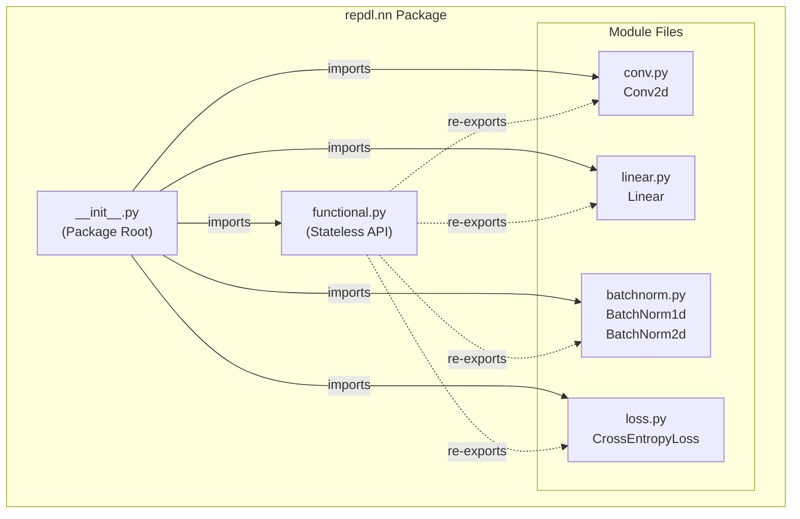
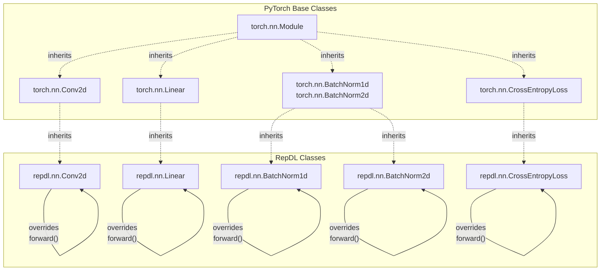
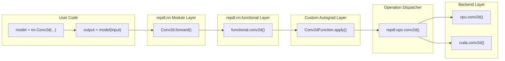
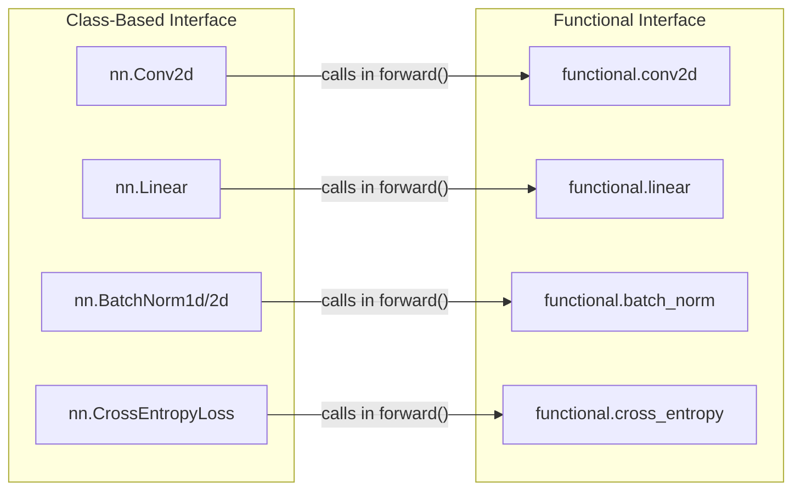

<!-- source: DeepWiki mcp.deepwiki.com · repo microsoft/RepDL · page 4.3 Neural Network Modules (repdl.nn) · fetched 2026-10-26 -->

# Neural Network Modules (repdl.nn)

<details>
<summary>Relevant source files</summary>

The following files were used as context for generating this wiki page:

- [repdl/nn/__init__.py](repdl/nn/__init__.py)
- [repdl/nn/functional.py](repdl/nn/functional.py)

</details>


## Purpose and Scope

The `repdl.nn` package provides PyTorch-compatible neural network building blocks that produce bitwise identical results across hardware platforms. This page provides an overview of the package structure, organization principles, and integration points with RepDL's core reproducibility system.

For detailed documentation of specific layer types, see:
- Convolutional layers: [4.3.1](#4.3.1)
- Linear layers: [4.3.2](#4.3.2)
- Normalization layers: [4.3.3](#4.3.3)
- Loss functions: [4.3.4](#4.3.4)
- Functional API: [4.3.5](#4.3.5)

For information about the custom autograd functions that power these modules, see [Custom Autograd Functions](#3.2). For the underlying operation dispatcher, see [Operations Module](#4.2).

---

## Package Structure

The `repdl.nn` package follows a modular organization pattern that mirrors PyTorch's `torch.nn` design. The package root [repdl/nn/__init__.py:1-9]() serves as the aggregation point for all neural network components.

### Package Hierarchy



**Sources:** [repdl/nn/__init__.py:1-9](), [repdl/nn/functional.py:1-8]()

The package exports two types of interfaces:

1. **Module Classes** (`nn.Module` subclasses): Stateful layers that maintain parameters and buffers
2. **Functional API** (`nn.functional`): Stateless operation functions

---

## Module Organization

The `repdl.nn` package organizes components by layer type, with each module file containing both a class-based interface and corresponding functional implementations.

### Exported Components

The package root [repdl/nn/__init__.py:5-8]() exports the following classes:

| Component | Type | Purpose |
|-----------|------|---------|
| `Conv2d` | Layer | 2D convolution with learnable filters |
| `Linear` | Layer | Fully connected linear transformation |
| `BatchNorm1d` | Layer | 1D batch normalization |
| `BatchNorm2d` | Layer | 2D batch normalization |
| `CrossEntropyLoss` | Loss | Classification loss function |

### Functional API

The `repdl.nn.functional` module [repdl/nn/functional.py:4-7]() provides stateless operation functions:

| Function | Module | Purpose |
|----------|--------|---------|
| `batch_norm` | `batchnorm.py` | Stateless batch normalization |
| `conv2d` | `conv.py` | Stateless 2D convolution |
| `linear` | `linear.py` | Stateless linear transformation |
| `cross_entropy` | `loss.py` | Stateless cross-entropy computation |

**Sources:** [repdl/nn/__init__.py:1-9](), [repdl/nn/functional.py:1-8]()

---

## PyTorch Compatibility

RepDL's neural network modules inherit from PyTorch base classes to maintain API compatibility. This design allows existing PyTorch models to be converted to RepDL with minimal code changes.

### Class Inheritance Pattern



**Key Design Principles:**

1. **Interface Preservation**: RepDL modules accept the same constructor parameters as their PyTorch counterparts
2. **Forward Override**: The `forward()` method is overridden to route computations through reproducible operations
3. **State Compatibility**: Parameters and buffers use PyTorch tensors, enabling seamless state transfer via `from_torch_module` (see [Model Conversion](#4.1))

**Sources:** Based on architectural patterns from high-level diagrams and [repdl/nn/__init__.py:5-8]()

---

## Integration with RepDL Core

The `repdl.nn` modules integrate with RepDL's reproducibility infrastructure through a three-layer delegation pattern.

### Operation Flow Architecture



**Delegation Responsibilities:**

1. **Module Layer** (`nn.Conv2d`, `nn.Linear`, etc.): Manages parameters, buffers, and training/evaluation modes
2. **Functional Layer** (`nn.functional.conv2d`, etc.): Provides stateless operation interface
3. **Autograd Layer** (Custom `Function` classes): Controls gradient computation for reproducibility
4. **Operations Layer** (`repdl.ops`): Dispatches to device-specific backends
5. **Backend Layer** (CPU/CUDA): Executes reproducible low-level operations

This architecture ensures that **all computations flow through the reproducible operation dispatcher** [repdl.ops](#4.2), which is the critical chokepoint for achieving bitwise identical results.

**Sources:** Based on Diagram 2 (Operation Dispatch Flow) from high-level architecture

---

## Module-Functional Correspondence

Each `nn.Module` class has a corresponding functional implementation that performs the actual computation. This separation follows PyTorch's design pattern.

### Mapping Table



**Usage Pattern:**

- **Stateful operations**: Use module classes (e.g., `nn.Conv2d`) to maintain learnable parameters
- **Stateless operations**: Use functional API (e.g., `functional.conv2d`) when parameters are provided externally
- **Gradient computation**: Both interfaces produce reproducible gradients through custom autograd functions

**Sources:** [repdl/nn/__init__.py:4-8](), [repdl/nn/functional.py:4-7]()

---

## Available Components Summary

The table below summarizes all components currently available in `repdl.nn`:

| Component | Import Path | Type | Documentation |
|-----------|-------------|------|---------------|
| `Conv2d` | `repdl.nn.Conv2d` | Layer | [4.3.1](#4.3.1) |
| `Linear` | `repdl.nn.Linear` | Layer | [4.3.2](#4.3.2) |
| `BatchNorm1d` | `repdl.nn.BatchNorm1d` | Layer | [4.3.3](#4.3.3) |
| `BatchNorm2d` | `repdl.nn.BatchNorm2d` | Layer | [4.3.3](#4.3.3) |
| `CrossEntropyLoss` | `repdl.nn.CrossEntropyLoss` | Loss | [4.3.4](#4.3.4) |
| `functional` | `repdl.nn.functional` | Module | [4.3.5](#4.3.5) |

### Import Examples

```python
# Import individual components
from repdl.nn import Conv2d, Linear, BatchNorm2d, CrossEntropyLoss

# Import functional API
from repdl.nn import functional as F

# Import entire package
import repdl.nn as nn
```

**Sources:** [repdl/nn/__init__.py:1-9](), [repdl/nn/functional.py:1-8]()

---

## Design Rationale

The `repdl.nn` package design achieves three key objectives:

1. **PyTorch Compatibility**: Inheriting from PyTorch base classes enables drop-in replacement and state transfer via `from_torch_module` (see [4.1](#4.1))

2. **Reproducibility Enforcement**: Routing all computations through custom autograd functions (see [3.2](#3.2)) and the operation dispatcher (see [4.2](#4.2)) ensures bitwise identical results

3. **Modular Organization**: Separating concerns across module/functional/autograd/ops layers maintains clear architectural boundaries and enables independent testing

This design allows RepDL to provide **familiar PyTorch-style APIs while guaranteeing reproducible results** across different hardware platforms.

**Sources:** Based on architectural patterns from high-level diagrams and [repdl/nn/__init__.py:1-9]()

---

