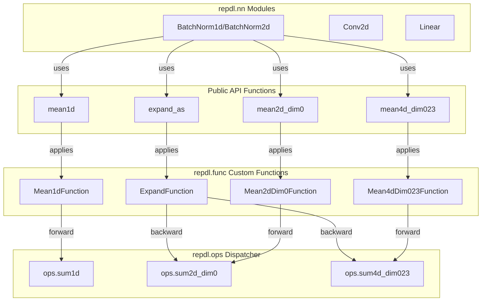
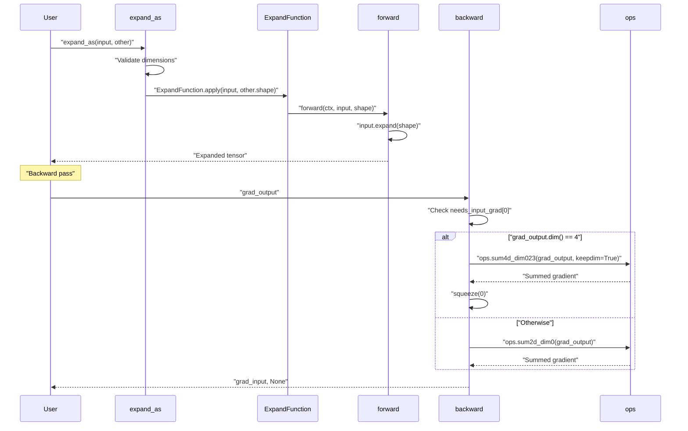
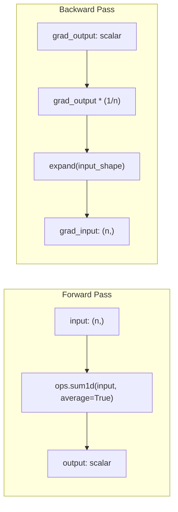
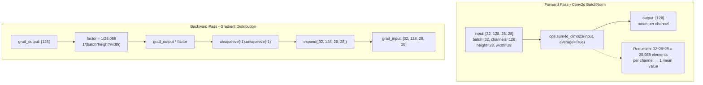
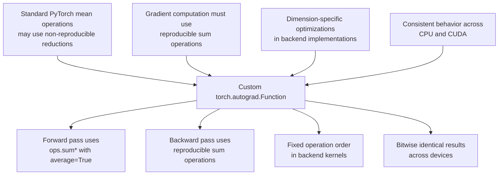
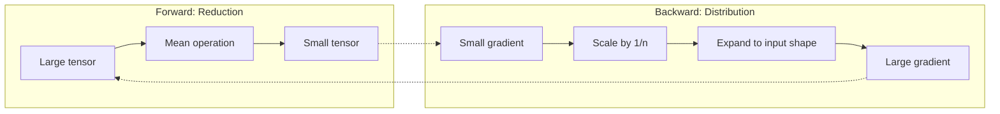

<!-- source: DeepWiki mcp.deepwiki.com · repo microsoft/RepDL · page 4.4 Custom Functions (repdl.func) · fetched 2026-10-26 -->

# Custom Functions (repdl.func)

<details>
<summary>Relevant source files</summary>

The following files were used as context for generating this wiki page:

- [repdl/func.py](repdl/func.py)

</details>


## Purpose and Scope

The `repdl.func` module provides custom autograd functions that implement reproducible forward and backward passes for specific tensor operations. These functions serve as building blocks for higher-level neural network modules in `repdl.nn`, ensuring that gradient computation remains bitwise identical across hardware platforms.

This page documents the custom autograd functions available in `repdl.func`, their implementation details, and how they integrate with the operation dispatcher. For information about the neural network modules that use these functions, see [Neural Network Modules (repdl.nn)](#4.3). For details about the underlying operations, see [Operations Module (repdl.ops)](#4.2). For a conceptual overview of custom autograd functions, see [Custom Autograd Functions](#3.2).

**Sources**: [repdl/func.py:1-122]()

---

## Module Architecture

The `repdl.func` module sits between the high-level `repdl.nn` modules and the low-level `repdl.ops` dispatcher. Each custom function implements a `torch.autograd.Function` subclass that defines reproducible forward and backward passes using operations from `repdl.ops`.



### Module Organization

**Sources**: [repdl/func.py:1-122]()

| Component | Type | Lines | Purpose |
|-----------|------|-------|---------|
| `ExpandFunction` | Autograd class | 11-31 | Custom expand operation with sum-based gradient |
| `expand_as` | Public API | 33-44 | Validates dimensions and applies `ExpandFunction` |
| `Mean1dFunction` | Autograd class | 47-65 | Mean reduction for 1D tensors |
| `mean1d` | Public API | 67-69 | Validates dimension and applies `Mean1dFunction` |
| `Mean2dDim0Function` | Autograd class | 72-91 | Mean reduction over dim 0 for 2D tensors |
| `mean2d_dim0` | Public API | 93-95 | Validates dimension and applies `Mean2dDim0Function` |
| `Mean4dDim023Function` | Autograd class | 98-117 | Mean reduction over dims 0,2,3 for 4D tensors |
| `mean4d_dim023` | Public API | 119-121 | Validates dimension and applies `Mean4dDim023Function` |

---

## expand_as

### Overview

The `expand_as` function broadcasts a tensor to match the shape of another tensor, supporting specific dimension patterns used in neural network operations. It implements custom gradient computation that sums gradients along expanded dimensions.

**Sources**: [repdl/func.py:33-44]()

### Function Signature

```python
def expand_as(input: torch.Tensor, other: torch.Tensor) -> torch.Tensor
```

| Parameter | Type | Description |
|-----------|------|-------------|
| `input` | `torch.Tensor` | Input tensor to expand |
| `other` | `torch.Tensor` | Target tensor whose shape to match |
| **Returns** | `torch.Tensor` | Expanded tensor with shape matching `other` |

### Supported Dimension Patterns

The function supports two specific expansion patterns:

1. **1D to 2D expansion**: `(n,) → (?, n)`
   - Input shape: `[n]`
   - Output shape: `[batch, n]`
   - Use case: Expanding bias vectors in linear layers

2. **3D to 4D expansion**: `(n, 1, 1) → (?, n, ?, ?)`
   - Input shape: `[n, 1, 1]`
   - Output shape: `[batch, n, height, width]`
   - Use case: Expanding BatchNorm statistics in convolutional layers

**Sources**: [repdl/func.py:33-44]()

### ExpandFunction Implementation



**Sources**: [repdl/func.py:11-31]()

#### Forward Pass

The forward pass [repdl/func.py:13-18]() simply calls PyTorch's native `tensor.expand()` method, which creates a view with broadcasted dimensions. No actual data copying occurs; the tensor shares storage with the input.

#### Backward Pass

The backward pass [repdl/func.py:21-30]() implements gradient accumulation:

- **For 4D tensors** (convolutional case): Uses `ops.sum4d_dim023` to sum over batch, height, and width dimensions, then squeezes the batch dimension
- **For 2D tensors** (linear case): Uses `ops.sum2d_dim0` to sum over the batch dimension

This ensures gradients are correctly accumulated along the expanded dimensions using reproducible sum operations.

---

## mean1d

### Overview

The `mean1d` function computes the mean of all elements in a 1D tensor with reproducible gradients. This operation is used in neural network layers that require averaging over feature dimensions.

**Sources**: [repdl/func.py:67-69]()

### Function Signature

```python
def mean1d(input: torch.Tensor) -> torch.Tensor
```

| Parameter | Type | Description |
|-----------|------|-------------|
| `input` | `torch.Tensor` | 1D tensor to compute mean over |
| **Returns** | `torch.Tensor` | Scalar tensor containing the mean value |

### Dimension Requirements

- Input must be 1-dimensional (`input.dim() == 1`)
- Raises `AssertionError` if dimension requirement is violated

**Sources**: [repdl/func.py:67-69]()

### Mean1dFunction Implementation



**Sources**: [repdl/func.py:47-65]()

#### Forward Pass

[repdl/func.py:49-53]()

1. Saves `input.shape` in the context for backward pass
2. Calls `ops.sum1d(input, average=True)` to compute the mean using reproducible summation
3. Returns a scalar tensor

#### Backward Pass

[repdl/func.py:56-64]()

1. Retrieves the saved input shape from context
2. Computes scaling factor: `1 / input_shape.numel()`
3. Multiplies `grad_output` by the scaling factor
4. Expands the result to match the input shape
5. Ensures the gradient is contiguous in memory

The gradient formula follows the mathematical derivative: ∂(mean(x))/∂x_i = 1/n for all elements.

---

## mean2d_dim0

### Overview

The `mean2d_dim0` function computes the mean over dimension 0 of a 2D tensor, preserving dimension 1. This operation is commonly used in BatchNorm for computing per-feature statistics across batches.

**Sources**: [repdl/func.py:93-95]()

### Function Signature

```python
def mean2d_dim0(input: torch.Tensor) -> torch.Tensor
```

| Parameter | Type | Description |
|-----------|------|-------------|
| `input` | `torch.Tensor` | 2D tensor with shape `[batch, features]` |
| **Returns** | `torch.Tensor` | 1D tensor with shape `[features]` containing means |

### Dimension Requirements

- Input must be 2-dimensional (`input.dim() == 2`)
- Raises `AssertionError` if dimension requirement is violated

**Sources**: [repdl/func.py:93-95]()

### Mean2dDim0Function Implementation


**Sources**: [repdl/func.py:72-91]()

#### Forward Pass

[repdl/func.py:74-78]()

1. Saves `input.shape` for gradient computation
2. Calls `ops.sum2d_dim0(input, average=True)` to compute per-feature means
3. Returns a 1D tensor with one mean value per feature

#### Backward Pass

[repdl/func.py:81-90]()

1. Computes the reduction factor: `batch_size = input_shape.numel() // grad_output.numel()`
2. Scales the gradient by `1 / batch_size`
3. Uses `unsqueeze(-1)` to add a dimension
4. Expands the gradient to match the original input shape

This distributes the gradient evenly across all batch elements for each feature.

---

## mean4d_dim023

### Overview

The `mean4d_dim023` function computes the mean over dimensions 0, 2, and 3 of a 4D tensor, preserving dimension 1 (channels). This operation is specifically designed for BatchNorm in convolutional networks, where statistics are computed across batch, height, and width dimensions.

**Sources**: [repdl/func.py:119-121]()

### Function Signature

```python
def mean4d_dim023(input: torch.Tensor) -> torch.Tensor
```

| Parameter | Type | Description |
|-----------|------|-------------|
| `input` | `torch.Tensor` | 4D tensor with shape `[batch, channels, height, width]` |
| **Returns** | `torch.Tensor` | 1D tensor with shape `[channels]` containing means |

### Dimension Requirements

- Input must be 4-dimensional (`input.dim() == 4`)
- Raises `AssertionError` if dimension requirement is violated

**Sources**: [repdl/func.py:119-121]()

### Mean4dDim023Function Implementation



**Sources**: [repdl/func.py:98-117]()

#### Forward Pass

[repdl/func.py:100-104]()

1. Saves `input.shape` for backward computation
2. Calls `ops.sum4d_dim023(input, average=True)` to compute per-channel means across spatial and batch dimensions
3. Returns a 1D tensor with one mean value per channel

#### Backward Pass

[repdl/func.py:107-116]()

1. Computes the total reduction factor: `(batch × height × width) = input_shape.numel() // grad_output.numel()`
2. Scales the gradient by `1 / factor`
3. Uses two `unsqueeze(-1)` operations to restore spatial dimensions
4. Expands the gradient to match the original 4D input shape

This distributes the gradient uniformly across all spatial locations and batch elements for each channel.

---

## Integration with repdl.ops

All custom functions in this module delegate to operations in `repdl.ops` to ensure reproducibility. The following table shows the mapping between custom functions and ops operations:

| Custom Function | Forward Operation | Backward Operation(s) |
|----------------|-------------------|----------------------|
| `ExpandFunction` | Native `expand()` | `ops.sum2d_dim0`, `ops.sum4d_dim023` |
| `Mean1dFunction` | `ops.sum1d(average=True)` | Native `expand()` + scalar multiplication |
| `Mean2dDim0Function` | `ops.sum2d_dim0(average=True)` | Native `unsqueeze()` + `expand()` |
| `Mean4dDim023Function` | `ops.sum4d_dim023(average=True)` | Native `unsqueeze()` + `expand()` |

**Sources**: [repdl/func.py:1-122]()

### Why Custom Functions Are Needed



**Sources**: [repdl/func.py:1-122]()

---

## Usage Patterns

### In Neural Network Modules

Custom functions from `repdl.func` are primarily used internally by `repdl.nn` modules. The most common usage pattern is in BatchNorm layers:

```python
# From repdl.nn.batchnorm module (conceptual)
from repdl.func import mean2d_dim0, mean4d_dim023, expand_as

# Compute batch statistics for 2D input (BatchNorm1d)
batch_mean = mean2d_dim0(input)  # [batch, features] -> [features]
batch_var = mean2d_dim0((input - batch_mean) ** 2)

# Compute batch statistics for 4D input (BatchNorm2d)
batch_mean = mean4d_dim023(input)  # [batch, channels, H, W] -> [channels]
batch_var = mean4d_dim023((input - batch_mean) ** 2)

# Expand running statistics to match input shape
mean_expanded = expand_as(running_mean, input)  # [channels] -> [batch, channels, H, W]
```

**Sources**: [repdl/func.py:33-44](), [repdl/func.py:93-95](), [repdl/func.py:119-121]()

### Direct Usage

While primarily internal, these functions can be used directly when implementing custom layers:

```python
import torch
from repdl.func import mean1d, mean2d_dim0, mean4d_dim023, expand_as

# Example: Custom normalization layer
class CustomNorm(torch.nn.Module):
    def forward(self, x):
        if x.dim() == 2:
            mean = mean2d_dim0(x)
        elif x.dim() == 4:
            mean = mean4d_dim023(x)
        
        # Expand mean to match input
        mean_expanded = expand_as(mean, x)
        
        return x - mean_expanded
```

**Sources**: [repdl/func.py:1-122]()

---

## Implementation Details

### Context Management

All autograd functions use PyTorch's context object (`ctx`) to pass information from forward to backward:

| Function | Saved Context | Purpose |
|----------|---------------|---------|
| `ExpandFunction` | None | Shape is passed as argument |
| `Mean1dFunction` | `input_shape` | Compute gradient scaling factor |
| `Mean2dDim0Function` | `input_shape` | Compute reduction factor and expansion shape |
| `Mean4dDim023Function` | `input_shape` | Compute reduction factor and expansion shape |

**Sources**: [repdl/func.py:11-122]()

### Gradient Computation Strategy



**Sources**: [repdl/func.py:47-122]()

The gradient distribution follows this pattern for all mean functions:
1. Scale the incoming gradient by the reciprocal of the reduction factor
2. Expand the scaled gradient to match the original input shape
3. Ensure the result is contiguous (for `mean1d`) or properly broadcasted

### Reproducibility Guarantees

Each function ensures reproducibility through:

1. **Forward pass**: Delegates to `ops.sum*` functions with `average=True`, which use reproducible summation algorithms
2. **Backward pass**: 
   - For `ExpandFunction`: Uses `ops.sum*` functions to accumulate gradients
   - For mean functions: Uses exact floating-point arithmetic (scaling by 1/n) followed by native expand operations that don't perform computation

**Sources**: [repdl/func.py:1-122]()

---

## Error Handling

### Dimension Validation

All functions perform strict dimension checking:

| Function | Validation | Error Type |
|----------|-----------|------------|
| `expand_as` | Specific patterns: `(n,)→(?,n)` or `(n,1,1)→(?,n,?,?)` | `NotImplementedError` |
| `mean1d` | `input.dim() == 1` | `AssertionError` |
| `mean2d_dim0` | `input.dim() == 2` | `AssertionError` |
| `mean4d_dim023` | `input.dim() == 4` | `AssertionError` |

**Sources**: [repdl/func.py:33-44](), [repdl/func.py:67-69](), [repdl/func.py:93-95](), [repdl/func.py:119-121]()

### expand_as Validation Logic

The `expand_as` function has the most complex validation [repdl/func.py:35-43]():

```python
if not (
    input.dim() == 1 and other.dim() == 2 and input.shape[-1] == other.shape[-1]
) and not (
    input.dim() == 3
    and other.dim() == 4
    and input.shape[-3] == other.shape[-3]
    and input.shape[-2] == input.shape[-1] == 1
):
    raise NotImplementedError
```

This ensures only supported dimension patterns are used, preventing undefined behavior.

**Sources**: [repdl/func.py:35-43]()

---

