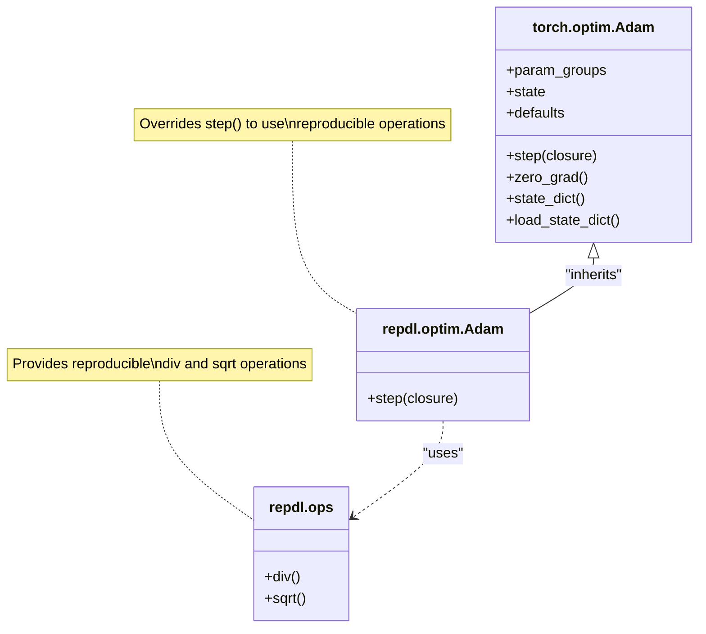
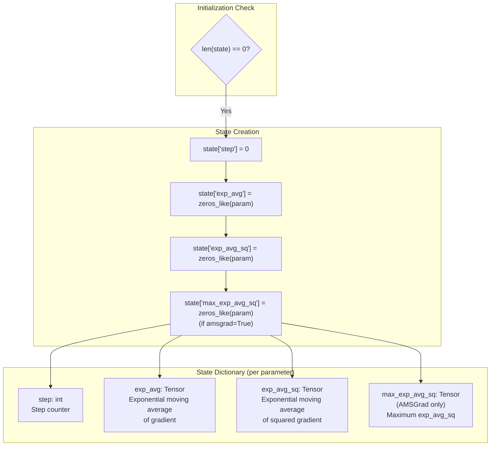
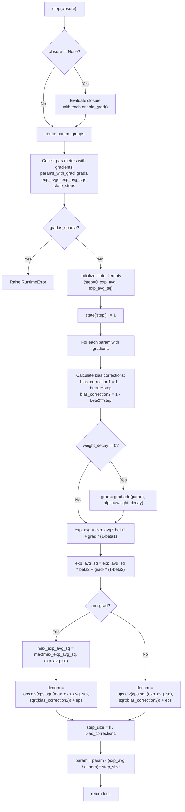
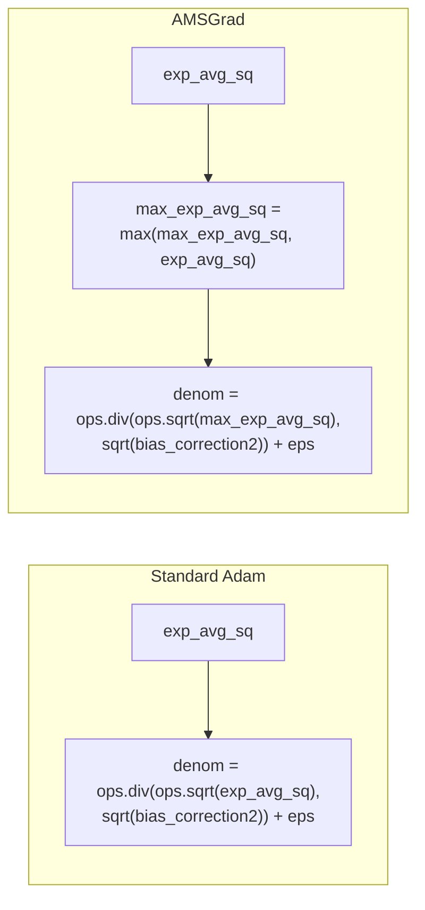

<!-- source: DeepWiki mcp.deepwiki.com · repo microsoft/RepDL · page 4.5 Optimizers (repdl.optim) · fetched 2026-10-26 -->

# Optimizers (repdl.optim)

<details>
<summary>Relevant source files</summary>

The following files were used as context for generating this wiki page:

- [repdl/optim.py](repdl/optim.py)

</details>


The `repdl.optim` module provides reproducible optimizer implementations that ensure bitwise identical parameter updates across different hardware platforms. Currently, it contains a single optimizer: `Adam`, which extends PyTorch's standard Adam optimizer by routing critical operations through RepDL's reproducible backend.

For information about the operations used by the optimizer, see [Operations Module (repdl.ops)](#4.2). For information about training workflows and verification, see [Reproducibility Verification](#3.3).

**Sources:** [repdl/optim.py:1-86]()

---

## Class Hierarchy

The `repdl.optim.Adam` class inherits from `torch.optim.Adam`, preserving the PyTorch optimizer interface while overriding the `step` method to use reproducible operations.



**Sources:** [repdl/optim.py:11-11](), [repdl/optim.py:8-8]()

---

## Parameters

The `Adam` optimizer accepts the same parameters as PyTorch's `torch.optim.Adam`. These parameters are passed to the parent class constructor during initialization.

| Parameter | Type | Default | Description |
|-----------|------|---------|-------------|
| `params` | iterable | required | Iterable of parameters to optimize or parameter groups |
| `lr` | float | 1e-3 | Learning rate |
| `betas` | Tuple[float, float] | (0.9, 0.999) | Coefficients for computing running averages of gradient and its square |
| `eps` | float | 1e-8 | Term added to denominator to improve numerical stability |
| `weight_decay` | float | 0 | Weight decay (L2 penalty) |
| `amsgrad` | bool | False | Whether to use the AMSGrad variant |

**Sources:** [repdl/optim.py:11-11]()

---

## State Management

The optimizer maintains state for each parameter being optimized. State initialization occurs during the first call to `step()` for each parameter.



State initialization logic:
- **Step counter**: Initialized to 0, incremented before each parameter update
- **Exponential averages**: Initialized to zero tensors matching parameter shape and memory format
- **Memory format preservation**: Uses `torch.preserve_format` to maintain the parameter's memory layout

**Sources:** [repdl/optim.py:34-52]()

---

## The step() Method

The `step()` method implements the Adam optimization algorithm with reproducible operations. It is decorated with `@torch.no_grad()` to disable gradient computation during parameter updates.

### Method Signature

```python
@torch.no_grad()
def step(self, closure=None) -> Optional[torch.Tensor]
```

**Parameters:**
- `closure` (callable, optional): A closure that reevaluates the model and returns the loss. Used for optimizers that require multiple function evaluations.

**Returns:**
- Loss value if closure is provided, otherwise `None`

**Sources:** [repdl/optim.py:12-13]()

---

## Parameter Update Flow

The following diagram shows the complete flow of operations during a single optimization step:



**Sources:** [repdl/optim.py:13-85]()

---

## Reproducible Operations

The key difference between `repdl.optim.Adam` and `torch.optim.Adam` is the use of reproducible operations for division and square root calculations. These operations ensure bitwise identical results across different hardware platforms.

### Operations Used

| Operation | Function Call | Purpose | Location |
|-----------|--------------|---------|----------|
| Square root | `ops.sqrt()` | Compute square root of second moment estimate | [repdl/optim.py:76](), [repdl/optim.py:80]() |
| Division | `ops.div()` | Divide square root by bias correction | [repdl/optim.py:75-77](), [repdl/optim.py:79-81]() |

### Code Comparison

**Standard PyTorch Adam:**
```python
denom = (exp_avg_sq.sqrt() / math.sqrt(bias_correction2)).add_(eps)
```

**RepDL Adam:**
```python
denom = ops.div(ops.sqrt(exp_avg_sq), math.sqrt(bias_correction2)).add_(eps)
```

The reproducible operations route computations through RepDL's backend implementations, which maintain:
- Fixed floating-point operation order
- IEEE-754 compliance
- Correctly rounded results

**Sources:** [repdl/optim.py:75-83](), [repdl/optim.py:8-8]()

---

## Computation Details

### Bias Correction

Adam uses bias correction to account for the initialization of moment estimates at zero:

| Correction | Formula | Purpose |
|------------|---------|---------|
| `bias_correction1` | `1 - beta1 ** step` | Corrects first moment (mean) estimate |
| `bias_correction2` | `1 - beta2 ** step` | Corrects second moment (variance) estimate |

**Sources:** [repdl/optim.py:61-62]()

### Moment Updates

The exponential moving averages are updated using the following formulas:

**First moment (mean of gradients):**
```
exp_avg = exp_avg * beta1 + grad * (1 - beta1)
```

**Second moment (uncentered variance of gradients):**
```
exp_avg_sq = exp_avg_sq * beta2 + (grad * grad) * (1 - beta2)
```

**Sources:** [repdl/optim.py:68-69]()

### Parameter Update

The final parameter update combines the bias-corrected moments:

```
step_size = learning_rate / bias_correction1
param = param - (exp_avg / denom) * step_size
```

where `denom` is the bias-corrected and stabilized second moment estimate.

**Sources:** [repdl/optim.py:82-83]()

---

## AMSGrad Variant

When `amsgrad=True`, the optimizer maintains the maximum of all second moment estimates:



This variant ensures the denominator is monotonically non-decreasing, which can improve convergence in some scenarios.

**Sources:** [repdl/optim.py:71-77]()

---

## Differences from torch.optim.Adam

| Aspect | torch.optim.Adam | repdl.optim.Adam |
|--------|------------------|------------------|
| **Base implementation** | PyTorch native | Inherits from `torch.optim.Adam` |
| **Division operation** | Standard PyTorch `/` operator | `ops.div()` for reproducible division |
| **Square root operation** | `.sqrt()` method | `ops.sqrt()` for reproducible square root |
| **Reproducibility** | Not guaranteed across devices | Bitwise identical across CPU/CUDA |
| **API compatibility** | Full PyTorch API | Full PyTorch API (compatible interface) |
| **Sparse gradients** | Supported (use SparseAdam) | Not supported (raises RuntimeError) |
| **Performance** | Optimized for speed | Optimized for reproducibility |

**Sources:** [repdl/optim.py:11](), [repdl/optim.py:29-32](), [repdl/optim.py:75-81]()

---

## Usage Example

Basic usage follows the standard PyTorch optimizer pattern:

```python
import torch
import repdl

# Create model and convert to reproducible version
model = torch.nn.Linear(10, 1)
model = repdl.from_torch_module(model)

# Create reproducible Adam optimizer
optimizer = repdl.optim.Adam(model.parameters(), lr=0.001)

# Training loop
for input, target in dataloader:
    optimizer.zero_grad()
    output = model(input)
    loss = criterion(output, target)
    loss.backward()
    optimizer.step()
```

### Verification Example

To verify reproducibility of optimizer updates:

```python
import repdl.utils as utils

# Get hash before training
hash_before = utils.get_hash(model)

# Train for N steps
for _ in range(100):
    optimizer.zero_grad()
    loss = model(input).mean()
    loss.backward()
    optimizer.step()

# Get hash after training
hash_after = utils.get_hash(model)

# Hash should be identical across runs and devices
print(f"Model hash after 100 steps: {hash_after}")
```

The resulting hash will be bitwise identical when running the same code on different hardware (CPU, different GPU models), assuming identical initial states and inputs.

**Sources:** [repdl/optim.py:11-85]()

---

## Limitations

### Sparse Gradients Not Supported

The optimizer explicitly checks for sparse gradients and raises an error:

```python
if p.grad.is_sparse:
    raise RuntimeError(
        "Adam does not support sparse gradients, please consider SparseAdam instead"
    )
```

For models with sparse gradients, use PyTorch's `torch.optim.SparseAdam` instead (note: this will not provide reproducibility guarantees).

**Sources:** [repdl/optim.py:29-32]()

---

## Implementation Notes

### Memory Format Preservation

State tensors are created using `torch.preserve_format` to maintain the same memory layout as the parameters being optimized:

```python
state["exp_avg"] = torch.zeros_like(p, memory_format=torch.preserve_format)
state["exp_avg_sq"] = torch.zeros_like(p, memory_format=torch.preserve_format)
```

This ensures efficient memory access patterns and prevents unnecessary memory format conversions.

**Sources:** [repdl/optim.py:37-42]()

### Weight Decay Application

Weight decay is applied by adding the parameter itself to the gradient:

```python
if weight_decay != 0:
    grad = grad.add(param, alpha=weight_decay)
```

This is equivalent to L2 regularization and occurs before moment updates.

**Sources:** [repdl/optim.py:64-66]()

---

## Related Documentation

- For details on `ops.div` and `ops.sqrt` implementations, see [Operations Module (repdl.ops)](#4.2)
- For backend implementation of reproducible operations, see [Backend Architecture](#5.1)
- For information about CPU-specific implementations, see [CPU Backend](#5.2)
- For information about CUDA-specific implementations, see [CUDA Backend](#5.3)
- For general reproducibility verification, see [Reproducibility Verification](#3.3)

---

