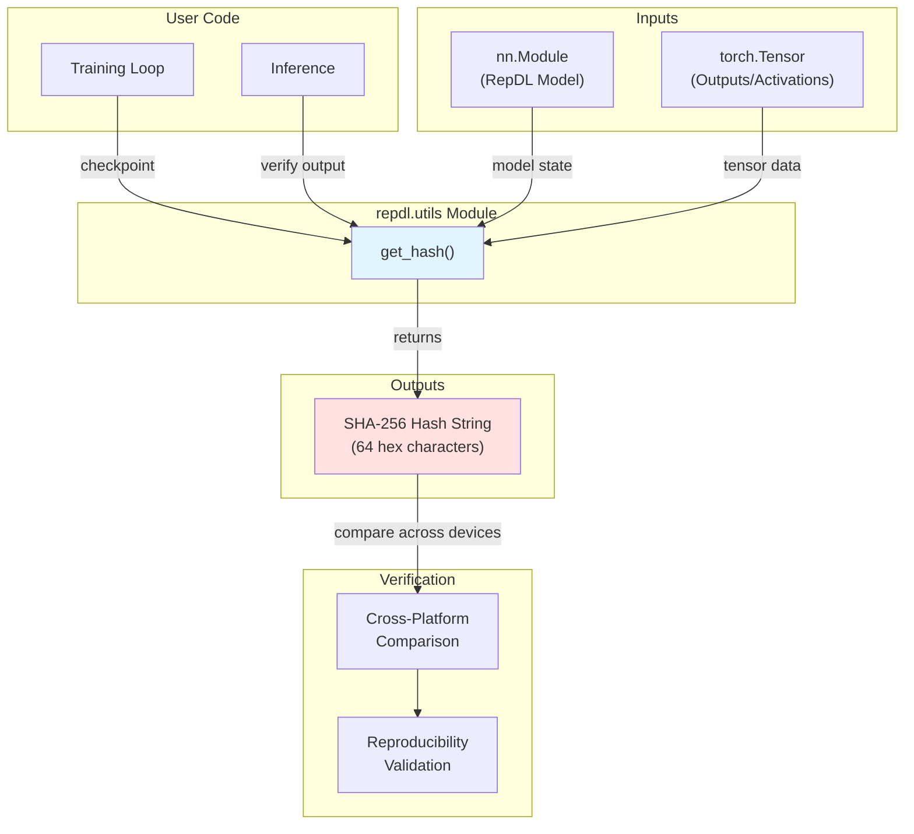
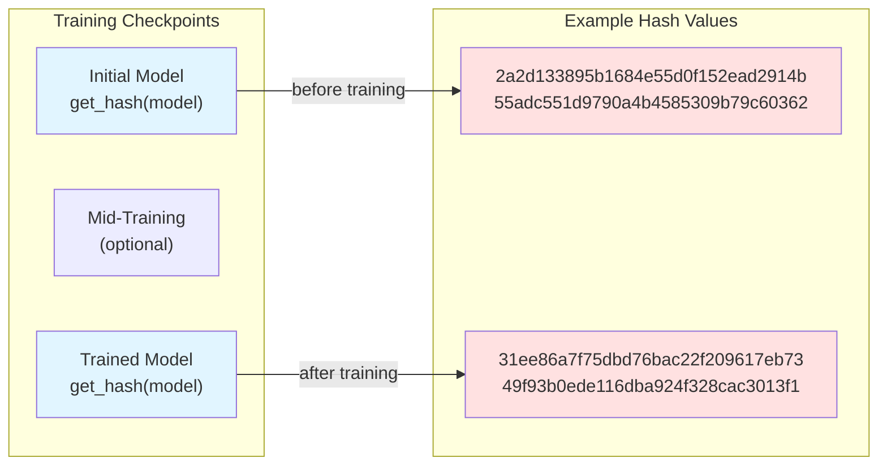
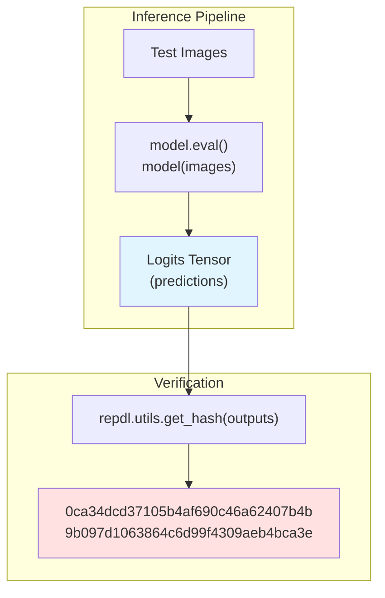
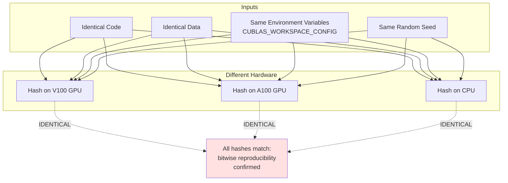
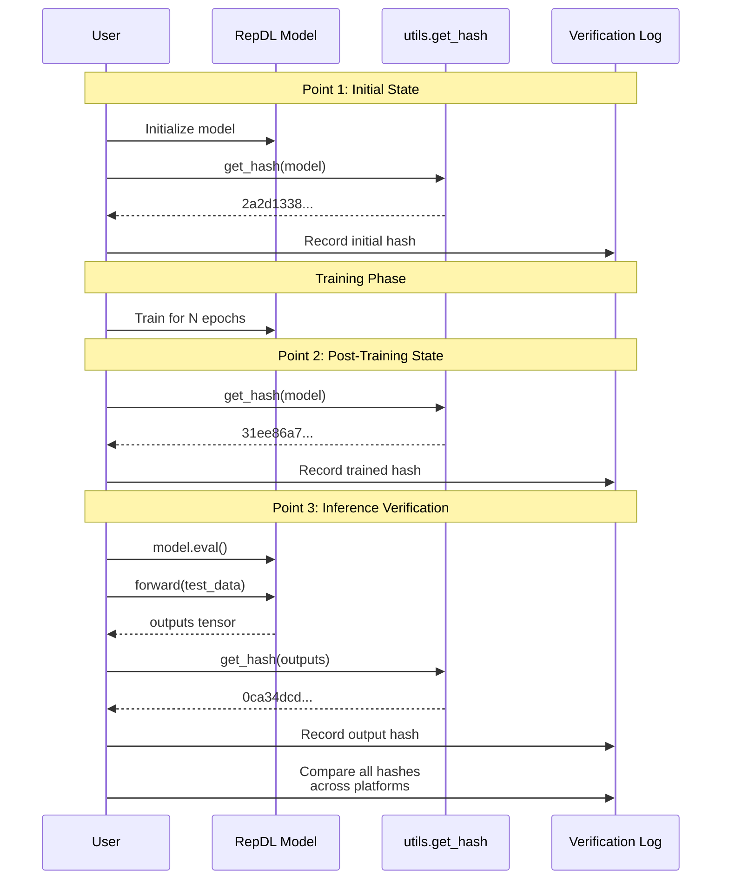
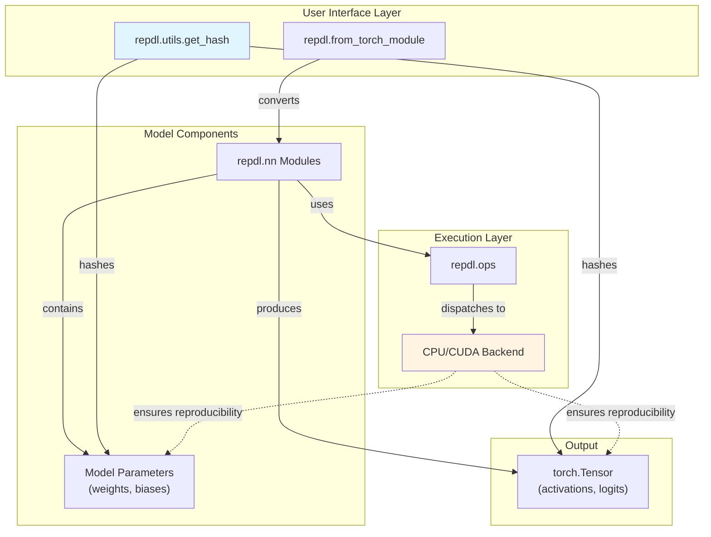

<!-- source: DeepWiki mcp.deepwiki.com · repo microsoft/RepDL · page 4.6 Utilities (repdl.utils) · fetched 2026-10-26 -->

# Utilities (repdl.utils)

<details>
<summary>Relevant source files</summary>

The following files were used as context for generating this wiki page:

- [README.md](README.md)
- [examples/mnist_trainig.py](examples/mnist_trainig.py)

</details>


## Purpose and Scope

The `repdl.utils` module provides utility functions for verifying reproducibility in RepDL. The primary function is `get_hash`, which computes cryptographic hashes of model states and tensor outputs to enable bitwise comparison across different hardware platforms and execution environments.

This page documents the utility functions available in `repdl.utils`. For the broader reproducibility verification workflow and how to interpret results, see [Reproducibility Verification](#3.3). For the complete training workflow that uses these utilities, see [MNIST Training Example](#2.3).

**Sources:** [README.md:1-65](), [examples/mnist_trainig.py:1-115]()

---

## Overview

The `repdl.utils` module serves as the **verification layer** in RepDL's architecture, providing tools to confirm that reproducibility guarantees are being met. It enables users to capture and compare the exact state of models and tensors at different points in the execution lifecycle.



**Diagram: Utility Module Role in Verification Workflow**

The utilities module is positioned at the intersection of user code and verification requirements, providing a simple interface to capture cryptographic fingerprints of computational state.

**Sources:** [README.md:34-40](), [examples/mnist_trainig.py:67-103]()

---

## Function Reference

### get_hash

Computes a cryptographic hash (SHA-256) of a model's parameters or a tensor's data, enabling bitwise comparison of computational states.

#### Signature

```python
repdl.utils.get_hash(obj: Union[torch.nn.Module, torch.Tensor]) -> str
```

#### Parameters

| Parameter | Type | Description |
|-----------|------|-------------|
| `obj` | `torch.nn.Module` or `torch.Tensor` | The object to hash. Can be a neural network module (to hash its parameters) or a tensor (to hash its data). |

#### Returns

| Type | Description |
|------|-------------|
| `str` | A 64-character hexadecimal string representing the SHA-256 hash of the object's state. |

#### Behavior

The function operates differently depending on the input type:

- **For `torch.nn.Module`**: Hashes all model parameters (weights and biases) in a deterministic order, creating a fingerprint of the model's complete state.
- **For `torch.Tensor`**: Hashes the tensor's raw data buffer, capturing the exact bit pattern of all elements.

Both modes produce deterministic hashes that are **identical across platforms** when the underlying data is bitwise identical, making them suitable for reproducibility verification.

**Sources:** [examples/mnist_trainig.py:67-103](), [README.md:36-39]()

---

## Usage Patterns

### Verifying Model State

The most common use case is to verify that a model's parameters remain bitwise identical across different training runs or hardware platforms.



**Diagram: Model State Verification Points**

#### Example: Initial Model Hash

```python
import repdl

model = repdl.from_torch_module(model)
model.to(device)

# Capture initial state before training
initial_hash = repdl.utils.get_hash(model)
print(f"Hash of the initial model: {initial_hash}")
```

**Expected output** (identical across all devices):
```
Hash of the initial model: 2a2d133895b1684e55d0f152ead2914b55adc551d9790a4b4585309b79c60362
```

**Sources:** [examples/mnist_trainig.py:67](), [README.md:36]()

#### Example: Post-Training Model Hash

```python
# After training loop completes
trained_hash = repdl.utils.get_hash(model)
print(f"Hash of the trained model: {trained_hash}")
```

**Expected output** (identical across all devices):
```
Hash of the trained model: 31ee86a7f75dbd76bac22f209617eb7349f93b0ede116dba924f328cac3013f1
```

**Sources:** [examples/mnist_trainig.py:83](), [README.md:37]()

---

### Verifying Tensor Outputs

`get_hash` can also verify that inference outputs or intermediate activations are bitwise identical.



**Diagram: Tensor Output Verification**

#### Example: Inference Output Hash

```python
model.eval()
with torch.no_grad():
    outputs = None
    for images, labels in test_loader:
        images = images.to(device)
        test_output = model(images)
        # Accumulate all outputs
        outputs = test_output if outputs is None else torch.cat((outputs, test_output))

# Verify outputs are reproducible
output_hash = repdl.utils.get_hash(outputs)
print(f"Hash of the logits: {output_hash}")
```

**Expected output** (identical across all devices):
```
Hash of the logits: 0ca34dcd37105b4af690c46a62407b4b9b097d1063864c6d99f4309aeb4bca3e
```

**Sources:** [examples/mnist_trainig.py:88-103](), [README.md:39]()

---

## Hash Value Characteristics

### Format

All hash values returned by `get_hash` follow this format:

| Property | Value |
|----------|-------|
| Algorithm | SHA-256 |
| Length | 64 hexadecimal characters |
| Character set | `0-9a-f` (lowercase hexadecimal) |
| Deterministic | Yes - same input always produces same hash |
| Collision-resistant | Cryptographically secure |

### Reproducibility Guarantee

The hash values have the following reproducibility characteristics:



**Diagram: Cross-Platform Hash Identity**

When using RepDL operations and modules, hash values will be **bitwise identical** across:

- Different GPU models (V100, A100, etc.)
- CPU vs GPU execution
- Different machines and operating systems
- Different CUDA versions (with same PyTorch version)

**Sources:** [README.md:5](), [README.md:34-40]()

---

## Integration with Verification Workflow

### Three-Point Verification Pattern

RepDL recommends a three-point verification pattern to ensure reproducibility throughout the model lifecycle:

| Verification Point | Purpose | Hash Type |
|-------------------|---------|-----------|
| **1. Initial Model** | Verify starting conditions are identical | Model hash |
| **2. Trained Model** | Verify training produces identical results | Model hash |
| **3. Inference Outputs** | Verify predictions are identical | Tensor hash |



**Diagram: Complete Verification Workflow**

**Sources:** [examples/mnist_trainig.py:67-103]()

---

## Practical Usage

### Complete Training Example

The following table shows the complete verification flow from the MNIST training example:

| Stage | Code | Expected Hash |
|-------|------|---------------|
| **Setup** | `torch.manual_seed(0)`<br/>`torch.use_deterministic_algorithms(True)` | N/A |
| **Initial** | `repdl.utils.get_hash(model)` | `2a2d133895b1684e55d0f152ead2914b55adc551d9790a4b4585309b79c60362` |
| **Training** | 2 epochs, batch_size=100, lr=0.01 | N/A |
| **Post-Training** | `repdl.utils.get_hash(model)` | `31ee86a7f75dbd76bac22f209617eb7349f93b0ede116dba924f328cac3013f1` |
| **Inference** | Test on 10,000 images | N/A |
| **Outputs** | `repdl.utils.get_hash(outputs)` | `0ca34dcd37105b4af690c46a62407b4b9b097d1063864c6d99f4309aeb4bca3e` |

**Sources:** [examples/mnist_trainig.py:1-115](), [README.md:34-40]()

### Best Practices

1. **Always hash before training**: Capture the initial model state to ensure all training runs start from the same point.

2. **Hash at consistent checkpoints**: Use the same training steps/epochs when comparing across platforms.

3. **Include outputs in verification**: Model parameter hashes verify training reproducibility, but output hashes verify inference reproducibility.

4. **Store hashes in version control**: Include expected hash values in test suites to detect reproducibility regressions.

5. **Use with required environment setup**: Hashing alone isn't sufficient - ensure proper environment configuration:
   ```python
   import os
   os.environ["CUBLAS_WORKSPACE_CONFIG"] = ":4096:8"
   torch.use_deterministic_algorithms(True)
   ```

**Sources:** [examples/mnist_trainig.py:41-43]()

---

## Relationship to Other Components



**Diagram: Utils Module in System Context**

The `repdl.utils` module operates at the **verification boundary**, providing cryptographic confirmation that the reproducibility guarantees enforced by lower layers (operations dispatch, backend implementations) are being met in practice.

For details on:
- Converting PyTorch models to RepDL: see [Model Conversion](#4.1)
- The operation dispatch mechanism: see [Operation Dispatch Mechanism](#3.1)
- Backend implementation details: see [Backend Implementation](#5)

**Sources:** [README.md:1-65](), [examples/mnist_trainig.py:1-115]()

---

