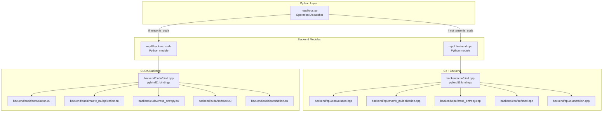
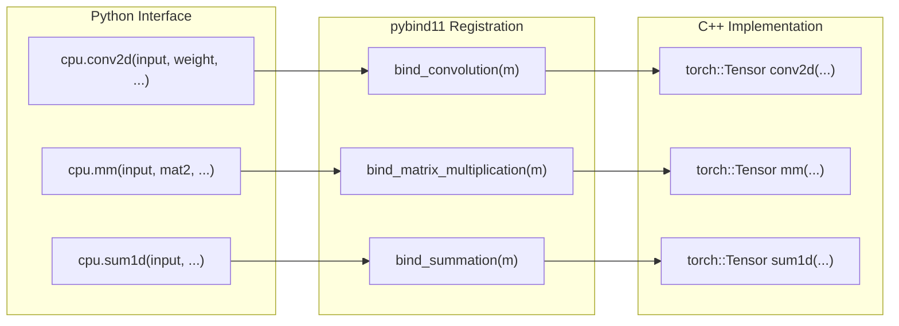
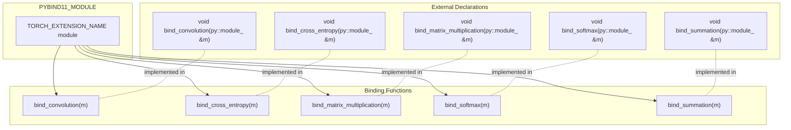
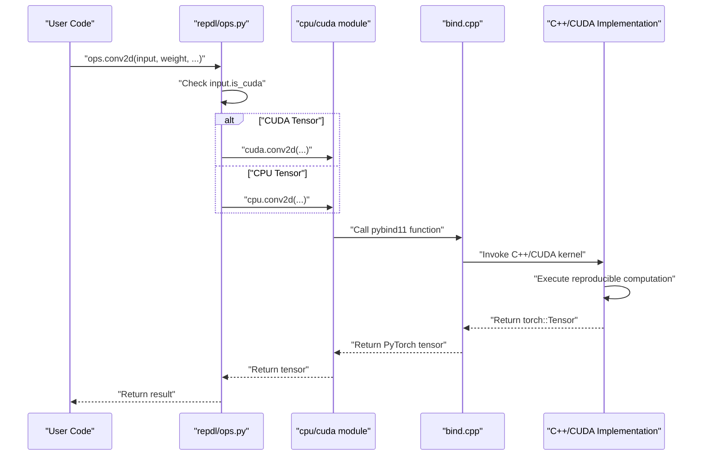

<!-- source: DeepWiki mcp.deepwiki.com · repo microsoft/RepDL · page 5 Backend Implementation · fetched 2026-10-26 -->

# Backend Implementation

<details>
<summary>Relevant source files</summary>

The following files were used as context for generating this wiki page:

- [backend/cpu/bind.cpp](backend/cpu/bind.cpp)
- [repdl/ops.py](repdl/ops.py)

</details>


## Purpose and Scope

This document explains the C++ and CUDA backend architecture that provides reproducible operations for RepDL. It covers the dual backend design, pybind11 binding mechanism, operation dispatch flow, and interface contracts between Python and native code.

For implementation details of specific operations in each backend, see [CPU Backend](#5.2) and [CUDA Backend](#5.3). For the Python-level operation dispatcher, see [Operations Module (repdl.ops)](#4.2).

---

## Backend Architecture Overview

RepDL implements a **dual backend architecture** where all reproducible operations are provided by both CPU and CUDA implementations. The Python layer dispatches to the appropriate backend based on tensor device placement.

### System Organization



**Sources:** [repdl/ops.py:1-158](), [backend/cpu/bind.cpp:1-19]()

### Backend Module Structure

Both backends follow an identical organizational pattern:

| Component | Purpose | CPU Location | CUDA Location |
|-----------|---------|--------------|---------------|
| Binding Module | pybind11 registration | `backend/cpu/bind.cpp` | `backend/cuda/bind.cpp` |
| Convolution | 2D convolution operations | `backend/cpu/convolution.cpp` | `backend/cuda/convolution.cu` |
| Matrix Multiplication | Matrix-matrix products | `backend/cpu/matrix_multiplication.cpp` | `backend/cuda/matrix_multiplication.cu` |
| Cross Entropy | Loss computation | `backend/cpu/cross_entropy.cpp` | `backend/cuda/cross_entropy.cu` |
| Softmax | Softmax activation | `backend/cpu/softmax.cpp` | `backend/cuda/softmax.cu` |
| Summation | Reduction operations | `backend/cpu/summation.cpp` | `backend/cuda/summation.cu` |

**Sources:** [backend/cpu/bind.cpp:6-10]()

### Interface Contracts

Each backend must expose identical function signatures to Python. The `bind.cpp` files register these functions using pybind11:



**Sources:** [backend/cpu/bind.cpp:12-18]()

---

## Python-Backend Integration

### Dispatch Mechanism

The [repdl/ops.py:1-158]() module serves as the primary dispatcher. Every operation checks `tensor.is_cuda` to route to the appropriate backend:

**Pattern for Binary Operations:**

[repdl/ops.py:12-26]() demonstrates the dispatch pattern for `conv2d`:

```python
def conv2d(input, weight, stride, padding, groups):
    if input.is_cuda:
        return cuda.conv2d(input, weight, stride[0], stride[1], ...)
    else:
        return cpu.conv2d(input, weight, stride[0], stride[1], ...)
```

**Pattern for Gradient Operations:**

[repdl/ops.py:29-57]() shows gradient dispatch for `conv2d_grad_input`:

```python
def conv2d_grad_input(input_shape, weight, grad_output, stride, padding):
    if grad_output.is_cuda:
        return cuda.conv2d_grad_input(grad_output, weight, ...)
    else:
        return cpu.conv2d_grad_input(grad_output, weight, ...)
```

**Sources:** [repdl/ops.py:12-88]()

### Operation Categories

The backends implement the following operation categories:

| Category | Operations | Purpose |
|----------|-----------|---------|
| Convolution | `conv2d`, `conv2d_grad_input`, `conv2d_grad_kernel` | 2D convolution forward and backward |
| Matrix Operations | `mm` | Matrix multiplication with transpose options |
| Loss Functions | `cross_entropy`, `softmax` | Loss computation and softmax activation |
| Reductions | `sum1d`, `sum2d_dim0`, `sum2d_dim1`, `sum4d_dim023` | Summation across specified dimensions |
| Element-wise | `div`, `sqrt` | Element-wise arithmetic operations |

**Sources:** [repdl/ops.py:12-158]()

### Special Cases

Some operations have special handling:

**Division:** [repdl/ops.py:98-103]() handles scalar division by converting scalars to tensors on CUDA:

```python
def div(input, other):
    if isinstance(other, torch.Tensor) or input.device == "cpu":
        return input.div(other)
    else:
        return input.div(torch.tensor(other, device=input.device))
```

**Square Root:** [repdl/ops.py:122-123]() promotes to float64 for correct rounding:

```python
def sqrt(input):
    return input.to(dtype=torch.float64).sqrt().to(dtype=torch.float32)
```

**Sources:** [repdl/ops.py:98-123]()

---

## pybind11 Binding Architecture

### Binding Module Structure

The [backend/cpu/bind.cpp:1-19]() file demonstrates the standard binding pattern:



**Sources:** [backend/cpu/bind.cpp:6-18]()

### Function Declaration Pattern

Each category of operations declares its binding function at [backend/cpu/bind.cpp:6-10]():

- `void bind_convolution(py::module_ &m)` - Registers convolution operations
- `void bind_cross_entropy(py::module_ &m)` - Registers cross entropy loss
- `void bind_matrix_multiplication(py::module_ &m)` - Registers matrix operations
- `void bind_softmax(py::module_ &m)` - Registers softmax activation
- `void bind_summation(py::module_ &m)` - Registers reduction operations

These functions are implemented in their respective `.cpp` or `.cu` files and called from the main binding module at [backend/cpu/bind.cpp:14-18]().

**Sources:** [backend/cpu/bind.cpp:6-18]()

---

## Operation Flow

### Complete Dispatch Sequence



**Sources:** [repdl/ops.py:12-26]()

### Convolution Example

The convolution operation demonstrates the complete flow:

1. **Python Dispatcher** [repdl/ops.py:12-26]():
   - Function: `conv2d(input, weight, stride, padding, groups)`
   - Decision: Check `input.is_cuda`
   - Route: Call `cuda.conv2d(...)` or `cpu.conv2d(...)`

2. **Backend Module** (bound via pybind11):
   - Module: `repdl.backend.cpu` or `repdl.backend.cuda`
   - Entry Point: Registered function from `bind_convolution()`

3. **C++/CUDA Implementation**:
   - CPU: Implements convolution using OpenMP parallelization
   - CUDA: Implements convolution using GPU kernels
   - Both ensure fixed FP operation order

**Sources:** [repdl/ops.py:12-26](), [backend/cpu/bind.cpp:6-7,14]()

### Gradient Operations

Gradient operations follow the same pattern but dispatch based on the gradient tensor:

**Input Gradients:** [repdl/ops.py:29-57]()
- Checks `grad_output.is_cuda`
- Routes to `conv2d_grad_input` in appropriate backend

**Weight Gradients:** [repdl/ops.py:60-88]()
- Checks `input.is_cuda`
- Routes to `conv2d_grad_kernel` in appropriate backend

**Sources:** [repdl/ops.py:29-88]()

---

## Reproducibility Implementation

### Fixed Operation Order

All backend implementations ensure operations execute in a fixed, deterministic order:

- **No parallelization reordering:** Operations within parallel regions maintain consistent execution order
- **Accumulation order:** Summation operations use consistent accumulation patterns
- **Memory access patterns:** Kernels access memory in fixed patterns to prevent non-deterministic race conditions

### IEEE-754 Compliance

Backends follow IEEE-754 floating-point standards:

- **Rounding modes:** Use default round-to-nearest-even mode
- **Special values:** Handle NaN, infinity consistently
- **Denormals:** Preserve denormalized numbers where possible

### Correct Rounding

The `sqrt` operation at [repdl/ops.py:122-123]() demonstrates correct rounding:

```python
def sqrt(input):
    return input.to(dtype=torch.float64).sqrt().to(dtype=torch.float32)
```

This promotes to float64 before square root to ensure correctly rounded results when converting back to float32.

**Sources:** [repdl/ops.py:122-123]()

---

## Backend Interface Summary

### Required Function Signatures

Each backend must implement the following functions with identical signatures:

| Function | Parameters | Returns |
|----------|-----------|---------|
| `conv2d` | `input, weight, stride_h, stride_w, pad_h, pad_w, groups` | `torch.Tensor` |
| `conv2d_grad_input` | `grad_output, weight, in_h, in_w, stride_h, stride_w, pad_h, pad_w` | `torch.Tensor` |
| `conv2d_grad_kernel` | `grad_output, input, k_h, k_w, stride_h, stride_w, pad_h, pad_w` | `torch.Tensor` |
| `mm` | `input, mat2, transA, transB` | `torch.Tensor` |
| `cross_entropy` | `input, target` | `torch.Tensor` |
| `softmax` | `input` | `torch.Tensor` |
| `sum1d` | `input, average` | `torch.Tensor` |
| `sum2d_dim0` | `input, keepdim, average` | `torch.Tensor` |
| `sum2d_dim1` | `input, keepdim, average` | `torch.Tensor` |
| `sum4d_dim023` | `input, keepdim, average` | `torch.Tensor` |

**Sources:** [repdl/ops.py:12-157]()

### Device Detection

The dispatch logic uses PyTorch's `is_cuda` property:

```python
if input.is_cuda:
    return cuda.operation(...)
else:
    return cpu.operation(...)
```

This ensures operations execute on the correct device without explicit device specification.

**Sources:** [repdl/ops.py:19-26]()

---

## Extension Points

To add a new operation to the backend:

1. **Declare in ops.py:** Add dispatcher function checking `tensor.is_cuda`
2. **Implement CPU version:** Add C++ implementation in `backend/cpu/`
3. **Implement CUDA version:** Add CUDA kernel in `backend/cuda/`
4. **Register bindings:** Add pybind11 registration in both `bind.cpp` files
5. **Maintain interface parity:** Ensure both backends expose identical signatures

For detailed implementation guidance, see [Adding Custom Operations](#6.1).

**Sources:** [repdl/ops.py:1-158](), [backend/cpu/bind.cpp:1-19]()

---

