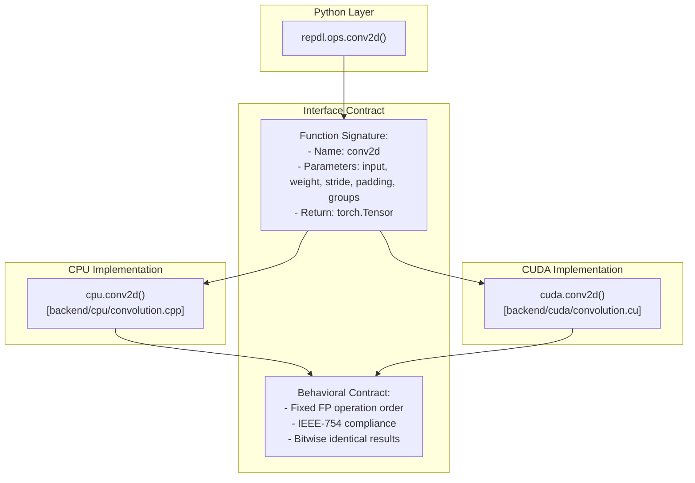
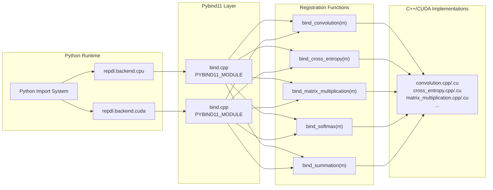
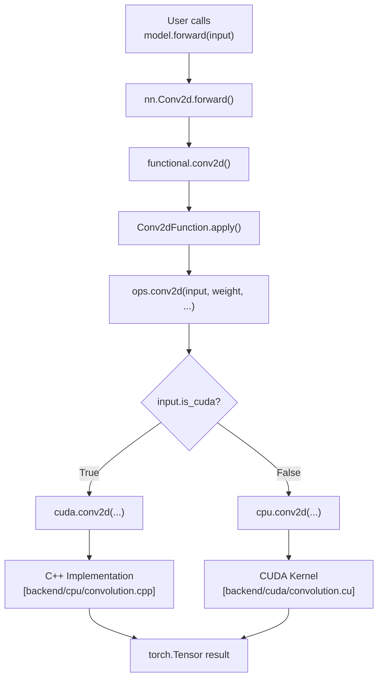
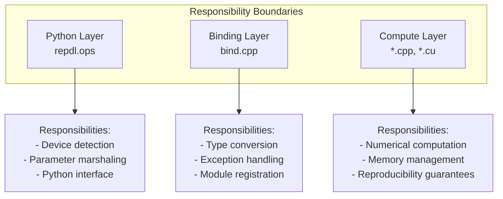

<!-- source: DeepWiki mcp.deepwiki.com · repo microsoft/RepDL · page 5.1 Backend Architecture · fetched 2026-10-26 -->

# Backend Architecture

<details>
<summary>Relevant source files</summary>

The following files were used as context for generating this wiki page:

- [backend/cpu/bind.cpp](backend/cpu/bind.cpp)
- [repdl/ops.py](repdl/ops.py)

</details>


## Purpose and Scope

This page describes the architecture of RepDL's backend layer, which implements reproducible computations in C++ (CPU) and CUDA (GPU). It covers the separation between CPU and CUDA backends, the pybind11 binding mechanism that exposes these implementations to Python, and the interface contracts that both backends must fulfill.

For details on specific CPU implementation strategies, see [CPU Backend](#5.2). For CUDA kernel designs and GPU optimizations, see [CUDA Backend](#5.3). For the Python-level dispatch mechanism, see [Operation Dispatch Mechanism](#3.1).

**Sources:** High-level system architecture diagrams, [repdl/ops.py:1-158]()

---

## Dual Backend Architecture

RepDL maintains two separate backend implementations that provide identical functionality:

| Backend | Language | Build System | Primary Use Case |
|---------|----------|--------------|------------------|
| **CPU** | C++ with OpenMP | CMake | Development, CPU-only environments, reference implementation |
| **CUDA** | CUDA C++ | CMake with nvcc | Production GPU training, high-performance inference |

Both backends are compiled as separate Python extension modules using pybind11:
- `repdl.backend.cpu` - CPU implementation
- `repdl.backend.cuda` - CUDA implementation

The backends are **architecturally isolated** from each other. They share no code at the C++/CUDA level, ensuring that:
1. CPU implementation can be compiled without CUDA toolkit
2. Backend-specific optimizations don't create cross-dependencies
3. Each backend can evolve independently while maintaining interface contracts

**Sources:** [repdl/ops.py:8-9](), backend directory structure

---

## Backend Interface Contract

Both CPU and CUDA backends must implement an **identical interface** for each operation. This contract is enforced at the Python binding level and consists of:

### Operation Signature Requirements



**Diagram: Backend Interface Contract Enforcement**

Each operation must satisfy:

1. **Signature Compatibility**: Same function name, parameter order, and types
2. **Tensor Shape Contract**: Same input/output tensor shapes and dimensionality
3. **Numerical Reproducibility**: Bitwise identical results for identical inputs
4. **Memory Layout**: Same tensor storage order and alignment expectations

### Implemented Operations

Both backends provide the following operations, registered through their respective `bind.cpp` files:

| Operation Category | Functions | Registration Function |
|-------------------|-----------|----------------------|
| **Convolution** | `conv2d`, `conv2d_grad_input`, `conv2d_grad_kernel` | `bind_convolution()` |
| **Matrix Operations** | `mm` (with transpose flags) | `bind_matrix_multiplication()` |
| **Loss Functions** | `cross_entropy`, `softmax` | `bind_cross_entropy()`, `bind_softmax()` |
| **Reductions** | `sum1d`, `sum2d_dim0`, `sum2d_dim1`, `sum4d_dim023` | `bind_summation()` |

**Sources:** [backend/cpu/bind.cpp:1-19](), [repdl/ops.py:1-158]()

---

## Pybind11 Binding Mechanism

RepDL uses pybind11 to expose C++ and CUDA implementations to Python as extension modules. The binding process follows a consistent pattern across both backends.

### Binding Architecture



**Diagram: Pybind11 Binding Flow from Python to C++/CUDA**

### Module Registration Pattern

The entry point for each backend is the `PYBIND11_MODULE` macro in `bind.cpp`:

```cpp
// backend/cpu/bind.cpp (lines 12-19)
PYBIND11_MODULE(TORCH_EXTENSION_NAME, m)
{
    bind_convolution(m);
    bind_cross_entropy(m);
    bind_matrix_multiplication(m);
    bind_softmax(m);
    bind_summation(m);
}
```

Each `bind_*` function is responsible for:
1. Registering operation functions with the Python module object `m`
2. Defining function signatures with pybind11 type annotations
3. Handling tensor ownership and memory management
4. Converting between Python and C++ exceptions

The `TORCH_EXTENSION_NAME` macro expands to the module name (`cpu` or `cuda`) and must match the build system configuration.

**Sources:** [backend/cpu/bind.cpp:1-19]()

---

## Operation Dispatch Flow

The dispatch mechanism routes operations from Python to the appropriate backend based on tensor device placement. This is the **critical chokepoint** that enforces reproducibility.

### Device-Based Routing



**Diagram: Complete Operation Dispatch Path from User Code to Backend**

### Dispatch Implementation Pattern

The dispatch logic in `repdl/ops.py` follows a consistent pattern for all operations:

```python
# Example from repdl/ops.py:12-26
def conv2d(input, weight, stride, padding, groups):
    if input.is_cuda:
        return cuda.conv2d(input, weight, stride[0], stride[1], 
                          padding[0], padding[1], groups)
    else:
        return cpu.conv2d(input, weight, stride[0], stride[1], 
                         padding[0], padding[1], groups)
```

Key characteristics:
- **Single decision point**: Only one `is_cuda` check per operation
- **Tuple unpacking**: Python tuples are unpacked to individual arguments for C++
- **Direct delegation**: No additional processing at the dispatch layer
- **Tensor device preservation**: Operations return tensors on the same device as inputs

### Gradient Operation Dispatch

Gradient operations follow the same pattern but typically dispatch based on `grad_output.is_cuda`:

| Forward Operation | Gradient Operations | Dispatch Tensor |
|------------------|---------------------|-----------------|
| `conv2d` | `conv2d_grad_input`, `conv2d_grad_kernel` | `grad_output` |
| `mm` | `mm` (with transpose flags) | `input` or `mat2` |
| `cross_entropy` | Handled in forward | `input` |

**Sources:** [repdl/ops.py:12-88](), [repdl/ops.py:91-157]()

---

## Backend Module Structure

Both backends follow an identical organizational structure that mirrors their Python interface:

### File Organization

```
backend/
├── cpu/
│   ├── bind.cpp                    # Pybind11 module entry point
│   ├── convolution.cpp             # Conv2d implementations
│   ├── cross_entropy.cpp           # Loss function implementations
│   ├── matrix_multiplication.cpp   # Matrix multiply implementations
│   ├── softmax.cpp                 # Softmax implementations
│   ├── summation.cpp               # Reduction implementations
│   └── CMakeLists.txt              # Build configuration
│
└── cuda/
    ├── bind.cpp                    # Pybind11 module entry point (identical structure)
    ├── convolution.cu              # CUDA kernels for conv2d
    ├── cross_entropy.cu            # CUDA kernels for loss functions
    ├── matrix_multiplication.cu    # CUDA kernels for matrix multiply
    ├── softmax.cu                  # CUDA kernels for softmax
    ├── summation.cu                # CUDA kernels for reductions
    └── CMakeLists.txt              # CUDA build configuration
```

### Registration Function Declarations

Each backend's `bind.cpp` declares the same set of registration functions:

```cpp
// backend/cpu/bind.cpp:6-10 (identical in CUDA version)
void bind_convolution(py::module_ &m);
void bind_cross_entropy(py::module_ &m);
void bind_matrix_multiplication(py::module_ &m);
void bind_softmax(py::module_ &m);
void bind_summation(py::module_ &m);
```

These functions are implemented in their respective `.cpp` or `.cu` files and register specific operations with the Python module object `m`.

**Sources:** [backend/cpu/bind.cpp:6-10](), backend directory structure

---

## Build System Integration

The backends are built as PyTorch extensions using setuptools and CMake:

### Extension Building Process

| Step | Component | Purpose |
|------|-----------|---------|
| **1. Setup Configuration** | `setup.py` | Defines extension modules with source files and build flags |
| **2. CMake Configuration** | `CMakeLists.txt` | Configures compiler flags, finds PyTorch, sets optimization levels |
| **3. Compilation** | gcc/nvcc | Compiles C++/CUDA source files with appropriate flags |
| **4. Linking** | setuptools | Links against PyTorch libraries and creates `.so` modules |
| **5. Installation** | pip | Installs modules into Python site-packages |

### Backend-Specific Build Requirements

**CPU Backend:**
- Requires: C++17 compiler, PyTorch C++ libraries, OpenMP
- Flags: `-O3`, `-march=native`, `-fopenmp`
- Output: `cpu.so` (Linux) or `cpu.pyd` (Windows)

**CUDA Backend:**
- Requires: CUDA toolkit, nvcc compiler, PyTorch CUDA libraries
- Flags: `-O3`, `--use_fast_math`, `-arch=sm_70+`
- Output: `cuda.so` (Linux) or `cuda.pyd` (Windows)

**Sources:** Project build system configuration

---

## Design Principles

The backend architecture adheres to several key design principles that enable reproducibility and maintainability:

### Separation of Concerns



**Diagram: Separation of Responsibilities Across Backend Layers**

### Interface Consistency

1. **Function Naming**: Identical names across CPU and CUDA (e.g., `conv2d` in both)
2. **Parameter Order**: Same argument sequence for all operations
3. **Return Types**: Always `torch.Tensor` for compatibility with PyTorch ecosystem
4. **Error Handling**: Consistent exception types and error messages

### Backend Independence

The backends are compiled and distributed independently:
- CPU backend can be built without CUDA toolkit installed
- CUDA backend requires GPU support but doesn't affect CPU functionality
- Runtime selection happens dynamically based on tensor device

**Sources:** [repdl/ops.py:1-158](), [backend/cpu/bind.cpp:1-19]()

---

## Extension Points

The backend architecture is designed for extensibility. Adding a new operation requires:

1. **Add to both backends**: Implement in `backend/cpu/*.cpp` and `backend/cuda/*.cu`
2. **Register in bind.cpp**: Add `bind_*` function call in both `bind.cpp` files
3. **Create Python dispatcher**: Add routing function in `repdl/ops.py`
4. **Maintain interface contract**: Ensure identical signatures and behavior

For detailed guidance on extending the backend, see [Adding Custom Operations](#6.1).

**Sources:** Development guide context, backend architecture patterns

---

