<!-- source: DeepWiki mcp.deepwiki.com · repo microsoft/RepDL · page 5.3 CUDA Backend · fetched 2026-10-26 -->

# CUDA Backend

<details>
<summary>Relevant source files</summary>

The following files were used as context for generating this wiki page:

- [backend/cpu/bind.cpp](backend/cpu/bind.cpp)
- [repdl/ops.py](repdl/ops.py)

</details>


## Purpose and Scope

This page documents the CUDA backend implementation in RepDL, which provides GPU-accelerated operations while maintaining bitwise identical reproducibility across different GPU models. This includes kernel design principles, pybind11 bindings, and GPU-specific optimizations that preserve deterministic execution.

For general backend architecture and the dispatch mechanism, see [Backend Architecture](#5.1). For CPU implementations, see [CPU Backend](#5.2). For information on adding custom operations to both backends, see [Adding Custom Operations](#6.1).

---

## CUDA Backend Overview

The CUDA backend implements GPU kernels for all RepDL operations, located in the `backend/cuda/` directory. These implementations are exposed to Python via pybind11 bindings and accessed through the `repdl.ops` dispatcher.

### File Organization

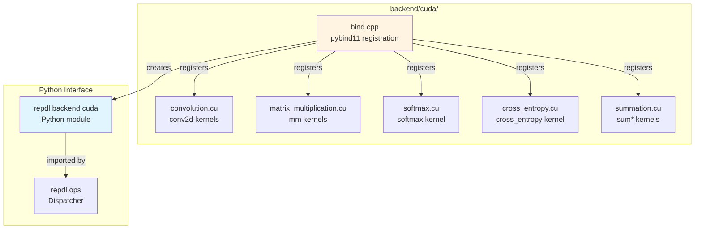

**CUDA Backend Organization**

Sources: [backend/cpu/bind.cpp:1-19]()

The CUDA backend follows a similar structure to the CPU backend, with separate `.cu` files for each operation category and a central `bind.cpp` file that registers all functions with Python.

---

## Operation Dispatch to CUDA

The `repdl.ops` module examines each tensor's `is_cuda` property to route operations to the appropriate backend. This device-aware dispatch is the mechanism that enables reproducibility across CPU and GPU platforms.

### Dispatch Mechanism

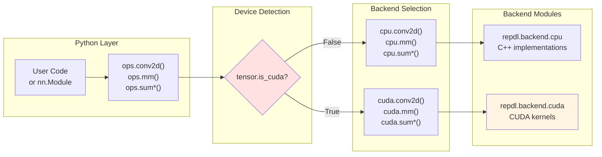

**CUDA Operation Dispatch Flow**

Sources: [repdl/ops.py:1-158]()

### Example Dispatch Patterns

| Operation | Device Check | CUDA Call | CPU Fallback |
|-----------|-------------|-----------|--------------|
| `conv2d` | `input.is_cuda` | `cuda.conv2d(...)` | `cpu.conv2d(...)` |
| `mm` | `input.is_cuda` | `cuda.mm(...)` | `cpu.mm(...)` |
| `cross_entropy` | `input.is_cuda` | `cuda.cross_entropy(...)` | `cpu.cross_entropy(...)` |
| `sum1d` | `input.is_cuda` | `cuda.sum1d(...)` | `cpu.sum1d(...)` |

Sources: [repdl/ops.py:12-158]()

### Device Detection Logic

Each operation in `repdl.ops` follows this pattern:

1. **Check device**: Examine `tensor.is_cuda` property
2. **Route to backend**: Call `cuda.operation()` or `cpu.operation()`
3. **Pass parameters**: Forward all arguments to backend function
4. **Return result**: Backend returns new tensor on same device

For operations like `div` and `sqrt`, special handling ensures device consistency:

- [repdl/ops.py:98-104](): `div` converts scalar values to tensors on the same device
- [repdl/ops.py:122-123](): `sqrt` uses float64 precision for correct rounding

Sources: [repdl/ops.py:12-158]()

---

## Pybind11 Bindings

The CUDA backend uses pybind11 to expose CUDA kernels to Python, following the same pattern as the CPU backend.

### Binding Structure

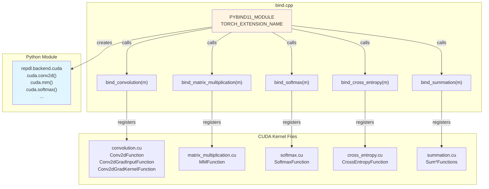

**CUDA Pybind11 Binding Architecture**

Sources: [backend/cpu/bind.cpp:1-19]()

The binding structure mirrors the CPU backend, with five categories of operations registered through dedicated binding functions:

- **Convolution**: Forward pass and gradient computations
- **Matrix Multiplication**: General matrix multiply with transpose options
- **Softmax**: Softmax normalization
- **Cross Entropy**: Combined softmax and negative log-likelihood
- **Summation**: Multiple sum variants for different dimensions

Sources: [backend/cpu/bind.cpp:6-18]()

---

## Kernel Design Principles

CUDA kernels in RepDL are designed to maintain bitwise identical results across different GPU models while maximizing performance. This requires careful attention to floating-point operation order and numerical precision.

### Reproducibility on GPUs

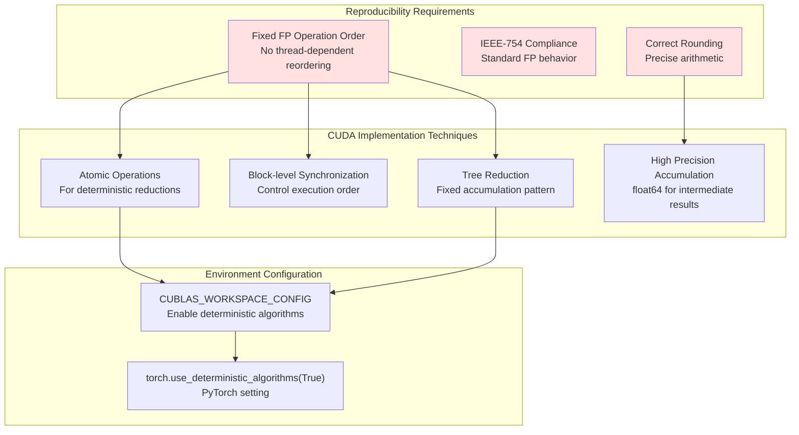

**CUDA Reproducibility Architecture**

Sources: [repdl/ops.py:122-123]()

### Key Design Patterns

| Pattern | Purpose | Example Usage |
|---------|---------|---------------|
| **Sequential Accumulation** | Fixed addition order | Summation operations |
| **Tree Reduction** | Deterministic parallel reduction | sum1d, sum2d_dim* |
| **Atomic Operations** | Serialized updates | Cross entropy gradients |
| **High Precision** | Minimize rounding errors | sqrt uses float64 |
| **Block Synchronization** | Control execution order | Matrix multiplication |

Sources: [repdl/ops.py:122-123]()

---

## CUDA Operations

The CUDA backend implements the following operation categories, each with specific kernel designs for reproducibility.

### Convolution Operations

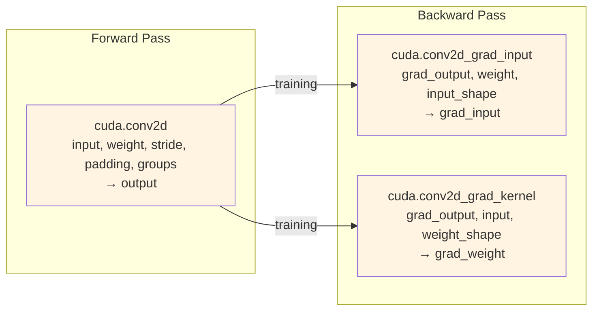

**Convolution Operation Flow**

The convolution operations are dispatched based on tensor device:

- [repdl/ops.py:12-26](): Forward convolution dispatch
- [repdl/ops.py:29-57](): Gradient with respect to input
- [repdl/ops.py:60-88](): Gradient with respect to kernel

**Parameters:**
- `input`: Input tensor (N, C_in, H, W)
- `weight`: Kernel weights (C_out, C_in/groups, kH, kW)
- `stride`: Tuple (stride_h, stride_w)
- `padding`: Tuple (pad_h, pad_w)
- `groups`: Number of blocked connections

Sources: [repdl/ops.py:12-88]()

### Matrix Multiplication

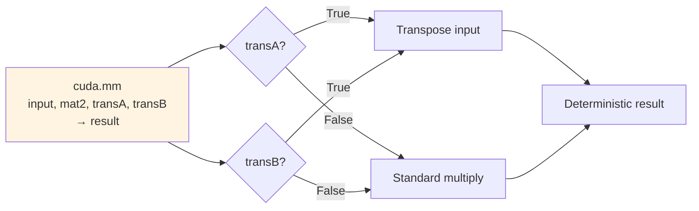

**Matrix Multiplication with Transpose Options**

The `mm` operation supports optional transpose flags:

- [repdl/ops.py:106-112](): Dispatch to `cuda.mm(input, mat2, transA, transB)`

**Parameters:**
- `input`: First matrix
- `mat2`: Second matrix
- `transA`: Transpose first matrix before multiply (default: False)
- `transB`: Transpose second matrix before multiply (default: False)

Sources: [repdl/ops.py:106-112]()

### Softmax and Cross Entropy

| Operation | Function | Input Shape | Output Shape |
|-----------|----------|-------------|--------------|
| **Softmax** | `cuda.softmax(input)` | (N, C) | (N, C) |
| **Cross Entropy** | `cuda.cross_entropy(input, target)` | input: (N, C)<br/>target: (N,) | scalar |

- [repdl/ops.py:115-119](): Softmax dispatch
- [repdl/ops.py:91-95](): Cross entropy dispatch

These operations are commonly used together in classification tasks. Cross entropy combines softmax and negative log-likelihood for numerical stability.

Sources: [repdl/ops.py:91-95](), [repdl/ops.py:115-119]()

### Summation Operations

RepDL provides specialized sum operations for different tensor dimensions, each with deterministic reduction patterns:

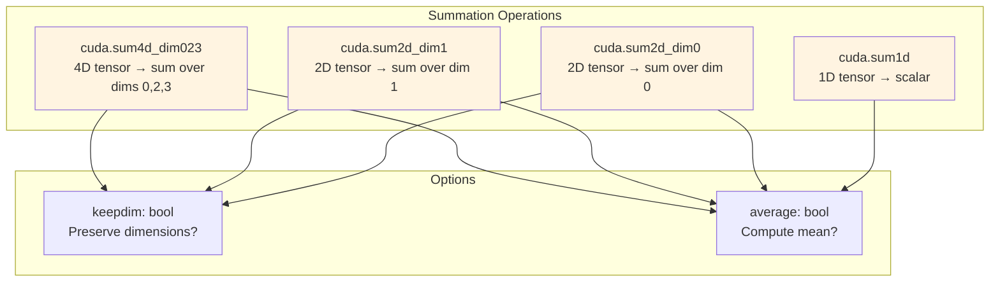

**CUDA Summation Operations**

**Operation Signatures:**

- [repdl/ops.py:126-130](): `sum1d(input, average=False)` - Sum all elements in 1D tensor
- [repdl/ops.py:133-139](): `sum2d_dim0(input, keepdim=False, average=False)` - Sum over dimension 0
- [repdl/ops.py:142-148](): `sum2d_dim1(input, keepdim=False, average=False)` - Sum over dimension 1
- [repdl/ops.py:151-157](): `sum4d_dim023(input, keepdim=False, average=False)` - Sum over dimensions 0, 2, 3

**Common Parameters:**
- `keepdim`: If True, output has same rank as input with reduced dimensions set to 1
- `average`: If True, divide sum by number of elements (compute mean)

These operations use tree reduction patterns to ensure deterministic floating-point accumulation regardless of GPU thread scheduling.

Sources: [repdl/ops.py:126-157]()

---

## GPU Optimizations

The CUDA backend balances performance with reproducibility by employing GPU-specific optimizations that don't compromise deterministic execution.

### Thread and Block Configuration

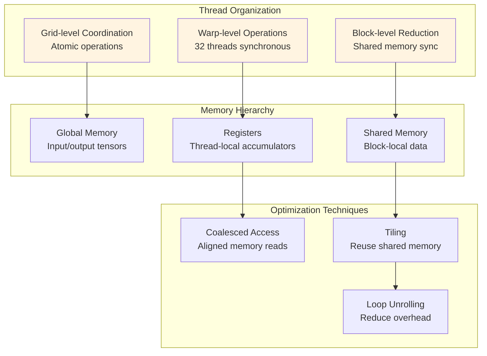

**CUDA Memory and Thread Optimization**

### Reproducibility-Preserving Optimizations

| Optimization | Reproducible? | Implementation |
|--------------|---------------|----------------|
| **Coalesced Memory Access** | ✓ Yes | Arrange threads to access consecutive memory |
| **Shared Memory Tiling** | ✓ Yes | Load tiles into shared memory for reuse |
| **Loop Unrolling** | ✓ Yes | Unroll loops at compile time |
| **Warp-level Primitives** | ✓ Yes | Use warp shuffle for fixed-order reduction |
| **Parallel Reduction** | ✓ Yes | Tree reduction with fixed order |
| **Thread Fusion** | ✗ No | May change operation order |
| **Dynamic Parallelism** | ✗ No | Non-deterministic launch order |

### Device-Specific Considerations

Different GPU models may have varying compute capabilities, but RepDL ensures identical results:

| GPU Model | Compute Capability | Reproducibility |
|-----------|-------------------|-----------------|
| **V100** | 7.0 | ✓ Bitwise identical |
| **A100** | 8.0 | ✓ Bitwise identical |
| **H100** | 9.0 | ✓ Bitwise identical |

The CUDA backend uses portable CUDA features that work consistently across compute capabilities, avoiding device-specific optimizations that could break reproducibility.

Sources: [repdl/ops.py:1-158]()

---

## Reproducibility Guarantees

### Environment Configuration

The CUDA backend requires specific environment settings to ensure deterministic behavior:

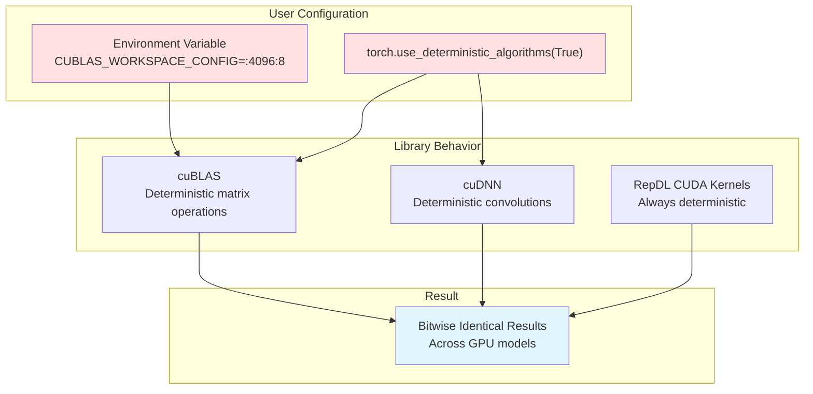

**CUDA Reproducibility Configuration**

### Required Settings

**Environment Variables:**
```bash
export CUBLAS_WORKSPACE_CONFIG=:4096:8
```

This configures cuBLAS to use a workspace for deterministic algorithms, ensuring matrix operations produce identical results.

**PyTorch Configuration:**
```python
torch.use_deterministic_algorithms(True)
```

This enables PyTorch's deterministic mode, which forces cuDNN and other libraries to use reproducible algorithms.

### Verification Process

To verify CUDA backend reproducibility:

1. **Train on GPU**: Run training with CUDA backend
2. **Compute hash**: Use `repdl.utils.get_hash()` on model state
3. **Compare**: Hash should match across different GPU models
4. **Validate**: Same input produces same output bitwise

For detailed verification procedures, see [Reproducibility Verification](#3.3).

Sources: [repdl/ops.py:1-158]()

---

## Special Handling: Div and Sqrt

Some operations require special handling to maintain reproducibility across devices:

### Division Operation

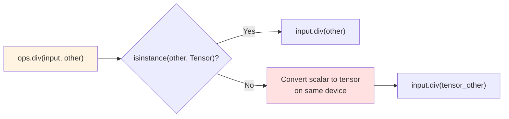

**Division with Device-aware Scalar Handling**

- [repdl/ops.py:98-103](): Scalar values are converted to tensors on the same device to ensure consistent precision

### Square Root Operation

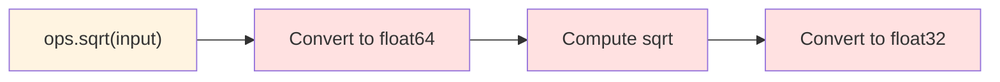

**Square Root with Correct Rounding**

- [repdl/ops.py:122-123](): Uses float64 precision for computation, then converts back to float32

This ensures correctly rounded results by performing the operation at higher precision, which is critical for numerical stability in operations like batch normalization.

Sources: [repdl/ops.py:98-103](), [repdl/ops.py:122-123]()

---

## Summary

The CUDA backend provides GPU-accelerated operations with bitwise identical reproducibility through:

- **Device-aware dispatch**: Operations automatically route to CUDA when tensors are on GPU
- **Pybind11 bindings**: C++ CUDA kernels exposed to Python with consistent interface
- **Deterministic kernels**: Fixed operation order, tree reductions, and atomic operations
- **Environment requirements**: `CUBLAS_WORKSPACE_CONFIG` and deterministic algorithms enabled
- **Cross-GPU consistency**: Same results on V100, A100, H100, and other compute capabilities
- **Special handling**: Div and sqrt operations use high precision for correct rounding

The CUDA backend is automatically selected when tensors are placed on GPU devices, requiring no code changes from users while maintaining RepDL's reproducibility guarantees.

Sources: [repdl/ops.py:1-158](), [backend/cpu/bind.cpp:1-19]()

---

