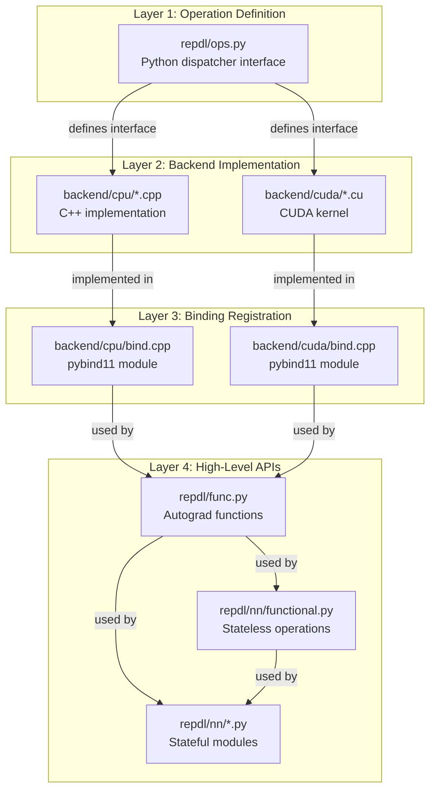
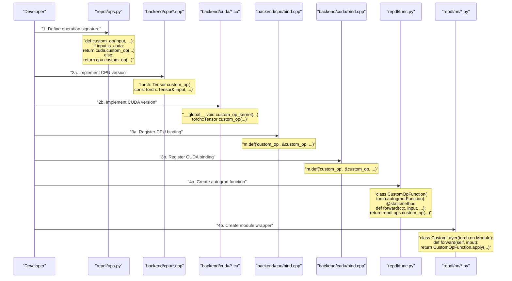
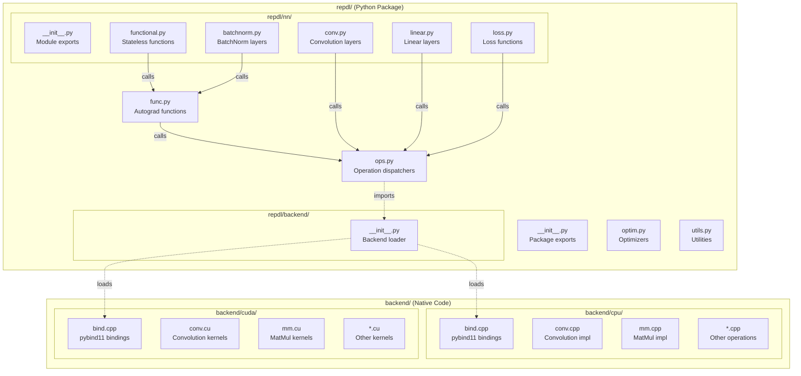
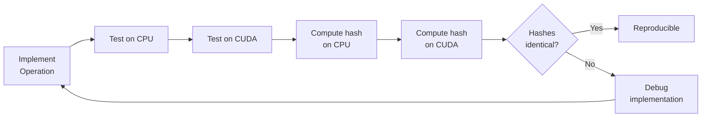

<!-- source: DeepWiki mcp.deepwiki.com · repo microsoft/RepDL · page 6 Development Guide · fetched 2026-10-26 -->

# Development Guide

<details>
<summary>Relevant source files</summary>

The following files were used as context for generating this wiki page:

- [README.md](README.md)
- [examples/mnist_trainig.py](examples/mnist_trainig.py)
- [repdl/ops.py](repdl/ops.py)

</details>


This guide provides practical instructions for extending RepDL with custom operations, autograd functions, and neural network layers. The focus is on maintaining RepDL's reproducibility guarantees while adding new functionality to the framework.

**Scope**: This document covers the development workflow for extending RepDL. For information about using existing RepDL components, see [API Reference](#4). For details about backend implementation internals, see [Backend Implementation](#5).

**Prerequisites**: Before extending RepDL, you should be familiar with:
- PyTorch's autograd system and `torch.autograd.Function`
- C++ and/or CUDA programming for backend implementations
- pybind11 for Python-C++ bindings
- The reproducibility principles explained in [Reproducibility Principles](#6.4)

---

## Extension Architecture

RepDL follows a four-layer extension pattern where new functionality flows from low-level operations through progressively higher abstraction layers:



**Key Principle**: All computational operations must flow through `repdl.ops` to reach reproducible backend implementations. Direct use of PyTorch operations bypasses the reproducibility guarantees.

**Sources**: [README.md:47-52](), [repdl/ops.py:1-158]()

---

## Development Workflow

The typical workflow for adding new functionality follows these steps:



**Critical Requirements**:
1. **Dual Implementation**: Both CPU and CUDA backends must be implemented for each operation
2. **Device Routing**: The `repdl.ops` dispatcher must check `tensor.is_cuda` to route correctly
3. **Identical Interfaces**: CPU and CUDA implementations must have matching function signatures
4. **Reproducibility**: All implementations must follow the principles in [Reproducibility Principles](#6.4)

**Sources**: [README.md:47-52](), [repdl/ops.py:12-26]()

---

## Operation Dispatcher Pattern

The `repdl.ops` module implements a consistent pattern for device-aware operation dispatch. Understanding this pattern is essential for adding custom operations.

### Dispatcher Structure

Every operation in [repdl/ops.py]() follows this template:

| Component | Responsibility | Example |
|-----------|---------------|---------|
| Function signature | Python interface with type hints | `def conv2d(input: torch.Tensor, weight: torch.Tensor, ...)` |
| Device check | Determine backend based on tensor location | `if input.is_cuda:` |
| CUDA dispatch | Route CUDA tensors to CUDA backend | `return cuda.conv2d(...)` |
| CPU dispatch | Route CPU tensors to CPU backend | `return cpu.conv2d(...)` |

### Example: Matrix Multiplication

The `mm` operation demonstrates the standard pattern:

[repdl/ops.py:106-112]()

```python
def mm(
    input: torch.Tensor, mat2: torch.Tensor, transA: bool = False, transB: bool = False
) -> torch.Tensor:
    if input.is_cuda:
        return cuda.mm(input, mat2, transA, transB)
    else:
        return cpu.mm(input, mat2, transA, transB)
```

**Key Observations**:
- The dispatcher is device-agnostic - it doesn't care which GPU model or CPU architecture
- Parameters are passed identically to both backends
- The backend modules (`cpu` and `cuda`) are imported at the module level [repdl/ops.py:8-9]()

### Special Cases

Some operations have different dispatch logic:

**Division Operation**: [repdl/ops.py:98-103]()
- Falls back to PyTorch's `div` for CPU tensors or tensor-tensor division
- Only uses custom logic for CUDA scalar division to ensure reproducibility

**Square Root Operation**: [repdl/ops.py:122-123]()
- Uses dtype promotion to `float64` for correctly rounded results
- No separate backend implementation needed

**Sources**: [repdl/ops.py:8-158]()

---

## File Organization

When extending RepDL, you'll work with files across multiple directories. Understanding the organization helps locate where changes should be made:



### Directory Structure

| Directory | Purpose | File Types | Build Process |
|-----------|---------|------------|---------------|
| `repdl/` | Python package root | `.py` | No build required |
| `repdl/nn/` | Neural network modules | `.py` | No build required |
| `backend/cpu/` | CPU implementations | `.cpp`, `.h` | Compiled with `pip install` |
| `backend/cuda/` | CUDA implementations | `.cu`, `.cuh` | Compiled with `pip install` |

**Sources**: [repdl/ops.py:1-10]()

---

## Testing Reproducibility

After implementing a custom operation, autograd function, or layer, you must verify that it produces bitwise identical results across devices.

### Verification Workflow



### Hash Verification Example

Use `repdl.utils.get_hash` to verify reproducibility as shown in [examples/mnist_trainig.py:67-83]():

```python
# Before training
initial_hash = repdl.utils.get_hash(model)
print(f"Hash of the initial model: {initial_hash}")

# ... training loop ...

# After training
final_hash = repdl.utils.get_hash(model)
print(f"Hash of the trained model: {final_hash}")
```

### Testing Strategy

| Test Case | Purpose | Expected Result |
|-----------|---------|-----------------|
| CPU-only execution | Verify CPU implementation correctness | Consistent hash across multiple runs |
| CUDA-only execution | Verify CUDA implementation correctness | Consistent hash across multiple runs |
| Cross-device comparison | Verify CPU-CUDA equivalence | Identical hashes between CPU and CUDA |
| Multiple GPU models | Verify device independence | Identical hashes on V100, A100, etc. |

### Debugging Non-Reproducibility

If hashes differ across devices, check:

1. **Floating-point operation order**: Ensure operations execute in a fixed sequence
2. **Reduction operations**: Sum/mean operations are particularly sensitive to order
3. **Fast math flags**: Disable compiler optimizations that violate IEEE-754
4. **Atomic operations**: CUDA atomics may have non-deterministic ordering

See [Reproducibility Principles](#6.4) for detailed guidance on maintaining reproducibility.

**Sources**: [examples/mnist_trainig.py:67-83](), [README.md:34-39]()

---

## Build System Integration

When adding backend implementations, the build system automatically compiles them during `pip install`.

### Build Configuration

The build process is configured in `setup.py` (not shown in provided files) and follows these steps:

1. **Compilation**: C++ files in `backend/cpu/` are compiled with OpenMP support
2. **CUDA Compilation**: `.cu` files in `backend/cuda/` are compiled if CUDA is available
3. **Binding**: pybind11 creates Python modules from the compiled libraries
4. **Installation**: Modules are installed into `repdl.backend.cpu` and `repdl.backend.cuda`

### Adding New Backend Files

When you add new `.cpp` or `.cu` files:

1. Create the implementation file in `backend/cpu/` or `backend/cuda/`
2. Add the function to the corresponding `bind.cpp` file
3. Run `pip install .` to rebuild

**Note**: The binding files [backend/cpu/bind.cpp]() and [backend/cuda/bind.cpp]() are referenced in the README but not provided in the file list. These files use pybind11's `PYBIND11_MODULE` macro to expose C++/CUDA functions to Python.

**Sources**: [README.md:23-27](), [README.md:49]()

---

## Common Extension Patterns

### Pattern 1: Simple Element-wise Operation

For operations that apply independently to each element:

1. **Dispatcher**: Check device and route [repdl/ops.py:122-123]()
2. **Backend**: May not need separate implementation if using dtype promotion
3. **Integration**: Can be called directly from higher-level code

Example: `sqrt` operation uses dtype promotion for reproducibility without custom backends.

### Pattern 2: Reduction Operation

For operations that aggregate values (sum, mean):

1. **Dispatcher**: Must route to reproducible backend [repdl/ops.py:126-157]()
2. **Backend**: Implement fixed-order reduction algorithms
3. **Variants**: Separate functions for different dimensionalities (`sum1d`, `sum2d_dim0`, etc.)

Example: Multiple `sum*` operations handle different tensor shapes.

### Pattern 3: Matrix Operations

For linear algebra operations:

1. **Dispatcher**: Route matrix multiplications [repdl/ops.py:106-112]()
2. **Backend**: Use reproducible BLAS libraries or custom kernels
3. **Parameters**: Include transpose flags for flexibility

Example: `mm` operation supports `transA` and `transB` flags.

### Pattern 4: Convolution Operations

For spatial operations with multiple outputs:

1. **Forward Dispatcher**: Route forward pass [repdl/ops.py:12-26]()
2. **Gradient Dispatchers**: Separate functions for input/weight gradients [repdl/ops.py:29-88]()
3. **Backend**: Implement im2col or direct convolution algorithms
4. **Parameters**: Handle stride, padding, groups

Example: `conv2d` has three separate dispatchers for forward, input gradient, and kernel gradient.

**Sources**: [repdl/ops.py:12-158]()

---

## Environment Setup for Development

Before implementing extensions, configure your development environment:

### Required Environment Variables

Set these variables as shown in [examples/mnist_trainig.py:42-43]():

```python
os.environ["CUBLAS_WORKSPACE_CONFIG"] = ":4096:8"
torch.use_deterministic_algorithms(True)
```

| Variable | Value | Purpose |
|----------|-------|---------|
| `CUBLAS_WORKSPACE_CONFIG` | `:4096:8` or `:16:8` | Allocates workspace for deterministic cuBLAS operations |
| `torch.use_deterministic_algorithms` | `True` | Forces PyTorch to use deterministic algorithms where possible |

### Development Tools

Ensure you have:
- C++ compiler with C++14 support (GCC 7+, Clang 5+, MSVC 2017+)
- CUDA Toolkit 11.0+ (for CUDA backend development)
- OpenMP support (for CPU parallelization)
- pybind11 (automatically installed as dependency)

### Testing Environment

For thorough reproducibility testing:
1. Access to both CPU and CUDA-capable systems
2. Multiple GPU models if possible (e.g., V100, A100)
3. Clean Python environment (consider using `venv` or `conda`)

**Sources**: [examples/mnist_trainig.py:41-43](), [README.md:21]()

---

This development guide provides the foundation for extending RepDL. The following sub-sections provide detailed instructions for specific extension types:

- [Adding Custom Operations](#6.1): Step-by-step guide for implementing new operations in the backend
- [Adding Custom Autograd Functions](#6.2): Creating differentiable functions using `torch.autograd.Function`
- [Adding Custom Layers](#6.3): Building PyTorch-compatible modules that use RepDL operations
- [Reproducibility Principles](#6.4): Deep dive into maintaining bitwise reproducibility

---

