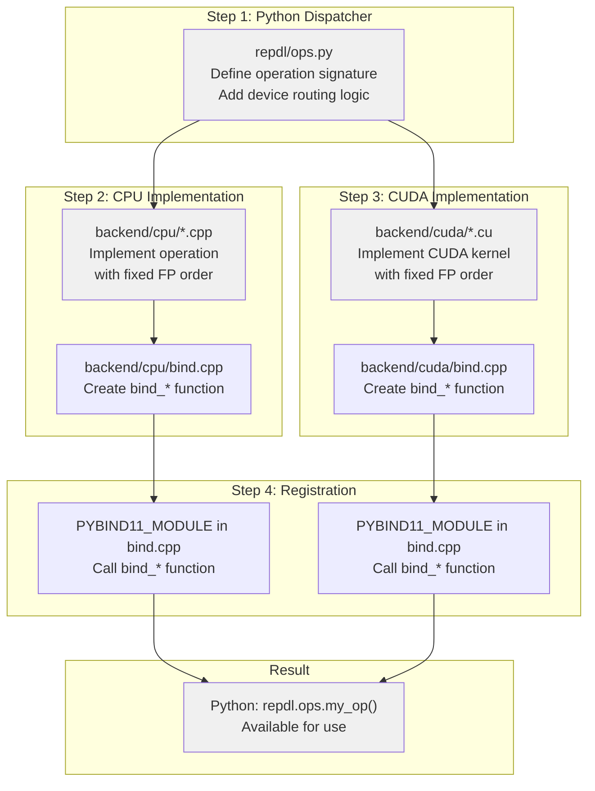
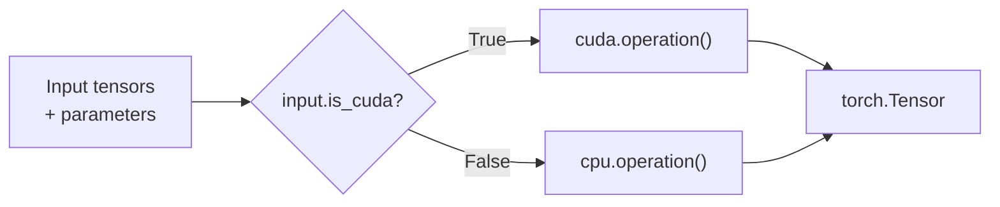
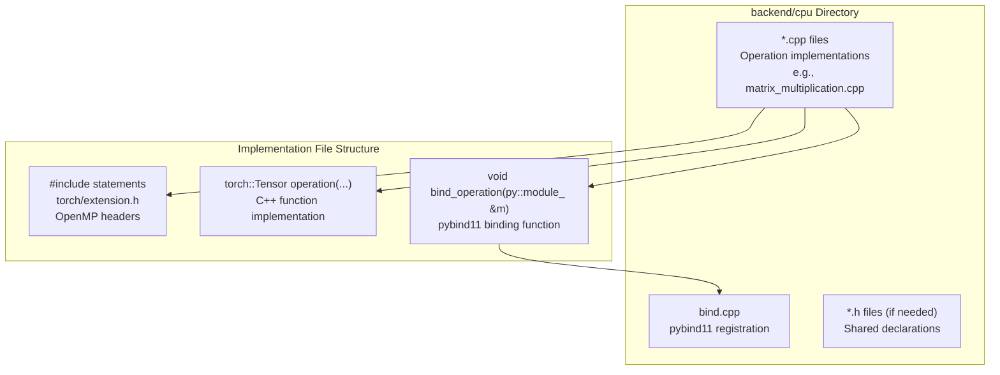
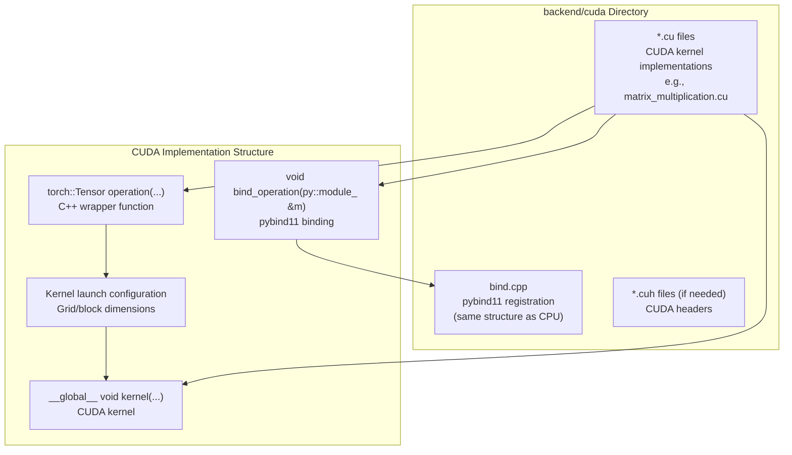
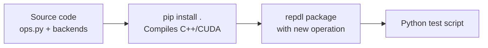
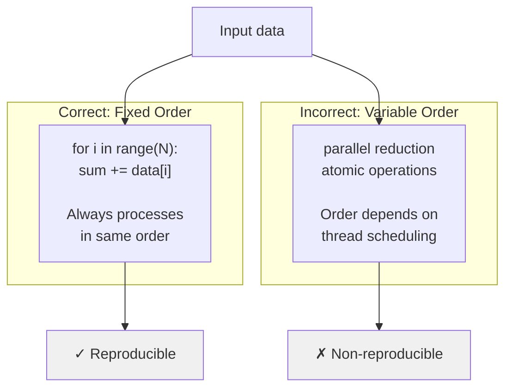
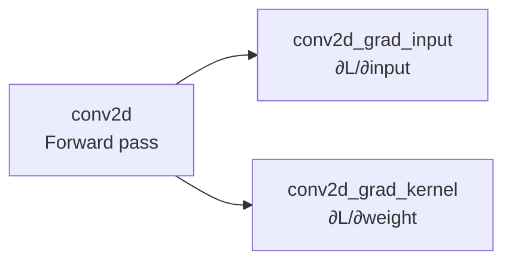
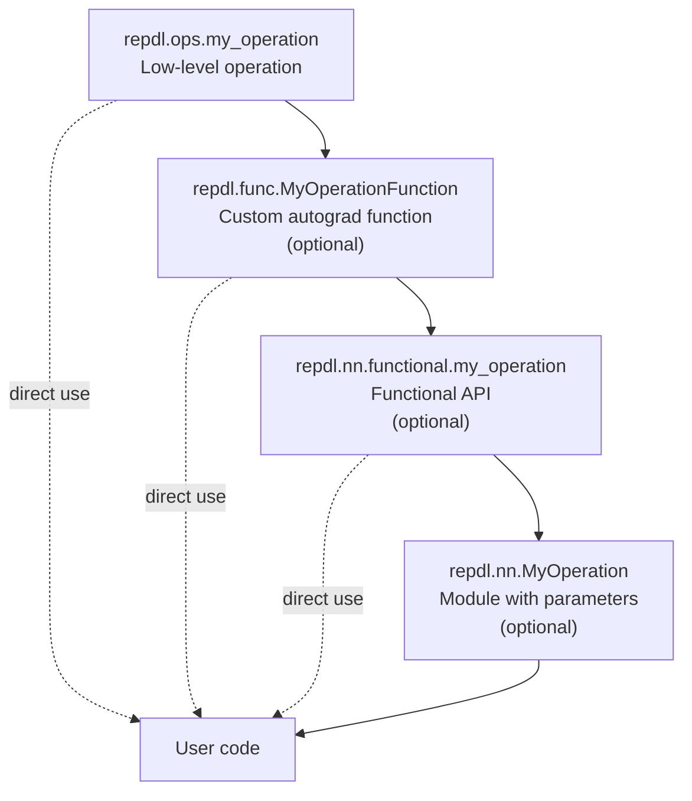

<!-- source: DeepWiki mcp.deepwiki.com · repo microsoft/RepDL · page 6.1 Adding Custom Operations · fetched 2026-10-26 -->

# Adding Custom Operations

<details>
<summary>Relevant source files</summary>

The following files were used as context for generating this wiki page:

- [README.md](README.md)
- [backend/cpu/bind.cpp](backend/cpu/bind.cpp)
- [examples/mnist_trainig.py](examples/mnist_trainig.py)
- [repdl/ops.py](repdl/ops.py)

</details>


## Purpose and Scope

This document provides a step-by-step guide for extending RepDL with custom operations that maintain bitwise reproducibility across hardware platforms. It covers the complete workflow from defining an operation signature in the Python dispatcher to implementing and registering C++ and CUDA backend kernels.

For information about:
- Creating custom autograd functions that use these operations, see [Adding Custom Autograd Functions](#6.2)
- Creating custom neural network layers, see [Adding Custom Layers](#6.3)
- Understanding the core reproducibility principles, see [Reproducibility Principles](#6.4)
- Understanding how the operation dispatch mechanism works, see [Operation Dispatch Mechanism](#3.1)

---

## Prerequisites

Before adding custom operations, you should have:

1. **Development Environment**: C++ compiler, CUDA toolkit (if adding GPU support), and PyTorch with CUDA installed
2. **Understanding of RepDL Architecture**: Familiarity with the layered architecture described in [Architecture Overview](#1.2)
3. **Knowledge of Reproducibility Requirements**: Understanding of fixed floating-point operation order and IEEE-754 compliance as described in [What is Reproducible Deep Learning?](#1.1)

Sources: [README.md:21-27](), [README.md:47-52]()

---

## Overview of the Extension Process

Adding a custom operation to RepDL follows a four-step process that ensures the operation is available at the Python level while maintaining reproducibility guarantees through controlled backend implementations.

### Complete Operation Flow



Sources: [README.md:47-52](), [repdl/ops.py:1-158]()

---

## Step 1: Adding Operation to ops.py

The first step is to define your operation's Python interface in [repdl/ops.py](). This module serves as the device-aware dispatcher that routes operations to the appropriate backend based on tensor device placement.

### Operation Signature Pattern

All operations in `ops.py` follow a consistent pattern:



### Implementation Template

Your operation should follow this structure:

| Component | Description | Example |
|-----------|-------------|---------|
| Function signature | `def operation_name(input: torch.Tensor, ...) -> torch.Tensor` | `def mm(input, mat2, transA, transB)` |
| Device check | `if input.is_cuda:` | Tests tensor device placement |
| CUDA dispatch | `return cuda.operation_name(...)` | Routes to GPU backend |
| CPU dispatch | `return cpu.operation_name(...)` | Routes to CPU backend |

### Example: Matrix Multiplication Operation

The matrix multiplication operation at [repdl/ops.py:106-112]() demonstrates the standard pattern:

```python
def mm(
    input: torch.Tensor, mat2: torch.Tensor, transA: bool = False, transB: bool = False
) -> torch.Tensor:
    if input.is_cuda:
        return cuda.mm(input, mat2, transA, transB)
    else:
        return cpu.mm(input, mat2, transA, transB)
```

### Key Considerations

1. **Device Detection**: Use `input.is_cuda` to determine which backend to call. For operations with multiple tensor inputs, check any input tensor (they should all be on the same device).

2. **Parameter Consistency**: Ensure both backend calls receive identical parameters in the same order.

3. **Type Hints**: Include type hints for all parameters and return values to improve code clarity.

4. **Import Statements**: The backends are imported at [repdl/ops.py:8-9]():
   ```python
   from .backend import cpu
   from .backend import cuda
   ```

### Special Cases

Some operations may have special handling:

- **`div` operation** [repdl/ops.py:98-103](): Handles both tensor and scalar division with device-specific behavior
- **`sqrt` operation** [repdl/ops.py:122-123](): Implements reproducibility through dtype conversion rather than custom backends

Sources: [repdl/ops.py:1-158](), [README.md:49]()

---

## Step 2: Implementing CPU Backend

The CPU backend implementation provides the actual computation logic using C++ with OpenMP for parallelization. All CPU implementations should be placed in the `backend/cpu/` directory.

### File Organization



### Implementation Requirements

| Requirement | Purpose | Example |
|-------------|---------|---------|
| Fixed operation order | Ensures reproducibility | Sum elements in consistent order, not parallel reduction |
| IEEE-754 compliance | Standard floating-point behavior | Avoid non-standard fast-math optimizations |
| Correct rounding | Precise math functions | Use correctly rounded `sqrt`, not approximate versions |
| OpenMP parallelization | Performance optimization | Parallelize outer loops, not reductions |

### Creating a New Implementation File

Create a new `.cpp` file in `backend/cpu/` with this structure:

1. **Include necessary headers**:
   ```cpp
   #include <torch/extension.h>
   #include <omp.h>  // if using OpenMP
   ```

2. **Implement the operation** as a function returning `torch::Tensor`:
   ```cpp
   torch::Tensor my_operation(torch::Tensor input, ...) {
       // Implementation with fixed FP order
   }
   ```

3. **Create the binding function**:
   ```cpp
   void bind_my_operation(py::module_ &m) {
       m.def("my_operation", &my_operation, "Description");
   }
   ```

### Binding Registration

After creating your implementation and binding function, register it in [backend/cpu/bind.cpp](). The registration process involves:

1. **Declare the binding function** at the top of `bind.cpp`:
   ```cpp
   void bind_my_operation(py::module_ &m);
   ```

2. **Call it in the PYBIND11_MODULE** at [backend/cpu/bind.cpp:12-18]():
   ```cpp
   PYBIND11_MODULE(TORCH_EXTENSION_NAME, m) {
       bind_convolution(m);
       bind_cross_entropy(m);
       bind_matrix_multiplication(m);
       bind_softmax(m);
       bind_summation(m);
       bind_my_operation(m);  // Add your binding
   }
   ```

### Current CPU Bindings

The existing bindings at [backend/cpu/bind.cpp:6-10]() show the pattern:

| Binding Function | Operation Category | File Location |
|-----------------|-------------------|---------------|
| `bind_convolution` | Convolution operations | `backend/cpu/convolution.cpp` |
| `bind_cross_entropy` | Loss functions | `backend/cpu/cross_entropy.cpp` |
| `bind_matrix_multiplication` | Matrix operations | `backend/cpu/matrix_multiplication.cpp` |
| `bind_softmax` | Activation functions | `backend/cpu/softmax.cpp` |
| `bind_summation` | Reduction operations | `backend/cpu/summation.cpp` |

Sources: [backend/cpu/bind.cpp:1-19](), [README.md:49]()

---

## Step 3: Implementing CUDA Backend

The CUDA backend implementation provides GPU acceleration while maintaining the same reproducibility guarantees as the CPU backend. CUDA implementations are placed in the `backend/cuda/` directory.

### File Organization



### CUDA-Specific Reproducibility Requirements

| Requirement | Implementation Strategy | Rationale |
|-------------|------------------------|-----------|
| Fixed thread execution order | Avoid atomicAdd for critical sums | Atomic operations have non-deterministic ordering |
| Warp-level synchronization | Use warp primitives carefully | Ensure consistent execution across GPU architectures |
| Memory access patterns | Consistent coalesced access | Prevent reordering optimizations |
| Reduction order | Hierarchical, deterministic reduction | Tree-based reduction with fixed order |

### Creating a CUDA Implementation

Create a `.cu` file in `backend/cuda/` with:

1. **CUDA kernel definition**:
   ```cuda
   __global__ void my_operation_kernel(...) {
       // Kernel implementation with fixed thread order
   }
   ```

2. **C++ wrapper function**:
   ```cpp
   torch::Tensor my_operation(torch::Tensor input, ...) {
       // Setup kernel launch configuration
       // Launch kernel
       // Return result
   }
   ```

3. **Binding function** (same pattern as CPU):
   ```cpp
   void bind_my_operation(py::module_ &m) {
       m.def("my_operation", &my_operation, "Description");
   }
   ```

### CUDA Binding Registration

Register your CUDA binding in `backend/cuda/bind.cpp` following the same pattern as CPU bindings:

1. Declare the binding function
2. Call it in `PYBIND11_MODULE`

The CUDA `bind.cpp` has the same structure as [backend/cpu/bind.cpp:1-19]().

### Device-Specific Considerations

When implementing CUDA operations, ensure:

- **Kernel Launch Configuration**: Choose grid and block dimensions that work across different GPU architectures
- **Shared Memory Usage**: Be aware of shared memory limits on different GPU models
- **Compute Capability**: Target a minimum compute capability that supports your required features
- **Error Checking**: Include CUDA error checking for debugging

Sources: [README.md:49](), [repdl/ops.py:19-26]()

---

## Step 4: Building and Testing

After implementing both CPU and CUDA backends, rebuild RepDL to compile your new operation.

### Build Process



### Rebuild Command

From the RepDL root directory:

```bash
pip install .
```

This will:
1. Compile CPU backend with pybind11
2. Compile CUDA backend with nvcc
3. Link the compiled modules
4. Install the updated package

### Testing Your Operation

Create a test script to verify your operation works correctly:

| Test Type | Purpose | Example |
|-----------|---------|---------|
| **Functional Test** | Verify operation produces correct results | Compare against reference implementation |
| **Device Consistency** | Ensure CPU and CUDA produce identical results | Run same inputs on both devices, compare outputs |
| **Reproducibility Test** | Verify bitwise identical results across runs | Use `repdl.utils.get_hash()` on outputs |
| **Gradient Test** | Verify autograd compatibility (if applicable) | Test `.backward()` propagation |

### Example Test Pattern

```python
import torch
import repdl

# Setup
torch.manual_seed(0)
input_cpu = torch.randn(10, 10)
input_gpu = input_cpu.cuda()

# Test operation
output_cpu = repdl.ops.my_operation(input_cpu)
output_gpu = repdl.ops.my_operation(input_gpu)

# Verify consistency
assert torch.allclose(output_cpu, output_gpu.cpu())

# Verify reproducibility
hash1 = repdl.utils.get_hash(output_cpu)
hash2 = repdl.utils.get_hash(output_gpu)
assert hash1 == hash2
```

### Debugging Tips

If your operation doesn't work as expected:

1. **Check Python imports**: Verify `from .backend import cpu, cuda` works
2. **Check binding registration**: Ensure your `bind_*` function is called in `PYBIND11_MODULE`
3. **Check compilation**: Look for compiler warnings or errors during `pip install`
4. **Test backends separately**: Import and test `repdl.backend.cpu.my_operation` directly
5. **Enable CUDA error checking**: Add `torch.cuda.synchronize()` and check for errors

Sources: [README.md:23-27](), [examples/mnist_trainig.py:106-114]()

---

## Reproducibility Checklist

Before considering your custom operation complete, verify it meets all reproducibility requirements:

### Fixed Floating-Point Operation Order



### Verification Checklist

| Requirement | Verification Method | Pass/Fail Criteria |
|-------------|--------------------|--------------------|
| **Fixed FP order** | Review code for loops/reductions | Sequential processing, no race conditions |
| **IEEE-754 compliance** | Check compiler flags | No `-ffast-math` or equivalent |
| **Correct rounding** | Test math functions | Use standard library, not approximations |
| **CPU/CUDA consistency** | Run cross-device tests | Bitwise identical results |
| **Multiple runs** | Hash outputs across runs | Identical hashes every time |
| **Different GPUs** | Test on V100, A100, etc. | Same results on all hardware |

### Common Pitfalls to Avoid

1. **Parallel reductions without fixed order**: Use hierarchical reduction with deterministic ordering
2. **Atomic operations**: Avoid `atomicAdd` for final results
3. **Fast-math optimizations**: Disable compiler optimizations that break IEEE-754
4. **Non-deterministic memory access**: Ensure consistent memory ordering
5. **GPU-specific instructions**: Avoid instructions that behave differently on different GPU models

Sources: [README.md:52](), [README.md:5]()

---

## Common Operation Patterns

RepDL's existing operations demonstrate several common patterns that can serve as templates for your custom operations.

### Pattern 1: Simple Element-wise Operations

**Example**: [repdl/ops.py:122-123]()

Operations that transform each element independently:
- No inter-element dependencies
- Can be safely parallelized
- May work directly with PyTorch ops if reproducible

```python
def sqrt(input: torch.Tensor) -> torch.Tensor:
    return input.to(dtype=torch.float64).sqrt().to(dtype=torch.float32)
```

### Pattern 2: Matrix Operations

**Example**: [repdl/ops.py:106-112]()

Operations involving matrix multiplication:
- Requires careful ordering of multiply-add operations
- Benefits from specialized BLAS/cuBLAS routines
- May need transpose parameters

### Pattern 3: Reduction Operations

**Examples**: [repdl/ops.py:126-157]()

Operations that reduce tensor dimensions:

| Operation | Dimensions | Use Case |
|-----------|-----------|----------|
| `sum1d` | 1D tensor → scalar | Total sum |
| `sum2d_dim0` | 2D → 1D (reduce rows) | Column sums |
| `sum2d_dim1` | 2D → 1D (reduce columns) | Row sums |
| `sum4d_dim023` | 4D → 1D (reduce batch, H, W) | Channel statistics |

Common features:
- `keepdim` parameter to preserve dimensions
- `average` parameter for mean instead of sum
- Fixed reduction order for reproducibility

### Pattern 4: Convolution Operations

**Examples**: [repdl/ops.py:12-88]()

Convolution operations with separate forward and gradient functions:



Characteristics:
- Separate functions for forward and each gradient
- Multiple configuration parameters (stride, padding, groups)
- Shape parameters passed explicitly to gradient functions

### Pattern 5: Complex Loss Functions

**Example**: [repdl/ops.py:91-95]()

Operations combining multiple sub-operations:
- May involve softmax, log, and reduction
- Require careful numerical stability considerations
- Often compute forward and backward in single pass for efficiency

Sources: [repdl/ops.py:1-158]()

---

## Integration with Higher-Level APIs

After implementing your custom operation in `ops.py`, you can integrate it into higher-level APIs:

### Operation Usage Flow



### Next Steps

1. **For differentiable operations**: Create a custom autograd function in `repdl/func.py` (see [Adding Custom Autograd Functions](#6.2))

2. **For stateless operations**: Add to `repdl/nn/functional.py` for PyTorch-compatible functional API

3. **For stateful operations**: Create a module in `repdl/nn/` (see [Adding Custom Layers](#6.3))

### Example: Matrix Multiplication Integration

The matrix multiplication operation demonstrates this progression:

1. **`repdl.ops.mm`**: Base operation with device dispatch
2. **`repdl.func.LinearFunction`**: Autograd function using `ops.mm`
3. **`repdl.nn.functional.linear`**: Functional API
4. **`repdl.nn.Linear`**: Module with learnable weights

This layered approach separates concerns while building on the reproducible foundation.

Sources: [README.md:47-52](), [repdl/ops.py:106-112]()

---

## Summary

Adding custom operations to RepDL requires careful implementation across multiple layers:

| Step | Key Actions | Critical Requirements |
|------|-------------|----------------------|
| **1. ops.py** | Define signature, add device routing | Consistent parameter passing |
| **2. CPU Backend** | Implement in C++, create binding | Fixed FP order, OpenMP parallel safety |
| **3. CUDA Backend** | Implement kernel, create binding | Deterministic thread execution |
| **4. Registration** | Update bind.cpp files | Include in PYBIND11_MODULE |
| **5. Testing** | Verify correctness and reproducibility | Bitwise identical across devices |

The key to maintaining RepDL's reproducibility guarantee is ensuring that every floating-point operation executes in a fixed, deterministic order regardless of hardware platform or parallel execution strategy. By following the patterns established in existing operations and adhering to the reproducibility checklist, your custom operations will integrate seamlessly into RepDL's architecture.

For further information:
- See [Reproducibility Principles](#6.4) for detailed technical requirements
- See [Backend Architecture](#5.1) for understanding backend design
- See [CPU Backend](#5.2) and [CUDA Backend](#5.3) for implementation details

Sources: [README.md:47-52](), [repdl/ops.py:1-158](), [backend/cpu/bind.cpp:1-19]()

---

