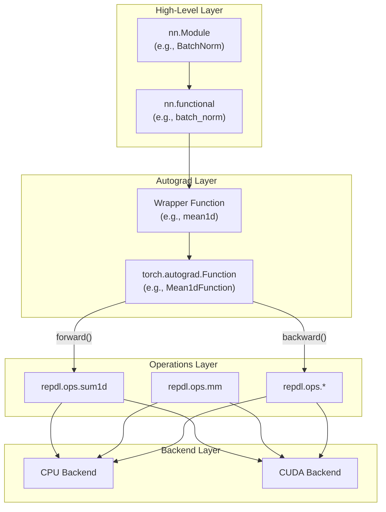
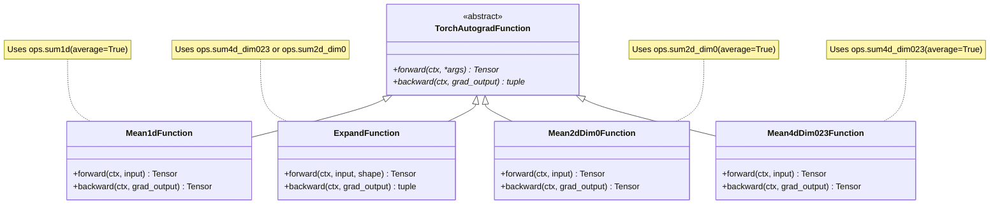
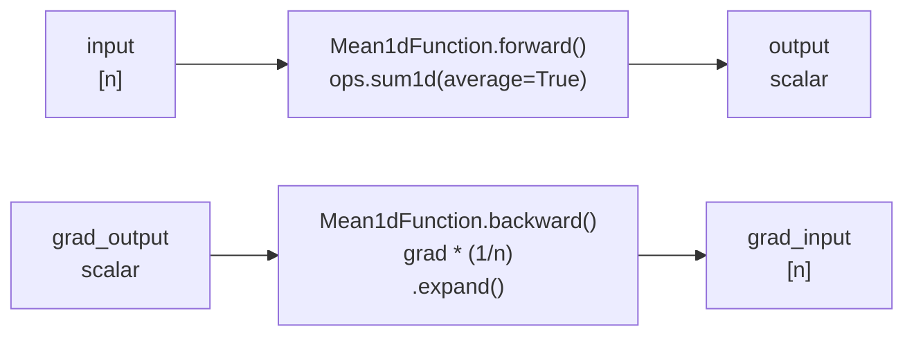
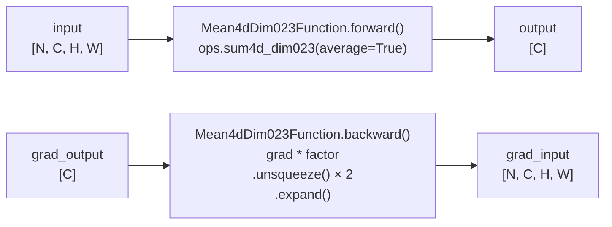
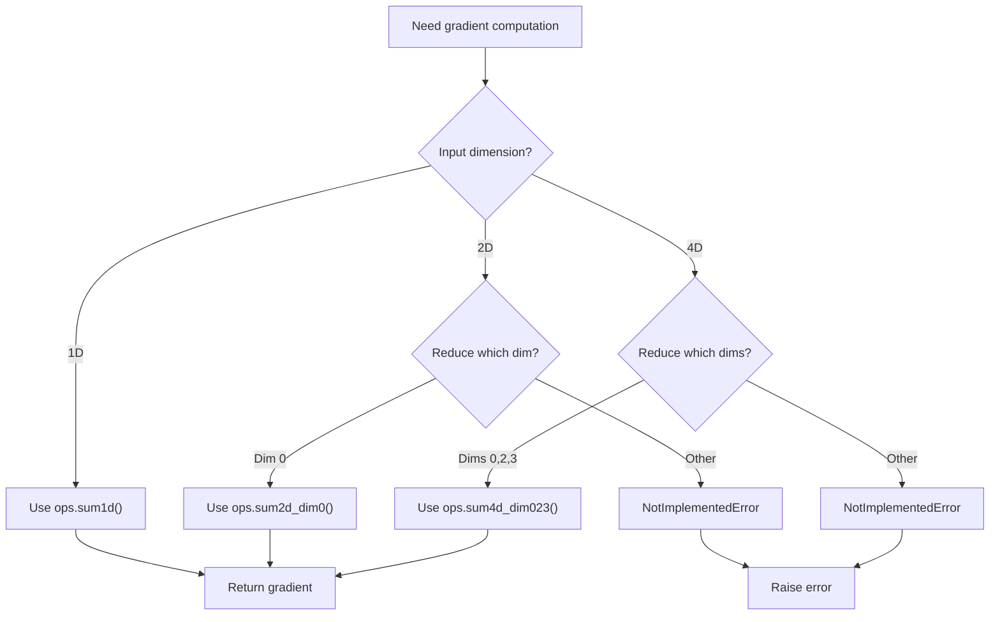

<!-- source: DeepWiki mcp.deepwiki.com · repo microsoft/RepDL · page 6.2 Adding Custom Autograd Functions · fetched 2026-10-26 -->

# Adding Custom Autograd Functions

<details>
<summary>Relevant source files</summary>

The following files were used as context for generating this wiki page:

- [README.md](README.md)
- [examples/mnist_trainig.py](examples/mnist_trainig.py)
- [repdl/func.py](repdl/func.py)

</details>


## Purpose and Scope

This guide explains how to create custom `torch.autograd.Function` subclasses that use `repdl.ops` for reproducible gradient computation. Custom autograd functions serve as differentiable wrappers around low-level operations, enabling automatic differentiation while maintaining RepDL's reproducibility guarantees.

For information about adding the underlying low-level operations themselves, see [Adding Custom Operations](#6.1). For information about building higher-level neural network modules, see [Adding Custom Layers](#6.3). For conceptual background on how autograd functions fit into RepDL's architecture, see [Custom Autograd Functions](#3.2).

**Sources:** [README.md:50-51](), [repdl/func.py:1-122]()

---

## Role of Autograd Functions in RepDL

Custom autograd functions sit between high-level modules (`repdl.nn`) and low-level operations (`repdl.ops`), providing the automatic differentiation glue that enables gradient-based training while routing all computations through reproducible backends.



**Sources:** [repdl/func.py:1-122]()

---

## Structure of Custom Autograd Functions

All custom autograd functions in RepDL follow a consistent pattern defined by PyTorch's `torch.autograd.Function` interface. Each function consists of two mandatory static methods and an optional wrapper function.

### Basic Components

| Component | Type | Purpose |
|-----------|------|---------|
| **Class Definition** | `torch.autograd.Function` subclass | Defines forward and backward computation |
| **`forward()` method** | `@staticmethod` | Computes output using `repdl.ops` |
| **`backward()` method** | `@staticmethod` | Computes gradients using `repdl.ops` |
| **Wrapper function** | Regular function | Validates inputs and calls `.apply()` |



**Sources:** [repdl/func.py:11-121]()

---

## Implementing the Forward Method

The `forward()` method computes the operation's output using reproducible operations from `repdl.ops`. It receives a context object (`ctx`) for storing information needed during the backward pass.

### Method Signature

```python
@staticmethod
def forward(
    ctx: torch.autograd.function.BackwardCFunction,
    input: torch.Tensor,
    *other_args
) -> torch.Tensor:
```

### Context Storage Pattern

Store any values needed for gradient computation in the context object:

| What to Store | When to Store | Example |
|---------------|---------------|---------|
| **Input shapes** | When shape is needed in backward | `ctx.input_shape = input.shape` |
| **Intermediate values** | When needed to compute gradients | `ctx.save_for_backward(input, weight)` |
| **Operation parameters** | When gradients depend on parameters | `ctx.dim = dim` |

### Example: Mean1dFunction Forward

[repdl/func.py:48-53]() demonstrates a simple forward implementation:

```python
@staticmethod
def forward(
    ctx: torch.autograd.function.BackwardCFunction, input: torch.Tensor
) -> torch.Tensor:
    ctx.input_shape = input.shape
    return ops.sum1d(input, average=True)
```

**Key points:**
- Stores `input.shape` for the backward pass
- Uses `ops.sum1d()` with `average=True` for reproducible computation
- Returns a single scalar tensor

### Example: ExpandFunction Forward

[repdl/func.py:13-18]() shows forward with multiple arguments:

```python
@staticmethod
def forward(
    ctx: torch.autograd.function.BackwardCFunction,
    input: torch.Tensor,
    shape: torch.Size,
) -> torch.Tensor:
    return input.expand(shape)
```

**Key points:**
- Takes an additional `shape` parameter
- Uses PyTorch's native `expand()` (reproducible for this operation)
- No context storage needed (gradients computed from output shape)

**Sources:** [repdl/func.py:11-53]()

---

## Implementing the Backward Method

The `backward()` method computes gradients with respect to inputs using reproducible operations. It receives the gradient of the loss with respect to the operation's output.

### Method Signature

```python
@staticmethod
def backward(
    ctx: torch.autograd.function.BackwardCFunction, 
    grad_output: torch.Tensor
) -> tuple[Optional[torch.Tensor], ...]:
```

### Return Value Pattern

Return a tuple with one gradient per `forward()` argument:

| Forward Argument | Backward Return Position | Value |
|------------------|-------------------------|-------|
| `input` tensor | Position 0 | `grad_input` or `None` |
| Scalar parameter | Position n | Always `None` |
| Shape/size parameter | Position n | Always `None` |

### Gradient Computation Patterns

#### Pattern 1: Mean Operations

For mean operations, gradients are distributed uniformly:

[repdl/func.py:56-64]() shows the pattern for 1D mean:

```python
@staticmethod
def backward(
    ctx: torch.autograd.function.BackwardCFunction, grad_output: torch.Tensor
) -> torch.Tensor:
    grad_input = None
    input_shape: torch.Size = ctx.input_shape
    if ctx.needs_input_grad[0]:
        grad_input = grad_output * (1 / input_shape.numel())
        grad_input = grad_input.expand(input_shape).contiguous()
    return grad_input
```

**Mathematical principle:** For `y = mean(x)`, we have `∂y/∂x_i = 1/n` where `n` is the number of elements.

#### Pattern 2: Dimension-Specific Reduction

For operations that reduce specific dimensions:

[repdl/func.py:81-90]() demonstrates reduction along dimension 0:

```python
@staticmethod
def backward(
    ctx: torch.autograd.function.BackwardCFunction, grad_output: torch.Tensor
) -> torch.Tensor:
    grad_input = None
    input_shape: torch.Size = ctx.input_shape
    if ctx.needs_input_grad[0]:
        factor = 1 / (input_shape.numel() // grad_output.numel())
        grad_input = grad_output * factor
        grad_input = grad_input.unsqueeze(-1).expand(input_shape)
    return grad_input
```

**Key operation:** `unsqueeze(-1)` restores the reduced dimension before expansion.

#### Pattern 3: Broadcasting Reversal

For operations that broadcast tensors, the backward pass must sum over broadcasted dimensions:

[repdl/func.py:21-30]() shows broadcasting reversal:

```python
@staticmethod
def backward(
    ctx: torch.autograd.function.BackwardCFunction, grad_output: torch.Tensor
) -> tuple[Optional[torch.Tensor], ...]:
    grad_input = None
    if ctx.needs_input_grad[0]:
        if grad_output.dim() == 4:
            grad_input = ops.sum4d_dim023(grad_output, keepdim=True).squeeze(0)
        else:
            grad_input = ops.sum2d_dim0(grad_output)
    return grad_input, None
```

**Key insight:** Uses reproducible sum operations (`ops.sum4d_dim023`, `ops.sum2d_dim0`) to reverse the broadcasting.

**Sources:** [repdl/func.py:21-116]()

---

## Complete Implementation Examples

### Example 1: Mean1dFunction

This is the simplest complete example, computing the mean of a 1D tensor:



**Implementation:** [repdl/func.py:47-69]()

| Method | Input Shape | Output Shape | Uses |
|--------|------------|--------------|------|
| `forward()` | `[n]` | `[]` (scalar) | `ops.sum1d(average=True)` |
| `backward()` | `[]` (scalar) | `[n]` | Standard PyTorch operations |

**Wrapper function:** [repdl/func.py:67-69]()
```python
def mean1d(input: torch.Tensor) -> torch.Tensor:
    assert input.dim() == 1
    return Mean1dFunction.apply(input)
```

### Example 2: Mean4dDim023Function

This example handles 4D tensors, reducing dimensions 0, 2, and 3 while preserving dimension 1:



**Implementation:** [repdl/func.py:98-121]()

| Method | Input Shape | Output Shape | Uses |
|--------|------------|--------------|------|
| `forward()` | `[N, C, H, W]` | `[C]` | `ops.sum4d_dim023(average=True)` |
| `backward()` | `[C]` | `[N, C, H, W]` | `.unsqueeze()`, `.expand()` |

**Backward computation details:**
1. Calculate factor: `1 / (N * H * W)` 
2. Apply factor: `grad_output * factor`
3. Add dimensions: `.unsqueeze(-1).unsqueeze(-1)` → `[C, 1, 1]`
4. Broadcast: `.expand([N, C, H, W])`

### Example 3: ExpandFunction

This example handles tensor broadcasting with dimension validation:

**Implementation:** [repdl/func.py:11-44]()

| Method | Input Shape | Output Shape | Special Handling |
|--------|------------|--------------|------------------|
| `forward()` | `[n]` or `[n, 1, 1]` | Variable | Calls `.expand(shape)` |
| `backward()` | Variable | `[n]` or `[n, 1, 1]` | Uses dimension-specific sum ops |

**Dimension validation:** [repdl/func.py:35-43]()
- Supports `[n]` → `[?, n]` (2D case)
- Supports `[n, 1, 1]` → `[?, n, ?, ?]` (4D case)
- Raises `NotImplementedError` for other shapes

**Sources:** [repdl/func.py:11-121]()

---

## Integration with repdl.ops

All gradient computations must use reproducible operations from `repdl.ops` to maintain RepDL's bitwise identical guarantee.

### Available Operations for Gradients

| Operation | Use Case | Example |
|-----------|----------|---------|
| `ops.sum1d(average=True)` | 1D reduction | Mean1dFunction forward |
| `ops.sum2d_dim0()` | 2D reduction along dim 0 | ExpandFunction backward (2D case) |
| `ops.sum4d_dim023(keepdim=True)` | 4D multi-dim reduction | ExpandFunction backward (4D case) |
| `ops.mm()` | Matrix multiplication | Not shown in func.py, but used in nn layers |
| `ops.div()` | Element-wise division | Could be used for normalization |

### Operation Selection Flow



**Important:** RepDL currently implements only specific dimension reduction patterns. When adding new autograd functions, you may need to add corresponding operations to [repdl/ops.py]() first. See [Adding Custom Operations](#6.1).

**Sources:** [repdl/func.py:8-122]()

---

## Wrapper Function Pattern

Each autograd function class should have a corresponding wrapper function that validates inputs and calls `.apply()`.

### Purpose of Wrapper Functions

| Purpose | Implementation |
|---------|----------------|
| **Input validation** | Check tensor dimensions with `assert` |
| **Shape constraints** | Verify specific shape requirements |
| **API simplification** | Hide `.apply()` implementation detail |
| **Type hints** | Provide clear function signatures |

### Standard Pattern

```python
def operation_name(input: torch.Tensor, *other_args) -> torch.Tensor:
    # Validate input constraints
    assert input.dim() == expected_dim
    
    # Additional validation if needed
    if not meets_requirements(input):
        raise NotImplementedError
    
    # Call the autograd function
    return OperationFunction.apply(input, *other_args)
```

### Examples from func.py

**Simple validation:** [repdl/func.py:67-69]()
```python
def mean1d(input: torch.Tensor) -> torch.Tensor:
    assert input.dim() == 1
    return Mean1dFunction.apply(input)
```

**Complex validation:** [repdl/func.py:33-44]()
```python
def expand_as(input: torch.Tensor, other: torch.Tensor) -> torch.Tensor:
    # (n) -> (?, n) or (n, 1, 1) -> (?, n, ?, ?)
    if not (
        input.dim() == 1 and other.dim() == 2 and input.shape[-1] == other.shape[-1]
    ) and not (
        input.dim() == 3
        and other.dim() == 4
        and input.shape[-3] == other.shape[-3]
        and input.shape[-2] == input.shape[-1] == 1
    ):
        raise NotImplementedError
    return ExpandFunction.apply(input, other.shape)
```

**Sources:** [repdl/func.py:33-69]()

---

## Step-by-Step Development Process

### 1. Define the Mathematical Operation

Before writing code, clearly define:
- Forward computation: `y = f(x)`
- Gradient computation: `∂L/∂x = g(∂L/∂y, x)`
- Shape transformations

### 2. Implement the Class Structure

```python
class YourOperationFunction(torch.autograd.Function):
    @staticmethod
    def forward(ctx, input, *args):
        # Store values needed for backward
        ctx.save_for_backward(input)
        # or ctx.input_shape = input.shape
        
        # Compute using repdl.ops
        output = ops.your_operation(input, *args)
        return output
    
    @staticmethod
    def backward(ctx, grad_output):
        # Retrieve stored values
        input_shape = ctx.input_shape
        
        # Initialize gradient
        grad_input = None
        
        # Compute if gradient is needed
        if ctx.needs_input_grad[0]:
            grad_input = ops.your_gradient_operation(grad_output, ...)
        
        # Return tuple with one element per forward argument
        return grad_input, None, ...  # None for non-tensor args
```

### 3. Create the Wrapper Function

```python
def your_operation(input: torch.Tensor, *args) -> torch.Tensor:
    # Validate inputs
    assert input.dim() == expected_dim
    # Additional checks...
    
    return YourOperationFunction.apply(input, *args)
```

### 4. Add to func.py

Place your implementation in [repdl/func.py]() following the existing organization pattern.

### 5. Test Reproducibility

Verify that your function produces identical results across devices:

```python
import torch
import repdl

# Test on CPU
input_cpu = torch.randn(10, device='cpu')
output_cpu = repdl.func.your_operation(input_cpu)

# Test on CUDA (if available)
if torch.cuda.is_available():
    input_cuda = input_cpu.cuda()
    output_cuda = repdl.func.your_operation(input_cuda)
    
    # Should be bitwise identical
    assert torch.equal(output_cpu, output_cuda.cpu())
```

**Sources:** [repdl/func.py:1-122](), [examples/mnist_trainig.py:62-84]()

---

## Best Practices and Common Patterns

### Gradient Check Pattern

Always check `ctx.needs_input_grad[i]` before computing gradients:

```python
grad_input = None
if ctx.needs_input_grad[0]:
    grad_input = compute_gradient(...)
return grad_input
```

**Rationale:** Avoids unnecessary computation when gradients aren't required.

### Shape Preservation Pattern

Store original shapes when the backward pass needs to restore them:

```python
# In forward
ctx.input_shape = input.shape

# In backward
grad_input = process_gradient(grad_output)
grad_input = grad_input.expand(ctx.input_shape)
```

### Dimension Validation Pattern

Validate dimensions in the wrapper function, not in forward/backward:

| Where | What to Check | How |
|-------|---------------|-----|
| **Wrapper function** | Expected dimensions | `assert input.dim() == n` |
| **Wrapper function** | Shape compatibility | `if not condition: raise NotImplementedError` |
| **Forward method** | None (already validated) | — |
| **Backward method** | None (PyTorch guarantees) | — |

### Contiguous Memory Pattern

Call `.contiguous()` after operations that may produce non-contiguous tensors:

```python
grad_input = grad_output.expand(input_shape).contiguous()
```

**Rationale:** Ensures compatibility with C++/CUDA backends that expect contiguous memory.

### Return Tuple Pattern

Always return a tuple from `backward()`, even for single inputs:

```python
# Correct
return grad_input, None, None

# Also correct (single element)
return grad_input  # For single-input functions

# Incorrect
return [grad_input, None]  # Lists not supported
```

**Sources:** [repdl/func.py:21-116]()

---

## Common Issues and Solutions

### Issue 1: Shape Mismatch in Backward

**Symptom:** RuntimeError about shape mismatch in autograd

**Solution:** Ensure gradient shape exactly matches input shape:
```python
# Add .contiguous() if needed
grad_input = grad_input.expand(input_shape).contiguous()
```

### Issue 2: Non-Deterministic Results

**Symptom:** Different hashes across runs

**Solution:** Ensure all operations use `repdl.ops`:
```python
# Wrong - uses PyTorch's non-deterministic sum
grad_input = grad_output.sum()

# Correct - uses RepDL's deterministic sum
grad_input = ops.sum1d(grad_output)
```

### Issue 3: Missing Gradient

**Symptom:** `None` gradient when gradient should exist

**Solution:** Check return tuple length and order:
```python
# Return one element per forward() argument
# Non-tensor arguments get None
return grad_input, None  # input and shape parameter
```

### Issue 4: NotImplementedError in Production

**Symptom:** NotImplementedError raised during training

**Solution:** Add support for the required tensor dimensions/shapes:
```python
# Expand validation to support new cases
if input.dim() == 2 and meets_conditions(input):
    # Add implementation
    pass
elif input.dim() == 4 and meets_conditions(input):
    # Add implementation
    pass
else:
    raise NotImplementedError(
        f"Unsupported shape: {input.shape}"
    )
```

**Sources:** [repdl/func.py:35-43]()

---

## Summary

Custom autograd functions in RepDL follow a three-component pattern:

1. **Function Class**: Inherits from `torch.autograd.Function`, implements `forward()` and `backward()`
2. **Reproducible Operations**: Uses `repdl.ops` for all computations
3. **Wrapper Function**: Validates inputs and calls `.apply()`

The key to maintaining reproducibility is ensuring that both forward and backward passes exclusively use operations from `repdl.ops`, which route through reproducible backends.

For next steps:
- To add underlying operations, see [Adding Custom Operations](#6.1)
- To build layers using these functions, see [Adding Custom Layers](#6.3)
- To understand reproducibility guarantees, see [Reproducibility Principles](#6.4)

**Sources:** [README.md:47-53](), [repdl/func.py:1-122]()

---

