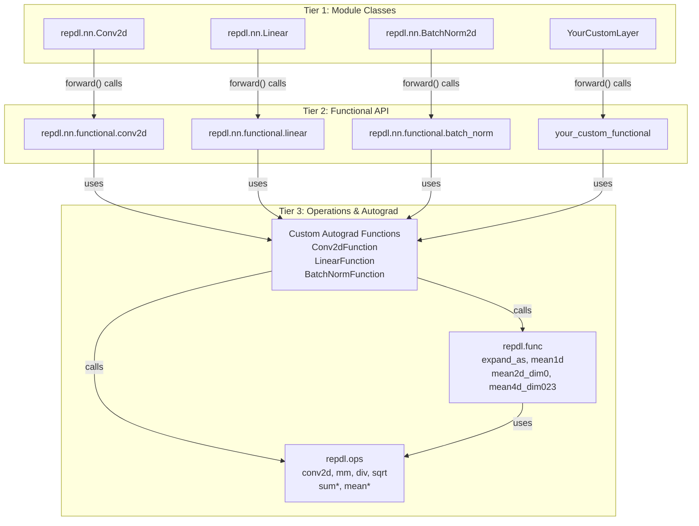
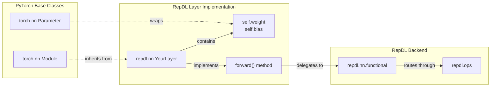
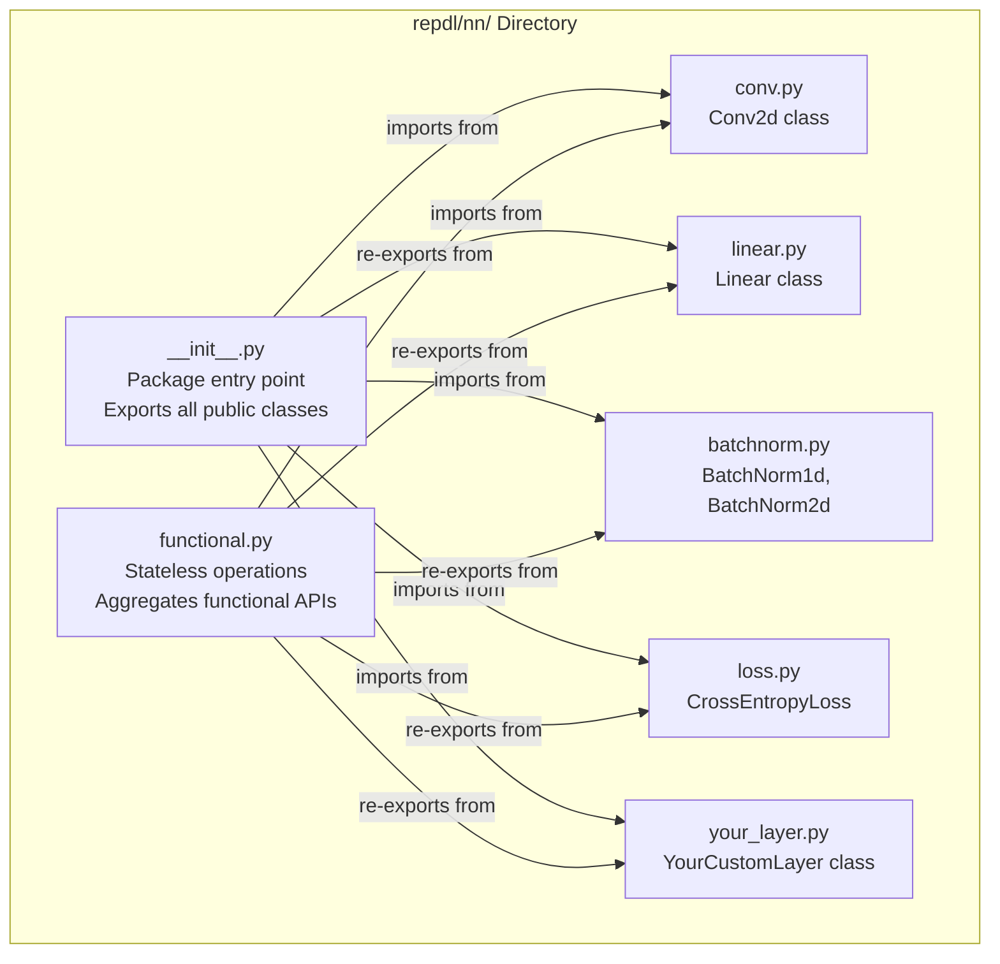
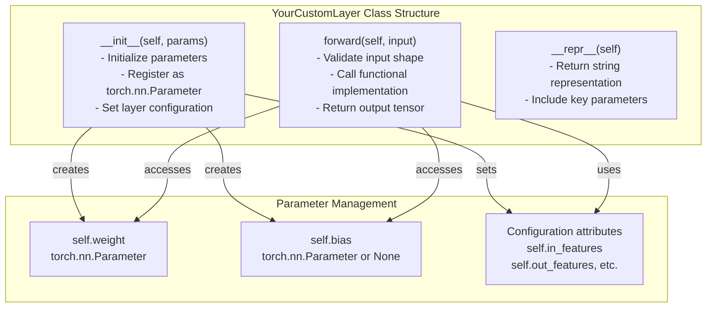
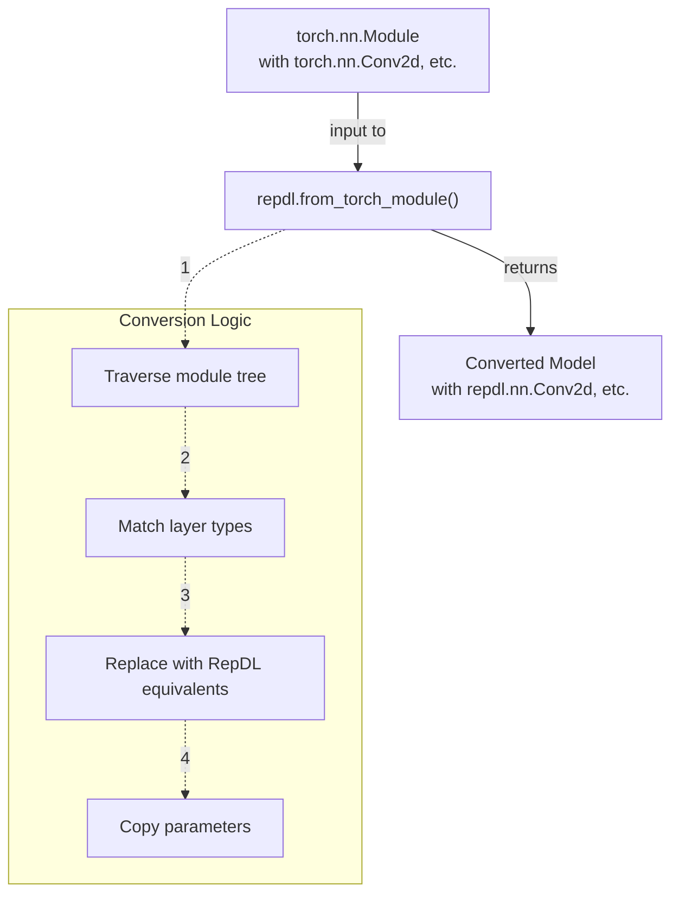
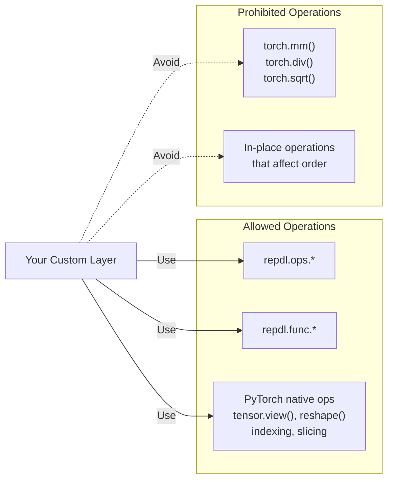
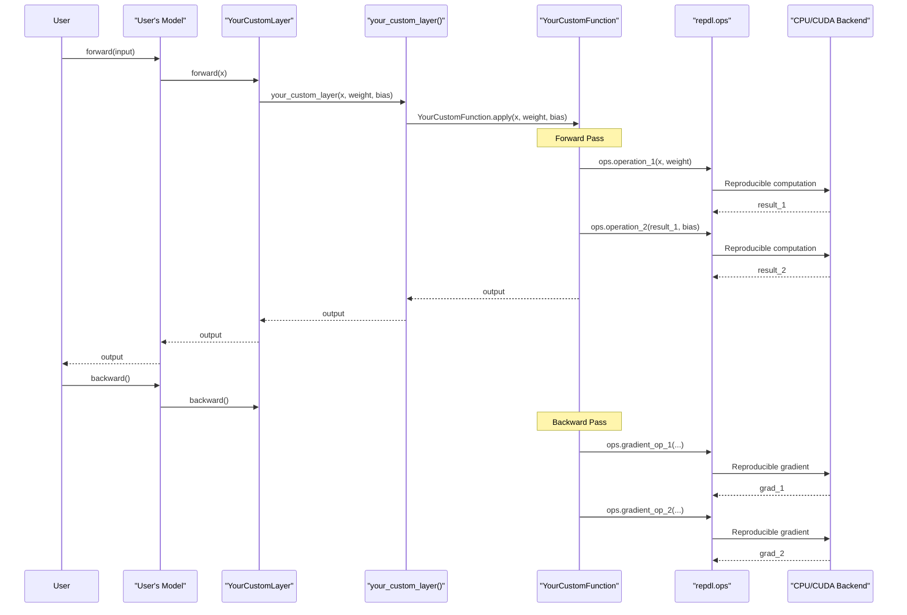

<!-- source: DeepWiki mcp.deepwiki.com · repo microsoft/RepDL · page 6.3 Adding Custom Layers · fetched 2026-10-26 -->

# Adding Custom Layers

<details>
<summary>Relevant source files</summary>

The following files were used as context for generating this wiki page:

- [README.md](README.md)
- [examples/mnist_trainig.py](examples/mnist_trainig.py)
- [repdl/nn/__init__.py](repdl/nn/__init__.py)

</details>


## Purpose and Scope

This guide explains how to create custom `nn.Module` subclasses that integrate with the RepDL framework. It covers the process of implementing new neural network layers, organizing them within the `repdl.nn` package, and ensuring they maintain reproducibility guarantees.

For information about implementing low-level operations, see [Adding Custom Operations](#6.1). For creating custom autograd functions that your layers might use, see [Adding Custom Autograd Functions](#6.2). For reference documentation of existing layers, see [Neural Network Modules](#4.3).

**Sources:** [README.md:47-52]()

---

## RepDL Layer Architecture

RepDL layers follow a three-tier architecture that mirrors PyTorch's design while routing all computations through reproducible backends. Understanding this structure is essential for implementing custom layers correctly.

### Layer Implementation Tiers



**Sources:** [README.md:45-52](), [repdl/nn/__init__.py:1-9]()

### Relationship to PyTorch



**Sources:** [examples/mnist_trainig.py:13-32]()

---

## File Organization

Custom layers must be organized within the `repdl.nn` package following established conventions. This structure ensures proper module discovery and import behavior.

### Package Structure



| File | Purpose | Exports |
|------|---------|---------|
| `__init__.py` | Package entry point, aggregates all layer classes | Layer classes (e.g., `Conv2d`, `Linear`) |
| `functional.py` | Stateless functional API, aggregates functional implementations | Functional operations (e.g., `conv2d()`, `linear()`) |
| `conv.py` | Convolutional layer implementation | `Conv2d` class |
| `linear.py` | Linear layer implementation | `Linear` class |
| `batchnorm.py` | Normalization layer implementation | `BatchNorm1d`, `BatchNorm2d` classes |
| `loss.py` | Loss function implementation | `CrossEntropyLoss` class |
| `your_layer.py` | Your custom layer implementation | `YourCustomLayer` class |

**Sources:** [repdl/nn/__init__.py:1-9]()

---

## Step-by-Step Implementation Guide

### Step 1: Create the Layer Module File

Create a new Python file in `repdl/nn/` for your custom layer. The file should contain:

1. **Module class** - Inherits from `torch.nn.Module`
2. **Functional implementation** - Stateless function that performs the computation
3. **Initialization** - Sets up parameters as `torch.nn.Parameter`
4. **Forward pass** - Delegates to the functional implementation

**File naming convention:** Use lowercase with underscores (e.g., `your_layer.py`)

### Step 2: Implement the Module Class

Your custom layer should follow this pattern:



**Key implementation requirements:**

| Component | Requirements |
|-----------|-------------|
| **Class inheritance** | Must inherit from `torch.nn.Module` |
| **Parameter initialization** | Wrap tensors in `torch.nn.Parameter` for automatic registration |
| **Forward method** | Delegate to functional implementation in `repdl.nn.functional` |
| **Reproducible operations** | Use only `repdl.ops` or `repdl.func`, never raw PyTorch operations |

**Sources:** [examples/mnist_trainig.py:35-38]()

### Step 3: Implement the Functional API

Create a corresponding stateless function in the same file that performs the actual computation. This function should:

1. Accept tensors and parameters as arguments (no `self`)
2. Use custom autograd functions or `repdl.ops` directly
3. Return computed tensors

The module's `forward()` method calls this functional implementation:


**Sources:** [README.md:50-51]()

### Step 4: Implement Custom Autograd Function (if needed)

If your layer requires custom gradient computation, implement a `torch.autograd.Function` subclass. See [Adding Custom Autograd Functions](#6.2) for detailed guidance.

**When to create a custom autograd function:**
- Complex backward pass logic
- Need to save intermediate values for gradient computation
- Multiple operations that need coordinated gradient flow

**When to use existing functions:**
- Simple operations available in `repdl.ops`
- Can compose from existing `repdl.func` functions
- Standard gradient computation patterns

### Step 5: Register in Package

Add your layer to `repdl/nn/__init__.py`:

```python
from .your_layer import YourCustomLayer
```

Add the functional implementation to `repdl/nn/functional.py`:

```python
from .your_layer import your_custom_layer
```

This two-step registration ensures your layer is accessible both as a module class (`repdl.nn.YourCustomLayer`) and as a functional operation (`repdl.nn.functional.your_custom_layer`).

**Sources:** [repdl/nn/__init__.py:4-8]()

---

## Conversion Support with `from_torch_module`

To enable automatic conversion of PyTorch models that use your custom layer, you must ensure compatibility with `repdl.from_torch_module()`. This function traverses PyTorch models and replaces standard layers with RepDL equivalents.

### Conversion Flow



### Supporting Conversion for Your Layer

To support automatic conversion, your layer must:

1. **Match parameter naming** - Use the same parameter names as PyTorch equivalents
2. **Accept same constructor arguments** - Support the same initialization API
3. **Maintain parameter shapes** - Ensure weight/bias tensors have identical dimensions

**Example conversion pattern:**

| PyTorch Layer | RepDL Equivalent | Parameter Mapping |
|---------------|------------------|-------------------|
| `torch.nn.Conv2d` | `repdl.nn.Conv2d` | `weight`, `bias` → same names |
| `torch.nn.Linear` | `repdl.nn.Linear` | `weight`, `bias` → same names |
| `torch.nn.BatchNorm2d` | `repdl.nn.BatchNorm2d` | `weight`, `bias`, `running_mean`, `running_var` → same names |

**Sources:** [README.md:29-32](), [examples/mnist_trainig.py:37-38]()

---

## Best Practices

### Maintain Reproducibility

All operations within your custom layer must use RepDL's reproducible backends:



**Key principles:**

| Principle | Implementation |
|-----------|----------------|
| **Fixed FP operation order** | Use `repdl.ops` operations that guarantee deterministic execution order |
| **IEEE-754 compliance** | Rely on RepDL backends that enforce standard floating-point behavior |
| **Correctly rounded math** | Use `repdl.ops.div()`, `repdl.ops.sqrt()` instead of PyTorch equivalents |
| **No in-place mutations** | Avoid operations that modify tensors in-place if they affect computation order |

**Sources:** [README.md:52-52]()

### Parameter Initialization

Initialize parameters using PyTorch's standard initialization utilities, but ensure the initialization itself is deterministic:

**Recommended approach:**
1. Create tensor with desired initialization
2. Wrap in `torch.nn.Parameter`
3. Register by assigning to `self.parameter_name`

**Parameter registration:**
- Parameters assigned as attributes are automatically registered
- Use `register_parameter()` for conditional parameters (e.g., optional bias)

### Documentation and Testing

Document your custom layer with:
1. **Docstring** - Describe purpose, parameters, input/output shapes
2. **Parameter descriptions** - Document each constructor argument
3. **Shape specifications** - Clearly define expected tensor dimensions
4. **Usage examples** - Show typical usage patterns

Test your layer for reproducibility:
1. Run forward pass on CPU and CUDA with same input
2. Verify outputs are bitwise identical using `repdl.utils.get_hash()`
3. Test backward pass produces identical gradients
4. Verify conversion with `repdl.from_torch_module()` preserves behavior

**Sources:** [examples/mnist_trainig.py:67-67](), [examples/mnist_trainig.py:83-83](), [examples/mnist_trainig.py:103-103]()

---

## Integration Example

Here's how a custom layer integrates with the RepDL ecosystem:



**Sources:** [README.md:47-52]()

---

## Summary

Creating custom layers in RepDL requires:

1. **File organization** - Create layer file in `repdl/nn/`, register in `__init__.py` and `functional.py`
2. **Module implementation** - Inherit from `torch.nn.Module`, manage parameters, implement forward pass
3. **Functional implementation** - Create stateless function that delegates to autograd functions or operations
4. **Reproducible operations** - Use only `repdl.ops` and `repdl.func` for all computations
5. **Conversion support** - Match PyTorch parameter naming and constructor signatures
6. **Testing** - Verify bitwise identical results across devices using `repdl.utils.get_hash()`

By following these patterns, your custom layers will maintain RepDL's reproducibility guarantees while integrating seamlessly with the existing framework.

**Sources:** [README.md:47-52](), [repdl/nn/__init__.py:1-9]()

---

