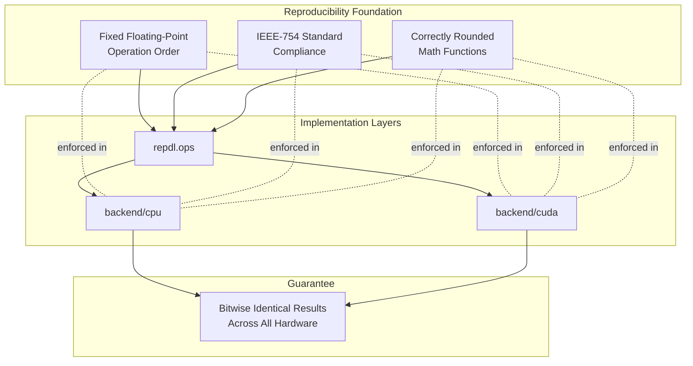
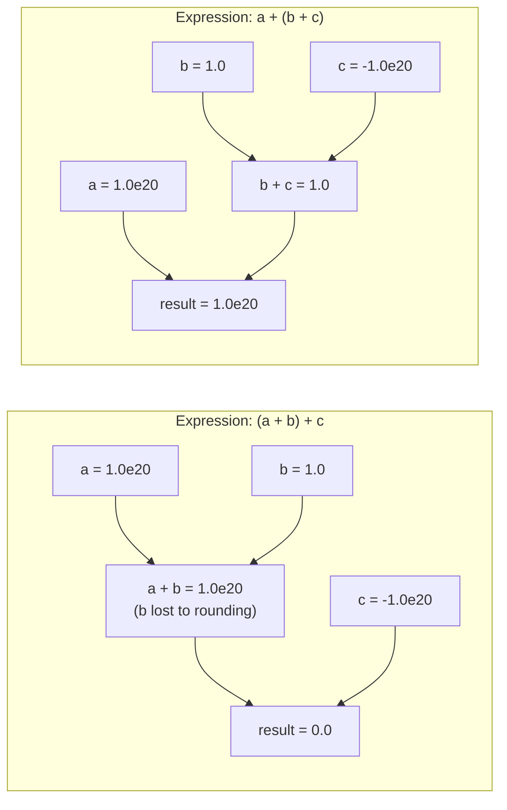
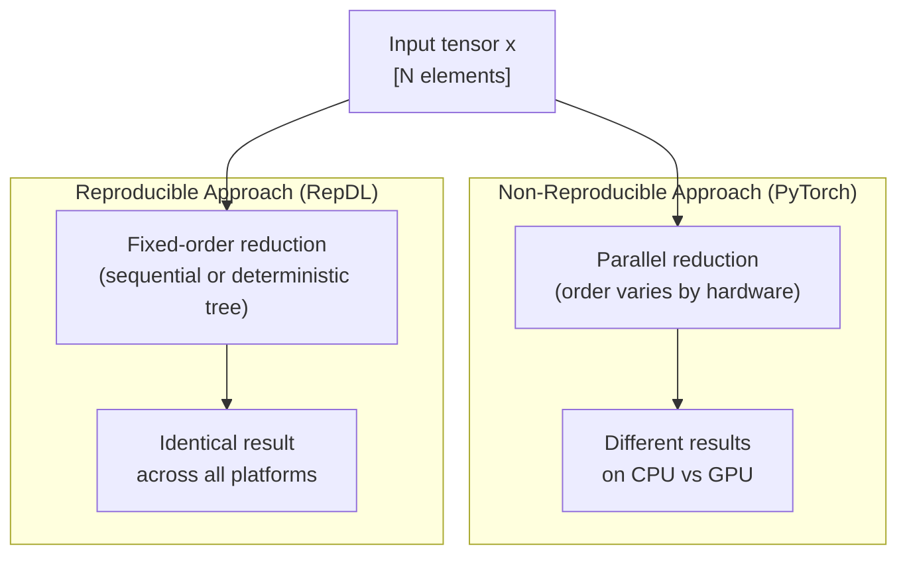
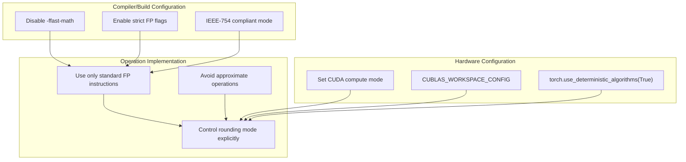
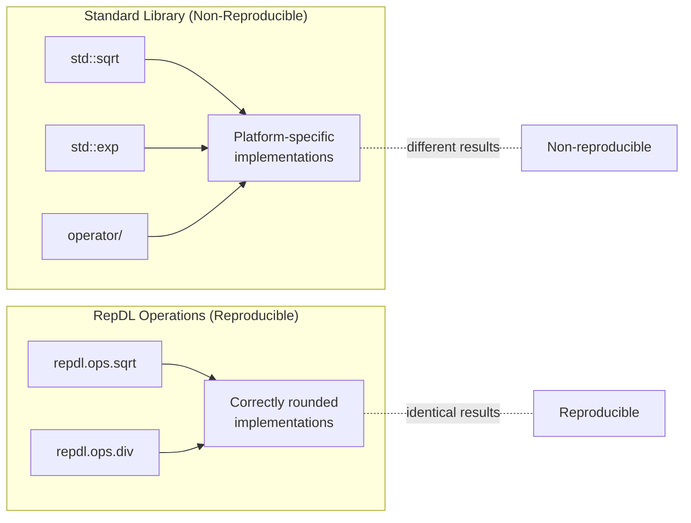
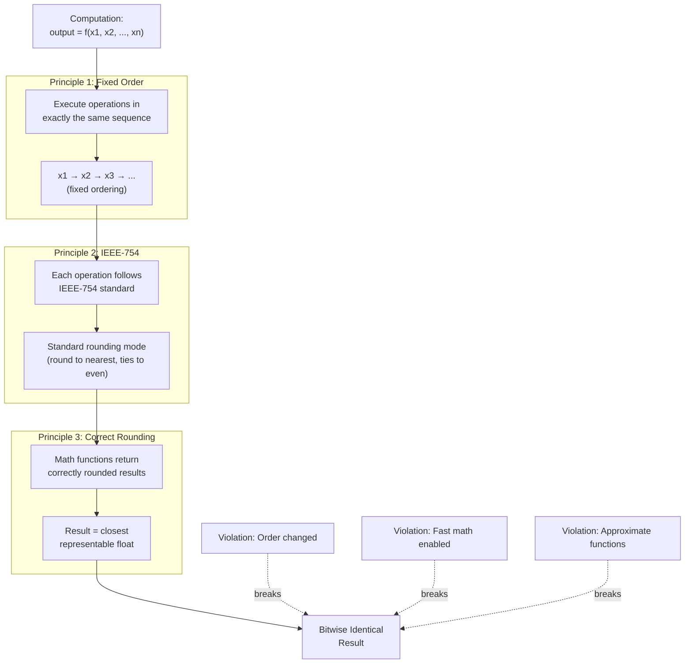
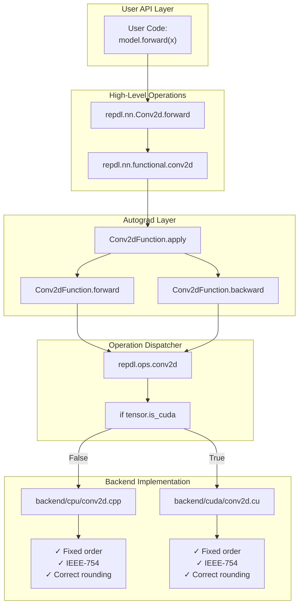
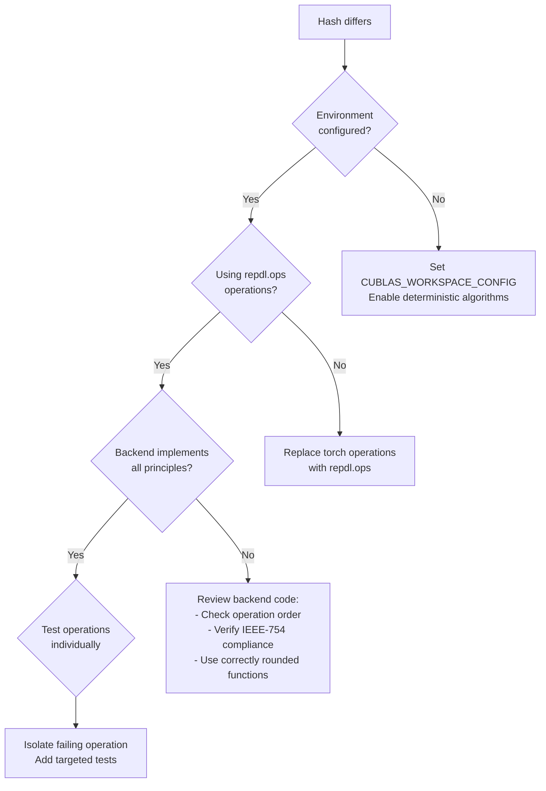

<!-- source: DeepWiki mcp.deepwiki.com · repo microsoft/RepDL · page 6.4 Reproducibility Principles · fetched 2026-10-26 -->

# Reproducibility Principles

<details>
<summary>Relevant source files</summary>

The following files were used as context for generating this wiki page:

- [README.md](README.md)
- [examples/mnist_trainig.py](examples/mnist_trainig.py)

</details>


## Purpose and Scope

This document provides a comprehensive explanation of the three core reproducibility principles that underpin RepDL's guarantee of **bitwise identical results across hardware platforms**. It details:

- The technical foundation of fixed floating-point operation order
- IEEE-754 standard compliance requirements
- Correctly rounded mathematical functions
- How these principles interact to ensure reproducibility
- Guidelines for maintaining these principles when extending RepDL

For practical implementation guidance on adding custom operations, see [Adding Custom Operations](#6.1). For backend-specific implementation details, see [Backend Architecture](#5.1).

**Sources:** [README.md:52-52]()

---

## Overview: The Three Pillars

RepDL achieves bitwise reproducibility through three fundamental principles that must be maintained throughout the entire computation stack:



**Diagram: Three Pillars of Reproducibility and Their Enforcement Points**

These principles are not optional optimizations—they are **mandatory requirements** for any operation, function, or module in RepDL. Violating any principle breaks the reproducibility guarantee.

**Sources:** [README.md:52-52]()

---

## Principle 1: Fixed Floating-Point Operation Order

### The Problem

Floating-point arithmetic is **not associative**. The expression `(a + b) + c` can produce different results than `a + (b + c)` due to rounding errors:



**Diagram: Non-Associativity of Floating-Point Addition**

Compilers, hardware optimizers, and parallel reduction algorithms may reorder operations for performance, leading to different results on different platforms.

### The Solution

RepDL **fixes the exact order** of all floating-point operations at the implementation level:

| Technique | Purpose | Implementation Location |
|-----------|---------|------------------------|
| Sequential reduction loops | Enforce left-to-right summation order | `backend/cpu/*.cpp`, `backend/cuda/*.cu` |
| Disabled auto-vectorization flags | Prevent compiler reordering | Backend build configuration |
| Deterministic parallel reduction | Use reproducible tree reduction patterns | CUDA kernel implementations |
| Explicit operation scheduling | Control CUDA kernel execution order | `backend/cuda/bind.cpp` |

### Example: Reproducible Sum Operation

Consider the operation `repdl.ops.sum(x)` which sums all elements of a tensor:



**Diagram: Reproducible vs Non-Reproducible Sum Implementation**

The key difference: RepDL's implementation guarantees that elements are combined in **exactly the same order** regardless of hardware or parallel execution strategy.

**Sources:** [README.md:52-52](), [README.md:43-43]()

---

## Principle 2: IEEE-754 Standard Compliance

### The Problem

The IEEE-754 standard defines the behavior of floating-point arithmetic, including:
- Rounding modes (round to nearest, ties to even)
- Handling of special values (NaN, infinity)
- Precision guarantees for basic operations

However, many hardware optimizations violate this standard:

| Violation Type | Example | Impact |
|----------------|---------|--------|
| Fast math mode | `-ffast-math` compiler flag | Changes rounding, handles NaN differently |
| Fused operations | Hardware FMA (fused multiply-add) | Different rounding than separate multiply + add |
| Approximate instructions | CUDA `__fdividef` (fast division) | Lower precision, non-standard rounding |
| Reduced precision intermediates | x87 FPU extended precision | Inconsistent results across platforms |

### The Solution

RepDL enforces strict IEEE-754 compliance:



**Diagram: IEEE-754 Compliance Enforcement Stack**

### Required Environment Setup

RepDL requires specific environment configuration to ensure IEEE-754 compliance:

```python
# Required before training
os.environ["CUBLAS_WORKSPACE_CONFIG"] = ":4096:8"
torch.use_deterministic_algorithms(True)
```

These settings force PyTorch and CUDA libraries to use deterministic, IEEE-754 compliant algorithms.

**Sources:** [examples/mnist_trainig.py:42-43](), [README.md:52-52]()

---

## Principle 3: Correctly Rounded Math Functions

### The Problem

Mathematical functions like `sqrt`, `exp`, `log`, `sin`, etc., are not part of basic IEEE-754 operations. Hardware and library implementations vary:

| Function | Problem | Example |
|----------|---------|---------|
| `sqrt(x)` | Different implementations use different approximations | Last bit may differ |
| `exp(x)` | Table-based vs polynomial approximation | Multi-bit differences for some inputs |
| `div(x, y)` | Fast reciprocal multiply vs true division | Rounding differences |
| `log(x)` | Range reduction strategies differ | Platform-specific results |

### The Solution

RepDL uses **correctly rounded** implementations that guarantee:
- The result is the closest representable floating-point number to the true mathematical result
- Rounding follows a consistent mode (round to nearest, ties to even)
- The same result across all platforms



**Diagram: Standard vs Correctly Rounded Math Functions**

### Implementation Requirements

For each math operation in `repdl.ops`:

1. **CPU Backend** (`backend/cpu/*.cpp`):
   - Use correctly rounded C++ math library functions
   - Verify that the library provides guarantees (e.g., `libm` with correct rounding)
   - Test on multiple CPUs to verify identical results

2. **CUDA Backend** (`backend/cuda/*.cu`):
   - Use CUDA intrinsics with correct rounding (e.g., `__fdiv_rn` for round-to-nearest division)
   - Avoid fast math intrinsics (e.g., `__fdividef`)
   - Ensure consistent results across GPU architectures (Volta, Turing, Ampere, etc.)

**Sources:** [README.md:43-43](), [README.md:52-52]()

---

## How The Principles Work Together

The three principles are **interdependent** and must all be satisfied simultaneously:



**Diagram: Interdependence of Reproducibility Principles**

**Example Scenario:** Computing `repdl.ops.div(repdl.ops.sqrt(x), 10)`

| Step | Principle Applied | Requirement |
|------|-------------------|-------------|
| 1. `sqrt(x)` | Principle 3 | Use correctly rounded sqrt implementation |
| 2. Result of sqrt | Principle 2 | Store in IEEE-754 compliant format |
| 3. `div(result, 10)` | Principle 3 | Use correctly rounded division |
| 4. Overall computation | Principle 1 | Execute sqrt before div, no reordering |

If any principle is violated (e.g., compiler reorders operations, or hardware uses fast approximate sqrt), reproducibility breaks.

**Sources:** [README.md:52-52]()

---

## Applying Principles in Code Architecture

RepDL's architecture enforces these principles at multiple levels:



**Diagram: Principle Enforcement Through Architecture Layers**

### Enforcement Points

| Layer | File Path | Principle Enforcement |
|-------|-----------|----------------------|
| Operation Dispatcher | `repdl/ops.py` | Routes to reproducible backends only |
| CPU Backend | `backend/cpu/*.cpp` | Implements all three principles in C++ |
| CUDA Backend | `backend/cuda/*.cu` | Implements all three principles in CUDA |
| Binding Layer | `backend/cpu/bind.cpp`, `backend/cuda/bind.cpp` | Registers only compliant implementations |

The principles are **not enforced at the Python level** (too slow), but rather in the C++/CUDA backends where performance is maintained.

**Sources:** [README.md:49-49]()

---

## Maintaining Principles When Extending RepDL

When adding custom operations, functions, or modules to RepDL, you **must** ensure all three principles are maintained. Here's the checklist:

### 1. Adding to `repdl/ops.py`

Define the operation interface in the dispatcher:

```python
# repdl/ops.py - operation signature
def my_custom_op(x: torch.Tensor, param: float) -> torch.Tensor:
    """
    Custom operation with reproducibility guarantee.
    
    Requirements:
    - Fixed operation order in implementation
    - IEEE-754 compliant computation  
    - Correctly rounded result
    """
    if x.is_cuda:
        return _cuda_backend.my_custom_op(x, param)
    else:
        return _cpu_backend.my_custom_op(x, param)
```

**Key Point:** The dispatcher itself doesn't enforce principles—it routes to backends that do.

### 2. Implementing CPU Backend (`backend/cpu/*.cpp`)

```cpp
// backend/cpu/my_custom_op.cpp
torch::Tensor my_custom_op(torch::Tensor x, double param) {
    // Principle 1: Fixed operation order
    // - Use sequential loops, not parallel reductions (unless deterministic)
    // - Document the exact order of operations
    
    // Principle 2: IEEE-754 compliance
    // - Compile without -ffast-math
    // - Use standard floating-point types (float, double)
    
    // Principle 3: Correctly rounded math
    // - Use std::sqrt, std::exp, etc. (not approximate versions)
    // - Verify rounding mode is round-to-nearest
    
    auto result = torch::empty_like(x);
    auto x_data = x.data_ptr<float>();
    auto result_data = result.data_ptr<float>();
    
    // Example: Fixed-order sequential computation
    for (int64_t i = 0; i < x.numel(); ++i) {
        // Each operation is performed in exactly this order
        float temp = std::sqrt(x_data[i]);  // Correctly rounded
        result_data[i] = temp / param;       // IEEE-754 division
    }
    
    return result;
}
```

**Critical Requirements:**
- No parallel loops that might execute in variable order
- No compiler optimizations that reorder operations
- Explicit sequential iteration when order matters

### 3. Implementing CUDA Backend (`backend/cuda/*.cu`)

```cpp
// backend/cuda/my_custom_op.cu
__global__ void my_custom_op_kernel(
    const float* x, float* result, double param, int64_t size) {
    
    int64_t idx = blockIdx.x * blockDim.x + threadIdx.x;
    if (idx >= size) return;
    
    // Principle 1: Each thread computes exactly one element
    // - No shared memory reductions that might reorder
    // - Fixed computation per thread
    
    // Principle 2: IEEE-754 compliance
    // - Use standard CUDA intrinsics
    // - Avoid __float2int_rz (non-standard rounding)
    
    // Principle 3: Correctly rounded math
    // - Use __fdiv_rn (round-to-nearest division)
    // - Use sqrtf (correctly rounded), not __fsqrt_rn (approximate)
    
    float temp = sqrtf(x[idx]);           // Correctly rounded
    result[idx] = __fdiv_rn(temp, param); // Round-to-nearest division
}

torch::Tensor my_custom_op(torch::Tensor x, double param) {
    auto result = torch::empty_like(x);
    
    // Principle 1: Fixed kernel launch configuration
    int64_t size = x.numel();
    int threads = 256;  // Fixed thread count
    int blocks = (size + threads - 1) / threads;
    
    // Launch kernel with deterministic configuration
    my_custom_op_kernel<<<blocks, threads>>>(
        x.data_ptr<float>(),
        result.data_ptr<float>(),
        param,
        size
    );
    
    return result;
}
```

**CUDA-Specific Considerations:**

| Aspect | Non-Reproducible | Reproducible |
|--------|------------------|--------------|
| Division | `a / b` (might use fast path) | `__fdiv_rn(a, b)` (explicit rounding) |
| Square root | `__fsqrt_rn(x)` (fast approx) | `sqrtf(x)` (correctly rounded) |
| Reduction | Variable thread order | Fixed reduction tree or atomic operations |
| Kernel launch | Dynamic configuration | Fixed block/thread counts |

### 4. Testing Reproducibility

Every new operation must be tested for reproducibility:

```python
# test_my_custom_op.py
import torch
import repdl

def test_reproducibility_cpu():
    """Test CPU reproducibility."""
    x = torch.randn(1000)
    param = 2.5
    
    # Multiple runs should produce identical results
    result1 = repdl.ops.my_custom_op(x, param)
    result2 = repdl.ops.my_custom_op(x, param)
    
    assert torch.equal(result1, result2), "CPU results differ"
    assert repdl.utils.get_hash(result1) == repdl.utils.get_hash(result2)

def test_reproducibility_cuda():
    """Test CUDA reproducibility."""
    if not torch.cuda.is_available():
        return
        
    x = torch.randn(1000).cuda()
    param = 2.5
    
    result1 = repdl.ops.my_custom_op(x, param)
    result2 = repdl.ops.my_custom_op(x, param)
    
    assert torch.equal(result1, result2), "CUDA results differ"

def test_cross_device_reproducibility():
    """Test that CPU and CUDA produce identical results."""
    if not torch.cuda.is_available():
        return
    
    x_cpu = torch.randn(1000)
    x_cuda = x_cpu.cuda()
    param = 2.5
    
    result_cpu = repdl.ops.my_custom_op(x_cpu, param)
    result_cuda = repdl.ops.my_custom_op(x_cuda, param).cpu()
    
    # Must be bitwise identical
    assert torch.equal(result_cpu, result_cuda), "CPU and CUDA results differ"
    assert repdl.utils.get_hash(result_cpu) == repdl.utils.get_hash(result_cuda)
```

**Sources:** [README.md:49-52]()

---

## Common Pitfalls and How to Avoid Them

### Pitfall 1: Parallel Reductions Without Fixed Order

**Problem:**
```cpp
// NON-REPRODUCIBLE: OpenMP may execute in any order
#pragma omp parallel for reduction(+:sum)
for (int i = 0; i < n; ++i) {
    sum += data[i];  // Order varies across runs
}
```

**Solution:**
```cpp
// REPRODUCIBLE: Sequential accumulation
float sum = 0.0f;
for (int i = 0; i < n; ++i) {
    sum += data[i];  // Fixed left-to-right order
}
```

### Pitfall 2: Fast Math Flags

**Problem:**
```cmake
# NON-REPRODUCIBLE: Build configuration
target_compile_options(my_backend PRIVATE -ffast-math)
```

**Solution:**
```cmake
# REPRODUCIBLE: Strict IEEE-754 mode
target_compile_options(my_backend PRIVATE -fno-fast-math)
```

### Pitfall 3: Approximate CUDA Intrinsics

**Problem:**
```cpp
// NON-REPRODUCIBLE: Fast approximate division
result[idx] = __fdividef(a, b);  // Platform-dependent precision
```

**Solution:**
```cpp
// REPRODUCIBLE: Correctly rounded division
result[idx] = __fdiv_rn(a, b);  // Round-to-nearest, IEEE-754
```

### Pitfall 4: Forgetting Environment Configuration

**Problem:**
```python
# NON-REPRODUCIBLE: Missing environment setup
model = repdl.from_torch_module(model)
# Training without deterministic algorithms enabled
```

**Solution:**
```python
# REPRODUCIBLE: Proper environment configuration
import os
os.environ["CUBLAS_WORKSPACE_CONFIG"] = ":4096:8"
torch.use_deterministic_algorithms(True)

model = repdl.from_torch_module(model)
```

**Sources:** [examples/mnist_trainig.py:42-43](), [README.md:52-52]()

---

## Verification and Debugging

### Using `repdl.utils.get_hash` for Verification

The `get_hash` function provides cryptographic verification of reproducibility:

```python
import repdl

# Compute hash of model state
model_hash = repdl.utils.get_hash(model)

# Compute hash of tensor outputs
output_hash = repdl.utils.get_hash(output)

# Compare across devices/runs
assert model_hash == expected_hash, "Model state differs"
assert output_hash == expected_hash, "Output differs"
```

**Expected Behavior:**
- Same input → Same hash (always)
- Different devices → Same hash (CPU vs CUDA)
- Different runs → Same hash (run 1 vs run 2)

### Debugging Non-Reproducibility

When hashes differ, use this debugging strategy:



**Diagram: Debugging Non-Reproducibility Flow**

**Sources:** [examples/mnist_trainig.py:67-67](), [examples/mnist_trainig.py:83-83](), [examples/mnist_trainig.py:103-103]()

---

## Summary Table

| Principle | What It Controls | How It's Enforced | Where to Look |
|-----------|------------------|-------------------|---------------|
| **Fixed FP Order** | Sequence of floating-point operations | Sequential loops, deterministic reductions | `backend/cpu/*.cpp`, `backend/cuda/*.cu` |
| **IEEE-754 Compliance** | Rounding modes, special value handling | Compiler flags, standard FP types, environment config | Build system, `examples/mnist_trainig.py:42-43` |
| **Correct Rounding** | Math function precision | Correctly rounded library functions, explicit CUDA intrinsics | Backend implementations, operation tests |

**Key Takeaway:** All three principles must be satisfied simultaneously at the backend level for RepDL to guarantee bitwise identical results. When extending RepDL, treat these principles as **invariant requirements** that cannot be compromised for performance or convenience.

**Sources:** [README.md:52-52](), [README.md:49-52]()

---

