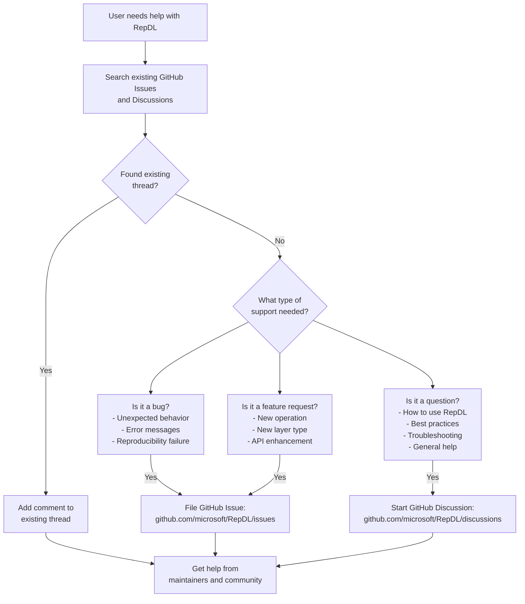
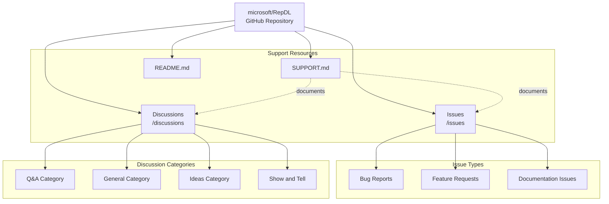
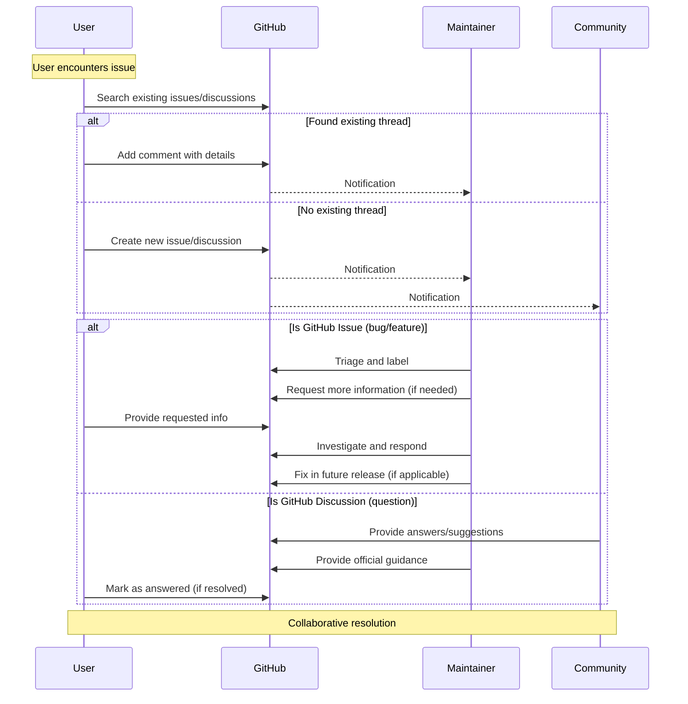

<!-- source: DeepWiki mcp.deepwiki.com · repo microsoft/RepDL · page 7.1 Getting Help · fetched 2026-10-26 -->

# Getting Help

<details>
<summary>Relevant source files</summary>

The following files were used as context for generating this wiki page:

- [SUPPORT.md](SUPPORT.md)

</details>


## Purpose and Scope

This document describes the support resources available for RepDL users, including where to report bugs, where to ask questions, and what to expect from Microsoft's support policy. For information about contributing code to RepDL, see [Contributing](#7.2). For security vulnerability reporting, see [Security](#7.3).

---

## Support Channels Overview

RepDL provides two primary support channels through GitHub, each serving a distinct purpose:

| Channel | Purpose | When to Use |
|---------|---------|-------------|
| **GitHub Issues** | Bug tracking and feature requests | Reproducible bugs, unexpected behavior, feature proposals |
| **GitHub Discussions** | Questions and community help | Usage questions, best practices, troubleshooting, general help |

**Sources:** [SUPPORT.md:1-12]()

---

## Support Channel Decision Flow



**Sources:** [SUPPORT.md:3-7]()

---

## GitHub Issues: Bugs and Feature Requests

GitHub Issues should be used for **actionable items** that require code changes or investigation by the maintainers.

### When to File an Issue

File a GitHub Issue when you encounter:

- **Bugs**: Unexpected behavior, crashes, or errors
- **Reproducibility Failures**: Different results across hardware when using RepDL
- **Feature Requests**: Proposals for new operations, layers, or API enhancements
- **Documentation Issues**: Missing or incorrect documentation

### Before Filing a New Issue

**Always search existing issues first** to avoid duplicates. RepDL uses GitHub Issues at `https://github.com/microsoft/RepDL/issues` to track all bugs and feature requests.

**Sources:** [SUPPORT.md:5]()

### What to Include in Bug Reports

When filing a bug report, include the following information to help maintainers reproduce and diagnose the issue:

#### Environment Information

```python
import torch
import repdl
import sys

print(f"Python version: {sys.version}")
print(f"PyTorch version: {torch.__version__}")
print(f"RepDL version: {repdl.__version__}")
print(f"CUDA available: {torch.cuda.is_available()}")
if torch.cuda.is_available():
    print(f"CUDA version: {torch.version.cuda}")
    print(f"GPU: {torch.cuda.get_device_name(0)}")
```

#### Minimal Reproducible Example

Provide a **minimal, self-contained code snippet** that reproduces the issue:

```python
import torch
import repdl

# Minimal example that demonstrates the bug
model = torch.nn.Linear(10, 5)
repdl_model = repdl.from_torch_module(model)

# Describe expected vs actual behavior
```

#### Reproducibility Verification

For reproducibility issues, include:
- Hash values from `repdl.utils.get_hash()` on different hardware
- Environment variables set (e.g., `CUBLAS_WORKSPACE_CONFIG`)
- Hardware details (CPU model, GPU model)

**Sources:** [SUPPORT.md:5]()

### What to Include in Feature Requests

When proposing a new feature, include:

1. **Use Case**: Describe the problem you're trying to solve
2. **Proposed API**: Show how you envision the feature being used
3. **Alternatives Considered**: Explain why existing functionality doesn't meet your needs
4. **Reproducibility Impact**: Discuss how the feature maintains bitwise identical results

**Sources:** [SUPPORT.md:5]()

---

## GitHub Discussions: Questions and Help

GitHub Discussions should be used for **conversational support** where you need help understanding or using RepDL.

### When to Use Discussions

Use GitHub Discussions at `https://github.com/microsoft/RepDL/discussions` for:

- **Usage Questions**: "How do I convert a custom PyTorch model?"
- **Best Practices**: "What's the recommended way to verify reproducibility?"
- **Troubleshooting**: "Why am I getting different results on CPU vs GPU?"
- **Integration Help**: "How do I integrate RepDL with my training pipeline?"
- **Performance Questions**: "What's the performance overhead of reproducibility?"
- **General Help**: Any question that doesn't involve a bug or feature request

### Discussion Categories

GitHub Discussions are typically organized into categories:

| Category | Purpose |
|----------|---------|
| **Q&A** | Ask questions and get answers from the community |
| **General** | General discussions about RepDL |
| **Ideas** | Share ideas that aren't ready to be feature requests |
| **Show and Tell** | Share projects or results using RepDL |

**Sources:** [SUPPORT.md:7]()

### Getting Good Answers

To get helpful responses in Discussions:

1. **Be Specific**: Include relevant code snippets and error messages
2. **Provide Context**: Explain what you're trying to accomplish
3. **Show Your Work**: Describe what you've already tried
4. **Format Code**: Use markdown code blocks for readability
5. **Follow Up**: Update the discussion if you solve the problem

**Sources:** [SUPPORT.md:7]()

---

## GitHub Repository Structure



**Sources:** [SUPPORT.md:1-12]()

---

## Microsoft Support Policy

### Limited Support Scope

Support for RepDL is **limited to the resources listed in this document**:

- GitHub Issues for bugs and feature requests
- GitHub Discussions for questions and help

Microsoft does **not** provide:

- Phone support
- Email support (except for security vulnerabilities via MSRC)
- Guaranteed response times
- Priority support for specific users or organizations
- Support for modified or forked versions of RepDL

**Sources:** [SUPPORT.md:9-11]()

### Community-Driven Support

RepDL is an **open-source project** with a community-driven support model:

- **Maintainers** review issues and discussions as time permits
- **Community members** can help answer questions and triage issues
- **Response times** vary based on maintainer availability
- **Bug fixes** are prioritized based on severity and impact

### What Microsoft Provides

Microsoft's support includes:

1. **Issue Triage**: Maintainers review and categorize filed issues
2. **Bug Fixes**: Critical bugs are addressed in future releases
3. **Documentation**: Maintaining accurate documentation and examples
4. **Security Patches**: Addressing security vulnerabilities (see [Security](#7.3))

**Sources:** [SUPPORT.md:9-11]()

---

## Best Practices for Getting Help

### Do Your Research First

Before asking for help:

1. **Read the Documentation**: Check the README and examples in the repository
2. **Search Existing Issues**: Your question may already be answered
3. **Search Existing Discussions**: Look for similar conversations
4. **Check Examples**: The `examples/` directory may contain relevant code

### Provide Complete Information

When asking for help, always include:

```python
# 1. Environment information
import torch, repdl, sys
print(f"Python: {sys.version}, PyTorch: {torch.__version__}, RepDL: {repdl.__version__}")

# 2. Minimal reproducible code
# Include the smallest code snippet that demonstrates your issue

# 3. Expected vs actual behavior
# Clearly state what you expected and what actually happened

# 4. Error messages and tracebacks
# Include complete error messages, not just summaries
```

### Be Respectful and Patient

Remember:

- Maintainers and community members are volunteers
- Response times may vary
- Be polite and professional in all interactions
- Follow up with additional information if requested
- Mark issues/discussions as resolved when your problem is solved

**Sources:** [SUPPORT.md:1-12]()

---

## Common Support Scenarios

### Scenario 1: Reproducibility Failure

**Problem**: Getting different results on different hardware

**Where to go**: GitHub Issues

**What to include**:
```python
# Hash values on different devices
cpu_hash = repdl.utils.get_hash(model.state_dict())  # On CPU: 2a2d1338...
gpu_hash = repdl.utils.get_hash(model.state_dict())  # On GPU: 3f4e5d6c... (different!)

# Environment configuration
print(os.environ.get('CUBLAS_WORKSPACE_CONFIG'))
print(torch.are_deterministic_algorithms_enabled())

# Hardware details
print(torch.cuda.get_device_name(0))
```

### Scenario 2: Usage Question

**Problem**: "How do I use RepDL with a custom optimizer?"

**Where to go**: GitHub Discussions

**What to include**: Description of your use case, example of what you've tried, and what you're trying to accomplish

### Scenario 3: Feature Request

**Problem**: "RepDL should support GroupNorm"

**Where to go**: GitHub Issues

**What to include**: Use case, proposed API, explanation of why existing alternatives don't work

### Scenario 4: Documentation Issue

**Problem**: The documentation for `repdl.ops.conv2d` is incomplete

**Where to go**: GitHub Issues

**What to include**: Link to the documentation, description of what's missing or incorrect, and suggestions for improvement

**Sources:** [SUPPORT.md:1-12]()

---

## Support Response Workflow



**Sources:** [SUPPORT.md:1-12]()

---

## Related Resources

- **Contributing Guidelines**: See [Contributing](#7.2) for information about contributing code
- **Security Reporting**: See [Security](#7.3) for reporting security vulnerabilities
- **API Reference**: See [API Reference](#4) for detailed documentation
- **Examples**: Check the `examples/` directory in the repository for usage examples
- **README**: The `README.md` file contains quick start information

**Sources:** [SUPPORT.md:1-12]()

---

