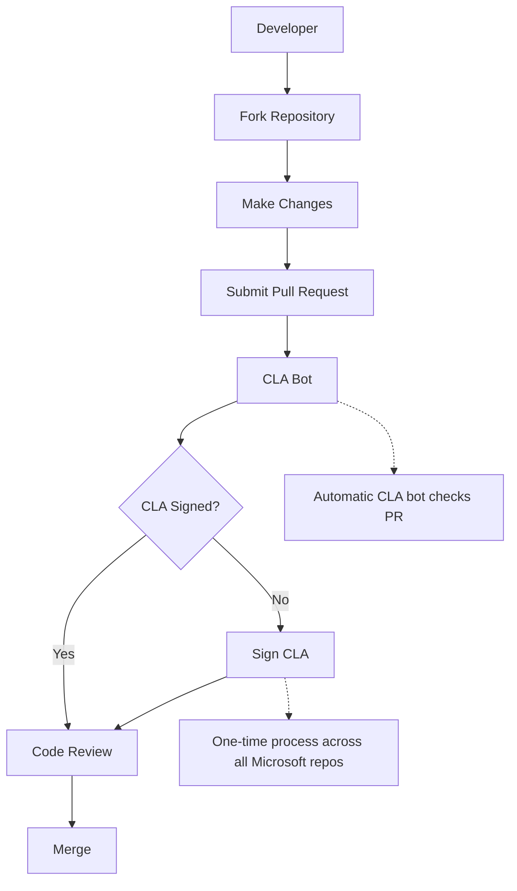
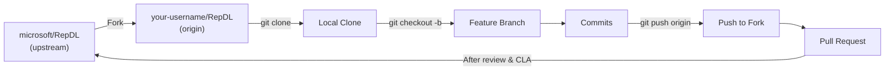
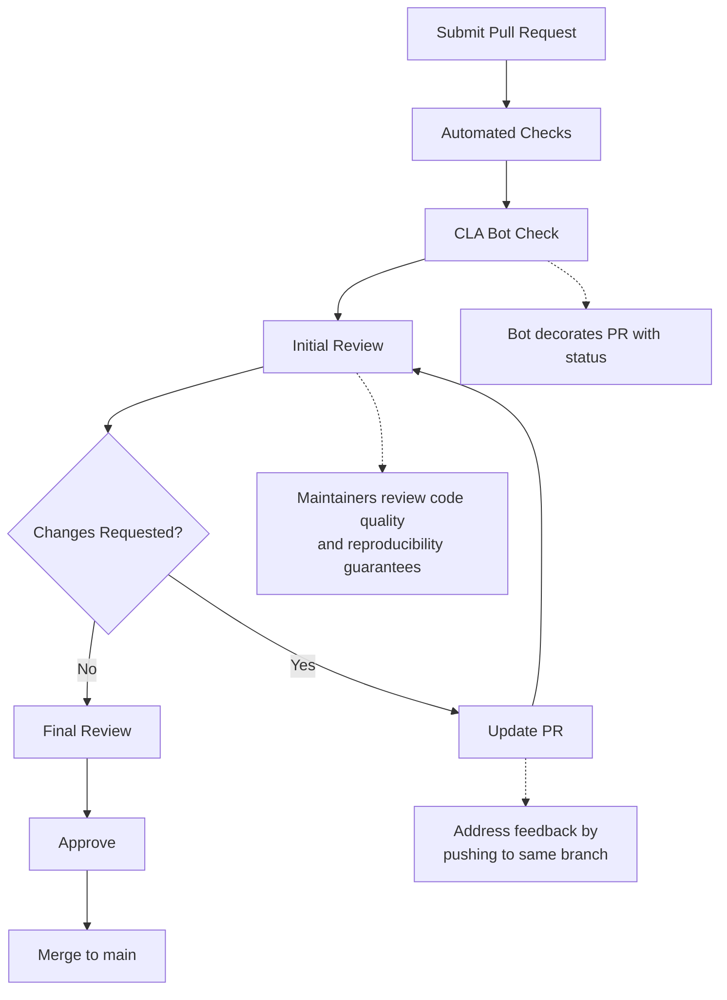

<!-- source: DeepWiki mcp.deepwiki.com · repo microsoft/RepDL · page 7.2 Contributing · fetched 2026-10-26 -->

# Contributing

<details>
<summary>Relevant source files</summary>

The following files were used as context for generating this wiki page:

- [CODE_OF_CONDUCT.md](CODE_OF_CONDUCT.md)
- [README.md](README.md)
- [examples/mnist_trainig.py](examples/mnist_trainig.py)

</details>


This page provides guidelines for contributing to RepDL, including code of conduct requirements, the Contributor License Agreement (CLA) process, pull request workflows, and development best practices. For technical details on extending RepDL functionality, see [Adding Custom Operations](#6.1), [Adding Custom Autograd Functions](#6.2), and [Adding Custom Layers](#6.3). For general support questions, see [Getting Help](#7.1).

---

## Project Status and Contribution Philosophy

RepDL is a **research project for academic and non-production purposes**. The project actively welcomes contributions and suggestions from the community [README.md:3](). Contributors are expected to follow Microsoft's open source guidelines and maintain the reproducibility guarantees that are core to RepDL's purpose.

Sources: [README.md:3]()

---

## Code of Conduct

All contributors must adhere to the **Microsoft Open Source Code of Conduct**. This project has adopted this code of conduct to ensure a welcoming and inclusive environment for all participants [README.md:60]().

### Code of Conduct Resources

| Resource | Purpose | Link |
|----------|---------|------|
| **Microsoft Open Source Code of Conduct** | Primary code of conduct document | https://opensource.microsoft.com/codeofconduct/ |
| **Code of Conduct FAQ** | Frequently asked questions | https://opensource.microsoft.com/codeofconduct/faq/ |
| **Contact for Questions** | Email for code of conduct inquiries | opencode@microsoft.com |

The code of conduct applies to all project spaces, including:
- GitHub Issues and Pull Requests
- GitHub Discussions
- Code reviews and comments
- Project documentation and wiki pages

Sources: [README.md:60](), [CODE_OF_CONDUCT.md:1-9]()

---

## Contributor License Agreement (CLA)

Most contributions require agreement to a **Contributor License Agreement (CLA)** [README.md:56](). The CLA declares that you have the right to grant Microsoft the rights to use your contribution. Full details are available at https://cla.opensource.microsoft.com.

### CLA Process



**CLA Workflow Details:**

1. **Automatic Detection**: When you submit a pull request, a CLA bot automatically determines whether you need to provide a CLA [README.md:58]()
2. **PR Decoration**: The bot decorates the PR with status checks or comments if CLA signature is required [README.md:58]()
3. **One-Time Process**: You only need to sign the CLA once across all repositories using Microsoft's CLA [README.md:59]()
4. **Simple Instructions**: Follow the instructions provided by the bot to complete the CLA process [README.md:58]()

Sources: [README.md:56-59]()

---

## Contribution Workflow

### Standard Git Workflow

RepDL follows the standard GitHub fork-and-pull-request workflow:



**Step-by-Step Process:**

1. **Fork** the repository at https://github.com/microsoft/RepDL
2. **Clone** your fork locally: `git clone https://github.com/your-username/RepDL.git`
3. **Create a branch**: `git checkout -b feature/your-feature-name`
4. **Make changes** following the development guidelines (see below)
5. **Commit** with clear, descriptive messages
6. **Push** to your fork: `git push origin feature/your-feature-name`
7. **Submit** a pull request to the `main` branch of `microsoft/RepDL`
8. **Sign CLA** if prompted by the CLA bot
9. **Address review feedback** and update your PR as needed

Sources: [README.md:56-59]()

---

## Types of Contributions and Code Locations

RepDL accepts various types of contributions, each targeting specific areas of the codebase:

### Contribution Types Mapping

```mermaid
graph TB
    subgraph "Contribution Types"
        OPS_CONTRIB["Custom Operations"]
        FUNC_CONTRIB["Custom Autograd Functions"]
        MODULE_CONTRIB["PyTorch Modules"]
        BACKEND_CONTRIB["Backend Implementations"]
        DOC_CONTRIB["Documentation"]
        TEST_CONTRIB["Tests"]
    end
    
    subgraph "Python Layer"
        OPS_PY["repdl/ops.py"]
        FUNC_PY["repdl/func.py"]
        NN_FUNC["repdl/nn/functionals.py"]
        OPTIM_PY["repdl/optim.py"]
    end
    
    subgraph "Backend Layer"
        CPU_IMPL["backend/cpu/*.cpp"]
        CUDA_IMPL["backend/cuda/*.cu"]
        CPU_BIND["backend/cpu/bind.cpp"]
        CUDA_BIND["backend/cuda/bind.cpp"]
    end
    
    subgraph "Documentation"
        README["README.md"]
        EXAMPLES["examples/*.py"]
    end
    
    OPS_CONTRIB --> OPS_PY
    OPS_CONTRIB --> CPU_IMPL
    OPS_CONTRIB --> CUDA_IMPL
    OPS_CONTRIB --> CPU_BIND
    OPS_CONTRIB --> CUDA_BIND
    
    FUNC_CONTRIB --> FUNC_PY
    
    MODULE_CONTRIB --> NN_FUNC
    MODULE_CONTRIB --> OPTIM_PY
    
    BACKEND_CONTRIB --> CPU_IMPL
    BACKEND_CONTRIB --> CUDA_IMPL
    BACKEND_CONTRIB --> CPU_BIND
    BACKEND_CONTRIB --> CUDA_BIND
    
    DOC_CONTRIB --> README
    DOC_CONTRIB --> EXAMPLES
    
    TEST_CONTRIB --> EXAMPLES
```



### Detailed Contribution Guidelines by Type

| Contribution Type | Target Files | Required Changes | See Also |
|-------------------|--------------|------------------|----------|
| **Custom Operations** | [repdl/ops.py](), [backend/cpu/*.cpp](), [backend/cuda/*.cu](), [backend/cpu/bind.cpp](), [backend/cuda/bind.cpp]() | Add dispatcher in `ops.py`, implement in both CPU and CUDA backends, register with pybind11 | [Adding Custom Operations](#6.1) |
| **Autograd Functions** | [repdl/func.py]() | Create `torch.autograd.Function` subclass using `repdl.ops` for forward/backward | [Adding Custom Autograd Functions](#6.2) |
| **Neural Network Modules** | [repdl/nn/functionals.py](), [repdl/optim.py](), or other `repdl/nn/` files | Implement PyTorch-compatible differentiable functions and modules | [Adding Custom Layers](#6.3) |
| **Backend Implementations** | [backend/cpu/](), [backend/cuda/]() | C++ and CUDA kernel implementations with reproducibility guarantees | [CPU Backend](#5.2), [CUDA Backend](#5.3) |
| **Examples** | [examples/]() | Complete working examples demonstrating new features | [MNIST Training Example](#2.3) |
| **Documentation** | [README.md](), wiki pages | User guides, API documentation, tutorials | N/A |

Sources: [README.md:47-52]()

---

## Development Guidelines

### Reproducibility Requirements

All contributions **must maintain RepDL's reproducibility guarantees**. When implementing new operations, functions, or modules, ensure compliance with these principles [README.md:52]():

#### Core Reproducibility Principles

| Principle | Requirement | Why It Matters |
|-----------|-------------|----------------|
| **Fixed Floating-Point Operation Order** | Operations must execute in a deterministic, unchanging sequence | Prevents non-associative FP arithmetic from producing different results |
| **IEEE-754 Compliance** | Avoid instructions that don't comply with IEEE-754 standard | Ensures consistent FP behavior across hardware |
| **Correctly Rounded Math Functions** | Use precisely rounded math functions, not fast-but-inaccurate approximations | Guarantees identical results for transcendental operations |

**Detailed guidance**: See [Reproducibility Principles](#6.4) for deep technical details on maintaining these guarantees.

Sources: [README.md:52]()

### Adding Custom Operations - Quick Reference

For custom operations that extend RepDL's reproducible operation set [README.md:49]():

1. **Define Operation Interface**: Add function signature to [repdl/ops.py]()
2. **Implement CPU Backend**: Write C++ implementation in [backend/cpu/]()
3. **Implement CUDA Backend**: Write CUDA kernel in [backend/cuda/]()
4. **Register Bindings**: Add pybind11 registration in [backend/cpu/bind.cpp]() and [backend/cuda/bind.cpp]()
5. **Test Reproducibility**: Verify bitwise identical results across devices

**Full guide**: See [Adding Custom Operations](#6.1)

Sources: [README.md:49]()

### Adding Custom Functions - Quick Reference

For differentiable functions compatible with PyTorch's autograd [README.md:50]():

1. **Create Autograd Function**: Add `torch.autograd.Function` subclass to [repdl/func.py]()
2. **Implement Forward**: Use `repdl.ops` operations in `forward()` method
3. **Implement Backward**: Use `repdl.ops` operations in `backward()` method for gradients
4. **Verify Gradients**: Test gradient computation reproducibility

**Full guide**: See [Adding Custom Autograd Functions](#6.2)

Sources: [README.md:50]()

### Adding PyTorch-Compatible Modules - Quick Reference

For high-level neural network modules and optimizers [README.md:51]():

1. **Choose Location**: Add to appropriate file in [repdl/nn/]() or [repdl/optim.py]()
2. **Inherit from PyTorch**: Extend `torch.nn.Module` or relevant PyTorch base class
3. **Use Reproducible Operations**: Build on `repdl.ops`, `repdl.func`, or `repdl.nn.functional`
4. **Test Conversion**: Ensure `repdl.from_torch_module` can convert similar PyTorch modules

**Full guide**: See [Adding Custom Layers](#6.3)

Sources: [README.md:51]()

---

## Pull Request Process

### PR Requirements Checklist

Before submitting a pull request, ensure:

- [ ] **Code builds successfully**: Run `pip install .` from repository root [README.md:27]()
- [ ] **Tests pass**: If adding examples, verify they produce expected hash values
- [ ] **CLA signed**: Complete CLA process when prompted by bot [README.md:56-59]()
- [ ] **Code of conduct followed**: Respectful communication in PR description and comments [README.md:60]()
- [ ] **Reproducibility maintained**: New operations follow fixed FP order, IEEE-754 compliance, correct rounding [README.md:52]()
- [ ] **Documentation updated**: Add or update relevant documentation for new features
- [ ] **Clear commit messages**: Descriptive messages explaining what and why

### PR Workflow



### What Reviewers Look For

**Code Quality:**
- Clear, readable code following Python conventions
- Proper error handling and input validation
- Efficient implementations without sacrificing reproducibility

**Reproducibility:**
- Operations maintain fixed FP operation order [README.md:52]()
- No use of non-IEEE-754 compliant instructions [README.md:52]()
- Correctly rounded math functions used [README.md:52]()

**Integration:**
- PyTorch API compatibility maintained
- Proper use of existing `repdl.ops` operations
- Correct device handling (CPU/CUDA)

**Documentation:**
- Clear docstrings for new functions/classes
- Updated README or examples if adding major features
- Code comments explaining non-obvious reproducibility techniques

Sources: [README.md:52](), [README.md:56-60]()

---

## Building and Testing

### Local Development Setup

```bash
# Clone your fork
git clone https://github.com/your-username/RepDL.git
cd RepDL

# Install in development mode
pip install -e .

# Run example to verify installation
python examples/mnist_trainig.py
```

### Verifying Reproducibility

When contributing new operations or features, verify reproducibility using `repdl.utils.get_hash`:

```python
import repdl
import torch

# Test on CPU
device = "cpu"
model = your_new_model().to(device)
cpu_hash = repdl.utils.get_hash(model)

# Test on CUDA (if available)
if torch.cuda.is_available():
    device = "cuda"
    model = your_new_model().to(device)
    cuda_hash = repdl.utils.get_hash(model)
    
    # Hashes MUST be identical
    assert cpu_hash == cuda_hash, "Reproducibility violated!"
```

The MNIST training example at [examples/mnist_trainig.py]() demonstrates expected hash values for a reproducible training run [README.md:34-39]().

Sources: [README.md:27](), [examples/mnist_trainig.py:1-115]()

---

## Community Expectations

### Communication Guidelines

- **Be respectful**: Follow the [Microsoft Open Source Code of Conduct](https://opensource.microsoft.com/codeofconduct/)
- **Be clear**: Provide context and details in issues and PRs
- **Be patient**: Maintainers are volunteers; response times may vary
- **Be collaborative**: Work with reviewers to improve contributions

### Response and Review Timeline

RepDL is a **research project maintained by Microsoft researchers**. While the project welcomes contributions, response times may vary based on maintainer availability. Contributors should:

- Expect initial CLA bot response within minutes [README.md:58]()
- Allow 1-2 weeks for initial human review (may vary)
- Be prepared to iterate on feedback
- Understand that not all contributions may be accepted

### Scope of Contributions

Contributions are welcome for:
- ✅ Additional reproducible operations extending [repdl/ops.py]()
- ✅ New autograd functions in [repdl/func.py]()
- ✅ PyTorch-compatible modules in [repdl/nn/]()
- ✅ Documentation improvements and examples
- ✅ Bug fixes maintaining reproducibility
- ✅ Performance improvements that don't compromise reproducibility

Contributions may be rejected if they:
- ❌ Break reproducibility guarantees
- ❌ Significantly increase complexity without clear benefit
- ❌ Duplicate existing functionality
- ❌ Target production use cases (this is a research project [README.md:3]())

Sources: [README.md:3](), [README.md:56-60]()

---

## Getting Help with Contributions

For questions or assistance during the contribution process:

- **General questions**: Use GitHub Discussions (see [Getting Help](#7.1))
- **Bug reports**: Open a GitHub Issue
- **CLA problems**: Contact the CLA bot or visit https://cla.opensource.microsoft.com
- **Code of conduct concerns**: Email opencode@microsoft.com [CODE_OF_CONDUCT.md:9]()

Sources: [CODE_OF_CONDUCT.md:9]()

---

## Related Documentation

- **[Adding Custom Operations](#6.1)**: Detailed guide for implementing new reproducible operations
- **[Adding Custom Autograd Functions](#6.2)**: Guide for creating differentiable functions
- **[Adding Custom Layers](#6.3)**: Guide for creating PyTorch-compatible modules
- **[Reproducibility Principles](#6.4)**: Deep dive into maintaining reproducibility
- **[Getting Help](#7.1)**: Support channels and resources
- **[Security](#7.3)**: Security vulnerability reporting process
- **[License](#7.4)**: MIT license terms and conditions

Sources: [README.md:54-64](), [CODE_OF_CONDUCT.md:1-9]()

---

