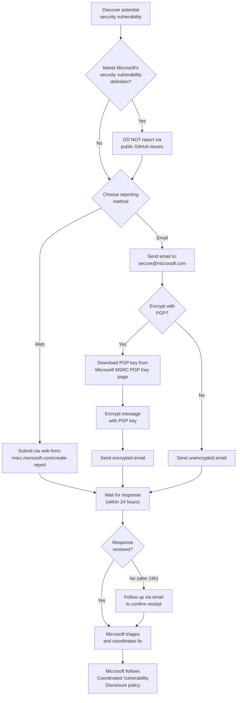
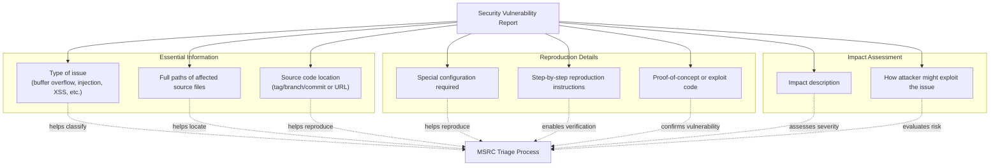
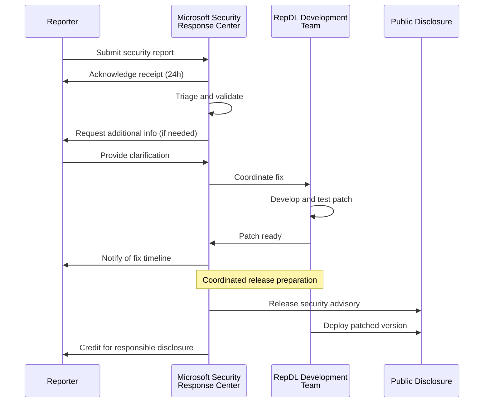

<!-- source: DeepWiki mcp.deepwiki.com · repo microsoft/RepDL · page 7.3 Security · fetched 2026-10-26 -->

# Security

Relevant source files

The following files were used as context for generating this wiki page:

- [SECURITY.md](SECURITY.md)

This document describes the security vulnerability reporting process for RepDL. It provides contact information for the Microsoft Security Response Center (MSRC), details the required information for security reports, and explains Microsoft's coordinated disclosure policy.

For information about contributing code or documentation, see [Contributing](#7.2). For information about software licensing terms, see [License](#7.4).

---

## Overview

RepDL follows Microsoft's standard security policy for open source projects. Security vulnerabilities should be reported through private channels to the Microsoft Security Response Center rather than through public GitHub issues. This ensures responsible disclosure and allows Microsoft to coordinate fixes before public disclosure.

**Sources:** [SECURITY.md:1-42]()

---

## Reporting Security Vulnerabilities

### Do Not Use Public Channels

Security vulnerabilities must **not** be reported through public GitHub issues. Public disclosure of security vulnerabilities before a fix is available can put users at risk.

**Sources:** [SECURITY.md:11]()

### Reporting Methods

RepDL provides two methods for reporting security vulnerabilities to the Microsoft Security Response Center (MSRC):

| Method | Details | Encryption |
|--------|---------|------------|
| **Web Form** | https://msrc.microsoft.com/create-report | HTTPS |
| **Email** | secure@microsoft.com | Optional PGP encryption available |

For email reports, PGP encryption is available using Microsoft's public key, which can be downloaded from the [Microsoft Security Response Center PGP Key page](https://aka.ms/security.md/msrc/pgp).

**Sources:** [SECURITY.md:13-15]()

---

## Security Reporting Process

The following diagram illustrates the complete security vulnerability reporting workflow:

**Security Vulnerability Reporting Workflow**

**Sources:** [SECURITY.md:7-17, 39]()

---

## Required Information for Security Reports

To help Microsoft triage security reports quickly, reporters should include as much of the following information as possible:

**Information Components for Security Reports**

### Information Checklist

| Category | Information Required | Purpose |
|----------|---------------------|---------|
| **Issue Type** | Type of vulnerability (e.g., buffer overflow, SQL injection, cross-site scripting) | Classification and routing |
| **Source Files** | Full paths of source files related to the issue | Code analysis and patching |
| **Code Location** | Tag, branch, commit hash, or direct URL to affected code | Version identification |
| **Configuration** | Any special configuration required to reproduce | Environment setup |
| **Reproduction Steps** | Step-by-step instructions to reproduce the issue | Verification and testing |
| **Proof of Concept** | PoC or exploit code (if available) | Validation and severity assessment |
| **Impact Analysis** | Description of potential impact and exploitation methods | Risk evaluation |

**Sources:** [SECURITY.md:19-29]()

---

## Response Timeline

Microsoft provides the following response commitments:

| Event | Timeline | Action Required |
|-------|----------|-----------------|
| **Initial Response** | Within 24 hours | None - Microsoft will acknowledge receipt |
| **No Response** | After 24 hours | Reporter should follow up via email to ensure receipt |
| **Additional Information** | As needed | Microsoft may request clarification during triage |

Reporters can find additional information at [microsoft.com/msrc](https://www.microsoft.com/msrc).

**Sources:** [SECURITY.md:17]()

---

## Bug Bounty Program

Microsoft operates a Bug Bounty Program that may provide financial rewards for valid security vulnerability reports. More complete reports that include detailed reproduction steps, proof-of-concept code, and impact analysis can contribute to higher bounty awards.

For details about active bug bounty programs and eligibility criteria, see the [Microsoft Bug Bounty Program page](https://aka.ms/security.md/msrc/bounty).

**Sources:** [SECURITY.md:31]()

---

## Communication Preferences

All security-related communications should be conducted in **English**. This ensures efficient processing by the Microsoft Security Response Center team.

**Sources:** [SECURITY.md:33-35]()

---

## Coordinated Vulnerability Disclosure

Microsoft follows the principle of **Coordinated Vulnerability Disclosure (CVD)**. This policy ensures that:

1. **Security vulnerabilities are fixed** before public disclosure
2. **Users are protected** by coordinated patch releases
3. **Reporters receive recognition** for responsible disclosure
4. **Communication is maintained** between reporter and Microsoft throughout the process

**Coordinated Vulnerability Disclosure Process**

This approach balances transparency with security by ensuring fixes are available before vulnerabilities become public knowledge.

**Sources:** [SECURITY.md:37-39]()

---

## Security Scope

The security policy covers all code in the RepDL repository, including:

- Python modules in `repdl/` directory
- C++ backend implementations in `backend/cpu/`
- CUDA backend implementations in `backend/cuda/`
- Build system files (`setup.py`, `CMakeLists.txt`)
- Example code and documentation

The policy is part of Microsoft's broader commitment to security across all GitHub repositories under Microsoft, Azure, DotNet, AspNet, and Xamarin organizations.

**Sources:** [SECURITY.md:5]()

---

## Security Considerations for RepDL Users

While this section focuses on reporting vulnerabilities, RepDL users should also be aware of general security considerations when deploying machine learning systems:

- **Input Validation**: RepDL performs numerical computations on tensor data; applications should validate inputs before processing
- **Model Integrity**: Use `repdl.utils.get_hash` to verify model integrity and detect unauthorized modifications (see [Reproducibility Verification](#3.3))
- **Dependency Security**: Keep PyTorch and other dependencies updated to receive security patches
- **Execution Environment**: Follow security best practices for the environment where RepDL models are deployed

For questions about secure deployment practices (non-vulnerability issues), use GitHub Discussions (see [Getting Help](#7.1)).

---

## Microsoft Security Definition

Microsoft defines a security vulnerability as a weakness in a product that could allow an attacker to compromise the integrity, availability, or confidentiality of the product. The full definition is available at [Microsoft's security vulnerability definition page](https://aka.ms/security.md/definition).

Not all bugs constitute security vulnerabilities. Issues that do not meet this definition should be reported through normal GitHub Issues rather than the MSRC.

**Sources:** [SECURITY.md:7]()

---

