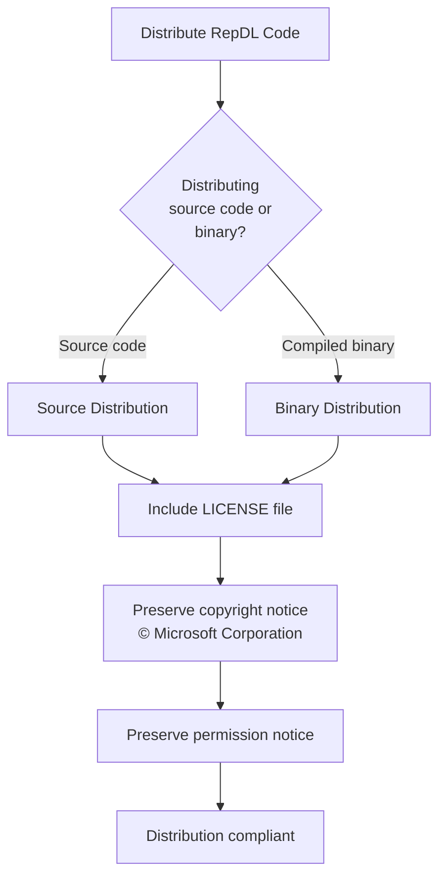
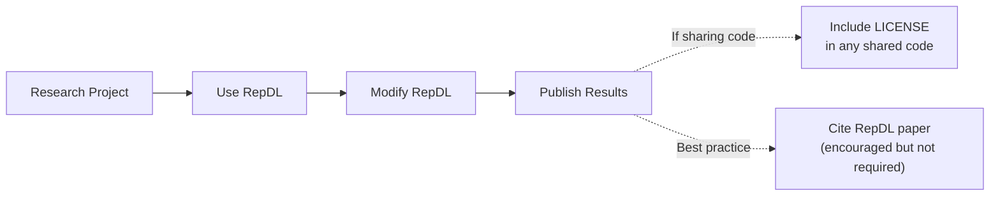
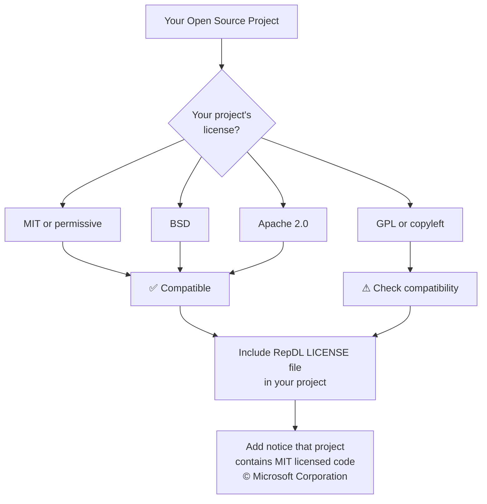

<!-- source: DeepWiki mcp.deepwiki.com · repo microsoft/RepDL · page 7.4 License · fetched 2026-10-26 -->

# License

<details>
<summary>Relevant source files</summary>

The following files were used as context for generating this wiki page:

- [LICENSE](LICENSE)

</details>


This page documents the licensing terms for RepDL, explaining the MIT License permissions, conditions, and limitations. This information is essential for understanding your rights when using, modifying, or distributing RepDL code.

For information about contributing code and the Contributor License Agreement (CLA), see [Contributing](#7.2). For security vulnerability reporting, see [Security](#7.3).

---

## License Overview

RepDL is licensed under the **MIT License**, one of the most permissive open-source licenses. The complete license text is located in [LICENSE:1-22]().

| License Property | Value |
|-----------------|-------|
| **License Type** | MIT License |
| **Copyright Holder** | Microsoft Corporation |
| **SPDX Identifier** | MIT |
| **OSI Approved** | Yes |
| **Permissions** | Commercial use, modification, distribution, private use |
| **Conditions** | License and copyright notice inclusion |
| **Limitations** | No warranty, no liability |

The MIT License is a short, simple permissive license with conditions only requiring preservation of copyright and license notices. Licensed works, modifications, and larger works may be distributed under different terms and without source code.

**Sources:** [LICENSE:1-22]()

---

## Copyright Information

```
MIT License

Copyright (c) Microsoft Corporation.
```

The copyright is held by **Microsoft Corporation** as stated in [LICENSE:3](). This copyright notice must be included in all copies or substantial portions of the software as required by [LICENSE:12-13]().

**Sources:** [LICENSE:3](), [LICENSE:12-13]()

---

## Permissions Granted

The MIT License grants broad permissions without requiring payment of royalties or fees. The license explicitly states in [LICENSE:5-10]():

> Permission is hereby granted, free of charge, to any person obtaining a copy of this software and associated documentation files (the "Software"), to deal in the Software without restriction...

### Detailed Permissions

| Permission | Description | License Reference |
|-----------|-------------|-------------------|
| **Use** | Run the software for any purpose (research, commercial, personal) | [LICENSE:6-7]() |
| **Copy** | Make copies of the software | [LICENSE:5]() |
| **Modify** | Alter, transform, or build upon the software | [LICENSE:7]() |
| **Merge** | Combine with other software | [LICENSE:7]() |
| **Publish** | Make the software publicly available | [LICENSE:8]() |
| **Distribute** | Share copies with others | [LICENSE:8]() |
| **Sublicense** | Grant these same permissions to others | [LICENSE:8]() |
| **Sell** | Include in commercial products or services | [LICENSE:8-9]() |

These permissions apply to all components of RepDL, including:
- Python modules in `repdl/` directory
- C++ backend implementations in `backend/cpu/`
- CUDA backend implementations in `backend/cuda/`
- Examples and documentation
- Build configurations and scripts

**Sources:** [LICENSE:5-10]()

---

## Conditions and Requirements

The MIT License has **minimal conditions**. The primary requirement is stated in [LICENSE:12-13]():

> The above copyright notice and this permission notice shall be included in all copies or substantial portions of the Software.

### Required Actions When Distributing



**Diagram: License Compliance for Distribution**

### Specific Requirements

1. **Include LICENSE file**: The [LICENSE:1-22]() file must be included in any distribution
2. **Preserve copyright**: The text "Copyright (c) Microsoft Corporation" from [LICENSE:3]() must remain
3. **Preserve license text**: The full MIT License text from [LICENSE:1-22]() must be included
4. **Apply to substantial portions**: These requirements apply even if you only use a portion of RepDL

### What You Do NOT Need to Do

- Release your modifications under the same license (you can use any license for derivative works)
- Provide source code when distributing binaries
- Document changes you made
- Share modifications publicly
- Use the same license for your own code that uses RepDL

**Sources:** [LICENSE:12-13]()

---

## Limitations and Disclaimers

The MIT License includes an explicit disclaimer of warranties and limitation of liability in [LICENSE:15-21]():

### No Warranty

The software is provided **"AS IS"** with no warranty of any kind. This includes but is not limited to:

| Warranty Type | Status | License Reference |
|---------------|--------|-------------------|
| **Fitness for particular purpose** | Not warranted | [LICENSE:16-17]() |
| **Merchantability** | Not warranted | [LICENSE:16]() |
| **Non-infringement** | Not warranted | [LICENSE:17]() |
| **Correctness** | Not warranted | [LICENSE:15-16]() |
| **Completeness** | Not warranted | [LICENSE:15-16]() |

This means Microsoft Corporation makes no guarantees that:
- RepDL will work for your specific use case
- RepDL is free from bugs or errors
- RepDL will meet your performance requirements
- RepDL will continue to be maintained or supported

### No Liability

[LICENSE:18-21]() explicitly limits liability:

> IN NO EVENT SHALL THE AUTHORS OR COPYRIGHT HOLDERS BE LIABLE FOR ANY CLAIM, DAMAGES OR OTHER LIABILITY...

Microsoft Corporation is not liable for:
- Direct damages from using RepDL
- Indirect or consequential damages
- Loss of profits or data
- Any other claims arising from use of the software

This limitation applies whether claims arise from:
- Contract
- Tort
- Other legal theories

**Sources:** [LICENSE:15-21]()

---

## License Scope in RepDL Codebase

The MIT License applies to all files in the RepDL repository unless explicitly stated otherwise. Here is the scope:

```mermaid
graph TB
    subgraph "License Scope: LICENSE file"
        ROOT["Repository Root"]
        
        subgraph "Python Package: MIT Licensed"
            REPDL["repdl/__init__.py"]
            OPS["repdl/ops.py"]
            FUNC["repdl/func.py"]
            UTILS["repdl/utils.py"]
            OPTIM["repdl/optim.py"]
            NN["repdl/nn/"]
        end
        
        subgraph "Backend Code: MIT Licensed"
            CPU["backend/cpu/*.cpp"]
            CUDA["backend/cuda/*.cu"]
            CPU_BIND["backend/cpu/bind.cpp"]
            CUDA_BIND["backend/cuda/bind.cpp"]
        end
        
        subgraph "Build System: MIT Licensed"
            SETUP["setup.py"]
            CMAKE["CMakeLists.txt"]
        end
        
        subgraph "Examples: MIT Licensed"
            MNIST["examples/mnist.py"]
        end
        
        subgraph "Documentation: MIT Licensed"
            README["README.md"]
            CODE_OF_CONDUCT["CODE_OF_CONDUCT.md"]
            SECURITY["SECURITY.md"]
        end
    end
    
    LICENSE["LICENSE<br/>(MIT License)"]
    
    LICENSE -.applies to.-> REPDL
    LICENSE -.applies to.-> OPS
    LICENSE -.applies to.-> FUNC
    LICENSE -.applies to.-> UTILS
    LICENSE -.applies to.-> OPTIM
    LICENSE -.applies to.-> NN
    LICENSE -.applies to.-> CPU
    LICENSE -.applies to.-> CUDA
    LICENSE -.applies to.-> CPU_BIND
    LICENSE -.applies to.-> CUDA_BIND
    LICENSE -.applies to.-> SETUP
    LICENSE -.applies to.-> CMAKE
    LICENSE -.applies to.-> MNIST
    LICENSE -.applies to.-> README
    LICENSE -.applies to.-> CODE_OF_CONDUCT
    LICENSE -.applies to.-> SECURITY
```



**Diagram: MIT License Coverage in RepDL Repository**

All source files, documentation, and build configurations are covered by the MIT License unless they contain a different license header.

**Sources:** [LICENSE:1-22]()

---

## Practical Implications for Different Use Cases

Understanding how the license applies to your specific situation:

### Research and Academic Use



**Diagram: License Flow for Research Use**

**Permissions:**
- Use RepDL in research projects without restriction
- Modify RepDL for your experiments
- Publish papers describing work that uses RepDL
- Share your modified code under any license you choose

**Requirements:**
- If you share code (modified or unmodified), include [LICENSE:1-22]()
- No requirement to cite RepDL (though it is good academic practice)

**Sources:** [LICENSE:5-10]()

---

### Commercial Product Development

**Scenario:** Building a commercial product that uses RepDL.

| Action | Permitted? | License Requirement |
|--------|-----------|---------------------|
| **Use RepDL in product** | ✅ Yes | Must include [LICENSE:1-22]() with product |
| **Modify RepDL** | ✅ Yes | Must include [LICENSE:1-22]() with modifications |
| **Distribute RepDL with product** | ✅ Yes | Must include [LICENSE:1-22]() |
| **Sell product containing RepDL** | ✅ Yes | Must include [LICENSE:1-22]() |
| **Keep modifications private** | ✅ Yes | But still include [LICENSE:1-22]() for RepDL portions |
| **Use different license for your code** | ✅ Yes | Only RepDL portions require [LICENSE:1-22]() |
| **Remove copyright notice** | ❌ No | Copyright from [LICENSE:3]() must remain |

**Important Notes:**
- The "no warranty" clause in [LICENSE:15-17]() means you cannot hold Microsoft liable for issues
- You should implement your own quality assurance and testing
- Consider whether the MIT License's "as-is" nature meets your product requirements

**Sources:** [LICENSE:1-22]()

---

### Open Source Project Integration

**Scenario:** Incorporating RepDL into another open source project.



**Diagram: License Compatibility with Other Open Source Licenses**

The MIT License is generally compatible with other open source licenses:

- **Permissive licenses** (MIT, BSD, Apache): Fully compatible
- **Copyleft licenses** (GPL, LGPL): Generally compatible, but check specific version requirements
- **Proprietary licenses**: Compatible - MIT allows proprietary derivatives

**Actions required:**
1. Include [LICENSE:1-22]() file in your project
2. Preserve copyright notice from [LICENSE:3]()
3. Document in your project that it includes RepDL under MIT License

**Sources:** [LICENSE:1-22]()

---

### Internal/Private Use

**Scenario:** Using RepDL internally within your organization without distribution.

**Permissions:**
- Use RepDL without any external notices or attributions
- Modify RepDL for internal use
- No requirement to share modifications
- No requirement to include LICENSE in internal deployments

**Reasoning:**
The license conditions in [LICENSE:12-13]() only apply when you "distribute" the software. Internal use within your organization does not constitute distribution.

**Note:** If you later decide to distribute your work externally, you must then include [LICENSE:1-22]().

**Sources:** [LICENSE:12-13]()

---

## Relationship to Dependencies

RepDL depends on external libraries that have their own licenses:

| Dependency | License | Compatibility with MIT |
|-----------|---------|------------------------|
| **PyTorch** | BSD-style license | ✅ Compatible |
| **NumPy** | BSD license | ✅ Compatible |
| **pybind11** | BSD license | ✅ Compatible |
| **CUDA Toolkit** | NVIDIA CUDA EULA | ⚠ Check NVIDIA terms |

When you distribute RepDL, you are also distributing these dependencies (or linking to them). Ensure you comply with all dependency licenses:

- PyTorch's BSD license requires including their copyright notice
- NumPy's BSD license requires including their copyright notice
- pybind11's BSD license requires including their copyright notice
- CUDA has different licensing terms - consult NVIDIA documentation

**Note:** The [LICENSE:1-22]() file only covers RepDL's code. Dependencies have separate licenses.

**Sources:** [LICENSE:1-22]()

---

## License Version and Modifications

The license text in [LICENSE:1-22]() is the standard MIT License with no modifications:

- **Line 1:** Standard "MIT License" header
- **Line 3:** Copyright holder specified as "Microsoft Corporation"
- **Lines 5-21:** Standard MIT License text without modifications

This is important because:
1. It's a well-known, widely-accepted license
2. Legal teams can easily verify compliance
3. No ambiguity about license terms

**Sources:** [LICENSE:1-22]()

---

## Frequently Asked Questions

### Do I need to open source my modifications?

**No.** The MIT License is permissive, not copyleft. You can:
- Keep modifications private
- Use different licenses for your modifications
- Distribute modified versions as proprietary software

You only need to include [LICENSE:1-22]() for the RepDL portions.

---

### Can I remove the license file?

**No.** The requirement in [LICENSE:12-13]() explicitly states the copyright and permission notice must be included in all copies. Removing [LICENSE:1-22]() violates the license terms.

---

### Does the license cover trained models?

The license in [LICENSE:1-22]() covers the RepDL **software code**. Models trained using RepDL are your own work products. However:
- The license makes no warranties about model behavior ([LICENSE:15-17]())
- If you distribute RepDL code with your models, include [LICENSE:1-22]()
- Your trained model weights themselves are not covered by MIT License

---

### Can I use RepDL in a patent application?

The MIT License in [LICENSE:1-22]() does not grant explicit patent rights (unlike Apache 2.0). Microsoft Corporation retains any patent rights. If patent issues are a concern for your use case, consult legal counsel.

---

### What if I find a security vulnerability?

The license's "no liability" clause in [LICENSE:18-21]() means Microsoft is not liable for security issues. However, Microsoft maintains a responsible disclosure process - see [Security](#7.3) for reporting procedures.

---

## Summary

The MIT License provides broad permissions with minimal requirements:

**✅ You CAN:**
- Use RepDL for any purpose (commercial, research, personal)
- Modify and create derivative works
- Distribute original or modified versions
- Use different licenses for your modifications
- Include in proprietary products

**📋 You MUST:**
- Include [LICENSE:1-22]() when distributing
- Preserve the copyright notice: "Copyright (c) Microsoft Corporation" from [LICENSE:3]()

**❌ You CANNOT:**
- Remove license or copyright notices
- Hold Microsoft liable for damages
- Expect warranties or guarantees

The full license text is always available in [LICENSE:1-22]().

**Sources:** [LICENSE:1-22]()