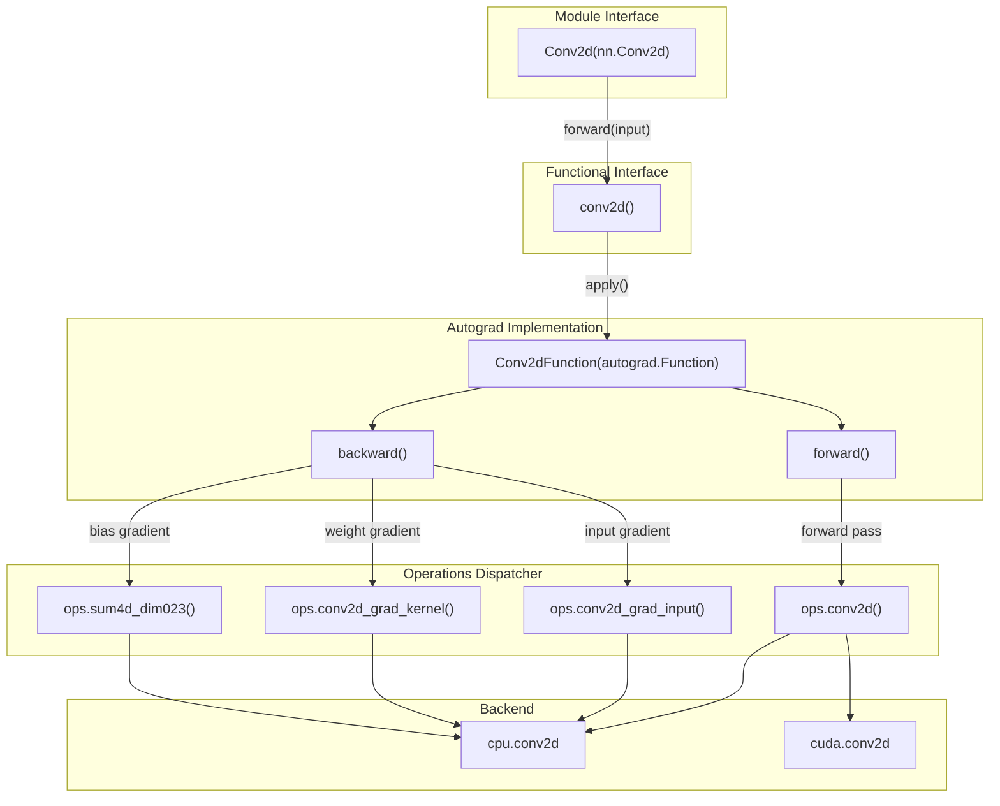
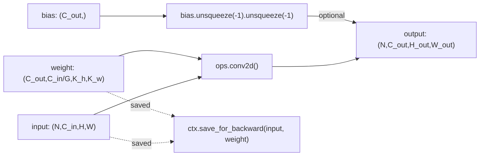
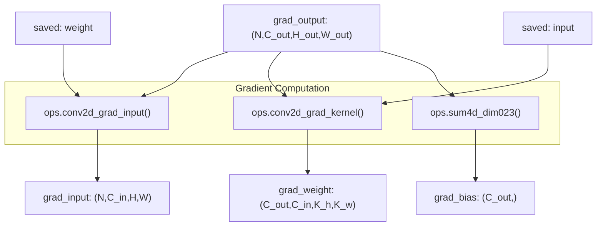

<!-- source: DeepWiki mcp.deepwiki.com · repo microsoft/RepDL · extra page Convolutional Layers · fetched 2026-10-26 -->

# Convolutional Layers

<details>
<summary>Relevant source files</summary>

The following files were used as context for generating this wiki page:

- [repdl/nn/__init__.py](repdl/nn/__init__.py)
- [repdl/nn/conv.py](repdl/nn/conv.py)

</details>


## Purpose and Scope

This page documents the `Conv2d` convolutional layer implementation in RepDL. It covers the module class, functional API, custom autograd implementation, parameter specifications, forward/backward pass mechanics, and gradient computation details. For general information about the neural network module organization, see [Neural Network Modules](#4.3). For the underlying operation dispatcher, see [Operations Module](#4.2). For the functional interface, see [Functional API](#4.3.5).

**Sources:** [repdl/nn/conv.py:1-116]()

---

## Overview

RepDL provides a reproducible implementation of 2D convolution through three interconnected components:

1. **`Conv2d`** - PyTorch-compatible module class that maintains parameters
2. **`conv2d`** - Stateless functional interface
3. **`Conv2dFunction`** - Custom autograd function for reproducible gradients

All convolution operations route through `repdl.ops.conv2d` to ensure bitwise identical results across hardware platforms.

**Sources:** [repdl/nn/conv.py:11-116](), [repdl/nn/__init__.py:6]()

---

## Component Architecture

The following diagram shows how the convolutional layer components interact and delegate to reproducible backends:



**Sources:** [repdl/nn/conv.py:11-116]()

---

## Conv2d Module Class

The `Conv2d` class inherits from `torch.nn.Conv2d` to maintain PyTorch compatibility while overriding the forward pass for reproducibility.

### Class Definition

```python
class Conv2d(torch.nn.Conv2d):
    def forward(self, input: torch.Tensor) -> torch.Tensor:
        return conv2d(
            input,
            self.weight,
            self.bias,
            self.stride,
            self.padding,
            self.dilation,
            self.groups,
        )
```

**Location:** [repdl/nn/conv.py:105-116]()

### Parameters

The `Conv2d` module accepts standard PyTorch convolution parameters through inheritance:

| Parameter | Type | Description | Default |
|-----------|------|-------------|---------|
| `in_channels` | `int` | Number of input channels | Required |
| `out_channels` | `int` | Number of output channels | Required |
| `kernel_size` | `int \| tuple[int, int]` | Size of convolving kernel | Required |
| `stride` | `int \| tuple[int, int]` | Stride of the convolution | `1` |
| `padding` | `int \| tuple[int, int]` | Zero-padding added to both sides of input | `0` |
| `dilation` | `int \| tuple[int, int]` | Spacing between kernel elements | `1` |
| `groups` | `int` | Number of blocked connections from input to output | `1` |
| `bias` | `bool` | If `True`, adds learnable bias | `True` |

### State Management

The module maintains the following learnable parameters (inherited from `torch.nn.Conv2d`):

- **`weight`**: Shape `(out_channels, in_channels/groups, kernel_height, kernel_width)`
- **`bias`**: Shape `(out_channels,)` if `bias=True`

**Sources:** [repdl/nn/conv.py:105-116]()

---

## Functional API

The `conv2d` function provides a stateless interface for 2D convolution.

### Function Signature

```python
def conv2d(
    input: torch.Tensor,
    weight: torch.Tensor,
    bias: Optional[torch.Tensor] = None,
    stride: Union[int, tuple[int, int]] = 1,
    padding: Union[str, int, tuple[int, int]] = 0,
    dilation: Union[int, tuple[int, int]] = 1,
    groups: int = 1,
) -> torch.Tensor
```

**Location:** [repdl/nn/conv.py:53-76]()

### Input Validation

The function performs validation before delegating to `Conv2dFunction`:

1. **Tensor dimensions**: Input must be 4D `(batch, channels, height, width)`
2. **Weight dimensions**: Weight must be 4D `(out_channels, in_channels/groups, kernel_h, kernel_w)`
3. **Bias dimensions**: Bias must be 1D `(out_channels,)` if provided
4. **Parameter normalization**: Converts scalar `stride` and `padding` to tuples

### Unsupported Features

The following PyTorch features raise `NotImplementedError`:

- String padding modes (`"same"`, `"valid"`)
- Dilation values other than `1`
- Non-4D inputs

**Sources:** [repdl/nn/conv.py:53-76]()

---

## Conv2dFunction Autograd Implementation

The `Conv2dFunction` class implements custom forward and backward passes for reproducible gradient computation.

### Forward Pass



**Implementation:**

[repdl/nn/conv.py:12-29]()

1. Save `input` and `weight` tensors for backward pass
2. Save convolution hyperparameters (`stride`, `padding`, `groups`) in context
3. Call `ops.conv2d` with saved parameters
4. Add bias by broadcasting to spatial dimensions if provided

**Key Operations:**
- `ops.conv2d(input, weight, stride, padding, groups)` - Reproducible convolution
- `bias.unsqueeze(-1).unsqueeze(-1)` - Broadcast bias to `(C_out, 1, 1)` for addition

**Sources:** [repdl/nn/conv.py:12-29]()

### Backward Pass

The backward pass computes three gradients: input gradient, weight gradient, and bias gradient.



**Implementation:**

[repdl/nn/conv.py:31-50]()

#### Input Gradient

Computed when `ctx.needs_input_grad[0]` is `True`:

```python
grad_input = ops.conv2d_grad_input(
    input.shape, weight, grad_output, ctx.stride, ctx.padding
)
```

This operation performs transposed convolution of `grad_output` with `weight`.

#### Weight Gradient

Computed when `ctx.needs_input_grad[1]` is `True`:

```python
grad_weight = ops.conv2d_grad_kernel(
    input, weight.shape, grad_output, ctx.stride, ctx.padding
)
```

This operation correlates `input` with `grad_output` to produce kernel gradients.

#### Bias Gradient

Computed when `ctx.needs_input_grad[2]` is `True`:

```python
grad_bias = ops.sum4d_dim023(grad_output)
```

Sums `grad_output` over batch (dim 0), height (dim 2), and width (dim 3) dimensions, retaining only the channel dimension.

**Grouped Convolution Limitation:**

Backward pass for `groups > 1` raises `NotImplementedError` at [repdl/nn/conv.py:35-36]().

**Sources:** [repdl/nn/conv.py:31-50]()

---

## Supported Configurations

### Fully Supported

The following convolution configurations are fully supported with reproducible gradients:

| Configuration | Forward | Backward | Notes |
|---------------|---------|----------|-------|
| Standard convolution (`groups=1`) | ✓ | ✓ | Complete support |
| Strided convolution | ✓ | ✓ | Arbitrary stride values |
| Padded convolution | ✓ | ✓ | Integer padding only |
| With bias | ✓ | ✓ | Bias gradient via sum reduction |
| Without bias | ✓ | ✓ | `bias=None` |

### Partially Supported

| Configuration | Forward | Backward | Notes |
|---------------|---------|----------|-------|
| Grouped convolution (`groups>1`) | ✓ | ✗ | Forward only; backward raises error |

### Unsupported

The following configurations raise `NotImplementedError`:

- **Dilated convolution**: `dilation != 1`
- **String padding modes**: `padding="same"` or `padding="valid"`
- **Non-4D inputs**: Input tensors with dimensions other than 4

**Sources:** [repdl/nn/conv.py:35-36](), [repdl/nn/conv.py:62-68]()

---

## Tensor Shape Reference

The following table shows tensor shapes throughout the convolution operation:

| Tensor | Shape | Description |
|--------|-------|-------------|
| `input` | `(N, C_in, H, W)` | Input feature maps |
| `weight` | `(C_out, C_in/G, K_h, K_w)` | Convolution kernels |
| `bias` | `(C_out,)` | Per-channel bias terms |
| `output` | `(N, C_out, H_out, W_out)` | Output feature maps |
| `grad_output` | `(N, C_out, H_out, W_out)` | Gradient w.r.t. output |
| `grad_input` | `(N, C_in, H, W)` | Gradient w.r.t. input |
| `grad_weight` | `(C_out, C_in/G, K_h, K_w)` | Gradient w.r.t. weight |
| `grad_bias` | `(C_out,)` | Gradient w.r.t. bias |

Where:
- `N` = batch size
- `C_in` = input channels
- `C_out` = output channels
- `G` = groups
- `K_h`, `K_w` = kernel height and width
- `H`, `W` = input height and width
- `H_out`, `W_out` = output height and width

Output spatial dimensions are computed as:
```
H_out = floor((H + 2*padding[0] - K_h) / stride[0]) + 1
W_out = floor((W + 2*padding[1] - K_w) / stride[1]) + 1
```

**Sources:** [repdl/nn/conv.py:11-116]()

---

## Usage Example

```python
import torch
import repdl.nn as nn

# Create Conv2d layer
conv = nn.Conv2d(
    in_channels=3,
    out_channels=64,
    kernel_size=3,
    stride=1,
    padding=1,
    bias=True
)

# Forward pass
input = torch.randn(8, 3, 32, 32)  # (batch, channels, height, width)
output = conv(input)  # (8, 64, 32, 32)

# Backward pass (automatic through autograd)
loss = output.sum()
loss.backward()

# Access gradients
weight_grad = conv.weight.grad  # (64, 3, 3, 3)
bias_grad = conv.bias.grad      # (64,)
```

The forward and backward passes route through `Conv2dFunction` to ensure reproducible computation across hardware platforms.

**Sources:** [repdl/nn/conv.py:105-116]()

---

## Integration with Operations Module

The convolution layer delegates to four operations in `repdl.ops`:

| Operation | Purpose | Called During |
|-----------|---------|---------------|
| `ops.conv2d` | Forward convolution | Forward pass |
| `ops.conv2d_grad_input` | Input gradient via transposed convolution | Backward pass |
| `ops.conv2d_grad_kernel` | Weight gradient via correlation | Backward pass |
| `ops.sum4d_dim023` | Bias gradient via dimension reduction | Backward pass |

All operations are dispatched to CPU or CUDA backends based on tensor device. For detailed operation specifications, see [Operations Module](#4.2).

**Sources:** [repdl/nn/conv.py:26](), [repdl/nn/conv.py:41-49]()

---

## Implementation Notes

### Context Management

The `Conv2dFunction` saves minimal state for the backward pass:

- **Tensors**: `input` and `weight` (required for gradient computation)
- **Attributes**: `stride`, `padding`, `groups` (convolution hyperparameters)

This design minimizes memory overhead while providing necessary information for gradient calculation.

### Bias Handling

Bias addition occurs after convolution in the forward pass:

1. `ops.conv2d` computes unbiased output
2. Bias is broadcast from `(C_out,)` to `(C_out, 1, 1)` via `unsqueeze`
3. Broadcasting rules automatically expand to `(N, C_out, H_out, W_out)`

In the backward pass, bias gradient is computed by summing `grad_output` over all dimensions except channels.

### Gradient Requirements

The backward pass checks `ctx.needs_input_grad` before computing gradients:

- `ctx.needs_input_grad[0]` → compute `grad_input`
- `ctx.needs_input_grad[1]` → compute `grad_weight`
- `ctx.needs_input_grad[2]` → compute `grad_bias`

This optimization avoids unnecessary computation when gradients are not required (e.g., frozen parameters).

**Sources:** [repdl/nn/conv.py:22-29](), [repdl/nn/conv.py:40-49]()

---

## Reproducibility Guarantees

The `Conv2d` implementation ensures bitwise identical results through:

1. **Deterministic operation order**: All operations route through `repdl.ops` with fixed computation order
2. **IEEE-754 compliance**: Backend implementations use standard floating-point arithmetic
3. **Identical kernels**: CPU and CUDA backends implement mathematically equivalent algorithms
4. **No non-deterministic operations**: No use of atomic operations or reduction with undefined order

For details on reproducibility principles, see [Reproducibility Principles](#6.4).

**Sources:** [repdl/nn/conv.py:11-116]()

---

