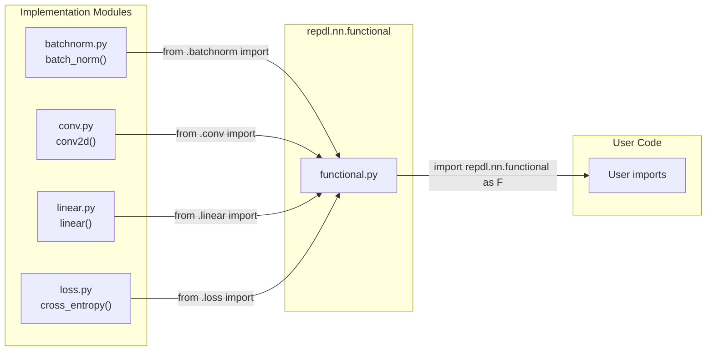
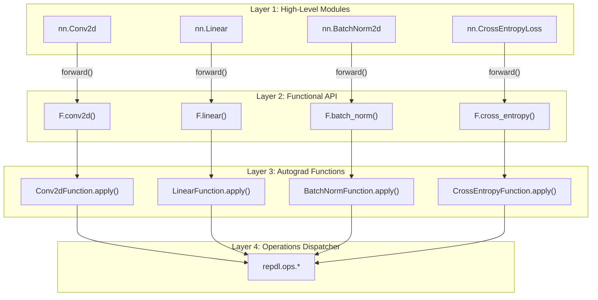
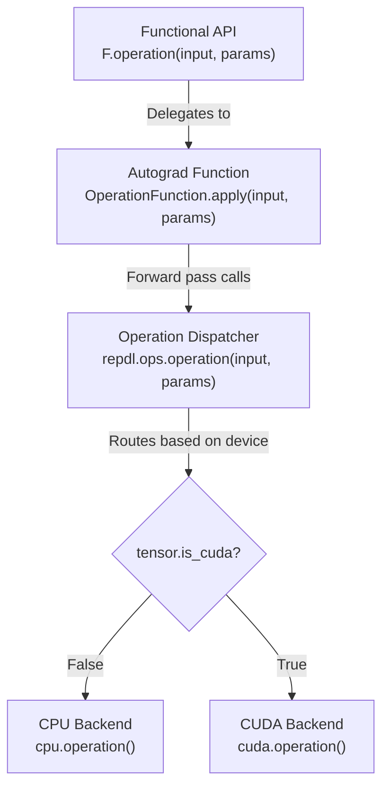
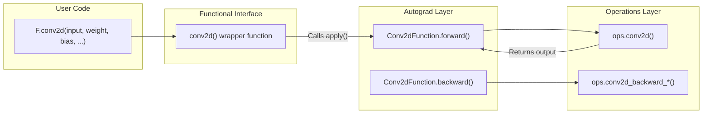

<!-- source: DeepWiki mcp.deepwiki.com · repo microsoft/RepDL · extra page Functional API (repdl.nn.functional) · fetched 2026-10-26 -->

# Functional API (repdl.nn.functional)

<details>
<summary>Relevant source files</summary>

The following files were used as context for generating this wiki page:

- [repdl/nn/functional.py](repdl/nn/functional.py)

</details>


## Purpose and Scope

The `repdl.nn.functional` module provides **stateless functional interfaces** to core neural network operations. These functions operate directly on tensors without maintaining internal state or learnable parameters, serving as the intermediary layer between high-level `nn.Module` classes and low-level autograd implementations.

This document covers the functional API exposed through `repdl.nn.functional`. For information about the stateful module-based API (e.g., `nn.Conv2d`, `nn.Linear`), see the respective sections: [Convolutional Layers](#4.3.1), [Linear Layers](#4.3.2), [Normalization Layers](#4.3.3), and [Loss Functions](#4.3.4). For information about the underlying operation dispatcher, see [Operations Module (repdl.ops)](#4.2).

## Overview

The functional API consists of four primary operations that are imported and re-exported from their respective implementation modules:

| Function | Source Module | Purpose |
|----------|---------------|---------|
| `batch_norm` | `repdl.nn.batchnorm` | Batch normalization operation |
| `conv2d` | `repdl.nn.conv` | 2D convolution operation |
| `linear` | `repdl.nn.linear` | Linear (fully-connected) transformation |
| `cross_entropy` | `repdl.nn.loss` | Cross-entropy loss computation |

These functions provide the core computational primitives that underlie their corresponding `nn.Module` implementations, enabling users to perform operations without instantiating module objects.

**Sources:** [repdl/nn/functional.py:1-8]()

## Module Structure

The `repdl.nn.functional` module follows a simple aggregation pattern, importing functions from domain-specific modules and exposing them through a unified namespace:



**Diagram: Import Structure of repdl.nn.functional**

This design centralizes access to functional operations while maintaining separation of implementation concerns across specialized modules.

**Sources:** [repdl/nn/functional.py:4-7]()

## Role in the Dispatch Chain

The functional API occupies a critical position in RepDL's operation dispatch flow. It serves as the **stateless interface layer** between high-level modules and low-level autograd functions:



**Diagram: Functional API Position in Dispatch Flow**

The functional API provides two key benefits in this architecture:

1. **Decoupling**: Separates parameter management (modules) from computation (functions)
2. **Flexibility**: Enables direct tensor operations without module instantiation

**Sources:** [repdl/nn/functional.py:1-8]() (from high-level architecture diagrams)

## Functional Operations

### batch_norm

The `batch_norm` function performs batch normalization on input tensors, computing normalized outputs using batch statistics and optional affine transformation parameters.

**Key Characteristics:**
- Operates on tensors of shape `(N, C)` for 1D or `(N, C, H, W)` for 2D
- Requires explicit passing of weight, bias, running statistics, and training mode flags
- Used internally by `nn.BatchNorm1d` and `nn.BatchNorm2d` modules
- Delegates to custom autograd function for reproducible gradient computation

**Typical Usage Pattern:**
```python
# Called internally by nn.BatchNorm2d.forward()
output = F.batch_norm(input, weight, bias, running_mean, running_var, 
                      training, momentum, eps)
```

For detailed parameter specifications, see [Normalization Layers](#4.3.3).

**Sources:** [repdl/nn/functional.py:4](), [repdl/nn/batchnorm.py]() (referenced)

### conv2d

The `conv2d` function performs 2D convolution operations on 4D input tensors, applying learned kernels with specified stride, padding, and dilation parameters.

**Key Characteristics:**
- Operates on tensors of shape `(N, C_in, H, W)`
- Requires explicit kernel tensor, bias (optional), and convolution parameters
- Used internally by `nn.Conv2d` module
- Routes through `Conv2dFunction` autograd wrapper to `repdl.ops.conv2d`

**Typical Usage Pattern:**
```python
# Called internally by nn.Conv2d.forward()
output = F.conv2d(input, weight, bias, stride, padding, dilation, groups)
```

For detailed parameter specifications and supported configurations, see [Convolutional Layers](#4.3.1).

**Sources:** [repdl/nn/functional.py:5](), [repdl/nn/conv.py]() (referenced)

### linear

The `linear` function performs a linear (fully-connected) transformation, computing the matrix multiplication between input and weight tensors with optional bias addition.

**Key Characteristics:**
- Operates on tensors of shape `(N, *, in_features)` where `*` represents any number of dimensions
- Requires explicit weight matrix and optional bias vector
- Used internally by `nn.Linear` module
- Routes through `LinearFunction` autograd wrapper to `repdl.ops.mm` (matrix multiplication)

**Typical Usage Pattern:**
```python
# Called internally by nn.Linear.forward()
output = F.linear(input, weight, bias)
```

For detailed parameter specifications and gradient computation details, see [Linear Layers](#4.3.2).

**Sources:** [repdl/nn/functional.py:6](), [repdl/nn/linear.py]() (referenced)

### cross_entropy

The `cross_entropy` function computes the cross-entropy loss between predictions and targets, combining log-softmax and negative log-likelihood into a single operation.

**Key Characteristics:**
- Operates on input tensors of shape `(N, C)` and target tensors of shape `(N,)`
- Supports reduction modes: `'mean'`, `'sum'`, or `'none'`
- Used internally by `nn.CrossEntropyLoss` module
- Routes through `CrossEntropyFunction` autograd wrapper to `repdl.ops.cross_entropy`

**Typical Usage Pattern:**
```python
# Called internally by nn.CrossEntropyLoss.forward()
loss = F.cross_entropy(input, target, reduction='mean')
```

For detailed parameter specifications and gradient computation, see [Loss Functions](#4.3.4).

**Sources:** [repdl/nn/functional.py:7](), [repdl/nn/loss.py]() (referenced)

## Functional vs. Module-Based API

The following table summarizes the key differences between using the functional API directly versus the module-based API:

| Aspect | Functional API (`F.operation`) | Module API (`nn.Operation`) |
|--------|-------------------------------|----------------------------|
| **State** | Stateless - no parameters stored | Stateful - maintains learnable parameters |
| **Parameter Passing** | All parameters passed explicitly each call | Parameters stored internally, accessed implicitly |
| **Instantiation** | No instantiation required | Requires module instantiation: `layer = nn.Conv2d(...)` |
| **Typical Use Case** | Custom forward passes, dynamic architectures | Standard layer-based models, parameter management |
| **Parameter Updates** | Parameters must be managed externally | Automatic via `optimizer.step()` on module parameters |
| **Example** | `F.linear(x, weight, bias)` | `layer = nn.Linear(...); layer(x)` |

**When to Use Functional API:**
- Implementing custom layers with manual parameter management
- Dynamic architectures where computation graph changes between forward passes
- Low-level operations where module overhead is unnecessary
- Testing and debugging individual operations

**When to Use Module API:**
- Standard neural network architectures
- Automatic parameter registration and optimization
- Model serialization and state management
- Leveraging PyTorch's module composition patterns

**Sources:** [repdl/nn/functional.py:1-8]() (architectural understanding)

## Implementation Pattern

All functions in `repdl.nn.functional` follow a consistent implementation pattern that ensures reproducibility:



**Diagram: Functional API Implementation Pattern**

This pattern ensures:
1. **Clean Separation**: Functional API handles interface, autograd handles differentiation, ops handle dispatch
2. **Reproducibility**: All computations route through controlled backends
3. **Device Transparency**: Device-aware routing happens automatically based on tensor placement

**Sources:** [repdl/nn/functional.py:1-8]() (from architectural diagrams)

## Integration with Custom Autograd Functions

Each functional operation is implemented using a corresponding custom `torch.autograd.Function` subclass. This design enables RepDL to control both forward and backward passes for reproducible gradient computation.

The typical implementation structure for a functional operation:



**Diagram: Autograd Integration for Functional Operations**

For detailed information about custom autograd functions, see [Custom Autograd Functions](#3.2) and [Custom Functions (repdl.func)](#4.4).

**Sources:** [repdl/nn/functional.py:1-8]() (architectural context)

## Usage Examples

While the functional API can be called directly by users, it is primarily designed to be called internally by the corresponding `nn.Module` classes. Understanding this usage pattern helps clarify the relationship between modules and functions.

### Internal Module Usage

When a user calls `forward()` on a module, it internally delegates to the functional API:

```python
# User calls module
conv_layer = nn.Conv2d(in_channels=3, out_channels=64, kernel_size=3)
output = conv_layer(input)

# Internally, nn.Conv2d.forward() calls:
# output = F.conv2d(input, self.weight, self.bias, self.stride, ...)
```

This pattern applies to all operations exposed in the functional API.

### Direct Functional Usage

Users can also call functional operations directly when implementing custom layers or operations:

```python
import repdl.nn.functional as F

# Direct use without module instantiation
result = F.linear(x, weight_matrix, bias_vector)
```

For comprehensive usage examples, see [MNIST Training Example](#2.3) and the examples directory in the repository.

**Sources:** [repdl/nn/functional.py:1-8]() (usage patterns)

## Relationship to PyTorch's torch.nn.functional

RepDL's `repdl.nn.functional` is designed to mirror the structure and naming conventions of PyTorch's `torch.nn.functional`, providing a **reproducible alternative** with an identical interface:

| PyTorch | RepDL | Reproducibility Mechanism |
|---------|-------|---------------------------|
| `torch.nn.functional.conv2d` | `repdl.nn.functional.conv2d` | Custom autograd + reproducible backends |
| `torch.nn.functional.linear` | `repdl.nn.functional.linear` | Custom autograd + reproducible backends |
| `torch.nn.functional.batch_norm` | `repdl.nn.functional.batch_norm` | Custom autograd + reproducible backends |
| `torch.nn.functional.cross_entropy` | `repdl.nn.functional.cross_entropy` | Custom autograd + reproducible backends |

This design enables **drop-in replacement** for PyTorch code while maintaining bitwise identical results across different hardware platforms.

**Sources:** [repdl/nn/functional.py:1-8]() (design philosophy)

## Summary

The `repdl.nn.functional` module serves as the **stateless operation interface** in RepDL's layered architecture:

- **Provides** four core functional operations: `batch_norm`, `conv2d`, `linear`, `cross_entropy`
- **Imports** functions from domain-specific implementation modules
- **Serves** as the intermediary between stateful `nn.Module` classes and autograd functions
- **Enables** flexible tensor operations without module instantiation
- **Maintains** PyTorch API compatibility while ensuring reproducibility

The functional API is a critical component in RepDL's dispatch chain, ensuring that all neural network operations flow through reproducible backends while providing a familiar interface for PyTorch users.

**Sources:** [repdl/nn/functional.py:1-8]()

---

