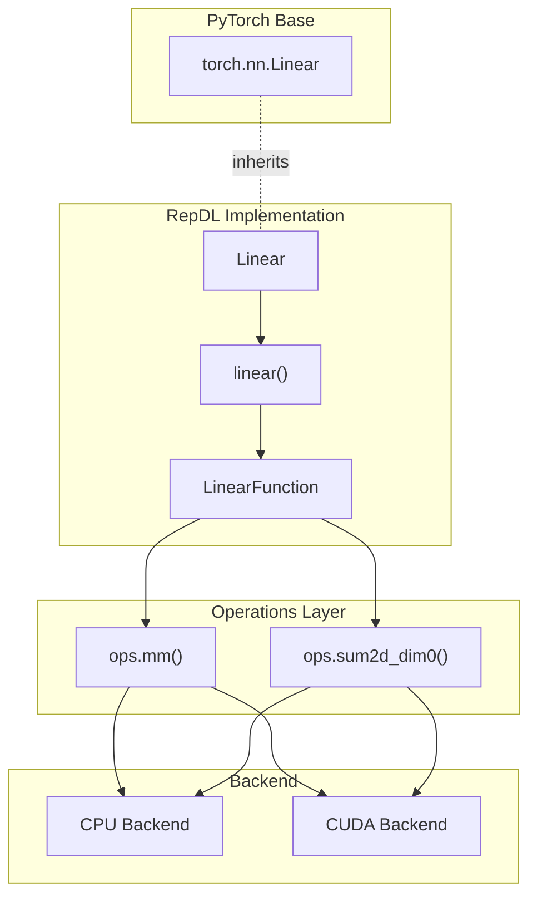
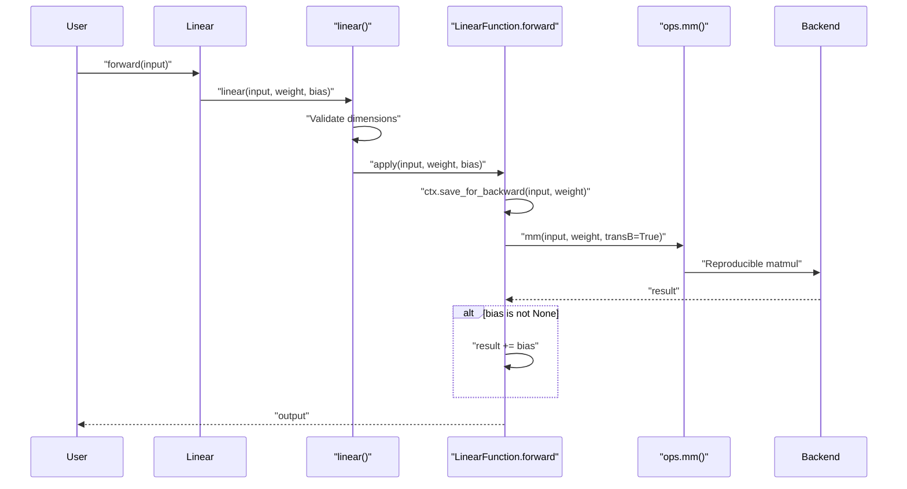
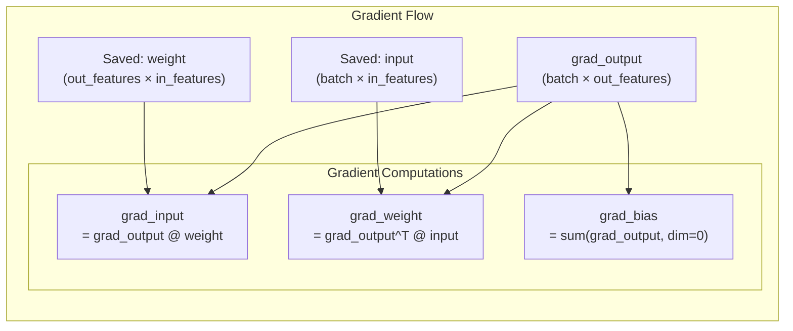
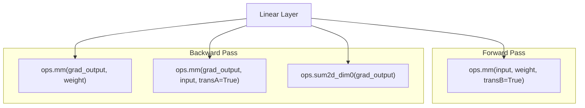

<!-- source: DeepWiki mcp.deepwiki.com · repo microsoft/RepDL · extra page Linear Layers · fetched 2026-10-26 -->

# Linear Layers

<details>
<summary>Relevant source files</summary>

The following files were used as context for generating this wiki page:

- [repdl/nn/__init__.py](repdl/nn/__init__.py)
- [repdl/nn/linear.py](repdl/nn/linear.py)

</details>


## Purpose and Scope

This document describes the `Linear` module in RepDL, which provides reproducible fully-connected (dense) layers. The `Linear` layer performs an affine transformation: `y = xW^T + b`, where the matrix multiplication and bias addition are executed through RepDL's reproducible operations dispatcher.

For information about convolutional layers, see [Convolutional Layers](#4.3.1). For the underlying matrix multiplication operation, see [Operations Module](#4.2). For the functional interface that aggregates all stateless operations, see [Functional API](#4.3.5).

**Sources:** [repdl/nn/linear.py:1-55]()

---

## Overview

The `Linear` layer implements a reproducible fully-connected neural network layer by:

1. **Extending `torch.nn.Linear`** - Maintains compatibility with PyTorch's API while overriding the forward pass
2. **Using custom autograd** - Implements `LinearFunction` to control both forward and backward passes
3. **Delegating to `ops.mm`** - Routes all matrix multiplications through RepDL's reproducible dispatcher
4. **Supporting optional bias** - Handles both biased and unbiased linear transformations

The implementation ensures bitwise identical results across hardware platforms for both forward propagation and gradient computation.

**Sources:** [repdl/nn/linear.py:52-54](), [repdl/nn/linear.py:11-39]()

---

## Class Architecture



**Class Hierarchy**

| Component | Type | Purpose |
|-----------|------|---------|
| `Linear` | `torch.nn.Module` | Stateful layer with weight and bias parameters |
| `linear` | Function | Stateless functional interface |
| `LinearFunction` | `torch.autograd.Function` | Custom autograd for reproducible gradients |
| `ops.mm` | Operation | Reproducible matrix multiplication |
| `ops.sum2d_dim0` | Operation | Reproducible summation for bias gradients |

**Sources:** [repdl/nn/linear.py:52-54](), [repdl/nn/linear.py:41-49](), [repdl/nn/linear.py:11-39]()

---

## Linear Module Class

### Class Definition

```python
class Linear(torch.nn.Linear):
    def forward(self, input: torch.Tensor) -> torch.Tensor:
        return linear(input, self.weight, self.bias)
```

The `Linear` class is a minimal wrapper around `torch.nn.Linear` that:
- **Inherits parameter management** from PyTorch (weight, bias, initialization)
- **Overrides only the forward method** to use the reproducible `linear` function
- **Maintains full API compatibility** with `torch.nn.Linear`

### Parameters

Since `Linear` inherits from `torch.nn.Linear`, it accepts the same constructor parameters:

| Parameter | Type | Description |
|-----------|------|-------------|
| `in_features` | `int` | Size of each input sample |
| `out_features` | `int` | Size of each output sample |
| `bias` | `bool` | If `True`, adds a learnable bias (default: `True`) |

### Attributes

| Attribute | Shape | Description |
|-----------|-------|-------------|
| `weight` | `(out_features, in_features)` | Learnable weight matrix |
| `bias` | `(out_features,)` | Learnable bias vector (if `bias=True`) |

**Sources:** [repdl/nn/linear.py:52-54]()

---

## Forward Pass

### Computation Flow



### Forward Implementation

The forward pass is implemented in `LinearFunction.forward`:

```python
def forward(ctx, input, weight, bias):
    ctx.save_for_backward(input, weight)
    res = ops.mm(input, weight, transB=True)  # Compute input @ weight^T
    if bias is not None:
        res += bias  # Add bias via broadcasting
    return res
```

**Key Operations:**

1. **Save tensors for backward** - Stores `input` and `weight` for gradient computation [repdl/nn/linear.py:19]()
2. **Transpose matrix multiplication** - Uses `transB=True` to compute `input @ weight^T` efficiently [repdl/nn/linear.py:20]()
3. **Bias addition** - Adds bias via broadcasting if provided [repdl/nn/linear.py:21-22]()

### Mathematical Formulation

For input `x ∈ ℝ^(batch_size × in_features)` and weight `W ∈ ℝ^(out_features × in_features)`:

```
output = x W^T + b
```

Where:
- `W^T` is computed efficiently using `transB=True` in `ops.mm`
- `b ∈ ℝ^(out_features)` is broadcast across the batch dimension

**Sources:** [repdl/nn/linear.py:11-23]()

---

## Backward Pass

### Gradient Computation Flow



### Backward Implementation

The backward pass is implemented in `LinearFunction.backward`:

```python
def backward(ctx, grad_output):
    input, weight = ctx.saved_tensors
    grad_input = grad_weight = grad_bias = None
    
    if ctx.needs_input_grad[0]:
        grad_input = ops.mm(grad_output, weight)
    if ctx.needs_input_grad[1]:
        grad_weight = ops.mm(grad_output, input, transA=True)
    if ctx.needs_input_grad[2]:
        grad_bias = ops.sum2d_dim0(grad_output)
    
    return grad_input, grad_weight, grad_bias
```

### Gradient Derivations

**Gradient with respect to input:**
```
∂L/∂x = grad_output @ W
```
Computed via: `ops.mm(grad_output, weight)` [repdl/nn/linear.py:33]()

**Gradient with respect to weight:**
```
∂L/∂W = grad_output^T @ x
```
Computed via: `ops.mm(grad_output, input, transA=True)` [repdl/nn/linear.py:35]()

**Gradient with respect to bias:**
```
∂L/∂b = sum(grad_output, dim=0)
```
Computed via: `ops.sum2d_dim0(grad_output)` [repdl/nn/linear.py:37]()

### Conditional Gradient Computation

The backward pass uses `ctx.needs_input_grad` to conditionally compute gradients only for tensors that require them:

| Index | Tensor | Condition Check |
|-------|--------|----------------|
| 0 | `input` | `ctx.needs_input_grad[0]` [repdl/nn/linear.py:32]() |
| 1 | `weight` | `ctx.needs_input_grad[1]` [repdl/nn/linear.py:34]() |
| 2 | `bias` | `ctx.needs_input_grad[2]` [repdl/nn/linear.py:36]() |

This optimization avoids unnecessary computation when gradients are not needed (e.g., during inference or when parameters have `requires_grad=False`).

**Sources:** [repdl/nn/linear.py:25-38]()

---

## Functional Interface

### Function Signature

```python
def linear(
    input: torch.Tensor,
    weight: torch.Tensor, 
    bias: Optional[torch.Tensor] = None
) -> torch.Tensor
```

The `linear` function provides a stateless interface to the linear transformation. It:
1. **Validates input dimensions** - Ensures input is 2D [repdl/nn/linear.py:44-45]()
2. **Asserts weight/bias shapes** - Verifies weight is 2D and bias is 1D if provided [repdl/nn/linear.py:46-48]()
3. **Delegates to autograd** - Applies `LinearFunction` for reproducible computation [repdl/nn/linear.py:49]()

### Dimension Validation

| Tensor | Required Dimensions | Validation |
|--------|-------------------|------------|
| `input` | `(batch_size, in_features)` | `input.dim() != 2` raises `NotImplementedError` |
| `weight` | `(out_features, in_features)` | `weight.dim() == 2` assertion |
| `bias` | `(out_features,)` | `bias.dim() == 1` assertion (if not `None`) |

**Note:** The current implementation only supports 2D input tensors. Higher-dimensional inputs (e.g., `(batch, seq_len, features)`) are not supported and will raise `NotImplementedError`.

**Sources:** [repdl/nn/linear.py:41-49]()

---

## Usage Examples

### Basic Usage

```python
import repdl.nn as nn

# Create a linear layer
layer = nn.Linear(in_features=128, out_features=64, bias=True)

# Forward pass
input = torch.randn(32, 128)  # batch_size=32, in_features=128
output = layer(input)  # shape: (32, 64)
```

### Without Bias

```python
# Create layer without bias
layer = nn.Linear(in_features=256, out_features=128, bias=False)

# Forward pass
input = torch.randn(16, 256)
output = layer(input)  # shape: (16, 128)
```

### Functional Interface

```python
from repdl.nn.functional import linear

# Use functional API without creating a module
weight = torch.randn(64, 128)  # (out_features, in_features)
bias = torch.randn(64)
input = torch.randn(32, 128)

output = linear(input, weight, bias)  # shape: (32, 64)
```

### Integration in Models

```python
class SimpleModel(nn.Module):
    def __init__(self):
        super().__init__()
        self.fc1 = nn.Linear(784, 256)
        self.fc2 = nn.Linear(256, 10)
    
    def forward(self, x):
        x = torch.relu(self.fc1(x))
        x = self.fc2(x)
        return x
```

**Sources:** [repdl/nn/linear.py:52-54](), [repdl/nn/linear.py:41-49]()

---

## Dimension Requirements and Constraints

### Input Constraints

| Constraint | Requirement | Error Behavior |
|-----------|-------------|----------------|
| Input dimensions | Exactly 2 dimensions `(batch, features)` | Raises `NotImplementedError` |
| Weight dimensions | Exactly 2 dimensions `(out, in)` | Assertion failure |
| Bias dimensions | Exactly 1 dimension `(out,)` if provided | Assertion failure |
| Feature dimension match | `input.shape[1] == weight.shape[1]` | Runtime error from matmul |
| Bias dimension match | `bias.shape[0] == weight.shape[0]` | Runtime error from broadcasting |

### Shape Compatibility

**Valid Configuration:**
```
input:  (B, I)  where B = batch_size, I = in_features
weight: (O, I)  where O = out_features
bias:   (O,)    optional
output: (B, O)
```

**Invalid Configurations:**

```python
# 3D input - NOT SUPPORTED
input = torch.randn(32, 10, 128)  # (batch, seq_len, features)
layer = nn.Linear(128, 64)
output = layer(input)  # Raises NotImplementedError

# 1D input - NOT SUPPORTED  
input = torch.randn(128)  # (features,)
output = layer(input)  # Raises NotImplementedError
```

**Sources:** [repdl/nn/linear.py:44-48]()

---

## Operation Dependencies

### Dispatcher Operations Used

The `Linear` layer depends on the following operations from `repdl.ops`:



### Operation Details

| Operation | Purpose | Line Reference |
|-----------|---------|---------------|
| `ops.mm(input, weight, transB=True)` | Compute `input @ weight^T` in forward pass | [repdl/nn/linear.py:20]() |
| `ops.mm(grad_output, weight)` | Compute gradient w.r.t. input | [repdl/nn/linear.py:33]() |
| `ops.mm(grad_output, input, transA=True)` | Compute gradient w.r.t. weight | [repdl/nn/linear.py:35]() |
| `ops.sum2d_dim0(grad_output)` | Compute gradient w.r.t. bias | [repdl/nn/linear.py:37]() |

All matrix multiplications use `ops.mm` to ensure reproducible computation through the operations dispatcher. See [Operations Module](#4.2) for detailed documentation of these operations.

**Sources:** [repdl/nn/linear.py:20](), [repdl/nn/linear.py:33](), [repdl/nn/linear.py:35](), [repdl/nn/linear.py:37]()

---

## Implementation Details

### Parameter Storage

The `Linear` class inherits parameter storage from `torch.nn.Linear`:
- **Weight initialization**: Default Kaiming uniform initialization from PyTorch
- **Bias initialization**: Uniform distribution `U(-1/√(in_features), 1/√(in_features))`
- **Parameter registration**: Automatically registered with `torch.nn.Module` parameter system

### Transpose Handling

The weight matrix transpose is handled efficiently using the `transB` parameter:

```python
# Instead of: ops.mm(input, weight.T)
res = ops.mm(input, weight, transB=True)  # More efficient
```

This approach:
- Avoids creating a transposed copy of the weight matrix
- Reduces memory overhead
- Improves cache efficiency in the backend

### Bias Broadcasting

Bias addition uses PyTorch's broadcasting semantics:

```python
res += bias  # bias shape (O,) broadcasts to (B, O)
```

Broadcasting is performed element-wise across the batch dimension, equivalent to:
```python
res[i, :] += bias  # for each i in batch
```

### Saved Tensors for Gradient

Only `input` and `weight` are saved for the backward pass [repdl/nn/linear.py:19]():
- `bias` is not saved because `grad_bias` only depends on `grad_output`
- This minimizes memory usage during training
- The saved tensors are accessed via `ctx.saved_tensors` in backward [repdl/nn/linear.py:29-30]()

**Sources:** [repdl/nn/linear.py:19](), [repdl/nn/linear.py:20](), [repdl/nn/linear.py:22](), [repdl/nn/linear.py:29-30]()

---

## Module Registration

The `Linear` class is exported from the `repdl.nn` package:

```python
from repdl.nn import Linear
```

It is registered in [repdl/nn/__init__.py:7]() alongside other neural network modules like `Conv2d`, `BatchNorm1d`, `BatchNorm2d`, and `CrossEntropyLoss`.

**Sources:** [repdl/nn/__init__.py:7]()

---

## Comparison with torch.nn.Linear

### Similarities

| Aspect | Behavior |
|--------|----------|
| API signature | Identical constructor and forward method signature |
| Parameter management | Inherits weight/bias initialization and storage |
| Broadcasting | Same bias broadcasting behavior |
| Shape constraints | Compatible shape requirements |

### Differences

| Aspect | `torch.nn.Linear` | `repdl.nn.Linear` |
|--------|------------------|------------------|
| Implementation | Native PyTorch ops | Custom autograd with `ops.mm` |
| Reproducibility | Non-deterministic on GPU | Bitwise identical across devices |
| Higher-dim inputs | Supports 3D+ inputs | Only 2D inputs (raises `NotImplementedError`) |
| Performance | Optimized with cuBLAS | Reproducibility-focused |

### Migration Considerations

When converting from `torch.nn.Linear` to `repdl.nn.Linear`:
- **2D inputs**: Direct drop-in replacement, no code changes needed
- **3D+ inputs**: Must reshape to 2D before calling forward, then reshape output back
- **Performance**: May be slower due to reproducibility constraints
- **Reproducibility**: Gains bitwise identical results across hardware

**Sources:** [repdl/nn/linear.py:52-54](), [repdl/nn/linear.py:44-45]()

---

