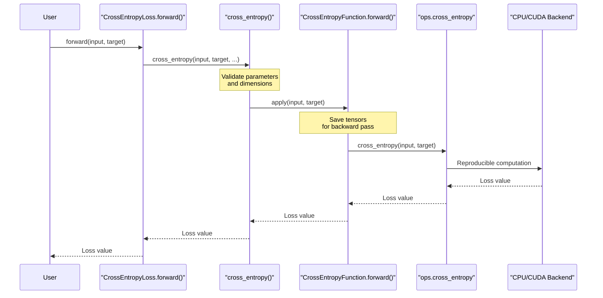
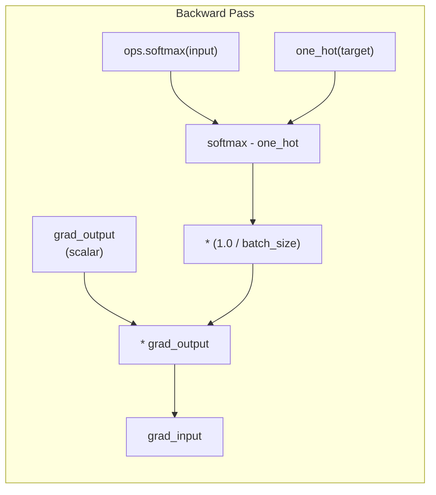
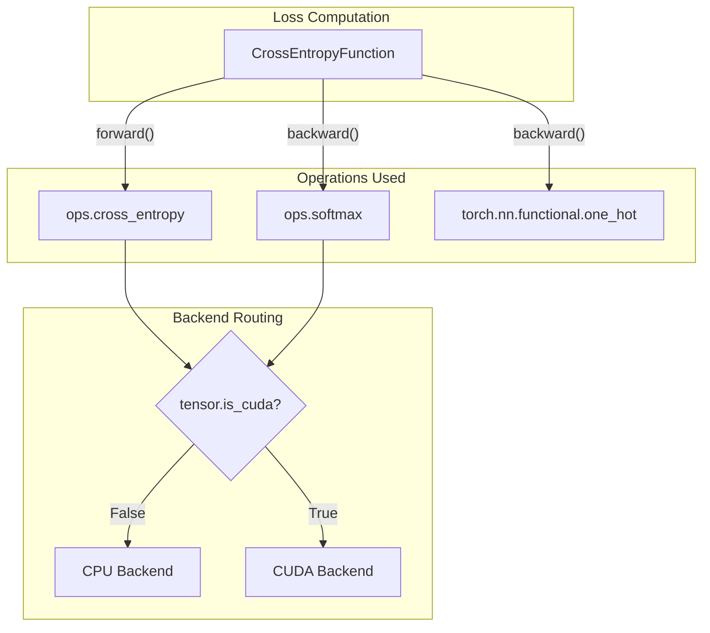

<!-- source: DeepWiki mcp.deepwiki.com · repo microsoft/RepDL · extra page Loss Functions · fetched 2026-10-26 -->

# Loss Functions

<details>
<summary>Relevant source files</summary>

The following files were used as context for generating this wiki page:

- [repdl/nn/__init__.py](repdl/nn/__init__.py)
- [repdl/nn/loss.py](repdl/nn/loss.py)

</details>


## Purpose and Scope

This page documents the loss functions available in `repdl.nn`, focusing on the `CrossEntropyLoss` class and its functional interface. Loss functions in RepDL follow the same reproducibility guarantees as other neural network modules by routing all computations through the operations dispatcher ([repdl.ops](#4.2)).

For information about other neural network modules, see:
- Convolutional Layers: [4.3.1](#4.3.1)
- Linear Layers: [4.3.2](#4.3.2)
- Normalization Layers: [4.3.3](#4.3.3)
- Functional API: [4.3.5](#4.3.5)

For information about custom autograd functions used in loss computation, see [Custom Functions](#4.4).

**Sources:** [repdl/nn/loss.py:1-71]()

---

## Module Overview

The `repdl.nn.loss` module provides reproducible implementations of loss functions for neural network training. Currently, the module implements cross-entropy loss, which is commonly used for classification tasks.

### Module Structure

```mermaid
graph TB
    subgraph "repdl.nn.loss Module"
        CELoss["CrossEntropyLoss<br/>(nn.Module)"]
        CEFunc["cross_entropy<br/>(functional interface)"]
        CEAuto["CrossEntropyFunction<br/>(autograd.Function)"]
    end
    
    subgraph "Base Classes"
        TorchCE["torch.nn.CrossEntropyLoss"]
        TorchAuto["torch.autograd.Function"]
    end
    
    subgraph "Operations Dispatcher"
        OpsCE["ops.cross_entropy"]
        OpsSM["ops.softmax"]
    end
    
    subgraph "Backend"
        Backend["CPU/CUDA<br/>Implementations"]
    end
    
    CELoss -->|"inherits from"| TorchCE
    CELoss -->|"forward() calls"| CEFunc
    CEFunc -->|"apply()"| CEAuto
    CEAuto -->|"inherits from"| TorchAuto
    
    CEAuto -->|"forward() calls"| OpsCE
    CEAuto -->|"backward() calls"| OpsSM
    
    OpsCE -->|"dispatches to"| Backend
    OpsSM -->|"dispatches to"| Backend
```

**Sources:** [repdl/nn/loss.py:11-71](), [repdl/nn/__init__.py:8]()

---

## CrossEntropyLoss Class

The `CrossEntropyLoss` class inherits from `torch.nn.CrossEntropyLoss` and overrides the forward method to use reproducible operations.

### Class Definition

| Attribute | Type | Description |
|-----------|------|-------------|
| Base Class | `torch.nn.CrossEntropyLoss` | Inherits PyTorch interface |
| Forward Method | Overridden | Routes to reproducible `cross_entropy` function |
| Backward Method | Inherited | Uses custom autograd function |

### Constructor Parameters

The class accepts the same parameters as `torch.nn.CrossEntropyLoss`:

| Parameter | Type | Default | Description |
|-----------|------|---------|-------------|
| `weight` | `Optional[Tensor]` | `None` | Manual rescaling weight for classes |
| `size_average` | `Optional[bool]` | `None` | Deprecated parameter |
| `ignore_index` | `int` | `-100` | Target value to ignore |
| `reduce` | `Optional[bool]` | `None` | Deprecated parameter |
| `reduction` | `str` | `"mean"` | Reduction mode: `"mean"`, `"sum"`, or `"none"` |
| `label_smoothing` | `float` | `0.0` | Label smoothing factor |

### Forward Method

```python
def forward(self, input: torch.Tensor, target: torch.Tensor) -> torch.Tensor
```

The forward method delegates to the functional `cross_entropy` interface, passing through all configured parameters.

**Sources:** [repdl/nn/loss.py:61-71]()

---

## Forward Pass Computation

The forward pass computes the cross-entropy loss between input logits and target labels using the reproducible operations dispatcher.

### Computation Flow



### Implementation Details

The forward pass consists of three layers:

1. **Module Layer** ([repdl/nn/loss.py:62-70]()):
   - Validates and passes parameters to functional interface

2. **Functional Layer** ([repdl/nn/loss.py:37-58]()):
   - Validates input dimensions (must be 2D)
   - Validates target dimensions (must be 1D)
   - Checks that only supported parameters are used
   - Applies the custom autograd function

3. **Autograd Layer** ([repdl/nn/loss.py:13-19]()):
   - Saves `input` and `target` tensors for backward pass
   - Calls `ops.cross_entropy` for reproducible computation

**Mathematical Formula:**

For input logits $x \in \mathbb{R}^{N \times C}$ and target labels $y \in \{0, 1, \ldots, C-1\}^N$:

$$\text{Loss} = -\frac{1}{N} \sum_{i=1}^{N} \log\left(\frac{\exp(x_{i,y_i})}{\sum_{j=1}^{C} \exp(x_{i,j})}\right)$$

where:
- $N$ is the batch size
- $C$ is the number of classes
- $x_{i,y_i}$ is the logit for the correct class

**Sources:** [repdl/nn/loss.py:13-19](), [repdl/nn/loss.py:37-58]()

---

## Backward Pass (Gradient Calculation)

The backward pass computes gradients with respect to the input logits using reproducible operations.

### Gradient Computation



### Implementation

The backward method ([repdl/nn/loss.py:21-34]()) computes gradients as follows:

1. **Retrieve Saved Tensors**: Extract `input` and `target` from forward pass context
2. **Compute Softmax**: Apply `ops.softmax(input)` to get probability distribution
3. **Create One-Hot**: Convert target labels to one-hot encoding using `torch.nn.functional.one_hot`
4. **Subtract**: Compute `softmax - one_hot` to get gradient base
5. **Scale by Batch Size**: Multiply by `1.0 / input.shape[0]` for mean reduction
6. **Scale by Output Gradient**: Multiply by `grad_output` to chain gradients

### Gradient Formula

For each sample $i$ and class $j$:

$$\frac{\partial L}{\partial x_{i,j}} = \frac{1}{N}(\text{softmax}(x_i)_j - \mathbb{1}_{y_i=j}) \cdot \frac{\partial L}{\partial \text{loss}}$$

where:
- $\text{softmax}(x_i)_j = \frac{\exp(x_{i,j})}{\sum_{k=1}^{C} \exp(x_{i,k})}$
- $\mathbb{1}_{y_i=j}$ is 1 if $y_i = j$, otherwise 0

### Gradient Return Values

The backward method returns a tuple:
- `grad_input`: Gradients with respect to input logits (or `None` if not needed)
- `None`: No gradients for target labels

**Sources:** [repdl/nn/loss.py:21-34]()

---

## Functional Interface

The module provides a functional interface `cross_entropy` that can be used without instantiating a module.

### Function Signature

```python
def cross_entropy(
    input: torch.Tensor,
    target: torch.Tensor,
    weight: Optional[torch.Tensor] = None,
    size_average: Optional[bool] = None,
    ignore_index: int = -100,
    reduce: Optional[bool] = None,
    reduction: str = "mean",
    label_smoothing: float = 0.0,
) -> torch.Tensor
```

### Usage Example

```python
import torch
import repdl.nn.functional as F

# Compute cross-entropy loss directly
logits = torch.randn(32, 10)  # Batch size 32, 10 classes
targets = torch.randint(0, 10, (32,))  # Target labels
loss = F.cross_entropy(logits, targets)
```

### Parameter Validation

The functional interface validates parameters and raises `NotImplementedError` if unsupported configurations are used ([repdl/nn/loss.py:47-57]()):

| Check | Condition | Reason |
|-------|-----------|--------|
| `weight` | Must be `None` | Class weighting not implemented |
| `size_average` | Must be `None` | Deprecated parameter not supported |
| `ignore_index` | Must be `-100` | Non-default values not implemented |
| `reduce` | Must be `None` | Deprecated parameter not supported |
| `reduction` | Must be `"mean"` | Only mean reduction supported |
| `label_smoothing` | Must be `0.0` | Label smoothing not implemented |
| `input.dim()` | Must be `2` | Only 2D inputs supported |
| `target.dim()` | Must be `1` | Only 1D targets supported |

**Sources:** [repdl/nn/loss.py:37-58]()

---

## Supported Parameters and Limitations

### Currently Supported

| Feature | Status | Description |
|---------|--------|-------------|
| 2D Input | ✓ Supported | Shape `(N, C)` where N is batch size, C is classes |
| 1D Target | ✓ Supported | Shape `(N,)` with integer class indices |
| Mean Reduction | ✓ Supported | Averages loss over batch |
| Reproducibility | ✓ Supported | Bitwise identical results across devices |
| Custom Gradients | ✓ Supported | Uses `ops.softmax` for reproducible gradients |

### Not Implemented

The following features from `torch.nn.CrossEntropyLoss` are **not currently supported**:

| Feature | PyTorch Support | RepDL Status |
|---------|----------------|--------------|
| Class Weights (`weight`) | Yes | Not implemented |
| Ignore Index (non-default) | Yes | Not implemented |
| Sum Reduction | Yes | Not implemented |
| None Reduction | Yes | Not implemented |
| Label Smoothing | Yes | Not implemented |
| Multi-dimensional Inputs | Yes | Not implemented |

Attempting to use unsupported features will raise `NotImplementedError` with a clear error message.

**Sources:** [repdl/nn/loss.py:47-57]()

---

## Integration with Operations Dispatcher

The loss functions integrate with the reproducible operations dispatcher to ensure bitwise identical results.

### Operation Dependencies



### Forward Pass Operations

- **`ops.cross_entropy`** ([repdl/nn/loss.py:19]()): Computes the cross-entropy loss value using reproducible softmax and log operations

### Backward Pass Operations

- **`ops.softmax`** ([repdl/nn/loss.py:29]()): Computes probability distribution for gradient calculation
- **`torch.nn.functional.one_hot`** ([repdl/nn/loss.py:29-31]()): Converts target labels to one-hot encoding

The operations dispatcher routes these calls to either CPU or CUDA backends based on tensor device placement, ensuring reproducibility across hardware platforms.

For details on the operations dispatcher, see [Operations Module](#4.2).

**Sources:** [repdl/nn/loss.py:11-34]()

---

## Usage in Training Loop

### Complete Example

```python
import torch
import repdl

# Define model and loss
model = repdl.from_torch_module(torch.nn.Sequential(
    torch.nn.Linear(784, 10)
))
criterion = repdl.nn.CrossEntropyLoss()

# Training step
optimizer = repdl.optim.Adam(model.parameters(), lr=0.001)

for inputs, targets in dataloader:
    # Forward pass
    outputs = model(inputs)
    loss = criterion(outputs, targets)
    
    # Backward pass
    optimizer.zero_grad()
    loss.backward()
    optimizer.step()
    
    print(f"Loss: {loss.item()}")
```

### Verification with Hash

```python
import repdl.utils

# Verify reproducibility
model_hash = repdl.utils.get_hash(model.state_dict())
print(f"Model hash: {model_hash}")

# After training, hash should be identical across runs
```

For a complete training example, see [MNIST Training Example](#2.3).

**Sources:** [repdl/nn/loss.py:61-71]()

---

## Summary

The `repdl.nn.loss` module provides:

1. **`CrossEntropyLoss`**: A reproducible loss module that inherits from PyTorch's interface
2. **`cross_entropy`**: A functional interface for stateless loss computation
3. **`CrossEntropyFunction`**: A custom autograd function that routes to reproducible operations
4. **Reproducible Gradients**: Backward pass uses `ops.softmax` for consistent gradient computation
5. **Limited Feature Set**: Currently supports only basic cross-entropy with mean reduction

All computations route through the operations dispatcher ([4.2](#4.2)) to ensure bitwise identical results across CPU and CUDA devices.

**Sources:** [repdl/nn/loss.py:1-71](), [repdl/nn/__init__.py:8]()

---

