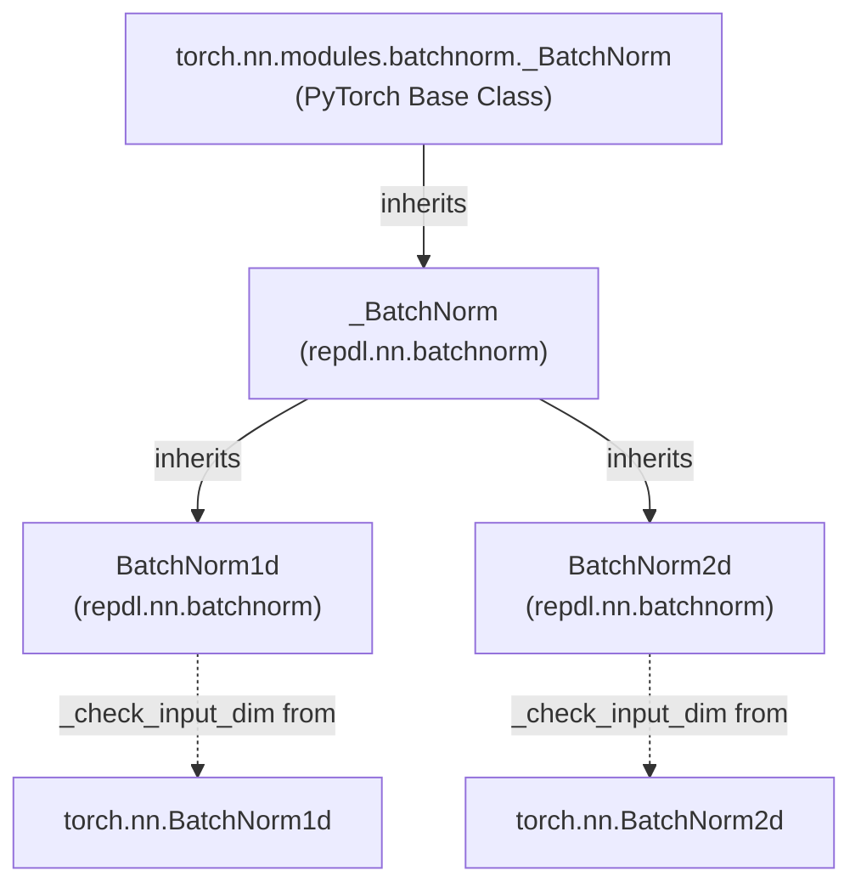
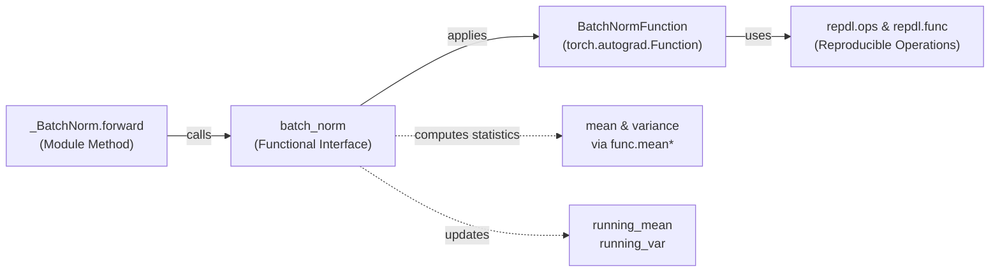
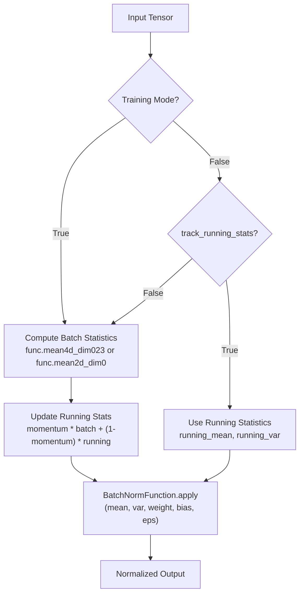
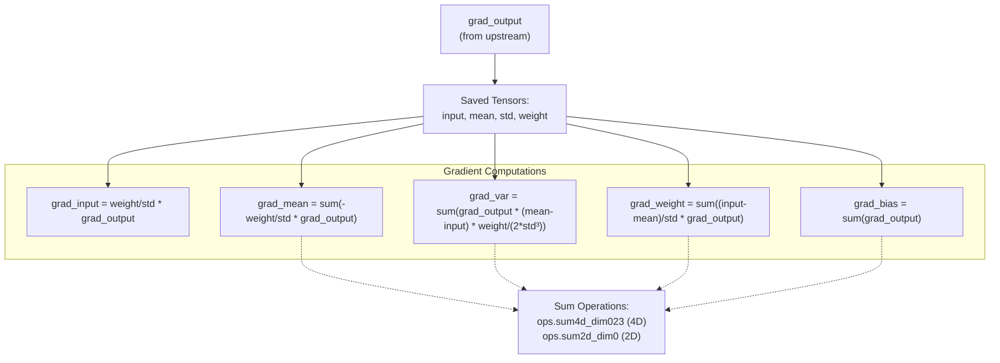
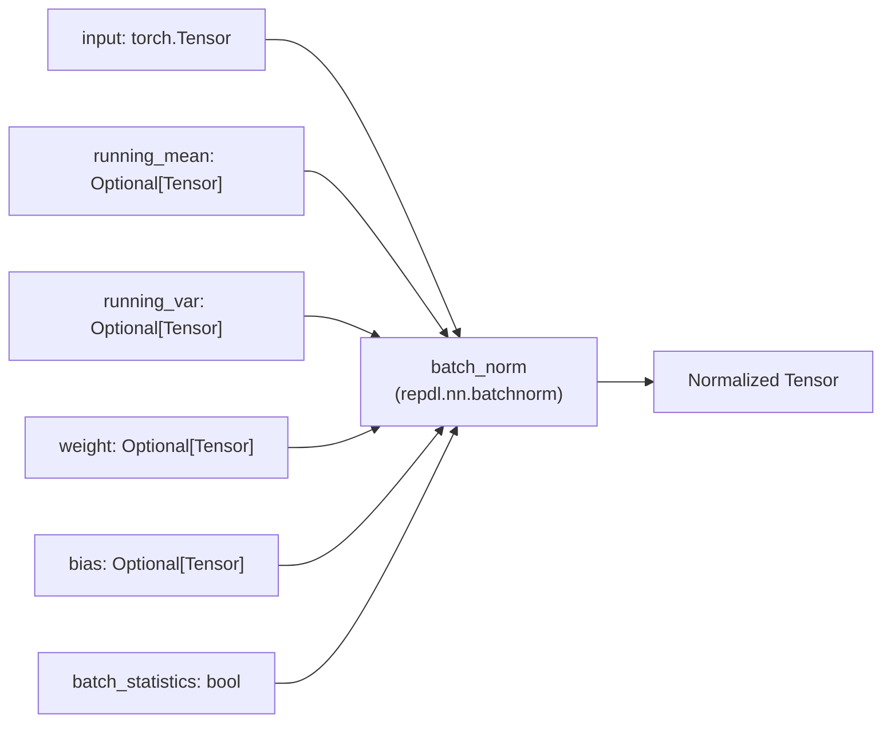
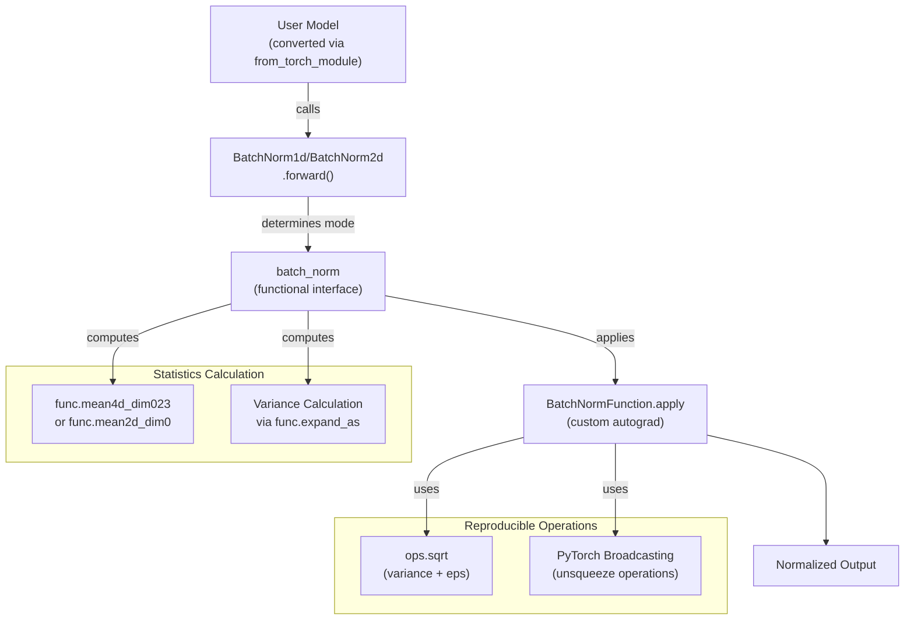

<!-- source: DeepWiki mcp.deepwiki.com · repo microsoft/RepDL · extra page Normalization Layers · fetched 2026-10-26 -->

# Normalization Layers

<details>
<summary>Relevant source files</summary>

The following files were used as context for generating this wiki page:

- [repdl/nn/__init__.py](repdl/nn/__init__.py)
- [repdl/nn/batchnorm.py](repdl/nn/batchnorm.py)

</details>


This page documents the normalization layer implementations in RepDL, specifically `BatchNorm1d` and `BatchNorm2d`. These layers perform batch normalization with reproducible statistics calculation, running average updates, and gradient computation. For the functional interface to these layers, see [Functional API](#4.3.5). For information about other layer types, see [Convolutional Layers](#4.3.1) and [Linear Layers](#4.3.2).

## Overview

RepDL provides two batch normalization layer classes that extend PyTorch's batch normalization modules while ensuring reproducible computation through the `repdl.ops` and `repdl.func` modules. Both layers support training mode with batch statistics and inference mode with running statistics.

**Sources:** [repdl/nn/batchnorm.py:1-133](), [repdl/nn/__init__.py:1-9]()

## Class Hierarchy



RepDL's normalization layers inherit from PyTorch's `_BatchNorm` base class [repdl/nn/batchnorm.py:100](), maintaining compatibility with PyTorch's API while overriding the `forward` method to use reproducible operations. The `BatchNorm1d` and `BatchNorm2d` classes differ only in their input dimension validation, reusing PyTorch's `_check_input_dim` methods [repdl/nn/batchnorm.py:128,132]().

**Sources:** [repdl/nn/batchnorm.py:100-133]()

## Core Components

### Component Architecture



The normalization layer architecture consists of three layers:
1. **Module Class** (`_BatchNorm`, `BatchNorm1d`, `BatchNorm2d`) - manages parameters and state
2. **Functional Interface** (`batch_norm`) - handles statistics calculation and mode logic
3. **Autograd Function** (`BatchNormFunction`) - implements forward/backward passes

**Sources:** [repdl/nn/batchnorm.py:12-133]()

## Parameters and Attributes

The `_BatchNorm` base class inherits standard PyTorch batch normalization parameters:

| Parameter | Type | Description |
|-----------|------|-------------|
| `num_features` | int | Number of input channels (C dimension) |
| `eps` | float | Small constant for numerical stability (default: 1e-5) |
| `momentum` | float | Momentum for running statistics update (default: 0.1) |
| `affine` | bool | Whether to learn `weight` and `bias` parameters |
| `track_running_stats` | bool | Whether to track running mean and variance |

### Learnable Parameters

| Parameter | Shape | Description |
|-----------|-------|-------------|
| `weight` | `(C,)` | Learnable scale parameter (γ) |
| `bias` | `(C,)` | Learnable shift parameter (β) |

### Running Statistics

| Buffer | Shape | Description |
|--------|-------|-------------|
| `running_mean` | `(C,)` | Exponential moving average of batch means |
| `running_var` | `(C,)` | Exponential moving average of batch variances |
| `num_batches_tracked` | scalar | Count of batches processed during training |

**Sources:** [repdl/nn/batchnorm.py:100-124]()

## Forward Pass

### Training vs Inference Mode



The forward pass behavior depends on the module's mode [repdl/nn/batchnorm.py:114]():

- **Training Mode (`batch_statistics=True`)**: Computes statistics from the current batch and updates running averages
- **Inference Mode (`batch_statistics=False`)**: Uses pre-computed running statistics

**Sources:** [repdl/nn/batchnorm.py:101-124]()

### Statistics Calculation

The `batch_norm` function computes mean and variance differently based on input dimensionality:

**For 4D Tensors (BatchNorm2d):**
```
Input shape: (N, C, H, W)
Mean computed over: dimensions 0, 2, 3 → shape (C,)
Variance computed over: dimensions 0, 2, 3 → shape (C,)
```

Implementation: [repdl/nn/batchnorm.py:81-85]()
- Mean: `func.mean4d_dim023(input)`
- Variance: `func.mean4d_dim023((input - mean_expanded) ** 2)`

**For 2D Tensors (BatchNorm1d):**
```
Input shape: (N, C)
Mean computed over: dimension 0 → shape (C,)
Variance computed over: dimension 0 → shape (C,)
```

Implementation: [repdl/nn/batchnorm.py:87-90]()
- Mean: `func.mean2d_dim0(input)`
- Variance: `func.mean2d_dim0((input - mean) ** 2)`

**Sources:** [repdl/nn/batchnorm.py:67-98]()

### Running Statistics Update

When `track_running_stats=True` and in training mode, running statistics are updated using exponential moving average [repdl/nn/batchnorm.py:91-93]():

```
running_mean = momentum * batch_mean + (1 - momentum) * running_mean
running_var = momentum * batch_var + (1 - momentum) * running_var
```

The momentum factor is determined by [repdl/nn/batchnorm.py:103-113]():
- If `momentum` is set explicitly, use that value
- If `momentum=None` and `num_batches_tracked` is available, use `1.0 / num_batches_tracked`
- Default momentum is 0.1

**Sources:** [repdl/nn/batchnorm.py:103-124]()

### Normalization Operation

The `BatchNormFunction.forward` method performs the actual normalization [repdl/nn/batchnorm.py:14-33]():

**Algorithm:**
1. Compute standard deviation: `std = ops.sqrt(var + eps)`
2. Center the input: `output = input - mean`
3. Scale by standard deviation: `output = output / std`
4. Apply learned affine transformation: `output = weight * output + bias`

**Dimension Handling:**
- **4D tensors**: Mean, variance, weight, and bias are unsqueezed to broadcast correctly [repdl/nn/batchnorm.py:26-29]()
- **2D tensors**: Operations are applied element-wise [repdl/nn/batchnorm.py:31-32]()

**Sources:** [repdl/nn/batchnorm.py:14-33]()

## Backward Pass

### Gradient Computation Flow



The `BatchNormFunction.backward` method computes gradients with respect to all inputs [repdl/nn/batchnorm.py:36-64]().

### Saved Tensors

The forward pass saves four tensors for gradient computation [repdl/nn/batchnorm.py:24]():
- `input`: Original input tensor
- `mean`: Computed or running mean
- `std`: Standard deviation (√(var + eps))
- `weight`: Learnable scale parameter

### Gradient Formulas

| Gradient | Formula | Implementation |
|----------|---------|----------------|
| `grad_input` | `weight/std * grad_output` | [repdl/nn/batchnorm.py:54]() |
| `grad_mean` | `-weight/std * sum(grad_output)` | [repdl/nn/batchnorm.py:56]() |
| `grad_var` | `weight/(2*std³) * sum(grad_output * (mean-input))` | [repdl/nn/batchnorm.py:58-59]() |
| `grad_weight` | `sum((input-mean)/std * grad_output)` | [repdl/nn/batchnorm.py:61]() |
| `grad_bias` | `sum(grad_output)` | [repdl/nn/batchnorm.py:63]() |

### Dimension-Aware Summation

The backward pass uses a dimension-aware sum function [repdl/nn/batchnorm.py:47-51]():

```python
def sum_func(x):
    if grad_output.dim() == 4:
        return ops.sum4d_dim023(x)  # Sum over N, H, W
    else:
        return ops.sum2d_dim0(x)     # Sum over N
```

For 4D tensors, gradients for mean, variance, weight, and bias require summing over spatial dimensions (H, W) and batch dimension (N), using `ops.sum4d_dim023`. For 2D tensors, only the batch dimension (N) is summed using `ops.sum2d_dim0`.

**Sources:** [repdl/nn/batchnorm.py:36-64]()

## Functional Interface

### batch_norm Function



The `batch_norm` function [repdl/nn/batchnorm.py:67-97]() provides a stateless interface to batch normalization:

**Signature:**
```python
def batch_norm(
    input: torch.Tensor,
    running_mean: Optional[torch.Tensor],
    running_var: Optional[torch.Tensor],
    weight: Optional[torch.Tensor] = None,
    bias: Optional[torch.Tensor] = None,
    batch_statistics: bool = False,
    momentum: float = 0.1,
    eps: float = 1e-5,
) -> torch.Tensor
```

**Parameters:**
- `input`: Input tensor (2D or 4D)
- `running_mean`: Running mean buffer (updated in-place if `batch_statistics=True`)
- `running_var`: Running variance buffer (updated in-place if `batch_statistics=True`)
- `weight`: Scale parameter (must be provided, shape `(C,)`)
- `bias`: Shift parameter (must be provided, shape `(C,)`)
- `batch_statistics`: Whether to compute batch statistics or use running statistics
- `momentum`: Momentum for running statistics update
- `eps`: Small constant for numerical stability

**Requirements:**
- `weight` and `bias` must be provided [repdl/nn/batchnorm.py:77-79]()
- Input must be 2D or 4D [repdl/nn/batchnorm.py:77-78]()
- `weight` and `bias` must be 1D tensors [repdl/nn/batchnorm.py:79]()

**Sources:** [repdl/nn/batchnorm.py:67-97]()

## Supported Input Dimensions

### BatchNorm1d

**Input Shape:** `(N, C)` where:
- `N`: Batch size
- `C`: Number of channels (must match `num_features`)

**Statistics Computed Over:** Dimension 0 (batch dimension)

**Validation:** Uses `torch.nn.BatchNorm1d._check_input_dim` [repdl/nn/batchnorm.py:128]()

### BatchNorm2d

**Input Shape:** `(N, C, H, W)` where:
- `N`: Batch size
- `C`: Number of channels (must match `num_features`)
- `H`: Height
- `W`: Width

**Statistics Computed Over:** Dimensions 0, 2, 3 (batch, height, width)

**Validation:** Uses `torch.nn.BatchNorm2d._check_input_dim` [repdl/nn/batchnorm.py:132]()

**Sources:** [repdl/nn/batchnorm.py:127-133]()

## Usage in RepDL Operation Flow



Normalization layers integrate with RepDL's reproducible operation dispatch mechanism:

1. **Statistics Calculation** uses `repdl.func` operations (`mean4d_dim023`, `mean2d_dim0`, `expand_as`) for reproducible mean and variance computation
2. **Normalization** uses `repdl.ops.sqrt` for reproducible standard deviation calculation
3. **Gradient Computation** uses `repdl.ops.sum4d_dim023` and `repdl.ops.sum2d_dim0` for reproducible gradient aggregation

All operations flow through the `repdl.ops` dispatcher, ensuring bitwise identical results across hardware platforms (see [Operation Dispatch Mechanism](#3.1)).

**Sources:** [repdl/nn/batchnorm.py:1-133]()

## Implementation Notes

### Reproducibility Considerations

1. **Fixed Operation Order**: Statistics are always computed in the same order regardless of tensor layout
2. **Reproducible Reductions**: All summation operations use `repdl.ops` sum variants that guarantee consistent results
3. **Broadcasting**: Standard PyTorch broadcasting is used after statistics are computed, ensuring deterministic behavior

### Limitations

The current implementation has the following constraints [repdl/nn/batchnorm.py:77-78]():
- `weight` and `bias` parameters must be provided (non-affine batch norm is not supported)
- Only 2D and 4D input tensors are supported (1D and 3D tensors raise `NotImplementedError`)
- Both `weight` and `bias` must be 1D tensors

**Sources:** [repdl/nn/batchnorm.py:1-133]()

---

