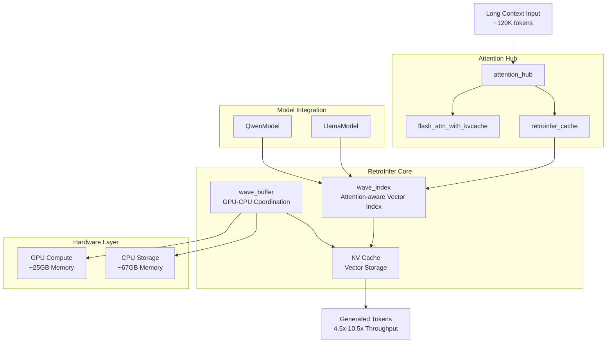
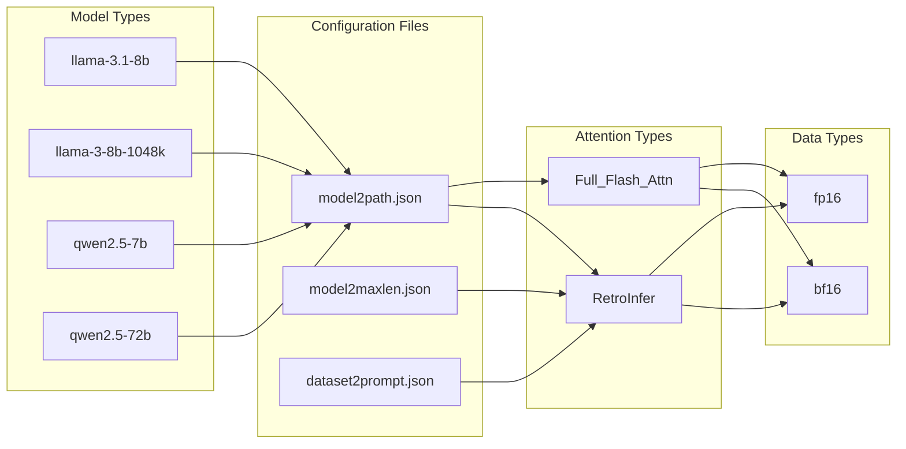
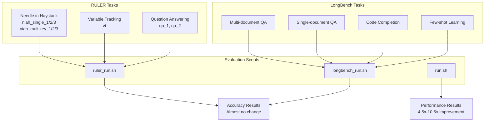

<!-- source: DeepWiki mcp.deepwiki.com · repo microsoft/RetrievalAttention · page 1 Overview · fetched 2026-10-26 -->

# Overview

Relevant source files

The following files were used as context for generating this wiki page:

- [README.md](README.md)
- [Transparency_FAQ.md](Transparency_FAQ.md)

This document provides an overview of RetroInfer, a novel system for accelerating long-context Large Language Model (LLM) inference through vector storage optimization and GPU-CPU co-execution. This page covers the system's core concepts, architecture, and performance characteristics.

For detailed setup instructions, see [Setup and Installation](#4). For specific usage examples and testing procedures, see [Usage Examples](#5). For technical implementation details of the attention mechanisms, see [Attention Mechanisms](#2).

## What is RetroInfer?

RetroInfer is a research system that **rethinks the KV cache as vector storage** to accelerate long-context LLM inference. The system exploits the inherent sparsity of attention mechanisms and introduces two key innovations:

- **Wave Index**: An attention-aware vector index that enables efficient retrieval of critical tokens from the KV cache
- **Wave Buffer**: A coordination system that manages KV cache placement and overlaps computation with data transfer across GPU and CPU

The system achieves 4.5x–10.5x improvements in decoding throughput over FlashAttention without accuracy loss, making it particularly effective for long-context scenarios (~120K tokens).

## Core System Architecture

### RetroInfer Components and Data Flow

Sources: [README.md:1-129](), [Transparency_FAQ.md:1-22]()

### Key Configuration Parameters

RetroInfer operates with two primary configuration parameters that control its behavior:

| Parameter | Default Value | Description |
|-----------|---------------|-------------|
| `retrieval_budget_ratio` | 0.018 | Ratio of tokens retrieved from KV cache to total input tokens |
| `attention_estimate_ratio` | 0.232 | Ratio of clusters estimated in attention mechanism to total clusters |

Sources: [README.md:79-80](), [README.md:91-92]()

## Supported Models and Configurations

### Model Support Matrix

Sources: [README.md:73-74](), [README.md:78-79](), [README.md:89-90](), [README.md:93]()

## Performance Characteristics

### Throughput Improvements

RetroInfer delivers significant performance improvements across different scenarios:

- **Decoding Throughput**: 4.5x–10.5x improvement over FlashAttention
- **Memory Usage**: ~25GB GPU memory, ~67GB CPU memory for batch size 4
- **Context Length**: Optimized for ~120K token contexts
- **Accuracy**: Almost no change compared to full attention

### Hardware Requirements

The system is designed for GPU-CPU co-execution with specific hardware characteristics:

- **GPU**: Requires CUDA 12.4 compatibility
- **CPU**: Utilizes CPU memory for extended KV cache storage
- **Multi-GPU**: Automatic model splitting across visible GPUs
- **NUMA**: Optimized for multi-NUMA node configurations

Sources: [README.md:3-4](), [README.md:42](), [README.md:96](), [Transparency_FAQ.md:4]()

## Evaluation and Benchmarking

### Supported Benchmarks

RetroInfer has been evaluated on multiple benchmark systems:

| Benchmark | Tasks | Purpose |
|-----------|-------|---------|
| RULER | `niah_single_1/2/3`, `niah_multikey_1/2/3`, `vt`, `qa_1/2` | Synthetic evaluation tasks |
| LongBench | Various real-world tasks | Real-world scenario evaluation |
| Throughput | Custom scripts | Performance measurement |

### Evaluation Tasks

Sources: [README.md:61-81](), [README.md:82-94](), [README.md:95-104](), [Transparency_FAQ.md:12-14]()

## Integration Points

### Development Environment

RetroInfer integrates with the following components:

- **CUDA Environment**: Requires CUDA 12.4.1 with cuDNN support
- **Python Environment**: Python 3.10.16 with conda management
- **Dependencies**: flash-attn, flashinfer-python, custom RetroInfer kernels
- **Build System**: CUTLASS integration for kernel compilation

### Testing and Validation

The system provides multiple entry points for testing:

- **Simple Test**: `simple_test.py` for basic functionality verification
- **Benchmark Evaluation**: Integrated with RULER and LongBench frameworks
- **Throughput Testing**: NUMA-aware performance measurement scripts

Sources: [README.md:7-35](), [README.md:37-55]()

---

