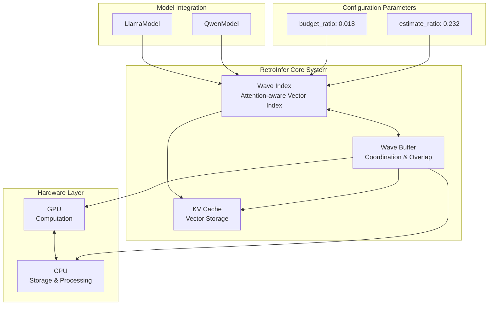
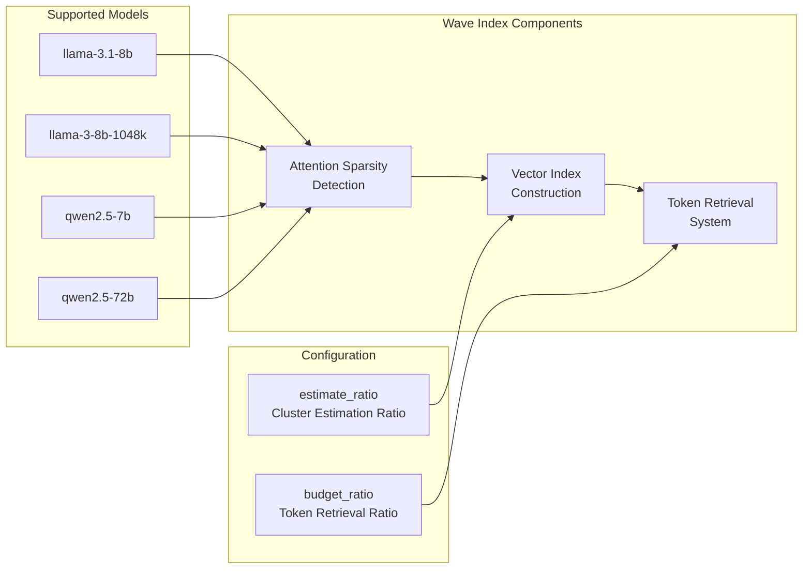
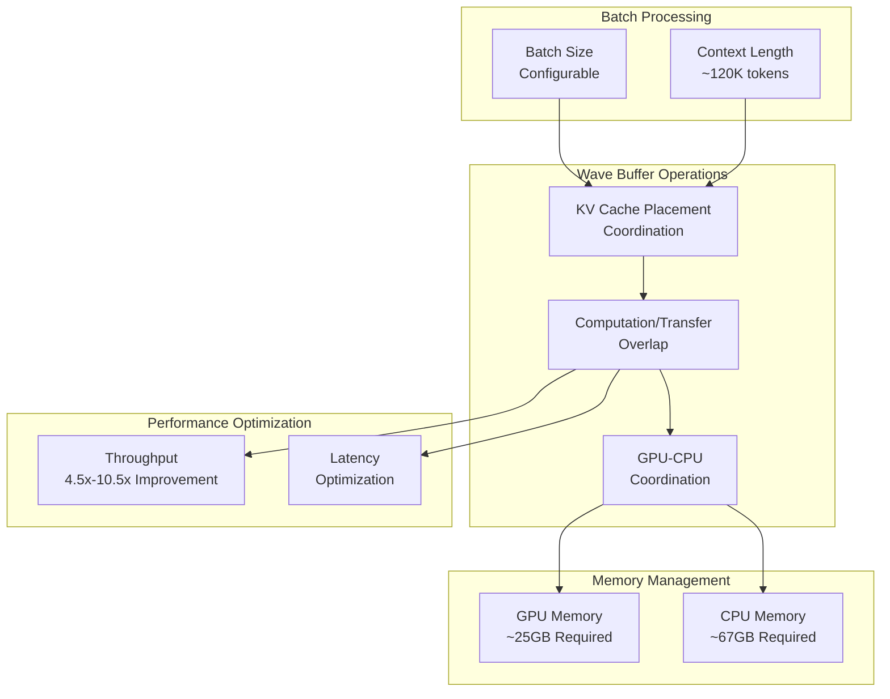
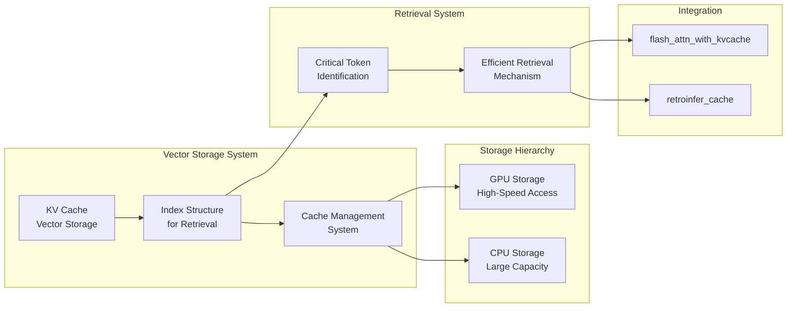
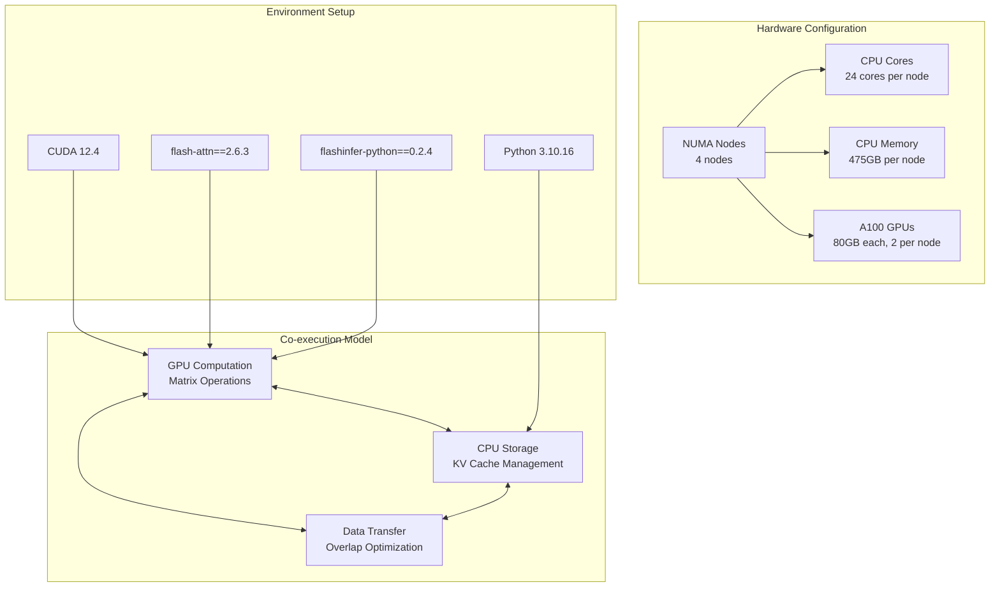

<!-- source: DeepWiki mcp.deepwiki.com · repo microsoft/RetrievalAttention · page 1.1 System Architecture · fetched 2026-10-26 -->

# System Architecture

Relevant source files

The following files were used as context for generating this wiki page:

- [README.md](README.md)
- [Transparency_FAQ.md](Transparency_FAQ.md)

## Purpose and Scope

This document provides a detailed technical overview of RetroInfer's core architectural components and their interactions. RetroInfer is a novel system that rethinks the KV cache as vector storage within a GPU-CPU co-execution setup to accelerate long-context LLM inference. 

This page covers the three primary architectural components: the wave index, wave buffer, and KV cache vector storage system. For information about specific attention implementations, see [Flash Attention](#2.1) and [RetroInfer Attention](#2.2). For performance characteristics and benchmarking details, see [Performance Benefits](#1.2).

## Core Components Overview

RetroInfer's architecture consists of three interconnected core components that work together to enable efficient long-context LLM inference:

### System Architecture Diagram

**Sources:** [README.md:1-80]()

## Wave Index Architecture

The wave index serves as an **A**ttention-a**W**are **VE**ctor index that enables efficient and accurate retrieval of critical tokens from the KV cache. It exploits the inherent sparsity of the attention mechanism to identify and index the most relevant tokens for each query.

### Wave Index Implementation

The wave index operates with two key parameters:
- **Budget Ratio** (0.018): Controls the ratio of tokens retrieved from the KV cache to the total input context tokens
- **Estimate Ratio** (0.232): Determines the ratio of clusters estimated in the attention mechanism to total clusters

**Sources:** [README.md:70-80]()

## Wave Buffer System

The wave buffer coordinates KV cache placement and overlaps computation and data transfer across GPU and CPU to sustain high throughput. It manages the complex orchestration between different memory hierarchies and processing units.

### Wave Buffer Coordination

The wave buffer enables efficient processing by overlapping computation with data transfer, allowing the system to achieve significant throughput improvements while maintaining accuracy.

**Sources:** [README.md:3-4, 38-42]()

## KV Cache as Vector Storage

RetroInfer fundamentally rethinks the KV cache as vector storage, enabling efficient retrieval and management of key-value pairs across the GPU-CPU memory hierarchy.

### KV Cache Vector Storage Architecture

The vector storage approach enables the system to maintain critical tokens in easily accessible formats while managing the full context across the memory hierarchy.

**Sources:** [README.md:3-4]()

## GPU-CPU Co-execution Architecture

The system implements a sophisticated GPU-CPU co-execution model that maximizes hardware utilization while maintaining high throughput for long-context inference.

### Hardware Integration

The co-execution model leverages NUMA-aware configuration to optimize memory access patterns and minimize data transfer overhead between GPU and CPU components.

**Sources:** [README.md:8-28, 96-104]()

## System Data Flow

The complete data flow through RetroInfer demonstrates how the three core components interact to process long-context inputs efficiently.

### End-to-End Processing Flow

```mermaid
graph LR
    subgraph "Input Processing"
        LongContext["Long Context Input<br/>~120K tokens"]
        TokenBatch["Token Batch<br/>batch_size=4"]
        
        LongContext --> TokenBatch
    end
    
    subgraph "Wave Index Processing"
        SparsityDetection["Attention Sparsity<br/>Detection"]
        VectorIndexing["Vector Indexing<br/>Construction"]
        TokenSelection["Critical Token<br/>Selection"]
        
        TokenBatch --> SparsityDetection
        SparsityDetection --> VectorIndexing
        VectorIndexing --> TokenSelection
    end
    
    subgraph "Wave Buffer Operations"
        GPUComputation["GPU Computation<br/>Parallel Processing"]
        CPUCoordination["CPU Coordination<br/>Memory Management"]
        TransferOverlap["Transfer Overlap<br/>Optimization"]
        
        TokenSelection --> GPUComputation
        TokenSelection --> CPUCoordination
        GPUComputation <--> TransferOverlap
        CPUCoordination <--> TransferOverlap
    end
    
    subgraph "KV Cache Management"
        VectorStorage["Vector Storage<br/>Retrieval System"]
        CacheRetrieval["Cache Retrieval<br/>Efficient Access"]
        
        TransferOverlap --> VectorStorage
        VectorStorage --> CacheRetrieval
    end
    
    subgraph "Output Generation"
        ThroughputGain["Throughput Gain<br/>4.5x-10.5x"]
        AccuracyMaintained["Accuracy<br/>Maintained"]
        
        CacheRetrieval --> ThroughputGain
        CacheRetrieval --> AccuracyMaintained
    end
```

The data flow demonstrates how RetroInfer processes long-context inputs through its three core components while maintaining high accuracy and achieving significant throughput improvements.

**Sources:** [README.md:38-42, 70-80]()

## Integration Points

RetroInfer integrates with existing LLM infrastructure through well-defined interfaces and supports multiple model architectures and attention mechanisms.

### Model and Attention Integration

| Component | Supported Models | Integration Method |
|-----------|------------------|-------------------|
| Wave Index | llama-3.1-8b, llama-3-8b-1048k | Direct model integration |
| Wave Buffer | qwen2.5-7b, qwen2.5-72b | GPU-CPU coordination |
| KV Cache | All supported models | Vector storage interface |

### Configuration Parameters

| Parameter | Default Value | Purpose |
|-----------|---------------|---------|
| `budget_ratio` | 0.018 | Controls token retrieval ratio |
| `estimate_ratio` | 0.232 | Determines cluster estimation ratio |
| `batch_size` | 4 | Configurable batch processing size |
| `context_length` | ~120K tokens | Maximum context length support |

**Sources:** [README.md:70-80]()

---

