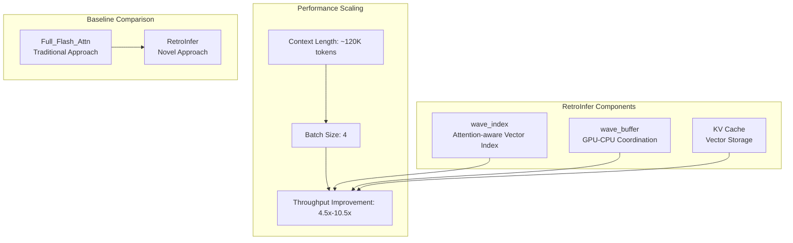
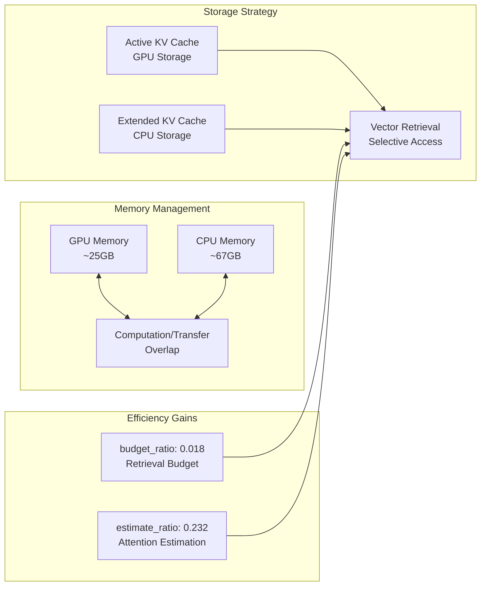
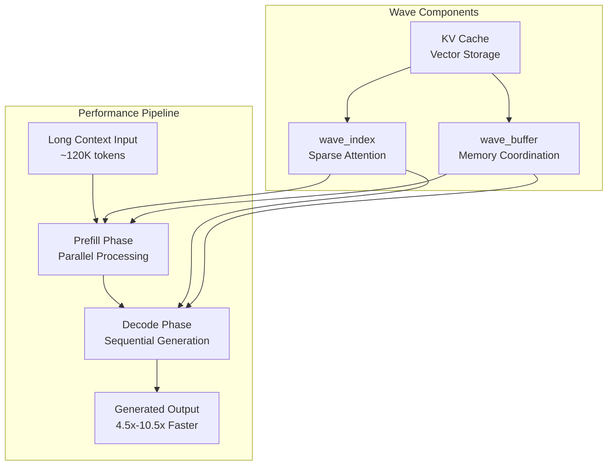
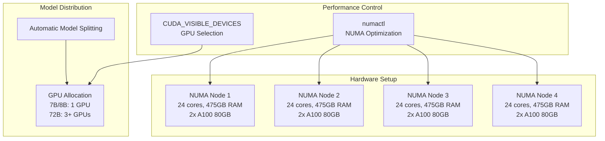
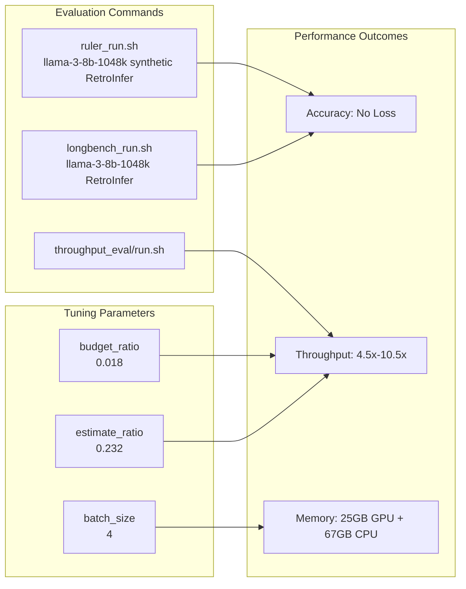

<!-- source: DeepWiki mcp.deepwiki.com · repo microsoft/RetrievalAttention · page 1.2 Performance Benefits · fetched 2026-10-26 -->

# Performance Benefits

Relevant source files

The following files were used as context for generating this wiki page:

- [README.md](README.md)
- [Transparency_FAQ.md](Transparency_FAQ.md)

This document explains the performance improvements achieved by RetroInfer, including throughput gains, memory efficiency, and hardware utilization optimizations. For detailed system architecture information, see [System Architecture](#1.1). For benchmarking methodology and evaluation details, see [Benchmarking and Evaluation](#3).

## Throughput Improvements

RetroInfer achieves significant throughput improvements over traditional Flash Attention implementations through its novel approach to KV cache management and GPU-CPU co-execution.

### Decoding Throughput Gains

RetroInfer delivers **4.5x to 10.5x improvements** in decoding throughput compared to FlashAttention while maintaining accuracy. These gains are achieved through:

- **Sparse attention exploitation**: The `wave index` efficiently identifies and retrieves only critical tokens from the KV cache
- **Overlapped computation**: The `wave buffer` coordinates computation and data transfer between GPU and CPU
- **Vector storage optimization**: Treating the KV cache as vector storage enables efficient retrieval operations

#### Performance Scaling by Context Length

Sources: [README.md:1-4](), [README.md:38-42]()

## Memory Efficiency

RetroInfer optimizes memory usage across both GPU and CPU resources, enabling efficient processing of long-context scenarios.

### Resource Requirements

| Component | Memory Usage | Details |
|-----------|-------------|---------|
| **GPU Memory** | ~25GB | Primary computation and active KV cache |
| **CPU Memory** | ~67GB | Extended KV cache storage and coordination |
| **Total System** | ~92GB | Combined GPU-CPU memory for 120K token contexts |

### Memory Optimization Strategies

Sources: [README.md:42](), [README.md:79-80]()

## System-Level Performance Optimizations

RetroInfer implements several key optimizations that work together to achieve its performance benefits.

### Wave Index Performance

The attention-aware vector index (`wave index`) provides efficient token retrieval by:

- **Exploiting attention sparsity**: Only critical tokens are retrieved from the full KV cache
- **Vector-based lookup**: Treats KV cache as searchable vector storage
- **Selective processing**: Reduces computational overhead through targeted retrieval

### Wave Buffer Coordination

The `wave buffer` system optimizes performance through:

- **GPU-CPU coordination**: Manages data placement across memory hierarchies
- **Computation overlap**: Overlaps data transfer with computation operations
- **Throughput sustainability**: Maintains high performance across long sequences

Sources: [README.md:3](), [Transparency_FAQ.md:4]()

## Hardware Utilization

RetroInfer is optimized for multi-GPU systems with NUMA-aware configuration, maximizing hardware resource utilization.

### Target Hardware Configuration

RetroInfer was evaluated on Azure virtual machines with the following specifications:

- **4 NUMA nodes** with 24 CPU cores each
- **475 GB CPU memory** per NUMA node
- **Two 80GB A100 GPUs** per NUMA node
- **Multi-GPU support** with automatic model splitting

### GPU Resource Management

Sources: [README.md:96-97](), [README.md:59](), [README.md:98-99]()

## Performance Tuning Parameters

RetroInfer provides configurable parameters that directly impact performance characteristics.

### Key Performance Parameters

| Parameter | Default Value | Purpose | Performance Impact |
|-----------|---------------|---------|-------------------|
| **`budget_ratio`** | 0.018 | Retrieval budget ratio | Controls token retrieval volume |
| **`estimate_ratio`** | 0.232 | Attention estimation ratio | Controls cluster estimation scope |
| **`batch_size`** | 4 | Processing batch size | Affects memory usage and throughput |

### Parameter Tuning for Performance

The performance parameters can be adjusted based on specific use cases:

- **Higher `budget_ratio`**: Increases accuracy but reduces throughput
- **Lower `budget_ratio`**: Maximizes throughput with minimal accuracy impact
- **`estimate_ratio`**: Balances attention computation efficiency
- **`batch_size`**: Scales with available memory resources

Sources: [README.md:70-71](), [README.md:86-87](), [README.md:79-80]()

## Benchmarking Results

RetroInfer maintains accuracy while achieving significant performance improvements across standard benchmarks.

### Evaluation Metrics

- **RULER benchmark**: Synthetic tasks with variable context lengths
- **LongBench**: Real-world long-context evaluation tasks
- **Throughput evaluation**: Performance measurement scripts

### Accuracy Preservation

RetroInfer achieves its performance benefits while maintaining model accuracy:

- **No accuracy loss** on standard benchmarks
- **Consistent performance** across different context lengths
- **Minimal impact** on model quality metrics

Sources: [README.md:61-81](), [README.md:82-94](), [Transparency_FAQ.md:13-14]()

---

