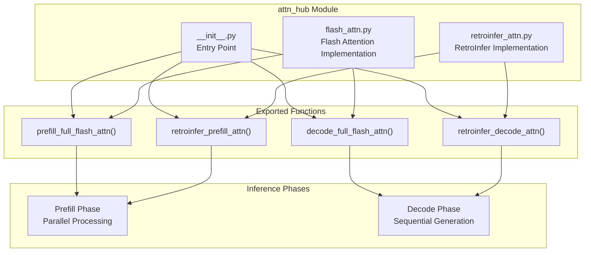
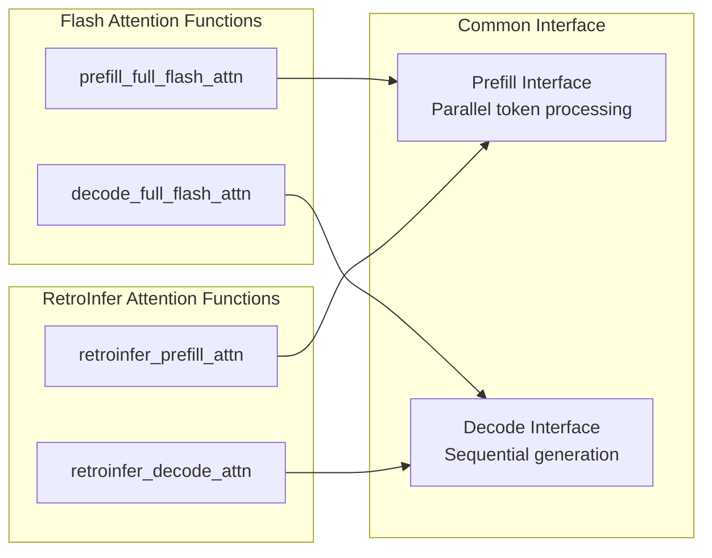
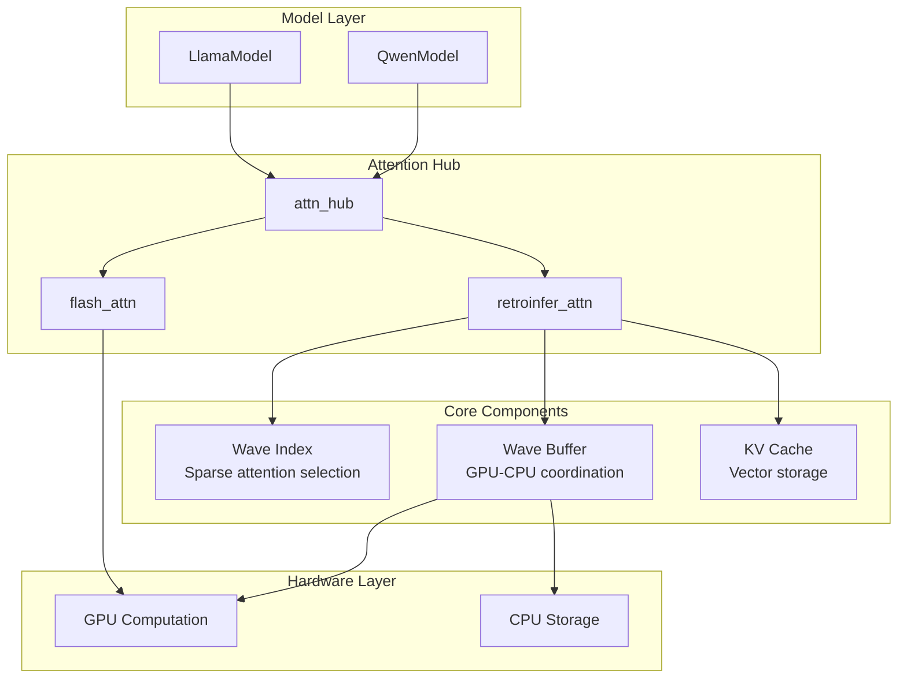

<!-- source: DeepWiki mcp.deepwiki.com · repo microsoft/RetrievalAttention · page 2 Attention Mechanisms · fetched 2026-10-26 -->

# Attention Mechanisms

Relevant source files

The following files were used as context for generating this wiki page:

- [attn_hub/__init__.py](attn_hub/__init__.py)

## Purpose and Scope

This document provides an overview of the attention mechanisms implemented in the RetroInfer system. The attention hub serves as the central coordination layer that provides different attention implementations for long-context LLM inference. This page covers the high-level architecture and integration of attention mechanisms, while detailed implementation specifics are covered in [Flash Attention](#2.1) and [RetroInfer Attention](#2.2).

For information about the broader system architecture that these attention mechanisms support, see [System Architecture](#1.1). For performance benchmarking of these attention implementations, see [Benchmarking and Evaluation](#3).

## Attention Hub Architecture

The attention hub provides a unified interface for different attention implementations, supporting both prefill and decode phases of inference. The system is designed to allow seamless switching between attention mechanisms while maintaining consistent interfaces.

### Attention Hub Structure

Sources: [attn_hub/__init__.py:1-3]()

## Attention Implementation Types

The RetroInfer system provides two primary attention implementations, each optimized for different use cases and performance characteristics.

### Implementation Comparison

| Aspect | Flash Attention | RetroInfer Attention |
|--------|----------------|---------------------|
| Purpose | Baseline/Full attention | Sparse attention with caching |
| Memory Usage | Higher (full attention) | Lower (selective attention) |
| Throughput | Standard | 4.5x-10.5x improvement |
| Accuracy | Full precision | Minimal degradation |
| Implementation | `flash_attn` module | `retroinfer_attn` module |

### Function Interface Pattern

Both attention implementations follow a consistent interface pattern with separate functions for prefill and decode phases:

Sources: [attn_hub/__init__.py:2-3]()

## Integration with Model Processing

The attention hub integrates with the broader RetroInfer system to provide attention computation for different model architectures and processing phases.

### System Integration Flow

Sources: [attn_hub/__init__.py:1-3]()

## Usage Patterns

The attention hub is designed to support different usage patterns depending on the performance requirements and accuracy needs of the application.

### Selection Criteria

The choice between attention implementations depends on several factors:

- **Full Flash Attention**: Used for baseline comparisons and when maximum accuracy is required
- **RetroInfer Attention**: Used for production inference where throughput optimization is critical

### Configuration Integration

The attention mechanisms integrate with the broader configuration system to support different model and dataset combinations. Configuration parameters such as `budget_ratio` and `estimate_ratio` control the behavior of the RetroInfer attention implementation.

Sources: [attn_hub/__init__.py:1-3]()

---

