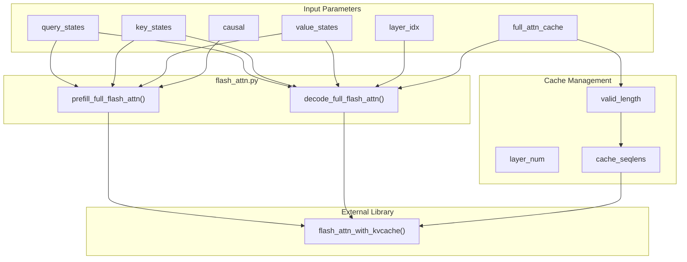
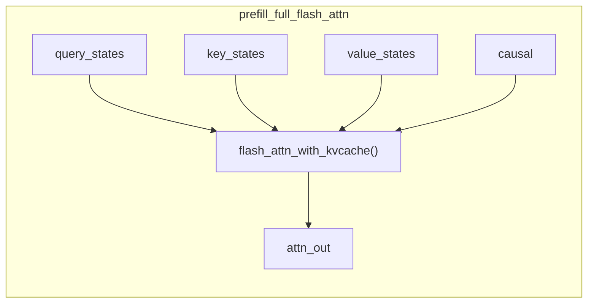
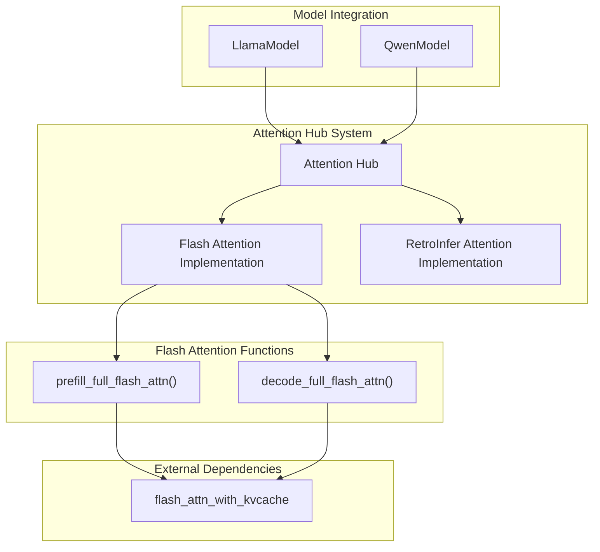

<!-- source: DeepWiki mcp.deepwiki.com · repo microsoft/RetrievalAttention · page 2.1 Flash Attention · fetched 2026-10-26 -->

# Flash Attention

<details>
<summary>Relevant source files</summary>

The following files were used as context for generating this wiki page:

- [attn_hub/flash_attn.py](attn_hub/flash_attn.py)

</details>


## Purpose and Scope

This document covers the Flash Attention implementation in the RetroInfer system, which serves as a baseline attention mechanism for comparison with RetroInfer's optimized attention approach. Flash Attention provides full attention computation for both prefill and decode phases using the external `flash_attn` library.

For information about RetroInfer's optimized attention implementation, see [RetroInfer Attention](#2.2). For the overall attention system architecture, see [Attention Mechanisms](#2).

## Overview

Flash Attention in RetroInfer is implemented as a wrapper around the external `flash_attn_with_kvcache` function from the `flash_attn` library. It provides two main functions for handling different phases of LLM inference:

| Function | Purpose | Phase |
|----------|---------|--------|
| `prefill_full_flash_attn` | Processes initial input tokens in parallel | Prefill |
| `decode_full_flash_attn` | Generates tokens sequentially with cache | Decode |

The implementation maintains compatibility with the RetroInfer system's attention hub architecture while providing full attention computation as a performance baseline.

**Sources:** [attn_hub/flash_attn.py:1-29]()

## Flash Attention Architecture



**Sources:** [attn_hub/flash_attn.py:1-29]()

## Prefill Phase Implementation

The `prefill_full_flash_attn` function handles the initial processing of input tokens during the prefill phase. It takes the following parameters:

- `query_states`: Query tensor for attention computation
- `key_states`: Key tensor for attention computation  
- `value_states`: Value tensor for attention computation
- `causal`: Boolean flag indicating whether to use causal (unidirectional) attention

The function directly calls `flash_attn_with_kvcache` with these parameters and returns the attention output.



**Sources:** [attn_hub/flash_attn.py:4-13]()

## Decode Phase Implementation

The `decode_full_flash_attn` function handles sequential token generation during the decode phase. It includes additional cache management logic:

### Parameters
- `query_states`: Query tensor for the current token
- `key_states`: Key cache containing all previous keys
- `value_states`: Value cache containing all previous values
- `layer_idx`: Current layer index for cache validation
- `full_attn_cache`: Cache object containing validity information

### Cache Length Calculation

The function calculates the valid cache length using conditional logic:

```
valid_len = full_attn_cache.valid_length + 1 if layer_idx < full_attn_cache.layer_num - 1 else full_attn_cache.valid_length
```

This ensures proper cache synchronization across layers during decode.

**Sources:** [attn_hub/flash_attn.py:17-28]()

## Integration with Attention Hub

Flash Attention integrates into the RetroInfer attention hub system as one of the available attention mechanisms. The system architecture allows switching between Flash Attention and RetroInfer Attention based on configuration.



**Sources:** [attn_hub/flash_attn.py:1-29]()

## Function Signatures and Usage

### prefill_full_flash_attn

```python
def prefill_full_flash_attn(query_states, key_states, value_states, causal):
```

**Parameters:**
- `query_states`: Tensor containing query vectors
- `key_states`: Tensor containing key vectors
- `value_states`: Tensor containing value vectors
- `causal`: Boolean for causal attention masking

**Returns:** Attention output tensor

### decode_full_flash_attn

```python
def decode_full_flash_attn(query_states, key_states, value_states, layer_idx, full_attn_cache):
```

**Parameters:**
- `query_states`: Query tensor for current token
- `key_states`: Key cache tensor
- `value_states`: Value cache tensor
- `layer_idx`: Current layer index
- `full_attn_cache`: Cache management object

**Returns:** Attention output tensor

**Sources:** [attn_hub/flash_attn.py:4-13](), [attn_hub/flash_attn.py:17-28]()

## Performance Characteristics

Flash Attention serves as the baseline implementation for performance comparisons in the RetroInfer system. While it provides full attention computation, it lacks the memory and computational optimizations found in RetroInfer's attention mechanism.

Key characteristics:
- **Full Attention**: Computes attention over all input tokens
- **Memory Usage**: Higher memory consumption due to full attention matrices
- **Throughput**: Lower throughput compared to RetroInfer's optimized approach
- **Accuracy**: Maintains full model accuracy as baseline reference

The system uses Flash Attention results to validate that RetroInfer's optimized attention maintains comparable accuracy while achieving significant performance improvements.

**Sources:** [attn_hub/flash_attn.py:1-29]()

---

